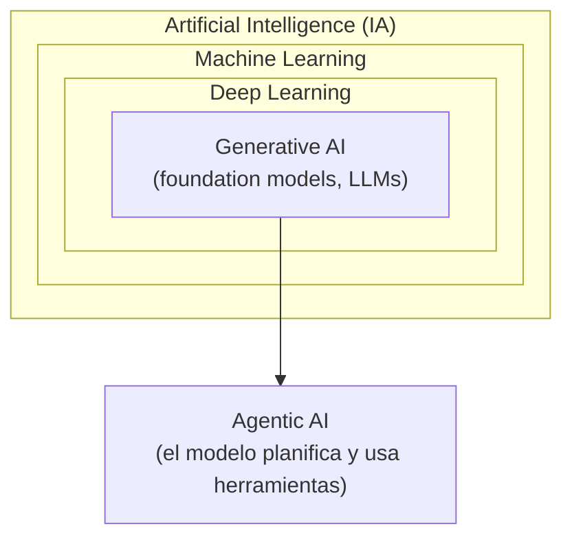
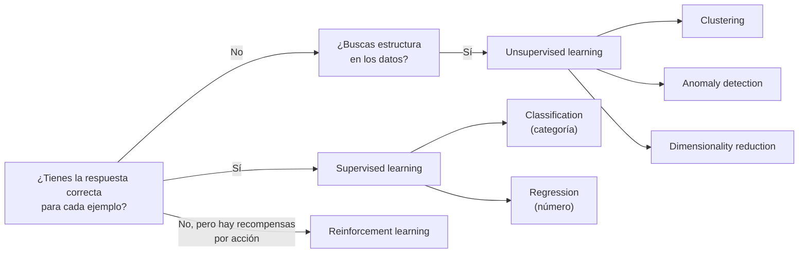
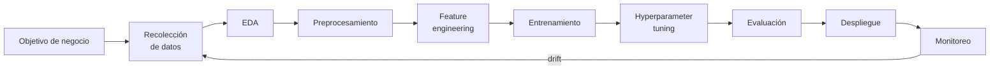

---
tags:
  - aws
  - certificacion
  - aif-c01
  - ia
  - machine-learning
---

# Dominio 1: Fundamentals of AI and ML (20%)

> Qué es la IA, cómo aprende un modelo, cuándo conviene (y cuándo no) usar ML, cómo es su ciclo de vida en AWS y cómo se mide si funciona.

!!! info "Qué evalúa este dominio"
    - **1.1 Conceptos y terminología**: IA, ML, deep learning, redes neuronales, visión por computadora, NLP, LLM, GenAI, agentic AI; tipos de inferencia (batch, real-time, asynchronous, serverless); tipos de datos; tipos de aprendizaje (supervisado, no supervisado, por refuerzo).
    - **1.2 Casos de uso prácticos**: dónde aporta valor la IA y dónde no; elegir regresión, clasificación o clustering; aplicaciones reales; capacidades de los servicios gestionados (SageMaker AI, Transcribe, Translate, Comprehend, Lex, Polly…); cuándo usar ML tradicional y cuándo un foundation model.
    - **1.3 Ciclo de vida de IA/ML**: componentes del pipeline, origen de los modelos, formas de usarlos en producción, servicios de AWS por etapa, MLOps, métricas técnicas y de negocio.

    Volver al [resumen del examen](resumen-examen.md).

## IA, ML, deep learning, GenAI y agentic AI

Son círculos concéntricos: cada uno es un subconjunto del anterior, salvo la IA agéntica, que es una forma de **usar** los modelos.

| Término | Qué es | Ejemplo |
| --- | --- | --- |
| **Artificial intelligence** (inteligencia artificial, IA) | Cualquier técnica que permite a una máquina imitar capacidades humanas: razonar, percibir, decidir. Incluye reglas escritas a mano | Un sistema experto con reglas `if/else` |
| **Machine learning** (aprendizaje automático, ML) | Subconjunto de la IA en que el sistema **aprende patrones de los datos** en vez de seguir reglas programadas | Un modelo que aprende a detectar fraude con transacciones históricas |
| **Deep learning** (aprendizaje profundo) | ML con **neural networks** (redes neuronales) de muchas capas. Destaca con datos no estructurados: imágenes, audio, texto | Reconocer caras en fotos |
| **Generative AI** (IA generativa, GenAI) | Deep learning que **genera contenido nuevo** (texto, imagen, audio, código) a partir de un prompt | Redactar un correo o crear una imagen |
| **Agentic AI** (IA agéntica) | Sistemas en que un modelo **planifica pasos, llama herramientas y actúa** para cumplir un objetivo, con poca intervención humana | Un agente que revisa un pedido, consulta el inventario y abre un ticket |

### Vocabulario básico

- **Algorithm** (algoritmo): el procedimiento matemático que aprende (por ejemplo, regresión lineal, XGBoost, una red neuronal).
- **Model** (modelo): el resultado de entrenar un algoritmo con datos. Es lo que haces llegar a producción.
- **Training** (entrenamiento): ajustar los **parámetros** del modelo con datos para que reduzca su error.
- **Inference** (inferencia): usar el modelo ya entrenado para predecir o generar con datos nuevos.
- **Neural network** (red neuronal): capas de nodos ("neuronas") conectados con pesos; cada capa transforma la entrada y la pasa a la siguiente.
- **Computer vision** (visión por computadora): IA que interpreta imágenes y video.
- **Natural language processing** (procesamiento de lenguaje natural, NLP): IA que entiende o genera lenguaje humano.
- **Large language model** (modelo de lenguaje grande, LLM): modelo de deep learning entrenado con enormes cantidades de texto para entender y generar lenguaje.
- **Bias** (sesgo): error sistemático que favorece o perjudica a ciertos grupos o resultados (ver [Dominio 4](dominio-4-ia-responsable.md)).
- **Fairness** (equidad): que el modelo trate de forma justa a distintos grupos.
- **Fit** (ajuste): qué tan bien se adapta el modelo a los datos. Ver [overfitting y underfitting](#overfitting-y-underfitting).

## Tipos de datos

| Tipo | Qué es | Ejemplo |
| --- | --- | --- |
| **Labeled data** (datos etiquetados) | Cada ejemplo trae la respuesta correcta (*label*, etiqueta) | Correos marcados como "spam" / "no spam" |
| **Unlabeled data** (datos sin etiquetar) | Solo entradas, sin respuesta | Millones de documentos sin clasificar |
| **Structured data** (estructurados) | Filas y columnas con esquema fijo | Una tabla de clientes en RDS |
| **Unstructured data** (no estructurados) | Sin esquema fijo | Texto libre, imágenes, audio, video |
| **Tabular** | Datos en tabla (un tipo de estructurado) | CSV de ventas |
| **Time-series** (series temporales) | Valores ordenados en el tiempo | Métricas de CPU por minuto, ventas diarias |
| **Image / text** | No estructurados por naturaleza | Fotos de productos, reseñas |

## Tipos de aprendizaje

### Supervised learning

En el **supervised learning** (aprendizaje supervisado) el modelo aprende con **datos etiquetados**: ve muchos pares entrada → respuesta y aprende a generalizar.

- **Classification** (clasificación): predice una **categoría**. Binaria (fraude sí/no) o multiclase (tipo de producto). Algoritmos típicos: regresión logística, árboles de decisión, XGBoost.
- **Regression** (regresión): predice un **valor numérico continuo** (precio de una casa, demanda de mañana). Ejemplo: regresión lineal.

### Unsupervised learning

En el **unsupervised learning** (aprendizaje no supervisado) no hay etiquetas: el modelo busca estructura por sí mismo.

- **Clustering** (agrupamiento): agrupa elementos parecidos. Ejemplo: segmentar clientes con **k-means**.
- **Anomaly detection** (detección de anomalías): encuentra lo que se sale del patrón (transacciones raras, picos en logs).
- **Dimensionality reduction** (reducción de dimensionalidad): resume muchas variables en pocas (por ejemplo, PCA) para visualizar o acelerar otros modelos.

### Reinforcement learning

En el **reinforcement learning** (aprendizaje por refuerzo, RL) un **agent** (agente) actúa en un **environment** (entorno), recibe una **reward** (recompensa) o penalización y aprende por prueba y error la **policy** (política de decisión) que maximiza la recompensa acumulada. Se usa en robótica, juegos, optimización de rutas y, en GenAI, en **RLHF** (*reinforcement learning from human feedback*, aprendizaje por refuerzo con retroalimentación humana) para alinear LLMs con lo que las personas prefieren (ver [Dominio 3](dominio-3-aplicaciones-modelos-fundacionales.md)).

!!! note "Otras variantes que aparecen en material de estudio"
    - **Semi-supervised learning**: pocos datos etiquetados y muchos sin etiquetar.
    - **Self-supervised learning** (autosupervisado): el modelo crea sus propias etiquetas a partir de los datos, por ejemplo prediciendo la siguiente palabra. Así se hace el *pre-training* de los LLMs.

!!! tip "En el examen"
    - "Predecir si…", "¿es A o B?" → **classification**. "¿Cuánto…?", "¿qué valor…?" → **regression**. "Agrupar sin categorías previas" → **clustering**.
    - "Aprende por prueba y error con recompensas" → **reinforcement learning**.
    - Si el enunciado dice que no hay etiquetas, descarta supervisado.

## Tipos de inferencia

| Tipo | Cómo funciona | Cuándo usarla | En SageMaker AI |
| --- | --- | --- | --- |
| **Real-time** (en tiempo real) | Endpoint siempre encendido; respuesta en milisegundos | Tráfico constante y baja latencia (recomendaciones en una web) | Real-time endpoints |
| **Serverless** | El endpoint escala a cero entre peticiones; puede haber **cold start** (arranque en frío) | Tráfico intermitente o impredecible; pagas solo por uso | Serverless Inference |
| **Asynchronous** (asíncrona) | La petición se encola y el resultado se deja en S3 | Payloads grandes o procesamiento largo (minutos) sin necesitar respuesta inmediata | Asynchronous Inference |
| **Batch** (por lotes) | Procesa un dataset completo de una vez, sin endpoint persistente | Predicciones periódicas sobre muchos registros (puntuar todos los clientes cada noche) | Batch Transform |

!!! tip "En el examen"
    "Sin necesidad de respuesta inmediata, millones de registros cada noche" → **batch**. "Tráfico esporádico, minimizar costo" → **serverless**. "Archivos grandes, procesamiento de varios minutos" → **asynchronous**. "Latencia baja y constante" → **real-time**.

## Overfitting y underfitting

- **Overfitting** (sobreajuste): el modelo memoriza el entrenamiento, incluido el ruido. Va muy bien en entrenamiento y mal con datos nuevos. Se asocia a **alta varianza**.
- **Underfitting** (subajuste): el modelo es demasiado simple y no capta el patrón. Va mal en entrenamiento y en datos nuevos. Se asocia a **alto sesgo** (*bias* en sentido estadístico).
- **Good fit**: equilibrio entre ambos (*bias-variance tradeoff*).

Cómo se combate el overfitting: más datos y más variados, *regularization* (regularización), *early stopping*, simplificar el modelo, *cross-validation*. El underfitting: un modelo más complejo, mejores *features* (variables), entrenar más tiempo.

Por eso los datos se dividen en **training set** (entrenar), **validation set** (ajustar hiperparámetros) y **test set** (medir al final con datos nunca vistos).

## Cuándo usar IA y cuándo no

La IA aporta valor cuando ayuda a **decidir mejor** (*assist human decision making*), cuando permite **escalar** lo que no escala con personas o cuando **automatiza** tareas repetitivas con datos abundantes.

No es la herramienta adecuada cuando:

- Se necesita un **resultado exacto y determinista** en vez de una predicción (calcular un impuesto con una fórmula conocida: usa reglas).
- El **costo** de construir y mantener el modelo supera el beneficio (*cost-benefit analysis*).
- No hay datos suficientes o de calidad.
- La regulación exige una explicación que el modelo no puede dar.

### Técnica según el caso

| Caso de negocio | Técnica |
| --- | --- |
| Predecir abandono de clientes (sí/no) | Classification |
| Estimar el precio de un inmueble | Regression |
| Segmentar clientes para marketing sin grupos previos | Clustering |
| Detectar transacciones fraudulentas raras | Classification (con etiquetas) o anomaly detection (sin ellas) |
| Pronosticar la demanda de las próximas semanas | Regression sobre series temporales (*forecasting*) |
| Recomendar productos | Recommendation systems (filtrado colaborativo) |
| Resumir documentos o responder preguntas | GenAI (foundation model) |

### ML tradicional vs foundation models

| Criterio | ML tradicional (modelo propio) | Foundation model (GenAI) |
| --- | --- | --- |
| Tarea | Específica y bien definida (puntuar riesgo de crédito) | Abierta, con lenguaje o contenido (resumir, conversar, redactar) |
| Datos | Necesita datos etiquetados del problema | Funciona con pocos o ningún ejemplo (*zero/few-shot*) |
| **Explicabilidad** | Alta en modelos simples (árboles, regresión) | Baja: difícil explicar por qué generó algo |
| **Regulación** | Preferible cuando hay que justificar decisiones (crédito, seguros, salud) | Riesgo mayor en decisiones reguladas |
| Costo y latencia | Barato y rápido en inferencia | Más caro por token y con más latencia |
| Determinismo | Misma entrada, misma salida | No determinista por defecto |

!!! tip "En el examen"
    Si el escenario menciona **explicabilidad obligatoria**, **regulador** o **decisiones sobre personas** (crédito, contratación), la respuesta suele ser un modelo tradicional e interpretable, no un LLM.

## Servicios de IA gestionados de AWS

Los **AI services** (servicios de IA preentrenados) se consumen por API sin saber ML. Son la respuesta cuando la pregunta dice *no ML expertise* o *least operational overhead*.

| Servicio | Qué hace | Caso típico |
| --- | --- | --- |
| **Amazon Comprehend** | NLP: sentimiento, entidades, frases clave, idioma, clasificación personalizada, detección de PII | Analizar el sentimiento de reseñas |
| **Amazon Translate** | Traducción automática neuronal | Traducir un catálogo a cinco idiomas |
| **Amazon Transcribe** | *Speech-to-text* (voz a texto), con identificación de hablantes y redacción de PII | Transcribir llamadas del call center |
| **Amazon Polly** | *Text-to-speech* (texto a voz) con voces naturales | Leer en voz alta artículos de un sitio |
| **Amazon Lex** | Chatbots y bots de voz con intents y slots (la tecnología de Alexa) | Bot que agenda citas por chat o teléfono |
| **Amazon Rekognition** | Visión: objetos, caras, texto en imagen, moderación de contenido, video | Moderar imágenes que suben los usuarios |
| **Amazon Textract** | Extrae texto, formularios y tablas de documentos escaneados (más que OCR) | Digitalizar facturas y formularios |
| **Amazon Personalize** | Recomendaciones personalizadas en tiempo real | "Productos que te pueden gustar" |
| **Amazon SageMaker AI** | Plataforma completa para construir, entrenar y desplegar tus propios modelos | Modelo de riesgo propio con datos de la empresa |

!!! tip "En el examen: no confundas"
    - **Textract** extrae texto de documentos; **Comprehend** analiza el significado del texto. Un flujo típico: Textract → Comprehend.
    - **Transcribe** (voz → texto) vs **Polly** (texto → voz). Truco: *Polly* habla como un loro.
    - **Lex** construye la conversación; Transcribe/Polly solo convierten audio.
    - **Rekognition** es para imágenes y video; si es un documento con campos, es **Textract**.

## Ciclo de vida de ML

- **Data collection** (recolección): reunir datos de las fuentes (S3, bases de datos, streaming).
- **EDA** (*exploratory data analysis*, análisis exploratorio): entender distribuciones, nulos, correlaciones, desbalanceo.
- **Data pre-processing** (preprocesamiento): limpiar, imputar nulos, normalizar, dividir en train/validation/test.
- **Feature engineering** (ingeniería de características): crear variables útiles (por ejemplo, "días desde la última compra").
- **Training**: entrenar el algoritmo.
- **Hyperparameter tuning** (ajuste de hiperparámetros): probar configuraciones del algoritmo que no se aprenden de los datos (tasa de aprendizaje, profundidad del árbol).
- **Evaluation**: medir con el test set y las métricas adecuadas.
- **Deployment** (despliegue): exponer el modelo para inferencia.
- **Monitoring**: vigilar **data drift** (los datos de producción cambian respecto del entrenamiento) y **model drift / concept drift** (la relación entre entradas y resultado cambia). Cuando se degrada, se **reentrena**.

### Servicios de AWS por etapa

| Etapa | Servicio o función |
| --- | --- |
| Almacenar y catalogar datos | Amazon S3, AWS Glue (ETL y Data Catalog), AWS Lake Formation |
| Preparar datos sin código | **SageMaker Data Wrangler** (integrado en SageMaker Canvas), AWS Glue DataBrew |
| Etiquetar datos | **SageMaker Ground Truth** (etiquetado con personas y ayuda de ML) |
| Guardar y compartir features | **SageMaker Feature Store** |
| Entrenar y ajustar | SageMaker AI Training, Automatic Model Tuning |
| Modelos preentrenados listos | **SageMaker JumpStart** (hub de modelos y soluciones), Amazon Bedrock |
| ML sin código para analistas | **SageMaker Canvas** |
| Orquestar y versionar | **SageMaker Pipelines**, **SageMaker Model Registry** |
| Desplegar | Endpoints de SageMaker AI (real-time, serverless, async, batch) |
| Monitorear | **SageMaker Model Monitor** (calidad de datos y de modelo, drift de sesgo y de explicabilidad) |
| Sesgo y explicabilidad | **SageMaker Clarify** |
| Documentar y gobernar | **SageMaker Model Cards**, SageMaker Model Dashboard, SageMaker Role Manager |
| GenAI sin gestionar infraestructura | Amazon Bedrock |
| Asistentes para negocio y desarrollo | Amazon Quick (negocio), Kiro (desarrollo), Amazon Q (en la consola) |

## Origen de los modelos y uso en producción

**De dónde sale el modelo**:

- **Pre-trained open source models** (modelos abiertos preentrenados): Llama, Mistral y otros, disponibles en JumpStart o Bedrock.
- **Modelos propietarios por API**: los del catálogo de Bedrock (Amazon Nova, Anthropic Claude, etc.).
- **Training custom models** (entrenar uno propio): con tus datos en SageMaker AI. Máximo control y máximo costo.

**Cómo se consume en producción**:

| Opción | Qué gestionas tú | Ejemplo en AWS |
| --- | --- | --- |
| **Managed API service** (API gestionada) | Solo las llamadas | Amazon Bedrock, servicios de IA preentrenados |
| **Self-hosted API** (autoalojado) | Instancias, escalado, parches, endpoint | Endpoint de SageMaker AI, o un contenedor en EC2/EKS |

## MLOps

**MLOps** es aplicar prácticas de DevOps al ML: que entrenar y desplegar modelos sea **repetible, automatizado y auditable**. Conceptos que pide la guía:

- **Experimentation** (experimentación): registrar cada prueba (datos, parámetros, métricas) para comparar.
- **Repeatable processes**: pipelines como código en lugar de notebooks manuales.
- **Scalable systems**: infraestructura que crece con los datos y el tráfico.
- **Managing technical debt** (deuda técnica): el código "de pegamento" y los datos sin versionar se acumulan rápido en ML.
- **Production readiness**: pruebas, aprobación del modelo, rollback.
- **Model monitoring** y **model re-training**: detectar drift y reentrenar automáticamente.

Es la misma idea que el CI/CD de software (ver [Integración continua](../../../devops/ci-cd/integracion-continua.md) y [Despliegue continuo](../../../devops/ci-cd/despliegue-continuo.md)), con el modelo y los datos como artefactos adicionales.

## Métricas de evaluación

### Matriz de confusión

Para un clasificador binario (por ejemplo, "¿es fraude?"):

| | Predicho: fraude | Predicho: no fraude |
| --- | --- | --- |
| **Real: fraude** | TP (*true positive*) | FN (*false negative*) |
| **Real: no fraude** | FP (*false positive*) | TN (*true negative*) |

| Métrica | Fórmula | Pregunta que responde | Úsala cuando… |
| --- | --- | --- | --- |
| **Accuracy** (exactitud) | (TP + TN) / total | ¿Qué porcentaje acierta en general? | Las clases están balanceadas |
| **Precision** (precisión) | TP / (TP + FP) | De lo que marqué como positivo, ¿cuánto lo era? | Un falso positivo es caro (bloquear a un cliente legítimo, filtro de spam) |
| **Recall** (sensibilidad, *sensitivity*) | TP / (TP + FN) | De todos los positivos reales, ¿cuántos encontré? | Un falso negativo es caro (fraude no detectado, diagnóstico médico) |
| **F1 score** | 2 × (P × R) / (P + R) | Equilibrio entre precision y recall | Clases desbalanceadas y ambos errores importan |
| **AUC-ROC** | Área bajo la curva ROC (0,5 = azar; 1 = perfecto) | ¿Qué tan bien separa las clases en todos los umbrales? | Comparar modelos de clasificación |

!!! example "Ejemplo resuelto"
    1000 transacciones, 10 son fraude. El modelo marca 15 como fraude, de las cuales 8 lo son.

    - TP = 8, FP = 7, FN = 2, TN = 983.
    - Accuracy = (8 + 983) / 1000 = **99,1%** (parece excelente, pero un modelo que diga siempre "no fraude" tendría 99%).
    - Precision = 8 / 15 = **53%**. Recall = 8 / 10 = **80%**. F1 ≈ **0,64**.

    Moraleja: con clases desbalanceadas, la accuracy engaña; mira precision, recall y F1.

Para **regresión** se usan **MAE** (*mean absolute error*, error absoluto medio), **RMSE** (*root mean squared error*, castiga más los errores grandes) y **R²** (cuánta variación explica el modelo).

### Métricas de negocio

El modelo también se mide en dinero y en usuarios: **cost per user** (costo por usuario), **development costs** (costo de desarrollo), **customer feedback** (opinión de clientes) y **ROI** (*return on investment*, retorno de la inversión). Un modelo con mejor F1 que cuesta el triple puede no compensar. Ver [Métricas, KPIs y OKRs](../../../negocio/metricas-kpis-okrs.md).

!!! tip "En el examen"
    "Es crítico no dejar pasar ningún caso positivo" → **recall**. "Es crítico no molestar con falsas alarmas" → **precision**. "Dataset desbalanceado" → no elijas accuracy.

## Casos de uso

1. **Una aseguradora quiere extraer datos de miles de formularios escaneados de siniestros.** → **Amazon Textract**: entiende formularios y tablas, no solo texto plano.
2. **Un call center quiere transcribir llamadas y saber si el cliente terminó molesto.** → **Amazon Transcribe** para el texto y **Amazon Comprehend** para el sentimiento.
3. **Una tienda online quiere recomendaciones personalizadas sin un equipo de data science.** → **Amazon Personalize**.
4. **Un banco necesita decidir créditos y el regulador exige justificar cada rechazo.** → Modelo tradicional interpretable entrenado en **SageMaker AI** con **SageMaker Clarify** para explicar las predicciones, no un LLM.
5. **Una red social debe detectar imágenes inapropiadas antes de publicarlas.** → **Amazon Rekognition** (moderación de contenido).
6. **Una empresa puntúa a todos sus clientes con un modelo de churn una vez por semana.** → Inferencia **batch** (Batch Transform): no necesita endpoint encendido.
7. **Un modelo de demanda empezó a fallar tras un cambio en los hábitos de compra.** → Es **drift**; detectarlo con **SageMaker Model Monitor** y reentrenar.
8. **Una startup quiere un bot que reserve citas por teléfono.** → **Amazon Lex** (conversación) con **Amazon Polly** para la voz.

## Preguntas de práctica

**1.** Una empresa quiere agrupar a sus clientes en segmentos según su comportamiento de compra. No tiene categorías definidas de antemano. ¿Qué tipo de aprendizaje debe usar?

- A. Supervised learning con classification
- B. Unsupervised learning con clustering
- C. Reinforcement learning
- D. Supervised learning con regression

??? success "Respuesta"
    **B.** Sin etiquetas previas y con el objetivo de agrupar, es clustering (no supervisado). A y D requieren datos etiquetados. C aprende con recompensas por acciones, no agrupa datos.

**2.** Un hospital entrena un modelo para detectar una enfermedad grave. Lo peor que puede pasar es que un paciente enfermo sea clasificado como sano. ¿Qué métrica debe priorizar?

- A. Accuracy
- B. Precision
- C. Recall
- D. RMSE

??? success "Respuesta"
    **C.** Recall mide cuántos positivos reales se detectan; minimiza falsos negativos. A engaña si la enfermedad es rara. B prioriza evitar falsos positivos. D es una métrica de regresión.

**3.** Un equipo necesita predicciones sobre archivos de 500 MB que tardan varios minutos en procesarse. No necesitan respuesta inmediata, pero sí procesar cada petición a medida que llega. ¿Qué opción de inferencia de SageMaker AI es la más adecuada?

- A. Real-time inference
- B. Serverless inference
- C. Asynchronous inference
- D. Ninguna: debe usar EC2

??? success "Respuesta"
    **C.** Asynchronous inference encola peticiones con payloads grandes y tiempos largos y deja el resultado en S3. A está pensada para baja latencia y payloads pequeños. B tiene límites de tamaño y duración y sufre cold starts. D añade gestión innecesaria.

**4.** ¿Qué servicio permite a una persona sin conocimientos de ML convertir texto de un sitio web en audio con voz natural?

- A. Amazon Transcribe
- B. Amazon Polly
- C. Amazon Lex
- D. Amazon Comprehend

??? success "Respuesta"
    **B.** Polly es text-to-speech. A es lo contrario (voz a texto). C crea bots conversacionales. D analiza texto.

**5.** Un modelo obtiene 99% de exactitud en entrenamiento y 70% con datos nuevos. ¿Qué está ocurriendo?

- A. Underfitting
- B. Overfitting
- C. Data drift
- D. El modelo está bien ajustado

??? success "Respuesta"
    **B.** Gran diferencia entre entrenamiento y datos nuevos indica que memorizó el entrenamiento. A daría malos resultados en ambos. C ocurre en producción con el tiempo, no inmediatamente. D no explica la caída.

**6.** (Elige dos) ¿Qué situaciones indican que una solución de ML **no** es adecuada?

- A. El resultado debe calcularse exactamente con una fórmula legal conocida
- B. Hay millones de transacciones históricas etiquetadas
- C. El costo de desarrollo supera claramente el beneficio esperado
- D. Se quiere escalar una tarea de clasificación repetitiva
- E. Los patrones cambian y las reglas manuales no dan abasto

??? success "Respuesta"
    **A y C.** Si existe una regla exacta, una predicción no aporta; y si el costo supera el beneficio, no compensa. B, D y E son señales a favor de usar ML.

**7.** Una empresa quiere desplegar un modelo de código abierto preentrenado con pocos clics, controlando la instancia en la que corre. ¿Qué opción encaja mejor?

- A. Amazon SageMaker JumpStart
- B. Amazon Comprehend
- C. Amazon Personalize
- D. AWS Glue DataBrew

??? success "Respuesta"
    **A.** JumpStart ofrece modelos preentrenados (incluidos abiertos) que se despliegan en endpoints de SageMaker AI que tú eliges. B y C son servicios cerrados para tareas específicas. D prepara datos.

## Para profundizar

| Tema | Nota del cuaderno |
| --- | --- |
| Cómputo donde corren los modelos | [Máquinas virtuales](../../../cloud/computo/maquinas-virtuales.md), [Serverless](../../../cloud/computo/serverless.md), [Contenedores gestionados](../../../cloud/computo/contenedores-gestionados.md) |
| Almacenamiento de datos de entrenamiento | [Almacenamiento y datos](../../../cloud/redes-y-datos/almacenamiento-datos.md) |
| MLOps como CI/CD | [Integración continua](../../../devops/ci-cd/integracion-continua.md), [Despliegue continuo](../../../devops/ci-cd/despliegue-continuo.md) |
| Monitoreo y drift | [Observabilidad](../../../devops/operacion/observabilidad.md) |
| Métricas de negocio y ROI | [Métricas, KPIs y OKRs](../../../negocio/metricas-kpis-okrs.md), [TI y negocio](../../../negocio/ti-y-negocio.md) |
| Siguiente dominio | [Dominio 2: Fundamentals of GenAI](dominio-2-fundamentos-ia-generativa.md) |

## Referencias

- [Exam guide AIF-C01 – Domain 1](https://docs.aws.amazon.com/aws-certification/latest/ai-practitioner-01/ai-practitioner-01-domain1.html)
- [Qué es Amazon SageMaker AI](https://docs.aws.amazon.com/sagemaker/latest/dg/whatis.html)
- [Opciones de despliegue para inferencia en SageMaker AI](https://docs.aws.amazon.com/sagemaker/latest/dg/deploy-model.html)
- [Amazon SageMaker Model Monitor](https://docs.aws.amazon.com/sagemaker/latest/dg/model-monitor.html)
- [Servicios de IA de AWS](https://aws.amazon.com/ai/services/)
- [Machine Learning Lens – AWS Well-Architected](https://docs.aws.amazon.com/wellarchitected/latest/machine-learning-lens/machine-learning-lens.html)
