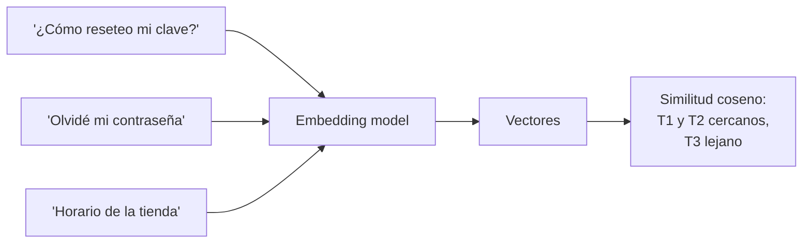
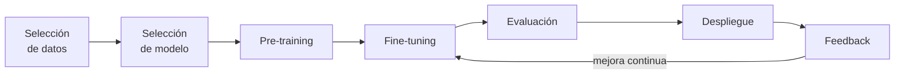
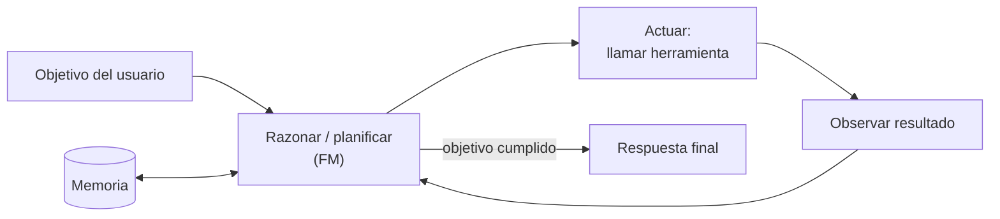

---
tags:
  - aws
  - certificacion
  - aif-c01
  - ia
  - ia-generativa
---

# Dominio 2: Fundamentals of GenAI (24%)

> Cómo funcionan por dentro los modelos generativos (tokens, embeddings, transformers), cuánto cuestan, qué es un agente, qué pueden y qué no pueden hacer, y qué servicios de AWS se usan para construir con ellos.

!!! info "Qué evalúa este dominio"
    - **2.1 Conceptos básicos de GenAI**: tokens, chunking, embeddings, vectores, prompt engineering, LLMs basados en transformers, foundation models, modelos multimodales y de difusión; casos de uso; ciclo de vida de un FM; precio por token; *context engineering*; conceptos de IA agéntica (multiagente, MCP, memoria, herramientas, orquestación).
    - **2.2 Capacidades y límites**: ventajas, desventajas (alucinaciones, no determinismo, interpretabilidad), criterios para elegir un modelo, métricas de valor de negocio.
    - **2.3 Infraestructura y servicios de AWS**: Bedrock, SageMaker AI, JumpStart, Amazon Quick, Kiro, Strands Agents, Bedrock AgentCore; ventajas y *trade-offs* de costo.

    Volver al [resumen del examen](resumen-examen.md).

## Conceptos base de la IA generativa

### Foundation models y LLMs

Un **foundation model** (modelo fundacional, FM) es un modelo muy grande entrenado con datos masivos y variados que sirve de **base para muchas tareas** distintas sin entrenarlo de nuevo: resumir, traducir, clasificar, responder, programar. Un **LLM** es un FM especializado en lenguaje. Los **multi-modal models** (multimodales) aceptan o generan varios tipos de datos: texto, imagen, audio, video.

### Tokens

Un **token** es la unidad mínima que procesa el modelo: una palabra, parte de una palabra o un signo. "Infraestructura" puede partirse en varios tokens. Importa por tres razones:

- El **costo** se calcula por tokens de entrada y de salida.
- La **context window** (ventana de contexto) es el máximo de tokens que el modelo puede considerar a la vez (prompt + historial + documentos + respuesta).
- La **latencia** crece con los tokens que hay que generar.

Como referencia aproximada en inglés, 1 token ≈ 4 caracteres o ¾ de palabra; en español suele haber algo más de tokens por palabra. Cada modelo tiene su propio *tokenizer*, así que el mismo texto puede costar distinto en dos modelos.

### Embeddings y vectores

Un **embedding** es la representación de un texto (o imagen) como un **vector**: una lista de cientos o miles de números que captura su **significado**. Textos con significado parecido quedan cerca en ese espacio, aunque no compartan palabras ("auto" y "vehículo").

La cercanía se mide con **cosine similarity** (similitud coseno) o distancia euclidiana. Una **vector database** (base de datos vectorial) guarda los vectores y busca los más parecidos en milisegundos (**semantic search**, búsqueda semántica). Es la base de RAG (ver [Dominio 3](dominio-3-aplicaciones-modelos-fundacionales.md)).

### Chunking

**Chunking** (fragmentación) es dividir documentos largos en trozos (*chunks*) antes de generar sus embeddings. Chunks muy grandes diluyen el significado y gastan contexto; chunks muy pequeños pierden contexto. Estrategias comunes: tamaño fijo con solapamiento (*overlap*), por estructura (secciones, párrafos), jerárquica y semántica.

### Transformers

La arquitectura **transformer** (2017) es la base de los LLMs actuales. Su pieza clave es el mecanismo de **self-attention** (autoatención): al procesar cada token, el modelo pondera qué otros tokens de la secuencia son relevantes, aunque estén lejos. Procesa la secuencia en paralelo, lo que permitió entrenar con muchísimos datos. Un LLM generativo **predice el siguiente token** una y otra vez hasta completar la respuesta.

### Diffusion models

Los **diffusion models** (modelos de difusión) generan imágenes partiendo de **ruido aleatorio** y eliminándolo paso a paso, guiados por el prompt, hasta obtener una imagen coherente. Son la técnica habitual para texto → imagen. Otras arquitecturas generativas que pueden aparecer: **GANs** (*generative adversarial networks*, un generador compite contra un discriminador) y **VAEs** (*variational autoencoders*).

| Tipo de modelo | Genera | Idea clave |
| --- | --- | --- |
| Transformer / LLM | Texto, código | Atención + predicción del siguiente token |
| Multimodal | Texto a partir de imagen/audio, o viceversa | Varias modalidades en el mismo modelo |
| Diffusion | Imágenes, video | Quitar ruido paso a paso |
| Embedding model | Vectores (no texto) | Representar significado para buscar y comparar |

## Casos de uso de la IA generativa

Generación de imagen, video y audio; **summarization** (resúmenes); **AI assistants** (asistentes); traducción; **code generation** (generación de código); agentes de atención al cliente; búsqueda conversacional; motores de recomendación; extracción de datos de documentos; generación de datos sintéticos.

## Ciclo de vida de un foundation model

En la práctica, casi ninguna empresa hace *pre-training*: elige un FM ya entrenado (en Bedrock o JumpStart), lo adapta con prompts, RAG o fine-tuning, lo evalúa, lo despliega y recoge feedback de los usuarios.

## Precio por token

En Amazon Bedrock con modelos *on-demand* pagas por **tokens de entrada** (*input tokens*) y **tokens de salida** (*output tokens*); los de salida suelen costar varias veces más que los de entrada. Consecuencias prácticas:

- Un prompt largo con muchos documentos (contexto) encarece **cada** llamada.
- Pedir respuestas concisas o limitar `maxTokens` reduce costo y latencia.
- Un modelo más grande cuesta más por token y suele responder más lento.

| Modalidad de Bedrock | Cómo se cobra | Cuándo conviene |
| --- | --- | --- |
| **On-demand** | Por token, sin compromiso | Uso variable, pruebas, la mayoría de aplicaciones |
| **Batch inference** | Por token, con descuento frente a on-demand | Grandes volúmenes sin necesidad de respuesta inmediata |
| **Provisioned Throughput** | Por hora de capacidad reservada (con o sin compromiso de plazo) | Tráfico alto y estable, rendimiento garantizado; algunos modelos personalizados lo requieren |
| **Prompt caching** | Los tokens leídos de caché son más baratos | Prompts con un prefijo largo que se repite (instrucciones, documentos) |
| **Service tiers** (priority, standard, flex) | Más caro por prioridad, más barato si toleras latencia | Ajustar costo/latencia por petición |

!!! warning "Los precios cambian"
    Los precios por token, los descuentos de batch y las modalidades disponibles varían por modelo y por región. Consulta la página de precios de Bedrock antes de estimar.

**Cross-Region inference** (inferencia entre regiones) usa *inference profiles* para repartir peticiones entre varias regiones y aumentar el *throughput* disponible; ten en cuenta los requisitos de residencia de datos.

## Context engineering

El **context engineering** (ingeniería de contexto) es diseñar **todo lo que entra en la ventana de contexto** del modelo, no solo la instrucción: el *system prompt*, el historial de la conversación, los documentos recuperados (RAG), los resultados de herramientas, la memoria del usuario y los ejemplos. Es una evolución del *prompt engineering* pensada para agentes y aplicaciones con muchas piezas.

Buenas prácticas: incluir solo lo relevante (más contexto no siempre es mejor y cuesta más), ordenar y etiquetar las secciones, resumir o recortar el historial largo, y poner al principio lo que no cambia para aprovechar el *prompt caching*.

## IA agéntica

Un **AI agent** (agente de IA) es un sistema en el que un FM **razona sobre un objetivo, decide qué acción tomar, usa herramientas, observa el resultado y repite** hasta terminar.

| Concepto | Qué es |
| --- | --- |
| **Tool usage** (uso de herramientas) | El modelo pide ejecutar funciones (APIs, consultas, código) y recibe su resultado. También se llama *function calling* |
| **Memory management** (memoria) | **Short-term** (corto plazo): el contexto de la sesión. **Long-term** (largo plazo): preferencias y hechos que persisten entre sesiones |
| **Workflow orchestration** (orquestación) | Coordinar pasos, reintentos, ramas y aprobaciones humanas (*human-in-the-loop*) |
| **Model Context Protocol (MCP)** | Protocolo abierto (creado por Anthropic) que estandariza cómo un agente se conecta a herramientas y datos externos. Un **MCP server** expone herramientas; cualquier cliente compatible las usa sin integración a medida |
| **Multi-agent systems** (multiagente) | Varios agentes especializados colaboran en una tarea compleja |

**Patrones multiagente** comunes:

- **Supervisor / orchestrator-workers**: un agente coordinador divide la tarea y delega en agentes especialistas.
- **Sequential / pipeline**: cada agente hace un paso y pasa el resultado al siguiente.
- **Peer-to-peer / swarm**: agentes que se pasan el control entre sí según la necesidad.
- **Graph / workflow**: un grafo definido de agentes y transiciones.

Para la comunicación entre agentes existe también el protocolo abierto **A2A** (*Agent2Agent*). La regla general: MCP conecta **agente ↔ herramientas**; A2A conecta **agente ↔ agente**.

!!! tip "En el examen"
    - "Conectar un agente a sistemas externos de forma estandarizada" → **MCP**.
    - "Recordar preferencias del usuario entre sesiones" → **long-term memory**.
    - Un agente **actúa** (ejecuta acciones); un chatbot con RAG solo **responde**.

## Ventajas y desventajas de la GenAI

| Ventajas | Desventajas |
| --- | --- |
| **Adaptability** (adaptabilidad): un solo modelo sirve para muchas tareas | **Hallucinations** (alucinaciones): respuestas falsas dichas con seguridad |
| **Responsiveness**: respuestas en segundos | **Nondeterminism** (no determinismo): la misma pregunta puede dar respuestas distintas |
| Capacidades conversacionales en lenguaje natural | **Interpretability** (interpretabilidad) baja: difícil explicar por qué respondió algo |
| Generación de contenido nuevo | **Inaccuracy**: errores en cálculos o datos concretos |
| Poca o ninguna necesidad de datos etiquetados | **Knowledge cutoff**: no sabe lo ocurrido después de su entrenamiento (salvo que le des contexto) |
| Rapidez para prototipar | Costo por token y latencia; riesgos de seguridad (prompt injection) y legales |

## Cómo elegir un modelo generativo

| Factor | Pregunta |
| --- | --- |
| Model type / modality | ¿Texto, imagen, embeddings, multimodal? |
| Performance requirements | ¿Qué calidad necesito en mi tarea? (evalúalo, ver [Dominio 3](dominio-3-aplicaciones-modelos-fundacionales.md)) |
| Capabilities | ¿Idiomas, uso de herramientas, razonamiento, longitud de contexto? |
| Constraints | ¿Región disponible, tamaño máximo de entrada y salida? |
| Compliance | ¿Residencia de datos, licencia del modelo, requisitos del sector? |
| **Cost** | Precio por token, volumen esperado |
| **Latency** | ¿Respuesta interactiva o puede esperar? |
| Model complexity / size | Un modelo pequeño y barato puede bastar para clasificar; uno grande para razonar |

## Valor de negocio y métricas

Métricas que pide la guía para medir el impacto de una aplicación de GenAI: **ROI**, **efficiency** (tiempo ahorrado por tarea), **conversion rate** (tasa de conversión), **average revenue per user** (ingreso medio por usuario, ARPU), **customer lifetime value** (valor de vida del cliente, CLV), **accuracy** de las respuestas y **cross-domain performance** (si rinde bien en distintos tipos de tareas). Ver [Métricas, KPIs y OKRs](../../../negocio/metricas-kpis-okrs.md).

## Servicios de AWS para construir con GenAI

### Amazon Bedrock

Servicio **serverless y totalmente gestionado** que da acceso por una API unificada a foundation models de Amazon (**Amazon Nova**, Titan) y de terceros (Anthropic, Meta, Mistral, Cohere y otros). No gestionas infraestructura. Además del acceso a modelos incluye:

| Función de Bedrock | Para qué |
| --- | --- |
| **Playgrounds** | Probar modelos y prompts en la consola |
| **Knowledge Bases** | RAG gestionado (ver [Dominio 3](dominio-3-aplicaciones-modelos-fundacionales.md)) |
| **Agents** | Agentes gestionados con *action groups* y Knowledge Bases |
| **Guardrails** | Filtros de seguridad y privacidad (ver [Dominio 4](dominio-4-ia-responsable.md)) |
| **Prompt Management** y **Flows** | Versionar prompts y orquestar flujos de GenAI |
| **Evaluations** | Evaluar modelos y RAG (automática, humana o con *LLM-as-a-judge*) |
| **Model customization** | Fine-tuning supervisado, *reinforcement fine-tuning*, distillation |
| **Marketplace** e importación de modelos | Usar más modelos o traer los tuyos |

!!! note "Tus datos en Bedrock"
    AWS indica que Bedrock no usa tus prompts ni respuestas para entrenar los modelos base ni los comparte con los proveedores de modelos. Es un argumento habitual en preguntas de privacidad.

### Amazon Bedrock AgentCore

Plataforma para **desplegar y operar agentes en producción** de forma segura, con cualquier framework (Strands Agents, LangGraph, CrewAI…) y cualquier modelo. Sus servicios son modulares: **Runtime** (ejecución serverless con aislamiento por sesión), **Memory**, **Gateway** (convierte APIs y Lambdas en herramientas MCP), **Identity** (identidad y credenciales de los agentes), **Policy** (reglas deterministas sobre qué herramientas puede usar un agente), **Code Interpreter**, **Browser**, **Observability** y **Evaluations**, entre otros.

### Amazon SageMaker AI y SageMaker JumpStart

**SageMaker AI** es para quien necesita **control total**: entrenar, ajustar y desplegar modelos propios o abiertos en la infraestructura que elijas. **SageMaker JumpStart** es su hub de modelos preentrenados y soluciones listas para desplegar o ajustar con pocos clics.

### Asistentes y herramientas de desarrollo

| Servicio | Qué es |
| --- | --- |
| **Amazon Q** | Familia de asistentes de GenAI de AWS. **Amazon Q Developer** en la consola de AWS ayuda con preguntas, errores y costos de tu cuenta |
| **Amazon Quick** | Espacio de trabajo con agentes para empleados: chat sobre los datos de la empresa (Quick Index), investigación con citas (Quick Research), automatización (Quick Flows, Quick Automate) y BI (Quick Sight, antes QuickSight). AWS lo presenta como la evolución de **Amazon Q Business** |
| **Kiro** | IDE y CLI agénticos para desarrollo guiado por especificaciones (*spec-driven development*): requisitos → diseño → tareas, con *hooks* y soporte MCP. Sucesor recomendado de los plugins de IDE de Q Developer |
| **Strands Agents** | SDK de código abierto de AWS para construir agentes en pocas líneas: defines modelo, prompt y herramientas y el modelo decide el plan |
| **AWS Transform** | Servicio agéntico para modernizar y migrar aplicaciones (por ejemplo .NET, mainframe, VMware) |
| **Amazon Nova** | Familia de foundation models de Amazon (comprensión de texto y multimodal, generación de imagen y video, voz), disponible en Bedrock |

!!! warning "Cambios recientes en Amazon Q"
    - **Amazon Q Business** ya no acepta clientes nuevos; su evolución es **Amazon Quick**.
    - Los **plugins de IDE y las suscripciones de Amazon Q Developer** dejan de tener soporte el **30 de abril de 2027**; AWS recomienda **Kiro**. Amazon Q Developer en la consola de AWS continúa.
    - En material antiguo verás "Amazon Q Business" y "Q Developer en el IDE" como respuestas correctas; con la guía 1.1 piensa en **Amazon Quick** y **Kiro**.

### ¿Cuál elijo?

| Necesidad | Servicio |
| --- | --- |
| Usar FMs por API sin gestionar infraestructura | **Amazon Bedrock** |
| Entrenar o desplegar modelos con control total de instancias | **Amazon SageMaker AI** |
| Desplegar un modelo abierto preentrenado con pocos clics | **SageMaker JumpStart** |
| Asistente para empleados sobre documentos y datos de la empresa | **Amazon Quick** |
| Asistente de programación agéntico | **Kiro** |
| Construir un agente con código propio | **Strands Agents** (u otro framework) |
| Operar agentes en producción con identidad, memoria y políticas | **Amazon Bedrock AgentCore** |
| Una tarea concreta de IA (traducir, transcribir, OCR) | Servicio de IA preentrenado (Translate, Transcribe, Textract…) |

### Ventajas de construir GenAI en AWS

- **Accessibility** y **lower barrier to entry**: no necesitas expertos en ML para empezar.
- **Efficiency** y **speed to market**: de idea a prototipo en días.
- **Cost-effectiveness**: pago por uso, sin GPUs ociosas.
- **Seguridad y cumplimiento**: IAM, cifrado con KMS, PrivateLink, certificaciones de AWS (ver [Dominio 5](dominio-5-seguridad-cumplimiento-gobierno.md)).
- Infraestructura propia para IA: chips **AWS Trainium** (entrenamiento) y **AWS Inferentia** (inferencia), además de GPUs en EC2.

### Trade-offs de costo

| Decisión | Gana | Pierde |
| --- | --- | --- |
| Modelo grande vs pequeño | Calidad y razonamiento | Costo por token y latencia |
| On-demand vs Provisioned Throughput | Flexibilidad, sin compromiso | Rendimiento garantizado a gran escala |
| Una región vs cross-Region inference | Residencia de datos simple | Throughput y disponibilidad |
| Modelo base vs modelo personalizado | Sin costo de entrenamiento ni hosting | Calidad en tu dominio específico |
| Redundancia multi-región | Disponibilidad | Costo y complejidad |

## Casos de uso

1. **Un equipo quiere probar varios FMs de distintos proveedores sin aprovisionar servidores.** → **Amazon Bedrock**: API única, serverless, varios proveedores.
2. **Una empresa quiere que sus empleados pregunten en lenguaje natural sobre políticas internas guardadas en SharePoint y S3.** → **Amazon Quick** (con Quick Index conectado a esas fuentes).
3. **Una aplicación de chat repite en cada llamada un *system prompt* de 5000 tokens.** → **Prompt caching** para reducir costo y latencia.
4. **Un agente debe consultar el CRM, el ERP y una base de datos interna, y el equipo no quiere escribir integraciones a medida para cada framework.** → Exponer las herramientas como **MCP servers** (por ejemplo con **AgentCore Gateway**).
5. **Un equipo de datos necesita entrenar un modelo propio con su propio algoritmo y elegir el tipo de GPU.** → **Amazon SageMaker AI**.
6. **Una empresa clasifica 10 millones de reseñas una vez al mes con un LLM.** → **Batch inference** de Bedrock: más barato y sin necesidad de respuesta inmediata.
7. **Un buscador interno no encuentra "vehículo" cuando el documento dice "auto".** → Búsqueda semántica con **embeddings** en una base vectorial.
8. **Un banco quiere modernizar aplicaciones .NET antiguas con ayuda de IA.** → **AWS Transform**.

## Preguntas de práctica

**1.** ¿Qué describe mejor un embedding?

- A. Un fragmento de un documento largo
- B. Una representación numérica que captura el significado de un texto
- C. La unidad mínima de texto que procesa un LLM
- D. Un parámetro que controla la creatividad del modelo

??? success "Respuesta"
    **B.** Un embedding es un vector que representa significado. A es un chunk. C es un token. D es la temperatura.

**2.** Una empresa nota que su factura de Bedrock creció porque cada petición incluye largos documentos de contexto. ¿Qué acción reduce el costo **sin cambiar de modelo**?

- A. Aumentar `maxTokens`
- B. Enviar solo los fragmentos relevantes y reutilizar el prefijo fijo con prompt caching
- C. Cambiar de on-demand a Provisioned Throughput sin analizar el tráfico
- D. Subir la temperatura

??? success "Respuesta"
    **B.** Menos tokens de entrada y caché del prefijo repetido reducen costo. A puede aumentar tokens de salida. C solo compensa con tráfico alto y estable. D no afecta al costo.

**3.** ¿Qué tipo de modelo genera imágenes eliminando ruido paso a paso?

- A. Transformer de solo texto
- B. Diffusion model
- C. Modelo de regresión
- D. Embedding model

??? success "Respuesta"
    **B.** Es la definición de difusión. A genera texto. C predice números. D produce vectores, no imágenes.

**4.** Un asistente de soporte da respuestas distintas a la misma pregunta y a veces inventa números de política. ¿Qué desventajas de la GenAI muestra? (Elige dos)

- A. Nondeterminism
- B. Hallucinations
- C. Underfitting
- D. Data drift
- E. Cold start

??? success "Respuesta"
    **A y B.** Respuestas distintas = no determinismo; datos inventados = alucinaciones. C es un problema de entrenamiento de ML tradicional. D es cambio en datos de producción. E es latencia de arranque.

**5.** ¿Qué protocolo abierto estandariza cómo un agente se conecta a herramientas y fuentes de datos externas?

- A. A2A
- B. MCP
- C. OAuth
- D. HTTP/3

??? success "Respuesta"
    **B.** MCP conecta agentes con herramientas. A2A conecta agentes entre sí. C es autorización. D es transporte web.

**6.** Un equipo quiere un servicio para ejecutar sus agentes (construidos con LangGraph) en producción con aislamiento por sesión, memoria gestionada y control de identidad, sin gestionar servidores. ¿Qué elige?

- A. Amazon Bedrock AgentCore
- B. Amazon Comprehend
- C. Amazon EC2 con Auto Scaling
- D. Amazon Lex

??? success "Respuesta"
    **A.** AgentCore es framework-agnóstico y ofrece Runtime, Memory e Identity gestionados. B es NLP. C exige gestionar todo. D crea bots conversacionales, no ejecuta agentes de otros frameworks.

**7.** Una empresa que hoy usa los plugins de IDE de Amazon Q Developer pregunta qué herramienta recomienda AWS de cara al futuro para desarrollo asistido por agentes. ¿Cuál?

- A. Amazon Quick
- B. Kiro
- C. Amazon SageMaker Canvas
- D. AWS Transform

??? success "Respuesta"
    **B.** AWS recomienda Kiro como sucesor de los plugins de IDE de Q Developer. A es para trabajo de negocio. C es ML sin código. D moderniza aplicaciones, no es un IDE.

**8.** ¿Qué factor es **más** relevante al elegir un FM para un chatbot de voz en tiempo real?

- A. Latency
- B. Capacidad de generar video
- C. Tamaño del dataset de pre-training
- D. Licencia de los datos de entrenamiento de un modelo de imagen

??? success "Respuesta"
    **A.** En voz en tiempo real, la latencia domina la experiencia. B y D no aplican al caso. C no se elige al consumir un FM.

## Para profundizar

| Tema | Nota del cuaderno |
| --- | --- |
| Serverless y pago por uso | [Serverless](../../../cloud/computo/serverless.md), [FinOps y costos](../../../cloud/fundamentos/finops-costos.md) |
| Bases de datos donde viven los vectores | [Almacenamiento y datos](../../../cloud/redes-y-datos/almacenamiento-datos.md) |
| Agentes como arquitectura event-driven e integración por APIs | [Integración y APIs](../../../cloud/arquitectura/integracion-apis.md), [Arquitectura en la nube](../../../cloud/arquitectura/arquitectura-cloud.md) |
| Llamar APIs desde Python | [APIs y HTTP](../../../python/scripting/apis-http.md), [Automatización cloud con SDKs](../../../python/scripting/automatizacion-cloud.md) |
| Dominio anterior y siguiente | [Dominio 1](dominio-1-fundamentos-ia-ml.md) · [Dominio 3](dominio-3-aplicaciones-modelos-fundacionales.md) |

## Referencias

- [Exam guide AIF-C01 – Domain 2](https://docs.aws.amazon.com/aws-certification/latest/ai-practitioner-01/ai-practitioner-01-domain2.html)
- [Qué es Amazon Bedrock](https://docs.aws.amazon.com/es_es/bedrock/latest/userguide/what-is-bedrock.html)
- [Precios de Amazon Bedrock](https://aws.amazon.com/bedrock/pricing/)
- [Qué es Amazon Bedrock AgentCore](https://docs.aws.amazon.com/bedrock-agentcore/latest/devguide/what-is-bedrock-agentcore.html)
- [Qué es Amazon Quick](https://docs.aws.amazon.com/quicksuite/latest/userguide/what-is.html)
- [Kiro](https://kiro.dev/)
- [Strands Agents](https://strandsagents.com/)
- [Model Context Protocol](https://modelcontextprotocol.io/)
- [Amazon SageMaker JumpStart](https://docs.aws.amazon.com/sagemaker/latest/dg/studio-jumpstart.html)
