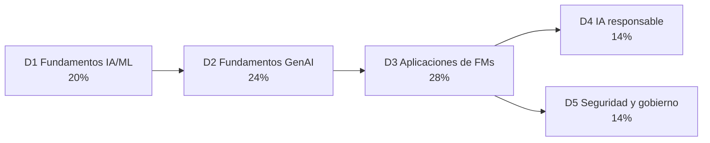

---
tags:
  - aws
  - certificacion
  - aif-c01
  - ia
---

# AWS Certified AI Practitioner (AIF-C01): resumen del examen

> Qué evalúa la certificación de entrada de IA de AWS, cómo es el examen, qué pesa cada dominio y un plan de 5 semanas para prepararlo desde cero.

## ¿Qué es?

**AWS Certified AI Practitioner** es una certificación de nivel **Foundational** (fundamentos). Valida que entiendes los conceptos de **artificial intelligence** (inteligencia artificial, IA), **machine learning** (aprendizaje automático, ML) y **generative AI** (IA generativa, GenAI), y que sabes **elegir** el servicio de AWS adecuado para un problema de negocio y usarlo de forma responsable y segura.

No es un examen para quien programa modelos: la propia guía dice que el perfil objetivo **usa** soluciones de IA/ML en AWS, pero **no necesariamente las construye**. Quedan fuera de alcance tareas como programar modelos, hacer *feature engineering*, ajustar hiperparámetros o hacer análisis matemático de modelos.

!!! info "Versión vigente de la guía (verificada en octubre de 2026)"
    - Código del examen: **AIF-C01** (no cambió de código).
    - La *exam guide* (guía del examen) tiene **versión 1.1, publicada el 30 de abril de 2026**. AWS publica los cambios unas cuatro semanas antes de aplicarlos al examen, así que el examen actual ya refleja la 1.1.
    - La 1.1 añadió **agentic AI** (IA agéntica), **Model Context Protocol (MCP)**, *context engineering*, precios por token, gestión de versiones de prompts, detección de alucinaciones y servicios nuevos (**Amazon Bedrock AgentCore**, **Kiro**, **Strands Agents**, **Amazon Quick**, **AWS Transform**). Si estudias con material de 2024–2025, te faltarán estos temas.

## Formato del examen

| Dato | Valor |
| --- | --- |
| Código | AIF-C01 |
| Nivel | Foundational |
| Preguntas | 65 en total: **50 puntuadas** + 15 sin puntuar (no sabes cuáles son) |
| Tipos de pregunta | *Multiple choice* (una correcta), *multiple response* (dos o más correctas), *ordering* (ordenar pasos) y *matching* (emparejar) |
| Duración | 90 minutos |
| Puntaje | Escala de 100 a 1000; **aprueba con 700**. Modelo compensatorio: no necesitas aprobar cada dominio, solo el total |
| Penalización por adivinar | No hay: responde todas (las no respondidas cuentan como incorrectas) |
| Costo | 100 USD (más impuestos o cargos de cambio de moneda) |
| Modalidad | Centro Pearson VUE o en línea con supervisión (*online proctored*) |
| Idiomas | Inglés, español (Latinoamérica), español (España), portugués (Brasil), francés, japonés, coreano, árabe, chino simplificado y tradicional, entre otros. El italiano y el alemán se retiraron después del 15 de octubre de 2026 |
| Validez | 3 años. Se renueva aprobando la versión vigente o la certificación Machine Learning Engineer – Associate |

!!! warning "Revisa precio e idiomas al agendar"
    El costo, los idiomas y las políticas de recertificación cambian. Confírmalos en la página oficial de la certificación antes de pagar.

### Experiencia recomendada

- Hasta **6 meses de exposición** a tecnologías de IA/ML en AWS (no hace falta haber construido modelos).
- Familiaridad con servicios base: **Amazon EC2**, **Amazon S3**, **AWS Lambda**, **Amazon Bedrock** y **Amazon SageMaker AI**.
- Conocer el **Shared Responsibility Model** (modelo de responsabilidad compartida), **AWS IAM** y los modelos de precios de AWS.

Si vienes de cero en AWS, conviene preparar antes [Cloud Practitioner](../cloud-practitioner/resumen-examen.md) o al menos sus temas de IAM, seguridad y precios.

## Objetivo profesional

### Perfil de candidato según AWS

La [exam guide oficial](https://docs.aws.amazon.com/aws-certification/latest/ai-practitioner-01/ai-practitioner-01.html) dice, resumido, que el examen es para quien quiere demostrar una **comprensión fundamental de los conceptos de IA y de las herramientas de IA de AWS**, con foco en **aplicaciones prácticas de negocio**. El *target candidate* tiene **hasta 6 meses de exposición** a tecnologías de IA/ML en AWS y **usa, pero no necesariamente construye**, soluciones de IA/ML. Debe estar familiarizado con los servicios base (EC2, S3, Lambda, Bedrock, SageMaker AI), el modelo de responsabilidad compartida, IAM y los modelos de precios. Quedan fuera: programar modelos, *feature engineering*, ajuste de hiperparámetros, construir pipelines de ML, análisis matemático de modelos e implementar marcos de seguridad o gobierno de IA.

### Para qué roles sirve

- Perfiles que **proponen, evalúan o integran** IA sin entrenar modelos: product managers, analistas, consultoría, preventa, Cloud Engineers que empiezan a trabajar con Amazon Bedrock.
- Primer paso hacia [MLOps / AI Platform Engineer](../../roles-profesionales.md#mlops-ai-platform-engineer), que luego exige certificaciones más técnicas.
- Ver todas las fichas en [Roles profesionales](../../roles-profesionales.md).

### Qué demuestra ante un empleador

| Demuestra | No demuestra |
| --- | --- |
| Que entiendes ML, IA generativa, RAG, agentes y sus límites (alucinaciones, sesgo, costos por token) | Que sepas entrenar, ajustar o desplegar modelos |
| Que sabes elegir entre Bedrock, SageMaker AI, Amazon Q y servicios de IA ya entrenados | Experiencia construyendo aplicaciones de IA en producción |
| Criterio de IA responsable, seguridad y gobierno al proponer una solución | Capacidad de implementar controles de seguridad o MLOps |

### Qué certificación sigue

- [Solutions Architect – Associate](../solutions-architect-associate/resumen-examen.md), para diseñar la arquitectura alrededor de la IA.
- Machine Learning Engineer – Associate (versión MLA-C02 en 2027), si quieres construir y operar modelos: ver [Otras certificaciones](../../otras-certificaciones.md#aws-el-resto-del-catalogo).

## Dominios y pesos

| Dominio | Peso | Qué cubre | Nota |
| --- | --- | --- | --- |
| 1. Fundamentals of AI and ML | 20% | Conceptos de IA/ML, tipos de aprendizaje e inferencia, casos de uso, ciclo de vida de ML, MLOps, métricas | [Dominio 1](dominio-1-fundamentos-ia-ml.md) |
| 2. Fundamentals of GenAI | 24% | Tokens, embeddings, transformers, foundation models, precios por token, *context engineering*, agentes, ventajas y límites, servicios de GenAI de AWS | [Dominio 2](dominio-2-fundamentos-ia-generativa.md) |
| 3. Applications of Foundation Models | **28%** | Elegir modelos, parámetros de inferencia, RAG, bases vectoriales, personalización, agentes, prompt engineering, fine-tuning, evaluación | [Dominio 3](dominio-3-aplicaciones-modelos-fundacionales.md) |
| 4. Guidelines for Responsible AI | 14% | Sesgo, equidad, robustez, seguridad, riesgos legales, transparencia y explicabilidad | [Dominio 4](dominio-4-ia-responsable.md) |
| 5. Security, Compliance, and Governance for AI Solutions | 14% | IAM, cifrado, PrivateLink, Guardrails, AgentCore Identity/Policy, linaje de datos, prompt injection, alucinaciones, servicios de gobierno | [Dominio 5](dominio-5-seguridad-cumplimiento-gobierno.md) |

Los dominios 2 y 3 suman **52%**: más de la mitad del examen es IA generativa.

## Servicios dentro y fuera de alcance

La lista oficial no es exhaustiva, pero sirve para priorizar.

| Categoría | En alcance (resumen) |
| --- | --- |
| Machine Learning | **Amazon Bedrock**, **Amazon Bedrock AgentCore**, **Amazon SageMaker AI**, **SageMaker JumpStart**, **Amazon Nova**, Amazon Comprehend, Amazon Lex, Amazon Personalize, Amazon Polly, Amazon Rekognition, Amazon Textract, Amazon Transcribe, Amazon Translate, AWS Transform |
| Developer Tools | **Kiro**, **Strands Agents** |
| Analytics | **Amazon Quick**, Amazon OpenSearch Service, AWS Glue, AWS Glue DataBrew, AWS Lake Formation, Amazon EMR, Amazon Redshift, AWS Data Exchange |
| Database | Amazon Aurora, Amazon RDS, Amazon Neptune, Amazon DocumentDB, Amazon DynamoDB, Amazon ElastiCache |
| Seguridad | AWS IAM, AWS KMS, Amazon Macie, AWS Secrets Manager, Amazon Inspector, AWS Artifact |
| Gestión y gobierno | AWS CloudTrail, Amazon CloudWatch, AWS Config, AWS Trusted Advisor, AWS Well-Architected Tool |
| Otros | Amazon EC2, AWS Lambda, Amazon ECS, Amazon EKS, Amazon S3, Amazon S3 Glacier, Amazon VPC, Amazon CloudFront, AWS Budgets, AWS Cost Explorer |

**Fuera de alcance** (ejemplos): AWS Organizations, AWS IAM Identity Center, Amazon GuardDuty, AWS Security Hub, AWS WAF, AWS Shield, Amazon Cognito, Route 53, servicios de IoT y de medios, AWS HealthImaging/HealthOmics, AWS Panorama, Amazon Monitron.

!!! note "Renombres y servicios que conviene tener claros"
    - **Amazon SageMaker AI** es el nombre actual (desde el 3 de diciembre de 2024) del servicio de ML que antes se llamaba Amazon SageMaker. "Amazon SageMaker" ahora es la **plataforma unificada** de datos, analítica e IA (incluye SageMaker Unified Studio, SageMaker AI y Bedrock). Las APIs siguen usando `sagemaker`.
    - **Amazon Quick** (antes Amazon QuickSight → Amazon Quick Suite) es el espacio de trabajo con agentes, investigación, automatización y BI. AWS lo presenta como **la evolución de Amazon Q Business**, que ya no acepta clientes nuevos.
    - **Amazon Q Developer**: sus plugins de IDE y suscripciones pagadas dejan de tener soporte el **30 de abril de 2027** y AWS recomienda migrar a **Kiro**. Amazon Q en la consola de AWS sigue funcionando.
    - **Amazon Kendra** y **Amazon Forecast** ya no aparecen en la lista de servicios en alcance (Forecast no acepta clientes nuevos). Puedes encontrarlos en material antiguo.

## Plan de estudio de 5 semanas

Pensado para unas 6–8 horas por semana, empezando sin conocimientos de IA.

| Semana | Foco | Actividades |
| --- | --- | --- |
| 1 | Dominio 1 | Lee la nota del dominio 1. Curso gratuito *Fundamentals of Machine Learning and Artificial Intelligence* en Skill Builder. Aprende de memoria la matriz de confusión y qué servicio de IA preentrenado resuelve cada problema |
| 2 | Dominio 2 | Nota del dominio 2. Entra a la consola de Bedrock, prueba el *playground* con dos modelos distintos y mira el conteo de tokens. Repasa agentes y MCP |
| 3 | Dominio 3 | Nota del dominio 3 (el que más pesa). Crea una Knowledge Base pequeña con PDFs en S3 (bórrala después para no generar costos). Practica prompts zero-shot, few-shot y chain-of-thought |
| 4 | Dominios 4 y 5 | Notas de los dominios 4 y 5. Crea un guardrail de prueba en Bedrock. Repasa la Generative AI Security Scoping Matrix y los servicios de gobierno |
| 5 | Repaso y práctica | *Official Practice Question Set* y *Official Pretest* en Skill Builder. Repasa los fallos por dominio, relee los "En el examen" de cada nota. Agenda el examen cuando superes con holgura el 70% en práctica |

Si ya tienes Cloud Practitioner y experiencia con IA, puedes comprimirlo a 3–4 semanas.

!!! tip "Laboratorios con costo controlado"
    Bedrock cobra por token y servicios como OpenSearch Serverless o los endpoints de SageMaker AI cobran por hora aunque no los uses. Crea una alarma de AWS Budgets antes de practicar y borra los recursos al terminar. Ver [FinOps y costos](../../../cloud/fundamentos/finops-costos.md).

## Recursos oficiales gratuitos

| Recurso | Para qué sirve |
| --- | --- |
| [Exam guide AIF-C01](https://docs.aws.amazon.com/aws-certification/latest/ai-practitioner-01/ai-practitioner-01.html) | La fuente de verdad: dominios, objetivos y servicios |
| [Página de la certificación](https://aws.amazon.com/certification/certified-ai-practitioner/) | Precio, idiomas, agenda y enlaces de preparación |
| [AWS Skill Builder](https://skillbuilder.aws/) | *Exam Prep Plan* de 4 pasos, cursos digitales, *Official Practice Question Set* y *Official Pretest* (gratuitos con cuenta) |
| AWS Cloud Quest, AWS SimuLearn, AWS Jam, AWS Escape Room | Práctica guiada en escenarios; parte del contenido es de suscripción |
| [AWS Workshops](https://workshops.aws/) | Laboratorios paso a paso de Bedrock, agentes y SageMaker AI |
| [Documentación de Amazon Bedrock](https://docs.aws.amazon.com/es_es/bedrock/latest/userguide/what-is-bedrock.html) | Referencia de Knowledge Bases, Agents, Guardrails y Evaluations |

!!! warning "Evita los *dumps*"
    Los bancos de "preguntas reales" violan el acuerdo del candidato y pueden costarte la certificación. Usa solo preguntas de práctica originales (como las de estas notas) y las oficiales.

## Consejos para el día del examen

- **Tiempo**: 90 minutos para 65 preguntas son unos 80 segundos por pregunta. Marca para revisión (*flag for review*) las que dudes y sigue; vuelve al final.
- **Lee primero la última frase**: ahí está lo que de verdad se pregunta ("¿qué servicio…?", "¿qué métrica…?").
- **Busca las palabras clave** que deciden entre opciones parecidas:

| Palabra clave en la pregunta | Suele apuntar a |
| --- | --- |
| *LEAST operational overhead*, *without managing infrastructure*, *no ML expertise* | Servicio gestionado o preentrenado (Bedrock, Comprehend, Rekognition…), no SageMaker AI ni EC2 |
| *MOST cost-effective* para conocimiento que cambia | RAG (Knowledge Bases) antes que fine-tuning |
| *Full control*, *custom algorithm*, *train your own model* | SageMaker AI |
| *Labeled data* / *unlabeled data* | Fine-tuning supervisado / continued pre-training o aprendizaje no supervisado |
| *Explain predictions*, *detect bias* | SageMaker Clarify |
| *Block topics*, *filter harmful content*, *redact PII in prompts* | Amazon Bedrock Guardrails |
| *PII in S3 buckets* | Amazon Macie |
| *Private connectivity*, *without traversing the internet* | AWS PrivateLink (VPC endpoints) |
| *Who called the API* | AWS CloudTrail |
| *Compliance reports* (SOC, ISO) | AWS Artifact |

- **Descarta**: suele haber dos opciones claramente fuera de lugar (un servicio que no es de IA, o uno de otra categoría). Decide entre las otras dos con la palabra clave.
- **Respuestas múltiples**: la pregunta dice cuántas elegir ("Choose two"); sin todas las correctas no hay punto.
- **No sobrepienses**: es un examen de fundamentos. Si una opción exige construir algo complejo y otra lo resuelve con un servicio gestionado, casi siempre gana la gestionada.

## Para profundizar

| Tema | Nota del cuaderno |
| --- | --- |
| Base de AWS para no partir de cero | [Cloud Practitioner](../cloud-practitioner/resumen-examen.md), [Modelos de servicio y regiones](../../../cloud/fundamentos/modelos-de-servicio-y-regiones.md) |
| Responsabilidad compartida | [Shared Responsibility Model](../../../cloud/fundamentos/responsabilidad-compartida.md) |
| IAM y seguridad base | [IAM: AWS, Azure y GCP](../../../cloud/identidad-y-seguridad/iam-comparativa.md), [Seguridad base](../../../cloud/identidad-y-seguridad/seguridad-base.md) |
| Costos | [FinOps y costos](../../../cloud/fundamentos/finops-costos.md) |
| Cumplimiento y riesgo | [Cumplimiento y gobierno](../../../devsecops/gobierno-y-respuesta/cumplimiento.md), [Gobierno y riesgo de TI](../../../negocio/gobierno-riesgo-ti.md) |
| Automatizar con Python | [Automatización cloud con SDKs](../../../python/scripting/automatizacion-cloud.md) |

## Referencias

- [AWS Certified AI Practitioner (AIF-C01) – exam guide](https://docs.aws.amazon.com/aws-certification/latest/ai-practitioner-01/ai-practitioner-01.html)
- [Revisiones de la exam guide AIF-C01](https://docs.aws.amazon.com/aws-certification/latest/ai-practitioner-01/aif-01-revisions.html)
- [Servicios en alcance](https://docs.aws.amazon.com/aws-certification/latest/ai-practitioner-01/aif-01-in-scope-services.html) y [fuera de alcance](https://docs.aws.amazon.com/aws-certification/latest/ai-practitioner-01/aif-01-out-of-scope-services.html)
- [Página oficial de la certificación](https://aws.amazon.com/certification/certified-ai-practitioner/)
- [Qué es Amazon SageMaker AI (nota sobre el renombre)](https://docs.aws.amazon.com/sagemaker/latest/dg/whatis.html)
- [Qué es Amazon Quick](https://docs.aws.amazon.com/quicksuite/latest/userguide/what-is.html)
