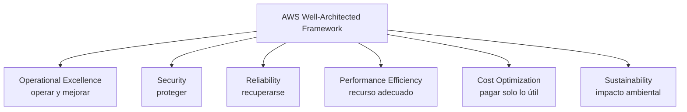

---
tags:
  - aws
  - certificacion
  - clf-c02
  - arquitectura
  - finops
---

# Dominio 1: Cloud Concepts (24%)

> Por qué una organización se va a la nube: los beneficios de AWS, los seis pilares de Well-Architected, cómo se planifica una migración y cómo cambia la economía frente a un datacenter propio.

!!! info "Qué evalúa este dominio"
    Según la guía oficial de CLF-C02, cuatro *task statements* (enunciados de tarea):

    - **1.1** Definir los beneficios de AWS Cloud: propuesta de valor, infraestructura global (velocidad de despliegue, alcance global), high availability, elasticidad y agilidad.
    - **1.2** Identificar los principios de diseño: los pilares del **AWS Well-Architected Framework** y en qué se diferencian.
    - **1.3** Beneficios y estrategias de migración: **AWS Cloud Adoption Framework (AWS CAF)** y estrategias de migración (p. ej. replicación de bases de datos).
    - **1.4** Economía de la nube: costos fijos vs variables, costos on-premises, licencias (BYOL vs incluidas), rightsizing, automatización y economías de escala.

    Vuelve al [resumen del examen](resumen-examen.md) para ver el formato y el plan de estudio.

## Beneficios de la nube de AWS

**Cloud computing** (computación en la nube) es la entrega de recursos de TI **on-demand** (bajo demanda) por internet, con **pay-as-you-go pricing** (pago por uso). En vez de comprar servidores, los "alquilas" por segundos, horas o peticiones. Los modelos IaaS, PaaS y SaaS están en [Modelos de servicio y regiones](../../../cloud/fundamentos/modelos-de-servicio-y-regiones.md).

### Las seis ventajas de la nube

El whitepaper *Overview of Amazon Web Services* resume la propuesta de valor en **seis ventajas**. Apréndelas con su nombre en inglés porque el examen las parafrasea:

| Ventaja (nombre oficial) | Qué significa | Ejemplo |
| --- | --- | --- |
| **Trade fixed expense for variable expense** (cambiar gasto fijo por variable) | No inviertes por adelantado en hardware; pagas solo lo que consumes | Una startup no compra servidores: paga EC2 por hora |
| **Benefit from massive economies of scale** (economías de escala masivas) | AWS compra a escala gigantesca y traslada parte del ahorro en precios más bajos | Bajadas de precio históricas de S3 y EC2 |
| **Stop guessing capacity** (deja de adivinar la capacidad) | Escalas según la demanda real; no sobredimensionas "por si acaso" | Auto Scaling en el Black Friday |
| **Increase speed and agility** (más velocidad y agilidad) | Recursos nuevos en minutos, no en semanas de compra | Un entorno de pruebas listo en 10 minutos |
| **Stop spending money running and maintaining data centers** (deja de gastar en operar datacenters) | Inviertes en tu producto, no en energía, refrigeración y racks | Cerrar un datacenter propio |
| **Go global in minutes** (global en minutos) | Despliegas en otras regiones del mundo con pocos clics | Llevar la app a Europa sin construir allí |

### High availability, elasticidad y agilidad

Tres conceptos que el examen distingue con cuidado:

| Concepto | Definición | Servicio típico |
| --- | --- | --- |
| **High availability** (alta disponibilidad) | El sistema sigue funcionando aunque falle un componente, gracias a redundancia | Varias **Availability Zones**, Elastic Load Balancing |
| **Elasticity** (elasticidad) | Crecer **y decrecer** automáticamente según la demanda | Amazon EC2 Auto Scaling, Lambda |
| **Scalability** (escalabilidad) | Capacidad de crecer para atender más carga (vertical u horizontal) | Cambiar el instance type, añadir instancias |
| **Agility** (agilidad) | Probar, lanzar y descartar rápido y barato | Crear y borrar entornos con CloudFormation |
| **Fault tolerance** (tolerancia a fallos) | Seguir funcionando **sin interrupción** ante un fallo (más exigente que HA) | Arquitecturas activo-activo multi-AZ |

La infraestructura global (Regions, Availability Zones, edge locations) se explica en el [Dominio 3](dominio-3-tecnologia-servicios.md) y a fondo en [Resiliencia](../../../cloud/operacion-y-gobierno/resiliencia.md).

!!! tip "En el examen"
    - "Pagar solo por lo que usas", "sin inversión inicial" → **trade fixed expense for variable expense**.
    - "Ajustarse automáticamente a la demanda, hacia arriba **y hacia abajo**" → **elasticity** (no "scalability").
    - "Llegar a usuarios de otro continente rápidamente" → **go global in minutes**.
    - "Precios más bajos porque AWS tiene millones de clientes" → **economies of scale**.

## Principios de diseño: AWS Well-Architected Framework

El **AWS Well-Architected Framework** es el conjunto de buenas prácticas de AWS para evaluar una arquitectura. Tiene **seis pilares**; el detalle completo (preguntas, design principles generales, Well-Architected Tool) está en [Well-Architected Framework](../../../cloud/fundamentos/well-architected.md). Aquí solo lo que necesitas para distinguirlos:

| Pilar | Palabra clave para reconocerlo | Ejemplo de pregunta tipo |
| --- | --- | --- |
| **Operational Excellence** | Operar, monitorear, mejorar procesos; IaC; cambios pequeños y reversibles | "Automatizar despliegues y aprender de los fallos" |
| **Security** | Proteger datos y accesos; least privilege; trazabilidad; cifrado | "Aplicar seguridad en todas las capas" |
| **Reliability** | Recuperarse de fallos; escalar; probar recuperación | "Recuperarse automáticamente de un fallo" |
| **Performance Efficiency** | Usar los recursos adecuados; serverless; experimentar más; global en minutos | "Elegir el tipo de recurso correcto para la carga" |
| **Cost Optimization** | Pagar solo por lo que aporta valor; medir eficiencia; rightsizing | "Adoptar un modelo de consumo" |
| **Sustainability** | Reducir el impacto ambiental; maximizar la utilización | "Minimizar los recursos necesarios" |

!!! tip "En el examen"
    - **Reliability vs Performance Efficiency**: si el escenario habla de *fallos* y *recuperación*, es Reliability; si habla de *elegir el recurso más adecuado* o *usar tecnologías avanzadas como servicio*, es Performance Efficiency.
    - **Operational Excellence vs Reliability**: "operations as code", runbooks y postmortems son Operational Excellence; Multi-AZ y backups probados son Reliability.
    - Si preguntan por una herramienta para revisar una arquitectura contra los pilares: **AWS Well-Architected Tool** (gratuita).
    - Son **seis** pilares. Si una opción menciona "Scalability pillar" o "Availability pillar", es una trampa.

## Migración: AWS Cloud Adoption Framework y estrategias

### AWS Cloud Adoption Framework (AWS CAF)

El **AWS CAF** (marco de adopción de la nube) guía la transformación de una **organización** (no de un workload, eso es Well-Architected). Organiza las capacidades en **seis perspectivas**:

| Perspectiva | Quién la lidera (típicamente) | De qué trata |
| --- | --- | --- |
| **Business** | CEO, CFO, COO, estrategia | Que la inversión en la nube acelere los resultados de negocio |
| **People** | RR. HH., liderazgo | Cultura, habilidades, estructura organizativa, gestión del cambio |
| **Governance** | CFO, CIO, PMO, riesgo | Gestionar riesgos, programas y beneficios; gestión financiera de la nube |
| **Platform** | CTO, arquitectos | Construir una plataforma cloud escalable e híbrida |
| **Security** | CISO, seguridad | Confidencialidad, integridad y disponibilidad de datos y workloads |
| **Operations** | Operaciones, soporte | Que los servicios cloud se entreguen al nivel acordado |

Truco de memoria: las tres primeras (Business, People, Governance) son **de negocio**; las tres últimas (Platform, Security, Operations) son **técnicas**.

Según la guía del examen, el CAF busca cuatro **business outcomes** (resultados de negocio): **reduced business risk** (menos riesgo de negocio), **improved ESG performance** (mejor desempeño ambiental, social y de gobernanza), **increased revenue** (más ingresos) e **increased operational efficiency** (más eficiencia operativa). El CAF también describe un ciclo de cuatro fases: **Envision, Align, Launch, Scale** (imaginar, alinear, lanzar, escalar).

### Estrategias de migración: las 7 R

Las estrategias (rehost, replatform, refactor, repurchase, relocate, retain, retire) y las fases de una migración están explicadas en [Migración a la nube](../../../cloud/arquitectura/migracion-cloud.md). Para el examen basta reconocerlas:

| Estrategia | Frase que la delata |
| --- | --- |
| **Rehost** ("lift and shift") | "Mover tal cual, sin cambios, lo más rápido posible" |
| **Replatform** ("lift, tinker and shift") | "Pequeños ajustes, p. ej. pasar la BD a Amazon RDS" |
| **Refactor / re-architect** | "Rediseñar para cloud-native, serverless o microservicios" |
| **Repurchase** ("drop and shop") | "Cambiar a un producto SaaS" |
| **Relocate** | "Mover VMware a la nube a nivel de hipervisor (VMware Cloud on AWS)" |
| **Retain** | "Dejarlo on-premises por ahora" |
| **Retire** | "Apagarlo porque ya no se usa" |

### Herramientas y recursos de migración

| Servicio | Para qué sirve |
| --- | --- |
| **AWS Application Discovery Service** | Descubre servidores on-premises, su uso y dependencias |
| **Migration Evaluator** | Crea un **business case** (caso de negocio) con el costo proyectado en AWS |
| **AWS Migration Hub** | Punto central para seguir el progreso de la migración |
| **AWS Application Migration Service** | **Rehost** de servidores: replica y lanza en EC2 |
| **AWS Database Migration Service (AWS DMS)** | Migra y **replica** bases de datos con mínimo tiempo de inactividad |
| **AWS Schema Conversion Tool (AWS SCT)** | Convierte el esquema entre motores distintos (p. ej. Oracle → Aurora PostgreSQL) |

!!! tip "En el examen"
    - "Migrar la base de datos **sin parar la aplicación**" → **AWS DMS** (replicación continua). Si además cambia el motor → **DMS + SCT**.
    - "Guía para alinear personas, procesos y tecnología en la adopción" → **AWS CAF**. "Revisar la arquitectura de un workload" → **Well-Architected**.
    - "Capacitar al equipo y gestionar el cambio cultural" → perspectiva **People**.
    - Para mover grandes volúmenes sin red, los materiales antiguos citan la familia **AWS Snow**; no está en la lista de servicios en alcance de la guía vigente y AWS limitó su disponibilidad para clientes nuevos, así que no la priorices.

## Economía de la nube

El detalle de CapEx vs OpEx, TCO y business case está en [TI y negocio](../../../negocio/ti-y-negocio.md); las prácticas de optimización, en [FinOps y costos](../../../cloud/fundamentos/finops-costos.md).

### Costos fijos vs variables

| On-premises | AWS Cloud |
| --- | --- |
| **CapEx** (*capital expenditure*, gasto de capital): compras servidores por adelantado | **OpEx** (*operational expenditure*, gasto operativo): pagas por uso |
| Costo **fijo**, lo uses o no | Costo **variable**, sube y baja con la demanda |
| Dimensionas para el pico y el resto del año sobra capacidad | Escalas según la demanda |

### Costos on-premises que se olvidan

Al calcular el **TCO** (*Total Cost of Ownership*, costo total de propiedad) de un datacenter propio no basta con el precio del servidor. Hay que sumar: espacio físico, energía, refrigeración, red y enlaces, seguridad física, hardware de repuesto, licencias, mantenimiento, renovación del hardware cada pocos años y el **personal** que lo opera. La nube elimina o reduce muchos de esos costos **indirectos**.

### Licencias: BYOL vs incluidas

| Modelo | Cómo funciona | Cuándo conviene |
| --- | --- | --- |
| **License included** (licencia incluida) | El precio por hora de la instancia o de RDS ya incluye la licencia (p. ej. Windows Server, SQL Server, Oracle SE2 en RDS) | No tienes licencias o quieres flexibilidad |
| **BYOL** (*Bring Your Own License*, trae tu propia licencia) | Usas licencias que ya compraste; pagas solo la infraestructura | Ya tienes licencias con derechos de uso en la nube. A veces exige **Dedicated Hosts** |

**AWS License Manager** ayuda a controlar el uso de licencias (BYOL incluidas) para no excederse.

### Rightsizing, automatización y economías de escala

- **Rightsizing** (ajustar el tamaño): elegir el tamaño de instancia según el uso real. Herramientas: **AWS Compute Optimizer** y las recomendaciones de **Cost Explorer**.
- **Automatización**: con IaC (CloudFormation, ver [Infrastructure as Code](../../../devops/iac/infraestructura-como-codigo.md)) y scripts, los entornos se crean y destruyen de forma repetible, con menos errores y menos horas de personal; también puedes **apagar** entornos fuera de horario.
- **Economies of scale**: AWS compra hardware y energía a escala y lo traslada en precios más bajos.

!!! tip "En el examen"
    - "Costo que **no** se elimina al migrar": tus datos, tus aplicaciones y la gestión de accesos siguen siendo tuyos (y su costo). Lo que desaparece es lo físico.
    - "Reducir costos de licencias de Windows/SQL que ya tienes" → **BYOL** (posiblemente con **Dedicated Hosts**).
    - "Identificar instancias sobredimensionadas" → **AWS Compute Optimizer** (o rightsizing en Cost Explorer).

## Casos de uso

1. **Una tienda online tiene picos enormes en fechas de oferta y el resto del año sus servidores están al 10%.** → Elasticidad con **Amazon EC2 Auto Scaling** detrás de un **load balancer**. Porqué: dejas de pagar el pico todo el año (*stop guessing capacity*).
2. **Una startup sin capital quiere lanzar su producto sin comprar hardware.** → Modelo **pay-as-you-go**: cambia gasto fijo por variable.
3. **Un banco quiere un marco para preparar a su gente, sus procesos y su gobierno antes de migrar.** → **AWS CAF** (perspectivas People y Governance).
4. **Una empresa tiene un ERP antiguo que solo quiere mover a EC2 sin cambios antes de que venza el contrato del datacenter.** → **Rehost** con **AWS Application Migration Service**.
5. **Un equipo migra una base Oracle a Amazon Aurora PostgreSQL con mínima interrupción.** → **AWS SCT** para el esquema y **AWS DMS** para los datos con replicación continua.
6. **La dirección pide justificar la migración con números.** → **Migration Evaluator** para el business case y TCO; [TI y negocio](../../../negocio/ti-y-negocio.md) explica cómo presentarlo.
7. **Un arquitecto quiere saber si su workload sigue buenas prácticas de fiabilidad y costos.** → **AWS Well-Architected Tool** con una review de los pilares.
8. **Una empresa tiene licencias de SQL Server con Software Assurance y no quiere pagarlas dos veces.** → **BYOL**, controlado con **AWS License Manager**.

## Preguntas de práctica

**1.** Una empresa quiere dejar de comprar servidores para picos que solo ocurren dos veces al año. ¿Qué ventaja de la nube describe mejor su objetivo?

- A. Go global in minutes
- B. Stop guessing capacity
- C. Benefit from massive economies of scale
- D. Stop spending money running and maintaining data centers

??? success "Respuesta"
    **B.** El problema es dimensionar para el pico. A habla de alcance geográfico; C de precios más bajos por volumen de AWS; D de dejar de operar instalaciones físicas, no de capacidad.

**2.** ¿Qué pilar del AWS Well-Architected Framework se centra en la capacidad de un workload para recuperarse de fallos de infraestructura?

- A. Operational Excellence
- B. Performance Efficiency
- C. Reliability
- D. Security

??? success "Respuesta"
    **C.** Reliability trata la recuperación ante fallos y la gestión de cambios en la demanda. A trata operar y mejorar procesos; B elegir los recursos adecuados; D proteger datos y accesos.

**3.** ¿Qué perspectiva del AWS CAF se ocupa de la cultura organizativa, la formación y la gestión del cambio?

- A. Business
- B. People
- C. Platform
- D. Operations

??? success "Respuesta"
    **B.** People cubre cultura, talento y gestión del cambio. Business cubre estrategia y resultados; Platform la plataforma técnica; Operations la entrega del servicio al nivel acordado.

**4.** Una empresa migra su aplicación a EC2 y, al mismo tiempo, mueve su base de datos MySQL autogestionada a Amazon RDS for MySQL sin cambiar el código. ¿Qué estrategia aplica a la base de datos?

- A. Rehost
- B. Replatform
- C. Refactor
- D. Retain

??? success "Respuesta"
    **B.** Pasar a un servicio gestionado sin rediseñar es replatform. Rehost sería instalar MySQL en EC2 tal cual; Refactor implicaría rediseñar la aplicación; Retain sería dejarla on-premises.

**5.** ¿Cuáles DOS son beneficios económicos de mover cargas a AWS? (Elige dos.)

- A. Cambiar gastos variables por gastos de capital
- B. Reducir costos de energía y refrigeración del datacenter
- C. Eliminar la responsabilidad del cliente sobre los datos
- D. Pagar solo por los recursos que se consumen
- E. Obtener licencias de software gratis para todas las aplicaciones

??? success "Respuesta"
    **B y D.** A está al revés (se cambia CapEx por gasto variable). C es falso por el Shared Responsibility Model: los datos siguen siendo tuyos. E es falso: las licencias se pagan (incluidas en el precio o BYOL).

**6.** Una empresa necesita migrar una base de datos Oracle on-premises a Amazon Aurora PostgreSQL. ¿Qué combinación de servicios es la adecuada?

- A. AWS Application Migration Service y AWS Backup
- B. AWS Schema Conversion Tool y AWS Database Migration Service
- C. AWS Migration Hub y Amazon RDS Proxy
- D. AWS DataSync y AWS Storage Gateway

??? success "Respuesta"
    **B.** SCT convierte el esquema entre motores distintos y DMS mueve y replica los datos. A sirve para rehost de servidores y backups; C sigue el progreso, pero no convierte; D mueve archivos, no bases de datos.

## Para profundizar

- [Modelos de servicio y regiones](../../../cloud/fundamentos/modelos-de-servicio-y-regiones.md): IaaS, PaaS, SaaS e infraestructura global.
- [Well-Architected Framework](../../../cloud/fundamentos/well-architected.md): pilares, design principles, Well-Architected Tool y lenses.
- [Migración a la nube](../../../cloud/arquitectura/migracion-cloud.md): las 7 R, fases y herramientas.
- [FinOps y costos](../../../cloud/fundamentos/finops-costos.md): cómo se cobra la nube y prácticas de optimización.
- [TI y negocio](../../../negocio/ti-y-negocio.md): CapEx vs OpEx, TCO, ROI y business case.
- [Resiliencia](../../../cloud/operacion-y-gobierno/resiliencia.md): high availability, autoscaling y disaster recovery.

## Referencias

- [Exam guide CLF-C02: Domain 1](https://docs.aws.amazon.com/aws-certification/latest/cloud-practitioner-02/cloud-practitioner-02-domain1.html)
- [Six advantages of cloud computing](https://docs.aws.amazon.com/whitepapers/latest/aws-overview/six-advantages-of-cloud-computing.html)
- [AWS Well-Architected Framework](https://docs.aws.amazon.com/wellarchitected/latest/framework/welcome.html)
- [AWS Cloud Adoption Framework](https://aws.amazon.com/cloud-adoption-framework/)
- [Migration strategies (AWS Prescriptive Guidance)](https://docs.aws.amazon.com/prescriptive-guidance/latest/large-migration-guide/migration-strategies.html)
- [AWS Database Migration Service](https://docs.aws.amazon.com/dms/latest/userguide/Welcome.html)
