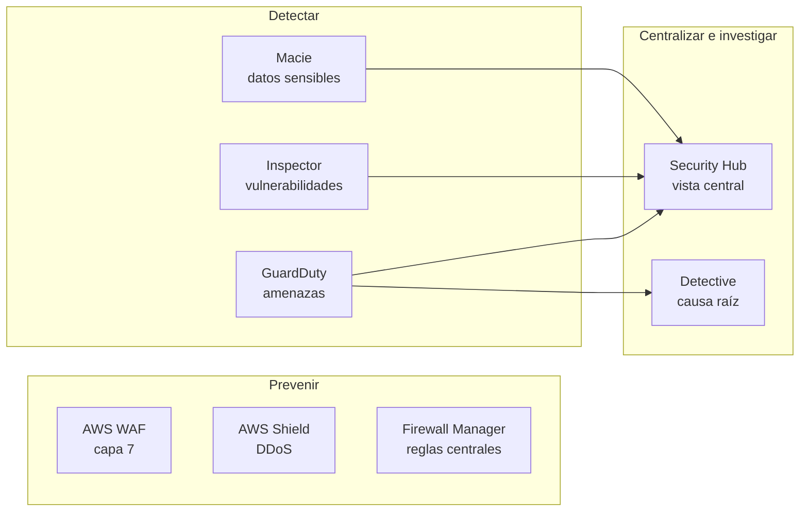

---
tags:
  - aws
  - certificacion
  - clf-c02
  - seguridad
  - iam
  - cumplimiento
---

# Dominio 2: Security and Compliance (30%)

> Quién protege qué en AWS, dónde se encuentran los informes de cumplimiento y los logs, cómo se gestionan las identidades (y el usuario root) y qué servicio de seguridad usar en cada caso.

!!! info "Qué evalúa este dominio"
    Según la guía oficial de CLF-C02, cuatro *task statements*:

    - **2.1** Entender el **AWS shared responsibility model**: qué hace AWS, qué hace el cliente, qué se comparte y cómo cambia según el servicio (Amazon EC2, Amazon RDS, AWS Lambda).
    - **2.2** Conceptos de seguridad, gobierno y cumplimiento: dónde encontrar información de cumplimiento (**AWS Artifact**), cifrado en tránsito y en reposo, servicios para proteger recursos (Inspector, Security Hub, GuardDuty, Shield) y para gobierno (CloudWatch, CloudTrail, Config, access reports).
    - **2.3** Gestión de accesos: **IAM**, protección del **root user**, **least privilege**, **IAM Identity Center**, access keys y políticas de contraseñas, almacenamiento de credenciales (Secrets Manager, Systems Manager), MFA, roles entre cuentas y federación.
    - **2.4** Componentes y recursos de seguridad: AWS WAF, Firewall Manager, Shield, GuardDuty, productos de terceros en **AWS Marketplace**, fuentes de información (Knowledge Center, Security Center, Security Blog) y **Trusted Advisor**.

    Es el **segundo dominio con más peso**. Vuelve al [resumen del examen](resumen-examen.md) para el plan de estudio.

## Shared Responsibility Model

AWS es responsable de la **security OF the cloud** (seguridad **de** la nube: datacenters, hardware, red global, hipervisor). Tú eres responsable de la **security IN the cloud** (seguridad **en** la nube: tus datos, tus identidades, tu configuración). La explicación completa, con la tabla por capas IaaS/PaaS/SaaS, está en [Shared Responsibility Model](../../../cloud/fundamentos/responsabilidad-compartida.md).

### Cómo cambia según el servicio

La guía pide explícitamente comparar EC2, RDS y Lambda. Cuanto más **managed** es el servicio, menos te toca:

| Tarea | Amazon EC2 (IaaS) | Amazon RDS (gestionado) | AWS Lambda (serverless) |
| --- | --- | --- | --- |
| Seguridad física, hardware, hipervisor | AWS | AWS | AWS |
| Parches del sistema operativo | **Cliente** | AWS | AWS |
| Parches del motor de base de datos o del runtime | **Cliente** (lo que instales) | AWS (en la ventana de mantenimiento que eliges) | AWS |
| Configurar security groups / acceso de red | **Cliente** | **Cliente** | **Cliente** (si la conectas a una VPC) |
| Código de la aplicación | **Cliente** | **Cliente** (consultas, esquema) | **Cliente** |
| Datos y su cifrado | **Cliente** | **Cliente** (activar cifrado) | **Cliente** |
| IAM: quién accede | **Cliente** | **Cliente** | **Cliente** (execution role) |

### Controles compartidos

Algunos controles los hacen **las dos partes**, cada una en su capa:

- **Patch management** (gestión de parches): AWS parchea la infraestructura; tú parcheas tus sistemas operativos y aplicaciones.
- **Configuration management** (gestión de configuración): AWS configura sus dispositivos; tú configuras tus sistemas, bases de datos y aplicaciones.
- **Awareness and training** (concienciación y formación): AWS forma a sus empleados; tú a los tuyos.

Además hay **controles heredados** (*inherited controls*): los físicos y ambientales, que el cliente hereda completamente de AWS.

!!! tip "En el examen"
    - "Parchear el sistema operativo de una instancia EC2" → **cliente**. "Parchear el SO de RDS" → **AWS**.
    - "Proteger el hardware o destruir discos al final de su vida útil" → **AWS**.
    - **IAM** y los **datos** son siempre del cliente, en cualquier modelo.
    - "Responsabilidad compartida" en una opción de respuesta suele referirse a parches, configuración o formación.

## Seguridad, gobierno y cumplimiento

### Información de cumplimiento: AWS Artifact y AWS compliance

- **AWS Artifact**: portal **self-service** (autoservicio y gratuito) para descargar los **informes de auditoría** de AWS (SOC 1/2/3, ISO 27001, PCI DSS…) en **Artifact Reports** y aceptar acuerdos como el **BAA** (*Business Associate Addendum*, para HIPAA) en **Artifact Agreements**.
- **AWS Compliance Programs**: la página que lista los programas por país e industria (HIPAA en salud de EE. UU., GDPR en la UE, PCI DSS en pagos, FedRAMP en el gobierno de EE. UU.).
- **AWS Services in Scope by Compliance Program**: no todos los servicios están certificados para todo; hay que comprobar que el servicio que vas a usar está **en alcance** del programa que te aplica.

Que AWS esté certificado **no** hace que tu aplicación cumpla automáticamente: la certificación cubre la parte de AWS. Tu parte la evalúas tú (ver [Cumplimiento y gobierno](../../../devsecops/gobierno-y-respuesta/cumplimiento.md)).

### Cifrado

| Tipo | Qué protege | Servicios |
| --- | --- | --- |
| **Encryption in transit** (cifrado en tránsito) | Datos que viajan por la red | TLS/HTTPS, **AWS Certificate Manager (ACM)** para certificados, VPN |
| **Encryption at rest** (cifrado en reposo) | Datos guardados | **AWS KMS** (*Key Management Service*) en S3, EBS, RDS, DynamoDB… |
| Claves en hardware dedicado | Requisitos regulatorios estrictos (claves en un **HSM** de un solo cliente) | **AWS CloudHSM** |

La diferencia práctica: en **KMS** AWS gestiona el hardware y tú controlas el uso de las claves con políticas; en **CloudHSM** tienes un HSM dedicado y gestionas tú las claves. Detalle (envelope encryption, rotación) en [Seguridad base](../../../cloud/identidad-y-seguridad/seguridad-base.md).

### Servicios de monitoreo, auditoría y gobierno

| Servicio | Responde a… | Ejemplo |
| --- | --- | --- |
| **AWS CloudTrail** | ¿**Quién** hizo **qué** llamada a la API, cuándo y desde dónde? | "¿Quién borró este bucket?" |
| **AWS Config** | ¿**Cómo estaba configurado** un recurso y cumple las reglas? | "¿Hay buckets S3 públicos?" "¿Cómo era este security group ayer?" |
| **Amazon CloudWatch** | ¿**Cómo funciona** (métricas, logs, alarmas)? | "Alarma si la CPU supera 80%" |
| **Access reports** (IAM access advisor, credential report, IAM Access Analyzer) | ¿Qué permisos se usan y qué recursos se comparten fuera? | "Usuarios con access keys de más de 90 días" |
| **AWS Audit Manager** | Recopilar evidencia para auditorías | (no está en la lista de alcance, pero ayuda a ubicarlo) |

Los logs de seguridad se centralizan en una cuenta de log archive (ver [Gobernanza](../../../cloud/operacion-y-gobierno/gobernanza.md)) y se analizan con CloudWatch Logs o Athena. Más detalle en [Observabilidad nativa](../../../cloud/operacion-y-gobierno/observabilidad-nativa.md).

!!! tip "En el examen"
    - "**Auditar** llamadas a la API", "quién lanzó la instancia" → **CloudTrail**.
    - "**Historial de configuración**", "cumplimiento de reglas de configuración" → **Config**.
    - "Métricas de rendimiento y alarmas" → **CloudWatch**.
    - "Descargar el informe SOC 2 o PCI de AWS" → **AWS Artifact** (no Trusted Advisor ni Security Hub).

## Gestión de identidades y accesos

**AWS Identity and Access Management (IAM)** controla **quién** (autenticación) puede hacer **qué** sobre **qué recursos** (autorización). Los conceptos (usuarios, grupos, roles, políticas, evaluación de permisos) y la comparación con Azure y Google Cloud están en [IAM: AWS, Azure y GCP](../../../cloud/identidad-y-seguridad/iam-comparativa.md).

### Piezas de IAM

| Pieza | Qué es | Buena práctica |
| --- | --- | --- |
| **IAM user** | Identidad con credenciales a largo plazo (contraseña, access keys) | Úsalos lo menos posible; para personas, mejor IAM Identity Center |
| **IAM group** | Conjunto de usuarios que comparten políticas | Asigna permisos al grupo, no usuario por usuario |
| **IAM role** | Identidad **sin credenciales permanentes**: quien la asume recibe credenciales **temporales** | Para servicios (EC2, Lambda), acceso **entre cuentas** (*cross-account*) y federación |
| **IAM policy** | Documento JSON con `Effect`, `Action`, `Resource` | **AWS managed policies** para empezar; **customer managed policies** (propias) para ajustar al mínimo |

```json title="politica-solo-lectura-bucket.json"
{
  "Version": "2012-10-17",
  "Statement": [
    {
      "Effect": "Allow",
      "Action": ["s3:GetObject", "s3:ListBucket"],
      "Resource": [
        "arn:aws:s3:::informes-dani",
        "arn:aws:s3:::informes-dani/*"
      ]
    }
  ]
}
```

El **principle of least privilege** (principio de mínimo privilegio) dice: concede solo los permisos necesarios para la tarea, y nada más. La política de arriba lo aplica: solo lectura y solo en un bucket.

### Autenticación

- **MFA** (*multi-factor authentication*, autenticación multifactor): algo que sabes (contraseña) más algo que tienes (app autenticadora, llave FIDO2/passkey). Actívalo **siempre** en el root y en usuarios con acceso a la consola.
- **Password policy** (política de contraseñas): longitud mínima, complejidad, caducidad para IAM users.
- **Access keys** (claves de acceso): par *access key ID* + *secret access key* para CLI, SDK y API. Nunca en el código ni en repositorios; mejor roles con credenciales temporales.
- **AWS IAM Identity Center** (antes AWS SSO): inicio de sesión único para **varias cuentas** de AWS Organizations y aplicaciones, con usuarios propios o de un **IdP** externo (Microsoft Entra ID, Okta, Google Workspace).
- **Federation** (federación): usar identidades de otro sistema (directorio corporativo vía SAML 2.0 u OIDC) en lugar de crear usuarios IAM. Para usuarios de **apps móviles o web** se usa **Amazon Cognito**.
- **Cross-account roles** (roles entre cuentas): un usuario de la cuenta A asume un rol en la cuenta B.

### Almacenar credenciales

| Servicio | Úsalo para | Diferencia clave |
| --- | --- | --- |
| **AWS Secrets Manager** | Contraseñas de bases de datos, API keys | **Rotación automática** integrada (p. ej. con RDS); de pago por secreto |
| **AWS Systems Manager Parameter Store** | Parámetros de configuración y secretos simples | Tier estándar sin costo adicional; sin rotación automática nativa |

### El usuario root

El **root user** (usuario raíz) se crea con la cuenta, usando el correo del registro, y tiene **acceso total** que no se puede limitar con políticas IAM dentro de la cuenta.

Buenas prácticas para protegerlo:

1. Activa **MFA** en el root.
2. **No crees access keys** para el root (y borra las que existan).
3. Usa una contraseña fuerte y un correo de grupo controlado.
4. **No lo uses para el día a día**: crea identidades administrativas en IAM Identity Center.
5. En AWS Organizations puedes usar **centralized root access** (gestión centralizada del acceso root) para quitar las credenciales root de las cuentas miembro.

Tareas que **solo** puede hacer el root user (las más preguntadas):

- Cambiar la configuración de la cuenta: correo del root, contraseña del root, access keys del root.
- **Cerrar la cuenta** de AWS.
- **Cambiar o cancelar el plan de AWS Support**.
- Restaurar permisos de IAM cuando el único administrador se bloqueó a sí mismo.
- Registrarse como vendedor en el **Reserved Instance Marketplace**.
- Configurar **MFA Delete** en un bucket S3.
- Editar o borrar una bucket policy de S3 que deniega el acceso a todos los principals.

!!! tip "En el examen"
    - "Mejor práctica **inmediata** al crear una cuenta" → **MFA en el root** y no usarlo para tareas diarias.
    - "Dar permisos a una aplicación en EC2 para leer S3" → **IAM role** (instance profile), **nunca** access keys guardadas en la instancia.
    - "Varias cuentas, un solo inicio de sesión" → **IAM Identity Center**.
    - "Usuarios de una app móvil" → **Amazon Cognito**, no IAM users.
    - "Rotar automáticamente la contraseña de la base de datos" → **Secrets Manager**.
    - Los permisos de IAM son **globales** (no por región).

## Servicios y recursos de seguridad

### Servicios que hay que distinguir

| Servicio | Qué hace | Frase que lo delata |
| --- | --- | --- |
| **Amazon GuardDuty** | **Threat detection** (detección de amenazas) con ML sobre CloudTrail, VPC Flow Logs, DNS logs y más | "Detectar actividad maliciosa o anómala", "instancia minando criptomonedas" |
| **Amazon Inspector** | **Vulnerability scanning** (escaneo de vulnerabilidades) automático de EC2, imágenes en ECR y funciones Lambda | "CVE", "vulnerabilidades de software", "exposición de red no intencionada" |
| **Amazon Macie** | Descubre **datos sensibles** (PII) en S3 con ML | "Encontrar datos personales o de tarjetas en buckets" |
| **Amazon Detective** | **Investigar** la causa raíz de un hallazgo de seguridad | "Analizar e investigar" hallazgos de GuardDuty |
| **AWS Security Hub** | Vista **central** de hallazgos y chequeos de postura contra estándares (CIS, AWS Foundational Security Best Practices) | "Panel único", "postura de seguridad en varias cuentas" |
| **AWS Shield** | Protección **DDoS**. **Standard**: gratis y automático para todos. **Advanced**: de pago, con equipo de respuesta (Shield Response Team) y protección de costos | "DDoS" |
| **AWS WAF** | **Web Application Firewall** (firewall de aplicaciones web, capa 7) delante de CloudFront, ALB o API Gateway | "Inyección SQL", "XSS", "bloquear IPs o países", "rate limiting" |
| **AWS Firewall Manager** | Gestiona **centralmente** reglas de WAF, Shield Advanced y security groups en todas las cuentas de Organizations | "Aplicar las mismas reglas de firewall en todas las cuentas" |
| **AWS Trusted Advisor** | Recomendaciones en costo, rendimiento, **seguridad**, tolerancia a fallos, service limits y excelencia operativa | "Puertos abiertos sin restricción", "MFA en root sin activar", "buckets públicos" |

!!! info "Cambio reciente en AWS Security Hub"
    En 2025 AWS lanzó un **nuevo AWS Security Hub** que correlaciona señales de GuardDuty, Inspector y otros servicios, y el Security Hub original pasó a llamarse **AWS Security Hub CSPM**. La guía del examen sigue diciendo "AWS Security Hub": quédate con la idea de **vista central de la postura y los hallazgos**. Más contexto en [Seguridad base](../../../cloud/identidad-y-seguridad/seguridad-base.md) y [CSPM](../../../devsecops/escaneos/cspm.md).



### Productos de terceros y fuentes de información

- **AWS Marketplace**: catálogo de software de terceros (firewalls, antivirus, SIEM, escáneres) que puedes desplegar y pagar a través de tu factura de AWS.
- **AWS Security Center** (aws.amazon.com/security): página central de seguridad, boletines y buenas prácticas.
- **AWS Security Blog**: artículos técnicos y anuncios.
- **AWS Knowledge Center** (hoy dentro de **AWS re:Post**): respuestas a las preguntas más frecuentes de soporte.
- **AWS Security Bulletins**: avisos de vulnerabilidades que afectan a servicios de AWS.

!!! tip "En el examen"
    - **GuardDuty vs Inspector**: GuardDuty mira **comportamiento** (amenazas en curso); Inspector mira **software vulnerable** (CVE).
    - **WAF vs Shield**: WAF filtra peticiones HTTP maliciosas (capa 7); Shield protege contra DDoS. Si dice "SQL injection" → WAF.
    - **Shield Standard** es gratuito y ya está activo; si piden "soporte 24/7 del equipo de respuesta DDoS" o "protección de costos por escalado durante un ataque" → **Shield Advanced**.
    - "Comprar una solución de seguridad de un proveedor externo" → **AWS Marketplace**.

## Casos de uso

1. **Un auditor pide el informe PCI DSS de AWS.** → Descargarlo de **AWS Artifact**. Porqué: es el portal de informes de cumplimiento de AWS.
2. **Alguien borró una tabla de DynamoDB y hay que saber quién fue.** → **AWS CloudTrail** (registro de llamadas a la API).
3. **El equipo de seguridad quiere alertas si una instancia se comunica con IPs de botnets.** → **Amazon GuardDuty**.
4. **Una empresa de salud necesita localizar datos de pacientes guardados por error en S3.** → **Amazon Macie**.
5. **Una tienda recibe ataques de inyección SQL en su web detrás de CloudFront.** → **AWS WAF** con reglas gestionadas.
6. **Una empresa con 40 cuentas quiere que sus empleados entren con su usuario corporativo de Microsoft Entra ID.** → **IAM Identity Center** federado con Entra ID.
7. **Una aplicación en Lambda necesita la contraseña de RDS y que se rote cada 30 días.** → **AWS Secrets Manager** con rotación automática, leído con el execution role de Lambda.
8. **Seguridad quiere un único panel con los hallazgos de GuardDuty, Inspector y Macie de todas las cuentas.** → **AWS Security Hub** con administrador delegado en Organizations.
9. **Una empresa quiere saber si sus security groups tienen el puerto 22 abierto a todo internet, sin instalar nada.** → **AWS Trusted Advisor** (chequeo de seguridad) o una regla de **AWS Config**.

## Preguntas de práctica

**1.** Según el AWS shared responsibility model, ¿cuál de estas tareas es responsabilidad del cliente cuando usa Amazon EC2?

- A. Mantener la seguridad física de los datacenters
- B. Parchear el sistema operativo invitado
- C. Reemplazar discos defectuosos del host
- D. Actualizar el hipervisor

??? success "Respuesta"
    **B.** En EC2 (IaaS) el sistema operativo es tuyo. A, C y D son infraestructura física y de virtualización: responsabilidad de AWS.

**2.** ¿Qué servicio permite descargar los informes SOC de AWS para entregarlos a un auditor?

- A. AWS Trusted Advisor
- B. AWS Security Hub
- C. AWS Artifact
- D. Amazon Inspector

??? success "Respuesta"
    **C.** Artifact es el portal de informes y acuerdos de cumplimiento. A da recomendaciones; B centraliza hallazgos de tus cuentas; D busca vulnerabilidades en tus recursos.

**3.** ¿Cuáles DOS acciones son buenas prácticas para proteger el usuario root? (Elige dos.)

- A. Activar MFA
- B. Crear access keys para el root y guardarlas en un lugar seguro
- C. Usar el root para las tareas administrativas diarias
- D. Crear identidades administrativas separadas para el trabajo diario
- E. Compartir la contraseña del root con el equipo de operaciones

??? success "Respuesta"
    **A y D.** B va contra la recomendación de no tener access keys del root. C y E aumentan el riesgo y eliminan la trazabilidad individual.

**4.** Una aplicación en EC2 necesita escribir objetos en un bucket S3. ¿Cuál es la forma MÁS segura de darle permisos?

- A. Guardar access keys de un IAM user en un archivo de la instancia
- B. Asignar un IAM role a la instancia con una política que solo permita escribir en ese bucket
- C. Hacer público el bucket
- D. Usar las credenciales del root user

??? success "Respuesta"
    **B.** El rol entrega credenciales temporales y la política aplica least privilege. A expone credenciales de larga duración; C abre los datos a cualquiera; D es la peor práctica posible.

**5.** ¿Qué servicio analiza de forma continua las instancias EC2 y las imágenes de contenedor en Amazon ECR en busca de vulnerabilidades de software conocidas?

- A. Amazon GuardDuty
- B. Amazon Inspector
- C. Amazon Macie
- D. AWS Shield

??? success "Respuesta"
    **B.** Inspector escanea CVE en EC2, ECR y Lambda. A detecta amenazas por comportamiento; C busca datos sensibles en S3; D protege contra DDoS.

**6.** ¿Qué servicio registra el historial de cambios de configuración de los recursos y evalúa si cumplen reglas definidas?

- A. AWS CloudTrail
- B. AWS Config
- C. Amazon CloudWatch
- D. AWS Artifact

??? success "Respuesta"
    **B.** Config guarda el estado de configuración en el tiempo y lo evalúa con Config rules. A registra llamadas a la API (quién hizo qué); C métricas, logs y alarmas; D informes de cumplimiento de AWS.

**7.** Una empresa quiere protección DDoS avanzada con acceso 24/7 a un equipo especializado de AWS durante los ataques. ¿Qué debe usar?

- A. AWS Shield Standard
- B. AWS Shield Advanced
- C. AWS WAF
- D. Amazon GuardDuty

??? success "Respuesta"
    **B.** Shield Advanced incluye el Shield Response Team y protección de costos. A es gratuito y automático, pero sin equipo dedicado; C filtra peticiones web pero no es un servicio DDoS completo; D detecta amenazas, no mitiga DDoS.

## Para profundizar

- [Shared Responsibility Model](../../../cloud/fundamentos/responsabilidad-compartida.md): tabla por capas y diferencias entre proveedores.
- [IAM: AWS, Azure y GCP](../../../cloud/identidad-y-seguridad/iam-comparativa.md): usuarios, roles, políticas y buenas prácticas.
- [Seguridad base](../../../cloud/identidad-y-seguridad/seguridad-base.md): cifrado, KMS, secretos, WAF, detección de amenazas y logs de auditoría.
- [Gobernanza](../../../cloud/operacion-y-gobierno/gobernanza.md): multi-cuenta, SCPs y cuentas centrales de logs y seguridad.
- [Cumplimiento y gobierno](../../../devsecops/gobierno-y-respuesta/cumplimiento.md): ISO 27001, SOC 2, CIS y CSPM vistos desde la verificación.
- [Secretos e identidades](../../../devsecops/identidades-y-pipeline/secretos-identidades.md): rotación y OIDC entre pipeline y nube.
- [Detección y respuesta](../../../devsecops/gobierno-y-respuesta/deteccion-respuesta.md): qué hacer con los hallazgos.

## Referencias

- [Exam guide CLF-C02: Domain 2](https://docs.aws.amazon.com/aws-certification/latest/cloud-practitioner-02/cloud-practitioner-02-domain2.html)
- [Shared Responsibility Model (AWS)](https://aws.amazon.com/compliance/shared-responsibility-model/)
- [AWS Artifact](https://docs.aws.amazon.com/artifact/latest/ug/what-is-aws-artifact.html)
- [Tasks that require root user credentials](https://docs.aws.amazon.com/IAM/latest/UserGuide/root-user-tasks.html)
- [Security best practices in IAM](https://docs.aws.amazon.com/IAM/latest/UserGuide/best-practices.html)
- [AWS Security Center](https://aws.amazon.com/security/)
- [AWS Compliance Programs](https://aws.amazon.com/compliance/programs/)
