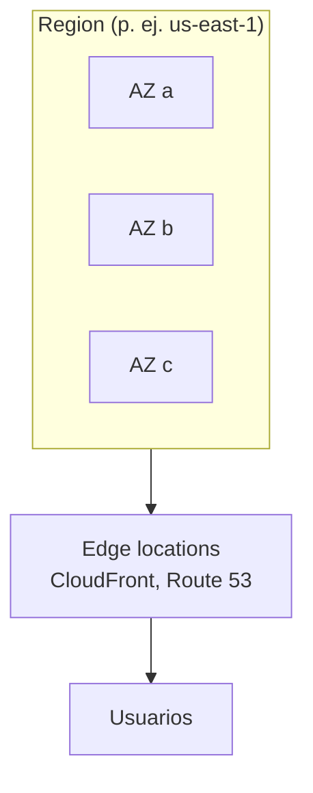

---
tags:
  - aws
  - certificacion
  - clf-c02
  - computo
  - redes
  - almacenamiento
---

# Dominio 3: Cloud Technology and Services (34%)

> El catálogo de AWS que el examen pide reconocer: formas de desplegar, infraestructura global, cómputo, bases de datos, redes, almacenamiento, IA y analítica, integración y otros servicios.

!!! info "Qué evalúa este dominio"
    Es el dominio **con más peso**. Según la guía oficial de CLF-C02, ocho *task statements*:

    - **3.1** Formas de desplegar y operar: consola, API, SDK, CLI, **infrastructure as code (IaC)**; operaciones puntuales vs repetibles; modelos cloud, híbrido y on-premises.
    - **3.2** Infraestructura global: **Regions, Availability Zones, edge locations**; alta disponibilidad con varias AZ; cuándo usar varias regiones.
    - **3.3** Cómputo: EC2 instance types, contenedores (ECS, EKS), serverless (Fargate, Lambda), auto scaling, load balancers.
    - **3.4** Bases de datos: EC2 vs gestionadas, relacionales (RDS, Aurora), NoSQL (DynamoDB), en memoria (ElastiCache), migración (DMS, SCT).
    - **3.5** Redes: componentes de una VPC, security groups vs network ACLs, Route 53, VPN y Direct Connect.
    - **3.6** Almacenamiento: object, block y file storage, S3 storage classes, EBS vs instance store, EFS y FSx, Storage Gateway, lifecycle policies, AWS Backup.
    - **3.7** IA/ML y analítica: SageMaker AI, Lex y otros servicios de IA; Athena, Kinesis, Glue, Quick Sight.
    - **3.8** Otras categorías: SQS/SNS/EventBridge, Amazon Connect y SES, AWS Support, CodeBuild/CodePipeline/X-Ray, WorkSpaces/AppStream 2.0/WorkSpaces Secure Browser, Amplify, IoT Core.

    Vuelve al [resumen del examen](resumen-examen.md) para el plan de estudio.

## Formas de desplegar y operar en AWS

| Forma de acceso | Qué es | Cuándo usarla |
| --- | --- | --- |
| **AWS Management Console** (consola) | Interfaz web | Explorar, tareas **puntuales** (*one-time operations*), aprender |
| **AWS CLI** (*Command Line Interface*) | Comandos en la terminal (`aws s3 ls`) | Scripts y automatizaciones sencillas (ver [comandos de AWS CLI](../../../recursos/comandos/aws-cli.md)) |
| **AWS SDKs** y **API** | Librerías para Python (boto3), Java, JavaScript… | Integrar AWS en tu aplicación (ver [automatización cloud con Python](../../../python/scripting/automatizacion-cloud.md)) |
| **Infrastructure as code (IaC)** | Plantillas que describen la infraestructura: **AWS CloudFormation**, AWS CDK, Terraform | Procesos **repetibles**, varios entornos iguales, revisión en Git (ver [Infrastructure as Code](../../../devops/iac/infraestructura-como-codigo.md)) |

Servicios gestionados para desplegar sin tocar la infraestructura:

- **AWS Elastic Beanstalk**: subes el código (Java, Python, Node.js, .NET…) y Beanstalk crea EC2, load balancer y auto scaling. **PaaS**.
- **Amazon Lightsail**: servidores virtuales, bases de datos y balanceadores con **precio mensual fijo y simple**. Para webs pequeñas, WordPress o quien empieza.

**Deployment models** (modelos de despliegue):

| Modelo | Descripción | Ejemplo en AWS |
| --- | --- | --- |
| **Cloud** (*cloud-native*, todo en la nube) | Todo corre en el proveedor | App 100% en AWS |
| **Hybrid** (híbrido) | Parte on-premises y parte en la nube, conectadas | Direct Connect, **AWS Outposts**, Storage Gateway |
| **On-premises** (*private cloud*) | Todo en tu datacenter con tecnología de virtualización | VMware en tu datacenter |

!!! tip "En el examen"
    - "Desplegar el mismo entorno en varias regiones de forma **repetible**" → **CloudFormation** (IaC).
    - "Subir código y que AWS gestione la capacidad, el balanceo y el escalado" → **Elastic Beanstalk**.
    - "Precio mensual predecible para una web sencilla" → **Lightsail**.
    - "Servicios de AWS **dentro de tu datacenter**" → **AWS Outposts**.

## Infraestructura global

Explicada a fondo en [Modelos de servicio y regiones](../../../cloud/fundamentos/modelos-de-servicio-y-regiones.md). Lo esencial:

| Componente | Qué es | Para qué sirve |
| --- | --- | --- |
| **Region** (región) | Zona geográfica con varias AZ aisladas entre sí (las regiones nuevas tienen al menos 3) | Cumplir **soberanía de datos**, cercanía a usuarios, DR |
| **Availability Zone (AZ)** (zona de disponibilidad) | Uno o varios datacenters con energía, red y refrigeración **independientes**, conectados con baja latencia | **High availability**: las AZ **no comparten puntos únicos de fallo** |
| **Edge location** (ubicación de borde) | Punto de presencia para caché y red cerca del usuario | **CloudFront**, **Route 53**, Global Accelerator, Shield |
| **Local Zone** | Extensión de una región cerca de una ciudad grande | Latencia de milisegundos para usuarios de esa ciudad |
| **AWS Outposts** | Hardware de AWS en tu datacenter | Baja latencia o datos que deben quedarse on-premises |

**Cómo elegir región** (cuatro factores): **compliance** (requisitos legales y de datos), **proximity** (cercanía a los usuarios = menor latencia), **service availability** (no todos los servicios están en todas las regiones) y **pricing** (el precio varía por región).

| Necesidad | Solución |
| --- | --- |
| Sobrevivir a la caída de un datacenter | Desplegar en **varias AZ** de la misma región |
| Sobrevivir a la caída de una región entera (disaster recovery) | **Varias regiones** |
| Latencia baja para usuarios en otro continente | Otra región cercana o **CloudFront** |
| Los datos no pueden salir del país (**data sovereignty**) | Región dentro del país |

!!! tip "En el examen"
    - "**Highly available**" → **multi-AZ**. "**Disaster recovery** ante desastre regional" → **multi-región**.
    - Las AZ están **físicamente separadas** pero dentro de la misma región. Una AZ **no** es un solo datacenter necesariamente.
    - Edge locations ≠ regiones: no lanzas EC2 en una edge location.

## Servicios de cómputo

Detalle en [Máquinas virtuales](../../../cloud/computo/maquinas-virtuales.md), [Contenedores gestionados](../../../cloud/computo/contenedores-gestionados.md) y [Serverless](../../../cloud/computo/serverless.md).

### Amazon EC2 y sus instance types

**Amazon EC2** (*Elastic Compute Cloud*) ofrece servidores virtuales (instancias). Tú eliges la **AMI** (imagen), el **instance type** (CPU/memoria) y la red.

| Familia | Uso | Ejemplo de caso |
| --- | --- | --- |
| **General purpose** (uso general: M, T) | Equilibrio CPU/memoria | Servidores web, entornos de desarrollo |
| **Compute optimized** (C) | Mucha CPU | Procesamiento por lotes, servidores de juegos, HPC, codificación de video |
| **Memory optimized** (R, X) | Mucha memoria | Bases de datos en memoria, análisis de grandes conjuntos en tiempo real |
| **Storage optimized** (I, D) | Disco local muy rápido (IOPS altas) | Bases de datos OLTP, data warehousing, sistemas de archivos distribuidos |
| **Accelerated computing** (P, G, Inf, Trn) | GPU y aceleradores | Machine learning, gráficos |

Los modelos de compra (On-Demand, Spot, Savings Plans…) están en el [Dominio 4](dominio-4-facturacion-precios-soporte.md).

### Escalado y balanceo

- **Amazon EC2 Auto Scaling**: añade o quita instancias según la demanda (**elasticidad**) y reemplaza las que fallan. **AWS Auto Scaling** extiende el escalado a otros servicios (DynamoDB, ECS, Aurora).
- **Elastic Load Balancing (ELB)**: reparte el tráfico entre instancias de varias AZ y deja de enviar tráfico a las que no pasan el **health check**. Tipos: **Application Load Balancer** (capa 7, HTTP/HTTPS, rutas), **Network Load Balancer** (capa 4, millones de peticiones, IP fija), **Gateway Load Balancer** (appliances de seguridad de terceros).

### Contenedores y serverless

| Servicio | Qué es | Cuándo |
| --- | --- | --- |
| **Amazon ECS** | Orquestador de contenedores propio de AWS, más simple | Contenedores sin necesitar Kubernetes |
| **Amazon EKS** | **Kubernetes** gestionado | Ya usas Kubernetes o quieres portabilidad |
| **Amazon ECR** | Registro privado de imágenes de contenedor | Guardar las imágenes que usan ECS/EKS |
| **AWS Fargate** | Motor **serverless** para contenedores (ECS o EKS) sin gestionar servidores | No quieres administrar las instancias del clúster |
| **AWS Lambda** | Funciones **serverless** que se ejecutan por eventos; pagas por petición y duración; máximo 15 minutos por ejecución | Procesar un archivo al subirlo a S3, APIs ligeras, tareas cortas |
| **AWS Batch** | Trabajos por lotes a gran escala | Miles de trabajos de cálculo programados |

!!! tip "En el examen"
    - "Ejecutar código **sin aprovisionar ni gestionar servidores**, por eventos" → **Lambda**. Si el trabajo dura más de 15 minutos, Lambda no sirve.
    - "Contenedores sin gestionar servidores" → **Fargate**. "Kubernetes gestionado" → **EKS**.
    - "Repartir tráfico entre instancias" → **ELB**. "Añadir instancias cuando sube la carga" → **Auto Scaling**. Son complementarios.

## Bases de datos

Detalle en [Almacenamiento y datos](../../../cloud/redes-y-datos/almacenamiento-datos.md).

### En EC2 o gestionada

| Opción | Tú gestionas | Úsala cuando |
| --- | --- | --- |
| **Base de datos en EC2** | SO, instalación, parches, backups, réplicas, escalado | Necesitas acceso al SO o un motor/versión no soportado por RDS |
| **Servicio gestionado** (RDS, Aurora, DynamoDB…) | Esquema, datos, consultas, acceso | Casi siempre: **menos esfuerzo operativo** |

### Qué base de datos para qué

| Servicio | Tipo | Característica clave |
| --- | --- | --- |
| **Amazon RDS** | Relacional (SQL) gestionada | MySQL, PostgreSQL, MariaDB, Oracle, SQL Server, Db2; **Multi-AZ** para alta disponibilidad y **read replicas** para lectura |
| **Amazon Aurora** | Relacional compatible con MySQL y PostgreSQL | Diseñada por AWS para la nube: más rendimiento, 6 copias de los datos en 3 AZ; opción serverless |
| **Amazon DynamoDB** | **NoSQL** clave-valor y documentos, serverless | Latencia de milisegundos de un dígito a cualquier escala; **global tables** multi-región |
| **Amazon ElastiCache** | **En memoria** (Valkey, Redis OSS, Memcached) | Caché para acelerar lecturas, sesiones |
| **Amazon DocumentDB** | Documentos compatible con MongoDB | Migrar cargas de MongoDB |
| **Amazon Neptune** | Grafos | Redes sociales, recomendaciones, detección de fraude |
| **Amazon Redshift** | **Data warehouse** (almacén de datos) | Analítica SQL sobre petabytes (ver analítica) |

### Migración de bases de datos

**AWS DMS** migra y replica datos con la base de origen funcionando; **AWS SCT** convierte esquemas entre motores distintos. Ver [Dominio 1](dominio-1-conceptos-cloud.md).

!!! tip "En el examen"
    - "Relacional, gestionada, menor esfuerzo" → **RDS**. "Relacional de alto rendimiento compatible con MySQL/PostgreSQL" → **Aurora**.
    - "NoSQL, serverless, milisegundos, escala masiva" → **DynamoDB**.
    - "Reducir latencia de lecturas repetidas" → **ElastiCache**.
    - "Consultas analíticas complejas sobre muchos datos históricos" → **Redshift** (no RDS).
    - **Multi-AZ** = alta disponibilidad; **read replicas** = escalar lecturas.

## Servicios de red

Detalle en [Redes en la nube](../../../cloud/redes-y-datos/redes.md) y, para la base de redes, [Routing y NAT](../../../networking/intermedio/routing-nat.md) y [Seguridad de red](../../../networking/avanzado/seguridad-red.md).

### Componentes de una VPC

| Componente | Qué hace |
| --- | --- |
| **Amazon VPC** (*Virtual Private Cloud*) | Tu red privada aislada dentro de una región |
| **Subnet** (subred) | Rango de IPs dentro de **una AZ**. **Public subnet**: tiene ruta a un internet gateway; **private subnet**: no |
| **Internet gateway** | Conecta la VPC con internet |
| **NAT gateway** | Permite que recursos de subredes privadas **salgan** a internet sin ser accesibles desde fuera |
| **Route table** | Reglas que indican a dónde va el tráfico |
| **VPC peering** / **AWS Transit Gateway** | Conectar VPC entre sí (Transit Gateway como hub central para muchas) |
| **AWS PrivateLink** | Acceder a servicios de forma privada sin pasar por internet |

### Security groups vs network ACLs

| | **Security group** | **Network ACL** |
| --- | --- | --- |
| Nivel | **Instancia** (interfaz de red) | **Subnet** |
| Estado | **Stateful**: la respuesta se permite sola | **Stateless**: hay que permitir ida y vuelta |
| Reglas | Solo **allow** | **Allow y deny** |
| Por defecto | Niega todo lo entrante, permite todo lo saliente | La NACL por defecto permite todo |

**Amazon Inspector** completa la seguridad de la VPC revisando la **exposición de red** no intencionada de las instancias.

### DNS, CDN y conectividad

- **Amazon Route 53**: **DNS** gestionado, registro de dominios, **health checks** y políticas de enrutamiento (latencia, geolocalización, failover, ponderado).
- **Amazon CloudFront**: **CDN** (*Content Delivery Network*) que cachea contenido en edge locations.
- **AWS Global Accelerator**: usa la red global de AWS y IPs anycast fijas para acelerar aplicaciones TCP/UDP (no cachea).
- **Amazon API Gateway**: crear, publicar y proteger APIs (a menudo delante de Lambda).

| Conectividad on-premises ↔ AWS | Cómo funciona | Cuándo |
| --- | --- | --- |
| **AWS Site-to-Site VPN** | Túnel IPsec cifrado **por internet** | Rápido de montar, barato; ancho de banda y latencia variables |
| **AWS Client VPN** | VPN para usuarios individuales | Teletrabajo hacia la VPC |
| **AWS Direct Connect** | Conexión **física privada dedicada**, no pasa por internet | Ancho de banda alto y constante, latencia predecible; tarda semanas en instalarse |

!!! tip "En el examen"
    - "Firewall a nivel de **instancia**, stateful" → **security group**. "A nivel de **subred**, con reglas deny" → **network ACL**.
    - "Conexión **privada y dedicada**, sin internet" → **Direct Connect**. "Cifrada por internet, rápida de configurar" → **Site-to-Site VPN**.
    - "Registrar un dominio y enrutar usuarios a la región con menor latencia" → **Route 53**.
    - "Entregar contenido estático y video con baja latencia global" → **CloudFront**.

## Servicios de almacenamiento

Detalle en [Almacenamiento y datos](../../../cloud/redes-y-datos/almacenamiento-datos.md).

| Tipo | Servicio | Cómo se usa | Ejemplo |
| --- | --- | --- | --- |
| **Object storage** (almacenamiento de objetos) | **Amazon S3** | Objetos (archivo + metadatos) en **buckets**, por HTTP; durabilidad de 11 nueves | Backups, data lakes, sitios estáticos, imágenes |
| **Block storage** (almacenamiento en bloque) | **Amazon EBS** | Disco de **una** instancia EC2 en **una AZ**; **persistente**; snapshots a S3 | Disco del SO, bases de datos en EC2 |
| Block storage efímero | **Instance store** | Disco físico del host; **se pierde** al detener o terminar la instancia | Caché, datos temporales |
| **File storage** (almacenamiento de archivos) | **Amazon EFS** | Sistema de archivos NFS **compartido** por muchas instancias Linux, multi-AZ, crece solo | Contenido compartido entre servidores web |
| File storage especializado | **Amazon FSx** | Sistemas de archivos gestionados: FSx for Windows File Server (SMB), NetApp ONTAP, OpenZFS, Lustre | Carpetas compartidas de Windows |
| Híbrido | **AWS Storage Gateway** | **Caché** local on-premises con los datos en AWS (File, Volume y Tape Gateway) | Que los servidores locales usen S3 como si fuera un NAS; reemplazar cintas |

### Amazon S3 storage classes

| Storage class | Acceso | Detalle clave |
| --- | --- | --- |
| **S3 Standard** | Frecuente | Por defecto; varias AZ; milisegundos |
| **S3 Intelligent-Tiering** | **Desconocido o cambiante** | Mueve objetos entre tiers según el uso, sin costo de recuperación (pequeño cargo de monitoreo) |
| **S3 Standard-IA** (*Infrequent Access*) | Poco frecuente, pero rápido cuando se necesita | Almacenamiento más barato, **cobro por recuperación**; mínimo 30 días |
| **S3 One Zone-IA** | Poco frecuente, datos **re-creables** | Una sola AZ: más barata, pero se pierde si falla esa AZ |
| **S3 Express One Zone** | Muy frecuente, latencia mínima | Una AZ, alto rendimiento para cargas intensivas |
| **S3 Glacier Instant Retrieval** | Archivo consultado ~1 vez por trimestre | Recuperación en **milisegundos**; mínimo 90 días |
| **S3 Glacier Flexible Retrieval** | Archivo, 1–2 veces al año | Recuperación de **minutos a horas**; mínimo 90 días |
| **S3 Glacier Deep Archive** | Archivo de largo plazo (cumplimiento, 7–10 años) | **La más barata**; recuperación en **horas** (hasta 12 h estándar); mínimo 180 días |

**Lifecycle policies** (políticas de ciclo de vida): reglas que **mueven** objetos a una clase más barata o los **borran** después de cierto tiempo. Ejemplo: Standard → Standard-IA a los 30 días → Glacier Deep Archive a los 365 → borrar a los 7 años.

**AWS Backup**: servicio **centralizado** para programar, retener y auditar backups de EBS, RDS, DynamoDB, EFS, FSx, EC2 y más, con planes y políticas en varias cuentas. **AWS Elastic Disaster Recovery** replica servidores para recuperarlos rápido en AWS.

!!! tip "En el examen"
    - "Patrón de acceso **desconocido**" → **Intelligent-Tiering**.
    - "Archivo más barato posible, se puede esperar horas" → **Glacier Deep Archive**.
    - "Archivo poco consultado pero que debe estar disponible **al instante**" → **Glacier Instant Retrieval**.
    - "Disco para **una** instancia" → **EBS**. "Sistema de archivos **compartido** entre muchas instancias Linux" → **EFS**. "Compartido para Windows (SMB)" → **FSx for Windows File Server**.
    - "Datos temporales que pueden perderse, máximo rendimiento" → **instance store**.
    - "Conectar el almacenamiento on-premises con la nube" → **Storage Gateway**.

## IA/ML y analítica

### Servicios de IA y machine learning

| Servicio | Qué hace |
| --- | --- |
| **Amazon SageMaker AI** | Plataforma para **construir, entrenar y desplegar** tus propios modelos de ML |
| **Amazon Lex** | **Chatbots** conversacionales por voz y texto (la tecnología de Alexa) |
| **Amazon Polly** | **Texto a voz** (*text-to-speech*) |
| **Amazon Transcribe** | **Voz a texto** (*speech-to-text*) |
| **Amazon Translate** | Traducción automática |
| **Amazon Comprehend** | **NLP** (procesamiento de lenguaje natural): sentimiento, entidades, temas |
| **Amazon Rekognition** | Análisis de **imágenes y video**: rostros, objetos, contenido inapropiado |
| **Amazon Textract** | Extraer texto y datos de **documentos escaneados** y formularios (más que OCR) |
| **Amazon Q** | Asistente de **IA generativa**: Amazon Q Business (preguntas sobre datos de la empresa) y Amazon Q Developer (ayuda para programar y operar en AWS) |

La IA generativa con Amazon Bedrock se trata a fondo en [AI Practitioner](../ai-practitioner/resumen-examen.md).

### Servicios de analítica

| Servicio | Qué hace |
| --- | --- |
| **Amazon Athena** | Consultas **SQL serverless directamente sobre S3**; pagas por datos escaneados |
| **Amazon Kinesis** | Ingesta y procesamiento de datos en **streaming** (tiempo real): clics, logs, IoT |
| **AWS Glue** | **ETL** serverless (extraer, transformar, cargar) y **Data Catalog** de metadatos |
| **Amazon Redshift** | Data warehouse para analítica a gran escala |
| **Amazon EMR** | Clústeres de **big data** (Apache Spark, Hadoop) gestionados |
| **Amazon OpenSearch Service** | Búsqueda y análisis de logs (OpenSearch/Elasticsearch) |
| **Amazon Quick Sight** | **BI** (*business intelligence*): dashboards y visualizaciones (antes Amazon QuickSight, hoy dentro de Amazon Quick) |

!!! tip "En el examen"
    - "Analizar el **sentimiento** de reseñas" → **Comprehend**. "Detectar **rostros** u objetos" → **Rekognition**. "Extraer datos de **facturas escaneadas**" → **Textract**.
    - "Convertir llamadas grabadas en texto" → **Transcribe**; "leer en voz alta un artículo" → **Polly**.
    - "Entrenar un modelo propio" → **SageMaker AI**.
    - "SQL sobre archivos en S3 sin servidores" → **Athena**. "Datos en tiempo real" → **Kinesis**. "Dashboards" → **Quick Sight**.

## Otros servicios en alcance

### Integración de aplicaciones

| Servicio | Patrón | Ejemplo |
| --- | --- | --- |
| **Amazon SQS** | **Cola** de mensajes: un consumidor procesa cada mensaje; **desacopla** componentes | Pedidos que esperan a ser procesados |
| **Amazon SNS** | **Pub/sub** y notificaciones: un mensaje a **muchos** suscriptores (email, SMS, SQS, Lambda) | Alertas a todo el equipo |
| **Amazon EventBridge** | **Bus de eventos** con reglas que enrutan eventos de AWS, SaaS y tus apps; también programación (*scheduler*) | "Cuando se cree una instancia, ejecuta esta Lambda" |
| **AWS Step Functions** | Orquestación de flujos de trabajo con pasos | Proceso de pedido con varias Lambdas |

Más sobre estos patrones en [Integración y APIs](../../../cloud/arquitectura/integracion-apis.md).

### Aplicaciones de negocio, herramientas y otros

| Necesidad | Servicio |
| --- | --- |
| **Contact center** (centro de contacto) en la nube | **Amazon Connect** |
| Enviar **emails** transaccionales o de marketing | **Amazon SES** (*Simple Email Service*) |
| Compilar y probar código (CI) | **AWS CodeBuild** |
| Orquestar el pipeline de CI/CD | **AWS CodePipeline** (ver [Integración continua](../../../devops/ci-cd/integracion-continua.md)) |
| **Trazar** peticiones entre servicios y depurar latencia | **AWS X-Ray** |
| **Escritorios virtuales** persistentes (Windows/Linux) | **Amazon WorkSpaces** |
| **Transmitir aplicaciones** de escritorio al navegador | **Amazon AppStream 2.0** |
| Navegador seguro para acceder a sitios internos sin VPN | **Amazon WorkSpaces Secure Browser** |
| Crear y desplegar **frontends web y apps móviles** full-stack | **AWS Amplify** |
| Conectar y gestionar **dispositivos IoT** | **AWS IoT Core** |
| Soporte técnico y de negocio | **AWS Support** (ver [Dominio 4](dominio-4-facturacion-precios-soporte.md)) |

Gestión y operación (también en alcance): **AWS Systems Manager** (gestionar flotas de instancias, parches, Session Manager sin SSH abierto), **AWS Organizations** y **AWS Control Tower** (multi-cuenta, ver [Gobernanza](../../../cloud/operacion-y-gobierno/gobernanza.md)), **AWS Service Catalog** (catálogo de productos aprobados), **Service Quotas** (límites), **Amazon CloudWatch** (ver [Observabilidad nativa](../../../cloud/operacion-y-gobierno/observabilidad-nativa.md)).

!!! tip "En el examen"
    - "**Desacoplar** componentes", "que no se pierdan pedidos si el servicio de procesamiento cae" → **SQS**.
    - "Enviar una notificación a muchos suscriptores" → **SNS**. "Reaccionar a eventos y enrutar según reglas" → **EventBridge**.
    - "VMs o escritorios en el equipo del usuario final" → **WorkSpaces** (escritorio completo) o **AppStream 2.0** (una aplicación).
    - "Contact center" → **Connect**, no SNS ni SES.

## Casos de uso

1. **Una empresa necesita que su web siga funcionando si cae un datacenter.** → EC2 en **varias AZ** con **ELB** y **Auto Scaling**.
2. **Una app procesa imágenes cada vez que se suben a S3; el proceso dura 20 segundos.** → **AWS Lambda** disparada por eventos de S3.
3. **Un equipo ya usa Kubernetes on-premises y quiere llevarlo a AWS.** → **Amazon EKS** (con Fargate si no quieren gestionar nodos).
4. **Un juego móvil necesita guardar perfiles con latencia de milisegundos para millones de usuarios.** → **DynamoDB**.
5. **Los logs de auditoría deben guardarse 7 años y casi nunca se consultan.** → **S3 Glacier Deep Archive** con una **lifecycle policy**.
6. **Una empresa quiere una conexión privada y estable de 10 Gbps entre su datacenter y AWS.** → **AWS Direct Connect** (con Site-to-Site VPN como respaldo).
7. **Marketing quiere analizar con SQL los CSV que ya están en S3, sin montar servidores.** → **Amazon Athena** (y **Quick Sight** para los dashboards).
8. **Un call center quiere un chatbot que responda por voz.** → **Amazon Connect** con **Amazon Lex**.
9. **Un servicio de pedidos se satura en picos y pierde peticiones.** → Poner **SQS** entre el frontend y el procesamiento.
10. **Varios servidores Linux necesitan leer y escribir los mismos archivos.** → **Amazon EFS**.

## Preguntas de práctica

**1.** ¿Qué afirmación describe correctamente las Availability Zones?

- A. Son ubicaciones de caché de CloudFront
- B. Son ubicaciones aisladas dentro de una región, sin puntos únicos de fallo compartidos
- C. Cada una está en un país diferente
- D. Son lo mismo que una región

??? success "Respuesta"
    **B.** Las AZ están aisladas (energía, red, refrigeración) pero dentro de una región. A describe edge locations; C y D son incorrectas.

**2.** Una empresa quiere ejecutar contenedores sin aprovisionar ni gestionar servidores ni clústeres de EC2. ¿Qué servicio debe usar?

- A. Amazon EC2
- B. AWS Fargate
- C. Amazon Lightsail
- D. AWS Outposts

??? success "Respuesta"
    **B.** Fargate es el motor serverless para contenedores en ECS y EKS. A exige gestionar instancias; C es un servicio simplificado de servidores; D lleva hardware de AWS a tu datacenter.

**3.** Una empresa guarda informes que se consultan con frecuencia los primeros 30 días y casi nunca después, pero deben conservarse 5 años. ¿Cuál es la solución MÁS rentable?

- A. Guardar todo en S3 Standard
- B. Usar una S3 Lifecycle policy que mueva los objetos a S3 Glacier Deep Archive tras 30 días
- C. Guardar todo en volúmenes EBS
- D. Guardar todo en instance store

??? success "Respuesta"
    **B.** La lifecycle policy automatiza el paso a la clase más barata cuando ya no se consultan. A cuesta más; C es almacenamiento en bloque más caro y ligado a una instancia; D se pierde al detener la instancia.

**4.** ¿Cuál es una diferencia entre security groups y network ACLs?

- A. Los security groups son stateless y las network ACLs stateful
- B. Los security groups actúan a nivel de instancia y las network ACLs a nivel de subnet
- C. Los security groups admiten reglas deny
- D. Las network ACLs solo se aplican a Amazon RDS

??? success "Respuesta"
    **B.** A está al revés; C es falso (solo allow); D es falso.

**5.** Una aplicación necesita una base de datos relacional compatible con PostgreSQL, gestionada, con alto rendimiento y datos replicados en varias AZ. ¿Qué servicio encaja MEJOR?

- A. Amazon DynamoDB
- B. Amazon Aurora
- C. Amazon ElastiCache
- D. Amazon Neptune

??? success "Respuesta"
    **B.** Aurora es relacional, compatible con PostgreSQL y MySQL, y replica en 3 AZ. A es NoSQL; C es caché en memoria; D es de grafos.

**6.** ¿Qué servicio permite consultar con SQL estándar datos almacenados en Amazon S3 sin gestionar infraestructura?

- A. Amazon Redshift
- B. Amazon Athena
- C. Amazon Kinesis
- D. AWS Glue

??? success "Respuesta"
    **B.** Athena es serverless y consulta directamente sobre S3. A es un data warehouse donde normalmente cargas los datos; C es para streaming; D es ETL y catálogo.

**7.** ¿Cuáles DOS servicios ayudan a desacoplar componentes de una aplicación? (Elige dos.)

- A. Amazon SQS
- B. Amazon SNS
- C. Amazon EBS
- D. AWS Direct Connect
- E. Amazon Route 53

??? success "Respuesta"
    **A y B.** SQS (colas) y SNS (pub/sub) permiten que los componentes se comuniquen sin depender directamente unos de otros. C es almacenamiento en bloque; D es conectividad dedicada; E es DNS.

**8.** Una empresa necesita extraer automáticamente campos (nombre, importe, fecha) de miles de facturas escaneadas. ¿Qué servicio debe usar?

- A. Amazon Rekognition
- B. Amazon Comprehend
- C. Amazon Textract
- D. Amazon Polly

??? success "Respuesta"
    **C.** Textract extrae texto, formularios y tablas de documentos. A analiza imágenes y video (rostros, objetos); B analiza texto ya digital; D convierte texto en voz.

## Para profundizar

- [Modelos de servicio y regiones](../../../cloud/fundamentos/modelos-de-servicio-y-regiones.md)
- [Máquinas virtuales](../../../cloud/computo/maquinas-virtuales.md), [Contenedores gestionados](../../../cloud/computo/contenedores-gestionados.md) y [Serverless](../../../cloud/computo/serverless.md)
- [Redes en la nube](../../../cloud/redes-y-datos/redes.md) y la sección de Networking: [Direccionamiento IP](../../../networking/basico/direccionamiento-ip.md), [Balanceo y alta disponibilidad](../../../networking/avanzado/balanceo-alta-disponibilidad.md), [Redes híbridas](../../../networking/avanzado/redes-datacenter-hibridas.md)
- [Almacenamiento y datos](../../../cloud/redes-y-datos/almacenamiento-datos.md)
- [Resiliencia](../../../cloud/operacion-y-gobierno/resiliencia.md): multi-AZ, multi-región y disaster recovery
- [Integración y APIs](../../../cloud/arquitectura/integracion-apis.md) y [Arquitecturas de referencia](../../../cloud/arquitectura/arquitecturas-referencia.md)
- [Infrastructure as Code](../../../devops/iac/infraestructura-como-codigo.md) y [Kubernetes](../../../devops/contenedores/kubernetes.md)

## Referencias

- [Exam guide CLF-C02: Domain 3](https://docs.aws.amazon.com/aws-certification/latest/cloud-practitioner-02/cloud-practitioner-02-domain3.html)
- [AWS Global Infrastructure](https://aws.amazon.com/about-aws/global-infrastructure/)
- [Amazon EC2 instance types](https://aws.amazon.com/ec2/instance-types/)
- [Amazon S3 storage classes](https://aws.amazon.com/s3/storage-classes/)
- [Control traffic with security groups and network ACLs](https://docs.aws.amazon.com/vpc/latest/userguide/infrastructure-security.html)
- [Overview of Amazon Web Services (whitepaper)](https://docs.aws.amazon.com/whitepapers/latest/aws-overview/introduction.html)
