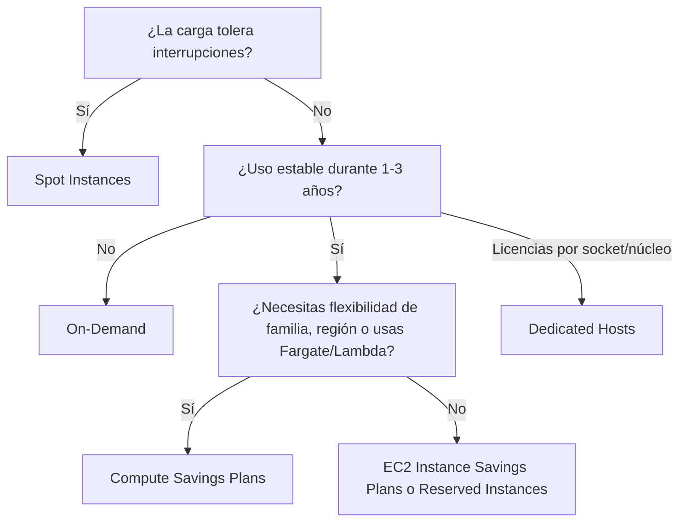

---
tags:
  - aws
  - certificacion
  - clf-c02
  - finops
---

# Dominio 4: Billing, Pricing, and Support (12%)

> Cómo se paga AWS (modelos de compra de cómputo, almacenamiento y transferencia de datos), qué herramienta usar para presupuestar y analizar costos, y qué plan de soporte y recurso técnico elegir.

!!! info "Qué evalúa este dominio"
    Según la guía oficial de CLF-C02, tres *task statements*:

    - **4.1** Comparar modelos de precios: On-Demand, Reserved Instances, Spot, Savings Plans, Dedicated Hosts, Dedicated Instances, Capacity Reservations; flexibilidad de las RI y su comportamiento en AWS Organizations; costos de transferencia de datos; precios de almacenamiento.
    - **4.2** Recursos de facturación y gestión de costos: **AWS Budgets**, **AWS Cost Explorer**, **AWS Pricing Calculator**, consolidated billing de **AWS Organizations**, **cost allocation tags** y **AWS Cost and Usage Report**.
    - **4.3** Recursos técnicos y AWS Support: documentación, whitepapers, re:Post, Knowledge Center, Prescriptive Guidance; **planes de AWS Support**; Trusted Advisor, Health Dashboard y Health API; Trust and Safety; AWS Partner Network y Marketplace; Professional Services y solutions architects.

    Pesa poco (unas 6 preguntas), pero son preguntas **fáciles de ganar** si memorizas las diferencias. Vuelve al [resumen del examen](resumen-examen.md).

## Modelos de compra de cómputo

La forma de cobrar de la nube y las prácticas de optimización están en [FinOps y costos](../../../cloud/fundamentos/finops-costos.md) y en la sección de precios de [Máquinas virtuales](../../../cloud/computo/maquinas-virtuales.md). Aquí, lo que el examen pide distinguir:

| Opción | Cómo funciona | Descuento aproximado frente a On-Demand | Cuándo usarla |
| --- | --- | --- | --- |
| **On-Demand Instances** | Pagas por segundo u hora, sin compromiso | — | Cargas cortas, impredecibles, pruebas |
| **Savings Plans** | Te comprometes a gastar **X USD/hora** durante **1 o 3 años** | Hasta ~72% | Uso estable con flexibilidad de familia, región o servicio |
| **Reserved Instances (RI)** | Te comprometes a una **configuración** de instancia durante **1 o 3 años** | Hasta ~72% | Uso estable y predecible (p. ej. una base de datos 24/7) |
| **Spot Instances** | Usas capacidad sobrante; AWS puede recuperarla con **2 minutos de aviso** | Hasta ~90% | Cargas **tolerantes a interrupciones**: batch, análisis, CI, renderizado |
| **Dedicated Hosts** | Un **servidor físico entero** para ti, con visibilidad de sockets y núcleos | — (más caro) | **BYOL** con licencias por socket/núcleo, requisitos de cumplimiento |
| **Dedicated Instances** | Instancias en hardware **no compartido** con otros clientes, sin control del host | — (más caro) | Requisitos de aislamiento sin necesidad de control del servidor |
| **On-Demand Capacity Reservations** | Reservas **capacidad** en una AZ, sin plazo; pagas la tarifa On-Demand la uses o no | Ninguno por sí solas (se combinan con Savings Plans o RI regionales) | Garantizar capacidad para un evento o DR |

Los porcentajes de descuento cambian con el tiempo y según el tipo: tómalos como orientación y revisa las páginas de precios.

### Savings Plans

- **Compute Savings Plans**: los más flexibles. Aplican a EC2 de **cualquier** familia, tamaño, región y sistema operativo, y también a **Fargate** y **Lambda**.
- **EC2 Instance Savings Plans**: más descuento, pero atados a **una familia de instancias en una región** (puedes cambiar tamaño, SO y AZ).
- También hay Savings Plans para **SageMaker AI**.

### Flexibilidad de las Reserved Instances

- **Standard RI**: más descuento; puedes cambiar AZ, tamaño (dentro de la familia, en Linux) y tipo de red, pero no la familia. Se pueden vender en el **Reserved Instance Marketplace**.
- **Convertible RI**: menos descuento; puedes **cambiar** a otra familia, SO o tenancy.
- **Regional RI** vs **zonal RI**: la regional aplica el descuento en cualquier AZ de la región (**no** reserva capacidad); la zonal reserva capacidad en una AZ concreta.
- Formas de pago: **All Upfront** (todo por adelantado, mayor descuento), **Partial Upfront** y **No Upfront**.

**RI y Savings Plans en AWS Organizations**: con **consolidated billing**, el descuento de una RI o Savings Plan comprado en una cuenta **se comparte** con las demás cuentas de la organización si la primera no lo usa. La **management account** (cuenta de administración) puede desactivar ese reparto.

!!! tip "En el examen"
    - "Trabajo que **puede interrumpirse** y debe ser lo más barato posible" → **Spot**. Si "no puede interrumpirse", Spot es la trampa.
    - "Carga **estable 24/7** durante 3 años" → **Reserved Instances** o **Savings Plans** (si piden flexibilidad o Lambda/Fargate, Savings Plans).
    - "Corto plazo, impredecible, sin compromiso" → **On-Demand**.
    - "Licencias por socket o núcleo" o "servidor físico dedicado" → **Dedicated Hosts**.
    - "Asegurar capacidad en una AZ para un evento, sin compromiso de 1 año" → **Capacity Reservations**.

## Precios de almacenamiento y transferencia de datos

**Almacenamiento**: en S3 pagas por **GB almacenado al mes** (según la storage class), por **peticiones** (PUT, GET), por **recuperación** en las clases IA y Glacier, y por la **transferencia de datos de salida**. En **EBS** pagas por los **GB aprovisionados** (aunque no los llenes) y, en algunos tipos, por IOPS y throughput aprovisionados. Las storage classes están en el [Dominio 3](dominio-3-tecnologia-servicios.md).

**Transferencia de datos**:

| Tráfico | ¿Se cobra? |
| --- | --- |
| **Entrada** desde internet a AWS (*data transfer in*) | Generalmente **gratis** |
| **Salida** de AWS a internet (*data transfer out*) | **Sí**, por GB, con precios escalonados |
| Entre **regiones** | **Sí** |
| Entre **AZ** de la misma región | **Sí** (en cada dirección) |
| Dentro de la **misma AZ** con IP privada | Generalmente **gratis** |
| De un origen en AWS hacia **CloudFront** | Gratis; pagas la salida de CloudFront al usuario |

!!! tip "En el examen"
    - "¿Qué tráfico **no** suele cobrarse?" → **la entrada de datos desde internet**.
    - En EBS pagas lo **aprovisionado**; en S3, lo **almacenado**.
    - Para reducir costos de salida a usuarios globales se suele usar **CloudFront**.

## Facturación, presupuestos y gestión de costos

| Herramienta | Para qué sirve | Pregunta que responde |
| --- | --- | --- |
| **AWS Pricing Calculator** | **Estimar** el costo de una arquitectura **antes** de desplegarla | "¿Cuánto me costará?" |
| **AWS Budgets** | Definir presupuestos de costo o uso (y de uso/cobertura de RI y Savings Plans) con **alertas** y **acciones** | "Avísame si me paso" |
| **AWS Cost Explorer** | **Visualizar y analizar** el gasto histórico, filtrar por servicio, cuenta o tag; **pronóstico**; recomendaciones de RI, Savings Plans y rightsizing | "¿En qué gasté y cuánto gastaré?" |
| **AWS Cost and Usage Report (CUR)** | El informe **más detallado** (línea por línea, por hora), entregado en un bucket S3; hoy se genera con **Data Exports** (CUR 2.0) | "Necesito todo el detalle para analizarlo con Athena o una herramienta de BI" |
| **AWS Billing and Cost Management console** | Facturas, métodos de pago, Free Tier, cost allocation tags | "¿Cuál es mi factura?" |
| **AWS Cost Anomaly Detection** | Detecta gastos anómalos con ML | "Avísame de un pico raro de gasto" |

### AWS Organizations y consolidated billing

**AWS Organizations** agrupa cuentas en una jerarquía (ver [Gobernanza](../../../cloud/operacion-y-gobierno/gobernanza.md)). Su **consolidated billing** (facturación consolidada), sin costo adicional:

- **Una sola factura** para todas las cuentas, pagada por la management account.
- **Descuentos por volumen agregados**: el uso de todas las cuentas se suma (p. ej. los tramos de precio de S3).
- **Reparto de RI y Savings Plans** entre cuentas.
- Seguimiento del costo **por cuenta**, útil para **showback y chargeback**.

### Cost allocation tags

Las **cost allocation tags** (etiquetas de asignación de costos) permiten repartir el gasto por proyecto, equipo o entorno:

- **AWS-generated cost allocation tags**: las crea AWS (p. ej. `aws:createdBy`).
- **User-defined cost allocation tags**: las defines tú (p. ej. `Proyecto=tienda`, `Entorno=prod`).
- Hay que **activarlas** en la consola de Billing and Cost Management para que aparezcan en **Cost Explorer** y en el **Cost and Usage Report**. Solo cuentan desde que se activan, no hacia atrás.

### AWS Free Tier

Permite probar servicios sin costo o con créditos. En **julio de 2025 AWS cambió el modelo** para cuentas nuevas: ahora se elige entre un plan gratuito con **créditos** durante los primeros meses y un plan de pago, y se mantienen ofertas **always free** (siempre gratuitas) en algunos servicios. Las condiciones cambian: revisa la página oficial antes de crear recursos y configura **AWS Budgets** desde el primer día.

!!! tip "En el examen"
    - "Estimar **antes** de migrar o desplegar" → **Pricing Calculator**. "Analizar lo **ya** gastado y pronosticar" → **Cost Explorer**. "**Alertar** al superar un umbral" → **Budgets**. "Máximo **detalle**" → **Cost and Usage Report**.
    - "Una factura para muchas cuentas y descuentos por volumen" → **consolidated billing** de **AWS Organizations**.
    - "Ver costos por proyecto o departamento" → **cost allocation tags** (activadas).

## AWS Support y recursos técnicos

### Planes de AWS Support

AWS **reestructuró sus planes de soporte** a finales de 2025 y la guía vigente de CLF-C02 ya usa los nombres nuevos:

| Plan | Para quién | Primera respuesta para un sistema de producción caído | Lo que lo distingue |
| --- | --- | --- | --- |
| **Basic Support** | Todos los clientes, **gratis** | Sin casos técnicos (solo cuenta y facturación) | Customer service 24/7, documentación, re:Post, **Trusted Advisor core checks**, AWS Health Dashboard |
| **AWS Business Support+** | Mínimo recomendado para **producción** | < 30 minutos | Soporte técnico 24/7 con asistencia de IA, **todos** los checks de Trusted Advisor, AWS Health API |
| **AWS Enterprise Support** | Cargas **críticas para el negocio** | < 15 minutos | **TAM** (*Technical Account Manager*) designado, Trusted Advisor Priority, revisiones operativas y de arquitectura |
| **AWS Unified Operations** | Cargas **de misión crítica** | < 5 minutos | Equipo ampliado (TAM, ingenieros especialistas, gestión de incidentes), máxima rapidez |

!!! warning "Planes antiguos que aún verás en cursos y simulacros"
    Los planes **Developer**, **Business** (sin "+") y **Enterprise On-Ramp** dejaron de venderse a clientes nuevos en **diciembre de 2025**. Según las FAQ de AWS Support, Developer y Business se **discontinúan el 1 de enero de 2027** y Enterprise On-Ramp tiene soporte hasta el **31 de diciembre de 2026**. Muchos materiales y bancos de preguntas siguen usando los nombres antiguos (por ejemplo "Developer: horario laboral por email", "Enterprise On-Ramp: pool de TAMs"): si una pregunta los menciona, razona por **nivel de servicio** (más caro = respuesta más rápida + TAM). Precios: el plan Business Support+ empieza en 29 USD/mes por cuenta y Enterprise Support en 5.000 USD/mes, con cargos que crecen con el gasto; revisa la página oficial.

### AWS Trusted Advisor, AWS Health y Trust and Safety

- **AWS Trusted Advisor**: revisa tu cuenta y da recomendaciones en seis categorías: **cost optimization, performance, security, fault tolerance, service limits** y **operational excellence**. Con Basic Support solo tienes los **core checks** (algunos de seguridad y service quotas); los planes de pago dan el conjunto completo.
- **AWS Health Dashboard**: muestra el estado de los servicios de AWS (**Service health**, público) y los eventos que **afectan a tus recursos** (**Your account health**: mantenimientos programados, incidencias en tu región).
- **AWS Health API**: acceso programático a esos eventos para automatizar respuestas (requiere un plan de soporte de pago).
- **AWS Trust and Safety team**: equipo al que se **reporta abuso** de recursos de AWS (spam, escaneo de puertos, ataques DoS, malware o contenido ilegal desde IPs de AWS), mediante el formulario de abuso.

### Recursos de documentación y ayuda

| Recurso | Qué encuentras |
| --- | --- |
| **AWS Documentation** | Guías de usuario y referencias de API de cada servicio |
| **AWS Whitepapers & Guides** | Documentos técnicos (Well-Architected, precios, seguridad) |
| **AWS Prescriptive Guidance** | Estrategias, guías y **patrones probados** para migración y modernización |
| **AWS re:Post** | Comunidad de preguntas y respuestas moderada por AWS (sustituye a los antiguos foros) |
| **AWS Knowledge Center** (en re:Post) | Respuestas oficiales a las preguntas más comunes de soporte |
| **AWS Blogs** | Novedades y artículos técnicos |
| **AWS Support Center** | Abrir y seguir **casos de soporte** desde la consola |

### AWS Partner Network, Marketplace y ayuda profesional

- **AWS Partner Network (APN)**: red de empresas socias. **Independent software vendors (ISV)** venden software que corre en AWS; **system integrators (SI)** y consultoras ayudan a diseñar, migrar y operar. Beneficios de ser partner: formación y certificaciones, eventos, apoyo comercial y descuentos.
- **AWS Marketplace**: catálogo digital de software, datos y servicios de terceros. Se compra y se factura **en la factura de AWS**, con ofertas privadas, gestión de licencias (**entitlements**), control de compras (gobierno) y gestión de costos.
- **AWS Professional Services**: consultores de AWS para proyectos (migraciones grandes, transformación).
- **AWS solutions architects**: arquitectos de AWS que asesoran sobre diseño (a través de tu equipo de cuenta).

!!! tip "En el examen"
    - "**TAM** designado" → **Enterprise Support** o superior. "Respuesta en < 5 minutos" → **Unified Operations**.
    - "Todos los checks de Trusted Advisor al menor costo" → **Business Support+**.
    - "Gratis para todos" → **Basic Support** (sin casos técnicos).
    - "Reportar que una IP de AWS está enviando spam" → **AWS Trust and Safety**.
    - "Comprar software de terceros y pagarlo en la factura de AWS" → **AWS Marketplace**. "Encontrar una consultora para migrar" → **AWS Partner Network**.
    - "Patrones y guías paso a paso para migrar" → **AWS Prescriptive Guidance**.
    - "Ver si un evento de AWS afecta a **mis** recursos" → **AWS Health Dashboard**.

## Casos de uso

1. **Una empresa de renderizado procesa trabajos que pueden repetirse si se interrumpen.** → **Spot Instances**. Porqué: el máximo descuento y la interrupción no es un problema.
2. **Una base de datos en EC2 funciona 24/7 y seguirá así 3 años.** → **Reserved Instances** o **EC2 Instance Savings Plans** a 3 años.
3. **Una empresa usa EC2, Fargate y Lambda y cambia de familias de instancias a menudo.** → **Compute Savings Plans**.
4. **Una empresa tiene licencias de Windows Server por núcleo físico.** → **Dedicated Hosts** (BYOL).
5. **Finanzas quiere un correo cuando el gasto mensual previsto supere 1.000 USD.** → **AWS Budgets** con alerta sobre el pronóstico.
6. **Un equipo debe estimar el costo de migrar 50 servidores antes de aprobar el proyecto.** → **AWS Pricing Calculator** (y Migration Evaluator, del [Dominio 1](dominio-1-conceptos-cloud.md)).
7. **Un holding con 12 cuentas quiere una sola factura y aprovechar descuentos por volumen.** → **AWS Organizations** con **consolidated billing**.
8. **Dirección quiere saber cuánto gasta cada proyecto.** → **Cost allocation tags** activadas y analizadas en **Cost Explorer**.
9. **Una fintech necesita un TAM y respuestas en menos de 15 minutos para producción.** → **AWS Enterprise Support**.

## Preguntas de práctica

**1.** Una empresa ejecuta trabajos de análisis nocturnos que pueden reiniciarse sin problema si se interrumpen. ¿Qué opción de compra es la MÁS rentable?

- A. On-Demand Instances
- B. Dedicated Hosts
- C. Spot Instances
- D. On-Demand Capacity Reservations

??? success "Respuesta"
    **C.** Spot ofrece el mayor descuento para cargas tolerantes a interrupciones. A es más caro; B es la opción más cara; D garantiza capacidad pero se cobra a tarifa On-Demand.

**2.** ¿Qué herramienta se usa para estimar el costo de una arquitectura ANTES de desplegarla?

- A. AWS Cost Explorer
- B. AWS Pricing Calculator
- C. AWS Budgets
- D. AWS Cost and Usage Report

??? success "Respuesta"
    **B.** Pricing Calculator estima costos de algo que aún no existe. A analiza gasto real; C alerta sobre umbrales; D da el detalle del uso ya facturado.

**3.** ¿Cuáles DOS son beneficios del consolidated billing de AWS Organizations? (Elige dos.)

- A. Una sola factura para varias cuentas
- B. Soporte técnico gratuito para todas las cuentas
- C. Agregación del uso para obtener descuentos por volumen
- D. Cifrado automático de todos los recursos
- E. Eliminación de los costos de transferencia de datos

??? success "Respuesta"
    **A y C.** B es falso (el soporte se contrata por plan); D y E no tienen relación con la facturación consolidada.

**4.** ¿Qué tipo de transferencia de datos generalmente NO tiene costo?

- A. Datos de salida de AWS a internet
- B. Datos entre dos regiones de AWS
- C. Datos de entrada desde internet a AWS
- D. Datos entre dos Availability Zones

??? success "Respuesta"
    **C.** La entrada desde internet suele ser gratuita. A, B y D se cobran por GB.

**5.** Una empresa necesita un Technical Account Manager designado para sus cargas críticas. ¿Cuál es el plan de AWS Support de MENOR costo que lo incluye?

- A. Basic Support
- B. AWS Business Support+
- C. AWS Enterprise Support
- D. AWS Unified Operations

??? success "Respuesta"
    **C.** Enterprise Support incluye TAM designado. A y B no lo incluyen; D también lo incluye, pero es más caro.

**6.** ¿Qué servicio da recomendaciones para reducir costos, mejorar la seguridad y evitar alcanzar los service quotas?

- A. AWS Trusted Advisor
- B. AWS Health Dashboard
- C. AWS Artifact
- D. AWS Pricing Calculator

??? success "Respuesta"
    **A.** Trusted Advisor revisa la cuenta en esas categorías. B informa de eventos de AWS que afectan a tus recursos; C da informes de cumplimiento; D estima costos.

**7.** Una empresa detecta que una dirección IP de AWS está lanzando ataques contra su servidor. ¿A quién debe reportarlo?

- A. AWS Professional Services
- B. AWS Trust and Safety team
- C. AWS Partner Network
- D. AWS Support Center de su propia cuenta con Basic Support

??? success "Respuesta"
    **B.** Trust and Safety gestiona los reportes de abuso de recursos de AWS. A es consultoría; C es la red de socios; D: con Basic no hay casos técnicos y además el abuso se reporta por el canal específico.

## Para profundizar

- [FinOps y costos](../../../cloud/fundamentos/finops-costos.md): modelos de cobro, herramientas nativas, tags y prácticas de optimización.
- [Máquinas virtuales](../../../cloud/computo/maquinas-virtuales.md): precios y opciones de compra comparadas entre proveedores.
- [Gobernanza](../../../cloud/operacion-y-gobierno/gobernanza.md): AWS Organizations, estrategia multi-cuenta y tagging.
- [TI y negocio](../../../negocio/ti-y-negocio.md): CapEx vs OpEx, TCO y business case.
- [Niveles de servicio](../../../negocio/niveles-de-servicio.md): SLA de los proveedores y créditos.
- [Gobierno y riesgo de TI](../../../negocio/gobierno-riesgo-ti.md): proveedores, contratos y vendor lock-in.

## Referencias

- [Exam guide CLF-C02: Domain 4](https://docs.aws.amazon.com/aws-certification/latest/cloud-practitioner-02/cloud-practitioner-02-domain4.html)
- [How AWS Pricing Works (whitepaper)](https://docs.aws.amazon.com/whitepapers/latest/how-aws-pricing-works/welcome.html)
- [Amazon EC2 pricing](https://aws.amazon.com/ec2/pricing/)
- [Savings Plans](https://docs.aws.amazon.com/savingsplans/latest/userguide/what-is-savings-plans.html)
- [Consolidated billing for AWS Organizations](https://docs.aws.amazon.com/awsaccountbilling/latest/aboutv2/consolidated-billing.html)
- [Cost allocation tags](https://docs.aws.amazon.com/awsaccountbilling/latest/aboutv2/cost-alloc-tags.html)
- [Compare AWS Support Plans](https://aws.amazon.com/premiumsupport/plans/)
- [AWS Support FAQs](https://aws.amazon.com/premiumsupport/faqs/)
- [AWS Free Tier](https://aws.amazon.com/free/)
