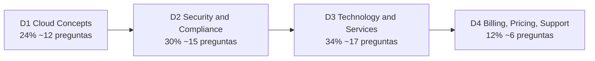

---
tags:
  - aws
  - certificacion
  - clf-c02
---

# AWS Certified Cloud Practitioner (CLF-C02): resumen del examen

> Qué evalúa el examen de entrada de AWS, cómo es el formato, cuánto pesa cada dominio y un plan de estudio de 5 semanas para alguien que empieza en cloud.

## ¿Qué es?

**AWS Certified Cloud Practitioner** es la certificación **Foundational** (nivel fundamental) de AWS. Demuestra que entiendes **qué es la nube de AWS, para qué sirve cada servicio principal, cómo se reparte la seguridad, cómo se cobra y dónde pedir ayuda**. No pide programar, diseñar arquitecturas ni resolver incidentes: pide **reconocer** el servicio o concepto correcto para cada situación.

El código vigente del examen es **CLF-C02** (sustituyó a CLF-C01 en septiembre de 2023). A la fecha de esta nota (octubre de 2026) no hay una versión nueva anunciada en la guía oficial.

!!! info "Para quién es"
    La guía oficial habla de una persona con **hasta 6 meses de exposición** a AWS (diseño, implementación u operación), que empieza una carrera en cloud o que trabaja **con** personas que tienen roles cloud (ventas, compras, gestión de proyectos, finanzas). Es un buen primer paso antes de [AI Practitioner](../ai-practitioner/resumen-examen.md) o [Solutions Architect – Associate](../solutions-architect-associate/resumen-examen.md).

Lo que **no** entra (según la guía): escribir código, diseñar arquitectura, troubleshooting, implementación y pruebas de carga o rendimiento.

## Formato del examen

| Aspecto | Detalle |
| --- | --- |
| Código | **CLF-C02** |
| Preguntas | **65**: 50 puntúan y **15 son unscored** (sin puntaje, de prueba para futuras versiones; no sabes cuáles son) |
| Tipos de pregunta | **Multiple choice** (opción múltiple: 1 correcta de 4) y **multiple response** (respuesta múltiple: 2 o más correctas de 5 o más) |
| Duración | **90 minutos** |
| Puntaje | Escala de 100 a 1000; **aprobado con 700** |
| Modelo de puntaje | **Compensatory** (compensatorio): no necesitas aprobar cada dominio, solo el total |
| Preguntas sin responder | Cuentan como incorrectas; **no hay penalización por adivinar** |
| Costo | **100 USD** (más impuestos o tipo de cambio según el país) |
| Modalidad | Centro de pruebas **Pearson VUE** u **online proctored** (en línea con supervisor) |
| Idiomas | Inglés, español (Latinoamérica), español (España), portugués (Brasil), francés, alemán, italiano, japonés, coreano, árabe, chino simplificado y tradicional |
| Validez | **3 años** |

!!! warning "Datos que cambian"
    Precio, idiomas y políticas cambian. La página oficial indica que las versiones en **italiano y alemán se retiran después del 31 de diciembre de 2026**. Revisa la página del examen antes de agendar.

!!! tip "Si el inglés no es tu idioma nativo"
    Puedes presentar en español, pero muchos nombres de servicio quedan en inglés. Si lo presentas en inglés, AWS ofrece la acomodación **ESL +30** (30 minutos extra) que se solicita **antes** de agendar desde tu cuenta de AWS Certification.

## Objetivo profesional

### Perfil de candidato según AWS

La [exam guide oficial](https://docs.aws.amazon.com/aws-certification/latest/cloud-practitioner-02/cloud-practitioner-02.html) dice, resumido, que el examen es para quien puede demostrar **conocimiento general de la nube de AWS, independiente de un rol concreto**. El *target candidate* (candidato objetivo) tiene **hasta 6 meses de exposición** al diseño, la implementación o la operación en AWS, y puede estar **empezando una carrera cloud** o **trabajar con personas que tienen roles cloud**. Debe conocer conceptos de nube, seguridad y cumplimiento, servicios principales y la economía de AWS. La guía deja fuera, de forma explícita, programar, diseñar arquitectura, hacer troubleshooting, implementar y hacer pruebas de carga.

### Para qué roles sirve

- Primer paso hacia [Cloud Engineer](../../roles-profesionales.md#cloud-engineer), [Support / Cloud Operations](../../roles-profesionales.md#support-cloud-operations) y [FinOps Practitioner](../../roles-profesionales.md#finops-practitioner-analyst).
- Perfiles no técnicos que trabajan con equipos cloud: ventas, compras, gestión de proyectos, finanzas.
- Para el resto de roles técnicos es solo una base: ver [Roles profesionales](../../roles-profesionales.md).

### Qué demuestra ante un empleador

| Demuestra | No demuestra |
| --- | --- |
| Que hablas el idioma de AWS: servicios, modelo de responsabilidad compartida, precios y soporte | Que sepas construir, desplegar u operar algo en AWS |
| Interés y disciplina para estudiar cloud por tu cuenta | Experiencia práctica (el examen no tiene laboratorios) |
| Que puedes participar en conversaciones de costos y seguridad con criterio | Capacidad de diseñar arquitecturas o resolver incidentes |

En ofertas técnicas pesa poco por sí sola: acompáñala con un proyecto propio (ver [Laboratorios](../../../laboratorios/index.md)).

### Qué certificación sigue

- [Solutions Architect – Associate](../solutions-architect-associate/resumen-examen.md), el siguiente paso más habitual.
- [AI Practitioner](../ai-practitioner/resumen-examen.md), si te interesa la IA generativa.
- CloudOps Engineer – Associate o Developer – Associate según el rol: ver [Otras certificaciones](../../otras-certificaciones.md#aws-el-resto-del-catalogo).

## Dominios y peso

| Dominio | Peso | Qué cubre | Nota |
| --- | --- | --- | --- |
| 1. Cloud Concepts | **24%** | Beneficios de la nube, Well-Architected, CAF y migración, economía de la nube | [Dominio 1](dominio-1-conceptos-cloud.md) |
| 2. Security and Compliance | **30%** | Shared Responsibility Model, cumplimiento, IAM y usuario root, servicios de seguridad | [Dominio 2](dominio-2-seguridad-cumplimiento.md) |
| 3. Cloud Technology and Services | **34%** | Formas de desplegar, infraestructura global, cómputo, bases de datos, redes, almacenamiento, IA/analítica y otros servicios | [Dominio 3](dominio-3-tecnologia-servicios.md) |
| 4. Billing, Pricing, and Support | **12%** | Modelos de compra, herramientas de costos, Organizations, planes de soporte y recursos | [Dominio 4](dominio-4-facturacion-precios-soporte.md) |

El número de preguntas por dominio es aproximado (porcentaje sobre las 50 que puntúan). Los dominios 2 y 3 suman casi dos tercios del examen: ahí está la mayor parte del estudio.

## Servicios dentro y fuera de alcance

La guía publica una lista de **in-scope services** (servicios en alcance), no exhaustiva. Resumen por categoría:

| Categoría | Servicios en alcance (los que más salen, en negrita) |
| --- | --- |
| Compute | **Amazon EC2**, **AWS Elastic Beanstalk**, **Amazon Lightsail**, AWS Batch, AWS Outposts |
| Containers y Serverless | **Amazon ECS**, **Amazon EKS**, Amazon ECR, **AWS Fargate**, **AWS Lambda** |
| Storage | **Amazon S3**, Amazon S3 Glacier, **Amazon EBS**, **Amazon EFS**, Amazon FSx, AWS Storage Gateway, AWS Backup, AWS Elastic Disaster Recovery |
| Database | **Amazon RDS**, **Amazon Aurora**, **Amazon DynamoDB**, **Amazon ElastiCache**, Amazon DocumentDB, Amazon Neptune |
| Networking | **Amazon VPC**, **Amazon Route 53**, **Amazon CloudFront**, **AWS Direct Connect**, AWS VPN (Site-to-Site y Client VPN), Amazon API Gateway, AWS Global Accelerator, AWS PrivateLink, AWS Transit Gateway |
| Security | **IAM**, **IAM Identity Center**, **AWS Artifact**, **Amazon GuardDuty**, **Amazon Inspector**, **AWS Shield**, **AWS WAF**, AWS Security Hub, Amazon Macie, Amazon Detective, AWS KMS, AWS CloudHSM, AWS Secrets Manager, ACM, Amazon Cognito, AWS Firewall Manager, AWS Directory Service, AWS RAM |
| Management and Governance | **CloudWatch**, **CloudTrail**, **AWS Config**, **AWS Organizations**, **Trusted Advisor**, CloudFormation, Control Tower, Systems Manager, Auto Scaling, Compute Optimizer, Health Dashboard, Service Catalog, Service Quotas, License Manager, Well-Architected Tool |
| Cloud Financial Management | **AWS Budgets**, **AWS Cost Explorer**, AWS Cost and Usage Reports, AWS Marketplace |
| Analytics y ML | Athena, Kinesis, Glue, Redshift, EMR, OpenSearch Service, Quick Sight; SageMaker AI, Lex, Polly, Rekognition, Comprehend, Textract, Transcribe, Translate, Amazon Q |
| Integración y otros | SQS, SNS, EventBridge, Step Functions, Amazon Connect, Amazon SES, CodeBuild, CodePipeline, X-Ray, AWS CLI, Amplify, IoT Core, WorkSpaces, AppStream 2.0, WorkSpaces Secure Browser |
| Migración | Application Migration Service, DMS, SCT, Migration Hub, Application Discovery Service, Migration Evaluator |

**Fuera de alcance** (ejemplos de la lista oficial): Amazon MSK, AWS Clean Rooms, Amazon DataZone, AWS CodeDeploy, AWS CodeArtifact, AWS CloudShell, AWS Network Firewall, Amazon VPC Lattice, AWS Wavelength, AWS Transfer Family, Amazon FSx for Lustre, Amazon Keyspaces, Amazon MemoryDB, Amazon Personalize, AWS IoT Greengrass, los servicios de AWS Elemental y AWS Managed Services (AMS).

!!! tip "Cómo usar estas listas"
    Si una opción de respuesta nombra un servicio fuera de alcance, casi nunca es la correcta. Pero no memorices la lista de memoria: concéntrate en **para qué sirve** cada servicio en alcance.

## Plan de estudio de 5 semanas

Pensado para 5–7 horas por semana. Si ya trabajas con AWS, compáctalo en 2–3 semanas.

| Semana | Tema | Qué hacer |
| --- | --- | --- |
| 1 | Dominio 1 + base del cuaderno | Lee [Dominio 1](dominio-1-conceptos-cloud.md), [modelos de servicio y regiones](../../../cloud/fundamentos/modelos-de-servicio-y-regiones.md) y [Well-Architected](../../../cloud/fundamentos/well-architected.md). Crea una cuenta de AWS y configura **MFA en el root** y una alerta de AWS Budgets el primer día |
| 2 | Dominio 2 | Lee [Dominio 2](dominio-2-seguridad-cumplimiento.md), [responsabilidad compartida](../../../cloud/fundamentos/responsabilidad-compartida.md) e [IAM](../../../cloud/identidad-y-seguridad/iam-comparativa.md). Práctica: crear un usuario en IAM Identity Center, revisar AWS Artifact |
| 3 | Dominio 3 (cómputo, redes, almacenamiento, bases de datos) | Lee la primera mitad del [Dominio 3](dominio-3-tecnologia-servicios.md). Práctica: lanzar y terminar una EC2 pequeña, crear un bucket S3 con lifecycle policy |
| 4 | Dominio 3 (IA, analítica, integración, otros) + Dominio 4 | Termina el Dominio 3 y lee [Dominio 4](dominio-4-facturacion-precios-soporte.md). Práctica: estimar un costo en AWS Pricing Calculator y explorar Cost Explorer |
| 5 | Repaso y simulacros | Official Practice Question Set, repaso de los "En el examen" de cada nota, preguntas de práctica de las notas. Repite los temas donde falles más |

!!! tip "Señal de que estás lista"
    Cuando superes con holgura (80% o más) el **Official Practice Exam** o varios simulacros de calidad, agenda. Ojo con los "dumps" (preguntas filtradas): violan el acuerdo de AWS Certification y pueden anular la certificación.

## Recursos oficiales gratuitos

| Recurso | Para qué sirve |
| --- | --- |
| **Exam guide** (guía del examen) | La fuente de verdad: dominios, task statements y servicios en alcance |
| **AWS Skill Builder** | Plataforma de cursos. Gratis: *AWS Cloud Practitioner Essentials*, *Exam Prep Standard Course: CLF-C02* y el **Official Practice Question Set** (20 preguntas) |
| **Official Practice Exam** | Simulacro completo del mismo formato (en la suscripción de Skill Builder; revisa disponibilidad) |
| **AWS Cloud Quest: Cloud Practitioner** | Juego de rol con laboratorios reales; la parte de Cloud Practitioner es gratuita |
| **AWS Workshops** | Laboratorios guiados paso a paso (workshops.aws) |
| **Whitepapers** | *Overview of Amazon Web Services*, *AWS Well-Architected Framework*, *How AWS Pricing Works* |
| **AWS Free Tier** | Probar servicios con costo bajo o cero (las condiciones cambiaron en 2025: revisa la página vigente) |

## Consejos para el día del examen

- **Gestión del tiempo**: 90 minutos para 65 preguntas son ~80 segundos por pregunta. Responde todo en una primera pasada, usa **Flag for review** (marcar para revisar) en las dudosas y vuelve al final. No dejes ninguna en blanco.
- **Lee la última frase primero**: ahí está lo que piden ("Which service…", "Which TWO…"). En las de **multiple response** el enunciado dice cuántas elegir.
- **Descarta opciones**: suele haber dos opciones claramente equivocadas (servicios de otra categoría). Decide entre las dos restantes con la palabra clave del enunciado.
- **Palabras clave** que cambian la respuesta:

| Palabra clave | Qué suele indicar |
| --- | --- |
| **MOST cost-effective** / **LEAST expensive** | Spot, Savings Plans, S3 Glacier, serverless, apagar recursos |
| **LEAST operational overhead** (menor esfuerzo operativo) | Servicio **managed** (gestionado) o serverless: RDS frente a base de datos en EC2, Lambda/Fargate frente a EC2 |
| **Highly available** | Varias **Availability Zones** |
| **Disaster recovery**, **data sovereignty**, **latencia global** | Varias **Regions** |
| **Audit** / "quién hizo qué" | AWS CloudTrail |
| **Compliance reports** (informes de cumplimiento, SOC, ISO, PCI) | AWS Artifact |
| **Recommendations** sobre costo, seguridad, límites | AWS Trusted Advisor |
| **Forecast** / alertas de gasto | AWS Budgets (alertas) y Cost Explorer (análisis y pronóstico) |

- **Online proctored**: escritorio despejado, sin segundo monitor, documento de identidad vigente y haz el **system test** días antes.
- Al aprobar, AWS suele dar un **voucher de 50% de descuento** para el siguiente examen (revisa en tu cuenta de AWS Certification).

## Para profundizar

- Base conceptual: [Modelos de servicio y regiones](../../../cloud/fundamentos/modelos-de-servicio-y-regiones.md), [Shared Responsibility Model](../../../cloud/fundamentos/responsabilidad-compartida.md), [Well-Architected Framework](../../../cloud/fundamentos/well-architected.md), [FinOps y costos](../../../cloud/fundamentos/finops-costos.md)
- Servicios: [Máquinas virtuales](../../../cloud/computo/maquinas-virtuales.md), [Contenedores gestionados](../../../cloud/computo/contenedores-gestionados.md), [Serverless](../../../cloud/computo/serverless.md), [Redes](../../../cloud/redes-y-datos/redes.md), [Almacenamiento y datos](../../../cloud/redes-y-datos/almacenamiento-datos.md)
- Seguridad y gobierno: [IAM](../../../cloud/identidad-y-seguridad/iam-comparativa.md), [Seguridad base](../../../cloud/identidad-y-seguridad/seguridad-base.md), [Gobernanza](../../../cloud/operacion-y-gobierno/gobernanza.md)
- Negocio: [TI y negocio](../../../negocio/ti-y-negocio.md) (CapEx vs OpEx, TCO)
- Siguientes certificaciones: [AI Practitioner](../ai-practitioner/resumen-examen.md) y [Solutions Architect – Associate](../solutions-architect-associate/resumen-examen.md)

## Referencias

- [AWS Certified Cloud Practitioner (página oficial)](https://aws.amazon.com/certification/certified-cloud-practitioner/)
- [Exam guide CLF-C02](https://docs.aws.amazon.com/aws-certification/latest/cloud-practitioner-02/cloud-practitioner-02.html)
- [In-Scope AWS Services (CLF-C02)](https://docs.aws.amazon.com/aws-certification/latest/cloud-practitioner-02/clf-02-in-scope-services.html)
- [Out-of-Scope AWS Services (CLF-C02)](https://docs.aws.amazon.com/aws-certification/latest/cloud-practitioner-02/clf-02-out-of-scope-services.html)
- [AWS Skill Builder](https://skillbuilder.aws/)
- [AWS Certification: políticas del examen](https://aws.amazon.com/certification/policies/)
- [Overview of Amazon Web Services (whitepaper)](https://docs.aws.amazon.com/whitepapers/latest/aws-overview/introduction.html)
