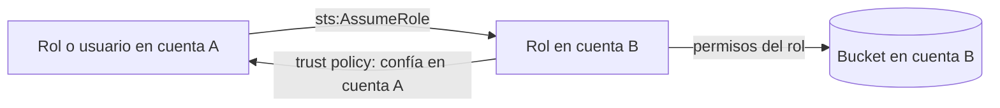
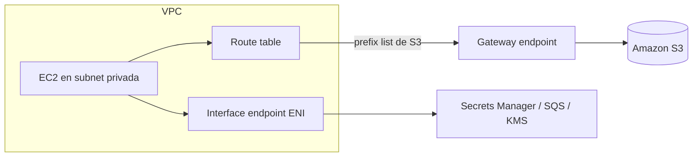

---
tags:
  - aws
  - certificacion
  - saa-c03
  - seguridad
  - iam
---

# Dominio 1: Design Secure Architectures (30%)

> El dominio con más peso: acceso seguro a recursos con IAM y multi-cuenta, cargas de trabajo protegidas en la VPC y en el borde, y controles de datos con cifrado, gestión de claves y backups.

!!! info "Qué evalúa este dominio"
    - **Task 1.1 – Design secure access to AWS resources**: usuarios, grupos, roles y políticas; mínimo privilegio y MFA; acceso entre cuentas con STS; estrategia multi-cuenta con Organizations, Control Tower y SCPs; resource policies; federación con un directorio.
    - **Task 1.2 – Design secure workloads and applications**: VPC con security groups, NACLs, route tables y NAT; segmentación en subnets públicas y privadas; service endpoints; Cognito, GuardDuty, Macie; Shield, WAF, Secrets Manager; VPN y Direct Connect.
    - **Task 1.3 – Determine appropriate data security controls**: cifrado en reposo (KMS) y en tránsito (ACM/TLS), políticas de claves, rotación de claves y certificados, backups y replicación, retención, lifecycle y cumplimiento.

    Formato y resto de dominios en el [resumen del examen](resumen-examen.md).

## IAM: identidades y tipos de políticas

La base está en [IAM: AWS, Azure y GCP](../../../cloud/identidad-y-seguridad/iam-comparativa.md#aws-iam); aquí va lo que el examen exige distinguir.

- **Root user** (usuario raíz): solo para tareas que lo requieren (cambiar el plan de soporte, cerrar la cuenta). Activa MFA y no crees access keys para él.
- **IAM user** (usuario IAM): credenciales de larga duración. En diseños modernos se evita: las personas entran por **IAM Identity Center** y las aplicaciones usan **roles**.
- **IAM role** (rol): identidad sin credenciales fijas; quien la asume recibe **temporary credentials** (credenciales temporales) de **AWS STS**. Es la respuesta correcta para EC2 (instance profile), Lambda (execution role), ECS (task role) y acceso entre cuentas.

| Tipo de política | Dónde se adjunta | ¿Concede permisos? | Para qué |
| --- | --- | --- | --- |
| **Identity-based policy** | Usuario, grupo o rol | Sí | Qué puede hacer esa identidad |
| **Resource-based policy** | Recurso (bucket S3, cola SQS, clave KMS, función Lambda) | Sí, incluso a otras cuentas | Quién puede usar ese recurso; incluye un `Principal` |
| **Permissions boundary** (límite de permisos) | Usuario o rol | No, solo limita | Tope máximo; típico para delegar la creación de roles a desarrolladores sin que escalen privilegios |
| **Service control policy (SCP)** | Cuenta u OU en AWS Organizations | No, solo limita | Guardrail (barrera) para todas las identidades de las cuentas miembro, incluido su root |
| **Resource control policy (RCP)** | Cuenta u OU en AWS Organizations | No, solo limita | Tope sobre lo que se puede hacer con los recursos de la organización (perímetro de datos) |
| **Session policy** | Al asumir un rol o federarse | No, solo limita | Reducir permisos de una sesión concreta |

### Cómo se evalúa una petición

1. Por defecto todo está **denegado** (*implicit deny*).
2. Un **explicit deny** (denegación explícita) en cualquier política gana siempre.
3. SCPs, RCPs, permissions boundaries y session policies deben **permitir** la acción (intersección).
4. Una identity-based **o** resource-based policy debe concederla.
5. **Entre cuentas** hacen falta **las dos partes**: la cuenta origen debe permitirle a su identidad la acción y el recurso de la cuenta destino debe confiar en ella (resource policy o trust policy del rol).

!!! tip "En el examen"
    - Las SCPs **no afectan a la management account** (cuenta de administración) y **no conceden** permisos: si una pregunta propone "dar acceso con una SCP", es incorrecta.
    - "Los desarrolladores deben poder crear roles para sus Lambdas, pero sin superar ciertos permisos" → **permissions boundary**.
    - "Impedir que cualquier cuenta de la organización use regiones fuera de la UE" → **SCP** con `aws:RequestedRegion`.

### Acceso entre cuentas (cross-account)

- El rol de la cuenta B tiene una **trust policy** (política de confianza) que nombra a la cuenta A; la identidad de A necesita `sts:AssumeRole` sobre ese rol.
- Para terceros (un proveedor SaaS que accede a tu cuenta) añade un **External ID** en la trust policy para evitar el problema del *confused deputy* (suplente confundido).
- Alternativa para S3, SQS, SNS o KMS: una **resource-based policy** que conceda a la otra cuenta. La diferencia: con resource policy la identidad conserva sus permisos originales; al asumir un rol, los "cambia" por los del rol.

### Federación e identidades de usuarios

| Necesidad | Servicio |
| --- | --- |
| Empleados entran a muchas cuentas con su usuario corporativo (Entra ID, Okta, Active Directory) | **AWS IAM Identity Center** con permission sets (SAML 2.0 + SCIM) |
| Aplicaciones en AWS que necesitan Active Directory real (Windows, Kerberos, GPO) | **AWS Managed Microsoft AD** (AWS Directory Service) |
| Usar el AD on-premises existente sin copiar usuarios a AWS | **AD Connector** (proxy hacia tu AD) |
| Usuarios finales de una app web o móvil (registro, login, redes sociales) | **Amazon Cognito user pools** |
| Usuarios de la app que deben acceder **directamente** a S3 o DynamoDB con credenciales temporales | **Amazon Cognito identity pools** |

!!! tip "En el examen: Cognito"
    **User pool = autenticación** (quién eres; devuelve tokens JWT). **Identity pool = autorización a recursos AWS** (te da credenciales temporales de un rol IAM). Muchas apps usan los dos: login en el user pool y luego intercambio del token en el identity pool.

## Estrategia multi-cuenta

Separar cargas en cuentas distintas es el límite de seguridad más fuerte de AWS. La teoría está en [Gobernanza](../../../cloud/operacion-y-gobierno/gobernanza.md#estrategia-multi-cuenta).

| Servicio | Qué aporta |
| --- | --- |
| **AWS Organizations** | Agrupa cuentas en OUs, consolidated billing (facturación consolidada), SCPs y RCPs |
| **AWS Control Tower** | Despliega una **landing zone** con buenas prácticas: cuentas de log archive y audit, guardrails preventivos (SCP) y detectivos (Config), Account Factory |
| **AWS RAM** (Resource Access Manager) | Compartir recursos entre cuentas sin duplicarlos (subnets de una VPC, Transit Gateway, reglas de Route 53 Resolver) |
| **CloudTrail organization trail** | Un solo trail para todas las cuentas hacia un bucket central |

## Seguridad de red en la VPC

Repasa primero [Redes en la nube](../../../cloud/redes-y-datos/redes.md#firewalls-stateful-y-stateless) y [Seguridad de red](../../../networking/avanzado/seguridad-red.md).

| Aspecto | Security group | Network ACL |
| --- | --- | --- |
| Nivel | Interfaz de red (ENI) / instancia | Subnet |
| Estado | **Stateful**: el tráfico de retorno se permite solo | **Stateless**: debes permitir también el retorno (puertos efímeros 1024–65535) |
| Reglas | Solo **allow** | **Allow y deny** |
| Evaluación | Todas las reglas | En orden por número; gana la primera que coincide |
| Referencias | Puede referenciar otro security group como origen | Solo CIDR |
| Uso típico | Control fino por capa (web → app → db) | Bloquear una IP o rango concreto a nivel de subnet |

!!! tip "En el examen"
    "Bloquear una IP maliciosa concreta" → **NACL** (los security groups no tienen deny). "Permitir que solo la capa de aplicación llegue a la base de datos" → regla en el security group de la DB con **origen = security group de la app**.

**Segmentación típica**: subnets públicas (ruta `0.0.0.0/0` → Internet Gateway) solo para load balancers y NAT gateways; subnets privadas para aplicación y datos, que salen a internet a través del **NAT gateway** (solo salida). Para administrar instancias privadas sin bastion host ni puerto 22 abierto: **Systems Manager Session Manager**.

### VPC endpoints y PrivateLink

Sirven para llegar a servicios de AWS **sin pasar por internet ni por el NAT gateway**.

| Aspecto | Gateway endpoint | Interface endpoint (AWS PrivateLink) |
| --- | --- | --- |
| Servicios | Solo **S3 y DynamoDB** | La mayoría de servicios de AWS, servicios SaaS y tus propios servicios |
| Cómo funciona | Entrada en la **route table** hacia un prefix list | Una **ENI con IP privada** en tu subnet y DNS privado |
| Costo | Sin cargo | Por hora por AZ + por GB procesado |
| Acceso desde on-premises (VPN/DX) o desde otra región | No | Sí |
| Control | Endpoint policy | Endpoint policy + security group |

- Puedes forzar en la **bucket policy** que solo se acceda desde un endpoint con la condición `aws:SourceVpce`.
- Para **exponer tu propio servicio** a otras VPC o cuentas sin peering y sin solapamiento de CIDR: crea un **endpoint service** detrás de un **Network Load Balancer** (o Gateway Load Balancer) y los consumidores crean interface endpoints.

### Conexiones externas seguras

| Opción | Cifrado | Cuándo |
| --- | --- | --- |
| **AWS Site-to-Site VPN** | IPsec sobre internet | Rápido de montar, ancho de banda moderado, respaldo de Direct Connect |
| **AWS Client VPN** | TLS (OpenVPN) | Usuarios remotos individuales que entran a la VPC |
| **AWS Direct Connect** | **No cifra por defecto** | Enlace privado dedicado, latencia consistente, mucho volumen |
| Direct Connect + VPN (o MACsec) | IPsec sobre DX, o MACsec en conexiones dedicadas compatibles | Requisito de enlace privado **y** cifrado |

El detalle de rendimiento y costo está en el [Dominio 3](dominio-3-arquitecturas-alto-rendimiento.md#conectividad-hibrida-vpn-vs-direct-connect).

## Protección del borde y detección de amenazas

| Servicio | Protege contra | Dónde se aplica |
| --- | --- | --- |
| **AWS WAF** | Ataques de capa 7: SQL injection, XSS, bots, rate limiting, bloqueo por país o IP | CloudFront, ALB, API Gateway, AppSync, Cognito user pools, App Runner, Verified Access |
| **AWS Shield Standard** | DDoS de capa 3/4 | Automático y gratis en todas las cuentas |
| **AWS Shield Advanced** | DDoS más sofisticado; incluye equipo de respuesta (SRT), protección de costos por escalado durante un ataque y métricas | CloudFront, Route 53, Global Accelerator, ELB, Elastic IP; suscripción con costo alto y compromiso anual |
| **AWS Firewall Manager** | Gestión central de reglas WAF, Shield Advanced, security groups y Network Firewall | Toda la organización |
| **AWS Network Firewall** | Filtrado stateful, IPS, filtrado por dominio en el tráfico de la VPC | Subnets de inspección de la VPC |

| Servicio de detección | Qué hace |
| --- | --- |
| **Amazon GuardDuty** | Detección de amenazas con ML sobre CloudTrail, VPC Flow Logs, DNS logs, S3, EKS, etc. (cripto-minería, credenciales filtradas) |
| **Amazon Inspector** | Escaneo de vulnerabilidades (CVE) en EC2, imágenes de ECR y Lambda |
| **Amazon Macie** | Descubre **datos sensibles (PII)** en S3 |
| **Amazon Detective** | Investigación: grafos de relaciones para analizar un hallazgo |
| **AWS Security Hub** | Agrega hallazgos y evalúa estándares (CIS, AWS Foundational Security Best Practices) |
| **AWS Config** | Historial de configuración y reglas de cumplimiento |
| **AWS CloudTrail** | Quién hizo qué llamada a la API y cuándo (auditoría) |

!!! tip "En el examen"
    Palabras clave: "PII en buckets" → **Macie**; "actividad maliciosa o comprometida" → **GuardDuty**; "CVE en instancias o imágenes" → **Inspector**; "SQL injection / XSS" → **WAF**; "DDoS con soporte 24/7 y protección de costos" → **Shield Advanced**; "quién borró el recurso" → **CloudTrail**; "el recurso cambió de configuración / no cumple" → **Config**.

## Cifrado y gestión de claves

Conceptos generales (envelope encryption, quién gestiona la clave) en [Seguridad base](../../../cloud/identidad-y-seguridad/seguridad-base.md#cifrado-en-transito-y-en-reposo).

### AWS KMS y CloudHSM

| Tipo de clave | Quién la gestiona | Rotación | Política de clave editable | Uso típico |
| --- | --- | --- | --- | --- |
| **AWS owned key** | AWS, compartida entre cuentas | AWS | No (ni la ves) | Cifrado por defecto de algunos servicios |
| **AWS managed key** (`aws/s3`, `aws/rds`) | AWS, en tu cuenta | Automática anual | No | Cifrado sencillo sin control fino |
| **Customer managed key** | Tú | Automática opcional (periodo configurable) o manual | **Sí** | Control de quién usa la clave, acceso entre cuentas, auditoría, desactivar o programar el borrado |
| Material importado (BYOK) | Tú generas el material | Solo manual | Sí | Requisito de generar la clave fuera de AWS |
| **AWS CloudHSM** | Tú, en HSM dedicados de un solo tenant | Tú | N/A | Requisitos de HSM dedicado, control exclusivo de las claves, FIPS 140 nivel 3 |

- KMS cifra directamente solo datos pequeños (hasta 4 KB); para lo demás usa **envelope encryption** con data keys.
- Las claves KMS son **regionales**. Para cifrar en una región y descifrar en otra (DR, tablas globales) existen las **multi-Region keys**.
- Para compartir un snapshot cifrado entre cuentas: debe estar cifrado con una **customer managed key** cuya key policy permita a la otra cuenta (no se puede con una AWS managed key).

### Cifrado en S3

| Opción | Clave | Cuándo |
| --- | --- | --- |
| **SSE-S3** | Gestionada por S3 | Cifrado por defecto de todos los objetos nuevos desde 2023 |
| **SSE-KMS** | Clave KMS | Auditoría en CloudTrail de cada uso de la clave y control por key policy; activa **S3 Bucket Keys** para reducir llamadas (y costo) a KMS |
| **DSSE-KMS** | Clave KMS, doble capa | Requisitos de cumplimiento que exigen dos capas de cifrado |
| **SSE-C** | La envías tú en cada petición | No quieres que AWS guarde la clave |
| Client-side encryption | Cifras antes de subir | Los datos no pueden llegar sin cifrar a AWS |

Para forzar cifrado en tránsito: condición `aws:SecureTransport` = `false` con `Deny` en la bucket policy.

### Secretos y certificados

| Aspecto | AWS Secrets Manager | SSM Parameter Store |
| --- | --- | --- |
| Para qué | Credenciales de bases de datos, API keys, tokens | Configuración y parámetros; también secretos simples (`SecureString` con KMS) |
| **Rotación automática** | **Sí** (gestionada para RDS, Aurora, Redshift, DocumentDB; con Lambda para el resto) | No nativa |
| Replicación entre regiones | Sí | No |
| Costo | Por secreto al mes + llamadas a la API | Tier Standard sin costo adicional; Advanced con costo |
| Tamaño | Hasta 64 KB | 4 KB (Standard) / 8 KB (Advanced) |

- **AWS Certificate Manager (ACM)**: certificados TLS públicos gratuitos para servicios integrados (ELB, CloudFront, API Gateway) con **renovación automática**. Para CloudFront, el certificado debe estar en **us-east-1**. Para certificados internos, **AWS Private CA**.

!!! tip "En el examen"
    "Rotar la contraseña de RDS automáticamente cada 30 días con el menor esfuerzo" → **Secrets Manager**. "Guardar parámetros de configuración de forma barata" → **Parameter Store**. "Certificado que se renueve solo en el ALB" → **ACM**.

## Protección, retención y recuperación de datos

| Necesidad | Solución |
| --- | --- |
| Recuperar objetos borrados o sobrescritos | **S3 Versioning** (+ MFA Delete para proteger el borrado de versiones) |
| WORM: nadie puede borrar durante X años (normativa) | **S3 Object Lock** en modo **Compliance** (ni root puede); modo **Governance** permite a usuarios con permiso especial saltarlo; **Legal hold** sin fecha |
| Copia en otra región por cumplimiento o latencia | **S3 Cross-Region Replication (CRR)**; requiere versioning |
| Evitar buckets públicos por error | **S3 Block Public Access** a nivel de cuenta + Object Ownership "Bucket owner enforced" (ACLs desactivadas) |
| Compartir un objeto temporalmente | **Presigned URL** (URL prefirmada) |
| Backups centralizados con retención y copia entre regiones o cuentas | **AWS Backup** con backup plans y **Backup Vault Lock** (inmutable) |
| Point-in-time recovery | RDS/Aurora (backups automáticos, retención hasta 35 días), DynamoDB PITR |

## Casos de uso

1. **Una empresa quiere que sus 40 cuentas de AWS no puedan desactivar CloudTrail, ni siquiera con el usuario root de cada cuenta.** → SCP que deniegue `cloudtrail:StopLogging` y `cloudtrail:DeleteTrail` en la OU raíz. Las SCPs aplican también al root de las cuentas miembro.
2. **Una aplicación en EC2 debe leer objetos de un bucket en otra cuenta.** → Rol de instancia en la cuenta A + bucket policy en la cuenta B que permita ese rol (o rol en B asumido desde A). Nunca access keys en la instancia.
3. **Las instancias privadas descargan gigabytes diarios de S3 y la factura del NAT gateway es alta.** → **Gateway endpoint** de S3: sin costo y el tráfico no pasa por el NAT. Además mejora la seguridad.
4. **Una app móvil necesita que cada usuario suba fotos directamente a su carpeta de S3.** → Cognito user pool para login + **identity pool** con un rol que use la variable `${cognito-identity.amazonaws.com:sub}` en el prefijo permitido.
5. **Un banco necesita conexión privada a AWS con latencia estable y cifrado de extremo a extremo.** → Direct Connect + Site-to-Site VPN sobre la conexión (o MACsec si la conexión lo soporta).
6. **Auditoría exige saber quién usó la clave de cifrado de los datos de clientes y poder revocarla.** → SSE-KMS con **customer managed key**: cada uso queda en CloudTrail y puedes desactivar la clave o restringir la key policy.
7. **Una API pública recibe miles de peticiones por segundo desde unas pocas IPs.** → AWS WAF con **rate-based rule** en el ALB o en CloudFront.
8. **Registros financieros deben conservarse 7 años sin posibilidad de borrado.** → S3 Object Lock en modo **Compliance** con retención de 7 años, más lifecycle a Glacier Deep Archive para costo.

## Preguntas de práctica

**1.** Una empresa usa AWS Organizations. Quiere que los desarrolladores de la cuenta Dev puedan crear roles IAM para sus funciones Lambda, pero sin que esos roles tengan más permisos que los del propio desarrollador. ¿Qué debe usar?

- A. Una SCP aplicada a la OU de Dev
- B. Un permissions boundary obligatorio al crear roles
- C. Una resource-based policy en cada función Lambda
- D. AWS IAM Identity Center con un permission set de administrador

??? success "Respuesta"
    **B.** Un permissions boundary limita el máximo de permisos de los roles creados; se exige con una condición `iam:PermissionsBoundary` en la política del desarrollador. **A** limita la cuenta entera, no lo que un desarrollador delega. **C** controla quién invoca la función, no los permisos del rol. **D** da más permisos, no menos.

**2.** Unas instancias EC2 en subnets privadas deben acceder a una tabla DynamoDB sin que el tráfico salga a internet y con el menor costo. ¿Qué solución cumple?

- A. NAT gateway en cada AZ
- B. Interface endpoint de DynamoDB
- C. Gateway endpoint de DynamoDB y actualizar las route tables
- D. VPC peering con la VPC de DynamoDB

??? success "Respuesta"
    **C.** El gateway endpoint es gratuito y mantiene el tráfico en la red de AWS. **A** sale por internet y cobra por GB. **B** funciona, pero tiene costo por hora y por GB (tiene sentido si necesitas acceso desde on-premises). **D** no existe: DynamoDB no vive en una VPC tuya.

**3.** Una aplicación web debe protegerse contra SQL injection y además limitar a 2,000 peticiones cada 5 minutos por IP. Se sirve con CloudFront delante de un ALB. ¿Qué es lo MÁS adecuado?

- A. Security groups en el ALB
- B. AWS Shield Standard
- C. AWS WAF con reglas administradas de SQLi y una rate-based rule asociada a CloudFront
- D. Network ACL en las subnets públicas

??? success "Respuesta"
    **C.** WAF inspecciona capa 7 y tiene rate-based rules. **A** y **D** filtran por IP y puerto, no por contenido. **B** protege contra DDoS de capa 3/4, no contra SQLi.

**4.** Una empresa necesita rotar automáticamente las credenciales de su base de datos Aurora sin escribir código propio. ¿Qué servicio usar?

- A. SSM Parameter Store con SecureString
- B. AWS Secrets Manager con rotación gestionada
- C. AWS KMS con rotación automática de claves
- D. Variables de entorno cifradas en la Lambda

??? success "Respuesta"
    **B.** Secrets Manager rota credenciales de Aurora de forma gestionada. **A** no rota. **C** rota la clave de cifrado, no la contraseña de la base de datos. **D** no rota nada y es mala práctica.

**5.** Una auditoría exige que nadie, ni siquiera el usuario root, pueda borrar los objetos de un bucket durante 5 años. ¿Qué configuración lo garantiza? (Elige DOS.)

- A. S3 Versioning
- B. S3 Object Lock en modo Governance
- C. S3 Object Lock en modo Compliance con retención de 5 años
- D. MFA Delete
- E. Lifecycle rule que expire objetos a los 5 años

??? success "Respuesta"
    **A y C.** Object Lock requiere versioning, y el modo Compliance impide borrar o acortar la retención a cualquiera, incluido root. **B** permite saltarlo con un permiso especial. **D** añade fricción pero root con MFA puede borrar. **E** borra, no protege.

**6.** Usuarios de una aplicación móvil deben autenticarse con Google y luego subir archivos directamente a S3 con credenciales temporales. ¿Qué combinación es correcta?

- A. IAM users por cada usuario de la app
- B. Cognito user pool con federación de Google + Cognito identity pool que entregue un rol IAM
- C. IAM Identity Center con Google como IdP
- D. Bucket público con presigned URLs generadas en el cliente

??? success "Respuesta"
    **B.** El user pool autentica (incluida la federación social) y el identity pool intercambia el token por credenciales temporales. **A** no escala y usa credenciales fijas. **C** es para personal de la empresa, no usuarios finales. **D** es inseguro: las presigned URLs se generan en el backend y el bucket no debe ser público.

## Para profundizar

- [IAM: AWS, Azure y GCP](../../../cloud/identidad-y-seguridad/iam-comparativa.md): políticas, roles y buenas prácticas.
- [Seguridad base](../../../cloud/identidad-y-seguridad/seguridad-base.md): cifrado, KMS, secretos, WAF, detección y auditoría.
- [Gobernanza](../../../cloud/operacion-y-gobierno/gobernanza.md): landing zone, SCPs y multi-cuenta.
- [Redes en la nube](../../../cloud/redes-y-datos/redes.md) y [Seguridad de red](../../../networking/avanzado/seguridad-red.md): segmentación, firewalls y VPN.
- [Secretos e identidades](../../../devsecops/identidades-y-pipeline/secretos-identidades.md): rotación y OIDC desde el pipeline.
- [Responsabilidad compartida](../../../cloud/fundamentos/responsabilidad-compartida.md).

## Relación con otras secciones

| Enfoque | Qué se mira desde ahí | Nota |
| --- | --- | --- |
| Cloud (el control) | IAM, KMS, VPC y servicios de seguridad | [IAM](../../../cloud/identidad-y-seguridad/iam-comparativa.md), [Seguridad base](../../../cloud/identidad-y-seguridad/seguridad-base.md) |
| DevOps (la automatización) | Roles y redes definidos como código | [Infrastructure as Code](../../../devops/iac/infraestructura-como-codigo.md) |
| DevSecOps (la verificación) | Detectar `*:*`, puertos abiertos y buckets públicos | [Seguridad de IaC](../../../devsecops/infraestructura-y-contenedores/seguridad-iac.md), [CSPM](../../../devsecops/escaneos/cspm.md), [Cumplimiento](../../../devsecops/gobierno-y-respuesta/cumplimiento.md) |
| Networking (la base) | Firewalls, VPN y segmentación | [Seguridad de red](../../../networking/avanzado/seguridad-red.md) |
| Laboratorios (la práctica) | Practicar esto paso a paso | [Lab 17: AWS: VPC con subnets públicas y privadas y una EC2](../../../laboratorios/cloud/aws-vpc-ec2.md) |

## Referencias

- [Exam guide SAA-C03: Domain 1](https://docs.aws.amazon.com/aws-certification/latest/solutions-architect-associate-03/solutions-architect-associate-03-domain1.html)
- [Policy evaluation logic (IAM)](https://docs.aws.amazon.com/IAM/latest/UserGuide/reference_policies_evaluation-logic.html)
- [Service control policies](https://docs.aws.amazon.com/organizations/latest/userguide/orgs_manage_policies_scps.html)
- [Permissions boundaries](https://docs.aws.amazon.com/IAM/latest/UserGuide/access_policies_boundaries.html)
- [AWS PrivateLink y VPC endpoints](https://docs.aws.amazon.com/vpc/latest/privatelink/concepts.html)
- [Security groups vs network ACLs](https://docs.aws.amazon.com/vpc/latest/userguide/infrastructure-security.html)
- [AWS KMS concepts](https://docs.aws.amazon.com/kms/latest/developerguide/concepts.html)
- [Amazon Cognito](https://docs.aws.amazon.com/cognito/latest/developerguide/what-is-amazon-cognito.html)
- [S3 Object Lock](https://docs.aws.amazon.com/AmazonS3/latest/userguide/object-lock.html)
- [AWS Security Reference Architecture](https://docs.aws.amazon.com/prescriptive-guidance/latest/security-reference-architecture/welcome.html)
