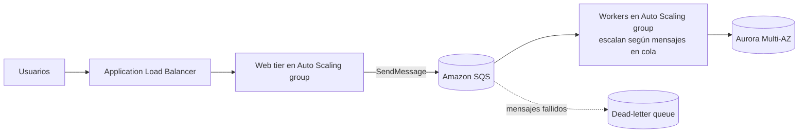
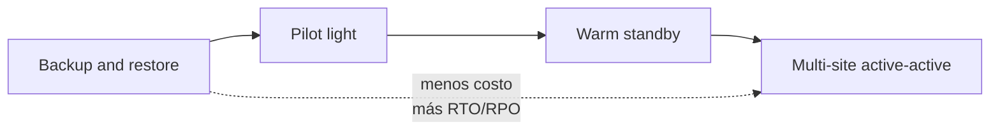

---
tags:
  - aws
  - certificacion
  - saa-c03
  - resiliencia
  - arquitectura
---

# Dominio 2: Design Resilient Architectures (26%)

> Arquitecturas que escalan y no se caen: desacoplar con colas y eventos, escalar horizontalmente con Auto Scaling y load balancers, replicar datos entre AZ y regiones, y elegir la estrategia de disaster recovery que cumpla el RTO y el RPO.

!!! info "Qué evalúa este dominio"
    - **Task 2.1 – Design scalable and loosely coupled architectures**: API Gateway, colas y pub/sub, arquitecturas event-driven, microservicios stateless, escalado horizontal y vertical, caché y CDN, load balancing, contenedores (ECS, EKS) y serverless (Lambda, Fargate), Step Functions, read replicas, servicios gestionados con propósito específico.
    - **Task 2.2 – Design highly available and/or fault-tolerant architectures**: regiones, AZ y Route 53; estrategias de DR (backup and restore, pilot light, warm standby, active-active) con RTO/RPO; failover; infraestructura inmutable; RDS Proxy; service quotas en el entorno de standby; X-Ray; mejorar la fiabilidad de aplicaciones legacy sin cambiar código.

    Formato y resto de dominios en el [resumen del examen](resumen-examen.md).

## Acoplamiento débil: por qué y cómo

En una arquitectura **tightly coupled** (fuertemente acoplada), si el componente B se cae o va lento, A también falla. En una **loosely coupled** (débilmente acoplada), A deja el trabajo en un intermediario (cola, tópico, bus de eventos) y B lo procesa a su ritmo. Esto permite escalar cada parte por separado y absorber picos. La teoría está en [Integración y APIs](../../../cloud/arquitectura/integracion-apis.md#colas-pubsub-y-streaming) y [Estilos de arquitectura](../../../cloud/arquitectura/estilos-arquitectura.md).

## Mensajería y eventos: SQS, SNS, EventBridge, Kinesis

| Servicio | Modelo | Entrega y orden | Retención | Úsalo cuando |
| --- | --- | --- | --- | --- |
| **SQS Standard** | Cola, un consumidor procesa cada mensaje (pull) | **At-least-once** (al menos una vez); orden *best effort*; throughput casi ilimitado | 1 minuto a 14 días (4 por defecto) | Desacoplar productor y consumidor, absorber picos (*queue-based load leveling*) |
| **SQS FIFO** | Cola | **Exactly-once processing** y orden estricto por *message group ID* | Igual | El orden importa (transacciones, pedidos); throughput más limitado (modo high throughput para más) |
| **Amazon SNS** | **Pub/sub** (publicación/suscripción), push a muchos suscriptores | At-least-once; SNS FIFO para orden | No retiene (entrega y listo) | **Fan-out** (abanico): un evento a varias colas, Lambdas, emails, SMS, HTTP |
| **Amazon EventBridge** | **Event bus** con reglas de enrutamiento por contenido | At-least-once | Archivo y replay opcionales | Event-driven entre servicios de AWS, apps SaaS y tus microservicios; programación de tareas (EventBridge Scheduler) |
| **Kinesis Data Streams** | **Streaming** con shards; varios consumidores leen el mismo flujo | Orden por partition key dentro del shard | 24 h por defecto, ampliable hasta 365 días | Telemetría, clickstream, logs en tiempo real; reprocesar datos; varios consumidores |
| **Amazon MQ** | Broker gestionado ActiveMQ o RabbitMQ | Según protocolo | Según broker | Migrar apps que ya usan JMS, AMQP, MQTT o STOMP **sin reescribir** |

Detalles de SQS que se preguntan:

- **Visibility timeout** (tiempo de invisibilidad): mientras un consumidor procesa un mensaje, nadie más lo ve. Si tarda más que el timeout, el mensaje reaparece y se procesa dos veces: ajústalo al tiempo real de procesamiento.
- **Dead-letter queue (DLQ)**: después de N intentos fallidos (`maxReceiveCount`) el mensaje va a otra cola para análisis.
- **Long polling** (hasta 20 s): reduce respuestas vacías y costo.
- **Delay queue**: retrasa la entrega hasta 15 minutos.
- Tamaño máximo de mensaje: **1 MiB** desde agosto de 2025 (antes 256 KiB). Para más, guarda el payload en S3 y envía la referencia (Extended Client Library).

!!! tip "En el examen"
    - "Un pedido debe procesarse una sola vez y en orden" → **SQS FIFO**.
    - "Un evento debe llegar a tres sistemas distintos que lo procesan de forma independiente" → **SNS + varias colas SQS (fan-out)**.
    - "Reaccionar a eventos de servicios de AWS o de un SaaS (Zendesk, Datadog) y enrutarlos según el contenido" → **EventBridge**.
    - "Varios consumidores leen el mismo flujo en tiempo real y se necesita reprocesar" → **Kinesis Data Streams** (en SQS, un mensaje consumido se borra).
    - "Migrar una app con ActiveMQ sin cambiar código" → **Amazon MQ**.

### Orquestación y APIs

- **AWS Step Functions**: orquesta pasos (Lambdas, ECS, llamadas a servicios) como máquina de estados, con reintentos, ramas, esperas y aprobación humana. **Standard workflows** (hasta 1 año, exactly-once, auditables) vs **Express workflows** (hasta 5 minutos, alto volumen, más baratos). Es la respuesta cuando ves "coordinar varios pasos con manejo de errores sin escribir lógica de orquestación".
- **Amazon API Gateway**: puerta de entrada para APIs. **REST API** (más funciones: caché, API keys y usage plans, validación, WAF, endpoints privados), **HTTP API** (más simple, barato y de menor latencia, autorizadores JWT) y **WebSocket API** (comunicación bidireccional). Aplica **throttling** (límite de peticiones) para proteger el backend. Ver [Serverless](../../../cloud/computo/serverless.md#api-gateway-delante-de-las-funciones).

## Cómputo escalable: stateless, contenedores y serverless

Para escalar horizontalmente, las instancias deben ser **stateless** (sin estado): la sesión del usuario va a **ElastiCache** o **DynamoDB**, los archivos a **S3** o **EFS**, no al disco local.

| Opción | Escala | Gestión | Cuándo |
| --- | --- | --- | --- |
| EC2 + Auto Scaling group | Por instancia, en minutos | Tú gestionas el SO | Control total, software legacy, licencias |
| **ECS** o **EKS** sobre EC2 | Por tarea/pod y por nodo | Tú gestionas los nodos | Contenedores con necesidad de GPU, instancias específicas o Spot |
| ECS o EKS con **Fargate** | Por tarea/pod | Sin servidores que gestionar | Contenedores sin administrar nodos |
| **AWS Lambda** | Por invocación, en milisegundos | Ninguna | Eventos cortos (máximo 15 minutos), tráfico irregular |
| **Elastic Beanstalk** | Auto Scaling incluido | AWS crea ELB, ASG y despliegues | Subir código web rápido sin diseñar la infraestructura |

- **ECS vs EKS**: ECS es el orquestador propio de AWS (más simple); EKS es Kubernetes gestionado (portabilidad, ecosistema, equipo que ya sabe Kubernetes). Ver [Contenedores gestionados](../../../cloud/computo/contenedores-gestionados.md).
- **Migrar a contenedores**: aplicaciones .NET/Java existentes se pueden contenerizar y llevar a ECS/Fargate; la regla general es "menos gestión = Fargate".

## Load balancing y Auto Scaling

**Elastic Load Balancing** reparte tráfico entre targets sanos en varias AZ y quita los que fallan el **health check** (comprobación de estado). La comparación ALB vs NLB vs GWLB está en el [Dominio 3](dominio-3-arquitecturas-alto-rendimiento.md#load-balancers-alb-vs-nlb-vs-gwlb).

### Políticas de Auto Scaling

| Política | Cómo funciona | Cuándo |
| --- | --- | --- |
| **Target tracking** (seguimiento de objetivo) | Mantiene una métrica en un valor (CPU 50%, `ALBRequestCountPerTarget`, mensajes en cola por instancia) | La opción por defecto recomendada |
| **Step scaling** (por pasos) | Alarmas de CloudWatch con escalones según cuánto se supera el umbral | Reacciones distintas según la magnitud del pico |
| **Simple scaling** | Una alarma, un ajuste, espera el cooldown | Legacy; mejor step o target tracking |
| **Scheduled** (programado) | Cambia la capacidad a una hora fija | Picos conocidos: lunes 8:00, cierre de mes |
| **Predictive** (predictivo) | ML sobre el historial para escalar **antes** del pico | Patrones cíclicos diarios o semanales |

- **Health check type**: por defecto el ASG usa el estado de EC2; activa el health check de **ELB** para reemplazar instancias cuya aplicación no responde.
- **Launch template**: define AMI, tipo de instancia, security groups (los launch configurations están obsoletos).
- **Lifecycle hooks**: ejecutar acciones al lanzar o terminar una instancia (descargar logs, registrar en un sistema).
- **Warm pools**: instancias preinicializadas para escalar más rápido apps con arranque lento.
- **Escalar workers con SQS**: target tracking sobre "mensajes visibles por instancia" (backlog per instance).

!!! tip "En el examen"
    "Tráfico alto todos los lunes a las 9:00" → **scheduled**. "La app tarda 10 minutos en arrancar y el pico es diario y predecible" → **predictive** (o warm pools). "Mantener la CPU cerca del 60%" → **target tracking**. "Las instancias fallan pero el ASG no las reemplaza" → activar **health check de ELB**.

## Alta disponibilidad de bases de datos

| Opción | Qué resuelve | Replicación | ¿Se puede leer la réplica? | Failover |
| --- | --- | --- | --- | --- |
| **RDS Multi-AZ (instancia)** | **Disponibilidad** ante fallo de AZ | Síncrona a un standby en otra AZ | **No** | Automático, mismo endpoint DNS (1–2 minutos aprox.) |
| **RDS Multi-AZ DB cluster** | Disponibilidad + algo de lectura | Semisíncrona a **dos** standbys en otras AZ (MySQL, PostgreSQL) | Sí | Más rápido que Multi-AZ instancia |
| **RDS read replicas** | **Escalar lecturas** | **Asíncrona**, misma región o cross-region | Sí | Manual: se **promueve** la réplica (puede usarse para DR) |
| **Aurora** | HA y rendimiento | Almacenamiento con 6 copias en 3 AZ; hasta 15 Aurora Replicas que comparten ese almacenamiento | Sí (reader endpoint) | Automático a una réplica, normalmente en menos de un minuto |
| **Aurora Global Database** | DR entre regiones y lecturas globales de baja latencia | Asíncrona a nivel de almacenamiento, lag típico menor a 1 s | Sí en regiones secundarias | Promoción de región secundaria: RPO de segundos, RTO de minutos |
| **DynamoDB global tables** | Multi-región **activo-activo** | Asíncrona multi-activa (por defecto); opción de consistencia fuerte multi-región | Sí, y también escribir en cada región | No hay failover: todas las regiones aceptan escrituras |

- **RDS Proxy**: pool de conexiones gestionado delante de RDS/Aurora. Evita agotar conexiones cuando muchas Lambdas abren conexiones, y reduce el tiempo de failover **sin cambiar el código** (solo el endpoint).
- **ElastiCache** con réplicas Multi-AZ (Valkey/Redis OSS) para que la caché no sea un single point of failure (punto único de falla).

!!! tip "En el examen"
    Multi-AZ = **disponibilidad** (no escala lecturas). Read replica = **rendimiento de lectura** (no da failover automático). Si piden ambos, son dos funciones distintas. "Reportes pesados ralentizan la base de producción" → **read replica** y apuntar los reportes ahí. "RPO de 1 segundo y RTO de 1 minuto entre regiones para una base relacional" → **Aurora Global Database**.

## Route 53 y failover

| Routing policy | Cómo decide | Caso típico |
| --- | --- | --- |
| **Simple** | Un registro, uno o varios valores al azar, sin health checks | Un solo recurso |
| **Weighted** (ponderado) | Porcentaje por registro | Canary, A/B testing, migración gradual |
| **Latency** (latencia) | Región con menor latencia para el usuario | App desplegada en varias regiones |
| **Failover** | Primario mientras su health check esté sano; si no, secundario | DR activo-pasivo |
| **Geolocation** | País o continente del usuario | Contenido localizado, restricciones legales |
| **Geoproximity** | Distancia geográfica con un **bias** para ampliar o reducir zonas | Mover tráfico entre regiones ajustando el sesgo |
| **Multivalue answer** | Hasta 8 registros sanos al azar | Balanceo simple del lado del cliente con health checks |
| **IP-based** | Rango CIDR de origen del usuario | Enrutar según el ISP o la red del cliente |

- **Alias record**: apunta a recursos de AWS (ALB, CloudFront, S3 website, API Gateway) y **funciona en el zone apex** (`ejemplo.com`), a diferencia de un CNAME; las consultas a alias de recursos AWS no tienen costo.
- Más sobre DNS en [Servicios de red](../../../networking/intermedio/servicios-red.md).

## Estrategias de disaster recovery

La teoría de RTO/RPO está en [Resiliencia](../../../cloud/operacion-y-gobierno/resiliencia.md#rto-y-rpo) y en [Continuidad de negocio](../../../negocio/continuidad-negocio.md).

| Estrategia | Qué hay en la región de DR | RPO / RTO típicos | Costo |
| --- | --- | --- | --- |
| **Backup and restore** | Solo backups (AWS Backup, snapshots copiados, S3 CRR) | Horas / horas | El más bajo |
| **Pilot light** (piloto encendido) | Datos replicados en vivo; cómputo apagado o inexistente (AMIs, IaC listos) | Minutos / decenas de minutos | Bajo |
| **Warm standby** (en espera activa) | Copia completa **funcionando a escala reducida** | Segundos a minutos / minutos | Medio |
| **Multi-site active-active** | Producción completa en dos o más regiones recibiendo tráfico | Casi cero / casi cero | El más alto |

- **AWS Elastic Disaster Recovery (DRS)**: replicación continua a nivel de bloque de servidores (on-premises o EC2) hacia una región de AWS, con recuperación en minutos. Útil para aplicaciones legacy **sin cambiar código**.
- **AWS Backup**: políticas de backup centralizadas para EBS, RDS, Aurora, DynamoDB, EFS, FSx, S3 y más, con copia entre regiones y cuentas.
- **Service quotas** (cuotas de servicio): en pilot light y warm standby, verifica que la región de DR tiene cuotas suficientes (instancias, IPs) **antes** del desastre; si no, el failover falla al escalar.
- **Infraestructura inmutable**: no parchear servidores en vivo; reemplazarlos desde una AMI o imagen nueva (CloudFormation, launch templates). Garantiza que el entorno de DR sea idéntico.

!!! tip "En el examen"
    Lee los números: "RPO de 24 horas, mínimo costo" → backup and restore. "RTO de minutos, costo moderado" → warm standby. "La base de datos debe estar siempre replicada pero el cómputo puede arrancar en 30 minutos" → pilot light. "Cero tiempo de caída" → active-active.

## Observabilidad para la resiliencia

- **Amazon CloudWatch**: métricas, alarmas y logs que disparan Auto Scaling y notificaciones. Ver [Observabilidad nativa](../../../cloud/operacion-y-gobierno/observabilidad-nativa.md).
- **AWS X-Ray**: **distributed tracing** (trazas distribuidas) para ver qué microservicio provoca la latencia o los errores.
- **AWS Health Dashboard**: eventos de AWS que afectan a tus recursos.

## Casos de uso

1. **Una tienda online pierde pedidos en Black Friday porque el backend de pagos no da abasto.** → SQS entre el frontend y los workers de pagos; workers en Auto Scaling según mensajes en cola. Si importa el orden por cliente, SQS FIFO con `MessageGroupId` = cliente.
2. **Cuando se sube una imagen a S3, hay que generar miniatura, analizarla con Rekognition y notificar al usuario, cada cosa por separado.** → Evento de S3 a SNS (o EventBridge) con fan-out a tres colas SQS/Lambdas.
3. **Una app legacy en EC2 guarda las sesiones en memoria y los usuarios pierden la sesión al escalar.** → Externalizar la sesión a ElastiCache o DynamoDB (o, como parche rápido, sticky sessions en el ALB).
4. **Cientos de Lambdas agotan las conexiones de una base RDS PostgreSQL.** → **RDS Proxy**.
5. **Una empresa necesita que su app siga funcionando si cae una región, con RTO de 15 minutos y presupuesto moderado.** → Warm standby: Aurora Global Database + ASG mínimo en la segunda región + Route 53 failover.
6. **Un proceso de aprobación de préstamos tiene 6 pasos con reintentos y una espera de aprobación humana de hasta 3 días.** → **Step Functions Standard**.
7. **Un servidor Windows on-premises crítico necesita DR en AWS sin modificar la aplicación.** → **AWS Elastic Disaster Recovery**.
8. **Una app global debe responder desde la región más cercana y retirar automáticamente la región que falle.** → Route 53 latency routing con health checks (o Global Accelerator si se requieren IPs estáticas y failover más rápido).

## Preguntas de práctica

**1.** Una aplicación procesa transacciones bancarias recibidas desde una API. Cada transacción debe procesarse exactamente una vez y en el orden en que llega por cuenta de cliente. ¿Qué solución cumple con el MENOR esfuerzo operativo?

- A. SQS Standard con deduplicación en la aplicación
- B. SQS FIFO usando el ID de cuenta como message group ID
- C. SNS Standard con suscripción de Lambda
- D. Kinesis Data Streams con un shard por cliente

??? success "Respuesta"
    **B.** FIFO garantiza orden por grupo y exactly-once processing, y los grupos permiten paralelizar entre cuentas. **A** exige lógica propia y no garantiza orden. **C** no garantiza orden ni exactly-once. **D** no escala (un shard por cliente) y añade gestión.

**2.** Los reportes de BI saturan la base de datos MySQL en RDS de producción, que ya tiene Multi-AZ. ¿Qué cambio resuelve el problema?

- A. Enviar los reportes al standby de Multi-AZ
- B. Crear una read replica y dirigir los reportes a su endpoint
- C. Aumentar el tamaño de la instancia del standby
- D. Activar backups automáticos con retención de 35 días

??? success "Respuesta"
    **B.** Las read replicas sirven lecturas. **A** no es posible: el standby de una instancia Multi-AZ no acepta conexiones. **C** no ayuda por lo mismo. **D** no tiene relación con la carga de lectura.

**3.** Una empresa requiere RPO de 1 hora y RTO de 4 horas para una aplicación interna, al menor costo posible, en otra región. ¿Qué estrategia elegir?

- A. Multi-site active-active
- B. Warm standby
- C. Pilot light
- D. Backup and restore con copias entre regiones mediante AWS Backup

??? success "Respuesta"
    **D.** Un RTO de horas permite restaurar desde backups, la opción más barata; con copias cada hora se cumple el RPO. **A**, **B** y **C** cumplen, pero cuestan más.

**4.** Una aplicación en un Auto Scaling group detrás de un ALB devuelve errores 500 porque el proceso web se cuelga, pero las instancias siguen en estado "running" y el ASG no las reemplaza. ¿Qué hacer?

- A. Cambiar a una política de step scaling
- B. Configurar el ASG para usar health checks de ELB
- C. Activar el detailed monitoring de CloudWatch
- D. Añadir una segunda AZ

??? success "Respuesta"
    **B.** Con el health check de ELB, el ASG considera no sana una instancia que falla el health check del target group y la reemplaza. **A** cambia cómo se escala, no cómo se detectan fallos. **C** da métricas cada minuto, no reemplaza. **D** no resuelve el proceso colgado.

**5.** Un sistema de pedidos publica un evento por cada pedido. Facturación, inventario y analítica deben recibir **cada** evento y procesarlo de forma independiente, aunque uno de ellos esté caído un rato. ¿Qué diseño es correcto?

- A. Una cola SQS compartida por los tres consumidores
- B. Un tópico SNS con tres colas SQS suscritas
- C. Tres llamadas HTTP síncronas desde el servicio de pedidos
- D. Una función Lambda que escribe en las tres bases de datos

??? success "Respuesta"
    **B.** Fan-out con SNS + SQS: cada consumidor tiene su cola durable y procesa a su ritmo. **A** reparte cada mensaje a un solo consumidor. **C** acopla y falla si uno está caído. **D** acopla todo en una función.

**6.** Una aplicación debe tolerar la caída de una AZ **sin degradación**. Con 2 AZ necesita 6 instancias en total para atender la carga normal. ¿Cuál es el mínimo de instancias para ser fault tolerant ante la caída de una AZ?

- A. 6 (3 por AZ)
- B. 8 (4 por AZ)
- C. 12 (6 por AZ)
- D. 7 (4 en una AZ y 3 en la otra)

??? success "Respuesta"
    **C.** Si cae una AZ, la otra debe tener sola las 6 instancias. **A** es solo HA: con una AZ caída quedan 3. **B** deja 4 y **D** deja 3 o 4. Dato útil: con **3 AZ** bastarían 9 (3 por AZ), porque al caer una quedan 6; por eso repartir en más AZ abarata la tolerancia a fallos.

## Para profundizar

- [Resiliencia](../../../cloud/operacion-y-gobierno/resiliencia.md): HA, autoscaling, health checks y DR comparados entre nubes.
- [Integración y APIs](../../../cloud/arquitectura/integracion-apis.md): síncrono vs asíncrono, colas, pub/sub, streaming, saga y outbox.
- [Arquitectura en la nube](../../../cloud/arquitectura/arquitectura-cloud.md): patrones como retry con backoff, circuit breaker y queue-based load leveling.
- [Arquitecturas de referencia](../../../cloud/arquitectura/arquitecturas-referencia.md): web de tres capas y multi-región activo-pasivo con diagramas.
- [Balanceo y alta disponibilidad de red](../../../networking/avanzado/balanceo-alta-disponibilidad.md).
- [Despliegue continuo](../../../devops/ci-cd/despliegue-continuo.md): blue/green y canary con weighted routing.

## Relación con otras secciones

| Enfoque | Qué se mira desde ahí | Nota |
| --- | --- | --- |
| Cloud (el control) | Multi-AZ, multi-región, DR | [Resiliencia](../../../cloud/operacion-y-gobierno/resiliencia.md), [Serverless](../../../cloud/computo/serverless.md) |
| DevOps (la automatización) | Infraestructura inmutable, despliegues seguros, SLOs | [Despliegue continuo](../../../devops/ci-cd/despliegue-continuo.md), [Operación y SRE](../../../devops/operacion/operacion-sre.md) |
| Negocio TI (el porqué) | RTO, RPO y SLA los fija el negocio | [Continuidad de negocio](../../../negocio/continuidad-negocio.md), [Niveles de servicio](../../../negocio/niveles-de-servicio.md) |
| Networking (la base) | Balanceo, DNS failover, anycast | [Balanceo y alta disponibilidad](../../../networking/avanzado/balanceo-alta-disponibilidad.md) |

## Referencias

- [Exam guide SAA-C03: Domain 2](https://docs.aws.amazon.com/aws-certification/latest/solutions-architect-associate-03/solutions-architect-associate-03-domain2.html)
- [Disaster Recovery of Workloads on AWS (whitepaper)](https://docs.aws.amazon.com/whitepapers/latest/disaster-recovery-workloads-on-aws/disaster-recovery-workloads-on-aws.html)
- [Amazon SQS FIFO queues](https://docs.aws.amazon.com/AWSSimpleQueueService/latest/SQSDeveloperGuide/FIFO-queues.html)
- [Amazon SQS aumenta el tamaño máximo de mensaje a 1 MiB](https://aws.amazon.com/about-aws/whats-new/2025/08/amazon-sqs-max-payload-size-1mib/)
- [Dynamic scaling for Amazon EC2 Auto Scaling](https://docs.aws.amazon.com/autoscaling/ec2/userguide/as-scale-based-on-demand.html)
- [Multi-AZ deployments for Amazon RDS](https://docs.aws.amazon.com/AmazonRDS/latest/UserGuide/Concepts.MultiAZ.html)
- [Aurora Global Database](https://docs.aws.amazon.com/AmazonRDS/latest/AuroraUserGuide/aurora-global-database.html)
- [DynamoDB global tables](https://docs.aws.amazon.com/amazondynamodb/latest/developerguide/GlobalTables.html)
- [Route 53 routing policies](https://docs.aws.amazon.com/Route53/latest/DeveloperGuide/routing-policy.html)
- [AWS Well-Architected: Reliability Pillar](https://docs.aws.amazon.com/wellarchitected/latest/reliability-pillar/welcome.html)
