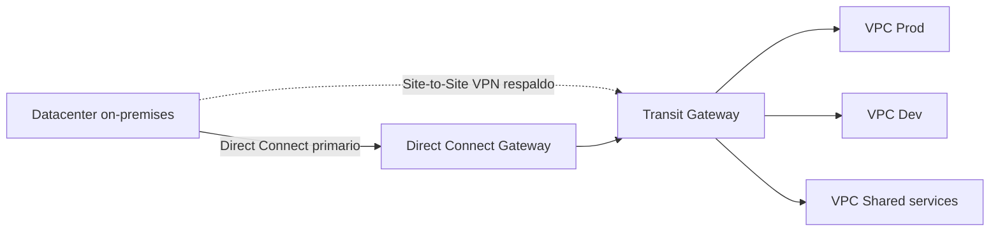
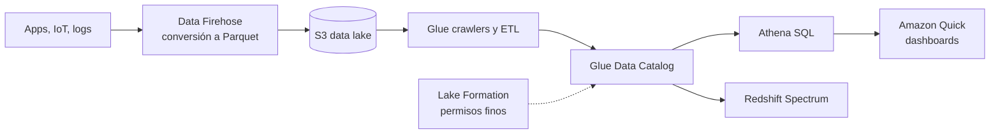

---
tags:
  - aws
  - certificacion
  - saa-c03
  - arquitectura
  - computo
  - redes
---

# Dominio 3: Design High-Performing Architectures (24%)

> Elegir el almacenamiento, el cómputo, la base de datos, la red y el pipeline de datos adecuados para la latencia, las IOPS y el throughput que pide cada escenario.

!!! info "Qué evalúa este dominio"
    - **Task 3.1 – Storage**: S3, EFS, EBS; tipos object/file/block; almacenamiento híbrido; configuraciones que cumplan rendimiento y escalen.
    - **Task 3.2 – Compute**: EC2 (tipos de instancia), Auto Scaling, Lambda (memoria), Fargate, ECS/EKS, Batch, EMR; desacoplar para escalar por separado; métricas de escalado.
    - **Task 3.3 – Databases**: tipos de base de datos (relacional, NoSQL, en memoria, serverless), motores, capacidad (capacity units, Provisioned IOPS), read replicas, proxies, caché con ElastiCache, patrones de lectura vs escritura.
    - **Task 3.4 – Network**: CloudFront y Global Accelerator, diseño de subnets y routing, load balancing, VPN, Direct Connect, PrivateLink; topologías globales, híbridas y multi-tier.
    - **Task 3.5 – Data ingestion and transformation**: Kinesis, DataSync, Storage Gateway, Glue, Athena, Lake Formation, Amazon Quick, EMR; data lakes seguros; streaming; conversión de formatos (CSV a Parquet).

    Formato y resto de dominios en el [resumen del examen](resumen-examen.md).

## Almacenamiento: object, block y file

La comparación entre nubes y los conceptos están en [Almacenamiento y datos](../../../cloud/redes-y-datos/almacenamiento-datos.md). Aquí, cómo elegir en AWS:

| Servicio | Tipo | Acceso | Alcance | Úsalo cuando |
| --- | --- | --- | --- | --- |
| **Amazon S3** | Object | API HTTP | Regional, prácticamente ilimitado | Archivos estáticos, data lakes, backups, media |
| **Amazon EBS** | Block | Disco de **una** instancia (salvo Multi-Attach) | **Una AZ** | Disco de SO y bases de datos en EC2 |
| **Instance store** | Block efímero | Disco físico del host | La instancia; se pierde al parar o terminar | Máximas IOPS para caché, buffers, datos temporales o replicados |
| **Amazon EFS** | File (NFS) | Miles de instancias Linux a la vez | Regional (multi-AZ) o One Zone | Contenido compartido entre instancias Linux, contenedores y Lambda |
| **Amazon FSx** | File (varios) | Ver tabla de FSx | Single-AZ o Multi-AZ | Windows, HPC, NetApp, ZFS |

### Tipos de volumen EBS

| Tipo | Medio | Rendimiento | Casos de uso |
| --- | --- | --- | --- |
| **gp3** | SSD | 3,000 IOPS y 125 MiB/s de base, independientes del tamaño; puedes aprovisionar más IOPS y throughput por separado (desde septiembre de 2025, hasta 80,000 IOPS, 2,000 MiB/s y 64 TiB) | **Opción por defecto**: boot, apps, bases de datos medianas |
| gp2 | SSD | IOPS ligadas al tamaño (3 IOPS por GiB) con burst | Legacy: migra a gp3 (más barato y predecible) |
| **io2 Block Express** | SSD | El más alto: hasta 256,000 IOPS, latencia submilisegundo, mayor durabilidad | Bases de datos críticas con IOPS sostenidas (Oracle, SQL Server, SAP HANA) |
| io1 | SSD | IOPS aprovisionadas | Legacy frente a io2 |
| **st1** | HDD | Throughput alto y barato | Big data, data warehouses, logs: lectura **secuencial** |
| **sc1** | HDD | El más barato | Datos fríos con acceso secuencial poco frecuente |

- Los HDD (st1, sc1) **no pueden ser volumen de arranque**.
- **Multi-Attach**: solo io1/io2, misma AZ, y la aplicación debe gestionar escrituras concurrentes (sistema de archivos de clúster).
- Un volumen EBS vive en **una AZ**: para moverlo a otra AZ o región, haz un **snapshot** y crea el volumen desde él (las snapshots se pueden copiar entre regiones).
- Las cifras máximas cambian: revisa la [documentación de tipos de volumen](https://docs.aws.amazon.com/ebs/latest/userguide/ebs-volume-types.html) antes del examen.

!!! tip "En el examen"
    "IOPS altas y sostenidas para una base de datos" → **io2**. "Rendimiento predecible, buen costo" → **gp3**. "Procesamiento secuencial de grandes archivos de log, barato" → **st1**. "La máxima I/O posible y los datos se pueden perder" → **instance store**.

### EFS vs FSx

| Servicio | Protocolo | Clientes | Úsalo cuando |
| --- | --- | --- | --- |
| **Amazon EFS** | NFS v4 | Linux | Sistema de archivos compartido elástico, sin aprovisionar capacidad |
| **FSx for Windows File Server** | **SMB** | Windows (y Linux con SMB) | Carpetas compartidas Windows, integración con **Active Directory**, DFS |
| **FSx for Lustre** | Lustre | Linux | **HPC**, ML, renderizado; integración con S3 (lee el bucket como sistema de archivos) |
| **FSx for NetApp ONTAP** | NFS, SMB **e iSCSI** | Linux, Windows, macOS | Migrar NetApp on-premises, multiprotocolo, snapshots y replicación ONTAP |
| **FSx for OpenZFS** | NFS | Linux, macOS | Migrar ZFS on-premises, baja latencia, snapshots y clones |

- EFS: **throughput mode Elastic** (recomendado, escala solo), Provisioned o Bursting; clases **Standard**, **Infrequent Access** y **Archive** con lifecycle management.

!!! tip "En el examen"
    "Windows" o "SMB" o "Active Directory" → **FSx for Windows**. "HPC", "sub-millisecond", "procesar datos de S3 en paralelo" → **FSx for Lustre**. "Linux compartido entre muchas instancias en varias AZ" → **EFS**. "Varios protocolos a la vez" → **FSx for NetApp ONTAP**.

### Rendimiento de S3

- S3 escala por **prefijo**: al menos 3,500 PUT/COPY/POST/DELETE y 5,500 GET/HEAD por segundo **por prefijo**; repartir objetos en varios prefijos multiplica el rendimiento.
- **Multipart upload**: recomendado desde 100 MB y obligatorio para objetos de más de 5 GB; sube partes en paralelo.
- **S3 Transfer Acceleration**: sube a través de las edge locations de CloudFront; útil para usuarios lejanos de la región.
- **Byte-range fetches**: descargar partes de un objeto en paralelo.
- **S3 Express One Zone**: clase de una sola AZ con latencia de milisegundos de un dígito para cargas muy intensivas (ML, analítica), con *directory buckets*.
- Las clases de almacenamiento y el lifecycle (costo) están en el [Dominio 4](dominio-4-arquitecturas-costo-optimizado.md#clases-de-almacenamiento-de-s3).

## Cómputo de alto rendimiento

Familias y nomenclatura en [Máquinas virtuales](../../../cloud/computo/maquinas-virtuales.md#familias-de-maquinas).

| Familia EC2 | Optimizada para | Ejemplos de uso |
| --- | --- | --- |
| General purpose (M, T) | Equilibrio CPU/memoria; T con créditos de CPU (burstable) | Web, apps, entornos de desarrollo |
| Compute optimized (C) | CPU | Batch, servidores de juego, HPC, codificación de video |
| Memory optimized (R, X) | Memoria | Bases de datos en memoria, caché, analítica en tiempo real |
| Storage optimized (I, D) | I/O local (instance store NVMe) | NoSQL, data warehouses, sistemas de archivos distribuidos |
| Accelerated computing (P, G, Inf, Trn) | GPU o chips de ML | Entrenamiento e inferencia de ML, gráficos |

**Placement groups** (grupos de colocación):

| Tipo | Cómo coloca | Para qué |
| --- | --- | --- |
| **Cluster** | Juntas en la misma AZ, red de baja latencia y alto throughput | HPC, apps muy acopladas |
| **Spread** | Cada instancia en hardware distinto (máximo 7 por AZ por grupo) | Pocas instancias críticas que no deben fallar juntas |
| **Partition** | Grupos de instancias en particiones con racks separados | Hadoop, Cassandra, Kafka: sistemas distribuidos con réplicas |

- **Enhanced networking** (ENA) y **Elastic Fabric Adapter (EFA)** para HPC con MPI.
- **AWS Lambda**: la CPU es proporcional a la **memoria** asignada (128 MB a 10,240 MB): si una función va lenta por CPU, súbele memoria. Máximo 15 minutos por invocación. **Provisioned concurrency** elimina los cold starts; **reserved concurrency** reserva y limita concurrencia. Ver [Serverless](../../../cloud/computo/serverless.md#cold-starts).
- **AWS Batch**: trabajos por lotes en contenedores, gestiona colas y elige instancias (incluido Spot); para jobs de más de 15 minutos que no caben en Lambda.
- **Amazon EMR**: clústeres gestionados de Spark, Hadoop, Hive, Presto para big data.
- **Edge**: **AWS Outposts** (racks de AWS en tu datacenter), **Local Zones** (cómputo cerca de grandes ciudades), **Wavelength** (dentro de redes 5G de operadores).

!!! tip "En el examen"
    "Procesamiento que tarda 2 horas" → no es Lambda: **Batch**, ECS/Fargate o EC2. "Baja latencia entre nodos HPC" → **cluster placement group** (+ EFA). "Evitar que un fallo de hardware tumbe varias instancias críticas" → **spread**.

## Bases de datos según el patrón de acceso

| Necesidad | Servicio |
| --- | --- |
| Relacional, motor estándar (MySQL, PostgreSQL, MariaDB, Oracle, SQL Server, Db2) | **Amazon RDS** |
| Relacional de alto rendimiento compatible con MySQL/PostgreSQL | **Amazon Aurora**; **Aurora Serverless v2** para carga variable |
| Clave-valor o documentos con latencia de milisegundos a cualquier escala | **Amazon DynamoDB** |
| Caché en memoria, sesiones, leaderboards | **Amazon ElastiCache** |
| Data warehouse, analítica OLAP en columnas | **Amazon Redshift** |
| Documentos compatibles con MongoDB | **Amazon DocumentDB** |
| Grafos (redes sociales, fraude, recomendaciones) | **Amazon Neptune** |
| Compatible con Cassandra | **Amazon Keyspaces** |
| Búsqueda de texto y análisis de logs | **Amazon OpenSearch Service** |

### DynamoDB en profundidad

| Aspecto | Detalle |
| --- | --- |
| Capacity modes | **On-demand** (paga por petición, sin planificación; recomendado para tráfico impredecible) vs **Provisioned** (defines RCU/WCU, con auto scaling; más barato con tráfico estable) |
| Unidades | 1 **RCU** = 1 lectura fuertemente consistente/s de hasta 4 KB (o 2 eventualmente consistentes); 1 **WCU** = 1 escritura/s de hasta 1 KB |
| Ítem máximo | 400 KB |
| **DAX** (DynamoDB Accelerator) | Caché en memoria **compatible con la API** de DynamoDB: lecturas en **microsegundos** sin cambiar la lógica de la app |
| **Global tables** | Réplicas multi-región activo-activo |
| **DynamoDB Streams** | Flujo de cambios para disparar Lambdas (event-driven) |
| **TTL** | Borra ítems expirados sin costo de escritura |
| Índices | **GSI** (otra partition key, se puede crear después) y **LSI** (misma partition key, solo al crear la tabla) |

### ElastiCache

| Aspecto | Valkey / Redis OSS | Memcached |
| --- | --- | --- |
| Estructuras de datos | Ricas (sorted sets, hashes, pub/sub) | Clave-valor simple |
| Replicación y Multi-AZ con failover | Sí | No |
| Persistencia y backups | Sí | No |
| Escalado | Shards y réplicas (cluster mode) | Añadir o quitar nodos; multihilo |
| Úsalo cuando | Sesiones, leaderboards, alta disponibilidad | Caché simple y desechable |

- Estrategias: **lazy loading / cache-aside** (leer de caché, si no está, de la base y guardar) y **write-through** (escribir en caché al escribir en la base). Ver [Arquitectura en la nube](../../../cloud/arquitectura/arquitectura-cloud.md).
- **ElastiCache Serverless** para no gestionar nodos.

!!! tip "En el examen"
    "Microsegundos en DynamoDB sin cambiar código" → **DAX**. "Acelerar consultas repetidas a RDS" → **ElastiCache** (requiere cambios en la app) o read replicas. "Leaderboard en tiempo real" → **ElastiCache (Valkey/Redis OSS) sorted sets**. "Escalar relacional con lecturas intensivas en todo el mundo" → **Aurora Global Database**.

## Redes de alto rendimiento

### Load balancers: ALB vs NLB vs GWLB

| Aspecto | Application Load Balancer | Network Load Balancer | Gateway Load Balancer |
| --- | --- | --- | --- |
| Capa OSI | **7** (HTTP, HTTPS, gRPC, WebSocket) | **4** (TCP, UDP, TLS) | **3** (paquetes IP, encapsulados en GENEVE) |
| Enrutamiento | Por path, host, headers, query string, método | Por puerto y protocolo | Hacia appliances de seguridad |
| IP | DNS (IPs cambiantes) | **IP estática por AZ** (o Elastic IP) | N/A |
| Rendimiento | Alto | **Millones de peticiones por segundo, latencia ultra baja** | Alto |
| Targets | Instancias, IPs, **Lambda**, contenedores | Instancias, IPs, ALB | Appliances virtuales (firewalls, IDS/IPS de terceros) |
| Extras | WAF, autenticación con Cognito/OIDC, sticky sessions, redirecciones | Preserva la IP de origen, base de servicios **PrivateLink** | Inspección transparente de tráfico |

La teoría de L4 vs L7 está en [Balanceo y alta disponibilidad](../../../networking/avanzado/balanceo-alta-disponibilidad.md) y [Modelos OSI y TCP/IP](../../../networking/basico/modelos-osi-tcpip.md).

### CloudFront vs Global Accelerator

| Aspecto | Amazon CloudFront | AWS Global Accelerator |
| --- | --- | --- |
| Qué es | **CDN**: caché en edge locations | Red global de AWS con **2 IPs anycast estáticas** |
| Protocolos | HTTP/HTTPS (y WebSocket) | **TCP y UDP** cualquiera |
| Caché | Sí | **No** |
| Failover | Origin failover (grupos de orígenes) | Failover entre endpoints regionales en segundos, sin depender de la caché DNS |
| Úsalo cuando | Contenido estático o dinámico web, video, APIs; reducir carga del origen | Juegos, VoIP, IoT, apps no HTTP; necesidad de **IPs fijas** en una allowlist; failover multi-región rápido |

- **Origin Access Control (OAC)**: el bucket S3 solo acepta peticiones de CloudFront (reemplaza al antiguo OAI).
- **Lambda@Edge** y **CloudFront Functions** para lógica en el borde.

### Conectividad entre VPC

| Opción | Transitivo | Escala | Cuándo |
| --- | --- | --- | --- |
| **VPC peering** | **No** | Malla 1 a 1; sin CIDR solapados | Pocas VPC, baja latencia, sin costo por hora |
| **AWS Transit Gateway** | **Sí** (hub-and-spoke) | Miles de VPC, VPN y Direct Connect; peering entre regiones | Muchas VPC y on-premises; enrutamiento centralizado |
| **AWS PrivateLink** | N/A (servicio a consumidor) | Expone un servicio concreto | Compartir un servicio sin exponer la VPC; CIDR solapados |
| **VPC sharing (AWS RAM)** | N/A | Varias cuentas en subnets de una VPC | Red centralizada, cuentas separadas |

### Conectividad híbrida: VPN vs Direct Connect

| Aspecto | AWS Site-to-Site VPN | AWS Direct Connect |
| --- | --- | --- |
| Medio | IPsec sobre internet | Enlace físico dedicado en una ubicación de Direct Connect |
| Tiempo de puesta en marcha | Minutos u horas | **Semanas** (dedicated) o días (hosted vía partner) |
| Ancho de banda | Limitado por túnel (cada conexión trae 2 túneles); más con ECMP sobre Transit Gateway | Dedicated de 1, 10, 100 y 400 Gbps; hosted desde 50 Mbps |
| Latencia | Variable (internet) | **Consistente** |
| Cifrado | Sí | No por defecto (VPN sobre DX o MACsec) |
| Costo | Bajo | Puerto por hora + transferencia saliente más barata |

- **Resiliencia**: para máxima resiliencia, dos conexiones DX en **dos ubicaciones** distintas; una VPN como **respaldo** de DX es la opción económica.
- **Direct Connect Gateway**: una conexión DX hacia VPC de varias regiones.
- Fundamentos en [Redes de datacenter y redes híbridas](../../../networking/avanzado/redes-datacenter-hibridas.md) y [Routing y NAT](../../../networking/intermedio/routing-nat.md) (BGP).

## Ingesta y transformación de datos

### Streaming

| Servicio | Qué hace | Latencia | Gestión |
| --- | --- | --- | --- |
| **Kinesis Data Streams** | Flujo durable con shards (o modo on-demand); consumidores propios (Lambda, KCL, Flink) | **Real-time** (milisegundos a ~1 s) | Capacidad por shards u on-demand |
| **Amazon Data Firehose** | **Entrega** datos a S3, Redshift, OpenSearch, Splunk, HTTP o tablas Iceberg; transforma con Lambda y **convierte a Parquet/ORC** | **Near real-time** (buffer) | Totalmente gestionado, sin consumidores |
| **Amazon Managed Service for Apache Flink** | Analítica en streaming (ventanas, agregaciones) | Real-time | Gestionado |
| **Amazon MSK** | Apache Kafka gestionado (también MSK Serverless) | Real-time | Migrar o usar Kafka |
| **Kinesis Video Streams** | Video desde cámaras | Real-time | Gestionado |

### Analítica y data lakes

| Servicio | Para qué |
| --- | --- |
| **Amazon Athena** | SQL **serverless** sobre S3; pagas por datos escaneados (usa **Parquet** comprimido y **particiones**) |
| **AWS Glue** | ETL serverless, **Data Catalog** (metadatos) y crawlers que descubren esquemas; conversión CSV → Parquet |
| **AWS Lake Formation** | Construir y **asegurar** un data lake: permisos a nivel de base, tabla, columna y fila |
| **Amazon Redshift** | Data warehouse; **Redshift Spectrum** consulta S3 sin cargarlo; Redshift Serverless |
| **Amazon EMR** | Spark/Hadoop para transformaciones grandes y personalizadas |
| **Amazon Quick** (antes QuickSight) | Dashboards y BI |
| **Amazon OpenSearch Service** | Búsqueda y análisis de logs |
| **Amazon AppFlow** | Integrar datos de SaaS (Salesforce, SAP, Slack) con S3 o Redshift sin código |

### Transferencia de datos híbrida y migración

| Servicio | Qué hace | Úsalo cuando |
| --- | --- | --- |
| **AWS DataSync** | Copia **online** programada y verificada desde NFS, SMB, HDFS u object storage hacia S3, EFS o FSx (y entre servicios de AWS) | Migrar o sincronizar grandes volúmenes por la red |
| **AWS Storage Gateway – S3 File Gateway** | Recurso NFS/SMB on-premises que guarda los archivos como objetos en S3, con caché local | Apps on-premises que escriben archivos y los quieres en S3 |
| **Storage Gateway – Volume Gateway** | Volúmenes iSCSI: *cached* (datos en S3, caché local) o *stored* (datos locales, backup asíncrono a S3 como snapshots EBS) | Discos de servidores on-premises respaldados en AWS |
| **Storage Gateway – Tape Gateway** | Biblioteca de cintas virtual (VTL) hacia S3 y Glacier | Reemplazar cintas físicas sin cambiar el software de backup |
| **AWS Transfer Family** | Servidores **SFTP, FTPS, FTP y AS2** gestionados sobre S3 o EFS | Socios que envían archivos por SFTP |
| **AWS Snow Family** (Snowball Edge) | Dispositivo físico que se envía por mensajería | Decenas o cientos de TB con poca red o sin conectividad |
| **AWS DMS** | Migración de bases de datos con replicación continua (CDC); con conversión de esquema para migraciones **heterogéneas** | Oracle → Aurora PostgreSQL, MySQL → RDS |
| **AWS Application Migration Service (MGN)** | Rehost (*lift and shift*) de servidores | Llevar VMs a EC2 sin cambios |

!!! warning "Snow Family: estado actual"
    La guía SAA-C03 aún lista **Snow Family** y en el examen la respuesta esperada para "transferir cientos de TB con poco ancho de banda" suele ser **Snowball Edge**. En la vida real: Snowcone se discontinuó en noviembre de 2024 y, desde el **7 de noviembre de 2025**, Snowball Edge solo está disponible para clientes existentes. Para clientes nuevos, AWS recomienda **DataSync** (online), **AWS Data Transfer Terminal** (llevar tus discos a una ubicación física de AWS), soluciones de partners u **Outposts** para cómputo en el borde. Snowmobile ya no se ofrece. Revisa el [anuncio](https://aws.amazon.com/blogs/storage/aws-snow-device-updates/).

!!! tip "En el examen"
    Calcula: 100 TB por un enlace de 100 Mbps tardan unos 3 meses; si el plazo es una semana, la red no alcanza → dispositivo físico. "Sincronizar un NAS con EFS cada noche" → **DataSync**. "Apps on-premises siguen usando un recurso compartido de archivos pero los datos deben quedar en S3" → **S3 File Gateway**. "Proveedores externos suben archivos por SFTP" → **Transfer Family**. Detalles de migración en [Migración a la nube](../../../cloud/arquitectura/migracion-cloud.md).

## Casos de uso

1. **Un estudio de animación renderiza con cientos de instancias Linux que leen texturas desde S3 con latencia submilisegundo.** → **FSx for Lustre** enlazado al bucket S3.
2. **Una base de datos Oracle en EC2 necesita 100,000 IOPS sostenidas.** → EBS **io2 Block Express** en una instancia con suficiente ancho de banda EBS.
3. **Un juego multijugador usa UDP y los jugadores de todo el mundo sufren latencia; además necesita IPs fijas.** → **Global Accelerator**.
4. **Un catálogo de productos en DynamoDB recibe lecturas masivas repetidas y necesita microsegundos.** → **DAX**.
5. **Una empresa con 60 VPC en varias cuentas y dos datacenters necesita conectividad entre todas.** → **Transit Gateway** compartido con RAM + Direct Connect Gateway.
6. **Telemetría de 50,000 sensores debe guardarse en S3 en formato columnar para consultas SQL baratas.** → **Data Firehose** con conversión a Parquet → S3 → Glue Data Catalog → **Athena**.
7. **Un hospital debe dar acceso a analistas solo a ciertas columnas (sin PII) del data lake.** → **Lake Formation** con permisos a nivel de columna.
8. **Una app expone una API HTTP con rutas `/api` y `/imagenes` que van a servicios distintos.** → **ALB** con reglas por path.

## Preguntas de práctica

**1.** Una aplicación HPC necesita la menor latencia de red posible entre 20 instancias que intercambian mensajes constantemente. ¿Qué configuración es la MÁS adecuada?

- A. Spread placement group en tres AZ
- B. Cluster placement group en una AZ con instancias compatibles con EFA
- C. Partition placement group
- D. Instancias T3 en un Auto Scaling group multi-AZ

??? success "Respuesta"
    **B.** Cluster coloca las instancias juntas en una AZ con red de alto rendimiento; EFA mejora el MPI. **A** maximiza la separación (y la latencia). **C** es para sistemas distribuidos con réplicas. **D** usa instancias burstable y reparte entre AZ.

**2.** Una empresa necesita un sistema de archivos compartido para servidores Windows, integrado con su Active Directory, con alta disponibilidad. ¿Qué servicio elegir?

- A. Amazon EFS
- B. Amazon FSx for Windows File Server en Multi-AZ
- C. Amazon S3 con S3 File Gateway
- D. EBS Multi-Attach

??? success "Respuesta"
    **B.** SMB nativo, integración con AD y despliegue Multi-AZ. **A** es NFS para Linux. **C** sirve para llevar archivos on-premises a S3, no como file server principal en AWS. **D** es block storage en una sola AZ.

**3.** Una aplicación TCP no HTTP en dos regiones debe tener IPs estáticas que los clientes pongan en su firewall y conmutar a la otra región en segundos si una falla. ¿Qué usar?

- A. CloudFront con dos orígenes
- B. Route 53 failover routing
- C. AWS Global Accelerator con endpoints en ambas regiones
- D. Un Application Load Balancer por región con Elastic IP

??? success "Respuesta"
    **C.** IPs anycast estáticas, cualquier TCP/UDP y failover rápido sin depender del TTL DNS. **A** es para HTTP. **B** depende de la caché DNS y no da IPs fijas. **D**: un ALB no admite Elastic IP.

**4.** Un equipo consulta con Athena logs en CSV en S3 y el costo y el tiempo de consulta crecen cada mes. ¿Qué DOS acciones mejoran ambos?

- A. Convertir los datos a Parquet comprimido
- B. Particionar los datos por fecha en S3
- C. Mover los datos a S3 Glacier Flexible Retrieval
- D. Aumentar la memoria de Athena
- E. Activar S3 Transfer Acceleration

??? success "Respuesta"
    **A y B.** Athena cobra por datos escaneados: un formato columnar comprimido y las particiones reducen lo que se lee. **C** impide consultar directamente. **D** no existe como opción. **E** acelera subidas, no consultas.

**5.** Una aplicación Lambda que procesa imágenes tarda demasiado y las métricas muestran uso de CPU al máximo. ¿Qué cambio es el más directo?

- A. Aumentar el timeout a 15 minutos
- B. Aumentar la memoria asignada a la función
- C. Activar reserved concurrency
- D. Mover la función a una VPC

??? success "Respuesta"
    **B.** En Lambda la CPU escala con la memoria. **A** permite que tarde más, no que vaya más rápido. **C** controla concurrencia, no velocidad. **D** no aporta rendimiento.

**6.** Una empresa debe migrar 500 TB desde un datacenter con un enlace de 1 Gbps ya usado al 80%, en menos de 3 semanas. Según las opciones que evalúa el examen, ¿qué es lo MÁS adecuado?

- A. AWS DataSync por el enlace existente
- B. AWS Snowball Edge (varios dispositivos)
- C. S3 Transfer Acceleration
- D. Site-to-Site VPN

??? success "Respuesta"
    **B.** Con unos 200 Mbps libres, 500 TB tardarían más de 6 meses por la red. **A**, **C** y **D** dependen de ese mismo enlace. Nota real: para clientes nuevos, Snowball Edge ya no se ofrece desde noviembre de 2025; la alternativa física es AWS Data Transfer Terminal o un partner.

## Para profundizar

- [Almacenamiento y datos](../../../cloud/redes-y-datos/almacenamiento-datos.md): object, block, file y bases de datos.
- [Redes en la nube](../../../cloud/redes-y-datos/redes.md): load balancers, peering, VPN y CDN comparados.
- [Máquinas virtuales](../../../cloud/computo/maquinas-virtuales.md), [Contenedores gestionados](../../../cloud/computo/contenedores-gestionados.md) y [Serverless](../../../cloud/computo/serverless.md).
- [Arquitecturas de referencia](../../../cloud/arquitectura/arquitecturas-referencia.md#4-pipeline-de-datos): pipeline de datos.
- [Redes de datacenter y redes híbridas](../../../networking/avanzado/redes-datacenter-hibridas.md).
- [Migración a la nube](../../../cloud/arquitectura/migracion-cloud.md): 7 R y herramientas.

## Relación con otras secciones

| Enfoque | Qué se mira desde ahí | Nota |
| --- | --- | --- |
| Cloud (el control) | Servicios de cómputo, almacenamiento y red | [Almacenamiento y datos](../../../cloud/redes-y-datos/almacenamiento-datos.md), [Redes](../../../cloud/redes-y-datos/redes.md) |
| DevOps (la automatización) | Medir latencia y saturación para escalar | [Observabilidad](../../../devops/operacion/observabilidad.md) |
| Networking (la base) | L4 vs L7, BGP, anycast, híbrido | [Balanceo y alta disponibilidad](../../../networking/avanzado/balanceo-alta-disponibilidad.md), [Redes híbridas](../../../networking/avanzado/redes-datacenter-hibridas.md) |
| Python (la herramienta) | Automatizar consultas o transferencias con boto3 | [Automatización cloud con SDKs](../../../python/scripting/automatizacion-cloud.md) |
| Laboratorios (la práctica) | Practicar esto paso a paso | [Lab 18: AWS: API serverless con Lambda, API Gateway y DynamoDB](../../../laboratorios/cloud/aws-serverless-api.md) |

## Referencias

- [Exam guide SAA-C03: Domain 3](https://docs.aws.amazon.com/aws-certification/latest/solutions-architect-associate-03/solutions-architect-associate-03-domain3.html)
- [Amazon EBS volume types](https://docs.aws.amazon.com/ebs/latest/userguide/ebs-volume-types.html)
- [Amazon EBS amplía tamaño y rendimiento de gp3 (septiembre de 2025)](https://aws.amazon.com/about-aws/whats-new/2025/09/amazon-ebs-size-provisioned-performance-gp3-volumes/)
- [Choosing an Amazon FSx file system](https://aws.amazon.com/fsx/when-to-choose-fsx/)
- [S3 performance guidelines](https://docs.aws.amazon.com/AmazonS3/latest/userguide/optimizing-performance-guidelines.html)
- [Placement groups](https://docs.aws.amazon.com/AWSEC2/latest/UserGuide/placement-groups.html)
- [Elastic Load Balancing features](https://aws.amazon.com/elasticloadbalancing/features/)
- [AWS Global Accelerator FAQs](https://aws.amazon.com/global-accelerator/faqs/)
- [Amazon DynamoDB Accelerator (DAX)](https://docs.aws.amazon.com/amazondynamodb/latest/developerguide/DAX.html)
- [AWS Direct Connect resiliency recommendations](https://aws.amazon.com/directconnect/resiliency-recommendation/)
- [AWS Snow device updates](https://aws.amazon.com/blogs/storage/aws-snow-device-updates/)
