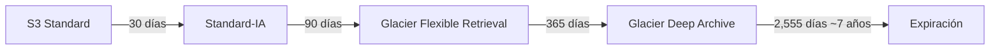
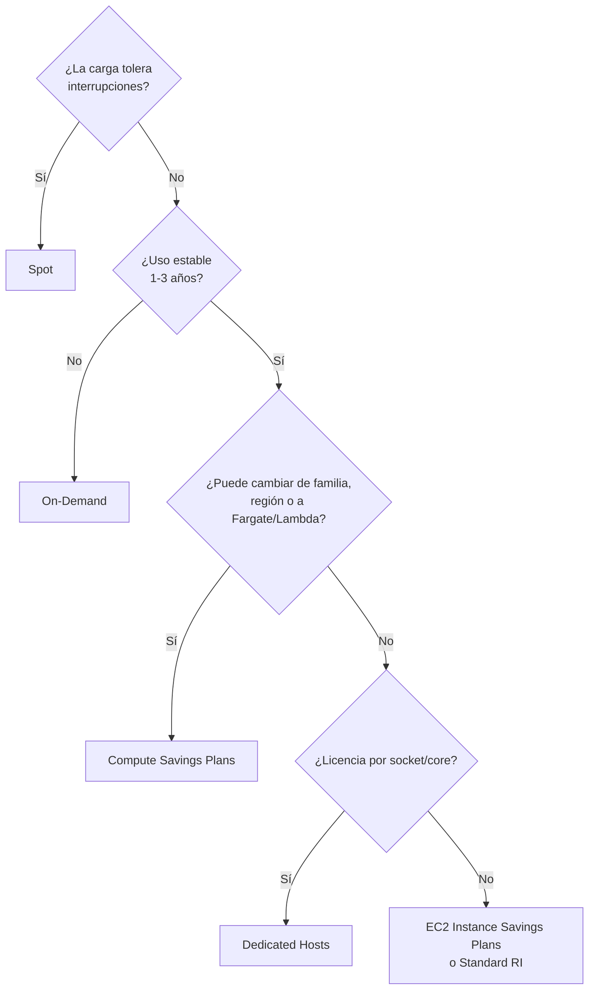

---
tags:
  - aws
  - certificacion
  - saa-c03
  - finops
  - arquitectura
---

# Dominio 4: Design Cost-Optimized Architectures (20%)

> Cumplir los requisitos al menor costo: clases de almacenamiento y lifecycle de S3, modelos de compra de cómputo, bases de datos del tamaño justo, costos de transferencia de red y las herramientas para medir y controlar el gasto.

!!! info "Qué evalúa este dominio"
    - **Task 4.1 – Cost-optimized storage**: clases y tiering de S3, lifecycle, Requester Pays, tipos de EBS (SSD vs HDD), EFS/FSx, backups y archivado, transferencia de datos más barata (DataSync, Transfer Family, Storage Gateway), tamaño correcto.
    - **Task 4.2 – Cost-optimized compute**: Spot, Reserved Instances, Savings Plans; familias y tamaños de instancia; escalado e hibernación; Lambda vs EC2 vs Fargate; disponibilidad según el tipo de carga (producción vs no producción); ALB vs NLB vs GWLB; Outposts.
    - **Task 4.3 – Cost-optimized databases**: capacidad (capacity units), caché, retención y frecuencia de snapshots, DynamoDB vs RDS vs serverless, formatos (series temporales, columnar), migraciones de motor.
    - **Task 4.4 – Cost-optimized network**: NAT gateway vs NAT instance y cuántos NAT; Direct Connect vs VPN vs internet; rutas que minimizan transferencia (entre regiones, entre AZ, VPC endpoints, Global Accelerator); CDN; throttling; ancho de banda.
    - En todas: **herramientas de costos** (Cost Explorer, Budgets, Cost and Usage Report, cost allocation tags, facturación multi-cuenta).

    Formato y resto de dominios en el [resumen del examen](resumen-examen.md).

## Herramientas de gestión de costos

Las prácticas de FinOps están en [FinOps y costos](../../../cloud/fundamentos/finops-costos.md#herramientas-nativas-de-costos).

| Herramienta | Para qué | Pista en el examen |
| --- | --- | --- |
| **AWS Cost Explorer** | Ver y filtrar el gasto histórico, pronóstico y recomendaciones de Savings Plans/RI | "Analizar tendencias de gasto por servicio" |
| **AWS Budgets** | Presupuestos con **alertas** (y acciones automáticas) por costo, uso o cobertura de reservas | "Avisar cuando el gasto supere X" |
| **AWS Cost and Usage Report (CUR)** | Datos de facturación más detallados (por hora y recurso) exportados a S3 (hoy vía Data Exports, CUR 2.0) para Athena o Amazon Quick | "Análisis detallado o personalizado" |
| **Cost allocation tags** | Etiquetas activadas en facturación para repartir costos por proyecto o equipo | "Saber cuánto gasta cada departamento" |
| **AWS Organizations – consolidated billing** | Una factura para todas las cuentas; los descuentos por volumen y las reservas se comparten | "Varias cuentas, aprovechar descuentos" |
| **AWS Compute Optimizer** | Recomendaciones de rightsizing (tamaño correcto) de EC2, ASG, EBS, Lambda, ECS en Fargate | "Instancias sobredimensionadas" |
| **AWS Trusted Advisor** | Revisiones de costo, seguridad, rendimiento, límites | "Recursos ociosos, EIP sin usar" |

## Almacenamiento

### Clases de almacenamiento de S3

Todas las clases tienen 99.999999999% (11 nueves) de durabilidad. Cambian disponibilidad, latencia de acceso, costo por GB, costo de recuperación y **duración mínima facturable**.

| Clase | Acceso | AZ | Mínimo facturable | Recuperación | Úsala cuando |
| --- | --- | --- | --- | --- | --- |
| **S3 Standard** | Milisegundos | ≥3 | – | Sin cargo | Datos de acceso frecuente |
| **S3 Intelligent-Tiering** | Milisegundos (capas de archivo opcionales, más lentas) | ≥3 | – | Sin cargo; pequeña tarifa de monitoreo por objeto | **Patrón de acceso desconocido o cambiante** |
| **S3 Standard-IA** | Milisegundos | ≥3 | 30 días, 128 KB por objeto | Cargo por GB | Acceso infrecuente pero inmediato (backups recientes) |
| **S3 One Zone-IA** | Milisegundos | **1** | 30 días, 128 KB | Cargo por GB | Datos infrecuentes **recreables** (copias secundarias) |
| **S3 Glacier Instant Retrieval** | Milisegundos | ≥3 | 90 días | Cargo por GB más alto | Archivo consultado una vez por trimestre que se necesita al instante |
| **S3 Glacier Flexible Retrieval** | Expedited 1–5 min; Standard 3–5 h; Bulk 5–12 h | ≥3 | 90 días | Según la opción | Archivo con recuperación en minutos u horas |
| **S3 Glacier Deep Archive** | Standard hasta 12 h; Bulk hasta 48 h | ≥3 | 180 días | Según la opción | Retención de largo plazo (normativa de 7–10 años), el más barato |
| **S3 Express One Zone** | Milisegundos de un dígito | **1** | – | – | Rendimiento máximo, no ahorro (ver [Dominio 3](dominio-3-arquitecturas-alto-rendimiento.md#rendimiento-de-s3)) |

**S3 Intelligent-Tiering** mueve cada objeto solo: Frequent Access → Infrequent Access (tras 30 días sin acceso) → Archive Instant Access (90 días); opcionalmente Archive Access y Deep Archive Access. Si el objeto se vuelve a leer, regresa a Frequent. Los objetos de menos de 128 KB no se mueven de capa.

!!! warning "El servicio Amazon Glacier original"
    Las clases **S3 Glacier** (dentro de S3) son lo que se usa. El servicio independiente de *vaults* (Amazon Glacier) no acepta clientes nuevos desde el 15 de diciembre de 2025. Si una pregunta habla de "Glacier", piensa en las clases de S3.

### Lifecycle rules



- **Transition actions** (mover de clase) y **expiration actions** (borrar). También limpiar versiones antiguas (*noncurrent versions*) y **multipart uploads incompletos**.
- Para pasar a Standard-IA o One Zone-IA, el objeto debe llevar al menos 30 días en su clase actual; por defecto, los objetos de menos de 128 KB no se transicionan.
- Mover a una clase y borrarlo antes del mínimo facturable cobra los días restantes: no tiene sentido mandar a Deep Archive datos que se borran al mes.

```json title="lifecycle.json"
{
  "Rules": [
    {
      "ID": "logs-a-archivo",
      "Filter": { "Prefix": "logs/" },
      "Status": "Enabled",
      "Transitions": [
        { "Days": 30, "StorageClass": "STANDARD_IA" },
        { "Days": 120, "StorageClass": "GLACIER" },
        { "Days": 365, "StorageClass": "DEEP_ARCHIVE" }
      ],
      "Expiration": { "Days": 2555 },
      "AbortIncompleteMultipartUpload": { "DaysAfterInitiation": 7 }
    }
  ]
}
```

En la API, `GLACIER` es Glacier Flexible Retrieval y `GLACIER_IR` es Glacier Instant Retrieval.

!!! tip "En el examen"
    "Acceso impredecible" → **Intelligent-Tiering**. "Se accede poco pero cuando se pide debe estar al instante" → **Standard-IA** o **Glacier Instant Retrieval** (si es aún menos frecuente). "Se puede regenerar" → **One Zone-IA**. "Retener 7 años, recuperación en 48 h aceptable" → **Deep Archive**. "Recuperar en minutos en casos urgentes" → Glacier Flexible Retrieval con **Expedited**.

### Otras palancas de costo en almacenamiento

- **S3 Requester Pays**: quien descarga paga la transferencia y las peticiones (datasets compartidos con otras cuentas).
- **S3 Storage Lens** y **Storage Class Analysis** para detectar qué mover.
- **EBS**: migrar **gp2 → gp3** (más barato, mismas o mejores IOPS); usar **st1/sc1** para datos secuenciales; borrar volúmenes sin adjuntar; **EBS Snapshots Archive** para snapshots que se guardan mucho tiempo; **Recycle Bin** contra borrados accidentales.
- **EFS**: lifecycle a **Infrequent Access** y **Archive**; One Zone para datos no críticos.
- **Backups**: AWS Backup con lifecycle a cold storage; snapshots incrementales.
- **Transferir datos al menor costo**: subir a S3 no tiene cargo de transferencia entrante; por lotes (archivos agrupados) en vez de millones de PUT individuales; DataSync o un dispositivo físico cuando la red no alcanza (ver [Dominio 3](dominio-3-arquitecturas-alto-rendimiento.md#transferencia-de-datos-hibrida-y-migracion)).

## Cómputo

### Modelos de compra

Comparación general entre nubes en [Máquinas virtuales](../../../cloud/computo/maquinas-virtuales.md#modelos-de-pago).

| Opción | Descuento máximo aproximado | Compromiso | Flexibilidad | Úsala cuando |
| --- | --- | --- | --- | --- |
| **On-Demand** | 0% | Ninguno | Total | Cargas cortas, impredecibles, pruebas |
| **Compute Savings Plans** | Hasta ~66% | $/hora durante 1 o 3 años | Cualquier familia, tamaño, región, SO; también **Fargate y Lambda** | Uso base estable que puede cambiar de tecnología |
| **EC2 Instance Savings Plans** | Hasta ~72% | $/hora en una **familia y región** por 1 o 3 años | Tamaño, SO y AZ dentro de la familia | Uso estable en una familia concreta |
| **Standard Reserved Instances** | Hasta ~72% | Tipo de instancia por 1 o 3 años | Baja (se pueden vender en el Marketplace) | Cargas fijas; también RDS, ElastiCache, Redshift, OpenSearch |
| **Convertible Reserved Instances** | Hasta ~66% | 1 o 3 años | Se pueden cambiar por otras de igual o mayor valor | Estable pero puede cambiar de familia |
| **Database Savings Plans** | Hasta ~35% | $/hora por 1 año | Varios motores, familias y regiones | Uso estable de bases de datos gestionadas (anunciado en diciembre de 2025; revisa los servicios cubiertos) |
| **Spot Instances** | Hasta ~90% | Ninguno | AWS puede interrumpir con **aviso de 2 minutos** | Cargas **tolerantes a interrupción**: batch, CI, big data, contenedores stateless |
| **Dedicated Hosts** | – | On-Demand o reserva | Servidor físico para ti, visibilidad de sockets/cores | **Licencias por socket o core** (BYOL), cumplimiento |
| **Dedicated Instances** | – | – | Hardware no compartido con otros clientes | Requisito de aislamiento de hardware sin gestionar el host |
| **On-Demand Capacity Reservations** | 0% (se combinan con Savings Plans) | Ninguno | Reserva capacidad en una AZ | Garantizar capacidad para un evento o DR |

- Los porcentajes son los "hasta" que publica AWS y pueden cambiar: memoriza el **orden**, no el número exacto.
- AWS recomienda **Savings Plans** sobre Reserved Instances para EC2, Fargate y Lambda.
- Una **zonal RI** reserva capacidad en una AZ; una regional RI solo da descuento.
- **Mixed instances policy** en un Auto Scaling group: una base On-Demand (cubierta por Savings Plans) + el resto en Spot con varias familias de instancia (allocation strategy *price-capacity-optimized*).



### Elegir el servicio y el tamaño

| Patrón de carga | Opción más económica habitual |
| --- | --- |
| Tráfico esporádico, eventos cortos | **Lambda** (pagas por invocación y duración; cero cuando no hay tráfico) |
| Contenedores con carga variable sin gestionar nodos | **Fargate** (con Fargate Spot para tareas tolerantes) |
| Carga continua y alta, muy predecible | EC2 con Savings Plans, o ECS/EKS sobre EC2 |
| Entornos de desarrollo que solo se usan en horario laboral | Apagar fuera de horario (Instance Scheduler, scheduled scaling a 0) |
| Instancias con arranque lento que se paran y arrancan | **EC2 hibernation** (guarda la RAM en el volumen raíz cifrado) |

- **Rightsizing**: Compute Optimizer y métricas de CloudWatch; elegir la familia correcta (no usar memory optimized para una carga de CPU).
- **Graviton** (procesadores ARM de AWS): mejor precio-rendimiento si el software es compatible.
- **Producción vs no producción**: no paguen la misma disponibilidad. Dev puede ir en una AZ, con Spot y apagado de noche.
- **Load balancer**: si no necesitas reglas L7, un NLB puede bastar; un solo ALB puede servir varias aplicaciones con reglas por host o path en lugar de un ALB por app.

## Bases de datos

| Escenario | Opción costo-eficiente |
| --- | --- |
| Tráfico relacional intermitente o impredecible (dev, apps internas) | **Aurora Serverless v2** (escala por ACU) |
| Tabla DynamoDB con tráfico estable y predecible | **Provisioned** con auto scaling (y reserved capacity) |
| Tabla DynamoDB con tráfico impredecible o nuevo | **On-demand** |
| Muchas lecturas repetidas que encarecen la base | **ElastiCache** o **DAX** delante; o read replicas |
| Datos de series temporales (IoT, métricas) | Base purpose-built de series temporales (Amazon Timestream; para clientes nuevos, Timestream for InfluxDB) en lugar de una relacional sobredimensionada |
| Analítica sobre grandes volúmenes | Formato **columnar**: Redshift o Parquet en S3 + Athena |
| Datos antiguos que casi no se consultan | Exportar a S3 (snapshot export a Parquet) y borrarlos de la base; **TTL** en DynamoDB |
| Licencias de Oracle o SQL Server caras | Migrar a Aurora PostgreSQL/MySQL con **DMS** y conversión de esquema |
| Uso estable de RDS/Aurora/ElastiCache | Reserved Instances (reserved nodes) o **Database Savings Plans** |

- **Backups**: ajusta la **retención** y la frecuencia de snapshots al RPO real; los snapshots manuales no expiran solos (bórralos o usa AWS Backup con retención).
- **RDS storage auto scaling**: crece el almacenamiento solo cuando hace falta, en vez de sobreaprovisionar.
- **RDS Proxy** reduce la necesidad de instancias más grandes solo por número de conexiones.

## Red

### Costos de transferencia de datos

| Tráfico | ¿Se cobra? |
| --- | --- |
| Entrante desde internet a AWS | No |
| Dentro de la misma AZ con IP privada | No |
| **Entre AZ** de la misma región | Sí (en ambos sentidos) |
| **Entre regiones** | Sí |
| Saliente a internet | Sí (por GB, con tramos) |
| Desde orígenes de AWS hacia CloudFront | No; pagas la salida de CloudFront, normalmente más barata |
| Procesado por un **NAT gateway** | Sí, por GB además de la hora |
| Saliente por **Direct Connect** | Sí, con tarifa menor que por internet |

Una guía visual oficial: [Overview of data transfer costs for common architectures](https://aws.amazon.com/blogs/architecture/overview-of-data-transfer-costs-for-common-architectures/).

### NAT gateway: cuántos y cuál

| Opción | Costo | Disponibilidad | Cuándo |
| --- | --- | --- | --- |
| **Un NAT gateway por AZ** | Más horas de NAT | Alta: si cae una AZ, las otras siguen saliendo; evita tráfico entre AZ | Producción |
| **Un NAT gateway compartido** | Menos horas, pero se paga tráfico entre AZ | Single point of failure | Desarrollo o pruebas |
| **NAT instance** (EC2) | Puede ser más barato con poco tráfico | Tú gestionas parches, HA y escalado; desactivar source/destination check | Casos muy pequeños o con necesidades especiales |
| **Regional NAT gateway** | Modo nuevo (noviembre de 2025): un NAT que se extiende solo a las AZ con cargas | Gestionado por AWS | Simplificar; revisa precios y si el examen ya lo considera |

- **Gateway endpoints** de S3 y DynamoDB eliminan el cargo de NAT para ese tráfico, y son gratis. Los **interface endpoints** cuestan, pero pueden salir más baratos que el NAT si el volumen es alto.

### Conectividad y entrega de contenido

- **VPN vs Direct Connect vs internet**: VPN es barata y rápida de montar; Direct Connect tiene costo fijo de puerto pero abarata grandes volúmenes salientes y da latencia estable. Para un volumen moderado, VPN suele ser lo más económico. Elige la **velocidad de DX** según el uso real y añade conexiones o VPN de respaldo según el requisito de disponibilidad.
- **CloudFront**: cachear en el borde reduce las peticiones al origen (menos instancias) y la salida de datos.
- **VPC peering vs Transit Gateway**: peering no cobra por hora (solo transferencia); Transit Gateway cobra por attachment y por GB procesado, pero simplifica muchas VPC. Con pocas VPC, peering es más barato.
- **Mantener el tráfico local**: colocar recursos que hablan mucho entre sí en la misma AZ cuando el requisito de disponibilidad lo permite; usar IPs privadas, no públicas.
- **Throttling**: usage plans de API Gateway y caché para no escalar el backend por abusos o picos.

!!! tip "En el examen"
    "Instancias privadas leen mucho de S3 y la factura de NAT es alta" → **gateway endpoint**. "Reducir costo de NAT en un entorno de pruebas" → **un solo NAT gateway** (aceptando menos disponibilidad). "Contenido estático para usuarios globales con menor costo de salida" → **CloudFront + S3 con OAC**.

## Casos de uso

1. **Una empresa guarda logs que se consultan mucho la primera semana, casi nunca después, y debe retenerlos 5 años.** → Lifecycle: Standard → Standard-IA a los 30 días → Glacier Flexible Retrieval o Deep Archive → expiración a 5 años.
2. **Un bucket de imágenes de usuarios con patrón de acceso imposible de predecir.** → **S3 Intelligent-Tiering**.
3. **Un proceso de renderizado nocturno puede reintentar si se interrumpe.** → **Spot** con varias familias de instancia y checkpoints en S3.
4. **Una empresa usa EC2 de forma estable y planea migrar parte a Fargate y Lambda el año próximo.** → **Compute Savings Plans** (cubre los tres).
5. **Un software se licencia por socket físico.** → **Dedicated Hosts**.
6. **Una base relacional de desarrollo se usa a ratos durante el día.** → **Aurora Serverless v2**.
7. **El equipo financiero quiere un aviso cuando el gasto mensual proyectado supere el presupuesto de cada proyecto.** → Cost allocation tags + **AWS Budgets** con alertas sobre el pronóstico.
8. **Un dataset público de 50 TB lo descargan otras organizaciones y la empresa no quiere pagar la salida.** → **S3 Requester Pays**.
9. **Muchos volúmenes gp2 grandes solo por necesitar IOPS.** → Migrar a **gp3** y aprovisionar IOPS por separado.

## Preguntas de práctica

**1.** Una empresa tiene archivos que se acceden con frecuencia los primeros 30 días; después se consultan unas pocas veces al año pero deben estar disponibles en milisegundos. Pasado 1 año, pueden tardar hasta 12 horas en recuperarse y deben guardarse 10 años. ¿Qué lifecycle es MÁS costo-eficiente?

- A. Standard → Standard-IA (30 días) → Glacier Deep Archive (365 días) → expirar a 10 años
- B. Standard → One Zone-IA (30 días) → Glacier Flexible Retrieval (365 días)
- C. Intelligent-Tiering desde el día 1 sin reglas
- D. Standard → Glacier Flexible Retrieval (30 días) → expirar a 10 años

??? success "Respuesta"
    **A.** Standard-IA da acceso en milisegundos con menor costo; Deep Archive cumple las 12 h y es lo más barato a largo plazo. Glacier Instant Retrieval también serviría en el tramo intermedio si el acceso es muy raro. **B**: One Zone-IA arriesga datos no recreables y no los borra a los 10 años. **C** no aprovecha Deep Archive salvo que se active la capa opcional, y no expira. **D** rompe el requisito de milisegundos.

**2.** Un Auto Scaling group procesa trabajos por lotes tolerantes a interrupciones y necesita además 2 instancias siempre disponibles para tareas críticas, durante los próximos 3 años. ¿Qué combinación minimiza el costo?

- A. Todo On-Demand
- B. Todo Spot
- C. Savings Plan para las 2 instancias base y Spot para el resto (mixed instances policy)
- D. Dedicated Hosts para todo

??? success "Respuesta"
    **C.** Base estable con compromiso y capacidad variable en Spot. **A** es lo más caro. **B** arriesga las tareas críticas. **D** es caro y no se pide aislamiento.

**3.** Instancias EC2 en subnets privadas de tres AZ suben 20 TB al mes a S3 a través de un NAT gateway. ¿Cómo reducir el costo con el MENOR esfuerzo?

- A. Reemplazar el NAT gateway por NAT instances
- B. Crear un gateway endpoint para S3 y añadirlo a las route tables privadas
- C. Mover las instancias a subnets públicas
- D. Usar S3 Transfer Acceleration

??? success "Respuesta"
    **B.** El tráfico a S3 deja de pasar por el NAT (sin cargo por GB procesado) y el endpoint es gratuito. **A** añade gestión. **C** empeora la seguridad. **D** cuesta más y no evita el NAT.

**4.** Una tabla DynamoDB tiene tráfico estable de unas 500 escrituras/s todo el día, todos los días. Hoy está en modo on-demand. ¿Qué cambio reduce el costo?

- A. Cambiar a provisioned con auto scaling
- B. Añadir DAX
- C. Activar global tables
- D. Activar DynamoDB Streams

??? success "Respuesta"
    **A.** Con tráfico predecible, provisioned (más reserved capacity, si aplica) suele ser más barato que pagar por petición. **B** acelera lecturas, no abarata escrituras. **C** y **D** añaden costo.

**5.** Un entorno de pruebas en una VPC con dos AZ tiene un NAT gateway en cada AZ. El equipo quiere reducir costos y acepta menor disponibilidad. ¿Qué hacer?

- A. Eliminar un NAT gateway y enrutar ambas subnets privadas al que queda
- B. Cambiar los NAT gateways por Internet Gateways en subnets privadas
- C. Añadir un tercer NAT gateway
- D. Usar Direct Connect

??? success "Respuesta"
    **A.** Un solo NAT reduce las horas facturadas; el costo es tráfico entre AZ y un single point of failure, aceptable en pruebas. **B** convierte las subnets en públicas. **C** sube el costo. **D** no tiene relación y es caro.

**6.** Una empresa necesita analizar sus costos de AWS por hora, por recurso y por etiqueta, con consultas SQL propias. ¿Qué usar?

- A. AWS Budgets
- B. AWS Cost and Usage Report (Data Exports) en S3 consultado con Athena
- C. AWS Trusted Advisor
- D. Cost Explorer con vista mensual

??? success "Respuesta"
    **B.** El CUR es el dataset de facturación más granular y se consulta con Athena. **A** alerta, no analiza en detalle. **C** da recomendaciones. **D** no permite SQL propio a ese nivel de detalle.

## Para profundizar

- [FinOps y costos](../../../cloud/fundamentos/finops-costos.md): cómo se cobra la nube, tags, showback y optimización.
- [Almacenamiento y datos](../../../cloud/redes-y-datos/almacenamiento-datos.md#clases-de-almacenamiento): clases de almacenamiento comparadas entre nubes.
- [Máquinas virtuales](../../../cloud/computo/maquinas-virtuales.md): familias y modelos de pago.
- [Gobernanza](../../../cloud/operacion-y-gobierno/gobernanza.md#tagging-y-labels): estrategia de tagging.
- [TI y negocio](../../../negocio/ti-y-negocio.md): CapEx vs OpEx y TCO.

## Relación con otras secciones

| Enfoque | Qué se mira desde ahí | Nota |
| --- | --- | --- |
| Cloud (el control) | Modelos de pago, clases de almacenamiento, tags | [FinOps y costos](../../../cloud/fundamentos/finops-costos.md), [Gobernanza](../../../cloud/operacion-y-gobierno/gobernanza.md) |
| DevOps (la automatización) | Costo en el pipeline, entornos efímeros que se destruyen | [Infrastructure as Code](../../../devops/iac/infraestructura-como-codigo.md), [Pruebas de infraestructura](../../../devops/iac/pruebas-infraestructura.md) |
| Negocio TI (el porqué) | TCO, ROI y presupuestos | [TI y negocio](../../../negocio/ti-y-negocio.md) |

## Referencias

- [Exam guide SAA-C03: Domain 4](https://docs.aws.amazon.com/aws-certification/latest/solutions-architect-associate-03/solutions-architect-associate-03-domain4.html)
- [Amazon S3 storage classes](https://aws.amazon.com/s3/storage-classes/)
- [S3 lifecycle: transitioning objects](https://docs.aws.amazon.com/AmazonS3/latest/userguide/lifecycle-transition-general-considerations.html)
- [What are Savings Plans?](https://docs.aws.amazon.com/savingsplans/latest/userguide/what-is-savings-plans.html)
- [Database Savings Plans (anuncio)](https://aws.amazon.com/about-aws/whats-new/2025/12/database-savings-plans-savings/)
- [Amazon EC2 Spot Instances](https://docs.aws.amazon.com/AWSEC2/latest/UserGuide/using-spot-instances.html)
- [AWS NAT Gateway regional availability (anuncio)](https://aws.amazon.com/about-aws/whats-new/2025/11/aws-nat-gateway-regional-availability/)
- [Overview of data transfer costs for common architectures](https://aws.amazon.com/blogs/architecture/overview-of-data-transfer-costs-for-common-architectures/)
- [AWS Well-Architected: Cost Optimization Pillar](https://docs.aws.amazon.com/wellarchitected/latest/cost-optimization-pillar/welcome.html)
