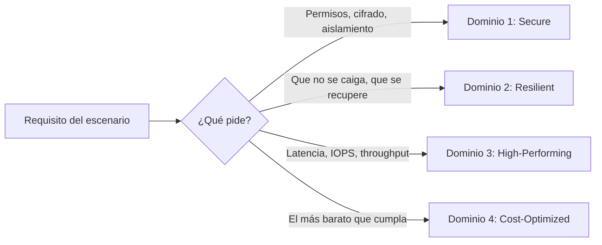

---
tags:
  - aws
  - certificacion
  - saa-c03
  - arquitectura
---

# AWS Certified Solutions Architect – Associate (SAA-C03)

> Qué evalúa el examen de Solutions Architect – Associate, cómo es el formato, cuánto pesa cada dominio y un plan de estudio de 6 semanas para diseñar arquitecturas en AWS seguras, resilientes, de alto rendimiento y con costos optimizados.

!!! info "Versión verificada"
    Datos revisados en octubre de 2026 en la [guía oficial del examen](https://docs.aws.amazon.com/aws-certification/latest/solutions-architect-associate-03/solutions-architect-associate-03.html) y en la [página de la certificación](https://aws.amazon.com/es/certification/certified-solutions-architect-associate/). La versión vigente sigue siendo **SAA-C03**; AWS no ha publicado una guía SAA-C04. Algunos sitios de terceros hablan de "SAA-C04", pero no hay fuente oficial que lo respalde: confía solo en la página de AWS. Revisa ambas páginas antes de agendar, porque precio, idiomas y alcance cambian.

## ¿Qué es?

Es la certificación de nivel **Associate** (asociado) de AWS para el rol de **solutions architect** (arquitecto/a de soluciones). Valida que sabes diseñar soluciones con servicios de AWS basadas en el [Well-Architected Framework](../../../cloud/fundamentos/well-architected.md): elegir el servicio correcto para un requisito, combinar servicios en una arquitectura y revisar una solución existente para mejorarla.

A diferencia de Cloud Practitioner, aquí no basta con saber *qué* es un servicio: el examen te da un escenario con requisitos (seguridad, disponibilidad, rendimiento, costo, poco esfuerzo operativo) y tienes que elegir **la mejor** de varias opciones que técnicamente funcionarían.

## Formato del examen

| Aspecto | Detalle |
| --- | --- |
| Código | SAA-C03 |
| Preguntas | 65: **50 puntuables** y 15 no puntuables (no sabes cuáles son) |
| Tipos de pregunta | **Multiple choice** (opción múltiple: 1 correcta de 4) y **multiple response** (respuesta múltiple: 2 o más correctas de 5 o más) |
| Duración | 130 minutos |
| Puntaje | Escala de 100 a 1,000; aprueba con **720** |
| Modelo de puntuación | **Compensatorio**: no necesitas aprobar cada dominio, solo el total |
| Penalización | Ninguna: una pregunta sin responder cuenta como incorrecta, así que responde todas |
| Costo | 150 USD (más impuestos o tipo de cambio) |
| Modalidad | Centro Pearson VUE o en línea con supervisión (*online proctored*) |
| Idiomas | Inglés, francés, italiano, japonés, coreano, portugués (Brasil), español (Latinoamérica), español (España), chino simplificado y tradicional |
| Validez | 3 años |

!!! note "Idioma italiano"
    La página oficial indica que la versión en italiano se retira después del 31 de diciembre de 2026. No afecta a la versión en español, pero muestra que los idiomas cambian: revísalos al reservar.

## Objetivo profesional

### Perfil de candidato según AWS

La [exam guide oficial](https://docs.aws.amazon.com/aws-certification/latest/solutions-architect-associate-03/solutions-architect-associate-03.html) dice que el examen es para quien **desempeña un rol de solutions architect** y valida que sabe **diseñar soluciones basadas en el AWS Well-Architected Framework**: soluciones que cumplan requisitos de negocio actuales y futuros, arquitecturas seguras, resilientes, de alto rendimiento y con costos optimizados, y **revisar soluciones existentes** para mejorarlas. El *target candidate* tiene **al menos 1 año de experiencia práctica** diseñando soluciones cloud con servicios de AWS.

### Para qué roles sirve

- [Cloud Architect / Solutions Architect](../../roles-profesionales.md#cloud-architect-solutions-architect) junior o en transición.
- [Cloud Engineer](../../roles-profesionales.md#cloud-engineer) y [DevOps Engineer](../../roles-profesionales.md#devops-engineer) en empresas que usan AWS: es la certificación de AWS que más aparece en ofertas.
- Desarrolladores que diseñan sus propios servicios en AWS. Ver [Roles profesionales](../../roles-profesionales.md).

### Qué demuestra ante un empleador

| Demuestra | No demuestra |
| --- | --- |
| Que conoces los servicios principales y sabes **elegir** entre ellos por seguridad, resiliencia, rendimiento y costo | Que hayas operado esa arquitectura en producción (el examen es teórico) |
| Criterio de arquitectura: desacoplar, alta disponibilidad, multi-AZ, cifrado, mínimo privilegio | Soltura con IaC, CI/CD o la CLI (no se evalúan) |
| Que puedes leer y mejorar un diseño existente | Experiencia en arquitectura multi-cuenta a escala de empresa (eso es el nivel Professional) |

### Qué certificación sigue

- [Terraform Associate](../../hashicorp/terraform-associate/resumen-examen.md), para escribir como código lo que diseñas.
- Solutions Architect – Professional (versión SAP-C03 desde noviembre de 2026), DevOps Engineer – Professional o Security – Specialty, según el rol: ver [Otras certificaciones](../../otras-certificaciones.md#aws-el-resto-del-catalogo).
- CKA, si tu destino es Kubernetes: ver [Rutas sugeridas por rol](../../otras-certificaciones.md#rutas-sugeridas-por-rol).

## Experiencia recomendada

AWS recomienda **al menos 1 año de experiencia práctica** diseñando soluciones en la nube con servicios de AWS. En la práctica ayuda tener claro:

- Redes: CIDR, subnets, routing, NAT, DNS (ver [Networking](../../../networking/basico/direccionamiento-ip.md)).
- Los tres tipos de almacenamiento y bases de datos relacionales vs NoSQL.
- IAM y el [Shared Responsibility Model](../../../cloud/fundamentos/responsabilidad-compartida.md).
- Conceptos de arquitectura: acoplamiento, escalado horizontal, alta disponibilidad, RTO/RPO.

## Dominios y peso

| Dominio | Peso | Task statements | Nota |
| --- | --- | --- | --- |
| 1. Design Secure Architectures | 30% | 1.1 acceso seguro a recursos · 1.2 cargas y aplicaciones seguras · 1.3 controles de seguridad de datos | [Dominio 1](dominio-1-arquitecturas-seguras.md) |
| 2. Design Resilient Architectures | 26% | 2.1 arquitecturas escalables y desacopladas · 2.2 alta disponibilidad y tolerancia a fallos | [Dominio 2](dominio-2-arquitecturas-resilientes.md) |
| 3. Design High-Performing Architectures | 24% | 3.1 almacenamiento · 3.2 cómputo elástico · 3.3 bases de datos · 3.4 redes · 3.5 ingesta y transformación de datos | [Dominio 3](dominio-3-arquitecturas-alto-rendimiento.md) |
| 4. Design Cost-Optimized Architectures | 20% | 4.1 almacenamiento · 4.2 cómputo · 4.3 bases de datos · 4.4 redes | [Dominio 4](dominio-4-arquitecturas-costo-optimizado.md) |

Con 50 preguntas puntuables, eso son aproximadamente 15, 13, 12 y 10 preguntas por dominio.

## Servicios dentro y fuera de alcance

La guía publica una lista **no exhaustiva** de servicios. Resumen:

| Categoría | En alcance (lo más preguntado) |
| --- | --- |
| Cómputo y contenedores | EC2, EC2 Auto Scaling, Lambda, Fargate, ECS, EKS, ECR, Batch, Elastic Beanstalk, Outposts, Wavelength |
| Almacenamiento | S3, S3 Glacier, EBS, EFS, FSx (todos los tipos), Storage Gateway, AWS Backup |
| Bases de datos | RDS, Aurora, Aurora Serverless, DynamoDB, ElastiCache, Redshift, DocumentDB, Neptune, Keyspaces |
| Redes | VPC, Route 53, CloudFront, Global Accelerator, ELB, Direct Connect, Site-to-Site VPN, Client VPN, PrivateLink, Transit Gateway |
| Integración | SQS, SNS, EventBridge, Step Functions, Amazon MQ, AppFlow, API Gateway |
| Analítica | Athena, Glue, Lake Formation, EMR, Kinesis, Amazon Data Firehose, MSK, OpenSearch Service, Amazon Quick |
| Seguridad | IAM, IAM Identity Center, Cognito, KMS, CloudHSM, Secrets Manager, ACM, WAF, Shield, Firewall Manager, Network Firewall, GuardDuty, Inspector, Macie, Detective, Security Hub, Directory Service, RAM |
| Gestión y gobierno | Organizations, Control Tower, CloudFormation, CloudTrail, CloudWatch, Config, Systems Manager, Trusted Advisor, Compute Optimizer, Service Catalog |
| Migración | Application Migration Service, DMS, DataSync, Transfer Family, Snow Family |
| Costos | Cost Explorer, Budgets, Cost and Usage Report, Savings Plans |
| Machine learning (solo "para qué sirve") | Comprehend, Lex, Polly, Rekognition, SageMaker AI, Textract, Transcribe, Translate |

**Fuera de alcance** (ejemplos): Lightsail, todos los servicios de IoT, AWS CDK y SDKs, CodeBuild/CodeDeploy/CodeCommit, CloudShell, Cloud Map, Amazon MWAA, GameLift, Braket, Ground Station, Personalize.

!!! warning "Nombres y servicios que cambiaron"
    - **Amazon Quick** es el nombre actual en la guía; antes era Amazon QuickSight (su parte de BI se llama ahora Amazon Quick Sight).
    - **Amazon Data Firehose** se llamaba Kinesis Data Firehose.
    - **Snow Family** sigue en la guía, pero AWS dejó de vender Snowcone (noviembre de 2024) y desde el 7 de noviembre de 2025 Snowball Edge solo está disponible para clientes existentes. Lo explica el [Dominio 3](dominio-3-arquitecturas-alto-rendimiento.md#transferencia-de-datos-hibrida-y-migracion).
    - El servicio original **Amazon Glacier** basado en *vaults* ya no acepta clientes nuevos (desde el 15 de diciembre de 2025); lo que se usa son las **clases de almacenamiento S3 Glacier** dentro de S3.

## Plan de estudio sugerido (6 semanas)

| Semana | Foco | Práctica |
| --- | --- | --- |
| 1 | Fundamentos: regiones y AZ, IAM a fondo, VPC (subnets, route tables, SG vs NACL, NAT) | Crea una VPC de 2 AZ con subnets públicas y privadas; asume un rol entre cuentas |
| 2 | Dominio 1: Organizations, SCP, KMS, Secrets Manager, Cognito, WAF/Shield, VPC endpoints | Cifra un bucket con SSE-KMS y restringe el acceso con una bucket policy + gateway endpoint |
| 3 | Dominio 2: SQS/SNS/EventBridge, ELB, Auto Scaling, RDS Multi-AZ y read replicas, Route 53, DR | Monta ALB + Auto Scaling group con target tracking; simula la caída de una instancia |
| 4 | Dominio 3: EBS/EFS/FSx, S3 rendimiento, DynamoDB/DAX/ElastiCache, CloudFront vs Global Accelerator, Kinesis, Athena/Glue | Consulta un CSV en S3 con Athena; conviértelo a Parquet con Glue y compara el costo escaneado |
| 5 | Dominio 4: clases de S3 y lifecycle, Savings Plans/RI/Spot, costos de transferencia y NAT, herramientas de costos | Crea una lifecycle rule y un AWS Budget con alerta |
| 6 | Repaso: preguntas de práctica, puntos débiles, whitepapers de DR y Well-Architected | Official Practice Question Set + un examen de práctica completo cronometrado |

!!! tip "Cómo estudiar las tablas de decisión"
    Las notas de dominio están llenas de tablas "X vs Y". Para cada fila, intenta escribir **la palabra clave del escenario** que te haría elegir esa opción ("sub-millisecond", "SMB", "exactly-once", "static IP"). El examen se gana reconociendo esas palabras.

## Recursos oficiales gratuitos

| Recurso | Para qué |
| --- | --- |
| [Guía oficial del examen (exam guide)](https://docs.aws.amazon.com/aws-certification/latest/solutions-architect-associate-03/solutions-architect-associate-03.html) | Dominios, task statements y listas de servicios en alcance; es la fuente de verdad |
| [AWS Skill Builder](https://skillbuilder.aws/) | Exam Prep Standard Course de SAA-C03 y el **Official Practice Question Set** (gratis); el Official Practice Exam y AWS Cloud Quest (rol Solutions Architect) requieren suscripción, revisa la oferta vigente |
| Sample questions | En la página de la certificación; muestran el estilo de redacción |
| [AWS Well-Architected Framework](https://docs.aws.amazon.com/wellarchitected/latest/framework/welcome.html) | Los cuatro dominios mapean a los pilares Security, Reliability, Performance Efficiency y Cost Optimization |
| [Whitepaper de disaster recovery](https://docs.aws.amazon.com/whitepapers/latest/disaster-recovery-workloads-on-aws/disaster-recovery-workloads-on-aws.html) | Estrategias de DR con RTO/RPO, muy preguntadas |
| [AWS Workshops](https://workshops.aws/) | Laboratorios guiados gratuitos (cuidado con los costos de tu cuenta) |
| [AWS Architecture Center](https://aws.amazon.com/architecture/) | Arquitecturas de referencia y diagramas |

## Consejos para el día del examen

- **Tiempo**: 130 minutos para 65 preguntas son 2 minutos por pregunta. Haz una primera pasada respondiendo todo, marca (*flag for review*) las dudosas y vuelve al final.
- **Lee primero la última frase**: ahí está lo que realmente piden. Luego busca los requisitos en el texto.
- **Palabras clave que deciden la respuesta**:

| Frase en la pregunta | Qué suele significar |
| --- | --- |
| MOST cost-effective | La opción más barata **que cumpla todos** los requisitos (no la más barata a secas) |
| LEAST operational overhead | Servicio gestionado o serverless; nada de scripts, cron en EC2 ni software autogestionado |
| MOST secure | Mínimo privilegio, cifrado, tráfico privado (endpoints), sin credenciales de larga duración |
| Highly available | Multi-AZ como mínimo |
| Fault tolerant | Sigue funcionando sin degradación: capacidad de sobra en varias AZ |
| Without changing the application code | Soluciones de infraestructura (RDS Proxy, ELB, Auto Scaling, Storage Gateway) |
| Decouple | SQS, SNS, EventBridge |
| Near real-time / real-time | Kinesis Data Streams (real-time) vs Data Firehose (near real-time) |
| Infrequently accessed but needs immediate retrieval | S3 Standard-IA o Glacier Instant Retrieval |

- **Descarta opciones**: suele haber dos claramente incorrectas (servicio que no existe para eso, o que viola un requisito). Entre las dos restantes, el detalle está en el requisito de costo u operación.
- **Desconfía de** respuestas que crean usuarios IAM con access keys para aplicaciones, que abren `0.0.0.0/0` en puertos de administración o que proponen "escribir un script en una instancia EC2" cuando hay un servicio gestionado que lo hace.
- Si no sabes, **no la dejes en blanco**: no hay penalización.

## Relación con otras secciones

| Enfoque | Qué se mira desde ahí | Nota |
| --- | --- | --- |
| Cloud (el control) | La base comparativa de cada servicio | [Redes](../../../cloud/redes-y-datos/redes.md), [Almacenamiento y datos](../../../cloud/redes-y-datos/almacenamiento-datos.md), [IAM](../../../cloud/identidad-y-seguridad/iam-comparativa.md), [Resiliencia](../../../cloud/operacion-y-gobierno/resiliencia.md), [Arquitecturas de referencia](../../../cloud/arquitectura/arquitecturas-referencia.md) |
| DevOps (la automatización) | Cómo se construyen estas arquitecturas como código | [Infrastructure as Code](../../../devops/iac/infraestructura-como-codigo.md) |
| DevSecOps (la verificación) | Cómo se verifica que el diseño sigue siendo seguro | [CSPM](../../../devsecops/escaneos/cspm.md) |
| Negocio TI (el porqué) | RTO/RPO y SLA vienen del negocio | [Continuidad de negocio](../../../negocio/continuidad-negocio.md) |
| Laboratorios (la práctica) | Practicar esto paso a paso | [Lab 17: AWS: VPC con subnets públicas y privadas y una EC2](../../../laboratorios/cloud/aws-vpc-ec2.md) |

## Referencias

- [AWS Certified Solutions Architect – Associate](https://aws.amazon.com/es/certification/certified-solutions-architect-associate/)
- [Exam guide SAA-C03](https://docs.aws.amazon.com/aws-certification/latest/solutions-architect-associate-03/solutions-architect-associate-03.html)
- [In-Scope AWS Services](https://docs.aws.amazon.com/aws-certification/latest/solutions-architect-associate-03/saa-03-in-scope-services.html)
- [Out-of-Scope AWS Services](https://docs.aws.amazon.com/aws-certification/latest/solutions-architect-associate-03/saa-03-out-of-scope-services.html)
- [Políticas de certificación de AWS](https://aws.amazon.com/certification/policies/)
- [AWS Skill Builder](https://skillbuilder.aws/)
- [AWS Snow device updates (AWS Storage Blog)](https://aws.amazon.com/blogs/storage/aws-snow-device-updates/)
