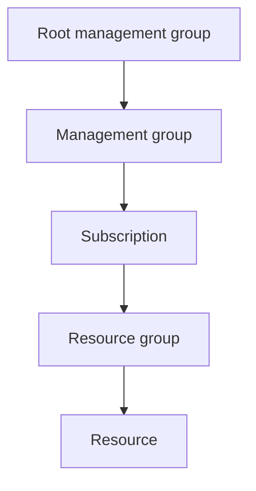

---
tags:
  - azure
  - certificacion
  - az-104
  - iam
  - gobernanza
---

# Manage Azure identities and governance (20–25%)

> Usuarios, grupos y licencias en Microsoft Entra ID, permisos con Azure RBAC y gobierno de suscripciones con management groups, Azure Policy, locks, tags y control de costos.

!!! info "Qué evalúa esta área"
    Según el *study guide* vigente (*skills measured as of April 17, 2026*), esta área tiene tres grupos de habilidades:

    - **Manage Microsoft Entra users and groups**: crear usuarios y grupos, gestionar sus propiedades, licencias, usuarios externos y **SSPR** (*self-service password reset*, restablecimiento de contraseña de autoservicio).
    - **Manage access to Azure resources**: roles integrados de Azure, asignarlos en distintos *scopes* e interpretar asignaciones de acceso.
    - **Manage Azure subscriptions and governance**: Azure Policy, *resource locks*, tags, resource groups, subscriptions, costos (alertas, budgets, Azure Advisor) y management groups.

    Es, junto con cómputo, el área con más peso del examen. Vuelve al [resumen del examen](resumen-examen.md) para ver el resto.

## Microsoft Entra ID: usuarios y grupos

**Microsoft Entra ID** (antes Azure Active Directory) es el directorio de identidades en la nube de Microsoft. Cada organización tiene un **tenant** (inquilino): una instancia de Entra ID con su propio dominio inicial `<nombre>.onmicrosoft.com`. Todas las subscriptions de Azure confían en **un solo** tenant. La visión comparativa con AWS y Google Cloud está en [IAM: AWS, Azure y GCP](../../../cloud/identidad-y-seguridad/iam-comparativa.md).

### Tipos de usuario

| Tipo | Qué es | Cómo se crea |
| --- | --- | --- |
| **Member** (miembro) | Persona de la organización | Se crea en el portal, con CLI/PowerShell, en bloque con CSV (*bulk create*) o se sincroniza desde Active Directory |
| **Guest** (invitado) | Persona externa que entra con su propia identidad | Invitación B2B (*Invite external user*) |
| Usuario sincronizado | Viene de un Active Directory local | **Microsoft Entra Connect Sync** o **Microsoft Entra Cloud Sync** |

Propiedades que conviene saber gestionar: *display name*, *user principal name* (UPN, el nombre de inicio de sesión), *job title*, *department*, *usage location* (necesaria para asignar licencias), *manager* y si la cuenta está habilitada (*account enabled*). Los usuarios sincronizados se editan **en el origen** (el AD local), no en Entra ID.

```bash title="Crear un usuario y un grupo con Azure CLI"
az ad user create \
  --display-name "Ana Torres" \
  --user-principal-name ana.torres@contoso.onmicrosoft.com \
  --password "<contraseña-temporal>" \
  --force-change-password-next-sign-in true

az ad group create --display-name "grp-soporte" --mail-nickname "grp-soporte"
az ad group member add --group "grp-soporte" \
  --member-id "$(az ad user show --id ana.torres@contoso.onmicrosoft.com --query id -o tsv)"
```

### Tipos de grupo y de membresía

| Group type | Para qué |
| --- | --- |
| **Security** | Dar acceso a recursos (roles de Azure, apps, licencias) |
| **Microsoft 365** | Colaboración: buzón compartido, calendario, SharePoint, Teams |

| Membership type | Cómo entran los miembros | Requisito |
| --- | --- | --- |
| **Assigned** (asignada) | Alguien los agrega a mano | Ninguno |
| **Dynamic user** (usuario dinámico) | Una regla sobre atributos del usuario | Licencia Microsoft Entra ID P1 |
| **Dynamic device** (dispositivo dinámico) | Una regla sobre atributos del dispositivo (solo security groups) | Licencia Microsoft Entra ID P1 |

```text title="Regla de membresía dinámica"
(user.department -eq "Ventas") -and (user.country -eq "Chile")
```

!!! tip "En el examen"
    - "Que los usuarios entren y salgan del grupo **automáticamente** según su departamento" → **dynamic membership** (requiere P1).
    - Un grupo dinámico **no** admite agregar miembros a mano. Si te piden ambas cosas, la respuesta no es un grupo dinámico.
    - Los grupos de dispositivos dinámicos solo pueden ser **Security**, no Microsoft 365.

### Licencias

Las licencias (Microsoft Entra ID P1/P2, Microsoft 365, etc.) se asignan a usuarios o, mejor, con **group-based licensing** (licenciamiento por grupo): asignas la licencia al grupo y todos sus miembros la heredan. Puntos clave:

- El usuario necesita **usage location** antes de recibir una licencia; si falta, la asignación falla.
- El licenciamiento por grupo requiere al menos P1 (o un plan que lo incluya, como Microsoft 365 E3).
- Puedes desactivar *service plans* (planes de servicio) concretos dentro de una licencia.

### Usuarios externos

**Microsoft Entra B2B collaboration** (colaboración B2B) permite invitar a personas de otras organizaciones como **guest users**: entran con su identidad (otra cuenta de Entra, cuenta Microsoft, Google, o código de un solo uso por correo) y tú les das acceso como a cualquier usuario. Se gobierna en **External collaboration settings**: quién puede invitar (solo admins, miembros, también invitados) y a qué dominios se permite o bloquea invitar. **Microsoft Entra External ID** es el nombre de la plataforma que agrupa B2B y los escenarios de identidades de clientes (*customer identity*).

```powershell title="Invitar a un usuario externo (Microsoft Graph PowerShell)"
New-MgInvitation -InvitedUserEmailAddress "proveedor@fabrikam.com" `
  -InviteRedirectUrl "https://myapps.microsoft.com" -SendInvitationMessage
```

### Self-service password reset (SSPR)

SSPR permite que una persona restablezca su contraseña o desbloquee su cuenta sin llamar a soporte.

| Configuración | Opciones |
| --- | --- |
| Alcance (*Self service password reset enabled*) | **None**, **Selected** (un grupo) o **All** |
| Métodos de autenticación | App Microsoft Authenticator (notificación o código), correo, teléfono móvil, teléfono de oficina, preguntas de seguridad |
| Número de métodos requeridos | 1 o 2 |
| Registro | Pedir a los usuarios que registren sus métodos al iniciar sesión y cada cuántos días reconfirmarlos |
| Notificaciones | Avisar al usuario y a los admins cuando se restablece una contraseña |
| *Password writeback* | Escribir la nueva contraseña en el AD local (usuarios sincronizados) |

!!! warning "Licencias y matices de SSPR"
    - El restablecimiento (no solo el cambio) de contraseña para usuarios de la nube requiere **P1** o un plan de Microsoft 365 que lo incluya; *password writeback* también requiere P1.
    - Los **administradores** siempre tienen SSPR activado con una política más estricta (dos métodos), independientemente de lo que configures para el resto.
    - Microsoft está moviendo la gestión de métodos de SSPR a la política unificada de **Authentication methods**. Revisa la doc vigente si el portal no coincide con estas notas.

!!! tip "En el examen"
    "Probar SSPR solo con un grupo piloto" → alcance **Selected**. Las preguntas de seguridad no sirven como método para administradores.

## Acceso a recursos con Azure RBAC

**Azure RBAC** (*role-based access control*, control de acceso basado en roles) controla qué se puede hacer con los recursos de Azure. Un permiso es una **role assignment** (asignación de rol):

```text
security principal (quién) + role definition (qué) + scope (dónde)
```

### Roles integrados

| Built-in role | Qué permite |
| --- | --- |
| **Owner** | Todo, incluido asignar roles a otros |
| **Contributor** | Crear y gestionar todos los recursos, **sin** asignar roles |
| **Reader** | Ver recursos, sin cambiar nada |
| **User Access Administrator** | Solo gestionar el acceso (asignar roles) |
| **Role Based Access Control Administrator** | Asignar roles, y se puede limitar con condiciones qué roles y a quién |
| Roles por servicio | P. ej. **Virtual Machine Contributor**, **Network Contributor**, **Storage Account Contributor**, **Storage Blob Data Reader** |

!!! warning "Control plane vs data plane"
    Roles como **Contributor** o **Storage Account Contributor** gestionan el recurso (*control plane*, plano de control). Leer blobs con identidad de Entra necesita un rol de *data plane* (plano de datos) como **Storage Blob Data Reader**. Un Owner de la storage account puede leer los blobs porque puede obtener las *access keys*, no porque tenga un rol de datos.

### Scopes y herencia



- Lo que asignas en un scope se **hereda** hacia abajo.
- Los permisos son **aditivos**: si tienes Reader en la subscription y Contributor en un resource group, en ese resource group eres Contributor.
- Los **deny assignments** (asignaciones de denegación) bloquean acciones aunque un rol las permita; no los creas tú directamente, los crean servicios como Azure Blueprints o *deployment stacks*.

### Interpretar asignaciones

En cada recurso, **Access control (IAM)** muestra:

- **Check access**: qué roles tiene una persona, grupo o identidad concreta en ese scope (incluye los heredados).
- **Role assignments**: la lista con la columna *Scope* (por ejemplo "This resource" o "Subscription (Inherited)").
- **Roles**: el detalle de `Actions`, `NotActions`, `DataActions` y `NotDataActions` de cada rol.

```bash title="Asignar y revisar roles"
RG_ID=$(az group show -n rg-app --query id -o tsv)
GRP_ID=$(az ad group show --group grp-soporte --query id -o tsv)
az role assignment create --assignee-object-id "$GRP_ID" --assignee-principal-type Group \
  --role "Virtual Machine Contributor" --scope "$RG_ID"

az role assignment list --resource-group rg-app --include-inherited -o table
az role definition list --name "Contributor" --query "[].permissions[].notActions"
```

!!! info "Custom roles"
    Si ningún rol integrado encaja, se crea un **custom role** (rol personalizado) en JSON con `Actions`, `NotActions`, `DataActions`, `NotDataActions` y `AssignableScopes`. El *study guide* actual pone el foco en roles integrados, pero conviene saber leer esa estructura.

### Roles de Azure vs roles de Microsoft Entra

| | Azure roles (RBAC) | Microsoft Entra roles |
| --- | --- | --- |
| Gestionan | Recursos de Azure (VMs, redes, storage) | El directorio: usuarios, grupos, apps, licencias |
| Ejemplos | Owner, Contributor, Reader | Global Administrator, User Administrator, Groups Administrator |
| Scope | Management group, subscription, resource group, recurso | Tenant o *administrative unit* |

Un **Global Administrator** no tiene acceso a las subscriptions por defecto, pero puede activar *Access management for Azure resources* para darse **User Access Administrator** en el root management group (uso excepcional).

!!! tip "En el examen"
    - "Que pueda crear VMs pero no dar permisos a nadie" → **Contributor** (o Virtual Machine Contributor si solo son VMs).
    - "Que pueda gestionar usuarios del directorio" → rol de **Entra**, no de Azure.
    - Asigna a **grupos** y en el scope más bajo que cumpla el requisito (*least privilege*, mínimo privilegio).

## Subscriptions, resource groups y management groups

| Nivel | Qué es | Detalles que se preguntan |
| --- | --- | --- |
| **Management group** | Contenedor de subscriptions para aplicar policies y RBAC en bloque | Hasta 6 niveles de profundidad (sin contar el root ni las subscriptions); una subscription tiene un solo padre |
| **Subscription** | Límite de facturación, de cuotas y de acceso | Confía en un tenant; puedes moverla de management group o transferir su facturación |
| **Resource group** | Contenedor lógico de recursos con el mismo ciclo de vida | Cada recurso está en **un solo** resource group; borrar el resource group borra todo lo que contiene |
| **Resource** | El recurso concreto | Puede estar en otra región distinta a la del resource group |

Al **mover recursos** entre resource groups o subscriptions, el *resource ID* cambia, ambos resource groups quedan bloqueados para escritura durante la operación y no todos los recursos admiten moverse (consulta la tabla de soporte). La ubicación del resource group solo indica dónde se guardan sus metadatos.

```bash title="Jerarquía con Azure CLI"
az account management-group create --name mg-produccion --display-name "Producción"
az account management-group subscription add --name mg-produccion --subscription "<subscription-id>"
az resource move --destination-group rg-destino --ids "<resource-id>"
```

Una visión agnóstica de landing zones y estrategia multi-suscripción está en [Gobernanza](../../../cloud/operacion-y-gobierno/gobernanza.md).

## Azure Policy

**Azure Policy** evalúa la **configuración** de los recursos contra reglas. No da ni quita permisos: RBAC dice **quién** puede actuar; Policy dice **cómo** deben quedar los recursos.

| Concepto | Qué es |
| --- | --- |
| **Policy definition** | Una regla en JSON (condición + efecto) |
| **Initiative** (*policy set definition*) | Un conjunto de definitions que se asignan juntas (p. ej. un benchmark de seguridad) |
| **Assignment** | Aplicar una definition o initiative a un scope, con parámetros y exclusiones |
| **Exemption** | Excepción temporal o permanente para un recurso o scope |
| **Remediation task** | Corrige recursos existentes que no cumplen (para `Modify` y `DeployIfNotExists`) |

| Effect | Qué hace |
| --- | --- |
| **Deny** | Bloquea la creación o el cambio |
| **Audit** | Permite, pero marca el recurso como *non-compliant* |
| **Append** / **Modify** | Agrega o cambia propiedades o tags |
| **DeployIfNotExists** | Despliega un recurso complementario si falta (p. ej. una extensión o una diagnostic setting) |
| **AuditIfNotExists** | Marca si falta el recurso complementario |
| **DenyAction** | Bloquea acciones concretas, como borrar |
| **Disabled** | Desactiva la regla sin quitar la asignación |

!!! tip "En el examen"
    - "Impedir crear recursos fuera de East US" → policy **Allowed locations** con efecto **Deny**.
    - "Que todo recurso herede el tag `costCenter` de su resource group" → **Inherit a tag from the resource group** (efecto `Modify`) + **remediation task** para los recursos que ya existían.
    - `Modify` y `DeployIfNotExists` necesitan una **managed identity** en la asignación para poder corregir.
    - Una policy con `Deny` **no** borra ni cambia los recursos existentes: solo los reporta como no conformes.

## Resource locks

| Lock | Efecto |
| --- | --- |
| **CanNotDelete** (*Delete* en el portal) | Se puede leer y modificar, pero no borrar |
| **ReadOnly** (*Read-only*) | Se puede leer, pero no modificar ni borrar |

- Se heredan: un lock en el resource group protege todos sus recursos.
- Solo afectan al *control plane*. Un ReadOnly en una storage account no impide escribir blobs con una SAS, pero **sí** impide listar las *access keys* (es una operación POST), lo que rompe al portal y a herramientas que dependen de ellas.
- Para crear o quitar locks hace falta `Microsoft.Authorization/locks/*`: **Owner** o **User Access Administrator** lo tienen; **Contributor** no.

```bash title="Lock de no borrado"
az lock create --name no-borrar --resource-group rg-app --lock-type CanNotDelete
az lock list --resource-group rg-app -o table
```

## Tags

Los **tags** (etiquetas) son pares nombre-valor para clasificar recursos por costo, entorno o dueño. **No se heredan** del resource group ni de la subscription por defecto: para eso usas Azure Policy. Cada recurso, resource group o subscription admite hasta 50 tags, y no todos los tipos de recurso los aceptan. La estrategia de tagging está en [FinOps y costos](../../../cloud/fundamentos/finops-costos.md).

```bash title="Tags con CLI"
az group update -n rg-app --tags env=prod owner=dani costCenter=cc-104
az resource tag --ids "<resource-id>" --tags env=prod --is-incremental
```

## Costos: budgets, alertas y Azure Advisor

| Herramienta | Para qué |
| --- | --- |
| **Cost analysis** (en Microsoft Cost Management) | Ver el gasto por servicio, resource group, tag, región |
| **Budgets** (presupuestos) | Monto por periodo con alertas al llegar a umbrales del gasto **real** o **pronosticado** (*forecasted*) |
| **Cost alerts** | Alertas de budget, de anomalías y de crédito |
| **Azure Advisor** | Recomendaciones en cinco categorías: Cost, Security, Reliability, Operational Excellence y Performance |
| **Pricing calculator** / **TCO calculator** | Estimar costos antes de desplegar / comparar con on-premises |

!!! warning "Un budget no apaga nada"
    Un budget **solo avisa**. Si quieres reaccionar (apagar VMs, por ejemplo) lo conectas a un **action group** que dispare un runbook de Azure Automation, una Logic App o una Function.

Ahorros que aparecen en Advisor y en el examen: **Reservations** (reservas de 1 o 3 años), **Azure savings plan for compute**, **Azure Hybrid Benefit** (reutilizar licencias de Windows Server y SQL Server) y **Spot VMs**.

## Casos de uso

1. **Una empresa quiere que los nuevos empleados de Ventas reciban automáticamente acceso a la app de CRM y una licencia de Microsoft 365.** → Grupo de seguridad con **dynamic membership** (`user.department -eq "Ventas"`), licencia asignada al grupo y app asignada al grupo. Requiere P1.
2. **Un auditor externo necesita ver la configuración de una subscription durante un mes.** → Invitarlo como **guest** (B2B) y asignarle **Reader** en la subscription; eliminar la asignación (o revisar con *access reviews*) al terminar.
3. **Producción no puede tener recursos fuera de dos regiones.** → Initiative o policy **Allowed locations** con `Deny`, asignada al **management group** de producción para cubrir todas sus subscriptions.
4. **Nadie debe poder borrar por error la VNet compartida.** → Lock **CanNotDelete** en el resource group de red.
5. **Finanzas quiere un correo cuando el gasto previsto supere el 90 % del presupuesto mensual.** → **Budget** con alerta sobre el costo **forecasted** al 90 %.
6. **El equipo de soporte debe reiniciar VMs, pero no crear redes ni dar permisos.** → **Virtual Machine Contributor** (o un custom role con `Microsoft.Compute/virtualMachines/restart/action`) asignado al grupo en el resource group de las VMs.
7. **La mesa de ayuda recibe demasiadas llamadas por contraseñas olvidadas.** → **SSPR** con alcance All y dos métodos; *password writeback* si los usuarios vienen del AD local.

## Preguntas de práctica

**1.** Asignaste a Laura el rol **Reader** en la subscription `sub-prod` y el rol **Contributor** en el resource group `rg-web` de esa subscription. ¿Qué puede hacer en `rg-web`?

- A. Solo leer, porque el rol más restrictivo gana.
- B. Crear y modificar recursos, pero no asignar roles.
- C. Todo, incluido asignar roles.
- D. Nada, porque hay un conflicto de asignaciones.

??? success "Respuesta"
    **B.** Azure RBAC es **aditivo**: en `rg-web` suma Reader (heredado) y Contributor, y Contributor no incluye asignar roles. A es falso porque no hay "el más restrictivo gana" (eso solo pasaría con un deny assignment). C sería Owner. D no existe en RBAC.

**2.** Debes impedir que se borre una storage account, pero las aplicaciones deben poder seguir cambiando su configuración. ¿Qué usas?

- A. Lock ReadOnly en la storage account.
- B. Lock CanNotDelete en la storage account.
- C. Asignar Reader a todos los usuarios.
- D. Policy con efecto Audit.

??? success "Respuesta"
    **B.** CanNotDelete permite modificar pero no borrar. A impediría cambios (y además bloquearía listar las *access keys*). C quita permisos a todos, no solo el borrado. D solo reporta, no impide nada.

**3.** Creaste una policy **Inherit a tag from the resource group** con efecto Modify. Los recursos nuevos reciben el tag, pero los 200 recursos que ya existían no. ¿Qué haces?

- A. Volver a crear la asignación con efecto Deny.
- B. Crear una **remediation task** para la asignación.
- C. Aplicar un lock ReadOnly al resource group.
- D. Esperar 24 horas: Policy los corregirá solo.

??? success "Respuesta"
    **B.** `Modify` actúa en creaciones y actualizaciones; para lo existente necesitas una remediation task (que usa la managed identity de la asignación). A bloquearía, no corregiría. C impediría justamente que se apliquen tags. D: la evaluación periódica marca el incumplimiento, pero no corrige.

**4.** Quieres que los usuarios de un grupo piloto prueben el restablecimiento de contraseña antes de abrirlo a toda la empresa. ¿Qué configuras?

- A. SSPR con alcance **All** y un método.
- B. SSPR con alcance **Selected** apuntando al grupo piloto.
- C. Conditional Access que exija MFA al grupo piloto.
- D. Password writeback para el grupo piloto.

??? success "Respuesta"
    **B.** Selected limita SSPR a un grupo. A lo abre a todos. C no habilita el restablecimiento. D es para escribir la contraseña en el AD local y no limita el alcance.

**5.** Un usuario con el rol **Global Administrator** en Entra ID no ve ninguna subscription en el portal de Azure. ¿Por qué?

- A. Le falta una licencia P2.
- B. Los roles de Entra ID no dan permisos sobre recursos de Azure por defecto.
- C. El tenant no tiene management groups.
- D. Debe tener MFA activado.

??? success "Respuesta"
    **B.** Roles de Entra y roles de Azure son sistemas distintos. Puede elevar su acceso (*Access management for Azure resources*) para obtener User Access Administrator en el root, pero no lo tiene por defecto. A, C y D no explican la falta de acceso.

**6.** Un budget mensual de 1 000 USD en una subscription de pruebas llegó al 100 %. ¿Qué pasa con las VMs?

- A. Se detienen automáticamente.
- B. Se desasignan y se conservan los discos.
- C. Siguen funcionando; el budget solo envía alertas, salvo que conectes una acción.
- D. La subscription se deshabilita.

??? success "Respuesta"
    **C.** Los budgets avisan; para actuar necesitas un action group con un runbook, Logic App o Function. A, B y D no ocurren por un budget (D puede pasar en subscriptions con límite de gasto, como algunas de prueba, pero no por un budget).

**7.** ¿Qué rol mínimo necesita una persona para crear y quitar resource locks en un resource group?

- A. Contributor.
- B. Reader.
- C. User Access Administrator u Owner.
- D. Storage Account Contributor.

??? success "Respuesta"
    **C.** Los locks requieren `Microsoft.Authorization/locks/*`, que tienen Owner y User Access Administrator. Contributor excluye `Microsoft.Authorization/*/Write` y `Delete`. B y D tampoco lo incluyen.

## Para profundizar

| Tema | Nota del cuaderno |
| --- | --- |
| Entra ID, RBAC y equivalencias con AWS y Google Cloud | [IAM: AWS, Azure y GCP](../../../cloud/identidad-y-seguridad/iam-comparativa.md) |
| Landing zones, guardrails, tagging, jerarquía | [Gobernanza](../../../cloud/operacion-y-gobierno/gobernanza.md) |
| Budgets, reservas, savings plans, showback | [FinOps y costos](../../../cloud/fundamentos/finops-costos.md) |
| Policy as code y escaneo de configuraciones | [Seguridad de IaC](../../../devsecops/infraestructura-y-contenedores/seguridad-iac.md), [CSPM](../../../devsecops/escaneos/cspm.md) |
| Identidades de workloads y OIDC desde el pipeline | [Secretos e identidades](../../../devsecops/identidades-y-pipeline/secretos-identidades.md) |
| Riesgo y gobierno de TI | [Gobierno y riesgo de TI](../../../negocio/gobierno-riesgo-ti.md) |

!!! example "Practica en el laboratorio"
    - [Lab 19: Azure: VNet
    - NSG y una VM con Azure CLI](../../../laboratorios/cloud/azure-vnet-vm.md)

## Referencias

- [Study guide del examen AZ-104](https://learn.microsoft.com/en-us/credentials/certifications/resources/study-guides/az-104)
- [Documentación de Microsoft Entra ID](https://learn.microsoft.com/es-es/entra/identity/)
- [Reglas de pertenencia dinámica a grupos](https://learn.microsoft.com/es-es/entra/identity/users/groups-dynamic-membership)
- [Licencias basadas en grupos](https://learn.microsoft.com/es-es/entra/identity/users/licensing-groups-assign)
- [Colaboración B2B en Microsoft Entra External ID](https://learn.microsoft.com/es-es/entra/external-id/what-is-b2b)
- [Cómo funciona SSPR](https://learn.microsoft.com/es-es/entra/identity/authentication/concept-sspr-howitworks)
- [Roles integrados de Azure](https://learn.microsoft.com/es-es/azure/role-based-access-control/built-in-roles)
- [Roles de Azure, roles de Microsoft Entra y roles de administrador clásicos](https://learn.microsoft.com/es-es/azure/role-based-access-control/rbac-and-directory-admin-roles)
- [Estructura de definición de Azure Policy: efectos](https://learn.microsoft.com/es-es/azure/governance/policy/concepts/effect-basics)
- [Bloqueo de recursos](https://learn.microsoft.com/es-es/azure/azure-resource-manager/management/lock-resources)
- [Grupos de administración](https://learn.microsoft.com/es-es/azure/governance/management-groups/overview)
- [Tutorial: crear y administrar presupuestos](https://learn.microsoft.com/es-es/azure/cost-management-billing/costs/tutorial-acm-create-budgets)
- [Azure Advisor](https://learn.microsoft.com/es-es/azure/advisor/advisor-overview)
