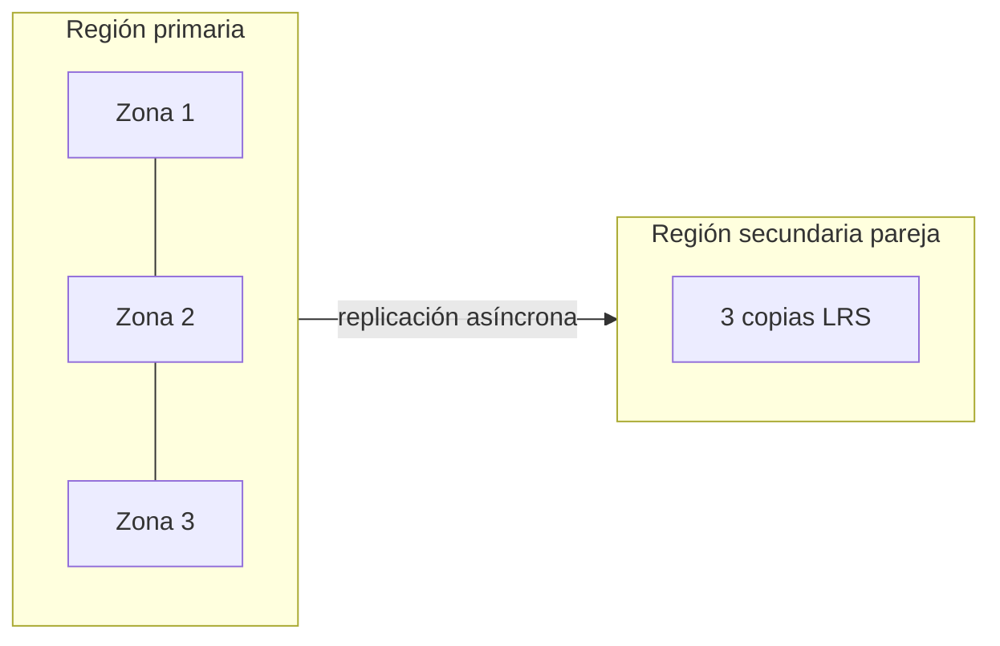

---
tags:
  - azure
  - certificacion
  - az-104
  - almacenamiento
---

# Implement and manage storage (15–20%)

> Storage accounts, redundancia, acceso con SAS, keys e identidades, firewalls, Azure Files, Blob Storage con tiers, lifecycle, versioning y soft delete, y herramientas como AzCopy y Storage Explorer.

!!! info "Qué evalúa esta área"
    Tres grupos de habilidades del *study guide* vigente:

    - **Configure access to storage**: firewalls y redes virtuales, **SAS** (*shared access signature*, firma de acceso compartido), *stored access policies*, *access keys* y acceso basado en identidad para Azure Files.
    - **Configure and manage storage accounts**: crear y configurar cuentas, redundancia, *object replication*, cifrado, Azure Storage Explorer y AzCopy.
    - **Configure Azure Files and Azure Blob Storage**: file shares, containers, *storage tiers*, soft delete de blobs y containers, snapshots y soft delete de Azure Files, lifecycle management y blob versioning.

    Vuelve al [resumen del examen](resumen-examen.md) para ver el resto.

## Storage accounts

Una **storage account** (cuenta de almacenamiento) es el contenedor de nivel superior para cuatro servicios de datos: **Blob Storage** (objetos), **Azure Files** (file shares SMB/NFS), **Queue Storage** (colas) y **Table Storage** (NoSQL clave-valor). Cada servicio tiene su *endpoint* (punto de conexión): `https://<cuenta>.blob.core.windows.net`, `https://<cuenta>.file.core.windows.net`, etc. La comparación con S3 y Cloud Storage está en [Almacenamiento y datos](../../../cloud/redes-y-datos/almacenamiento-datos.md).

| Tipo de cuenta | Rendimiento | Para qué |
| --- | --- | --- |
| **Standard general-purpose v2** | Standard (HDD) | La opción por defecto: blobs, files, queues y tables |
| **Premium block blobs** | Premium (SSD) | Muchas transacciones pequeñas o baja latencia en blobs |
| **Premium file shares** | Premium (SSD) | Azure Files de alto rendimiento; único tipo que admite **NFS** |
| **Premium page blobs** | Premium (SSD) | Page blobs (discos no administrados y casos especiales) |

Reglas de nombre: 3 a 24 caracteres, solo minúsculas y números, **únicos en todo Azure** (forman parte del DNS).

```bash title="Crear una storage account segura por defecto"
az storage account create \
  --name stcuadernoaz104 \
  --resource-group rg-storage \
  --location eastus \
  --sku Standard_ZRS \
  --kind StorageV2 \
  --access-tier Hot \
  --min-tls-version TLS1_2 \
  --allow-blob-public-access false
```

## Redundancia

Azure siempre guarda **al menos tres copias** de tus datos. La diferencia está en dónde:

| SKU | Copias | Sobrevive a | Lectura en la secundaria |
| --- | --- | --- | --- |
| **LRS** (*locally redundant storage*) | 3 en un datacenter | Fallo de disco o rack | No aplica |
| **ZRS** (*zone-redundant storage*) | 3 en tres availability zones | Caída de una zona | No aplica |
| **GRS** (*geo-redundant storage*) | LRS + LRS en la región pareja (asíncrono) | Caída de la región | No |
| **RA-GRS** (*read-access GRS*) | Igual que GRS | Caída de la región | **Sí** (endpoint `-secondary`) |
| **GZRS** (*geo-zone-redundant storage*) | ZRS + LRS en la región pareja | Zona y región | No |
| **RA-GZRS** | Igual que GZRS | Zona y región | **Sí** |



!!! tip "En el examen"
    - "Leer los datos aunque la región primaria esté caída, sin esperar un failover" → **RA-GRS** o **RA-GZRS**.
    - "Sobrevivir a la caída de un datacenter dentro de la región con el menor costo" → **ZRS**.
    - Las cuentas **Premium** solo admiten LRS o ZRS.
    - El tier **Archive** no está disponible con ZRS, GZRS ni RA-GZRS.
    - Si la primaria cae, puedes iniciar un **customer-managed failover** (conmutación iniciada por el cliente); la secundaria pasa a ser primaria y puedes perder los datos que aún no se habían replicado.

## Acceso a los datos

Hay varias formas de autorizar el acceso, de más a menos recomendada:

| Método | Cómo funciona | Cuándo |
| --- | --- | --- |
| **Microsoft Entra ID + RBAC** | Roles de datos como **Storage Blob Data Reader/Contributor** | Aplicaciones con managed identity y personas |
| **User delegation SAS** | SAS firmada con credenciales de Entra (solo Blob Storage y Data Lake) | Dar acceso temporal sin exponer keys |
| **Service SAS** | SAS firmada con la account key para **un** servicio | Acceso temporal a un container, blob, share o queue |
| **Account SAS** | SAS firmada con la account key para uno o varios servicios | Operaciones a nivel de cuenta |
| **Access keys** (*Shared Key*) | Dos claves con acceso total a la cuenta | Evitarlas; si se usan, guardarlas en Key Vault y rotarlas |

### Shared access signatures

Una SAS es una URL con un *token* que incluye permisos (`r`, `w`, `d`, `l`…), fecha de inicio y de expiración, IP permitidas y protocolo (solo HTTPS).

```bash title="User delegation SAS de solo lectura por 4 horas"
az storage blob generate-sas \
  --account-name stcuadernoaz104 --container-name reportes --name enero.pdf \
  --permissions r --expiry "$(date -u -d '+4 hours' '+%Y-%m-%dT%H:%MZ')" \
  --auth-mode login --as-user --https-only --full-uri
```

### Stored access policies

Una **stored access policy** (directiva de acceso almacenada) se define en un **container**, file share, queue o table y agrupa permisos y fechas. Las service SAS que la referencian heredan esos valores, y así puedes **revocarlas** cambiando o borrando la policy. Máximo **cinco** por container.

!!! warning "Cómo revocar cada tipo de SAS"
    | SAS | Cómo revocarla antes de que expire |
    | --- | --- |
    | Service SAS **con** stored access policy | Borrar o cambiar la policy |
    | Service SAS o account SAS **sin** policy | Rotar la access key que la firmó |
    | User delegation SAS | Revocar las *user delegation keys* o quitar el rol al usuario |

### Access keys

Cada cuenta tiene **key1** y **key2** para poder rotar sin cortar el servicio: cambias las apps a key2, regeneras key1, y en la siguiente rotación al revés. Puedes configurar recordatorios de rotación, guardarlas en Key Vault y, si todas las apps usan Entra ID, **deshabilitar Shared Key** (`--allow-shared-key-access false`).

```bash title="Rotar una key"
az storage account keys renew --account-name stcuadernoaz104 -g rg-storage --key primary
```

### Acceso basado en identidad para Azure Files

Para que las personas monten un file share SMB con su identidad (y no con la account key):

1. Habilita una fuente de identidad en la cuenta: **Active Directory Domain Services** (AD DS local), **Microsoft Entra Domain Services** o **Microsoft Entra Kerberos** (para identidades híbridas).
2. Asigna **permisos a nivel de share** con RBAC: **Storage File Data SMB Share Reader**, **Storage File Data SMB Share Contributor** o **Storage File Data SMB Share Elevated Contributor** (puede cambiar ACLs). También puedes definir un permiso por defecto para todos los usuarios autenticados.
3. Ajusta **permisos de archivo y carpeta** con ACLs de Windows (NTFS) desde un equipo unido al dominio.

!!! tip "En el examen"
    Los permisos efectivos son la combinación: share-level (RBAC) **y** ACL de NTFS. Si uno de los dos niega, no hay acceso.

## Firewalls, service endpoints y private endpoints

En **Networking** de la storage account, *Public network access* tiene tres opciones: **Enabled from all networks**, **Enabled from selected virtual networks and IP addresses** y **Disabled**.

- **IP network rules**: rangos de IP **públicas** permitidas (no admite IPs privadas).
- **Virtual network rules**: subnets que llegan por **service endpoint** `Microsoft.Storage`.
- **Resource instances** y **trusted Microsoft services**: excepciones para servicios de Azure concretos (p. ej. Azure Backup o una instancia de Azure Monitor).
- **Private endpoint**: una NIC con IP privada de tu VNet para la cuenta; se combina con *Public network access: Disabled* y una zona DNS privada `privatelink.blob.core.windows.net`.

La diferencia entre service endpoint y private endpoint se explica en [Implement and manage virtual networking](area-4-redes-virtuales.md#service-endpoints-y-private-endpoints).

```bash title="Permitir solo una subnet y una IP de oficina"
az network vnet subnet update -g rg-red --vnet-name vnet-app -n snet-app \
  --service-endpoints Microsoft.Storage
az storage account update -n stcuadernoaz104 -g rg-storage --default-action Deny
az storage account network-rule add -n stcuadernoaz104 -g rg-storage \
  --vnet-name vnet-app --subnet snet-app
az storage account network-rule add -n stcuadernoaz104 -g rg-storage --ip-address 203.0.113.10
```

## Cifrado de la cuenta

- **Storage Service Encryption** (SSE): todo se cifra en reposo con AES-256, siempre y sin costo extra.
- **Microsoft-managed keys** (por defecto) o **customer-managed keys** (CMK, claves gestionadas por el cliente) en **Azure Key Vault** o Managed HSM; la cuenta usa una managed identity para leer la clave.
- **Infrastructure encryption** (doble cifrado): se habilita **al crear** la cuenta y no se puede activar después.
- **Encryption scopes**: claves distintas por container o blob dentro de la misma cuenta.

Ver [Seguridad base](../../../cloud/identidad-y-seguridad/seguridad-base.md) para el modelo de *envelope encryption* y Key Vault.

## Blob Storage: containers y tiers

Los blobs viven en **containers**. El nivel de acceso público anónimo del container (*Private*, *Blob*, *Container*) solo funciona si la cuenta lo permite (`allowBlobPublicAccess`); hoy viene deshabilitado por defecto.

| Access tier | Retención mínima | Disponibilidad | Uso típico |
| --- | --- | --- | --- |
| **Hot** | No tiene | Online | Datos que se leen a menudo |
| **Cool** | 30 días | Online | Datos poco usados (backups recientes) |
| **Cold** | 90 días | Online | Datos rara vez leídos pero que necesitas al instante |
| **Archive** | 180 días | **Offline** | Archivo legal y backups de largo plazo |

- Si mueves o borras un blob antes de su retención mínima, pagas una **early deletion fee** (cargo por borrado anticipado) proporcional.
- **Archive** se asigna por blob; para leerlo hay que **rehidratar** (*rehydrate*) a Hot, Cool o Cold, con prioridad **Standard** (hasta 15 horas) o **High** (normalmente menos de una hora para blobs pequeños), o copiarlo a otro blob en un tier online.
- El tier por defecto de la cuenta se aplica a los blobs que no tienen uno explícito.

```bash title="Cambiar el tier de un blob"
az storage blob set-tier --account-name stcuadernoaz104 --auth-mode login \
  --container-name backups --name 2025-12.bak --tier Archive
```

## Lifecycle management

Una **lifecycle management policy** (política de administración del ciclo de vida) mueve blobs de tier o los borra según su antigüedad. Se ejecuta una vez al día y la primera ejecución puede tardar hasta 24 horas.

```json title="lifecycle.json"
{
  "rules": [
    {
      "enabled": true,
      "name": "logs-a-frio-y-borrar",
      "type": "Lifecycle",
      "definition": {
        "filters": { "blobTypes": ["blockBlob"], "prefixMatch": ["logs/"] },
        "actions": {
          "baseBlob": {
            "tierToCool": { "daysAfterModificationGreaterThan": 30 },
            "tierToArchive": { "daysAfterModificationGreaterThan": 90 },
            "delete": { "daysAfterModificationGreaterThan": 365 }
          },
          "snapshot": { "delete": { "daysAfterCreationGreaterThan": 90 } }
        }
      }
    }
  ]
}
```

```bash
az storage account management-policy create \
  --account-name stcuadernoaz104 -g rg-storage --policy @lifecycle.json
```

!!! tip "En el examen"
    - Para reglas basadas en **último acceso** (`daysAfterLastAccessTimeGreaterThan`) hay que activar **last access time tracking**.
    - `prefixMatch` filtra por container y prefijo (`logs/` = container `logs`).
    - Lifecycle no mueve blobs a Archive en cuentas ZRS/GZRS (Archive no existe ahí).

## Protección de datos: versioning, soft delete y snapshots

| Función | Qué protege | Detalle |
| --- | --- | --- |
| **Blob versioning** | Sobrescrituras y borrados | Cada cambio guarda una versión anterior automáticamente |
| **Blob soft delete** | Borrado de blobs y snapshots | Retención de 1 a 365 días; se recupera con *undelete* |
| **Container soft delete** | Borrado de un container entero | Retención de 1 a 365 días |
| **Point-in-time restore** | Volver un conjunto de block blobs a un momento anterior | Requiere versioning, change feed y blob soft delete |
| **Blob snapshots** | Copia de solo lectura de un blob en un momento | Manual |
| **Immutable storage** (WORM) | Que nadie borre ni modifique durante un periodo | *Time-based retention* o *legal hold* |

```bash title="Activar versioning y soft delete"
az storage account blob-service-properties update \
  --account-name stcuadernoaz104 -g rg-storage \
  --enable-versioning true \
  --enable-delete-retention true --delete-retention-days 14 \
  --enable-container-delete-retention true --container-delete-retention-days 14
```

### Object replication

**Object replication** copia de forma asíncrona block blobs de un container origen a otro destino, en otra cuenta y normalmente en otra región (por latencia de lectura o para separar entornos). Requisitos: **blob versioning** en ambas cuentas y **change feed** en la origen. No sirve para Archive ni sustituye a GRS (con GRS no eliges el destino ni puedes leerlo, salvo RA-GRS).

## Azure Files

**Azure Files** ofrece file shares administrados por **SMB** (puerto 445) y **NFS** 4.1 (solo en premium). Se montan desde Windows, Linux o macOS, o se cachean en servidores locales con **Azure File Sync**.

| Tier | Medio | Uso |
| --- | --- | --- |
| **Premium** | SSD | Bases de datos, cargas sensibles a latencia, NFS |
| **Transaction optimized** | HDD | Muchas transacciones, sin necesidad de baja latencia |
| **Hot** | HDD | Shares de uso general |
| **Cool** | HDD | Archivo online barato |

!!! warning "Modelos de facturación de Azure Files"
    Microsoft introdujo modelos **provisioned v2** (pagas por capacidad, IOPS y throughput aprovisionados) además del modelo *pay-as-you-go* con estos tiers. Revisa qué ofrece el portal al crear el share.

- **Share snapshots**: copias de solo lectura del share completo (hasta 200 por share); desde Windows aparecen como *Previous Versions*.
- **Soft delete de file shares**: recupera un share borrado durante el periodo de retención (1 a 365 días).
- Azure Backup puede programar snapshots de shares (ver [Monitor and maintain Azure resources](area-5-monitoreo-mantenimiento.md)).

```bash title="Crear un share y una snapshot"
az storage share-rm create -g rg-storage --storage-account stcuadernoaz104 \
  --name compartido --quota 100 --access-tier Hot
az storage share-rm snapshot -g rg-storage --storage-account stcuadernoaz104 --name compartido
```

## AzCopy y Azure Storage Explorer

| Herramienta | Qué es | Cuándo |
| --- | --- | --- |
| **AzCopy** | CLI para copiar datos hacia, desde y entre cuentas (copia servidor a servidor) | Copias grandes, scripts, migraciones |
| **Azure Storage Explorer** | App de escritorio para navegar blobs, files, queues y tables | Tareas manuales, revisar contenido, generar SAS |
| **Azure Data Box** | Dispositivo físico | Terabytes con poco ancho de banda |
| **Azure Import/Export** | Discos propios enviados al datacenter | Similar a Data Box con tus discos |

```bash title="AzCopy con identidad de Entra"
azcopy login
azcopy copy "./reportes/*" "https://stcuadernoaz104.blob.core.windows.net/reportes" --recursive
azcopy sync "./web" "https://stcuadernoaz104.blob.core.windows.net/\$web" --delete-destination=true
```

## Casos de uso

1. **Una app de lectura global debe seguir leyendo imágenes si cae la región primaria, sin intervención.** → **RA-GZRS** (o RA-GRS), apuntando las lecturas al endpoint `-secondary` cuando la primaria falla.
2. **Un proveedor necesita subir archivos a un container durante 48 horas.** → **SAS** con permisos `w` (y `c`), expiración de 48 h y HTTPS; idealmente user delegation SAS o una service SAS ligada a una **stored access policy** para poder revocarla.
3. **Logs que se consultan la primera semana, se guardan un año y luego se borran.** → **Lifecycle management**: a Cool a los 30 días, a Archive a los 90, borrar a los 365.
4. **Un usuario borró por error un container de facturas.** → Si estaba activado, **container soft delete** permite restaurarlo; si no, no hay recuperación.
5. **La storage account solo debe ser accesible desde la VNet de la aplicación y sin IP pública.** → **Private endpoint** + *Public network access: Disabled* + zona DNS privada.
6. **Reemplazar un servidor de archivos Windows y mantener los permisos NTFS por usuario.** → **Azure Files** con identidad **AD DS** (o Entra Kerberos), roles SMB a nivel de share y ACLs NTFS migradas; Azure File Sync si quieres caché local.
7. **Mantener una copia de los blobs de producción en otra región para analítica, en una cuenta distinta.** → **Object replication** con versioning en ambas cuentas y change feed en la origen.

## Preguntas de práctica

**1.** Necesitas que una cuenta de almacenamiento sobreviva a la caída de una availability zone y de la región completa, con la menor cantidad de cambios en la aplicación. ¿Qué redundancia eliges?

- A. LRS.
- B. ZRS.
- C. GRS.
- D. GZRS.

??? success "Respuesta"
    **D.** GZRS replica en tres zonas de la primaria y en la región pareja. A no sobrevive a la caída de una zona. B no protege ante la caída de la región. C protege ante la región, pero en la primaria usa LRS, que no sobrevive a la caída de una zona.

**2.** Emitiste varias service SAS sin stored access policy y una se filtró. ¿Cuál es la forma de invalidarla?

- A. Borrar el container.
- B. Regenerar la access key que se usó para firmarla.
- C. Crear una stored access policy nueva.
- D. Cambiar el tier del blob a Archive.

??? success "Respuesta"
    **B.** Sin policy, la única forma de revocar una SAS firmada con key es rotar esa key (y las demás SAS firmadas con ella también dejan de funcionar). A es destructivo. C no afecta a SAS ya emitidas que no la referencian. D no invalida la firma.

**3.** Una regla de lifecycle debe mover a Archive los blobs a los 60 días, pero la cuenta es Standard ZRS y la regla no tiene efecto. ¿Por qué?

- A. Lifecycle management requiere cuentas Premium.
- B. El tier Archive no está disponible en cuentas ZRS.
- C. Hay que activar blob versioning.
- D. Las reglas solo se aplican a blobs creados después de la regla.

??? success "Respuesta"
    **B.** Archive solo existe en LRS, GRS y RA-GRS. A es falso: lifecycle funciona en general-purpose v2. C no es requisito para mover de tier. D es falso: las reglas evalúan todos los blobs que cumplen el filtro.

**4.** Debes permitir acceso a una storage account solo desde la subnet `snet-app` sin crear IPs privadas nuevas. ¿Qué configuras?

- A. Un private endpoint.
- B. Un service endpoint `Microsoft.Storage` en la subnet y una virtual network rule en el firewall de la cuenta.
- C. Una IP network rule con el rango de la subnet.
- D. Un NSG en la subnet que permita el puerto 443.

??? success "Respuesta"
    **B.** El service endpoint identifica el tráfico de esa subnet ante la cuenta, sin crear IPs. A crea una IP privada. C no funciona: las IP rules solo aceptan IPs públicas. D no restringe el acceso a la cuenta desde otros orígenes.

**5.** ¿Qué combinación necesitas para configurar object replication?

- A. Change feed en la cuenta destino y soft delete en la origen.
- B. Blob versioning en origen y destino, y change feed en la origen.
- C. Cuentas GRS en ambas regiones.
- D. Lock ReadOnly en el container de destino.

??? success "Respuesta"
    **B.** Es el requisito documentado. A invierte los papeles. C no es necesario. D impediría la escritura de las réplicas.

**6.** Un usuario monta un share de Azure Files con su identidad de AD DS. Tiene **Storage File Data SMB Share Contributor**, pero la ACL de NTFS de una carpeta solo le da lectura. ¿Qué puede hacer en esa carpeta?

- A. Leer y escribir, porque RBAC gana.
- B. Solo leer.
- C. Nada.
- D. Cambiar la ACL.

??? success "Respuesta"
    **B.** Se aplican los dos niveles y el más restrictivo limita: el share permite escribir, pero NTFS solo lectura. A es falso. C: tiene lectura. D requiere Elevated Contributor y permisos NTFS de control total.

**7.** Necesitas copiar 2 TB de una storage account a otra en otra región, de forma programada y sin pasar los datos por tu equipo. ¿Qué herramienta usas?

- A. Azure Storage Explorer descargando y volviendo a subir.
- B. AzCopy con copia servidor a servidor.
- C. Azure Data Box.
- D. Object replication sobre Azure Files.

??? success "Respuesta"
    **B.** AzCopy copia entre cuentas directamente en el backend de Azure y es fácil de programar. A pasa por tu equipo. C es para mover datos físicamente desde on-premises. D no existe para Azure Files (object replication es de block blobs).

## Para profundizar

| Tema | Nota del cuaderno |
| --- | --- |
| Object, block y file storage en las tres nubes, clases y redundancia | [Almacenamiento y datos](../../../cloud/redes-y-datos/almacenamiento-datos.md) |
| Cifrado, Key Vault y gestión de secretos | [Seguridad base](../../../cloud/identidad-y-seguridad/seguridad-base.md) |
| Private endpoints, DNS privado y redes | [Redes en la nube](../../../cloud/redes-y-datos/redes.md), [Servicios de red](../../../networking/intermedio/servicios-red.md) |
| Backups, réplicas y RPO | [Resiliencia](../../../cloud/operacion-y-gobierno/resiliencia.md) |
| Costos de tiers y retención | [FinOps y costos](../../../cloud/fundamentos/finops-costos.md) |
| Escanear storage públicos con CSPM | [CSPM](../../../devsecops/escaneos/cspm.md) |

!!! example "Practica en el laboratorio"
    - [Lab 19: Azure: VNet
    - NSG y una VM con Azure CLI](../../../laboratorios/cloud/azure-vnet-vm.md)

## Referencias

- [Study guide del examen AZ-104](https://learn.microsoft.com/en-us/credentials/certifications/resources/study-guides/az-104)
- [Introducción a las cuentas de almacenamiento](https://learn.microsoft.com/es-es/azure/storage/common/storage-account-overview)
- [Redundancia de Azure Storage](https://learn.microsoft.com/es-es/azure/storage/common/storage-redundancy)
- [Conceder acceso limitado con SAS](https://learn.microsoft.com/es-es/azure/storage/common/storage-sas-overview)
- [Definir una directiva de acceso almacenada](https://learn.microsoft.com/es-es/rest/api/storageservices/define-stored-access-policy)
- [Configurar firewalls y redes virtuales de Azure Storage](https://learn.microsoft.com/es-es/azure/storage/common/storage-network-security)
- [Niveles de acceso de los blobs](https://learn.microsoft.com/es-es/azure/storage/blobs/access-tiers-overview)
- [Administración del ciclo de vida de blobs](https://learn.microsoft.com/es-es/azure/storage/blobs/lifecycle-management-overview)
- [Protección de datos de blobs](https://learn.microsoft.com/es-es/azure/storage/blobs/data-protection-overview)
- [Replicación de objetos para blobs en bloques](https://learn.microsoft.com/es-es/azure/storage/blobs/object-replication-overview)
- [Azure Files: autenticación basada en identidad](https://learn.microsoft.com/es-es/azure/storage/files/storage-files-active-directory-overview)
- [Introducción a AzCopy](https://learn.microsoft.com/es-es/azure/storage/common/storage-use-azcopy-v10)
