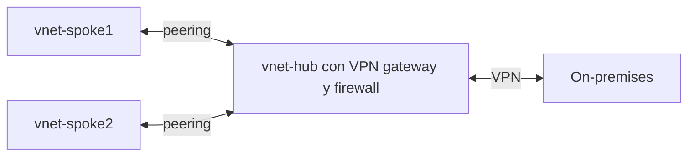
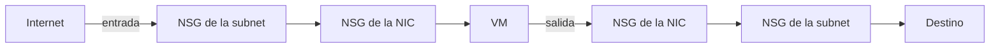

---
tags:
  - azure
  - certificacion
  - az-104
  - redes
---

# Implement and manage virtual networking (15–20%)

> VNets y subnets, peering, IPs públicas, rutas definidas por el usuario, NSGs y ASGs, Azure Bastion, service y private endpoints, Azure DNS y Azure Load Balancer, con el troubleshooting de cada pieza.

!!! info "Qué evalúa esta área"
    Tres grupos de habilidades del *study guide* vigente:

    - **Configure and manage virtual networks in Azure**: VNets y subnets, *virtual network peering*, IPs públicas, *user-defined routes* y troubleshooting de conectividad.
    - **Configure secure access to virtual networks**: **NSGs** (*network security groups*) y **ASGs** (*application security groups*), reglas efectivas, Azure Bastion, service endpoints y private endpoints para PaaS.
    - **Configure name resolution and load balancing**: Azure DNS, load balancer interno o público y troubleshooting del balanceo.

    Vuelve al [resumen del examen](resumen-examen.md) para ver el resto.

## Virtual networks y subnets

Una **virtual network** (VNet, red virtual) es una red privada aislada en **una región** y **una subscription**, con uno o varios **address spaces** (espacios de direcciones) en notación CIDR. Se divide en **subnets** (subredes) que pueden abarcar todas las zonas de la región. La visión comparativa (VPC, VNet, VPC de Google) está en [Redes en la nube](../../../cloud/redes-y-datos/redes.md) y el cálculo de subredes en [Direccionamiento IP](../../../networking/basico/direccionamiento-ip.md).

- Azure **reserva 5 IPs** por subnet: la dirección de red, las tres primeras (gateway y DNS de Azure) y la de broadcast. Una `/24` deja 251 IPs utilizables; la subnet más pequeña es `/29`.
- Algunas subnets tienen nombre obligatorio: `AzureBastionSubnet`, `GatewaySubnet`, `AzureFirewallSubnet`.
- **Subnet delegation** reserva una subnet para un servicio PaaS (p. ej. Container Apps o App Service VNet integration).
- Puedes agregar address spaces a una VNet existente; para cambiar el de una VNet con peering hay que sincronizar el peering.

```bash title="VNet con dos subnets"
az network vnet create -g rg-red -n vnet-hub -l eastus \
  --address-prefixes 10.0.0.0/16 --subnet-name snet-app --subnet-prefixes 10.0.1.0/24
az network vnet subnet create -g rg-red --vnet-name vnet-hub -n snet-db --address-prefixes 10.0.2.0/24
```

!!! warning "Salida a internet por defecto"
    Históricamente, una VM sin IP pública salía a internet con una IP "implícita" de Azure (*default outbound access*). Microsoft está retirando ese comportamiento: las VNets nuevas crean **subnets privadas** por defecto y necesitas un método explícito de salida (**NAT Gateway**, load balancer con *outbound rules*, IP pública en la VM o un firewall). Revisa la doc vigente para las fechas exactas.

## Public IP addresses

| Propiedad | Opciones |
| --- | --- |
| SKU | **Standard** (la vigente). La SKU **Basic** se retiró el 30 de septiembre de 2025 |
| Asignación | Standard es siempre **static** (estática) |
| Zonas | *Zone-redundant*, zonal (fija a una zona) o sin zona |
| Seguridad | Standard es **secure by default** (segura por defecto): el tráfico entrante se bloquea salvo que un NSG lo permita |
| Tier | *Regional* o *Global* (para cross-region load balancer) |

Se asocia a una NIC, un load balancer, un Application Gateway, un VPN gateway, Bastion o NAT Gateway. Un **public IP prefix** reserva un bloque contiguo de IPs públicas.

## Virtual network peering

El **peering** conecta dos VNets por la red troncal de Microsoft, con baja latencia y sin gateways. Puede ser **regional** (misma región) o **global** (entre regiones), y entre subscriptions o tenants.

- Los address spaces **no pueden solaparse**.
- **No es transitivo**: si A está conectada con B y B con C, A no llega a C. Para un modelo hub-and-spoke necesitas un firewall o NVA en el hub con UDRs, o Azure Virtual Network Manager.
- Se crea en **los dos sentidos** (el portal crea ambos lados a la vez).
- Opciones: **Allow forwarded traffic** (aceptar tráfico reenviado por un NVA), **Allow gateway transit** (en el hub, compartir su VPN gateway) y **Use remote gateways** (en el spoke, usar el gateway del hub).



```bash title="Peering en los dos sentidos"
az network vnet peering create -g rg-red -n hub-a-spoke1 --vnet-name vnet-hub \
  --remote-vnet vnet-spoke1 --allow-vnet-access --allow-gateway-transit
az network vnet peering create -g rg-red -n spoke1-a-hub --vnet-name vnet-spoke1 \
  --remote-vnet vnet-hub --allow-vnet-access --allow-forwarded-traffic --use-remote-gateways
```

!!! tip "En el examen"
    - "Spoke1 no llega a Spoke2 aunque ambos tienen peering con el hub" → el peering no es transitivo.
    - "No se puede crear el peering" → address spaces solapados.
    - El estado del peering debe ser **Connected** en ambos lados; si uno muestra **Initiated**, falta crear el otro lado.

## User-defined routes

Azure crea **system routes** (rutas del sistema) para que todo funcione: dentro de la VNet, hacia VNets con peering, hacia internet (`0.0.0.0/0`). Con una **route table** asociada a una subnet agregas **user-defined routes** (UDR, rutas definidas por el usuario) que tienen prioridad sobre las del sistema para el mismo prefijo.

| Next hop type | Para qué |
| --- | --- |
| **Virtual appliance** | Enviar a un firewall o NVA (IP privada); la NIC del NVA necesita **IP forwarding** habilitado |
| **Virtual network gateway** | Enviar al VPN gateway |
| **Virtual network** | Dentro de la VNet |
| **Internet** | Salida a internet |
| **None** | Descartar el tráfico |

Selección de ruta: primero gana el **prefijo más específico** (*longest prefix match*); si empatan, UDR antes que BGP y BGP antes que rutas del sistema. El concepto general está en [Routing y NAT](../../../networking/intermedio/routing-nat.md).

```bash title="Forzar el tráfico de internet a través de un firewall"
az network route-table create -g rg-red -n rt-app
az network route-table route create -g rg-red --route-table-name rt-app -n default-a-fw \
  --address-prefix 0.0.0.0/0 --next-hop-type VirtualAppliance --next-hop-ip-address 10.0.100.4
az network vnet subnet update -g rg-red --vnet-name vnet-hub -n snet-app --route-table rt-app
```

## Network security groups y application security groups

Un **NSG** es un firewall *stateful* (con estado) de capa 3 y 4 que se asocia a una **subnet**, a una **NIC** o a ambas. Cada regla tiene prioridad (100 a 4096; **menor número = se evalúa antes**), origen, destino, puerto, protocolo y acción (*Allow* o *Deny*). La primera regla que coincide decide.

| Default rule | Dirección | Prioridad | Qué hace |
| --- | --- | --- | --- |
| AllowVnetInBound | Entrada | 65000 | Permite tráfico desde la VNet (y redes conectadas) |
| AllowAzureLoadBalancerInBound | Entrada | 65001 | Permite las sondas del load balancer |
| DenyAllInBound | Entrada | 65500 | Bloquea todo lo demás |
| AllowVnetOutBound | Salida | 65000 | Permite tráfico hacia la VNet |
| AllowInternetOutBound | Salida | 65001 | Permite salir a internet |
| DenyAllOutBound | Salida | 65500 | Bloquea todo lo demás |

- **Service tags** (etiquetas de servicio): grupos de IPs que mantiene Microsoft, como `Internet`, `VirtualNetwork`, `AzureLoadBalancer`, `Storage`, `Sql.EastUS`.
- **Application security groups** (ASG): agrupan NICs por función (`asg-web`, `asg-db`) y se usan como origen o destino en reglas, sin escribir IPs. Las NICs de un ASG deben estar en la misma VNet.



!!! tip "En el examen: reglas efectivas"
    - Si hay NSG en la subnet **y** en la NIC, el tráfico debe estar permitido en **los dos**. Entrada: primero subnet, luego NIC. Salida: primero NIC, luego subnet.
    - Usa **Effective security rules** (en la NIC o en Network Watcher) para ver las reglas combinadas.
    - Una regla `Allow 3389 desde Internet` con prioridad 200 y una `Deny 3389` con prioridad 100: gana el **Deny** (menor número).

```bash title="NSG con ASGs"
az network asg create -g rg-red -n asg-web
az network asg create -g rg-red -n asg-db
az network nsg create -g rg-red -n nsg-app
az network nsg rule create -g rg-red --nsg-name nsg-app -n web-a-sql --priority 110 \
  --direction Inbound --access Allow --protocol Tcp --destination-port-ranges 1433 \
  --source-asgs asg-web --destination-asgs asg-db
az network nic list-effective-nsg -g rg-vm -n vm-app01VMNic -o table
```

Ver también [Seguridad de red](../../../networking/avanzado/seguridad-red.md) para firewalls stateful vs stateless y microsegmentación.

## Azure Bastion

**Azure Bastion** da acceso RDP y SSH a las VMs **desde el navegador** (portal) o el cliente nativo, por TLS, **sin IP pública** en las VMs.

| SKU | Destacado |
| --- | --- |
| **Developer** | Gratis, compartida, una conexión a la vez; para pruebas |
| **Basic** | Instancias dedicadas, conexiones desde el portal |
| **Standard** | Escalado de instancias, **native client** (`az network bastion ssh/rdp`), subida y descarga de archivos, acceso por IP |
| **Premium** | Además grabación de sesiones y despliegue solo privado |

- Requiere una subnet llamada **`AzureBastionSubnet`** de al menos `/26` (salvo Developer, que no la necesita).
- Llega a VMs de la misma VNet y de VNets con peering.
- El NSG de las VMs debe permitir 22/3389 desde la subnet de Bastion.

## Service endpoints y private endpoints

| | Service endpoint | Private endpoint |
| --- | --- | --- |
| Qué es | Extiende la identidad de la subnet al servicio PaaS | Una **NIC con IP privada** de tu VNet que representa una instancia concreta del servicio |
| IP del servicio | Sigue siendo la **pública** | **Privada** |
| Alcance | Todo el servicio (p. ej. todas las storage accounts de la región), filtrable con *service endpoint policies* | **Un** recurso concreto |
| Acceso desde on-premises o desde peering | No | **Sí** |
| DNS | Sin cambios | Requiere zona **Private DNS** (p. ej. `privatelink.blob.core.windows.net`) |
| Costo | Gratis | Se cobra por hora y por GB |
| Servicio relacionado | Se configura en la subnet | Lo ofrece **Azure Private Link** |

!!! tip "En el examen"
    - "Acceder desde on-premises por VPN a la storage account de forma privada" → **private endpoint**.
    - "Sin costo, restringir la storage account a una subnet" → **service endpoint** + regla de red en la cuenta.
    - Si un private endpoint "no funciona" y el nombre resuelve a una IP pública, falta la **zona DNS privada** o su *virtual network link*.

## Azure DNS

| Tipo de zona | Para qué |
| --- | --- |
| **Public DNS zone** | Hospedar un dominio público (`contoso.com`) en los servidores de nombres de Azure |
| **Private DNS zone** | Resolver nombres dentro de VNets (`interno.contoso.com`, `privatelink.*`) |

- **Delegación**: después de crear la zona pública, cambias los registros **NS** en el registrador (o en la zona padre) por los cuatro servidores de nombres que asigna Azure.
- **Virtual network links**: enlazan una zona privada con VNets; con **auto-registration** (autorregistro) las VMs registran su nombre automáticamente (una VNet solo puede tener una zona con autorregistro).
- **Alias records**: un registro A/AAAA/CNAME que apunta a un recurso de Azure (IP pública, Front Door, Traffic Manager) y se actualiza solo; permite apuntar el **dominio raíz** (*apex*) a un recurso.
- **Azure DNS Private Resolver**: resolver nombres privados desde on-premises y al revés.

```bash title="Zona pública y zona privada"
az network dns zone create -g rg-dns -n contoso.com
az network dns record-set a add-record -g rg-dns -z contoso.com -n www -a 203.0.113.20
az network private-dns zone create -g rg-dns -n interno.contoso.com
az network private-dns link vnet create -g rg-dns -z interno.contoso.com \
  -n link-hub -v "$(az network vnet show -g rg-red -n vnet-hub --query id -o tsv)" -e true
```

Fundamentos de DNS (registros, TTL, split-horizon) en [Servicios de red](../../../networking/intermedio/servicios-red.md).

## Azure Load Balancer

**Azure Load Balancer** es un balanceador de **capa 4** (TCP/UDP) de alto rendimiento.

| Componente | Qué es |
| --- | --- |
| **Frontend IP configuration** | IP pública (**public load balancer**) o privada (**internal load balancer**) |
| **Backend pool** | NICs o IPs de las VMs/VMSS que reciben tráfico |
| **Health probe** | Sondeo TCP, HTTP o HTTPS para saber qué instancias están sanas |
| **Load-balancing rule** | Puerto de frontend → puerto de backend, con probe y *session persistence* |
| **Inbound NAT rule** | Un puerto del frontend → una VM concreta (p. ej. SSH a cada VM) |
| **Outbound rule** | SNAT para que el backend salga a internet |

- La distribución por defecto usa un *hash* de 5 tuplas; **session persistence** (afinidad) por IP de cliente o IP+protocolo.
- **HA ports** (en internal LB Standard): balancear todos los puertos a la vez, típico para NVAs.
- La SKU **Basic** de Load Balancer se retiró el 30 de septiembre de 2025; usa **Standard** (o Gateway para NVAs de terceros).

```bash title="Load balancer público con sonda HTTP"
az network lb create -g rg-web -n lb-web --sku Standard \
  --public-ip-address pip-lb-web --frontend-ip-name fe-web --backend-pool-name be-web
az network lb probe create -g rg-web --lb-name lb-web -n probe-http \
  --protocol Http --port 80 --path /health
az network lb rule create -g rg-web --lb-name lb-web -n regla-http --protocol Tcp \
  --frontend-port 80 --backend-port 80 --frontend-ip-name fe-web \
  --backend-pool-name be-web --probe-name probe-http
```

### Qué balanceador usar

| Servicio | Capa | Alcance | Cuándo |
| --- | --- | --- | --- |
| **Azure Load Balancer** | L4 | Regional | Tráfico TCP/UDP, cualquier protocolo, interno o público |
| **Application Gateway** | L7 | Regional | HTTP(S): rutas por URL o host, terminación TLS, **WAF**, afinidad por cookie |
| **Azure Front Door** | L7 | Global | Web global con CDN, WAF y aceleración |
| **Traffic Manager** | DNS | Global | Reparto o failover entre regiones por DNS |

Algoritmos, health checks y L4 vs L7 en general: [Balanceo y alta disponibilidad](../../../networking/avanzado/balanceo-alta-disponibilidad.md).

### Troubleshooting del balanceo

1. ¿El **health probe** marca las instancias como sanas? Si la app no responde en el puerto o ruta de la sonda, la instancia sale del pool.
2. ¿El **NSG** del backend permite el puerto de la aplicación desde el origen y desde el service tag `AzureLoadBalancer` (para las sondas)? Con Standard, sin una regla que permita el tráfico, no entra nada.
3. ¿Las VMs están en el **backend pool** correcto y en la misma VNet que el LB?
4. Un internal LB no se puede probar desde una VM **del mismo backend** hacia la IP del frontend (el flujo vuelve a la misma VM y falla): prueba desde otra VM.
5. Revisa las métricas **Health Probe Status** y **Data Path Availability** en Azure Monitor.

## Troubleshooting de conectividad con Network Watcher

| Herramienta de Network Watcher | Responde a |
| --- | --- |
| **IP flow verify** | ¿Un NSG permite o bloquea este paquete? ¿Qué regla? |
| **NSG diagnostics** | Evaluación de todas las reglas de NSG en el camino |
| **Next hop** | ¿Por dónde sale el tráfico? (detecta UDRs mal puestas) |
| **Effective routes** (en la NIC) | Rutas combinadas del sistema, UDR y BGP |
| **Connection troubleshoot** | Prueba de conectividad punto a punto con latencia y saltos |
| **Packet capture** | Captura de paquetes en la VM |
| **VNet flow logs** | Registro de flujos de red (reemplaza a los NSG flow logs, en retiro) |

```bash title="¿Por qué no llego a la VM?"
az network watcher test-ip-flow -g rg-vm --vm vm-app01 --direction Inbound \
  --protocol TCP --local 10.0.1.4:22 --remote 203.0.113.50:50000
az network watcher show-next-hop -g rg-vm --vm vm-app01 \
  --source-ip 10.0.1.4 --dest-ip 8.8.8.8
```

Metodología general en [Troubleshooting de red](../../../networking/avanzado/troubleshooting-red.md).

## Casos de uso

1. **Dos equipos tienen VNets en regiones distintas y necesitan comunicarse con baja latencia.** → **Global VNet peering** (sin solapar address spaces).
2. **Todo el tráfico de salida a internet de las subnets de aplicación debe pasar por un firewall.** → **Route table** con `0.0.0.0/0` → **Virtual appliance** (IP del firewall), asociada a las subnets.
3. **Los administradores deben entrar por SSH a VMs sin IPs públicas.** → **Azure Bastion** (Standard si quieren usar su cliente SSH nativo).
4. **La capa web debe hablar con la base de datos solo por el puerto 1433, y las VMs cambian a menudo.** → **ASGs** `asg-web` y `asg-db` y una regla NSG entre ellos.
5. **Una app en on-premises (por VPN) debe usar un Azure SQL Database sin salir a internet.** → **Private endpoint** + zona DNS privada resolvible desde on-premises (DNS Private Resolver).
6. **Publicar `contoso.com` y `www.contoso.com` apuntando a una IP pública de Azure.** → **Public DNS zone**, delegación NS en el registrador y **alias record** en el apex.
7. **Balancear tráfico TCP interno hacia un clúster de VMs de base de datos.** → **Internal load balancer** Standard con health probe TCP.
8. **Una web necesita enrutar `/api` a un pool y `/imagenes` a otro, con WAF.** → **Application Gateway** (L7) con WAF.

## Preguntas de práctica

**1.** VNet1 tiene peering con VNet2 y VNet2 con VNet3. Una VM de VNet1 no llega a una VM de VNet3. ¿Qué haces con menor esfuerzo?

- A. Habilitar *Allow gateway transit* en VNet2.
- B. Crear un peering directo entre VNet1 y VNet3.
- C. Agregar una regla NSG de entrada en VNet3.
- D. Cambiar el address space de VNet2.

??? success "Respuesta"
    **B.** El peering no es transitivo; el camino más simple es un peering directo. A sirve para compartir un VPN gateway, no para tránsito entre spokes. C no resuelve la falta de ruta. D no aporta nada.

**2.** Un NSG en la subnet permite el puerto 443 desde Internet. La NIC de la VM tiene otro NSG solo con reglas por defecto. ¿Llega el tráfico HTTPS desde Internet a la VM?

- A. Sí, porque la subnet lo permite.
- B. No, porque el NSG de la NIC lo bloquea con DenyAllInBound.
- C. Sí, porque AllowVnetInBound lo permite.
- D. Depende de la regla de salida.

??? success "Respuesta"
    **B.** El tráfico de entrada debe pasar ambos NSGs; el de la NIC no tiene regla que lo permita y cae en DenyAllInBound. A ignora el NSG de la NIC. C: Internet no está dentro del service tag VirtualNetwork. D: al ser stateful, la respuesta no depende de reglas de salida.

**3.** Una VM con IP privada `10.0.1.4` no puede salir a internet tras aplicar una route table. ¿Qué herramienta te dice rápidamente adónde va el tráfico?

- A. IP flow verify.
- B. Next hop.
- C. Packet capture.
- D. Azure Advisor.

??? success "Respuesta"
    **B.** Next hop muestra el tipo de salto y la ruta aplicada (por ejemplo, un virtual appliance inexistente o `None`). A evalúa reglas NSG, no rutas. C da detalle pero no el porqué de la ruta. D no diagnostica rutas.

**4.** Debes permitir que recursos de on-premises conectados por VPN accedan a una storage account por IP privada. ¿Qué configuras?

- A. Service endpoint en la GatewaySubnet.
- B. Private endpoint para la storage account y resolución DNS de la zona `privatelink`.
- C. Una IP network rule con el rango de on-premises.
- D. Una regla NSG de salida a `Storage`.

??? success "Respuesta"
    **B.** El private endpoint da una IP privada alcanzable desde on-premises por la VPN, y el DNS debe resolver a esa IP. A: los service endpoints no se extienden a on-premises. C: las IP rules solo aceptan IPs públicas y el tráfico seguiría yendo por internet. D no da acceso privado.

**5.** Quieres desplegar Azure Bastion y el portal no deja seleccionar la subnet `snet-bastion` (`/27`). ¿Qué corriges?

- A. Asociar un NSG vacío a la subnet.
- B. Crear una subnet llamada `AzureBastionSubnet` de `/26` o mayor.
- C. Habilitar IP forwarding.
- D. Crear una IP pública Basic.

??? success "Respuesta"
    **B.** Bastion requiere ese nombre exacto y un tamaño mínimo de `/26`. A no lo resuelve. C no aplica. D: Basic está retirada y Bastion usa Standard.

**6.** Un load balancer público Standard tiene dos VMs en el backend, el health probe HTTP en `/health` y la regla en el puerto 80. Las sondas fallan, pero la web responde desde dentro de la VNet. ¿Causa más probable?

- A. Falta un inbound NAT rule.
- B. La aplicación no expone `/health` (devuelve 404) o el NSG bloquea la sonda.
- C. Hay que usar Application Gateway.
- D. Las VMs necesitan IP pública.

??? success "Respuesta"
    **B.** Una sonda HTTP exige un 200 en esa ruta y que el NSG permita el tráfico de `AzureLoadBalancer`. A es para conexiones a VMs concretas. C no es necesario. D: el backend no necesita IPs públicas.

**7.** Necesitas que el apex `contoso.com` apunte a la IP pública de un load balancer y se actualice solo si la IP cambia. ¿Qué usas?

- A. Un registro CNAME en el apex.
- B. Un **alias record** en la zona pública de Azure DNS.
- C. Un registro TXT.
- D. Una zona privada con autorregistro.

??? success "Respuesta"
    **B.** Los alias records apuntan a recursos de Azure y se actualizan solos, incluso en el apex. A: un CNAME no se permite en el apex. C no resuelve direcciones. D es para nombres internos.

## Para profundizar

| Tema | Nota del cuaderno |
| --- | --- |
| VNet frente a VPC de AWS y Google Cloud, firewalls, peering, load balancers | [Redes en la nube](../../../cloud/redes-y-datos/redes.md) |
| Subnetting, CIDR e IPs reservadas | [Direccionamiento IP](../../../networking/basico/direccionamiento-ip.md) |
| Rutas, longest prefix match, NAT | [Routing y NAT](../../../networking/intermedio/routing-nat.md) |
| DNS en profundidad y zonas privadas | [Servicios de red](../../../networking/intermedio/servicios-red.md) |
| Firewalls, segmentación, VPN y zero trust | [Seguridad de red](../../../networking/avanzado/seguridad-red.md) |
| L4 vs L7, health checks, GSLB | [Balanceo y alta disponibilidad](../../../networking/avanzado/balanceo-alta-disponibilidad.md) |
| Hub-and-spoke y conectividad híbrida | [Redes de datacenter y redes híbridas](../../../networking/avanzado/redes-datacenter-hibridas.md) |
| Metodología de troubleshooting | [Troubleshooting de red](../../../networking/avanzado/troubleshooting-red.md) |
| Detectar reglas abiertas a `0.0.0.0/0` en IaC | [Seguridad de IaC](../../../devsecops/infraestructura-y-contenedores/seguridad-iac.md) |

!!! example "Practica en el laboratorio"
    - [Lab 19: Azure: VNet
    - NSG y una VM con Azure CLI](../../../laboratorios/cloud/azure-vnet-vm.md)

## Referencias

- [Study guide del examen AZ-104](https://learn.microsoft.com/en-us/credentials/certifications/resources/study-guides/az-104)
- [¿Qué es Azure Virtual Network?](https://learn.microsoft.com/es-es/azure/virtual-network/virtual-networks-overview)
- [Emparejamiento de redes virtuales](https://learn.microsoft.com/es-es/azure/virtual-network/virtual-network-peering-overview)
- [Direcciones IP públicas](https://learn.microsoft.com/es-es/azure/virtual-network/ip-services/public-ip-addresses)
- [Enrutamiento del tráfico de red virtual](https://learn.microsoft.com/es-es/azure/virtual-network/virtual-networks-udr-overview)
- [Grupos de seguridad de red](https://learn.microsoft.com/es-es/azure/virtual-network/network-security-groups-overview)
- [Grupos de seguridad de aplicaciones](https://learn.microsoft.com/es-es/azure/virtual-network/application-security-groups)
- [Configuración y SKU de Azure Bastion](https://learn.microsoft.com/es-es/azure/bastion/configuration-settings)
- [Puntos de conexión de servicio de red virtual](https://learn.microsoft.com/es-es/azure/virtual-network/virtual-network-service-endpoints-overview)
- [¿Qué es un punto de conexión privado?](https://learn.microsoft.com/es-es/azure/private-link/private-endpoint-overview)
- [Azure DNS](https://learn.microsoft.com/es-es/azure/dns/dns-overview)
- [Azure Load Balancer](https://learn.microsoft.com/es-es/azure/load-balancer/load-balancer-overview)
- [Opciones de equilibrio de carga](https://learn.microsoft.com/es-es/azure/architecture/guide/technology-choices/load-balancing-overview)
- [Azure Network Watcher](https://learn.microsoft.com/es-es/azure/network-watcher/network-watcher-overview)
- [Acceso de salida predeterminado](https://learn.microsoft.com/es-es/azure/virtual-network/ip-services/default-outbound-access)
