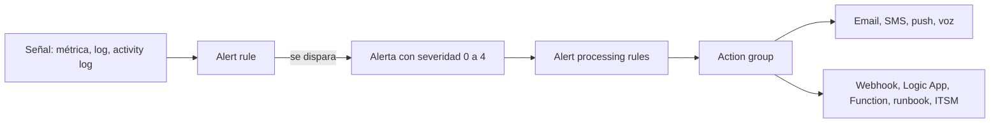
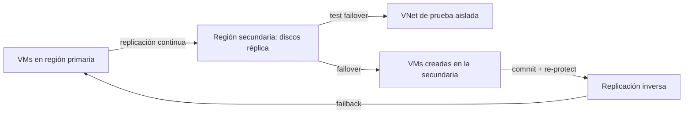

---
tags:
  - azure
  - certificacion
  - az-104
  - observabilidad
  - resiliencia
---

# Monitor and maintain Azure resources (10–15%)

> Azure Monitor (métricas, logs con KQL, alertas, action groups e Insights), Network Watcher y Connection monitor, y protección con Azure Backup y Azure Site Recovery.

!!! info "Qué evalúa esta área"
    Dos grupos de habilidades del *study guide* vigente:

    - **Monitor resources in Azure**: interpretar métricas, configurar logs, consultar logs, *alert rules*, *action groups* y *alert processing rules*, **Azure Monitor Insights** para VMs, storage y redes, y Network Watcher con Connection monitor.
    - **Implement backup and recovery**: Recovery Services vault, Backup vault, *backup policies*, backup y restore con Azure Backup, **Azure Site Recovery** y failover a una región secundaria, y reportes y alertas de backup.

    Es el área de menos peso, pero sus preguntas son muy concretas. Vuelve al [resumen del examen](resumen-examen.md) para ver el resto.

## Azure Monitor: métricas y logs

**Azure Monitor** es la plataforma de observabilidad de Azure. Recoge dos tipos de datos principales. La comparación con CloudWatch y Cloud Monitoring está en [Observabilidad nativa](../../../cloud/operacion-y-gobierno/observabilidad-nativa.md).

| | **Metrics** (métricas) | **Logs** (registros) |
| --- | --- | --- |
| Qué son | Valores numéricos en series de tiempo | Eventos y registros con muchos campos |
| Dónde se guardan | Base de métricas de Azure Monitor | **Log Analytics workspace** |
| Retención por defecto | 93 días para *platform metrics* | Configurable por workspace y tabla |
| Cómo se consultan | **Metrics explorer** | **Log Analytics** con **KQL** (*Kusto Query Language*) |
| Latencia | Casi tiempo real | Minutos |

### Interpretar métricas

En **Metrics explorer** eliges recurso, métrica, **aggregation** (agregación: *Avg*, *Min*, *Max*, *Sum*, *Count*), rango de tiempo y granularidad. Con **splitting** (división) separas por una dimensión (por ejemplo, por instancia o por código de respuesta) y con **filters** te quedas con un valor.

!!! tip "En el examen"
    Fíjate en la agregación. "Percentage CPU" con **Max** sobre 1 hora muestra el pico; con **Avg** puede esconderlo. Una pregunta típica muestra un gráfico y pide qué valor se ve en un momento concreto.

### Fuentes de logs y diagnostic settings

| Fuente | Qué contiene | Cómo se recoge |
| --- | --- | --- |
| **Activity log** | Operaciones del *control plane* (quién creó, borró o cambió qué) | Automático, 90 días; envíalo a un workspace para conservarlo y consultarlo |
| **Resource logs** | Logs internos de cada recurso (p. ej. lecturas de blobs, peticiones de Key Vault) | Requieren una **diagnostic setting** |
| **Logs de VMs** (sistema operativo, rendimiento) | Syslog, eventos de Windows, contadores | **Azure Monitor Agent** (AMA) + **data collection rule** (DCR) |
| Microsoft Entra ID | Sign-in y audit logs | Diagnostic setting en Entra ID |

Una **diagnostic setting** (configuración de diagnóstico) envía logs y métricas de un recurso a uno o varios destinos: **Log Analytics workspace**, **storage account** (archivo barato), **Event Hubs** (hacia un SIEM externo) o una solución de partner.

```bash title="Enviar los logs de una storage account a Log Analytics"
WS_ID=$(az monitor log-analytics workspace create -g rg-mon -n law-cuaderno --query id -o tsv)
az monitor diagnostic-settings create --name diag-blob \
  --resource "$(az storage account show -n stcuadernoaz104 -g rg-storage --query id -o tsv)/blobServices/default" \
  --workspace "$WS_ID" \
  --logs '[{"categoryGroup":"allLogs","enabled":true}]' \
  --metrics '[{"category":"Transaction","enabled":true}]'
```

### Consultar logs con KQL

KQL encadena operadores con `|`: empiezas por una tabla y vas filtrando y agregando.

```kusto title="Quién borró recursos en las últimas 24 horas"
AzureActivity
| where TimeGenerated > ago(24h)
| where OperationNameValue endswith "DELETE" and ActivityStatusValue == "Success"
| project TimeGenerated, Caller, ResourceGroup, _ResourceId
| order by TimeGenerated desc
```

```kusto title="VMs que dejaron de enviar heartbeat"
Heartbeat
| summarize UltimoLatido = max(TimeGenerated) by Computer
| where UltimoLatido < ago(15m)
```

```kusto title="CPU promedio por equipo cada 5 minutos"
Perf
| where ObjectName == "Processor" and CounterName == "% Processor Time"
| summarize avg(CounterValue) by Computer, bin(TimeGenerated, 5m)
| render timechart
```

| Operador | Para qué |
| --- | --- |
| `where` | Filtrar filas |
| `project` | Elegir columnas |
| `summarize ... by` | Agregar (count, avg, max…) |
| `bin()` | Agrupar por intervalos de tiempo |
| `order by` / `top` | Ordenar / primeras N filas |
| `extend` | Crear columnas calculadas |
| `join` | Combinar tablas |
| `render` | Dibujar un gráfico |

Fundamentos de cómo leer logs en general en [Leer logs](../../../devops/operacion/leer-logs.md).

## Alertas



| Pieza | Qué es |
| --- | --- |
| **Alert rule** | Qué vigilar (recurso o scope), condición (señal, umbral, frecuencia, ventana) y severidad (**Sev 0** crítica a **Sev 4** detallada) |
| Tipos de regla | **Metric alert**, **Log search alert** (consulta KQL), **Activity log alert** (p. ej. "alguien borró una VM"), **Service Health** y **Resource Health** |
| **Action group** | Lista reutilizable de **notificaciones** (correo, SMS, push de la app de Azure, voz, correo a un rol de Azure Resource Manager) y **acciones** (webhook, Logic App, Azure Function, Automation runbook, ITSM, Event Hubs) |
| **Alert processing rule** | Modifica alertas ya disparadas: **suprimir** notificaciones (ventanas de mantenimiento) o **agregar** action groups a muchas reglas a la vez |

```bash title="Alerta de CPU con action group de correo"
az monitor action-group create -g rg-mon -n ag-ops --short-name ops \
  --action email dani dani@example.com
az monitor metrics alert create -g rg-mon -n alerta-cpu-alta \
  --scopes "$(az vm show -g rg-vm -n vm-app01 --query id -o tsv)" \
  --condition "avg Percentage CPU > 80" --window-size 5m --evaluation-frequency 1m \
  --severity 2 --action ag-ops
```

!!! tip "En el examen"
    - "No enviar notificaciones el sábado de 22:00 a 02:00 por mantenimiento" → **alert processing rule** con supresión programada, no borrar las reglas.
    - "Avisar cuando alguien borre un recurso del resource group" → **activity log alert**.
    - "Ejecutar un script que reinicie un servicio al dispararse la alerta" → action group con **Automation runbook** o **Function**.
    - Hay límites de frecuencia para SMS, voz y correo en los action groups (*rate limiting*): no se envían más de cierto número por número o dirección en un intervalo.

## Azure Monitor Insights

Los **Insights** son experiencias de monitoreo preconfiguradas por tipo de recurso:

| Insight | Qué muestra | Requisito |
| --- | --- | --- |
| **VM insights** | Rendimiento (CPU, memoria, disco, red) y, opcional, el **Map** de procesos y conexiones | Azure Monitor Agent, DCR y Log Analytics workspace |
| **Storage insights** | Disponibilidad, transacciones, latencia y capacidad de las cuentas | Métricas de plataforma (sin agente) |
| **Network insights** | Topología, salud y métricas de recursos de red, conexiones y tráfico | Recursos de red; Connection monitor y flow logs para más detalle |

## Network Watcher y Connection monitor

**Network Watcher** se habilita automáticamente por región (en el resource group `NetworkWatcherRG`). Sus herramientas de diagnóstico (IP flow verify, Next hop, Connection troubleshoot, NSG diagnostics, Packet capture) se describen en [Implement and manage virtual networking](area-4-redes-virtuales.md#troubleshooting-de-conectividad-con-network-watcher).

**Connection monitor** vigila la conectividad **de forma continua** entre orígenes (VMs de Azure, máquinas on-premises con agente) y destinos (VMs, URLs, IPs, puertos): mide latencia, porcentaje de pérdidas y saltos, y dispara alertas. Diferencia clave:

| Herramienta | Uso |
| --- | --- |
| **Connection troubleshoot** | Prueba **puntual** ("¿llego ahora?") |
| **Connection monitor** | Monitoreo **continuo** con historial y alertas |
| **VNet flow logs** + **Traffic analytics** | Qué flujos pasan por la red y análisis visual del tráfico |

## Azure Backup

**Azure Backup** protege recursos de Azure y de on-premises con copias gestionadas, cifradas y aisladas de tu subscription de producción.

### Recovery Services vault vs Backup vault

| | **Recovery Services vault** | **Backup vault** |
| --- | --- | --- |
| Cargas | **Azure VMs**, SQL Server y SAP HANA en VMs, **Azure Files**, on-premises con el agente **MARS** o MABS/DPM, y **Azure Site Recovery** | **Azure Disks**, **Azure Blobs**, Azure Database for PostgreSQL, AKS y otras cargas nuevas |
| Usado por Site Recovery | Sí | No |

!!! tip "En el examen"
    - "Hacer backup de una VM" o "configurar Site Recovery" → **Recovery Services vault**.
    - "Backup de managed disks" o "backup operacional/vaulted de blobs" → **Backup vault**.
    - Para backup de VMs, el vault debe estar en la **misma región** que la VM.
    - La **redundancia del almacenamiento del vault** (LRS, ZRS o GRS) se elige **antes** del primer backup; después no se puede cambiar. **Cross Region Restore** requiere GRS.

### Backup policies

Una **backup policy** (política de copia de seguridad) define:

- **Frecuencia**: diaria o semanal; con la **Enhanced policy** también cada pocas horas (necesaria para VMs Trusted Launch y discos Premium SSD v2/Ultra).
- **Retención**: puntos diarios, semanales, mensuales y anuales (por ejemplo, 30 días, 12 semanas, 12 meses, 5 años).
- **Instant restore**: cuántos días se guardan los *snapshots* locales para restauraciones rápidas.

```bash title="Backup de una VM con la política por defecto"
az backup vault create -g rg-bkp -n rsv-cuaderno -l eastus
az backup protection enable-for-vm -g rg-bkp --vault-name rsv-cuaderno \
  --vm "$(az vm show -g rg-vm -n vm-app01 --query id -o tsv)" --policy-name DefaultPolicy
az backup protection backup-now -g rg-bkp --vault-name rsv-cuaderno \
  --container-name vm-app01 --item-name vm-app01 --backup-management-type AzureIaasVM
```

### Restaurar

| Opción de restore de VM | Cuándo |
| --- | --- |
| **Create new VM** | Crear una VM nueva desde el punto de restauración |
| **Restore disks** | Restaurar solo los discos y crear la VM a tu manera (plantilla) |
| **Replace existing** | Reemplazar los discos de la VM existente |
| **File Recovery** | Recuperar archivos sueltos: montas el punto de recuperación con un script y copias lo que necesitas |
| **Cross Region Restore** | Restaurar en la región secundaria (vault GRS con la opción activada) |

### Seguridad y borrado del vault

- **Soft delete** para backups: los datos borrados se guardan 14 días adicionales (configurable).
- **Immutable vault** y **multi-user authorization** para proteger contra borrados malintencionados (ransomware).
- No puedes borrar un vault que tenga elementos protegidos ni datos en soft delete: primero detienes la protección, borras los datos y esperas o purgas el soft delete.

### Reportes y alertas de backup

- **Backup reports**: requieren enviar los diagnósticos del vault a un **Log Analytics workspace** (diagnostic settings); se ven en el libro de Backup Reports.
- **Alertas**: Azure Monitor genera alertas integradas para fallos de backup y restore; las rutas a correo o ITSM se configuran con **alert processing rules** y action groups.
- **Azure Business Continuity Center** (centro que reemplaza a Backup center) da una vista unificada de protección, trabajos y alertas.

## Azure Site Recovery

**Azure Site Recovery** (ASR) replica VMs de forma continua a otra región para **disaster recovery** (recuperación ante desastres). Estrategias, RTO y RPO en [Resiliencia](../../../cloud/operacion-y-gobierno/resiliencia.md) y [Continuidad de negocio](../../../negocio/continuidad-negocio.md).



| Paso | Qué hace |
| --- | --- |
| **Enable replication** | Elige región destino, resource group, VNet, cuentas de cache y el **Recovery Services vault** (en una región distinta de la origen) |
| **Replication policy** | Retención de puntos de recuperación y frecuencia de snapshots **app-consistent** |
| **Test failover** | Crea las VMs en una **VNet aislada** para probar sin afectar a producción; luego *Cleanup test failover* |
| **Failover** | Levanta las VMs en la secundaria con el punto elegido (*Latest*, *Latest processed*, *Latest app-consistent*, *Custom*) |
| **Commit** | Confirma el failover |
| **Re-protect** | Empieza a replicar desde la secundaria hacia la primaria |
| **Failback** | Vuelve a la región original con otro failover |
| **Recovery plans** | Agrupa VMs, define el orden de arranque y agrega scripts o pasos manuales |

!!! tip "En el examen"
    - "Probar el plan de DR sin impacto en producción" → **Test failover** a una VNet aislada.
    - Backup **no** es lo mismo que DR: Azure Backup protege datos con puntos de restauración (RPO de horas); Site Recovery mantiene réplicas para levantar la carga en otra región en minutos.
    - El vault de ASR debe estar en una región **diferente** de la de las VMs que proteges (al revés que el vault de backup de VMs).

## Casos de uso

1. **Saber quién eliminó un grupo de recursos ayer.** → Consultar el **Activity log** (o `AzureActivity` en Log Analytics con KQL).
2. **Recibir un SMS si la CPU de las VMs de producción supera el 85 % durante 10 minutos.** → **Metric alert** con ventana de 10 minutos y **action group** con SMS.
3. **Silenciar todas las alertas de un resource group durante la ventana de parches de los domingos.** → **Alert processing rule** con supresión y horario recurrente.
4. **Analizar lecturas y borrados en una storage account.** → **Diagnostic setting** de `blobServices` a un **Log Analytics workspace** y consultas KQL en `StorageBlobLogs`.
5. **Vigilar de forma continua la latencia entre una VM de Azure y un servidor on-premises.** → **Connection monitor** con alertas.
6. **Recuperar un archivo borrado de una VM hace tres días.** → Azure Backup **File Recovery** desde el punto de restauración.
7. **Poder levantar una aplicación en otra región en menos de una hora si cae la principal.** → **Azure Site Recovery** con recovery plan y pruebas periódicas con test failover.
8. **Proteger managed disks con snapshots incrementales programados.** → **Backup vault** con política de backup de discos.

## Preguntas de práctica

**1.** Quieres guardar los logs de lecturas de blobs de una storage account y consultarlos con KQL. ¿Qué configuras?

- A. Activar Storage insights.
- B. Una diagnostic setting del servicio de blobs hacia un Log Analytics workspace.
- C. Una metric alert sobre Transactions.
- D. El activity log de la subscription.

??? success "Respuesta"
    **B.** Los *resource logs* solo se recogen con una diagnostic setting, y para usar KQL deben ir a Log Analytics. A muestra métricas, no logs de operaciones. C alerta pero no guarda logs. D solo registra operaciones de control plane, no lecturas de datos.

**2.** Varias reglas de alerta notifican a guardia cada noche durante la ventana de mantenimiento. Quieres conservar las reglas pero no recibir avisos en ese horario. ¿Qué usas?

- A. Deshabilitar cada regla manualmente.
- B. Una alert processing rule con supresión programada.
- C. Cambiar la severidad a Sev 4.
- D. Borrar el action group.

??? success "Respuesta"
    **B.** Las alert processing rules suprimen notificaciones en un horario sin tocar las reglas. A funciona pero es manual y propenso a olvidos. C no detiene las notificaciones. D rompería todas las alertas.

**3.** Debes hacer backup de una VM en East US. ¿Dónde creas el vault?

- A. Un Backup vault en West US.
- B. Un Recovery Services vault en East US.
- C. Un Recovery Services vault en West US.
- D. Un Backup vault en East US.

??? success "Respuesta"
    **B.** El backup de VMs usa Recovery Services vault en la misma región que la VM. A y D: Backup vault no hace backup de VMs completas. C está en otra región.

**4.** Configuraste un Recovery Services vault con LRS y ya hiciste backups. Ahora te piden Cross Region Restore. ¿Qué debes hacer?

- A. Cambiar la redundancia del vault a GRS en Properties.
- B. Crear un vault nuevo con GRS y Cross Region Restore, y proteger los elementos ahí.
- C. Activar soft delete.
- D. Activar la replicación de ASR.

??? success "Respuesta"
    **B.** La redundancia del vault no se puede cambiar una vez que hay elementos protegidos. A solo es posible antes del primer backup. C no da restauración en otra región. D es DR, no restauración de backups.

**5.** Necesitas validar el plan de recuperación ante desastres sin afectar a producción ni a la replicación. ¿Qué haces?

- A. Un failover planificado.
- B. Un test failover hacia una VNet aislada.
- C. Restaurar la VM desde Azure Backup en la misma región.
- D. Detener las VMs de producción y arrancar las réplicas.

??? success "Respuesta"
    **B.** El test failover crea las VMs en una red aislada y la replicación continúa. A detiene producción. C no prueba el DR en la otra región. D es un failover real con impacto.

**6.** ¿Qué necesitas para ver el mapa de dependencias y el rendimiento del sistema operativo de tus VMs en VM insights?

- A. Solo las métricas de plataforma de la VM.
- B. Azure Monitor Agent con una data collection rule y un Log Analytics workspace.
- C. Una diagnostic setting en la NIC.
- D. Network Watcher en la región.

??? success "Respuesta"
    **B.** VM insights recoge datos del sistema operativo con AMA y DCR hacia un workspace. A solo da métricas del host. C no recoge datos del SO. D es para diagnóstico de red.

**7.** Tienes que comprobar ahora mismo si una VM llega a `10.1.0.5:1433`, y además quieres un historial continuo de latencia. ¿Qué dos herramientas usas?

- A. IP flow verify y Activity log.
- B. Connection troubleshoot para la prueba puntual y Connection monitor para el historial continuo.
- C. Packet capture y Azure Advisor.
- D. Next hop y VM insights.

??? success "Respuesta"
    **B.** Connection troubleshoot es la prueba puntual de extremo a extremo y Connection monitor la vigilancia continua. A: IP flow verify solo evalúa NSGs y el activity log no mide conectividad. C y D no cubren ambas necesidades.

## Para profundizar

| Tema | Nota del cuaderno |
| --- | --- |
| Azure Monitor frente a CloudWatch y Cloud Monitoring | [Observabilidad nativa](../../../cloud/operacion-y-gobierno/observabilidad-nativa.md) |
| SLI/SLO, alertas útiles y OpenTelemetry | [Observabilidad](../../../devops/operacion/observabilidad.md) |
| Leer e interpretar logs | [Leer logs](../../../devops/operacion/leer-logs.md) |
| Incidentes, runbooks y postmortems | [Operación y fiabilidad (SRE)](../../../devops/operacion/operacion-sre.md), [Runbooks y playbooks](../../../devops/operacion/runbooks-playbooks.md) |
| HA, DR, RTO/RPO y pruebas de DR | [Resiliencia](../../../cloud/operacion-y-gobierno/resiliencia.md) |
| BCP, BIA y criticidad de sistemas | [Continuidad de negocio](../../../negocio/continuidad-negocio.md) |
| Logs de seguridad y SIEM | [Detección y respuesta](../../../devsecops/gobierno-y-respuesta/deteccion-respuesta.md) |
| Diagnóstico de red | [Troubleshooting de red](../../../networking/avanzado/troubleshooting-red.md) |

## Referencias

- [Study guide del examen AZ-104](https://learn.microsoft.com/en-us/credentials/certifications/resources/study-guides/az-104)
- [Información general de Azure Monitor](https://learn.microsoft.com/es-es/azure/azure-monitor/fundamentals/overview)
- [Métricas de Azure Monitor](https://learn.microsoft.com/es-es/azure/azure-monitor/metrics/data-platform-metrics)
- [Configuración de diagnóstico](https://learn.microsoft.com/es-es/azure/azure-monitor/platform/diagnostic-settings)
- [Información general de Kusto Query Language](https://learn.microsoft.com/es-es/kusto/query/)
- [Información general de alertas](https://learn.microsoft.com/es-es/azure/azure-monitor/alerts/alerts-overview)
- [Grupos de acciones](https://learn.microsoft.com/es-es/azure/azure-monitor/alerts/action-groups)
- [Reglas de procesamiento de alertas](https://learn.microsoft.com/es-es/azure/azure-monitor/alerts/alerts-processing-rules)
- [VM insights](https://learn.microsoft.com/es-es/azure/azure-monitor/vm/vminsights-overview)
- [Connection monitor](https://learn.microsoft.com/es-es/azure/network-watcher/connection-monitor-overview)
- [¿Qué es Azure Backup?](https://learn.microsoft.com/es-es/azure/backup/backup-overview)
- [Información general de los almacenes de Backup](https://learn.microsoft.com/es-es/azure/backup/backup-vault-overview)
- [Azure Site Recovery: recuperación ante desastres de VMs de Azure](https://learn.microsoft.com/es-es/azure/site-recovery/azure-to-azure-architecture)
