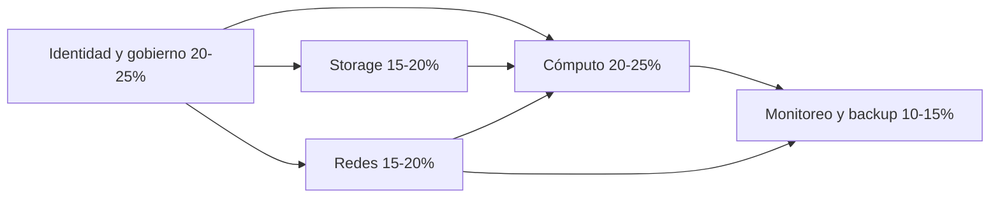

---
tags:
  - azure
  - certificacion
  - az-104
---

# Azure Administrator Associate (AZ-104): resumen del examen

> Qué evalúa el examen AZ-104, cómo es el formato, cómo se reparten las áreas de habilidad y un plan de estudio con laboratorio práctico para obtener la certificación Microsoft Certified: Azure Administrator Associate.

!!! warning "Versión del temario"
    Estas notas siguen el *study guide* oficial con **skills measured as of April 17, 2026** (consultado en octubre de 2026). Microsoft actualiza el temario varias veces al año y publica los cambios en la sección *Change log* del study guide. La versión en **inglés** se actualiza primero; las traducciones (incluido el español) se actualizan unas ocho semanas después. Revisa el study guide antes de agendar.

## ¿Qué es?

**Microsoft Certified: Azure Administrator Associate** es la certificación de nivel *Associate* (intermedio) para quien **implementa, administra y monitorea** un entorno de Azure: identidades, gobierno, almacenamiento, cómputo, redes virtuales, monitoreo y backup. Se obtiene aprobando **un solo examen: AZ-104**.

Es el equivalente en Azure a la [Associate Cloud Engineer de Google Cloud](../../google-cloud/associate-cloud-engineer/resumen-examen.md): ambas evalúan el día a día de operar una nube. Para comparar conceptos entre proveedores, usa las notas de [IAM](../../../cloud/identidad-y-seguridad/iam-comparativa.md), [Redes en la nube](../../../cloud/redes-y-datos/redes.md) y [Máquinas virtuales](../../../cloud/computo/maquinas-virtuales.md).

## Formato del examen

| Dato | Valor |
| --- | --- |
| Código | **AZ-104: Microsoft Azure Administrator** |
| Nivel | Associate (intermedio) |
| Duración | **100 minutos** para responder (unos 120 minutos de tiempo en la sala, con instrucciones y encuesta); 120/140 si el examen incluye laboratorios |
| Número de preguntas | No es fijo; Microsoft indica que la mayoría de sus exámenes tiene entre **40 y 60** |
| Tipos de pregunta | Opción múltiple, arrastrar y soltar, *hot area* (seleccionar en una imagen), *build list*, series de "¿esta solución cumple el objetivo?" (*Yes/No*), **case studies** (casos de estudio) y posibles **interactive components** (componentes interactivos o laboratorios) |
| Puntaje para aprobar | **700** en una escala de 1 a 1000 (es un puntaje escalado, no un 70 % de aciertos) |
| Precio | **165 USD** en Estados Unidos; el precio depende del país donde se presenta (en muchos países de Latinoamérica es menor) |
| Modalidad | Centro de Pearson VUE o en línea con supervisión (*online proctored*, OnVUE) |
| Idiomas | Inglés, **español**, japonés, chino simplificado, chino tradicional, coreano, francés, alemán, portugués (Brasil) e italiano |
| Validez | **12 meses**; se renueva gratis con un *renewal assessment* en línea en Microsoft Learn (dentro de los 6 meses previos al vencimiento) |
| Requisitos previos | Ninguno obligatorio |
| Reintentos | Puedes repetir a las 24 horas del primer intento; los siguientes tienen esperas mayores (ver *retake policy*) |

!!! info "Microsoft Learn abierto durante el examen"
    En los exámenes de nivel Associate puedes abrir **Microsoft Learn** dentro del examen (solo `learn.microsoft.com`, sin Q&A ni tu perfil). El reloj no se detiene: úsalo para dudas puntuales (un nombre de comando, un límite), no para cada pregunta.

!!! note "¿Hay laboratorios?"
    La página del examen dice que *puede* haber componentes interactivos. Microsoft no publica la lista de exámenes con laboratorios porque puede retirarlos en cualquier momento. Al empezar el examen, la pantalla de introducción indica la duración y si hay laboratorios. Prepárate igual para hacer las tareas en el portal y con CLI.

## Objetivo profesional

### Perfil de candidato según Microsoft

El *audience profile* de [Microsoft Learn](https://learn.microsoft.com/en-us/credentials/certifications/azure-administrator/) dice, resumido, que la persona candidata tiene **experiencia en implementar, administrar y monitorear el entorno de Azure de una organización**: redes virtuales, almacenamiento, cómputo, identidad, seguridad y gobierno. Suele formar parte de un equipo más grande que implementa la infraestructura cloud y **coordina con otros roles** (redes, seguridad, bases de datos, desarrollo, DevOps). Debe conocer sistemas operativos, redes, servidores y virtualización, y tener experiencia con PowerShell, Azure CLI, el portal, plantillas ARM o Bicep y Microsoft Entra ID.

### Para qué roles sirve

- [Cloud Engineer](../../roles-profesionales.md#cloud-engineer), [Infrastructure Engineer / SysAdmin](../../roles-profesionales.md#infrastructure-engineer-sysadmin-moderno) y [Support / Cloud Operations](../../roles-profesionales.md#support-cloud-operations) en empresas con Azure.
- Es **prerrequisito obligatorio** de Azure Solutions Architect Expert (AZ-305) y una de las vías para DevOps Engineer Expert (AZ-400).
- Ver [Roles profesionales](../../roles-profesionales.md).

### Qué demuestra ante un empleador

| Demuestra | No demuestra |
| --- | --- |
| Que sabes administrar Azure en el día a día: Entra ID, RBAC, Azure Policy, redes, VMs, App Service, contenedores, storage, backup y monitoreo | Que sepas diseñar soluciones completas (eso es AZ-305) |
| Que puedes hacer tareas en el portal, con CLI y PowerShell (el examen puede incluir laboratorios) | Que sepas automatizar con pipelines e IaC a escala |
| Que te mantienes al día: se renueva cada 12 meses | Experiencia en seguridad avanzada o redes complejas (SC-500, AZ-700) |

### Qué certificación sigue

- [Terraform Associate](../../hashicorp/terraform-associate/resumen-examen.md), si tu equipo usa Terraform en vez de Bicep.
- AZ-305 (arquitectura), AZ-400 (DevOps), AZ-700 (redes) o SC-500 (seguridad, reemplazo de AZ-500): ver [Otras certificaciones](../../otras-certificaciones.md#microsoft-azure).

## Perfil recomendado

El study guide pide experiencia con sistemas operativos, redes, servidores y virtualización, y uso práctico de **PowerShell**, **Azure CLI**, el **Azure portal**, **ARM templates o Bicep** y **Microsoft Entra ID**. Microsoft no exige un tiempo mínimo, pero el examen asume que ya administraste recursos reales (no solo teoría). Si empiezas desde cero, AZ-900 (Azure Fundamentals) es opcional pero útil.

## Áreas de habilidad y su peso

| Área (*skill area*) | Peso | Nota |
| --- | --- | --- |
| Manage Azure identities and governance | 20–25 % | [Área 1](area-1-identidades-gobierno.md) |
| Implement and manage storage | 15–20 % | [Área 2](area-2-almacenamiento.md) |
| Deploy and manage Azure compute resources | 20–25 % | [Área 3](area-3-computo.md) |
| Implement and manage virtual networking | 15–20 % | [Área 4](area-4-redes-virtuales.md) |
| Monitor and maintain Azure resources | 10–15 % | [Área 5](area-5-monitoreo-mantenimiento.md) |



### Qué cambió en la versión del 17 de abril de 2026

Según el *change log* oficial, los cambios fueron **menores** dentro de los grupos de habilidades (sin áreas nuevas). Algunos puntos que conviene notar en el temario actual:

- **Encryption at host** para VMs (en lugar de Azure Disk Encryption).
- **Azure Container Apps** junto a ACI y ACR; **AKS no aparece** en el temario.
- **Soft delete de blobs y containers** y **snapshots/soft delete de Azure Files**.
- Monitoreo con **Azure Monitor Insights** y **Connection monitor**.
- En identidades, el foco está en **roles integrados**; los custom roles no se nombran.

### Resumen de servicios en alcance

| Área | Servicios y conceptos principales |
| --- | --- |
| Identidades y gobierno | Microsoft Entra ID (usuarios, grupos, licencias, invitados B2B, SSPR), Azure RBAC, management groups, subscriptions, resource groups, Azure Policy, resource locks, tags, Cost Management, budgets, Azure Advisor |
| Storage | Storage accounts, redundancia (LRS/ZRS/GRS/RA-GRS/GZRS/RA-GZRS), SAS, stored access policies, access keys, firewalls, private endpoints, cifrado, Blob Storage (tiers, lifecycle, versioning, soft delete, object replication), Azure Files, AzCopy, Storage Explorer |
| Cómputo | ARM templates, Bicep, VMs (tamaños, discos, encryption at host, availability sets y zones, mover VMs), VM Scale Sets, Azure Container Registry, Azure Container Instances, Azure Container Apps, App Service (plans, escalado, TLS, dominios, backup, red, deployment slots) |
| Redes | VNets, subnets, peering, IPs públicas, UDRs, NSGs, ASGs, Azure Bastion, service endpoints, private endpoints, Azure DNS (público y privado), Azure Load Balancer |
| Monitoreo y mantenimiento | Azure Monitor (métricas, logs, KQL, alertas, action groups, alert processing rules, Insights), Network Watcher, Connection monitor, Azure Backup (Recovery Services vault, Backup vault), Azure Site Recovery |

Fuera del foco del examen (aunque aparezcan en opciones de respuesta como distractores): AKS, Azure Firewall en detalle, VPN Gateway y ExpressRoute en profundidad, Azure Functions, bases de datos.

## Plan de estudio de 6 semanas

| Semana | Tema | Práctica |
| --- | --- | --- |
| 1 | Área 1: Entra ID, RBAC, Policy, locks, tags, costos | Crear usuarios y grupos dinámicos, asignar roles en distintos scopes, asignar la policy *Allowed locations*, crear un budget |
| 2 | Área 4: redes virtuales | VNets, peering hub-spoke, NSG/ASG, UDR, Bastion, DNS privado, load balancer; diagnosticar con Network Watcher |
| 3 | Área 3 (I): ARM/Bicep y VMs | Desplegar con Bicep y `what-if`, discos, availability zones, VMSS con autoscale |
| 4 | Área 3 (II): contenedores y App Service | ACR + ACI + Container Apps; web app con slot de staging y swap |
| 5 | Área 2: storage | Redundancia, SAS y stored access policies, lifecycle, versioning, Azure Files, AzCopy |
| 6 | Área 5 y repaso | Diagnostic settings, KQL, alertas; backup y restore de una VM; test failover con Site Recovery; *practice assessment* y repaso de errores |

!!! tip "Orden recomendado"
    Empezar por identidades y redes ayuda: casi todas las preguntas de cómputo y storage dependen de permisos, subnets y NSGs.

## Recursos oficiales gratuitos

| Recurso | Para qué |
| --- | --- |
| [Study guide AZ-104](https://learn.microsoft.com/en-us/credentials/certifications/resources/study-guides/az-104) | El temario vigente y el change log |
| [Página de la certificación](https://learn.microsoft.com/es-es/credentials/certifications/azure-administrator/) | Formato, idiomas, agenda y renovación |
| Rutas de aprendizaje de Microsoft Learn (curso AZ-104T00) | Módulos gratuitos con ejercicios, enlazados desde la página de la certificación |
| [Practice Assessment](https://learn.microsoft.com/en-us/credentials/certifications/exams/az-104/practice/assessment?assessment-type=practice&assessmentId=21) | Preguntas de práctica oficiales y gratuitas |
| [Exam sandbox](https://aka.ms/examdemo) | Probar la interfaz y los tipos de pregunta |
| [Laboratorios del curso en GitHub](https://github.com/MicrosoftLearning/AZ-104-MicrosoftAzureAdministrator) | Instrucciones de los laboratorios oficiales del curso |
| [Exam Readiness Zone](https://learn.microsoft.com/en-us/shows/exam-readiness-zone/?terms=az-104) | Videos de preparación por área |
| [Cuenta gratuita de Azure](https://azure.microsoft.com/es-es/free/) | Crédito inicial y servicios gratuitos para practicar |

## Consejos para el día del examen

- **Gestiona el tiempo**: unos 100 minutos para 40 a 60 preguntas. Marca las dudosas y sigue.
- **Case studies y series Yes/No**: al terminar una sección de caso de estudio o una serie de "¿esta solución cumple el objetivo?" **no puedes volver** a ella. Revisa antes de pasar.
- **Pausas**: si tomas un descanso, no puedes volver a las preguntas vistas antes de él.
- **Lee el requisito exacto**: palabras como *minimize administrative effort* (minimizar el esfuerzo administrativo), *least privilege* (mínimo privilegio), *minimize costs* (minimizar costos) o *without downtime* (sin tiempo de inactividad) deciden entre dos opciones correctas.
- **Descarta por requisitos técnicos**: tier mínimo (slots desde Standard), SKU (Bastion `/26`, Archive no en ZRS), región (vault de backup en la misma región que la VM), licencia (grupos dinámicos con P1).
- **Microsoft Learn dentro del examen**: úsalo para comprobar un dato concreto; buscar cada respuesta no cabe en el tiempo.
- **Online proctored**: escritorio despejado, identificación vigente, prueba técnica del equipo antes del día.

## Laboratorio práctico

Un recorrido corto que toca las cinco áreas en una subscription de pruebas. Usa **Azure Cloud Shell** (ya trae `az` y PowerShell `Az`) o instala la CLI localmente.

!!! danger "Costos y limpieza"
    Todo se crea en **un solo resource group** para borrarlo al final. La VM, Bastion (salvo Developer), el load balancer y los vaults generan costos mientras existan. Crea un **budget** con alerta antes de empezar y **borra el resource group** al terminar. Si activaste backup, primero detén la protección y borra los datos (el soft delete puede retener el vault 14 días).

```bash title="1. Contexto y resource group"
az login
az account show --query "{subscription:name, tenant:tenantId}" -o table
RG=rg-az104-lab
LOC=eastus
az group create -n $RG -l $LOC --tags env=lab owner=dani
```

```bash title="2. Gobierno: policy, lock y rol"
RG_ID=$(az group show -n $RG --query id -o tsv)
# Policy integrada "Allowed locations"
az policy assignment create --name solo-eastus --scope "$RG_ID" \
  --policy e56962a6-4747-49cd-b67b-bf8b01975c4c \
  --params '{"listOfAllowedLocations":{"value":["eastus"]}}'
az lock create --name no-borrar --resource-group $RG --lock-type CanNotDelete
az role assignment list --scope "$RG_ID" --include-inherited -o table
```

```bash title="3. Storage con versioning, soft delete y SAS"
ST=staz104lab$RANDOM
az storage account create -n $ST -g $RG -l $LOC --sku Standard_LRS --kind StorageV2 \
  --min-tls-version TLS1_2 --allow-blob-public-access false
az storage account blob-service-properties update --account-name $ST -g $RG \
  --enable-versioning true --enable-delete-retention true --delete-retention-days 7
az storage container create --account-name $ST -n datos --auth-mode login
```

```bash title="4. Red: VNet, NSG y VM sin IP pública"
az network vnet create -g $RG -n vnet-lab --address-prefixes 10.10.0.0/16 \
  --subnet-name snet-app --subnet-prefixes 10.10.1.0/24
az network nsg create -g $RG -n nsg-app
az network nsg rule create -g $RG --nsg-name nsg-app -n allow-http --priority 100 \
  --direction Inbound --access Allow --protocol Tcp --destination-port-ranges 80 \
  --source-address-prefixes VirtualNetwork
az network vnet subnet update -g $RG --vnet-name vnet-lab -n snet-app --network-security-group nsg-app
az vm create -g $RG -n vm-lab --image Ubuntu2404 --size Standard_B2s \
  --vnet-name vnet-lab --subnet snet-app --public-ip-address "" --nsg "" \
  --admin-username azureuser --generate-ssh-keys
```

```bash title="5. Diagnóstico y monitoreo"
az network watcher test-ip-flow -g $RG --vm vm-lab --direction Inbound \
  --protocol TCP --local 10.10.1.4:22 --remote 10.10.1.10:50000
az network nic list-effective-nsg -g $RG -n vm-labVMNic -o table
az monitor metrics list --resource "$(az vm show -g $RG -n vm-lab --query id -o tsv)" \
  --metric "Percentage CPU" --interval PT5M -o table
```

=== "PowerShell (Az)"

    ```powershell title="Lo mismo, en parte, con el módulo Az"
    Connect-AzAccount
    New-AzResourceGroup -Name rg-az104-lab -Location eastus -Tag @{ env = "lab" }
    New-AzResourceLock -LockName no-borrar -LockLevel CanNotDelete `
      -ResourceGroupName rg-az104-lab -Force
    Get-AzRoleAssignment -ResourceGroupName rg-az104-lab | Format-Table DisplayName, RoleDefinitionName, Scope
    Get-AzVM -ResourceGroupName rg-az104-lab -Status | Format-Table Name, PowerState
    ```

=== "Limpieza (CLI)"

    ```bash
    # El lock impide borrar el resource group: quítalo primero
    az lock delete --name no-borrar --resource-group rg-az104-lab
    az group delete -n rg-az104-lab --yes --no-wait
    # Comprobar que ya no existe
    az group exists -n rg-az104-lab
    ```

=== "Limpieza (PowerShell)"

    ```powershell
    Remove-AzResourceLock -LockName no-borrar -ResourceGroupName rg-az104-lab -Force
    Remove-AzResourceGroup -Name rg-az104-lab -Force
    ```

!!! note "Recursos que se crean fuera de tu resource group"
    Network Watcher crea el resource group `NetworkWatcherRG` en cada región que uses. No genera costo por sí solo, pero los flow logs o connection monitors sí. La asignación de policy se borra con el resource group porque está en su scope.

## Para profundizar

| Tema | Nota del cuaderno |
| --- | --- |
| Identidad en las tres nubes | [IAM: AWS, Azure y GCP](../../../cloud/identidad-y-seguridad/iam-comparativa.md) |
| Gobierno y costos | [Gobernanza](../../../cloud/operacion-y-gobierno/gobernanza.md), [FinOps y costos](../../../cloud/fundamentos/finops-costos.md) |
| Storage | [Almacenamiento y datos](../../../cloud/redes-y-datos/almacenamiento-datos.md) |
| Cómputo y contenedores | [Máquinas virtuales](../../../cloud/computo/maquinas-virtuales.md), [Contenedores gestionados](../../../cloud/computo/contenedores-gestionados.md) |
| Redes | [Redes en la nube](../../../cloud/redes-y-datos/redes.md) y la sección [Networking](../../../networking/index.md) |
| IaC | [Infrastructure as Code](../../../devops/iac/infraestructura-como-codigo.md) |
| Monitoreo y DR | [Observabilidad nativa](../../../cloud/operacion-y-gobierno/observabilidad-nativa.md), [Resiliencia](../../../cloud/operacion-y-gobierno/resiliencia.md) |
| Mapa general del cuaderno | [Mapa de relaciones](../../../mapa-de-relaciones.md) |

## Referencias

- [Study guide del examen AZ-104 (inglés, se actualiza primero)](https://learn.microsoft.com/en-us/credentials/certifications/resources/study-guides/az-104)
- [Microsoft Certified: Azure Administrator Associate](https://learn.microsoft.com/es-es/credentials/certifications/azure-administrator/)
- [Duración y experiencia del examen](https://learn.microsoft.com/es-es/credentials/support/exam-duration-exam-experience)
- [Puntuación de exámenes e informes](https://learn.microsoft.com/es-es/credentials/certifications/exam-scoring-reports)
- [Renovar la certificación de Microsoft](https://learn.microsoft.com/es-es/credentials/certifications/renew-your-microsoft-certification)
- [Directiva de repetición de exámenes](https://learn.microsoft.com/es-es/credentials/support/retake-policy)
- [Documentación de la CLI de Azure](https://learn.microsoft.com/es-es/cli/azure/)
- [Documentación de Azure PowerShell](https://learn.microsoft.com/es-es/powershell/azure/)
