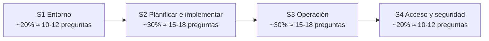

---
tags:
  - gcp
  - certificacion
  - ace
---

# Google Cloud Associate Cloud Engineer: resumen del examen

> Qué evalúa la certificación Associate Cloud Engineer, cómo es el formato, cuánto pesa cada sección de la guía vigente, un plan de estudio de 6 semanas y un laboratorio práctico con `gcloud`, `gcloud storage` y `kubectl`.

## ¿Qué es?

**Associate Cloud Engineer** (ACE) es la certificación de nivel **Associate** (asociado) de Google Cloud. Demuestra que sabes **desplegar, operar y asegurar** aplicaciones e infraestructura en Google Cloud: crear proyectos y redes, lanzar VMs y clústeres de GKE, desplegar en Cloud Run, elegir almacenamiento y bases de datos, configurar monitoreo y logs, y dar permisos con IAM y service accounts.

Es una certificación muy práctica: muchas preguntas piden **el comando o el paso concreto** (qué flag de `gcloud`, qué rol de IAM, qué opción de la consola) más que el diseño de una arquitectura. Es el equivalente en Google Cloud de la [AZ-104](../../azure/azure-administrator/resumen-examen.md) de Azure.

!!! info "Guía vigente: versión 2026 (4 secciones)"
    La guía oficial se **reestructuró en 2026**: pasó de 5 secciones (la guía anterior separaba "planificar" e "implementar") a **4 secciones**, añadió herramientas de IA (Gemini Cloud Assist, Gemini CLI, Google Antigravity, Application Design Center), Cloud NGFW, Database Center, Cloud Hub y la plataforma de agentes **Gemini Enterprise Agent Platform** (antes Vertex AI). La página oficial indica además que el examen "se actualizó para reflejar cambios recientes de marca", así que **los nombres de producto del examen son los de la guía vigente**. Muchos cursos y simulacros de terceros todavía siguen la guía de 5 secciones: úsalos con cuidado.

Lo que describe la guía: una persona que **despliega y asegura** aplicaciones, servicios e infraestructura, **monitorea la operación de varios proyectos** y mantiene soluciones empresariales, "apoyada en herramientas de IA", tanto con servicios gestionados por Google como autogestionados.

## Formato del examen

| Aspecto | Detalle |
| --- | --- |
| Nivel | **Associate** |
| Preguntas | **50–60**, **multiple choice** (opción múltiple: una correcta) y **multiple select** (selección múltiple: varias correctas) |
| Duración | **2 horas** |
| Puntaje | Aprobado / no aprobado; Google **no publica** el puntaje mínimo ni el desglose por sección |
| Costo | **125 USD** (más impuestos según el país) |
| Modalidad | **Online proctored** (en línea con supervisor remoto) o en un centro de pruebas **Pearson VUE** |
| Idiomas | Inglés, japonés, español y portugués |
| Prerrequisitos | Ninguno |
| Experiencia recomendada | **6 meses o más** de experiencia práctica con Google Cloud |
| Validez | **3 años** |
| Renovación | **Renewal exam** (examen de renovación: 1 hora, 20 preguntas, 75 USD, inglés y japonés, renueva 3 años) o una **ruta de renovación en Google Skills** (cursos o *skill badges*; según la página oficial, esa vía da validez de 1 año) |

!!! warning "Datos que cambian"
    Precio, idiomas, proveedor de pruebas y vías de renovación cambian con frecuencia. Revisa la [página oficial](https://cloud.google.com/learn/certification/cloud-engineer) antes de agendar; en especial, confirma que el idioma español ya esté disponible para la versión 2026 de la guía.

## Objetivo profesional

### Perfil de candidato según Google Cloud

La [descripción oficial de la certificación](https://cloud.google.com/learn/certification/cloud-engineer) dice, resumido, que un Associate Cloud Engineer **despliega y asegura aplicaciones, servicios e infraestructura**, **monitorea la operación de varios proyectos** y **mantiene soluciones empresariales** para cumplir métricas de rendimiento. Tiene experiencia con nubes públicas o con soluciones on-premises y realiza tareas habituales de la plataforma, **apoyándose en herramientas de IA**, para mantener y escalar soluciones con servicios gestionados por Google o autogestionados. Experiencia recomendada: **6 meses o más** de práctica con Google Cloud; sin prerrequisitos.

### Para qué roles sirve

- [Cloud Engineer](../../roles-profesionales.md#cloud-engineer) y [Support / Cloud Operations](../../roles-profesionales.md#support-cloud-operations) en empresas que usan Google Cloud.
- [DevOps Engineer](../../roles-profesionales.md#devops-engineer) y [SRE](../../roles-profesionales.md#site-reliability-engineer-sre) que empiezan en Google Cloud (GKE, Cloud Run, Cloud Monitoring).
- Ver [Roles profesionales](../../roles-profesionales.md).

### Qué demuestra ante un empleador

| Demuestra | No demuestra |
| --- | --- |
| Que sabes hacer las tareas del día a día: proyectos, IAM, redes VPC, VMs, GKE, Cloud Run, almacenamiento, logs | Que sepas diseñar arquitecturas complejas o multi-región (eso es Professional Cloud Architect) |
| Soltura con `gcloud`, la consola y conceptos de operación | Experiencia en producción a escala (el examen es teórico, aunque sus preguntas son muy prácticas) |
| Criterio de seguridad básica: service accounts, mínimo privilegio, credenciales de corta duración | Conocimiento profundo de seguridad, redes avanzadas o SRE |

### Qué certificación sigue

- [Terraform Associate](../../hashicorp/terraform-associate/resumen-examen.md), para pasar de la consola a IaC.
- Professional Cloud Architect, Professional Cloud DevOps Engineer, Professional Cloud Security Engineer o Professional Cloud Network Engineer, según el rol: ver [Otras certificaciones](../../otras-certificaciones.md#google-cloud).
- CKA, si trabajas mucho con GKE.

## Secciones y peso

| Sección | Peso | Qué cubre | Nota |
| --- | --- | --- | --- |
| 1. Setting up a cloud solution environment | **~20%** | Jerarquía de recursos, organization policies, IAM básico, Cloud Identity, APIs, cuotas, Cloud Asset Inventory, Workforce Identity Federation, billing accounts, budgets y billing export | [Sección 1](seccion-1-entorno-solucion-cloud.md) |
| 2. Planning and implementing a cloud solution | **~30%** | Cómputo (Compute Engine, GKE, Cloud Run, Cloud Run functions, Agent Runtime), almacenamiento y datos, redes (VPC, Cloud NGFW, load balancers, conectividad), IaC y herramientas de IA | [Sección 2](seccion-2-planificar-implementar.md) |
| 3. Ensuring the successful operation of a cloud solution | **~30%** | Operar VMs, GKE y Cloud Run; snapshots, backups y CMEK; redes del día a día; Cloud Monitoring y Cloud Logging, log sinks, Ops Agent | [Sección 3](seccion-3-operacion-solucion.md) |
| 4. Configuring access and security | **~20%** | IAM (roles, herencia, custom roles), service accounts, impersonation, credenciales de corta duración, Workload Identity Federation | [Sección 4](seccion-4-acceso-seguridad.md) |



El número de preguntas por sección es una estimación (porcentaje sobre 50–60). Las secciones 2 y 3 son el **60%** del examen: cómputo, datos y redes, primero para crearlos y después para operarlos.

## Servicios que más aparecen

La guía no publica una lista cerrada de servicios, pero los nombra en sus *considerations*. Resumen por categoría:

| Categoría | Servicios y conceptos (los más importantes, en negrita) |
| --- | --- |
| Organización y facturación | **Resource Manager** (organization, folders, projects), **Organization Policy Service**, **Cloud Billing** (billing accounts, budgets, billing export), Cloud Quotas, **Cloud Asset Inventory** |
| Identidad | **Cloud IAM**, **Cloud Identity**, Google Cloud Directory Sync, **service accounts**, **Workload Identity Federation**, **Workforce Identity Federation** |
| Cómputo | **Compute Engine** (machine types, **MIGs**, instance templates, **Spot VMs**, OS Login, VM Manager), **GKE** (Autopilot y Standard), **Cloud Run**, **Cloud Run functions**, Eventarc, GPUs y Cloud TPU, Agent Runtime |
| Almacenamiento | **Cloud Storage** (Standard, Nearline, Coldline, Archive, lifecycle), **Persistent Disk** y **Hyperdisk**, **Filestore**, Google Cloud NetApp Volumes, Managed Lustre, Storage Transfer Service |
| Datos | **Cloud SQL**, **AlloyDB**, **Spanner**, **Firestore**, **Bigtable**, **BigQuery**, Memorystore, Pub/Sub, Dataflow, Managed Service for Apache Kafka, Database Center |
| Redes | **VPC** (custom mode, **Shared VPC**, **VPC Network Peering**), **firewall rules** y **Cloud NGFW policies**, **Cloud Load Balancing**, **Cloud NAT**, **Cloud DNS**, Cloud VPN, Cloud Interconnect, Network Service Tiers |
| Operación | **Cloud Monitoring**, **Cloud Logging** (log buckets, **log sinks**, Log Analytics), Ops Agent, Managed Service for Prometheus, Cloud Trace, Cloud Profiler, Personalized Service Health, Active Assist, Cloud Hub |
| Herramientas | **gcloud CLI**, Cloud Shell, **kubectl**, **Terraform**, Infrastructure Manager, Config Connector, Fabric FAST, Helm, Gemini Cloud Assist, Gemini CLI, Google Antigravity, Application Design Center |
| IA y desarrollo | Gemini Enterprise Agent Platform (antes Vertex AI): Agent Runtime y Workbench; Cloud Workstations |

!!! note "Servicios retirados o en segundo plano"
    - **Cloud Deployment Manager** llegó a su fin de soporte el **31 de marzo de 2026**: ya no se puede usar. Su sucesor es **Infrastructure Manager** (Terraform gestionado). Si un simulacro lo da como respuesta, está desactualizado.
    - **Container Registry** fue reemplazado por **Artifact Registry**.
    - **Cloud Functions** ahora se llama **Cloud Run functions**.
    - **App Engine** sigue disponible, pero **no aparece en la guía vigente**; Google ofrece herramientas para migrar sus servicios a Cloud Run.
    - **`gsutil`** es la herramienta heredada de Cloud Storage; la recomendada es **`gcloud storage`**.

## Plan de estudio de 6 semanas

Pensado para 6–8 horas por semana con práctica real en un proyecto de pruebas. Si ya trabajas con Google Cloud, compáctalo en 3–4 semanas.

| Semana | Tema | Qué hacer |
| --- | --- | --- |
| 1 | Sección 1 + base del cuaderno | Lee [Sección 1](seccion-1-entorno-solucion-cloud.md), [modelos de servicio y regiones](../../../cloud/fundamentos/modelos-de-servicio-y-regiones.md) y [gobernanza](../../../cloud/operacion-y-gobierno/gobernanza.md). Crea un proyecto de pruebas, un **budget con alertas** y practica `gcloud config` |
| 2 | Sección 2: cómputo | Lee la parte de cómputo de la [Sección 2](seccion-2-planificar-implementar.md), [máquinas virtuales](../../../cloud/computo/maquinas-virtuales.md) y [contenedores gestionados](../../../cloud/computo/contenedores-gestionados.md). Práctica: instance template + MIG con autoscaling, Cloud Run, clúster Autopilot |
| 3 | Sección 2: datos y redes | Termina la Sección 2 con [almacenamiento y datos](../../../cloud/redes-y-datos/almacenamiento-datos.md) y [redes](../../../cloud/redes-y-datos/redes.md). Práctica: VPC custom, firewall rules, Cloud NAT, bucket con lifecycle |
| 4 | Sección 3 | Lee [Sección 3](seccion-3-operacion-solucion.md) y [observabilidad nativa](../../../cloud/operacion-y-gobierno/observabilidad-nativa.md). Práctica: snapshot schedule, node pools, traffic splitting en Cloud Run, alerta de Monitoring, log sink a BigQuery |
| 5 | Sección 4 | Lee [Sección 4](seccion-4-acceso-seguridad.md) e [IAM comparativa](../../../cloud/identidad-y-seguridad/iam-comparativa.md). Práctica: custom role, service account con impersonation, Workload Identity Federation for GKE |
| 6 | Repaso y simulacros | Sample questions oficiales, preguntas de práctica de cada nota, repaso de los "En el examen" y de los comandos del laboratorio |

!!! tip "Señal de que estás lista"
    Cuando puedas hacer el laboratorio de abajo **sin mirar la documentación** y superes con holgura las *sample questions* oficiales y varios simulacros de calidad actualizados a la guía de 4 secciones, agenda. Los "dumps" (preguntas filtradas) violan las políticas del programa de certificación y pueden anular la certificación.

## Recursos oficiales gratuitos

| Recurso | Para qué sirve |
| --- | --- |
| **Exam guide** (guía del examen) | La fuente de verdad: secciones, pesos y *considerations* |
| **Sample questions** (preguntas de ejemplo) | Formulario oficial con preguntas del estilo del examen |
| **Google Skills** (antes Google Cloud Skills Boost) | Ruta de aprendizaje *Cloud Engineer* con laboratorios en proyectos temporales (no gastas tu propio dinero) |
| **Free trial y Free Tier** | Crédito inicial para cuentas nuevas y productos con uso gratuito mensual (revisa condiciones vigentes) |
| **Documentación de Google Cloud** | Sobre todo las páginas "Choose…" (elegir cómputo, almacenamiento, base de datos, load balancer) |
| **Google Cloud Architecture Center** | Arquitecturas de referencia y buenas prácticas |

## Laboratorio práctico

Un recorrido por las cuatro secciones en un **proyecto de pruebas**. Ejecútalo en **Cloud Shell** (ya trae `gcloud`, `kubectl` y Terraform) o en tu equipo con la [gcloud CLI](../../../recursos/comandos/google-cli.md).

!!! danger "Costos y limpieza"
    Varios recursos de este laboratorio **cobran por hora** (VMs, clúster de GKE, Cloud NAT, load balancers). Usa un proyecto **solo para el laboratorio**, crea primero el budget y, al terminar, **borra el proyecto completo** (paso 6). Borrar el proyecto detiene la facturación de todo lo que contiene; queda en estado *pending deletion* 30 días por si te equivocaste.

1. **Entorno y facturación** (Sección 1):

    ```bash
    export PROJECT_ID="ace-lab-$RANDOM"
    gcloud projects create "$PROJECT_ID" --name="ACE lab"
    gcloud config set project "$PROJECT_ID"
    gcloud billing accounts list
    gcloud billing projects link "$PROJECT_ID" --billing-account=XXXXXX-XXXXXX-XXXXXX
    gcloud billing budgets create --billing-account=XXXXXX-XXXXXX-XXXXXX \
      --display-name="ace-lab" --budget-amount=10USD \
      --threshold-rule=percent=0.5 --threshold-rule=percent=0.9
    gcloud services enable compute.googleapis.com container.googleapis.com run.googleapis.com
    gcloud config set compute/region us-central1
    gcloud config set compute/zone us-central1-a
    ```

2. **Red y VM** (Sección 2):

    ```bash
    gcloud compute networks create lab-vpc --subnet-mode=custom
    gcloud compute networks subnets create lab-subnet --network=lab-vpc \
      --region=us-central1 --range=10.10.0.0/24 --enable-private-ip-google-access
    gcloud compute firewall-rules create lab-allow-iap-ssh --network=lab-vpc \
      --direction=INGRESS --action=ALLOW --rules=tcp:22 --source-ranges=35.235.240.0/20
    gcloud compute instance-templates create lab-tpl --machine-type=e2-small \
      --network=lab-vpc --subnet=lab-subnet --region=us-central1 --no-address \
      --provisioning-model=SPOT --image-family=debian-12 --image-project=debian-cloud
    gcloud compute instance-groups managed create lab-mig --template=lab-tpl \
      --size=1 --zone=us-central1-a
    gcloud compute instance-groups managed set-autoscaling lab-mig --zone=us-central1-a \
      --min-num-replicas=1 --max-num-replicas=3 --target-cpu-utilization=0.6
    gcloud compute ssh "$(gcloud compute instances list --format='value(name)' --limit=1)" \
      --zone=us-central1-a --tunnel-through-iap
    ```

3. **Cloud Storage** (secciones 2 y 3):

    ```bash
    gcloud storage buckets create "gs://${PROJECT_ID}-datos" --location=us-central1 \
      --uniform-bucket-level-access --public-access-prevention
    echo "hola" > hola.txt
    gcloud storage cp hola.txt "gs://${PROJECT_ID}-datos/"
    gcloud storage ls "gs://${PROJECT_ID}-datos/"
    # Equivalente heredado: gsutil cp hola.txt gs://BUCKET/
    gcloud storage buckets update "gs://${PROJECT_ID}-datos" --lifecycle-file=lifecycle.json
    ```

    El archivo `lifecycle.json` está en la [Sección 3](seccion-3-operacion-solucion.md#cloud-storage-objetos-y-lifecycle).

4. **Contenedores** (secciones 2 y 3):

    ```bash
    gcloud run deploy hola --image=us-docker.pkg.dev/cloudrun/container/hello \
      --region=us-central1 --allow-unauthenticated --max-instances=2
    gcloud container clusters create-auto lab-gke --region=us-central1
    gcloud container clusters get-credentials lab-gke --region=us-central1
    kubectl create deployment web --image=nginx:1.27
    kubectl expose deployment web --port=80 --type=LoadBalancer
    kubectl get nodes,pods,services
    ```

5. **Operación y acceso** (secciones 3 y 4):

    ```bash
    gcloud logging read 'resource.type="cloud_run_revision" severity>=WARNING' --limit=10
    gcloud iam service-accounts create lab-reader --display-name="Lab reader"
    gcloud projects add-iam-policy-binding "$PROJECT_ID" \
      --member="serviceAccount:lab-reader@${PROJECT_ID}.iam.gserviceaccount.com" \
      --role="roles/storage.objectViewer"
    gcloud projects get-iam-policy "$PROJECT_ID" \
      --flatten="bindings[].members" --format="table(bindings.role, bindings.members)"
    ```

6. **Limpieza**:

    ```bash
    kubectl delete service web   # libera el load balancer antes de borrar el clúster
    gcloud container clusters delete lab-gke --region=us-central1 --quiet
    gcloud projects delete "$PROJECT_ID" --quiet
    ```

!!! tip "Practica también desde la consola"
    El examen pregunta tanto por comandos como por pasos de la consola. Repite el laboratorio una vez solo con la consola y una vez con [Terraform](../../../devops/iac/terraform-basico.md) para ver el mismo resultado de tres formas.

## Consejos para el día del examen

- **Gestión del tiempo**: 2 horas para 50–60 preguntas son unos **2 minutos por pregunta**. Haz una primera pasada respondiendo todo, marca las dudosas para revisar y vuelve al final. No dejes ninguna en blanco.
- **Lee lo que piden al final**: "What should you do?", "Which command…", "Choose two". En *multiple select* el enunciado dice cuántas elegir.
- **Descarta opciones**: suele haber respuestas que funcionan pero violan una buena práctica (dar **Owner** o **Editor**, crear una **service account key**, abrir `0.0.0.0/0` a SSH).
- **Palabras clave** que cambian la respuesta:

| Palabra clave | Qué suele indicar |
| --- | --- |
| **Google-recommended practices** | Servicio gestionado, mínimo privilegio, grupos en vez de usuarios, sin claves de service account |
| **Minimize operational overhead** / **fully managed** | Cloud Run, GKE Autopilot, Cloud SQL, BigQuery antes que VMs autogestionadas |
| **Minimize cost** / **fault-tolerant batch** | Spot VMs, clases Nearline/Coldline/Archive, lifecycle, autoscaling a cero |
| **Least privilege** | Rol **predefined** más acotado o **custom role**; nunca basic roles |
| **Global**, **strong consistency**, **horizontal scale** relacional | Spanner |
| **Analytics**, **SQL sobre petabytes**, **data warehouse** | BigQuery |
| **Audit** / "quién hizo qué" | Cloud Audit Logs (Admin Activity, Data Access) |
| **Long-term log retention** / análisis externo | Log sink a Cloud Storage, BigQuery o Pub/Sub |
| **Without external IP** | IAP TCP forwarding para SSH, Cloud NAT para salir a internet, Private Google Access para APIs |

- **Online proctored**: escritorio despejado, un solo monitor, documento de identidad vigente y prueba del sistema días antes.

## Para profundizar

- Base: [Modelos de servicio y regiones](../../../cloud/fundamentos/modelos-de-servicio-y-regiones.md), [FinOps y costos](../../../cloud/fundamentos/finops-costos.md), [Gobernanza](../../../cloud/operacion-y-gobierno/gobernanza.md)
- Servicios: [Máquinas virtuales](../../../cloud/computo/maquinas-virtuales.md), [Contenedores gestionados](../../../cloud/computo/contenedores-gestionados.md), [Serverless](../../../cloud/computo/serverless.md), [Redes en la nube](../../../cloud/redes-y-datos/redes.md), [Almacenamiento y datos](../../../cloud/redes-y-datos/almacenamiento-datos.md)
- Operación y seguridad: [Observabilidad nativa](../../../cloud/operacion-y-gobierno/observabilidad-nativa.md), [Resiliencia](../../../cloud/operacion-y-gobierno/resiliencia.md), [IAM comparativa](../../../cloud/identidad-y-seguridad/iam-comparativa.md), [Seguridad base](../../../cloud/identidad-y-seguridad/seguridad-base.md)
- Automatización: [Infrastructure as Code](../../../devops/iac/infraestructura-como-codigo.md), [Kubernetes](../../../devops/contenedores/kubernetes.md), [Automatización cloud con SDKs](../../../python/scripting/automatizacion-cloud.md)
- Comandos: [gcloud CLI](../../../recursos/comandos/google-cli.md), [kubectl](../../../recursos/comandos/kubectl.md), [Terraform](../../../recursos/comandos/terraform.md)
- Otras certificaciones: [Azure Administrator (AZ-104)](../../azure/azure-administrator/resumen-examen.md), [Terraform Associate](../../hashicorp/terraform-associate/resumen-examen.md)

!!! example "Practica en el laboratorio"
    - [Lab 20: Google Cloud: desplegar un contenedor en Cloud Run](../../../laboratorios/cloud/gcp-cloud-run.md)

## Referencias

- [Associate Cloud Engineer (página oficial)](https://cloud.google.com/learn/certification/cloud-engineer)
- [Associate Cloud Engineer exam guide (PDF)](https://services.google.com/fh/files/misc/associate_cloud_engineer_exam_guide_english.pdf)
- [Renewal exam guide (PDF)](https://services.google.com/fh/files/misc/associate_cloud_engineer_renewal_exam_guide_english.pdf)
- [Google Skills](https://www.skills.google/)
- [gcloud CLI overview](https://cloud.google.com/sdk/gcloud)
- [Deployment Manager deprecation](https://cloud.google.com/deployment-manager/docs/deprecations)
- [Google Cloud Architecture Center](https://cloud.google.com/architecture)
