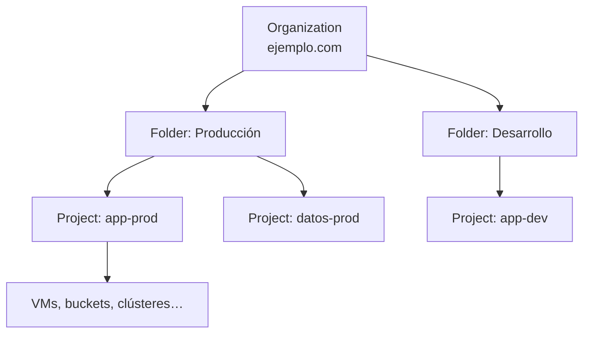
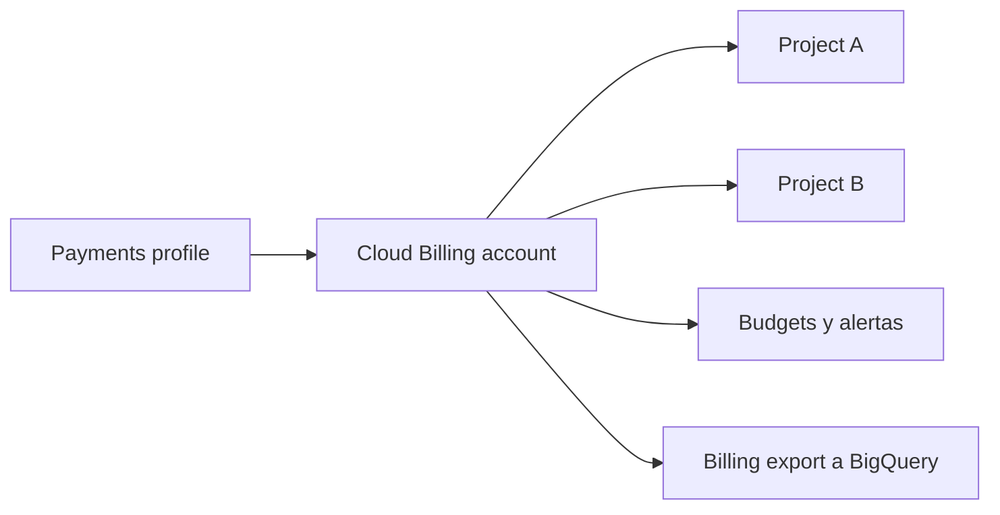

---
tags:
  - gcp
  - certificacion
  - ace
  - gobernanza
  - finops
---

# Sección 1: Setting up a cloud solution environment (~20%)

> Cómo se prepara el terreno en Google Cloud antes de desplegar nada: jerarquía de recursos, organization policies, usuarios y grupos, APIs, cuotas, inventario de recursos, federación de identidades y facturación.

!!! info "Qué evalúa esta sección"
    Según la guía oficial vigente:

    - **1.1 Setting up cloud projects and accounts**: crear la jerarquía de recursos, aplicar organization policies, dar roles de IAM en un proyecto, gestionar usuarios y grupos en Cloud Identity (manual y automatizado), habilitar APIs, preparar Google Cloud Observability, revisar cuotas y pedir aumentos, crear organizaciones independientes (*standalone*), preparar la red, verificar disponibilidad de productos por región y zona, Cloud Asset Inventory con Gemini Cloud Assist y Workforce Identity Federation.
    - **1.2 Managing billing configuration**: crear billing accounts, vincular proyectos, crear budgets y alertas, y configurar billing export.

    Formato, plan de estudio y laboratorio en el [resumen del examen](resumen-examen.md).

## Jerarquía de recursos

Google Cloud organiza todo en un árbol llamado **resource hierarchy** (jerarquía de recursos):



| Nivel | Qué es | Detalles que pregunta el examen |
| --- | --- | --- |
| **Organization** (organización) | Nodo raíz, ligado a un dominio de **Cloud Identity** o **Google Workspace** | Se crea automáticamente al verificar el dominio. Roles clave: **Organization Administrator** y **Project Creator** |
| **Folder** (carpeta) | Agrupa proyectos (por área, entorno o equipo); pueden anidarse | Sirve para heredar IAM y organization policies a muchos proyectos de una vez |
| **Project** (proyecto) | Unidad básica: habilita APIs, factura, contiene recursos | Tiene **project name** (editable), **project ID** (único global, inmutable) y **project number** (lo asigna Google) |
| **Resource** (recurso) | VM, bucket, dataset, clúster… | Pertenece a un solo proyecto |

!!! note "Herencia"
    Las **allow policies** de IAM y las **organization policies** se **heredan** de arriba hacia abajo. Un rol dado en un folder aplica a todos sus proyectos. Los permisos heredados **se suman**: no puedes quitar en un proyecto un permiso que se dio en la organización (para eso existen las **IAM deny policies**, que el examen trata poco).

**Standalone organization** (organización independiente): si una empresa no tiene Google Workspace, puede crear una organización registrando su dominio en **Cloud Identity Free** y verificándolo. Sin organización, los proyectos quedan "sin organización" y no hay folders ni organization policies.

```bash
gcloud organizations list
gcloud resource-manager folders create --display-name="Produccion" --organization=123456789012
gcloud projects create app-prod-4821 --name="App prod" --folder=987654321098
gcloud projects move app-dev-1234 --folder=987654321098
```

!!! tip "En el examen"
    - "Separar entornos / equipos y aplicar políticas comunes" → **folders**.
    - "Aislar recursos, cuotas y facturación" → **projects distintos**.
    - El **project ID** no se puede cambiar; el **project name** sí.

## Organization policies

El **Organization Policy Service** pone **guardrails** (barreras de protección) sobre **qué configuraciones** se permiten, sin importar los permisos de IAM de cada persona. IAM dice **quién** puede actuar; las organization policies dicen **qué** se puede configurar.

| Constraint (restricción) | Para qué |
| --- | --- |
| `constraints/gcp.resourceLocations` | Limitar las regiones donde se crean recursos (residencia de datos) |
| `constraints/compute.vmExternalIpAccess` | Prohibir VMs con IP externa |
| `constraints/iam.allowedPolicyMemberDomains` | Solo dar roles a identidades del propio dominio (*domain restricted sharing*) |
| `constraints/iam.disableServiceAccountKeyCreation` | Prohibir la creación de service account keys |
| `constraints/compute.requireOsLogin` | Obligar a usar OS Login en las VMs |
| `constraints/storage.publicAccessPrevention` | Impedir buckets públicos |

Las organizaciones nuevas reciben varias de estas restricciones **activadas por defecto** (*secure by default*). Hay **list constraints** (permitir o denegar valores), **boolean constraints** (activar o no) y **custom constraints** (reglas propias con CEL sobre campos del recurso).

```bash
gcloud org-policies describe compute.vmExternalIpAccess --project=app-prod-4821 --effective
gcloud org-policies set-policy politica.yaml
```

```yaml title="politica.yaml"
name: folders/987654321098/policies/gcp.resourceLocations
spec:
  rules:
    - values:
        allowedValues:
          - in:southamerica-locations
          - in:us-locations
```

Para quién gestiona estas políticas a escala, ver [Gobernanza](../../../cloud/operacion-y-gobierno/gobernanza.md) (landing zone y guardrails en las tres nubes).

## Usuarios, grupos y roles en el proyecto

Google Cloud **no tiene usuarios propios**: las personas son cuentas de **Cloud Identity** o **Google Workspace** (o cuentas de Google personales, o identidades federadas). Las buenas prácticas que el examen premia:

- Dar roles a **Google groups** (grupos), no a usuarios sueltos: altas y bajas se hacen en el grupo.
- Automatizar el alta de usuarios con **Google Cloud Directory Sync** (GCDS, sincroniza desde Active Directory o LDAP) o con aprovisionamiento **SCIM** desde un IdP como **Microsoft Entra ID** u Okta.
- Usar **SSO** (*Single Sign-On*, inicio de sesión único) con el IdP corporativo.

```bash
gcloud projects add-iam-policy-binding app-prod-4821 \
  --member="group:devops@ejemplo.com" --role="roles/compute.instanceAdmin.v1"
```

Los tipos de roles, la herencia y los custom roles se ven a fondo en la [Sección 4](seccion-4-acceso-seguridad.md).

### Workforce Identity Federation

**Workforce Identity Federation** (federación de identidades de la fuerza laboral) permite que **personas** de un IdP externo (Entra ID, Okta, cualquier IdP OIDC o SAML 2.0) usen la consola y la API de Google Cloud **sin sincronizar sus cuentas** a Cloud Identity. Se crea un **workforce pool** a nivel de **organización** y un **provider** con el mapeo de atributos; después se dan roles a `principalSet://iam.googleapis.com/locations/global/workforcePools/POOL/group/GRUPO`.

| Necesidad | Solución |
| --- | --- |
| Personas con cuentas en Cloud Identity/Workspace, sincronizadas desde AD | **GCDS** + SSO |
| Personas del IdP externo sin cuentas en Google | **Workforce Identity Federation** |
| **Workloads** (pipelines, apps en AWS/Azure/on-prem) sin claves | **Workload Identity Federation** ([Sección 4](seccion-4-acceso-seguridad.md#workload-identity-federation)) |

!!! tip "En el examen"
    *Workforce* = personas. *Workload* = máquinas y aplicaciones. Si el enunciado dice "employees" y "without creating accounts in Cloud Identity", es Workforce.

## APIs, cuotas y disponibilidad por ubicación

### Habilitar APIs

Cada servicio se habilita **por proyecto**. Si una llamada falla con "API has not been used in project… or it is disabled", falta habilitarla.

```bash
gcloud services list --available --filter="name:sqladmin"
gcloud services enable sqladmin.googleapis.com
gcloud services list --enabled
```

### Cuotas

Las **quotas** (cuotas) limitan cuánto puedes usar (por ejemplo, vCPUs por región o peticiones por minuto a una API). Se consultan y se pide aumento en **IAM & Admin > Quotas & System Limits** (servicio **Cloud Quotas**). Hay **system limits** que no se pueden aumentar.

```bash
gcloud compute regions describe us-central1 --format="table(quotas.metric, quotas.limit, quotas.usage)"
```

!!! tip "En el examen"
    "No se pueden crear más VMs en una región / error `QUOTA_EXCEEDED`" → revisar cuotas y **pedir un aumento**, o usar otra región. No es un problema de IAM.

### Productos por región y zona

No todos los machine types, GPUs o servicios existen en todas las regiones. Verifícalo antes de planificar:

```bash
gcloud compute regions list
gcloud compute zones list --filter="region:southamerica-west1"
gcloud compute machine-types list --zones=us-central1-a --filter="name~^c4"
gcloud compute accelerator-types list --filter="zone:us-central1-a"
```

Más sobre regiones y zonas en [Modelos de servicio y regiones](../../../cloud/fundamentos/modelos-de-servicio-y-regiones.md).

## Observabilidad, red e inventario desde el primer día

- **Google Cloud Observability**: Cloud Monitoring y Cloud Logging se activan con el proyecto, pero hay que planear el **metrics scope** (alcance de métricas): un proyecto "de monitoreo" que ve las métricas de varios proyectos. La guía lo pide porque una Associate Cloud Engineer monitorea **varios proyectos**. Detalle en la [Sección 3](seccion-3-operacion-solucion.md#cloud-monitoring).
- **Red inicial**: cada proyecto nuevo trae una **default VPC** en **auto mode** (una subnet por región y reglas de firewall permisivas). Para producción se recomienda borrarla (o impedirla con la constraint `compute.skipDefaultNetworkCreation`) y crear una **custom mode VPC**. Ver [Sección 2](seccion-2-planificar-implementar.md#vpc-y-subnets).
- **Cloud Asset Inventory**: inventario de recursos y políticas de IAM con **historial de 35 días**. Permite buscar, exportar a BigQuery o Cloud Storage y crear **feeds** a Pub/Sub cuando algo cambia. **Gemini Cloud Assist** puede responder en lenguaje natural sobre esos recursos ("¿qué VMs tienen IP pública?").

```bash
gcloud asset search-all-resources --scope=organizations/123456789012 \
  --asset-types="compute.googleapis.com/Instance" --query="state:RUNNING"
gcloud asset search-all-iam-policies --scope=projects/app-prod-4821 \
  --query="policy:roles/owner"
```

## Facturación



| Pieza | Qué es |
| --- | --- |
| **Cloud Billing account** (cuenta de facturación) | Paga los recursos de uno o varios proyectos. Un proyecto se vincula a **una sola** billing account a la vez |
| **Payments profile** (perfil de pagos) | Datos del pagador (empresa, tarjeta, facturas) en el Google Payments Center |
| Tipos de cuenta | **Self-serve** (online, tarjeta o débito) e **invoiced** (factura mensual, para empresas que cumplen requisitos) |
| **Budget** (presupuesto) | Monto mensual, trimestral o anual con **threshold rules** (umbrales) sobre gasto real o pronosticado |
| **Billing export** | Exporta el detalle a **BigQuery** (standard usage cost, detailed usage cost y pricing) para analizar con SQL o Looker Studio |

Roles de facturación que conviene distinguir:

| Rol | Puede |
| --- | --- |
| **Billing Account Administrator** | Gestionar la billing account, vincular proyectos, ver costos |
| **Billing Account User** | **Vincular proyectos** a la billing account (junto con un rol en el proyecto) |
| **Billing Account Viewer** | Ver costos y transacciones |
| **Project Billing Manager** | Vincular o desvincular **un proyecto** a una billing account |

```bash
gcloud billing projects link app-prod-4821 --billing-account=0X0X0X-0X0X0X-0X0X0X
gcloud billing projects describe app-prod-4821
gcloud billing budgets create --billing-account=0X0X0X-0X0X0X-0X0X0X \
  --display-name="app-prod mensual" --budget-amount=500USD \
  --filter-projects=projects/app-prod-4821 \
  --threshold-rule=percent=0.5 --threshold-rule=percent=0.9 \
  --threshold-rule=percent=1.0,basis=forecasted-spend
```

!!! warning "Un budget no corta el gasto"
    Los budgets **solo avisan** (correo a los Billing admins o a canales de Cloud Monitoring). Para reaccionar automáticamente, conecta el budget a un **tema de Pub/Sub** y una función que, por ejemplo, desvincule la facturación o apague recursos. Desvincular la facturación detiene los servicios del proyecto.

!!! tip "En el examen"
    - "Analizar costos por label o servicio con SQL / dashboards" → **billing export a BigQuery** (actívalo pronto: no es retroactivo).
    - "El equipo de finanzas debe ver costos pero no tocar recursos" → **Billing Account Viewer**.
    - "Un desarrollador debe poder vincular su proyecto" → **Billing Account User** en la cuenta + permisos en el proyecto.
    - "Avisar antes de pasarse" → budget con umbral sobre **forecasted spend** (gasto pronosticado).

Más prácticas de costos en [FinOps y costos](../../../cloud/fundamentos/finops-costos.md).

## Casos de uso

1. **Una empresa con tres áreas y entornos dev/prod quiere aplicar políticas distintas por entorno.** → Organization con folders por entorno (o por área y luego por entorno) y organization policies en cada folder. Los proyectos heredan sin configurarlos uno por uno.
2. **Una normativa exige que los datos se queden en Sudamérica.** → Organization policy `gcp.resourceLocations` con `in:southamerica-locations` en la organización o el folder.
3. **Recursos humanos da de baja empleados en Active Directory y deben perder acceso a Google Cloud.** → GCDS (o SCIM desde Entra ID) + roles asignados a grupos; al salir del grupo, pierde los permisos.
4. **Una consultora usa Okta y no quiere crear cuentas en Cloud Identity para su personal.** → Workforce Identity Federation con un workforce pool y un provider OIDC/SAML de Okta.
5. **Un equipo no puede crear más GPUs en `us-central1`.** → Revisar Cloud Quotas y pedir aumento; verificar disponibilidad del tipo de GPU en otras zonas.
6. **Finanzas quiere un dashboard de costos por equipo.** → Labels `equipo=` en los recursos + billing export a BigQuery + Looker Studio.
7. **Seguridad necesita saber cada día qué VMs con IP pública existen en toda la organización.** → Cloud Asset Inventory (`search-all-resources`) o un export programado a BigQuery; feed a Pub/Sub para cambios.
8. **Un proyecto de pruebas no debe pasar de 50 USD al mes.** → Budget con alertas y Pub/Sub + función que desvincule la billing account al llegar al 100%.

## Preguntas de práctica

**1.** Tu empresa quiere que ningún proyecto de la carpeta "Producción" pueda crear VMs con IP externa. ¿Qué haces?

- A. Crear una firewall rule que bloquee el tráfico de salida.
- B. Aplicar la organization policy `compute.vmExternalIpAccess` en el folder "Producción".
- C. Quitar el rol Compute Admin a todos los usuarios.
- D. Crear un custom role sin el permiso `compute.instances.create`.

??? success "Respuesta"
    **B.** Las organization policies limitan **configuraciones** y se heredan a todos los proyectos del folder. A no impide asignar la IP. C y D impiden crear VMs en general, no solo con IP externa.

**2.** Un analista de finanzas debe ver el costo de todos los proyectos de una billing account, sin poder modificar nada. ¿Qué rol le das?

- A. Billing Account Administrator
- B. Billing Account User
- C. Billing Account Viewer
- D. Viewer (basic role) en cada proyecto

??? success "Respuesta"
    **C.** Billing Account Viewer ve costos y transacciones. A permite administrar. B permite vincular proyectos. D da acceso de lectura a recursos, no a la facturación.

**3.** Necesitas analizar el gasto de los últimos meses por label `equipo` con consultas SQL. ¿Qué debes configurar?

- A. Un budget por equipo.
- B. Billing export a BigQuery.
- C. Un log sink de Cloud Logging a BigQuery.
- D. Cloud Asset Inventory export.

??? success "Respuesta"
    **B.** El billing export (detailed usage cost) incluye labels y se consulta con SQL. A solo alerta. C exporta logs, no costos. D exporta inventario, no costos. Recuerda: el export no trae datos anteriores a su activación.

**4.** Un script falla con el error "Compute Engine API has not been used in project … or it is disabled". ¿Cuál es el siguiente paso?

- A. Dar el rol Compute Admin a la cuenta del script.
- B. Ejecutar `gcloud services enable compute.googleapis.com` en el proyecto.
- C. Pedir un aumento de cuota.
- D. Vincular el proyecto a otra billing account.

??? success "Respuesta"
    **B.** El mensaje indica que la **API** no está habilitada en el proyecto. A sería para un error de permisos (`PERMISSION_DENIED`), C para `QUOTA_EXCEEDED`.

**5.** El personal de una empresa se autentica en Microsoft Entra ID. Quieren acceder a la consola de Google Cloud con esas credenciales **sin** sincronizar usuarios a Cloud Identity. ¿Qué usas?

- A. Workload Identity Federation
- B. Google Cloud Directory Sync
- C. Workforce Identity Federation
- D. Service accounts con claves para cada persona

??? success "Respuesta"
    **C.** Workforce Identity Federation es para personas sin cuentas en Cloud Identity. A es para workloads. B sincroniza cuentas (justo lo que no quieren). D es una mala práctica.

**6.** ¿Qué afirmación sobre los budgets de Cloud Billing es correcta?

- A. Detienen los recursos automáticamente al llegar al 100%.
- B. Solo pueden alertar sobre gasto real, no pronosticado.
- C. Envían alertas y pueden publicar en Pub/Sub para automatizar acciones.
- D. Se configuran por VM.

??? success "Respuesta"
    **C.** Los budgets alertan por correo, canales de Monitoring o Pub/Sub. No detienen nada por sí solos (A), admiten umbrales sobre *forecasted spend* (B) y se definen por billing account con filtros de proyectos, servicios o labels (D).

## Para profundizar

- [Gobernanza](../../../cloud/operacion-y-gobierno/gobernanza.md): landing zone, jerarquía y guardrails comparados con AWS Organizations y Azure management groups.
- [IAM: AWS, Azure y GCP](../../../cloud/identidad-y-seguridad/iam-comparativa.md): principals, roles y allow policies.
- [FinOps y costos](../../../cloud/fundamentos/finops-costos.md): labels, showback y optimización.
- [Modelos de servicio y regiones](../../../cloud/fundamentos/modelos-de-servicio-y-regiones.md): regiones, zonas y cómo elegir.
- [TI y negocio](../../../negocio/ti-y-negocio.md): CapEx vs OpEx y presupuesto.
- [Comandos de gcloud](../../../recursos/comandos/google-cli.md).

## Referencias

- [Resource hierarchy](https://cloud.google.com/resource-manager/docs/cloud-platform-resource-hierarchy)
- [Organization Policy Service](https://cloud.google.com/resource-manager/docs/organization-policy/overview)
- [Creating and managing organizations](https://cloud.google.com/resource-manager/docs/creating-managing-organization)
- [Workforce Identity Federation](https://cloud.google.com/iam/docs/workforce-identity-federation)
- [Google Cloud Directory Sync](https://support.google.com/a/answer/106368)
- [Cloud Quotas overview](https://cloud.google.com/docs/quotas/overview)
- [Cloud Asset Inventory](https://cloud.google.com/asset-inventory/docs/overview)
- [Cloud Billing: create budgets](https://cloud.google.com/billing/docs/how-to/budgets)
- [Export Cloud Billing data to BigQuery](https://cloud.google.com/billing/docs/how-to/export-data-bigquery)
- [Associate Cloud Engineer exam guide](https://services.google.com/fh/files/misc/associate_cloud_engineer_exam_guide_english.pdf)
