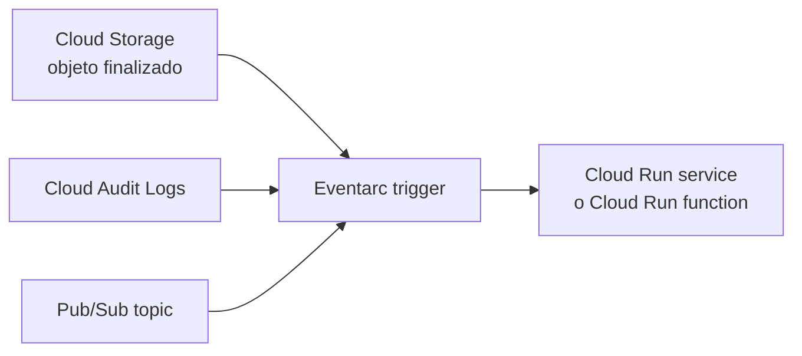
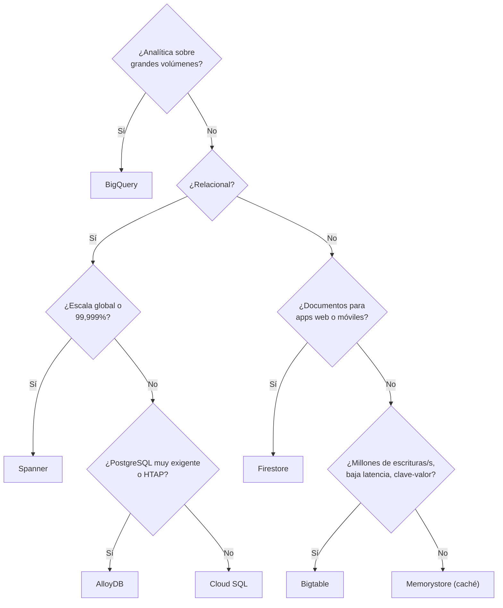
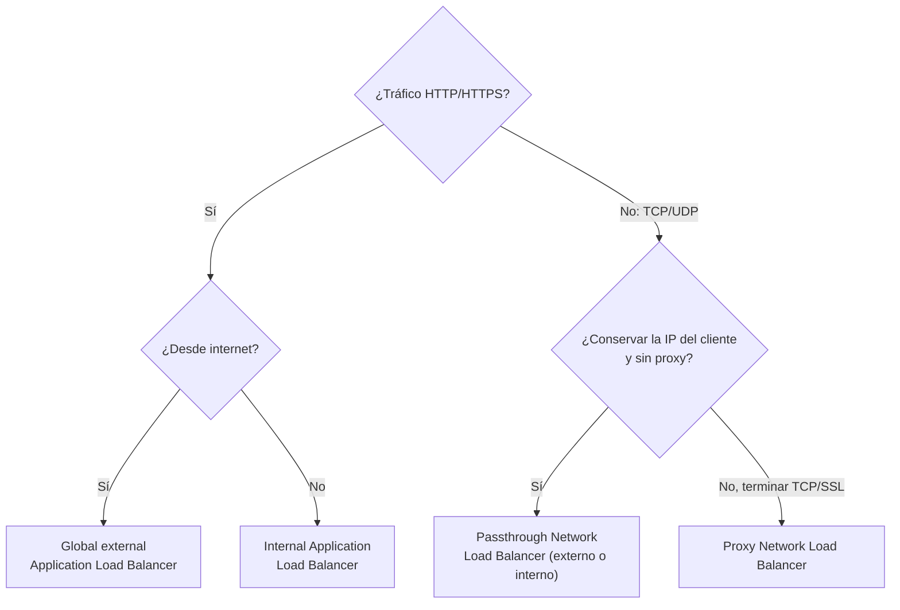

---
tags:
  - gcp
  - certificacion
  - ace
  - computo
  - redes
  - iac
---

# Sección 2: Planning and implementing a cloud solution (~30%)

> Cómo elegir y crear los recursos de una solución en Google Cloud: cómputo (Compute Engine, GKE, Cloud Run, Cloud Run functions), almacenamiento y bases de datos, redes y las herramientas de IaC e IA con las que se despliegan.

!!! info "Qué evalúa esta sección"
    Según la guía oficial vigente:

    - **2.1 Compute**: elegir entre Compute Engine, GKE, Cloud Run, Cloud Run functions y Agent Runtime; lanzar VMs (availability policy, SSH keys); elegir discos (zonal y regional Persistent Disk, Hyperdisk); MIG autoescalado con instance template; OS Login; VM Manager; Spot VMs y custom machine types; instalar `kubectl`; GKE Autopilot, regional y privado; desplegar en GKE y en serverless (eventos de Pub/Sub, Cloud Storage, Eventarc); GPUs o TPUs.
    - **2.2 Storage and data**: elegir y desplegar productos de datos y de almacenamiento, clases de Cloud Storage, carga de datos y redundancia multirregión.
    - **2.3 Networking**: VPC y subnets (custom mode, Shared VPC, VPC Network Peering), firewall rules y Cloud NGFW policies, Tags y service accounts en reglas, conectividad (Cloud VPN, Peering, Cloud Interconnect), load balancers y Network Service Tiers.
    - **2.4 Tooling**: IaC (Fabric FAST, Config Connector, Terraform, Helm) y herramientas de IA (Gemini CLI, Google Antigravity, Gemini Cloud Assist, Application Design Center).

    Formato y laboratorio en el [resumen del examen](resumen-examen.md).

## Elegir el cómputo

| Si el enunciado dice… | Elige | Por qué |
| --- | --- | --- |
| Control del sistema operativo, software con licencia por host, *lift and shift* | **Compute Engine** | IaaS: VMs completas |
| Contenedores con necesidades de Kubernetes (StatefulSets, DaemonSets, operadores, Helm) | **GKE** (Autopilot por defecto) | Kubernetes gestionado |
| Contenedor HTTP o *job* sin estado, escalar a cero, mínimo esfuerzo operativo | **Cloud Run** (services o jobs) | Serverless para contenedores |
| Código pequeño que reacciona a un evento (archivo subido, mensaje de Pub/Sub) | **Cloud Run functions** | Funciones por eventos, basadas en Cloud Run |
| Desplegar un agente de IA construido con un framework de agentes | **Agent Runtime** (Gemini Enterprise Agent Platform, antes Vertex AI Agent Engine) | Runtime gestionado para agentes |

!!! note "App Engine"
    App Engine sigue existiendo pero **no aparece en la guía vigente**. Si una pregunta antigua pide "PaaS para una web sin gestionar servidores", hoy la respuesta preferida es **Cloud Run**.

Comparación entre nubes: [Máquinas virtuales](../../../cloud/computo/maquinas-virtuales.md), [Contenedores gestionados](../../../cloud/computo/contenedores-gestionados.md) y [Serverless](../../../cloud/computo/serverless.md).

## Compute Engine

### Machine types y modelos de pago

- **Machine families**: general-purpose (E2, N2, N4, C3, C4…), compute-optimized (C2, H3…), memory-optimized (M1–M3, X4), storage-optimized (Z3) y accelerator-optimized (A2, A3, G2…).
- **Predefined machine types** (`e2-standard-4`) o **custom machine types** (vCPU y memoria a medida: `--custom-cpu=6 --custom-memory=20GB`, disponibles en E2, N2, N2D, N4 y N1). Úsalos cuando ningún tipo predefinido encaja y pagarías de más.
- **Spot VMs**: hasta 60–91% más baratas, Google puede hacer **preemption** (reclamarlas) con 30 segundos de aviso. Sin duración máxima (las antiguas *preemptible VMs* duraban como mucho 24 horas). Ideales para batch tolerante a fallos.
- **Sustained use discounts** (automáticos en algunas series), **committed use discounts** (CUD, compromiso de 1 o 3 años).

### Lanzar una VM: availability policy y SSH

La **availability policy** (política de disponibilidad) define qué pasa en el mantenimiento del host:

| Opción | Valores |
| --- | --- |
| `--maintenance-policy` | `MIGRATE` (**live migration**, por defecto) o `TERMINATE` (obligatorio con GPUs en muchos tipos y con Spot) |
| `--restart-on-failure` | Reiniciar la VM si el host falla |
| `--provisioning-model` | `STANDARD` o `SPOT` (con `--instance-termination-action=STOP` o `DELETE`) |

```bash
gcloud compute instances create web-1 --zone=us-central1-a \
  --machine-type=e2-medium --image-family=debian-12 --image-project=debian-cloud \
  --maintenance-policy=MIGRATE --metadata=enable-oslogin=TRUE \
  --service-account=web-sa@app-prod-4821.iam.gserviceaccount.com --scopes=cloud-platform
```

**Acceso SSH**:

- **OS Login** (recomendado): asocia el acceso Linux a la identidad de IAM. Se activa con la metadata `enable-oslogin=TRUE` (por VM o por proyecto) y se da `roles/compute.osLogin` (usuario) o `roles/compute.osAdminLogin` (con sudo). Admite 2FA y se puede forzar con la organization policy `compute.requireOsLogin`.
- **Metadata SSH keys**: claves públicas en la metadata del proyecto o de la VM. Más difícil de auditar y revocar.
- **IAP TCP forwarding**: SSH a VMs **sin IP externa** permitiendo en el firewall el rango `35.235.240.0/20` y el rol **IAP-secured Tunnel User**.

**VM Manager** agrupa **OS patch management** (parches programados), **OS inventory management** y **OS policies** (configuración deseada); necesita el agente OS Config en la VM.

### Discos de Compute Engine

| Opción | Tipo | Cuándo |
| --- | --- | --- |
| **Persistent Disk zonal** (`pd-balanced`, `pd-ssd`, `pd-standard`) | Block storage en red, en una zona | Uso general |
| **Regional Persistent Disk** | Replicación síncrona entre **dos zonas** de la región | HA de bases de datos autogestionadas: si la zona cae, adjuntas el disco en la otra |
| **Hyperdisk** (Balanced, Extreme, Throughput, ML, Balanced High Availability) | Rendimiento (IOPS y throughput) **configurable independiente del tamaño** | Bases de datos exigentes, SAP, cargas de IA; varias series recientes (por ejemplo C4 y N4) solo admiten Hyperdisk |
| **Local SSD** | Disco físico del host, efímero | Caché o scratch de altísimo rendimiento; se pierde al detener la VM |

### Instance templates y managed instance groups

Un **managed instance group** (MIG, grupo de instancias gestionado) crea VMs idénticas a partir de un **instance template** (plantilla, inmutable: para cambiarla creas una nueva). Ofrece:

- **Autoscaling** (escalado automático) por CPU, utilización del load balancer, métricas de Cloud Monitoring o **schedules** (horarios).
- **Autohealing** (autorreparación) con un **health check**: recrea las VMs que fallan.
- **Rolling updates** (actualización gradual) al cambiar de template, con `max-surge` y `max-unavailable`.
- **Zonal** o **regional** (reparte las VMs en varias zonas: más disponibilidad).

```bash
gcloud compute instance-templates create web-tpl-v2 --machine-type=e2-medium \
  --image-family=debian-12 --image-project=debian-cloud --tags=web \
  --metadata-from-file=startup-script=startup.sh
gcloud compute instance-groups managed create web-mig --region=us-central1 \
  --template=web-tpl-v2 --size=2 --health-check=hc-http --initial-delay=120
gcloud compute instance-groups managed set-autoscaling web-mig --region=us-central1 \
  --min-num-replicas=2 --max-num-replicas=10 --target-cpu-utilization=0.65
gcloud compute instance-groups managed rolling-action start-update web-mig \
  --region=us-central1 --version=template=web-tpl-v3 --max-surge=3 --max-unavailable=0
```

!!! tip "En el examen"
    - "Escalar VMs según carga y reemplazar las que fallan" → **MIG + autoscaling + autohealing**. Un *unmanaged instance group* no escala ni se repara.
    - "Sobrevivir a la caída de una zona" → **regional MIG**.
    - "Batch barato que tolera interrupciones" → **Spot VMs**.
    - "La aplicación necesita 6 vCPU y 20 GB y los tipos predefinidos sobran" → **custom machine type**.

### GPUs y TPUs

| Acelerador | Cuándo |
| --- | --- |
| **GPU** (NVIDIA: L4, A100, H100…) | Uso general de aceleración: entrenamiento e inferencia con distintos frameworks, gráficos, HPC, CUDA |
| **Cloud TPU** | Chips de Google para **entrenamiento e inferencia a gran escala** de modelos (JAX, PyTorch/XLA, TensorFlow), operaciones de matrices |

Las GPUs se usan con machine types **accelerator-optimized** (A2, A3, G2…) o se adjuntan a N1. Las TPUs se usan como Cloud TPU VMs o en node pools de GKE. Comprueba la disponibilidad por zona (`gcloud compute accelerator-types list`) y la cuota.

## GKE

**Google Kubernetes Engine** gestiona el control plane de Kubernetes. Lo básico de Kubernetes está en [Kubernetes](../../../devops/contenedores/kubernetes.md).

| | **Autopilot** (recomendado) | **Standard** |
| --- | --- | --- |
| Nodes | Los gestiona Google | Los gestionas tú (node pools) |
| Pagas por | **Recursos que piden los Pods** | VMs de los nodes |
| Tipo de clúster | Siempre **regional** | Zonal o regional |
| Seguridad | Endurecido por defecto, Workload Identity Federation for GKE activado | Configurable |
| Cuándo | Por defecto, menor esfuerzo operativo | Control fino de nodes, kernels o configuraciones especiales |

Configuraciones que pide la guía:

- **Regional cluster**: control plane y nodes replicados en varias zonas (más disponibilidad). Un **zonal cluster** tiene un único control plane.
- **Private cluster** (nodes sin IP pública): `--enable-private-nodes`; el endpoint del control plane se puede restringir con **authorized networks**. Los nodes salen a internet con **Cloud NAT**.
- **VPC-native** (alias IP): necesario para clústeres privados; es el modo por defecto.

```bash
gcloud components install kubectl gke-gcloud-auth-plugin   # o el gestor de paquetes del SO
gcloud container clusters create-auto apps --region=us-central1 --enable-private-nodes
gcloud container clusters create batch --zone=us-central1-a --num-nodes=3 \
  --machine-type=e2-standard-4 --enable-autoscaling --min-nodes=1 --max-nodes=5
gcloud container clusters get-credentials apps --region=us-central1
kubectl create deployment api --image=us-central1-docker.pkg.dev/app-prod-4821/apps/api:1.4.0
kubectl expose deployment api --type=LoadBalancer --port=80 --target-port=8080
```

!!! tip "En el examen"
    "Contenedores, Kubernetes y mínimo esfuerzo de operar nodes" → **Autopilot**. "Necesito DaemonSets privilegiados / tipo de nodo muy específico / control del SO" → **Standard**. `get-credentials` es lo que configura `kubectl` para hablar con el clúster.

## Cloud Run y Cloud Run functions

**Cloud Run** ejecuta contenedores sin servidores:

- **Services**: responden a HTTP/gRPC, escalan según peticiones (incluso **a cero**), cada despliegue crea una **revision** (revisión) inmutable.
- **Jobs**: tareas que se ejecutan hasta terminar (batch, migraciones).
- **Cloud Run functions** (antes Cloud Functions): escribes solo la función; Google construye el contenedor y lo despliega en Cloud Run.

Procesar **eventos** de Google Cloud:



```bash
# Desplegar desde código fuente (Cloud Build construye la imagen)
gcloud run deploy api --source=. --region=us-central1 --no-allow-unauthenticated

# Función que se dispara al subir un archivo a un bucket
gcloud functions deploy procesar-csv --gen2 --runtime=python312 --region=us-central1 \
  --source=. --entry-point=procesar --trigger-bucket=app-prod-4821-entrada

# Trigger de Eventarc hacia un servicio de Cloud Run
gcloud eventarc triggers create nuevo-objeto --location=us-central1 \
  --destination-run-service=api --destination-run-region=us-central1 \
  --event-filters="type=google.cloud.storage.object.v1.finalized" \
  --event-filters="bucket=app-prod-4821-entrada" \
  --service-account=eventarc-sa@app-prod-4821.iam.gserviceaccount.com
```

!!! tip "En el examen"
    - Un **Pub/Sub push subscription** también puede invocar Cloud Run directamente.
    - "Eventos de muchos servicios de Google Cloud con filtros" → **Eventarc**.
    - Traffic splitting y autoscaling de Cloud Run se ven en la [Sección 3](seccion-3-operacion-solucion.md#cloud-run-revisiones-trafico-y-autoscaling).

## Almacenamiento

| Producto | Tipo | Cuándo |
| --- | --- | --- |
| **Cloud Storage** | Object storage | Archivos, backups, data lakes, sitios estáticos |
| **Persistent Disk / Hyperdisk** | Block storage | Discos de VMs y de GKE |
| **Filestore** | File storage NFS gestionado | Carpetas compartidas entre VMs o Pods (`ReadWriteMany`) |
| **Google Cloud NetApp Volumes** | File storage NFS/SMB empresarial | Migrar cargas que usan NetApp, SMB para Windows, snapshots avanzados |
| **Google Cloud Managed Lustre** | Sistema de archivos paralelo | HPC y entrenamiento de IA con throughput muy alto |

### Cloud Storage: clases y ubicación

| Storage class | Acceso típico | Duración mínima | Costo de recuperación |
| --- | --- | --- | --- |
| **Standard** | Frecuente | Ninguna | No |
| **Nearline** | Menos de una vez al mes | **30 días** | Sí |
| **Coldline** | Menos de una vez al trimestre | **90 días** | Sí, mayor |
| **Archive** | Menos de una vez al año | **365 días** | Sí, el mayor |

Todas tienen **la misma latencia** (milisegundos) y durabilidad; cambia el precio de almacenamiento frente al de acceso. **Autoclass** mueve objetos de clase automáticamente según su uso. La **location** del bucket puede ser **region**, **dual-region** o **multi-region** (más disponibilidad y redundancia geográfica). Las reglas de **lifecycle** y la seguridad de objetos están en la [Sección 3](seccion-3-operacion-solucion.md#cloud-storage-objetos-y-lifecycle).

### Cargar datos

| Situación | Herramienta |
| --- | --- |
| Pocos archivos desde tu equipo | `gcloud storage cp` (o `gsutil cp`, heredado) |
| Copias grandes o programadas desde otra nube, URLs u on-premises | **Storage Transfer Service** |
| Decenas o cientos de TB sin buen ancho de banda | **Transfer Appliance** (dispositivo físico) |
| Datos en Cloud Storage hacia BigQuery | `bq load` o tablas externas |

```bash
gcloud storage cp -r ./exportes gs://app-prod-4821-datos/2026/
bq load --source_format=CSV --autodetect ventas.pedidos gs://app-prod-4821-datos/2026/pedidos.csv
```

## Bases de datos y productos de datos

| Necesidad | Producto | Notas |
| --- | --- | --- |
| Relacional (MySQL, PostgreSQL, SQL Server) regional, migrar una app tradicional | **Cloud SQL** | HA con instancia standby en otra zona; read replicas; hasta decenas de TB |
| PostgreSQL de alto rendimiento, mezcla transaccional y analítica | **AlloyDB for PostgreSQL** | Compatible con PostgreSQL, motor columnar para analítica |
| Relacional **global**, consistencia fuerte, escala horizontal casi ilimitada, 99,999% | **Spanner** | Configuraciones regionales y multirregión |
| Documentos NoSQL para apps web y móviles, sincronización en tiempo real | **Firestore** | Serverless, modo nativo o con compatibilidad MongoDB |
| NoSQL wide-column con **latencia baja y enorme volumen** (IoT, series temporales, adtech) | **Bigtable** | Compatible con la API de HBase; diseño de la row key crítico |
| **Data warehouse** analítico con SQL, petabytes | **BigQuery** | Serverless; pagas por consulta (bytes leídos) o capacidad |
| Caché en memoria | **Memorystore** (Valkey, Redis, Memcached) | Sesiones, caché de consultas |
| Mensajería asíncrona y eventos | **Pub/Sub** | Global, at-least-once, push o pull |
| Kafka gestionado (apps que ya usan Kafka) | **Managed Service for Apache Kafka** | Sin cambiar clientes Kafka |
| Procesamiento de datos batch y streaming (Apache Beam) | **Dataflow** | Serverless, autoescalado |



**Redundancia multirregión**: Cloud Storage dual-region o multi-region; Spanner y Firestore en configuraciones multirregión; BigQuery datasets en multi-region (`US`, `EU`) con **cross-region replication** opcional; Cloud SQL y AlloyDB con **cross-region read replicas** que se pueden promover en un desastre. Ver [Resiliencia](../../../cloud/operacion-y-gobierno/resiliencia.md).

```bash
gcloud sql instances create pg-prod --database-version=POSTGRES_16 \
  --region=us-central1 --tier=db-custom-2-7680 --availability-type=REGIONAL
gcloud spanner instances create pedidos --config=nam6 --processing-units=100 \
  --description="Pedidos globales"
bq mk --location=US --dataset app-prod-4821:ventas
```

## Redes

### VPC y subnets

Una **VPC** en Google Cloud es **global**: sus **subnets** son **regionales** y una sola VPC puede tener subnets en todas las regiones sin VPN entre ellas. Ver [Redes en la nube](../../../cloud/redes-y-datos/redes.md) y [Direccionamiento IP](../../../networking/basico/direccionamiento-ip.md) para el cálculo de rangos.

| Modo | Qué hace | Uso |
| --- | --- | --- |
| **Auto mode** | Crea una subnet por región con rangos `10.128.0.0/9` | Pruebas; puede solaparse con otras redes |
| **Custom mode** | Tú creas cada subnet y su rango | **Producción** (recomendado) |

```bash
gcloud compute networks create prod-vpc --subnet-mode=custom
gcloud compute networks subnets create prod-us --network=prod-vpc --region=us-central1 \
  --range=10.20.0.0/22 --secondary-range=pods=10.24.0.0/14,services=10.28.0.0/20 \
  --enable-private-ip-google-access --enable-flow-logs
```

**Private Google Access** (por subnet) permite que VMs **sin IP externa** lleguen a APIs de Google (Cloud Storage, BigQuery…).

### Compartir y conectar VPCs

| Opción | Qué hace | Cuándo |
| --- | --- | --- |
| **Shared VPC** | Un **host project** comparte sus subnets con **service projects**; la red la administra un equipo central | Varias apps/equipos en una organización con red centralizada |
| **VPC Network Peering** | Conecta dos VPCs (mismo u otro proyecto u organización) con IPs internas | Conectar redes administradas por separado; **no es transitivo**; rangos sin solapamiento |
| **Cloud VPN** (HA VPN) | Túneles IPsec por internet, 99,99% con HA VPN | Conexión rápida y barata con on-premises u otra nube |
| **Cloud Interconnect** (Dedicated o Partner) | Conexión privada física de alta capacidad | Mucho tráfico, latencia estable, sin internet |
| **Network Connectivity Center** | Hub para conectar muchas VPCs y sitios | Topologías hub-and-spoke grandes |

!!! tip "En el examen"
    "Equipo de red central y proyectos de cada área usando la misma red" → **Shared VPC** (rol **Compute Network User** en las subnets para los service projects). "A está en peering con B y B con C; A no llega a C" → el peering **no es transitivo**.

### Firewall rules y Cloud NGFW policies

Cada VPC tiene dos **implied rules** (reglas implícitas) de prioridad 65535: **deny all ingress** y **allow all egress**. Las reglas son **stateful** (el tráfico de retorno se permite solo).

| Atributo | Valores |
| --- | --- |
| Dirección | `INGRESS` o `EGRESS` |
| Acción | `allow` o `deny` |
| Prioridad | 0 (más alta) a 65535 |
| Source / destination | Rangos IP, network tags, service accounts, secure Tags |
| **Targets** (a qué VMs aplica) | Todas, **network tags** o **service accounts** |
| Protocolos y puertos | `tcp:80,443`, `udp:53`, `icmp` |

**Cloud Next Generation Firewall** (Cloud NGFW) añade **firewall policies**:

| Tipo | Se asocia a | Para qué |
| --- | --- | --- |
| **Hierarchical firewall policy** | Organization o folder | Reglas obligatorias para todos (por ejemplo, bloquear un rango); pueden hacer `goto_next` para delegar |
| **Global network firewall policy** | Una VPC (todas las regiones) | Reglas de la VPC con **secure Tags** gobernados por IAM, FQDN y geolocalización |
| **Regional network firewall policy** | Una VPC en una región | Reglas por región |

Los **secure Tags** (Tags de Resource Manager) son mejores que los **network tags** porque cambiarlos requiere permisos de IAM específicos; un network tag lo puede añadir quien edite la VM. Los niveles **Cloud NGFW Standard** (FQDN, geolocalización, threat intelligence) y **Enterprise** (IPS) cuestan aparte.

```bash
gcloud compute firewall-rules create allow-web --network=prod-vpc --direction=INGRESS \
  --action=ALLOW --rules=tcp:80,tcp:443 --source-ranges=0.0.0.0/0 --target-tags=web
gcloud compute network-firewall-policies create prod-policy --global
gcloud compute network-firewall-policies rules create 1000 --firewall-policy=prod-policy \
  --global-firewall-policy --direction=INGRESS --action=allow --layer4-configs=tcp:5432 \
  --src-secure-tags=tagValues/281484381811111 --target-secure-tags=tagValues/281484381822222
gcloud compute network-firewall-policies associations create --firewall-policy=prod-policy \
  --network=prod-vpc --global-firewall-policy
```

### Load balancers y Network Service Tiers



| Load balancer | Capa | Alcance | Ejemplo |
| --- | --- | --- | --- |
| **Application Load Balancer** (externo global) | L7 | Global, una IP anycast | Web pública multirregión, Cloud CDN, Cloud Armor |
| **Application Load Balancer** (regional / interno) | L7 | Regional o cross-region interno | Microservicios internos |
| **Proxy Network Load Balancer** | L4 (TCP, SSL) | Global o regional | TCP con terminación TLS |
| **Passthrough Network Load Balancer** | L4 (TCP, UDP, ICMP…) | Regional | UDP, juegos, preservar IP de origen |

**Network Service Tiers**:

| Tier | Ruta del tráfico | Load balancing |
| --- | --- | --- |
| **Premium** (por defecto) | Entra y sale por la red global de Google, cerca del usuario | Global y regional |
| **Standard** | Viaja por internet público hasta la región | **Solo regional**, más barato |

Más sobre balanceo en [Balanceo y alta disponibilidad](../../../networking/avanzado/balanceo-alta-disponibilidad.md).

## Herramientas: IaC e IA

| Herramienta | Qué es | Cuándo |
| --- | --- | --- |
| **Terraform** | IaC declarativo multicloud con el provider `google` | Estándar de facto; ver [Terraform básico](../../../devops/iac/terraform-basico.md) |
| **Infrastructure Manager** | Servicio de Google que ejecuta Terraform de forma gestionada (estado, ejecuciones, previews) | Terraform sin operar tu propio backend; **sucesor de Deployment Manager** (retirado el 31-03-2026) |
| **Fabric FAST** | Conjunto de módulos y etapas de Terraform (Cloud Foundation Fabric) para montar una **landing zone** | Organización nueva: jerarquía, redes, seguridad y facturación como código |
| **Config Connector** | Add-on de Kubernetes que gestiona recursos de Google Cloud como **custom resources** | Equipos que ya operan todo con `kubectl` y GitOps |
| **Helm** | Gestor de paquetes (charts) de Kubernetes | Desplegar apps en GKE ([Helm](../../../recursos/comandos/helm.md)) |
| **Gemini Cloud Assist** | Asistente de IA en la consola | Diseñar, investigar incidencias, analizar recursos y costos |
| **Gemini CLI** | Agente de IA de código abierto en la terminal | Generar y ejecutar comandos, scripts y IaC desde la terminal |
| **Google Antigravity** | Plataforma de desarrollo agéntica (IDE con agentes) | Que agentes planifiquen e implementen cambios de código |
| **Application Design Center** | Diseño visual de aplicaciones con plantillas que generan Terraform y despliegan con Infrastructure Manager | Estandarizar arquitecturas reutilizables |

```bash
gcloud infra-manager deployments apply projects/app-prod-4821/locations/us-central1/deployments/red-base \
  --service-account=projects/app-prod-4821/serviceAccounts/infra-sa@app-prod-4821.iam.gserviceaccount.com \
  --local-source=./terraform/red
```

!!! warning "La IA propone, tú verificas"
    Las herramientas de IA aceleran el trabajo, pero los cambios en infraestructura pasan por revisión, `terraform plan` y permisos mínimos. Ver [Seguridad de IaC](../../../devsecops/infraestructura-y-contenedores/seguridad-iac.md).

Panorama de IaC en [Infrastructure as Code](../../../devops/iac/infraestructura-como-codigo.md).

## Casos de uso

1. **Procesamiento nocturno de imágenes que puede reintentarse.** → MIG de **Spot VMs** o Cloud Run jobs; si la VM se reclama, el trabajo se reintenta.
2. **API en contenedor con tráfico irregular, sin equipo de operaciones.** → **Cloud Run** con escalado a cero y autenticación con IAM.
3. **Generar una miniatura cada vez que se sube una foto a un bucket.** → **Cloud Run function** con trigger de Cloud Storage (vía Eventarc).
4. **Base de datos de pedidos usada en América, Europa y Asia con consistencia fuerte.** → **Spanner** multirregión.
5. **Telemetría de millones de sensores con lecturas por clave y tiempo.** → **Bigtable**.
6. **Archivos de auditoría que se guardan 7 años y casi nunca se leen.** → Cloud Storage **Archive** con retention policy.
7. **Varias áreas con proyectos propios pero un equipo de red central.** → **Shared VPC** con host project.
8. **Web global con TLS, CDN y protección DDoS.** → **Global external Application Load Balancer** + Cloud CDN + Cloud Armor en Premium Tier.
9. **VMs sin IP pública que deben leer de Cloud Storage y actualizar paquetes.** → **Private Google Access** + **Cloud NAT**.
10. **Crear la landing zone de una organización nueva como código.** → **Fabric FAST** o Terraform propio, ejecutado con **Infrastructure Manager** o un pipeline.

## Preguntas de práctica

**1.** Una aplicación batch tolerante a fallos corre 6 horas cada noche. Quieres minimizar costos en Compute Engine. ¿Qué usas?

- A. Committed use discounts de 3 años
- B. Spot VMs en un managed instance group
- C. Sole-tenant nodes
- D. VMs `e2-micro`

??? success "Respuesta"
    **B.** Spot VMs son mucho más baratas y la carga tolera interrupciones; el MIG las recrea. A sirve para uso constante 24/7. C es para aislamiento o licencias por host. D probablemente no tenga la capacidad necesaria.

**2.** Necesitas un clúster de Kubernetes con el menor esfuerzo operativo, pagando por los recursos que piden los Pods. ¿Qué creas?

- A. `gcloud container clusters create` con node autoprovisioning
- B. `gcloud container clusters create-auto`
- C. Un MIG con kubeadm
- D. Cloud Run

??? success "Respuesta"
    **B.** Autopilot gestiona los nodes y factura por los recursos de los Pods. A es Standard (sigues pagando VMs). C es autogestionado. D no es Kubernetes.

**3.** Una VPC de producción debe permitir HTTPS desde internet solo a las VMs del frontend. ¿Cuál es la mejor regla?

- A. Ingress allow `tcp:443` desde `0.0.0.0/0` con target **todas las instancias**
- B. Ingress allow `tcp:443` desde `0.0.0.0/0` con target la **service account** del frontend
- C. Egress allow `tcp:443` hacia `0.0.0.0/0`
- D. Borrar la implied rule de deny ingress

??? success "Respuesta"
    **B.** Limita la regla a las VMs que corren con la service account del frontend (más difícil de cambiar que un network tag). A expone todas las VMs. C es de salida. D no se puede: las implied rules no se borran.

**4.** Necesitas una base de datos relacional para una aplicación con usuarios en tres continentes, escrituras en todos ellos y disponibilidad de 99,999%. ¿Qué eliges?

- A. Cloud SQL con read replicas
- B. Bigtable multirregión
- C. Spanner con configuración multirregión
- D. BigQuery

??? success "Respuesta"
    **C.** Spanner es relacional, global, con consistencia fuerte y SLA de 99,999% en multirregión. A solo escribe en la primaria. B no es relacional. D es analítico.

**5.** Dos VPCs en proyectos de equipos distintos deben comunicarse con IPs privadas, y cada equipo quiere administrar su red. ¿Qué usas?

- A. Shared VPC
- B. VPC Network Peering
- C. Cloud NAT
- D. Una firewall policy jerárquica

??? success "Respuesta"
    **B.** Peering conecta VPCs administradas por separado (sin solapamiento de rangos). A centraliza la administración en un host project. C es para salida a internet. D no conecta redes.

**6.** Guardas logs que se consultan una vez al trimestre durante una auditoría. ¿Qué clase de Cloud Storage es más rentable?

- A. Standard
- B. Nearline
- C. Coldline
- D. Archive

??? success "Respuesta"
    **C.** Coldline está pensada para acceso menor a una vez por trimestre (mínimo 90 días). Archive tiene menor costo de almacenamiento pero mayor costo de recuperación y está pensada para menos de una vez al año. Nearline es para acceso mensual.

**7.** Quieres usar Terraform en Google Cloud con un servicio gestionado que guarde el estado y ejecute los despliegues. ¿Qué eliges?

- A. Cloud Deployment Manager
- B. Infrastructure Manager
- C. Config Connector
- D. Cloud Build con estado local

??? success "Respuesta"
    **B.** Infrastructure Manager ejecuta Terraform de forma gestionada. A está retirado y usaba YAML/Jinja, no Terraform. C gestiona recursos desde Kubernetes, no Terraform. D pierde el estado entre ejecuciones.

## Para profundizar

- Cómputo: [Máquinas virtuales](../../../cloud/computo/maquinas-virtuales.md), [Contenedores gestionados](../../../cloud/computo/contenedores-gestionados.md), [Serverless](../../../cloud/computo/serverless.md), [Kubernetes](../../../devops/contenedores/kubernetes.md), [Docker](../../../devops/contenedores/docker.md)
- Datos: [Almacenamiento y datos](../../../cloud/redes-y-datos/almacenamiento-datos.md), [Integración y APIs](../../../cloud/arquitectura/integracion-apis.md) (Pub/Sub y mensajería)
- Redes: [Redes en la nube](../../../cloud/redes-y-datos/redes.md), [Seguridad de red](../../../networking/avanzado/seguridad-red.md), [Redes de datacenter e híbridas](../../../networking/avanzado/redes-datacenter-hibridas.md), [Routing y NAT](../../../networking/intermedio/routing-nat.md)
- IaC: [Infrastructure as Code](../../../devops/iac/infraestructura-como-codigo.md), [Terraform básico](../../../devops/iac/terraform-basico.md), [Despliegue continuo](../../../devops/ci-cd/despliegue-continuo.md)
- Arquitectura: [Arquitecturas de referencia](../../../cloud/arquitectura/arquitecturas-referencia.md)

!!! example "Practica en el laboratorio"
    - [Lab 20: Google Cloud: desplegar un contenedor en Cloud Run](../../../laboratorios/cloud/gcp-cloud-run.md)

## Referencias

- [Choose a compute option (Google Cloud)](https://cloud.google.com/docs/choosing-a-compute-option)
- [Machine families resource and comparison guide](https://cloud.google.com/compute/docs/machine-resource)
- [Spot VMs](https://cloud.google.com/compute/docs/instances/spot)
- [Managed instance groups](https://cloud.google.com/compute/docs/instance-groups)
- [OS Login](https://cloud.google.com/compute/docs/oslogin)
- [Hyperdisk](https://cloud.google.com/compute/docs/disks/hyperdisks)
- [GKE Autopilot overview](https://cloud.google.com/kubernetes-engine/docs/concepts/autopilot-overview)
- [Cloud Run documentation](https://cloud.google.com/run/docs)
- [Eventarc overview](https://cloud.google.com/eventarc/docs/overview)
- [Cloud Storage classes](https://cloud.google.com/storage/docs/storage-classes)
- [Google Cloud databases](https://cloud.google.com/products/databases)
- [VPC overview](https://cloud.google.com/vpc/docs/vpc)
- [Cloud NGFW overview](https://cloud.google.com/firewall/docs/about-firewalls)
- [Choose a load balancer](https://cloud.google.com/load-balancing/docs/choosing-load-balancer)
- [Network Service Tiers](https://cloud.google.com/network-tiers/docs/overview)
- [Infrastructure Manager](https://cloud.google.com/infrastructure-manager/docs/overview)
- [Cloud Foundation Fabric (FAST)](https://github.com/GoogleCloudPlatform/cloud-foundation-fabric)
