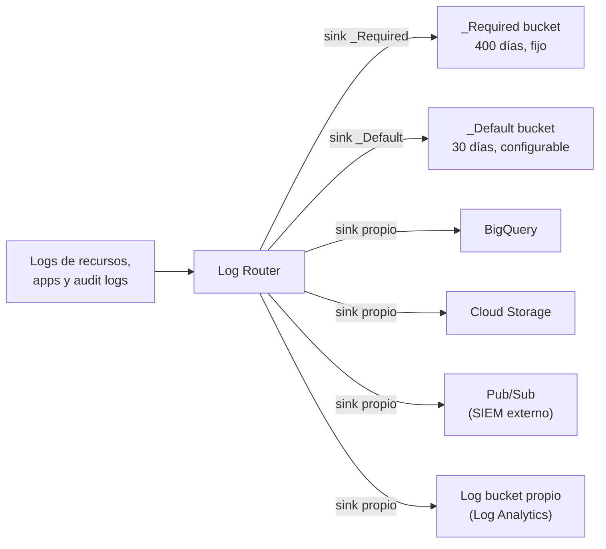

---
tags:
  - gcp
  - certificacion
  - ace
  - observabilidad
  - kubernetes
---

# Sección 3: Ensuring the successful operation of a cloud solution (~30%)

> El día a día después del despliegue: operar VMs, GKE y Cloud Run, gestionar almacenamiento y bases de datos (backups, consultas, CMEK), mantener la red y vigilar todo con Cloud Monitoring y Cloud Logging.

!!! info "Qué evalúa esta sección"
    Según la guía oficial vigente:

    - **3.1 Managing compute resources**: conectarse a VMs, ver instancias, snapshots e images (y programar snapshots), inventario de GKE, acceso de GKE a Artifact Registry, node pools, recursos de Kubernetes (Pods, Services, StatefulSets), HPA y VPA, resource requests en Autopilot, nuevas versiones y traffic splitting en Cloud Run (y Cloud Run functions, GKE), autoscaling de Cloud Run, GPUs y TPUs, desplegar un agente en Agent Runtime, notebooks en Workbench y BigQuery, Cloud Workstations.
    - **3.2 Managing storage and data solutions**: seguridad de objetos, lifecycle, consultas, estimar costos, backups y restauración, estado de jobs (Dataflow, BigQuery), Database Center, CMEK.
    - **3.3 Managing networking resources**: ampliar el rango de una subnet, reservar IPs estáticas, rutas estáticas, Cloud DNS, Cloud NAT, firewall rules y Cloud NGFW policies.
    - **3.4 Monitoring and logging**: alertas, métricas personalizadas, audit logs, VPC Flow Logs y firewall logs, exportar logs, log buckets, Log Analytics y log router, filtrar logs, Cloud Trace, Cloud Profiler, Query Insights, Personalized Service Health, Ops Agent, Managed Service for Prometheus, Gemini Cloud Assist, Active Assist y Cloud Hub.

    Formato y laboratorio en el [resumen del examen](resumen-examen.md).

## Operar Compute Engine

```bash
gcloud compute instances list --filter="status=RUNNING" --format="table(name,zone,machineType.basename(),status)"
gcloud compute ssh web-1 --zone=us-central1-a --tunnel-through-iap
gcloud compute instances stop web-1 --zone=us-central1-a
gcloud compute instances set-machine-type web-1 --zone=us-central1-a --machine-type=e2-standard-4
```

Para cambiar el machine type, la VM debe estar **detenida**. Una VM detenida no cobra cómputo, pero **sí cobra discos e IPs estáticas reservadas**.

### Snapshots e images

| | **Snapshot** | **Image** (custom image) | **Machine image** |
| --- | --- | --- | --- |
| Qué copia | Un disco, de forma **incremental** | Un disco de arranque, para crear VMs nuevas | Toda la VM: discos, metadata, configuración |
| Uso típico | Backup y restauración | Plantilla base ("golden image") en instance templates | Clonar o respaldar una VM completa |
| Ámbito | Global (se puede restaurar en otra región) | Global; se agrupan en **image families** | Global |

```bash
gcloud compute snapshots create web-1-pre-upgrade --source-disk=web-1 --source-disk-zone=us-central1-a
gcloud compute resource-policies create snapshot-schedule diario \
  --region=us-central1 --start-time=04:00 --daily-schedule --max-retention-days=14
gcloud compute disks add-resource-policies web-1 --zone=us-central1-a --resource-policies=diario
gcloud compute images create web-base-v3 --source-disk=web-1 --source-disk-zone=us-central1-a \
  --family=web-base
gcloud compute snapshots list
gcloud compute snapshots delete web-1-pre-upgrade
```

!!! tip "En el examen"
    "Backups automáticos diarios de los discos" → **snapshot schedule** (resource policy) adjunto al disco. "Crear VMs nuevas siempre con la última versión de la imagen" → **image family**. "Mover una VM a otra zona" → snapshot (o machine image) y crear la VM en la zona nueva.

## Operar GKE

### Inventario y recursos de Kubernetes

```bash
gcloud container clusters list
kubectl get nodes -o wide
kubectl get pods,svc,deploy,statefulset -A
kubectl describe pod api-7d9f8c-x2k4p
kubectl logs deploy/api --tail=50
kubectl rollout status deploy/api
kubectl rollout undo deploy/api
```

| Objeto | Para qué |
| --- | --- |
| **Deployment** | Pods sin estado, réplicas, rolling updates |
| **StatefulSet** | Pods con identidad estable y disco propio (bases de datos, colas) |
| **Service** (`ClusterIP`, `NodePort`, `LoadBalancer`) | IP estable y balanceo hacia los Pods |
| **Ingress** / **Gateway** | Entrada HTTP(S) con un Application Load Balancer |
| **DaemonSet** | Un Pod por node (agentes); limitado en Autopilot |

Detalle de cada objeto en [Kubernetes](../../../devops/contenedores/kubernetes.md) y la [chuleta de kubectl](../../../recursos/comandos/kubectl.md).

### Artifact Registry

Las imágenes se guardan en **Artifact Registry** (Container Registry está retirado). Para que GKE pueda descargar imágenes de un repositorio **privado**, la service account de los nodes necesita **Artifact Registry Reader** (`roles/artifactregistry.reader`) en el repositorio o el proyecto.

```bash
gcloud artifacts repositories create apps --repository-format=docker --location=us-central1
gcloud auth configure-docker us-central1-docker.pkg.dev
docker push us-central1-docker.pkg.dev/app-prod-4821/apps/api:1.5.0
```

### Node pools y autoscaling

En **GKE Standard** los nodes se organizan en **node pools** (grupos de nodes con la misma configuración). Para cambiar el machine type de los nodes se crea un pool nuevo, se migran los Pods y se borra el viejo.

```bash
gcloud container node-pools create highmem --cluster=batch --zone=us-central1-a \
  --machine-type=n2-highmem-4 --num-nodes=1 --enable-autoscaling --min-nodes=0 --max-nodes=4
gcloud container node-pools update default-pool --cluster=batch --zone=us-central1-a \
  --enable-autoscaling --min-nodes=1 --max-nodes=6
gcloud container clusters resize batch --node-pool=default-pool --num-nodes=2 --zone=us-central1-a
gcloud container node-pools delete highmem --cluster=batch --zone=us-central1-a
```

| Escalado | Qué escala | Cómo |
| --- | --- | --- |
| **Horizontal Pod Autoscaler** (HPA) | Número de Pods | CPU, memoria o métricas personalizadas: `kubectl autoscale deploy api --cpu-percent=60 --min=2 --max=10` |
| **Vertical Pod Autoscaler** (VPA) | Requests de CPU y memoria de cada Pod | Recomienda o ajusta los requests; se activa en el clúster (`--enable-vertical-pod-autoscaling`) |
| **Cluster autoscaler** | Número de nodes de un pool | `--enable-autoscaling` en el node pool (en Autopilot lo hace Google) |

!!! warning "Autopilot y resource requests"
    En **Autopilot** pagas por los **requests** de los Pods y Google ajusta valores fuera de rango a los mínimos y máximos permitidos (y aplica valores por defecto si no los defines). Define siempre `resources.requests` realistas: requests altos son dinero desperdiciado; requests bajos causan expulsiones o throttling. Para GPUs o hardware específico usa **ComputeClasses** o `nodeSelector` según la documentación vigente.

## Cloud Run: revisiones, tráfico y autoscaling

Cada despliegue crea una **revision**. Puedes desplegar una revisión **sin enviarle tráfico**, probarla con una URL con **tag** y luego moverle el tráfico de a poco (*canary*).

```bash
gcloud run deploy api --image=us-central1-docker.pkg.dev/app-prod-4821/apps/api:1.5.0 \
  --region=us-central1 --no-traffic --tag=candidata
gcloud run services update-traffic api --region=us-central1 --to-tags=candidata=10
gcloud run services update-traffic api --region=us-central1 --to-latest
gcloud run services update-traffic api --region=us-central1 --to-revisions=api-00041-xoz=100   # rollback
gcloud run services update api --region=us-central1 \
  --min-instances=1 --max-instances=20 --concurrency=80 --cpu=1 --memory=512Mi
```

| Parámetro | Efecto |
| --- | --- |
| `--min-instances` | Instancias siempre listas: evita **cold starts** (arranques en frío), pero cobra aunque no haya tráfico |
| `--max-instances` | Tope de escalado: protege presupuesto y bases de datos de abajo |
| `--concurrency` | Peticiones simultáneas por instancia (por defecto 80); bajarla escala antes |

El traffic splitting también existe en **Cloud Run functions** (son servicios de Cloud Run) y en **GKE** con Gateway API o service mesh. Estrategias en [Despliegue continuo](../../../devops/ci-cd/despliegue-continuo.md).

## IA, aceleradores y entornos de desarrollo

- **Adjuntar GPUs** a una VM: la VM debe estar detenida, con `--maintenance-policy=TERMINATE` y un machine type compatible (`gcloud compute instances create ... --accelerator=type=nvidia-l4,count=1` o un machine type G2/A3 que ya las incluye). En GKE, node pools con GPU o TPU.
- **Agent Runtime** (Gemini Enterprise Agent Platform, antes Vertex AI Agent Engine): se despliega un agente (por ejemplo hecho con Agent Development Kit) con el SDK de la plataforma; Google gestiona escalado, sesiones y memoria.
- **Workbench** (antes Vertex AI Workbench): instancias de **JupyterLab** gestionadas; los notebooks también se pueden crear en **BigQuery Studio**.
- **Cloud Workstations**: entornos de desarrollo gestionados y seguros en Google Cloud, definidos por **configurations** (imagen, máquina, red) que el equipo de plataforma controla.

## Cloud Storage: objetos y lifecycle

Seguridad de objetos:

| Mecanismo | Uso |
| --- | --- |
| **Uniform bucket-level access** | Permisos solo con IAM a nivel de bucket (recomendado); desactiva las ACLs por objeto |
| **Public access prevention** | Impide que el bucket o sus objetos se hagan públicos |
| **Signed URLs** | Acceso temporal a un objeto sin cuenta de Google (por ejemplo, descarga por 1 hora) |
| **Object Versioning** | Guarda versiones anteriores al sobrescribir o borrar |
| **Retention policy** / **Bucket Lock** | Impide borrar objetos antes de cierto tiempo (cumplimiento, WORM) |
| **Soft delete** | Recuperar objetos borrados durante un periodo (7 días por defecto) |
| **CMEK** | Cifrado con claves propias de Cloud KMS |

```json title="lifecycle.json"
{
  "rule": [
    {"action": {"type": "SetStorageClass", "storageClass": "NEARLINE"}, "condition": {"age": 30}},
    {"action": {"type": "SetStorageClass", "storageClass": "ARCHIVE"}, "condition": {"age": 365}},
    {"action": {"type": "Delete"}, "condition": {"age": 2555}},
    {"action": {"type": "Delete"}, "condition": {"isLive": false, "numNewerVersions": 3}}
  ]
}
```

```bash
gcloud storage buckets update gs://app-prod-4821-logs --lifecycle-file=lifecycle.json
gcloud storage buckets update gs://app-prod-4821-logs --versioning
gcloud storage sign-url gs://app-prod-4821-datos/informe.pdf --duration=1h \
  --impersonate-service-account=firmador@app-prod-4821.iam.gserviceaccount.com
gcloud storage buckets add-iam-policy-binding gs://app-prod-4821-datos \
  --member="group:analistas@ejemplo.com" --role="roles/storage.objectViewer"
```

!!! tip "En el examen"
    - "Mover a una clase más barata después de N días" o "borrar después de N días" → **lifecycle rule** (no un script con cron).
    - "Compartir un archivo temporalmente con alguien sin cuenta de Google" → **signed URL**.
    - "Nadie, ni un admin, puede borrar durante 7 años" → **retention policy con Bucket Lock**.

## Bases de datos: consultas, backups y costos

```bash
gcloud sql connect pg-prod --user=postgres           # o el Cloud SQL Auth Proxy
bq query --use_legacy_sql=false --dry_run 'SELECT pais, SUM(total) FROM ventas.pedidos GROUP BY pais'
bq ls -j --max_results=10                              # estado de jobs de BigQuery
gcloud dataflow jobs list --region=us-central1 --status=active
cbt -project=app-prod-4821 -instance=telemetria read lecturas count=5
gcloud spanner databases execute-sql pedidos-db --instance=pedidos --sql="SELECT COUNT(*) FROM Pedidos"
```

El `--dry_run` de BigQuery muestra **cuántos bytes leería** la consulta: con on-demand pagas por bytes procesados, así que es la forma de estimar el costo antes de ejecutar. Para estimar costos de almacenamiento y bases de datos usa el **Google Cloud Pricing Calculator**.

| Producto | Backup | Restauración |
| --- | --- | --- |
| **Cloud SQL** | Backups automáticos y bajo demanda; **point-in-time recovery** (PITR) con logs | `gcloud sql backups restore` sobre una instancia (sobrescribe) o clonar a un momento |
| **AlloyDB** | Backups continuos (PITR) y bajo demanda | Restaurar a un clúster nuevo |
| **Spanner** | Backups y **PITR** (retención de versiones hasta 7 días) | Restaurar a una base nueva |
| **Firestore** | Backups programados y PITR; export/import a Cloud Storage | Restaurar a una base nueva |
| **Bigtable** | Backups de tablas | Restaurar a una tabla nueva |

```bash
gcloud sql backups create --instance=pg-prod
gcloud sql backups list --instance=pg-prod
gcloud sql backups restore 1730000000000 --restore-instance=pg-prod --backup-instance=pg-prod
gcloud firestore backups schedules create --database='(default)' --recurrence=daily --retention=14d
```

- **Database Center**: vista única de **toda la flota de bases de datos** (Cloud SQL, AlloyDB, Spanner, Firestore, Bigtable, Memorystore) con inventario, salud, recomendaciones de seguridad y rendimiento, y asistencia de Gemini.
- **Query Insights** (Cloud SQL y AlloyDB) e **index advisor** ayudan a encontrar consultas lentas y a proponer índices.

### CMEK

Por defecto Google cifra todo con claves que gestiona Google. Con **CMEK** (*customer-managed encryption keys*, claves gestionadas por el cliente) usas una clave de **Cloud KMS** que tú controlas (rotación, deshabilitación, auditoría). El paso que más se olvida: dar a la **service agent** del servicio el rol **Cloud KMS CryptoKey Encrypter/Decrypter** sobre la clave.

```bash
gcloud kms keyrings create datos --location=us-central1
gcloud kms keys create bucket-key --keyring=datos --location=us-central1 --purpose=encryption \
  --rotation-period=90d --next-rotation-time=2026-12-01T00:00:00Z
gcloud storage service-agent --project=app-prod-4821 --authorize-cmek=projects/app-prod-4821/locations/us-central1/keyRings/datos/cryptoKeys/bucket-key
gcloud storage buckets update gs://app-prod-4821-datos \
  --default-encryption-key=projects/app-prod-4821/locations/us-central1/keyRings/datos/cryptoKeys/bucket-key
```

La clave debe estar en la **misma ubicación** que el recurso. Más en [Seguridad base](../../../cloud/identidad-y-seguridad/seguridad-base.md).

## Operar la red

```bash
# Ampliar una subnet (solo se puede agrandar, nunca reducir)
gcloud compute networks subnets expand-ip-range prod-us --region=us-central1 --prefix-length=21

# IPs estáticas
gcloud compute addresses create web-ip --region=us-central1                       # externa regional
gcloud compute addresses create lb-ip --global                                    # externa global (LB)
gcloud compute addresses create db-ip --region=us-central1 --subnet=prod-us --addresses=10.20.0.50

# Ruta estática hacia on-premises a través de una VM appliance
gcloud compute routes create a-onprem --network=prod-vpc --destination-range=192.168.0.0/16 \
  --next-hop-instance=fw-1 --next-hop-instance-zone=us-central1-a --priority=800

# Cloud NAT para VMs sin IP externa
gcloud compute routers create nat-router --network=prod-vpc --region=us-central1
gcloud compute routers nats create nat-us --router=nat-router --region=us-central1 \
  --auto-allocate-nat-external-ips --nat-all-subnet-ip-ranges

# Cloud DNS: zona privada visible solo desde la VPC
gcloud dns managed-zones create interna --dns-name="interno.ejemplo.com." \
  --visibility=private --networks=prod-vpc --description="Zona interna"
gcloud dns record-sets create db.interno.ejemplo.com. --zone=interna --type=A --ttl=300 --rrdatas=10.20.0.50
```

!!! tip "En el examen"
    - "La subnet se quedó sin IPs" → `expand-ip-range` (sin downtime), siempre que el nuevo rango no se solape.
    - "La IP pública cambia al reiniciar la VM" → **reservar una IP estática** (las efímeras cambian). Una IP reservada **sin usar** también cobra.
    - "VMs privadas necesitan descargar parches de internet" → **Cloud NAT** (solo salida; no permite conexiones entrantes).
    - "Nombres internos que no se vean desde internet" → **Cloud DNS private zone**.

Las firewall rules y policies se gestionan con los mismos comandos de la [Sección 2](seccion-2-planificar-implementar.md#firewall-rules-y-cloud-ngfw-policies); para depurar, activa **firewall rules logging** y usa **Connectivity Tests** ([Troubleshooting de red](../../../networking/avanzado/troubleshooting-red.md)).

## Cloud Monitoring

- **Metrics scope**: un proyecto puede ver métricas de hasta cientos de proyectos (un proyecto central de monitoreo).
- **Alerting policies** (políticas de alertas): condición sobre una métrica (umbral, ausencia de datos, PromQL) + **notification channels** (correo, SMS, Slack, PagerDuty, Pub/Sub, webhooks).
- **Uptime checks** (pruebas de disponibilidad) desde varias ubicaciones del mundo.
- **Custom metrics**: desde la aplicación (OpenTelemetry o la API de Monitoring, prefijo `custom.googleapis.com/`) o **log-based metrics** (métricas creadas contando o extrayendo valores de los logs).
- **Ops Agent**: agente único para **métricas y logs** del sistema operativo y de apps (NGINX, MySQL…) en Compute Engine. Sin él, solo ves métricas del hipervisor (CPU, red, disco), **no memoria ni uso del disco** desde dentro de la VM.
- **Google Cloud Managed Service for Prometheus**: recolecta métricas Prometheus (en GKE viene integrado) y las consulta con PromQL sin operar Prometheus.

```bash
gcloud logging metrics create errores-pago \
  --description="Errores del servicio de pagos" \
  --log-filter='resource.type="cloud_run_revision" AND resource.labels.service_name="pagos" AND severity>=ERROR'
# Ops Agent en una VM (o por política de VM Manager para todo un grupo)
curl -sSO https://dl.google.com/cloudagents/add-google-cloud-ops-agent-repo.sh
sudo bash add-google-cloud-ops-agent-repo.sh --also-install
```

## Cloud Logging



- **Log Router**: cada log entra al router, que lo envía según los **sinks** (con filtros de inclusión y exclusión).
- **Log buckets**: `_Required` (Admin Activity, System Event y Access Transparency; **400 días**, no se modifica ni se borra), `_Default` (lo demás, 30 días por defecto, configurable) y buckets propios con retención a medida. Un bucket con **Log Analytics** se consulta con SQL.
- **Destinos de un sink**: Cloud Storage (archivo barato y largo plazo), BigQuery (análisis), Pub/Sub (sistemas externos, SIEM, on-premises), otro log bucket u otro proyecto. Los **aggregated sinks** en la organización o un folder recogen logs de todos los proyectos.
- Tras crear el sink, hay que dar a su **writer identity** (service account del sink) permiso de escritura en el destino.

```bash
gcloud logging sinks create audit-a-bq \
  bigquery.googleapis.com/projects/seguridad-central/datasets/audit_logs \
  --organization=123456789012 --include-children \
  --log-filter='logName:"cloudaudit.googleapis.com"'
gcloud logging read 'resource.type="gce_instance" AND severity>=ERROR AND timestamp>="2026-10-25T00:00:00Z"' \
  --limit=20 --format=json
gcloud logging buckets update _Default --location=global --retention-days=90
```

### Audit logs, VPC Flow Logs y firewall logs

| Log | Se activa | Qué registra |
| --- | --- | --- |
| **Admin Activity audit logs** | Siempre, gratis, no se pueden desactivar | Cambios de configuración y metadata ("quién creó o borró qué") |
| **System Event audit logs** | Siempre | Acciones de Google sobre tus recursos (live migration, etc.) |
| **Data Access audit logs** | **Desactivados por defecto** (salvo BigQuery); se activan por servicio en la configuración de auditoría de IAM | Lecturas de datos y de configuración; pueden generar mucho volumen y costo |
| **Policy Denied audit logs** | Por defecto (se pueden excluir con filtros en el sink) | Accesos denegados por políticas de seguridad (por ejemplo, VPC Service Controls) |
| **VPC Flow Logs** | Por subnet (`--enable-flow-logs`) | Muestra de flujos de red (5-tupla, bytes) |
| **Firewall Rules Logging** | Por regla (`--enable-logging`) | Conexiones permitidas o denegadas por esa regla |

Más sobre auditoría en [Seguridad base](../../../cloud/identidad-y-seguridad/seguridad-base.md) y [Detección y respuesta](../../../devsecops/gobierno-y-respuesta/deteccion-respuesta.md).

### Diagnóstico y salud

| Herramienta | Para qué |
| --- | --- |
| **Cloud Trace** | Latencia distribuida entre servicios (trazas) |
| **Cloud Profiler** | Qué funciones consumen CPU y memoria en producción |
| **Error Reporting** | Agrupar excepciones de las apps |
| **Query Insights** / **index advisor** | Consultas lentas e índices en Cloud SQL y AlloyDB |
| **Personalized Service Health** | Incidentes de Google Cloud que **afectan a tus proyectos**, con alertas |
| **Active Assist** (Recommender) | Recomendaciones: VMs inactivas, rightsizing, IPs y discos sin usar, roles excesivos |
| **Cloud Hub** | Vista central de eventos activos (incidentes y mantenimientos), salud de aplicaciones de App Hub y alertas |
| **Gemini Cloud Assist** | Investigaciones asistidas por IA y ayuda para crear consultas y alertas |

```bash
gcloud recommender recommendations list --project=app-prod-4821 --location=us-central1-a \
  --recommender=google.compute.instance.IdleResourceRecommender
```

Conceptos de métricas, logs y trazas en [Observabilidad](../../../devops/operacion/observabilidad.md) y [Observabilidad nativa](../../../cloud/operacion-y-gobierno/observabilidad-nativa.md); cómo leer logs en [Leer logs](../../../devops/operacion/leer-logs.md).

!!! tip "En el examen"
    - "Ver memoria de la VM" → instalar **Ops Agent**.
    - "Guardar audit logs varios años de forma barata" → **sink a Cloud Storage** (con lifecycle a Archive).
    - "Analizar logs con SQL" → sink a **BigQuery** o log bucket con **Log Analytics**.
    - "Enviar logs a un SIEM on-premises" → sink a **Pub/Sub**.
    - "Auditar quién **leyó** datos de un bucket" → activar **Data Access audit logs** para Cloud Storage.
    - "Alerta si aparece un error concreto en los logs" → **log-based metric** + alerting policy (o una log-based alert).

## Casos de uso

1. **Restaurar una VM al estado de ayer después de una actualización fallida.** → Crear un disco desde el snapshot programado y una VM nueva con él.
2. **Desplegar una nueva versión de una API en Cloud Run y probarla con el 5% de los usuarios.** → `--no-traffic --tag`, luego `update-traffic --to-tags=tag=5` y subir gradualmente.
3. **Una app en GKE tiene picos de tráfico diarios.** → HPA para Pods + cluster autoscaler en el node pool (o Autopilot).
4. **Una subnet `/24` se quedó sin IPs.** → `expand-ip-range` a `/23` o `/22`.
5. **Un auditor pide los audit logs de toda la organización en un único lugar durante 5 años.** → Aggregated sink en la organización hacia un bucket de Cloud Storage con retention policy.
6. **El equipo quiere saber cuánto cuesta una consulta de BigQuery antes de ejecutarla.** → `bq query --dry_run`.
7. **Una normativa exige que la empresa controle y pueda revocar las claves de cifrado de un bucket.** → CMEK con Cloud KMS y permiso a la service agent de Cloud Storage.
8. **Ver incidentes de Google Cloud que afectan a tus proyectos y recibir alertas.** → **Personalized Service Health**.

## Preguntas de práctica

**1.** Necesitas que una API en Cloud Run responda sin cold starts en horario laboral. ¿Qué ajustas?

- A. `--concurrency=1`
- B. `--min-instances` mayor que 0
- C. `--max-instances=1`
- D. Un HPA

??? success "Respuesta"
    **B.** Las instancias mínimas quedan calientes (cobran aunque no haya tráfico). A hace escalar más, no evita cold starts. C limita el escalado. D es de Kubernetes, no de Cloud Run.

**2.** En Cloud Monitoring no ves el uso de memoria de tus VMs de Compute Engine. ¿Qué haces?

- A. Activar VPC Flow Logs
- B. Instalar el Ops Agent en las VMs
- C. Activar Data Access audit logs
- D. Crear un uptime check

??? success "Respuesta"
    **B.** La memoria se mide desde dentro del sistema operativo con el Ops Agent. A son flujos de red. C son lecturas de datos. D mide disponibilidad externa.

**3.** Seguridad pide conservar los audit logs de todos los proyectos de la organización 7 años al menor costo. ¿Qué configuras?

- A. Aumentar la retención del bucket `_Default` de cada proyecto a 7 años
- B. Un aggregated sink a nivel de organización hacia Cloud Storage con lifecycle a Archive
- C. Un sink por proyecto hacia BigQuery
- D. Exportar manualmente cada mes con `gcloud logging read`

??? success "Respuesta"
    **B.** Un aggregated sink con `--include-children` captura todos los proyectos, y Cloud Storage Archive es lo más barato para retener años. A es más caro y proyecto por proyecto. C funciona pero cuesta más y es más trabajo. D es manual y propenso a errores.

**4.** La subnet `10.20.0.0/24` se quedó sin direcciones y no puedes detener las VMs. ¿Qué haces?

- A. Crear una subnet nueva y mover las VMs
- B. `gcloud compute networks subnets expand-ip-range` con un prefijo menor, por ejemplo `/22`
- C. Cambiar la VPC a auto mode
- D. Reducir el rango a `/26` y volver a ampliarlo

??? success "Respuesta"
    **B.** Ampliar el rango primario no requiere downtime (si no se solapa con otras subnets ni rutas). A implica recrear VMs. C no amplía nada. D: los rangos no se pueden reducir.

**5.** Los Pods de GKE fallan con `ImagePullBackOff` al descargar desde un repositorio privado de Artifact Registry del mismo proyecto. ¿Cuál es la causa más probable?

- A. Falta Cloud NAT
- B. La service account de los nodes no tiene `roles/artifactregistry.reader`
- C. El clúster es Autopilot
- D. Falta una firewall rule de ingress

??? success "Respuesta"
    **B.** Los nodes descargan las imágenes con su service account. A afectaría a registries de internet, no a Artifact Registry con Private Google Access. C no impide descargar. D no aplica a descargas salientes.

**6.** Quieres saber quién leyó objetos de un bucket con datos sensibles. ¿Qué activas?

- A. Admin Activity audit logs
- B. Data Access audit logs de Cloud Storage
- C. VPC Flow Logs
- D. Object Versioning

??? success "Respuesta"
    **B.** Las lecturas de datos se registran en Data Access audit logs, que vienen desactivados por defecto. A registra cambios de configuración (siempre activo). C es tráfico de red. D guarda versiones, no accesos.

**7.** Un bucket con CMEK no puede escribir objetos tras crear la clave en Cloud KMS. ¿Qué falta?

- A. Habilitar Object Versioning
- B. Dar a la service agent de Cloud Storage el rol Cloud KMS CryptoKey Encrypter/Decrypter sobre la clave
- C. Dar Owner al usuario
- D. Mover la clave a la región `global`

??? success "Respuesta"
    **B.** El servicio cifra con su service agent, que necesita ese rol sobre la clave. A no tiene relación. C viola el mínimo privilegio y no resuelve el permiso del servicio. D: la clave debe estar en una ubicación compatible con el bucket, no necesariamente global.

## Para profundizar

- Operación: [Observabilidad nativa](../../../cloud/operacion-y-gobierno/observabilidad-nativa.md), [Observabilidad](../../../devops/operacion/observabilidad.md), [Operación y SRE](../../../devops/operacion/operacion-sre.md), [Troubleshooting](../../../devops/operacion/troubleshooting.md), [Runbooks y playbooks](../../../devops/operacion/runbooks-playbooks.md)
- Resiliencia y backups: [Resiliencia](../../../cloud/operacion-y-gobierno/resiliencia.md), [Almacenamiento y datos](../../../cloud/redes-y-datos/almacenamiento-datos.md), [Continuidad de negocio](../../../negocio/continuidad-negocio.md)
- Contenedores: [Kubernetes](../../../devops/contenedores/kubernetes.md), [Seguridad de Kubernetes](../../../devsecops/infraestructura-y-contenedores/seguridad-kubernetes.md)
- Redes: [Redes en la nube](../../../cloud/redes-y-datos/redes.md), [Servicios de red](../../../networking/intermedio/servicios-red.md) (DNS), [Troubleshooting de red](../../../networking/avanzado/troubleshooting-red.md)
- Automatización: [Automatización cloud con SDKs](../../../python/scripting/automatizacion-cloud.md)

## Referencias

- [Snapshots y snapshot schedules](https://cloud.google.com/compute/docs/disks/scheduled-snapshots)
- [Custom images e image families](https://cloud.google.com/compute/docs/images/image-families-best-practices)
- [GKE node pools](https://cloud.google.com/kubernetes-engine/docs/concepts/node-pools)
- [Autopilot resource requests](https://cloud.google.com/kubernetes-engine/docs/concepts/autopilot-resource-requests)
- [Cloud Run: rollouts, rollbacks y traffic migration](https://cloud.google.com/run/docs/rollouts-rollbacks-traffic-migration)
- [Cloud Storage lifecycle](https://cloud.google.com/storage/docs/lifecycle)
- [Cloud SQL backups](https://cloud.google.com/sql/docs/postgres/backup-recovery/backups)
- [Database Center](https://cloud.google.com/database-center/docs/overview)
- [CMEK](https://cloud.google.com/kms/docs/cmek)
- [Expand a subnet](https://cloud.google.com/vpc/docs/create-modify-vpc-networks#expand-subnet)
- [Cloud NAT](https://cloud.google.com/nat/docs/overview)
- [Cloud DNS](https://cloud.google.com/dns/docs/overview)
- [Cloud Monitoring alerting](https://cloud.google.com/monitoring/alerts)
- [Ops Agent](https://cloud.google.com/stackdriver/docs/solutions/agents/ops-agent)
- [Routing and storage overview (Cloud Logging)](https://cloud.google.com/logging/docs/routing/overview)
- [Cloud Audit Logs](https://cloud.google.com/logging/docs/audit)
- [Personalized Service Health](https://cloud.google.com/service-health/docs/overview)
- [Cloud Hub](https://cloud.google.com/hub/docs/overview)
