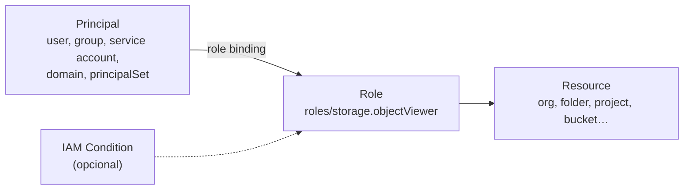
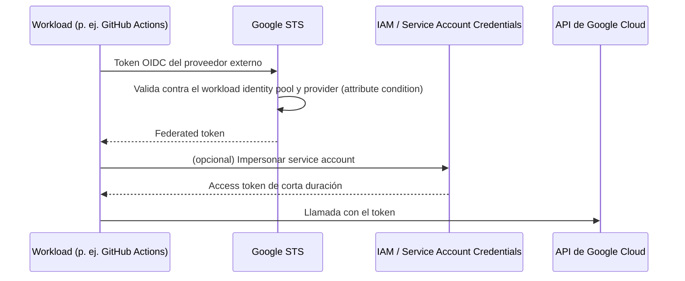

---
tags:
  - gcp
  - certificacion
  - ace
  - iam
  - seguridad
---

# Sección 4: Configuring access and security (~20%)

> Cómo se dan y se controlan los permisos en Google Cloud: allow policies, herencia en la jerarquía, tipos de roles, custom roles, service accounts, impersonation, credenciales de corta duración y Workload Identity Federation.

!!! info "Qué evalúa esta sección"
    Según la guía oficial vigente:

    - **4.1 Managing IAM**: ver y crear IAM policies, asignar roles y entender la herencia en la jerarquía de la organización, gestionar los tipos de roles y definir custom roles.
    - **4.2 Managing service accounts**: crear service accounts (incluidas las gestionadas por Google), usarlas con permisos mínimos, asignarlas a recursos, gestionar sus permisos, impersonation, credenciales de corta duración, service accounts con aplicaciones en GKE y Workload Identity Federation.

    Formato y laboratorio en el [resumen del examen](resumen-examen.md).

## Cómo funciona Cloud IAM

En Google Cloud, un permiso se concede con una **role binding** (vinculación de rol) dentro de una **allow policy** (política de permisos) adjunta a un recurso:

> **Principal** (quién) + **role** (conjunto de permisos) + **resource** (dónde, y todo lo que cuelga de él)



| Principal | Formato en el binding |
| --- | --- |
| Cuenta de Google o Cloud Identity | `user:ana@ejemplo.com` |
| Google group | `group:devops@ejemplo.com` |
| Service account | `serviceAccount:app@PROJECT.iam.gserviceaccount.com` |
| Dominio completo | `domain:ejemplo.com` |
| Identidades federadas | `principal://…` o `principalSet://…` |
| Todos / todos los autenticados | `allUsers` / `allAuthenticatedUsers` (público: evítalo) |

```bash
gcloud projects get-iam-policy app-prod-4821 --format=yaml
gcloud projects add-iam-policy-binding app-prod-4821 \
  --member="group:dba@ejemplo.com" --role="roles/cloudsql.admin"
gcloud projects remove-iam-policy-binding app-prod-4821 \
  --member="user:ex-empleado@ejemplo.com" --role="roles/editor"
gcloud projects add-iam-policy-binding app-prod-4821 \
  --member="user:contratista@ejemplo.com" --role="roles/compute.viewer" \
  --condition='expression=request.time < timestamp("2026-12-31T23:59:59Z"),title=hasta-fin-de-ano'
```

!!! warning "`set-iam-policy` reemplaza todo"
    `gcloud projects set-iam-policy` **sobrescribe** la política completa con el archivo que le pases. Para añadir o quitar un rol usa `add-iam-policy-binding` / `remove-iam-policy-binding`. Si usas `set-iam-policy`, parte de un `get-iam-policy` reciente (el campo `etag` evita pisar cambios concurrentes).

### Herencia en la jerarquía

La **effective policy** (política efectiva) de un recurso es la **unión** de su allow policy y las de todos sus ancestros (proyecto, folders, organización).

| Si das el rol en… | Aplica a |
| --- | --- |
| Organization | Todos los folders, proyectos y recursos |
| Folder | Sus subfolders, proyectos y recursos |
| Project | Todos los recursos del proyecto |
| Resource (bucket, topic, secret…) | Solo ese recurso |

Un permiso heredado **no se puede quitar más abajo** con una allow policy. Para bloquear explícitamente existen las **IAM deny policies** (se evalúan antes que las allow policies) y, para limitar configuraciones, las [organization policies](seccion-1-entorno-solucion-cloud.md#organization-policies).

!!! tip "En el examen"
    "Un usuario tiene un permiso que no debería en un proyecto, pero el binding no aparece en el proyecto" → revisa la **herencia** (folder u organización). **Policy Troubleshooter** y **Policy Analyzer** responden "¿por qué tiene (o no) este acceso?" y "¿quién tiene acceso a qué?".

## Tipos de roles

| Tipo | Ejemplos | Cuándo |
| --- | --- | --- |
| **Basic roles** (roles básicos, antes *primitive*) | `roles/owner`, `roles/editor`, `roles/viewer` | Casi nunca en producción: miles de permisos en todos los servicios. Solo pruebas o proyectos personales |
| **Predefined roles** (roles predefinidos) | `roles/compute.instanceAdmin.v1`, `roles/storage.objectViewer`, `roles/run.developer` | **Opción por defecto**: los mantiene Google y siguen el mínimo privilegio por servicio |
| **Custom roles** (roles personalizados) | `projects/app-prod-4821/roles/lectorDeLogsYVMs` | Cuando ningún predefined encaja sin dar permisos de más |

Detalles de los custom roles:

- Se crean a nivel de **organización** o de **proyecto** (no de folder).
- Tú los mantienes: si Google añade permisos nuevos a un servicio, tu custom role no los recibe.
- Tienen **launch stage** (`ALPHA`, `BETA`, `GA`, `DEPRECATED`, `DISABLED`). Algunos permisos no se pueden usar en custom roles.
- Se puede partir de un rol existente con `--source` o copiar uno con `gcloud iam roles copy`.

```bash
gcloud iam roles describe roles/compute.viewer
gcloud iam roles create lectorVmsYLogs --project=app-prod-4821 \
  --title="Lector de VMs y logs" --stage=GA \
  --permissions=compute.instances.get,compute.instances.list,logging.logEntries.list
gcloud iam roles update lectorVmsYLogs --project=app-prod-4821 --add-permissions=compute.disks.list
gcloud iam roles create auditorOrg --organization=123456789012 --file=rol-auditor.yaml
```

!!! tip "En el examen"
    - La respuesta "dar **Owner/Editor**" casi siempre es incorrecta: busca el **predefined role** más acotado.
    - "Ningún rol predefinido cumple sin dar permisos de más" → **custom role**.
    - "Custom role para toda la organización" → crearlo en la **organización**; no existen custom roles de folder.
    - Asigna roles a **grupos**, no a usuarios individuales.

## Service accounts

Una **service account** (cuenta de servicio) es una identidad para **aplicaciones y workloads**, no para personas. Es a la vez un **principal** (recibe roles) y un **recurso** (tiene su propia allow policy: quién puede usarla).

| Tipo | Quién la crea | Ejemplo |
| --- | --- | --- |
| **User-managed service account** | Tú | `api-pagos@app-prod-4821.iam.gserviceaccount.com` |
| **Default service account** | Google al habilitar ciertos servicios (Compute Engine, App Engine) | `PROJECT_NUMBER-compute@developer.gserviceaccount.com` |
| **Service agents** (Google-managed service accounts) | Google, para que un servicio actúe sobre tus recursos | `service-PROJECT_NUMBER@gcp-sa-…iam.gserviceaccount.com` |

!!! warning "La Compute Engine default service account"
    Históricamente recibía el rol **Editor** en el proyecto automáticamente. En organizaciones nuevas, una organization policy (`iam.automaticIamGrantsForDefaultServiceAccounts`) lo impide por defecto. Buena práctica: crear una **service account propia por aplicación** con solo los roles necesarios y no usar la default.

### Asignar una service account a un recurso

```bash
gcloud iam service-accounts create api-pagos --display-name="API de pagos"
gcloud projects add-iam-policy-binding app-prod-4821 \
  --member="serviceAccount:api-pagos@app-prod-4821.iam.gserviceaccount.com" \
  --role="roles/cloudsql.client"
gcloud run deploy pagos --image=us-central1-docker.pkg.dev/app-prod-4821/apps/pagos:2.0.0 \
  --region=us-central1 --service-account=api-pagos@app-prod-4821.iam.gserviceaccount.com
gcloud compute instances set-service-account web-1 --zone=us-central1-a \
  --service-account=web-sa@app-prod-4821.iam.gserviceaccount.com --scopes=cloud-platform
```

Para **adjuntar** una service account a un recurso (VM, Cloud Run, función), quien despliega necesita **Service Account User** (`roles/iam.serviceAccountUser`) **sobre esa service account**. Sin ese control, cualquiera con permiso de crear VMs podría "tomar prestados" los permisos de una service account poderosa.

!!! note "Access scopes"
    En Compute Engine, los **access scopes** son un mecanismo heredado que limita las APIs que la VM puede llamar. La recomendación actual: scope `cloud-platform` y controlar los permisos **solo con IAM** sobre la service account.

### Permisos sobre la service account

| Rol (sobre la service account) | Permite |
| --- | --- |
| **Service Account User** | Adjuntarla a recursos y ejecutar operaciones como ella |
| **Service Account Token Creator** | Generar **tokens de corta duración** (impersonation) |
| **Service Account Admin** | Crear, editar, deshabilitar y gestionar su política |
| **Service Account Key Admin** | Crear y borrar claves (evítalo) |
| **Workload Identity User** | Que una identidad federada o de GKE la use |

```bash
gcloud iam service-accounts add-iam-policy-binding \
  api-pagos@app-prod-4821.iam.gserviceaccount.com \
  --member="group:equipo-pagos@ejemplo.com" --role="roles/iam.serviceAccountUser"
gcloud iam service-accounts get-iam-policy api-pagos@app-prod-4821.iam.gserviceaccount.com
gcloud iam service-accounts disable viejo-sa@app-prod-4821.iam.gserviceaccount.com
```

## Impersonation y credenciales de corta duración

Las **service account keys** (archivos JSON) son **credenciales de larga duración**: si se filtran, dan acceso hasta que alguien las borre. Google recomienda **no crearlas** (y muchas organizaciones las bloquean con `iam.disableServiceAccountKeyCreation`). Alternativas:

| Necesidad | Solución sin claves |
| --- | --- |
| Código en una VM, Cloud Run, GKE | **Service account adjunta** (las credenciales llegan por el metadata server) |
| Una persona necesita probar con los permisos de una service account | **Service account impersonation** con Token Creator |
| Tu equipo local con librerías cliente | **Application Default Credentials**: `gcloud auth application-default login` (con `--impersonate-service-account` si hace falta) |
| Pipelines de CI/CD, apps en AWS, Azure u on-premises | **Workload Identity Federation** |

```bash
# Ejecutar un comando como la service account (requiere Token Creator sobre ella)
gcloud storage ls gs://app-prod-4821-datos \
  --impersonate-service-account=api-pagos@app-prod-4821.iam.gserviceaccount.com

# Imprimir un access token de corta duración (1 hora por defecto)
gcloud auth print-access-token --impersonate-service-account=api-pagos@app-prod-4821.iam.gserviceaccount.com

# Usarla siempre en esta configuración de gcloud
gcloud config set auth/impersonate_service_account api-pagos@app-prod-4821.iam.gserviceaccount.com
```

Por detrás, la **Service Account Credentials API** (`iamcredentials.googleapis.com`) emite **OAuth 2.0 access tokens**, **ID tokens** (OIDC) o firma JWTs, con vida corta. También se pueden encadenar delegaciones (*delegation chain*).

!!! tip "En el examen"
    - "Una desarrolladora debe probar con los permisos exactos de la app sin descargar claves" → **impersonation** con **Service Account Token Creator** sobre esa service account.
    - "Un despliegue falla con `iam.serviceAccounts.actAs`" → falta **Service Account User** sobre la service account que se adjunta.
    - Cualquier opción que diga "create a service account key and store it…" suele ser la trampa, salvo que no exista alternativa.

## Service accounts en GKE

**Workload Identity Federation for GKE** (antes "Workload Identity") permite que los Pods usen identidades de IAM **sin claves** y sin heredar la service account del node. Viene activado en Autopilot; en Standard se activa con `--workload-pool=PROJECT_ID.svc.id.goog` (y el metadata server de GKE en el node pool).

Dos formas de dar permisos:

=== "Directo a la Kubernetes service account (recomendado)"

    ```bash
    kubectl create serviceaccount pagos-ksa -n pagos
    gcloud projects add-iam-policy-binding app-prod-4821 \
      --role="roles/secretmanager.secretAccessor" \
      --member="principal://iam.googleapis.com/projects/123456789/locations/global/workloadIdentityPools/app-prod-4821.svc.id.goog/subject/ns/pagos/sa/pagos-ksa"
    ```

=== "Vinculando a una IAM service account"

    ```bash
    gcloud iam service-accounts add-iam-policy-binding \
      api-pagos@app-prod-4821.iam.gserviceaccount.com \
      --role="roles/iam.workloadIdentityUser" \
      --member="serviceAccount:app-prod-4821.svc.id.goog[pagos/pagos-ksa]"
    kubectl annotate serviceaccount pagos-ksa -n pagos \
      iam.gke.io/gcp-service-account=api-pagos@app-prod-4821.iam.gserviceaccount.com
    ```

Después, el Pod usa `serviceAccountName: pagos-ksa` y las librerías cliente obtienen credenciales solas. La versión directa no está soportada por todos los servicios: si uno no la admite, usa el vínculo con una IAM service account. Ver [Seguridad de Kubernetes](../../../devsecops/infraestructura-y-contenedores/seguridad-kubernetes.md).

## Workload Identity Federation

**Workload Identity Federation** permite que workloads **fuera de Google Cloud** (GitHub Actions, GitLab, AWS, Azure, Kubernetes on-premises, cualquier IdP OIDC o SAML) obtengan credenciales de corta duración intercambiando su propio token en el **Security Token Service** de Google.



Piezas:

- **Workload identity pool**: agrupa identidades externas (por ejemplo, "ci-cd").
- **Provider**: confía en un emisor concreto (`https://token.actions.githubusercontent.com`) con **attribute mapping** (mapeo de atributos) y una **attribute condition** que **limita qué identidades** se aceptan (por ejemplo, solo tu repositorio u organización de GitHub).
- **Acceso**: dar roles directamente al `principalSet://` del pool o permitir que impersone una service account con **Workload Identity User**.

```bash
gcloud iam workload-identity-pools create ci-cd --location=global --display-name="CI/CD"
gcloud iam workload-identity-pools providers create-oidc github --location=global \
  --workload-identity-pool=ci-cd --issuer-uri="https://token.actions.githubusercontent.com" \
  --attribute-mapping="google.subject=assertion.sub,attribute.repository=assertion.repository" \
  --attribute-condition="assertion.repository_owner=='mi-organizacion'"
gcloud iam service-accounts add-iam-policy-binding deployer@app-prod-4821.iam.gserviceaccount.com \
  --role="roles/iam.workloadIdentityUser" \
  --member="principalSet://iam.googleapis.com/projects/123456789/locations/global/workloadIdentityPools/ci-cd/attribute.repository/mi-organizacion/mi-repo"
```

El ejemplo completo con GitHub Actions está en [Secretos e identidades](../../../devsecops/identidades-y-pipeline/secretos-identidades.md) y la seguridad del pipeline en [Seguridad del pipeline](../../../devsecops/identidades-y-pipeline/seguridad-pipeline.md).

!!! tip "En el examen"
    "El pipeline de CI/CD externo necesita desplegar en Google Cloud sin guardar claves" → **Workload Identity Federation**. Sin **attribute condition**, cualquier repositorio del mismo emisor podría intentar usar tu pool.

## Casos de uso

1. **El equipo de datos debe consultar BigQuery en un proyecto, sin crear ni borrar datasets.** → Predefined roles `roles/bigquery.dataViewer` + `roles/bigquery.jobUser` al grupo del equipo.
2. **Auditoría necesita ver la configuración de todos los proyectos sin cambiar nada.** → Rol de lectura (por ejemplo `roles/iam.securityReviewer` y `roles/viewer`, o un custom role) en la **organización**, asignado a un grupo.
3. **Una app en Cloud Run debe leer un secreto y escribir en un bucket.** → Service account propia con `secretmanager.secretAccessor` sobre el secreto y `storage.objectCreator` sobre el bucket (a nivel de recurso).
4. **Un contratista necesita acceso de lectura hasta fin de año.** → Binding con **IAM Condition** de fecha.
5. **GitHub Actions despliega a Cloud Run.** → Workload Identity Federation con attribute condition del repositorio + service account `deployer` con `run.developer` y `iam.serviceAccountUser` sobre la service account de runtime.
6. **Pods de GKE deben leer de Pub/Sub sin claves.** → Workload Identity Federation for GKE con la Kubernetes service account del Pod.
7. **Una persona de SRE debe reproducir un error de permisos de la app.** → Impersonation de la service account de la app con Token Creator temporal.
8. **Se encontró una service account key en un repositorio público.** → Borrar o deshabilitar la clave, revisar audit logs, y migrar a credenciales sin claves; impedir nuevas con la organization policy.

## Preguntas de práctica

**1.** Un grupo de desarrolladores debe poder iniciar y detener VMs en un proyecto, pero no crearlas ni borrarlas. Ningún rol predefinido encaja exactamente. ¿Qué haces?

- A. Darles Editor en el proyecto
- B. Crear un custom role con `compute.instances.start` y `compute.instances.stop` (y los de lectura necesarios) y asignarlo al grupo
- C. Darles Compute Admin
- D. Crear una service account key para cada desarrollador

??? success "Respuesta"
    **B.** Un custom role da exactamente los permisos necesarios. A y C dan muchos más permisos. D es una mala práctica y no resuelve el alcance.

**2.** Una usuaria tiene acceso de Owner a un proyecto, pero en la allow policy del proyecto no aparece. ¿Cuál es la explicación más probable?

- A. Es un error de caché de la consola
- B. El rol se hereda de un folder o de la organización
- C. Tiene una service account key
- D. Las IAM Conditions están desactivadas

??? success "Respuesta"
    **B.** La política efectiva incluye los bindings de los ancestros. Revisa con Policy Analyzer o Policy Troubleshooter.

**3.** Al desplegar en Cloud Run con `--service-account=runtime@…` obtienes un error de permiso `iam.serviceAccounts.actAs`. ¿Qué rol falta y dónde?

- A. Cloud Run Admin en el proyecto
- B. Service Account User sobre la service account `runtime@…`
- C. Service Account Key Admin en el proyecto
- D. Owner en el proyecto

??? success "Respuesta"
    **B.** `actAs` se concede con Service Account User sobre la service account que se adjunta. A no incluye ese permiso sobre otras service accounts por sí solo. C es para claves. D funciona pero viola el mínimo privilegio.

**4.** Un pipeline de GitLab alojado fuera de Google Cloud debe desplegar recursos. Seguridad prohíbe las claves de service account. ¿Qué configuras?

- A. Una service account key guardada como variable protegida
- B. Workload Identity Federation con un provider OIDC de GitLab y una attribute condition del proyecto
- C. Workforce Identity Federation
- D. Una cuenta de usuario compartida

??? success "Respuesta"
    **B.** Workload Identity Federation intercambia el token OIDC del pipeline por credenciales de corta duración. A usa claves. C es para personas. D es inseguro y no auditable.

**5.** Una ingeniera quiere ejecutar comandos de `gcloud` con los permisos de una service account sin descargar claves. ¿Qué necesita?

- A. Service Account User sobre la service account
- B. Service Account Token Creator sobre la service account y usar `--impersonate-service-account`
- C. Workload Identity User en el proyecto
- D. Una clave JSON temporal

??? success "Respuesta"
    **B.** La impersonation genera tokens de corta duración y requiere Token Creator. A sirve para adjuntarla a recursos. C es para identidades federadas o de GKE. D es justo lo que se quiere evitar.

**6.** ¿Dónde puedes crear un custom role?

- A. En la organización, en folders y en proyectos
- B. Solo en proyectos
- C. En la organización y en proyectos
- D. En cualquier recurso

??? success "Respuesta"
    **C.** Los custom roles existen a nivel de organización o de proyecto. No hay custom roles de folder.

## Para profundizar

- [IAM: AWS, Azure y GCP](../../../cloud/identidad-y-seguridad/iam-comparativa.md): principals, roles y allow policies comparados con AWS IAM y Azure RBAC.
- [Seguridad base](../../../cloud/identidad-y-seguridad/seguridad-base.md): Cloud KMS, Secret Manager y auditoría.
- [Secretos e identidades](../../../devsecops/identidades-y-pipeline/secretos-identidades.md): OIDC entre pipeline y nube, Vault y rotación.
- [Seguridad del pipeline](../../../devsecops/identidades-y-pipeline/seguridad-pipeline.md) y [Seguridad de Kubernetes](../../../devsecops/infraestructura-y-contenedores/seguridad-kubernetes.md).
- [Gobernanza](../../../cloud/operacion-y-gobierno/gobernanza.md) y [Cumplimiento](../../../devsecops/gobierno-y-respuesta/cumplimiento.md).
- [Automatización cloud con SDKs](../../../python/scripting/automatizacion-cloud.md): Application Default Credentials en Python.

## Referencias

- [IAM overview](https://cloud.google.com/iam/docs/overview)
- [Roles and permissions](https://cloud.google.com/iam/docs/roles-overview)
- [Custom roles](https://cloud.google.com/iam/docs/creating-custom-roles)
- [Policy inheritance](https://cloud.google.com/iam/docs/resource-hierarchy-access-control)
- [IAM Conditions](https://cloud.google.com/iam/docs/conditions-overview)
- [Service accounts overview](https://cloud.google.com/iam/docs/service-account-overview)
- [Best practices for using service accounts](https://cloud.google.com/iam/docs/best-practices-service-accounts)
- [Service account impersonation](https://cloud.google.com/iam/docs/service-account-impersonation)
- [Create short-lived credentials](https://cloud.google.com/iam/docs/create-short-lived-credentials-direct)
- [Workload Identity Federation for GKE](https://cloud.google.com/kubernetes-engine/docs/concepts/workload-identity)
- [Workload Identity Federation](https://cloud.google.com/iam/docs/workload-identity-federation)
- [Policy Troubleshooter](https://cloud.google.com/policy-intelligence/docs/troubleshoot-access)
