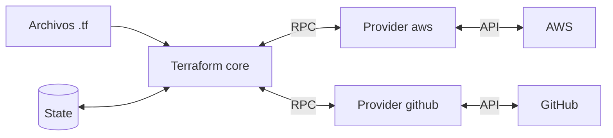

---
tags:
  - terraform
  - certificacion
  - terraform-associate
  - iac
---

# Objetivos 1 y 2: Infrastructure as Code (IaC) with Terraform y Terraform fundamentals

> Qué es IaC y por qué conviene, cómo trabaja Terraform con varias nubes y servicios, cómo se instalan y versionan los providers y para qué sirve el state.

!!! info "Qué evalúan estos objetivos"
    Sub-objetivos oficiales de la versión 004:

    - **1a** Explain what IaC is (explicar qué es IaC).
    - **1b** Describe the advantages of IaC patterns (ventajas de los patrones de IaC).
    - **1c** Explain how Terraform manages multi-cloud, hybrid cloud, and service-agnostic workflows (multi-cloud, nube híbrida y flujos agnósticos al servicio).
    - **2a** Install and version Terraform providers (instalar y versionar providers).
    - **2b** Describe how Terraform uses providers (cómo usa Terraform los providers).
    - **2c** Write Terraform configuration using multiple providers (configuración con varios providers).
    - **2d** Explain how Terraform uses and manages state (cómo usa y gestiona Terraform el state).

    Vuelve al [resumen del examen](resumen-examen.md) para ver el formato y el plan de estudio.

## 1a. Qué es Infrastructure as Code

**Infrastructure as Code** (IaC, infraestructura como código) es definir la infraestructura en **archivos de texto versionados** en lugar de crearla a mano en una consola web. Una herramienta lee esos archivos y llama a las APIs para que la realidad coincida con el código. El panorama completo (Terraform, CloudFormation, Bicep, Pulumi, Terragrunt) está en [Infrastructure as Code: panorama y herramientas](../../../devops/iac/infraestructura-como-codigo.md); aquí solo lo que pide el examen.

Terraform es:

| Característica | Qué significa | Contraste |
| --- | --- | --- |
| **Declarative** (declarativo) | Describes el **estado final**; Terraform calcula los pasos | Imperativo: un script Bash que ejecuta comandos en orden |
| **Idempotent** (idempotente) | Aplicar dos veces el mismo código no cambia nada la segunda vez | Un script que ejecuta "crear VM" dos veces crea dos VMs |
| Basado en **HCL** (*HashiCorp Configuration Language*) | Lenguaje legible por personas y máquinas; también admite JSON (`.tf.json`) | YAML/JSON de otras herramientas |
| Con **state** | Guarda qué objetos reales corresponden a cada bloque del código | CloudFormation/Bicep guardan el estado en el propio servicio |
| **Immutable infrastructure** (infraestructura inmutable) como enfoque preferido | Ante ciertos cambios, reemplaza el recurso en vez de modificarlo | *Configuration management* (Ansible, Chef) que modifica servidores existentes |

!!! note "Terraform no es configuration management"
    Terraform **aprovisiona** (crea redes, VMs, bases de datos). Configurar lo de dentro de un servidor (paquetes, archivos) es trabajo de herramientas como [Ansible](../../../devops/iac/ansible.md), de imágenes preconstruidas (Packer) o de `user_data`/cloud-init. Los *provisioners* (`local-exec`, `remote-exec`) existen, pero HashiCorp los considera **último recurso**.

## 1b. Ventajas de los patrones de IaC

| Ventaja | En la práctica |
| --- | --- |
| **Reproducibilidad y consistencia** | El mismo código crea `dev`, `staging` y `prod` iguales; se acaban los "copos de nieve" (*snowflake servers*, servidores únicos imposibles de recrear) |
| **Versionado** | El historial de Git dice quién cambió qué y por qué; se puede volver atrás |
| **Revisión antes de aplicar** | `terraform plan` y los **pull requests** (solicitudes de cambio) muestran el impacto antes de tocar nada |
| **Automatización** | El mismo flujo corre en un pipeline CI/CD, sin clics manuales |
| **Reutilización** | Los **modules** (módulos) encapsulan patrones y se comparten |
| **Documentación viva** | El código describe la infraestructura real mejor que un diagrama desactualizado |
| **Velocidad y menos errores** | Crear 50 recursos idénticos es un `count = 50`, no 50 formularios |
| **Seguridad verificable** | El código se escanea antes de aplicarlo (ver [IaC scanning](../../../devsecops/escaneos/iac-scanning.md)) |

!!! tip "En el examen"
    Las ventajas típicas son **versionado, reutilización, automatización, consistencia y revisión del plan**. Una opción como "IaC elimina la necesidad de entender la nube" o "IaC hace imposible el drift" es falsa: alguien puede seguir cambiando recursos a mano.

## 1c. Multi-cloud, hybrid cloud y flujos agnósticos al servicio

Terraform usa **el mismo lenguaje y el mismo workflow** para cualquier plataforma que tenga un **provider**: nubes públicas, plataformas on-premises (VMware vSphere, OpenStack) y servicios SaaS (GitHub, Datadog, Cloudflare, PagerDuty).

| Concepto | Qué significa con Terraform |
| --- | --- |
| **Multi-cloud** (varias nubes) | Una configuración puede crear recursos en AWS y en Google Cloud a la vez, con dependencias entre ellos (por ejemplo, un registro DNS en Cloudflare que apunta a un load balancer de Azure) |
| **Hybrid cloud** (nube híbrida) | El mismo flujo gestiona recursos on-premises y en la nube |
| **Service-agnostic workflow** (flujo agnóstico al servicio) | Write → Plan → Apply es igual para cualquier provider: el equipo aprende **un** flujo, no la herramienta nativa de cada servicio |

!!! warning "Agnóstico al flujo, no al recurso"
    El código **no es portable** entre nubes: un `aws_instance` no se convierte en `azurerm_linux_virtual_machine` cambiando el provider. Lo que es común es el lenguaje, el workflow, el state y los módulos. Para comparar los servicios de cada nube usa [Máquinas virtuales](../../../cloud/computo/maquinas-virtuales.md) y [Redes en la nube](../../../cloud/redes-y-datos/redes.md).

## 2a. Instalar y versionar providers

Un **provider** se declara en `required_providers` dentro del bloque `terraform`. `terraform init` lo descarga del **Terraform Registry** y lo guarda en `.terraform/providers/`.

```hcl title="providers.tf"
terraform {
  required_version = ">= 1.12" # versión de la CLI de Terraform

  required_providers {
    random = {
      source  = "hashicorp/random" # [hostname/]namespace/type
      version = "~> 3.7"           # >= 3.7.0 y < 4.0.0
    }
    local = {
      source  = "hashicorp/local"
      version = "~> 2.5"
    }
  }
}
```

La **source address** (dirección de origen) tiene la forma `[hostname/]namespace/type`. Si no pones hostname, se asume `registry.terraform.io`: `hashicorp/random` es en realidad `registry.terraform.io/hashicorp/random`.

### Version constraints (restricciones de versión)

| Operador | Significado | Ejemplo |
| --- | --- | --- |
| `=` (o sin operador) | Exactamente esa versión | `= 3.7.2` |
| `!=` | Excluye una versión | `!= 3.7.0` |
| `>`, `>=`, `<`, `<=` | Comparaciones | `>= 3.0, < 4.0` |
| `~>` | **Pessimistic constraint** (restricción pesimista): solo deja subir el **último** número indicado | `~> 3.7` permite 3.8, 3.9 pero no 4.0; `~> 3.7.0` permite 3.7.x pero no 3.8 |

### Dependency lock file

`terraform init` crea **`.terraform.lock.hcl`**, el *dependency lock file* (archivo de bloqueo de dependencias), con la versión exacta elegida y sus **hashes** (sumas de verificación). **Se sube a Git**: así todo el equipo y el pipeline usan exactamente la misma versión.

```hcl title=".terraform.lock.hcl (extracto real)"
provider "registry.terraform.io/hashicorp/archive" {
  version     = "2.8.1"
  constraints = "~> 2.7"
  hashes = [
    "h1:eehhIUcuegkswQDKArYBAhVV9wQmRVMhyYGaD7kHIj0=",
    "zh:03de290604114a89fcd45c2e5bc7787d5a1ebfc5f964fb5989306bea7a4c79ec",
    # ...
  ]
}
```

Si cambias la restricción a algo incompatible con lo bloqueado, Terraform se niega hasta que actualices el lock (salida real con Terraform 1.12.2):

```console
$ terraform plan
Error: Inconsistent dependency lock file
  - provider registry.terraform.io/hashicorp/random: locked version selection 3.9.1 doesn't match the updated version constraints "~> 3.6.0"
To update the locked dependency selections to match a changed configuration,
run:
  terraform init -upgrade
$ terraform init -upgrade
- Finding hashicorp/random versions matching "~> 3.6.0"...
- Installed hashicorp/random v3.6.3 (signed by HashiCorp)
```

!!! tip "En el examen"
    - El lock file bloquea **providers**, **no módulos** (las versiones de módulos se fijan con `version` en el bloque `module`).
    - `terraform init` respeta el lock file; **`terraform init -upgrade`** busca la versión más nueva que cumpla las restricciones y reescribe el lock.
    - `terraform providers lock -platform=linux_amd64 -platform=windows_amd64` añade hashes de otras plataformas (útil si desarrollas en Windows y el pipeline corre en Linux).
    - `required_version` restringe la versión de la **CLI**; `version` dentro de `required_providers` restringe el **provider**.

## 2b. Cómo usa Terraform los providers

Terraform **core** (el binario `terraform`) no sabe nada de AWS ni de GitHub. Lee la configuración, construye el **grafo de dependencias**, compara con el state y pide a cada **provider plugin** (un binario aparte que se comunica con core por RPC) que lea, cree, actualice o borre objetos usando la API del servicio.



| Concepto | Detalle |
| --- | --- |
| **Terraform Registry** | Repositorio público de providers y módulos (`registry.terraform.io`) |
| **Tiers** (niveles) de providers | **Official** (mantenidos por HashiCorp, namespace `hashicorp`), **Partner** (mantenidos por la empresa del servicio, verificados), **Community** (mantenidos por la comunidad) |
| Cada provider aporta | *Resource types* (`aws_s3_bucket`), *data sources* (`data.aws_ami`), *ephemeral resources* y a veces funciones propias (`provider::nombre::funcion`) |
| Configuración | Bloque `provider "nombre" { ... }`: región, credenciales (mejor por variables de entorno o identidad, nunca en el código) |
| Dónde se guardan | `.terraform/providers/`; con `TF_PLUGIN_CACHE_DIR` se comparte una caché entre proyectos |

Para ver qué providers necesita la configuración y el state (salida real del laboratorio):

```console
$ terraform providers
Providers required by configuration:
.
├── provider[registry.terraform.io/hashicorp/local] ~> 2.5
├── provider[registry.terraform.io/hashicorp/archive] ~> 2.7
├── provider[registry.terraform.io/hashicorp/random] ~> 3.7
└── module.etiquetas

Providers required by state:
    provider[registry.terraform.io/hashicorp/archive]
    ...
```

!!! note "Hay un provider integrado"
    `terraform_remote_state` y `terraform_data` vienen del provider **built-in** `terraform.io/builtin/terraform`, que no se declara ni se descarga.

## 2c. Configuración con varios providers

Puedes usar **varios providers distintos** en la misma configuración (cada uno en `required_providers`) y **varias configuraciones del mismo provider** con `alias`. El caso clásico es desplegar en dos regiones o en dos cuentas:

```hcl title="providers.tf"
provider "aws" {
  region = "us-east-1" # configuración por defecto (sin alias)
}

provider "aws" {
  alias  = "europa"
  region = "eu-west-1"
}

resource "aws_s3_bucket" "principal" {
  bucket = "ejemplo-principal-123"
}

resource "aws_s3_bucket" "replica" {
  provider = aws.europa # <PROVIDER>.<ALIAS>, sin comillas
  bucket   = "ejemplo-replica-123"
}
```

Lo mismo funciona con cualquier provider; el laboratorio lo probó con `random` (que no necesita credenciales):

```hcl
provider "random" {
  alias = "secundario"
}

resource "random_id" "a" {
  provider    = random.secundario
  byte_length = 4
}
```

!!! tip "En el examen"
    - Un recurso **sin** `provider` usa la configuración **por defecto** (la que no tiene alias) del provider que indica su prefijo (`aws_` → `aws`).
    - Para pasar un provider con alias a un **módulo** se usa el argumento `providers = { aws = aws.europa }` en el bloque `module` (ver [objetivo 5](objetivo-5-modulos.md)).
    - Un mismo `apply` puede tocar AWS, Azure y GitHub: eso es multi-cloud con un solo workflow.

## 2d. Cómo usa y gestiona Terraform el state

El **state** (estado) es un archivo JSON (por defecto `terraform.tfstate` en la carpeta de trabajo) que **asocia cada recurso del código con un objeto real** (por ID) y guarda sus atributos.

| Para qué sirve | Explicación |
| --- | --- |
| **Mapping to the real world** (mapeo con el mundo real) | Sabe que `random_pet.nombre` es el objeto con ID `dev-better-aardvark`. Sin state no sabría qué objetos son suyos |
| **Metadata** (metadatos) | Guarda dependencias para destruir en el orden correcto aunque ya hayas borrado el código |
| **Performance** (rendimiento) | Cachea atributos; en infraestructuras grandes se puede saltar el refresh con `-refresh=false` |
| **Syncing** (sincronización) | Con un **remote backend**, todo el equipo trabaja contra el mismo state |

Antes de planificar, Terraform hace un **refresh** (lectura) de los objetos reales para actualizar el state en memoria y luego compara **configuración vs state actualizado**.

```console
$ terraform state pull | head -6
{
  "version": 4,
  "terraform_version": "1.12.2",
  "serial": 38,
  "lineage": "567d1b23-5c91-1e23-7811-615e80dec483",
  "outputs": {
```

- `serial` aumenta con cada escritura; `lineage` identifica de forma única ese state (evita mezclar states de proyectos distintos).
- Cada escritura deja una copia `terraform.tfstate.backup` (backend local).

!!! danger "El state contiene secretos en texto plano"
    Contraseñas generadas, claves privadas o el valor de una variable `sensitive` **se guardan sin cifrar en el state**. `sensitive = true` solo oculta el valor en la salida de la CLI. Protege el backend (cifrado, control de acceso), no subas el state a Git y usa *ephemeral values* o *write-only arguments* cuando puedas (ver [objetivo 4](objetivo-4-configuracion.md#4h-datos-sensibles-y-vault)).

Los backends, el locking y el drift se ven en [Objetivos 6 y 7](objetivo-6-7-estado-y-mantenimiento.md).

!!! tip "En el examen"
    - "Terraform **requiere** el state para funcionar": verdadero. No es opcional.
    - Editar el JSON del state a mano: no. Usa `terraform state ...`, `moved`, `removed` o `import`.
    - El state local es el **default**: si no configuras backend, se usa `local`.

## Casos de uso

1. **Un equipo crea cada entorno a mano y ninguno es igual.** IaC con Terraform y un módulo común: el mismo código produce entornos consistentes y revisables.
2. **Una empresa usa AWS para cómputo, Cloudflare para DNS y GitHub para repositorios.** Una configuración con tres providers gestiona todo con el mismo workflow, y las referencias entre recursos ordenan las dependencias.
3. **El pipeline instala una versión de provider distinta a la de las laptops.** Subir `.terraform.lock.hcl` a Git y, si el pipeline corre en otra plataforma, `terraform providers lock -platform=...`.
4. **Hay que desplegar el mismo bucket en dos regiones.** Dos bloques `provider "aws"`, uno con `alias`, y `provider = aws.<alias>` en el recurso de la segunda región.
5. **Una persona cambió el tamaño de una VM desde la consola.** El refresh lo detecta; el siguiente `plan` propone volver al valor del código (drift, objetivo 6).
6. **Alguien propone guardar el state en el repositorio "para no perderlo".** No: contiene secretos en texto plano. Usa un remote backend con cifrado, versionado y locking.
7. **Se quiere actualizar el provider de AWS a la última versión menor.** Restricción `~> 6.0` y `terraform init -upgrade`; revisa el plan antes de aplicar.

## Preguntas de práctica

**1.** ¿Qué describe mejor que Terraform sea declarativo?

- A. Ejecuta los comandos en el orden en que aparecen en los archivos.
- B. Describes el estado final deseado y Terraform calcula las acciones necesarias.
- C. Solo funciona con un proveedor de nube por configuración.
- D. Necesita un script de rollback para cada cambio.

??? success "Respuesta"
    **B.** A describe un enfoque imperativo (y además Terraform no depende del orden de los bloques). C es falso: admite varios providers. D no tiene relación con ser declarativo.

**2.** Tu configuración tiene `version = "~> 2.5"` para un provider. ¿Cuál de estas versiones **no** se puede instalar?

- A. 2.5.0
- B. 2.9.1
- C. 2.10.0
- D. 3.0.0

??? success "Respuesta"
    **D.** `~> 2.5` permite cualquier 2.x a partir de 2.5 (A, B y C), pero no sube la versión mayor. Para limitar a 2.5.x habría que escribir `~> 2.5.0`.

**3.** ¿Qué afirmaciones sobre `.terraform.lock.hcl` son correctas? (Elige DOS.)

- A. Se debe incluir en el control de versiones.
- B. Fija las versiones de los módulos del Registry.
- C. `terraform init -upgrade` puede actualizarlo.
- D. Contiene una copia del state.

??? success "Respuesta"
    **A y C.** B es falso: el lock file solo cubre providers. D es falso: no contiene state.

**4.** Necesitas crear recursos de AWS en dos regiones en la misma configuración. ¿Qué usas?

- A. Dos CLI workspaces.
- B. Dos bloques `provider "aws"`, uno con `alias`, y el argumento `provider` en los recursos.
- C. Dos archivos `.terraform.lock.hcl`.
- D. Un bloque `backend` por región.

??? success "Respuesta"
    **B.** Es el patrón de configuraciones múltiples de un provider. A crea states separados, no dos regiones en una configuración. C y D no tienen relación con regiones.

**5.** Verdadero o falso: marcar una variable con `sensitive = true` impide que su valor se guarde en el state.

??? success "Respuesta"
    **Falso.** `sensitive` solo la oculta en la salida de `plan`, `apply` y `output`. El valor queda en el state en texto plano. Para que no se guarde existen los valores `ephemeral` (Terraform 1.10+).

**6.** ¿Cuál **no** es una función del state de Terraform?

- A. Asociar los recursos de la configuración con objetos reales.
- B. Guardar dependencias para destruir en orden.
- C. Almacenar las credenciales del provider para la siguiente ejecución.
- D. Mejorar el rendimiento cacheando atributos.

??? success "Respuesta"
    **C.** El state no está pensado para guardar credenciales del provider (aunque puede contener otros secretos que generan los recursos). A, B y D son propósitos documentados del state.

**7.** ¿Quién mantiene un provider de tier **Partner** en el Terraform Registry?

- A. HashiCorp.
- B. La empresa propietaria del servicio, verificada por HashiCorp.
- C. Cualquier persona de la comunidad, sin verificación.
- D. La Linux Foundation.

??? success "Respuesta"
    **B.** Official los mantiene HashiCorp (A); Community, la comunidad (C). D no aplica (la Linux Foundation aloja OpenTofu, otro proyecto).

## Para profundizar

- [Infrastructure as Code: panorama y herramientas](../../../devops/iac/infraestructura-como-codigo.md): declarativo vs imperativo, IaC vs configuration management, comparativa de herramientas.
- [Infrastructure as Code con Terraform](../../../devops/iac/terraform-basico.md): conceptos clave, estructura de archivos, qué subir a Git.
- [IaC scanning](../../../devsecops/escaneos/iac-scanning.md) y [Seguridad de IaC](../../../devsecops/infraestructura-y-contenedores/seguridad-iac.md): verificar el código antes de aplicarlo.
- Siguiente: [Objetivo 3: Core Terraform workflow](objetivo-3-flujo-de-trabajo.md).

## Referencias

- [What is Terraform?](https://developer.hashicorp.com/terraform/intro)
- [Use cases (multi-cloud, etc.)](https://developer.hashicorp.com/terraform/intro/use-cases)
- [Providers](https://developer.hashicorp.com/terraform/language/providers)
- [Provider requirements](https://developer.hashicorp.com/terraform/language/providers/requirements)
- [Version constraints](https://developer.hashicorp.com/terraform/language/expressions/version-constraints)
- [Dependency lock file](https://developer.hashicorp.com/terraform/language/files/dependency-lock)
- [Purpose of Terraform state](https://developer.hashicorp.com/terraform/language/state/purpose)
- [Exam Content List - Terraform Associate 004](https://developer.hashicorp.com/terraform/tutorials/certification-004/associate-review-004)
