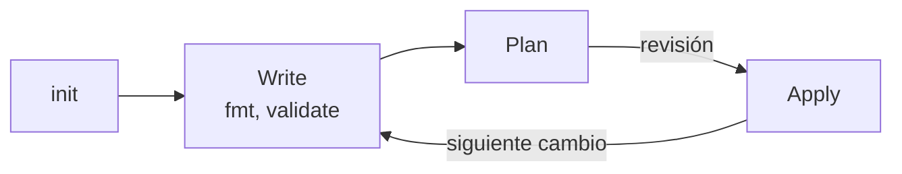

---
tags:
  - terraform
  - certificacion
  - terraform-associate
  - iac
  - ci-cd
---

# Objetivo 3: Core Terraform workflow

> El ciclo Write → Plan → Apply y los comandos que lo implementan: `init`, `validate`, `plan`, `apply`, `destroy` y `fmt`, con sus opciones más preguntadas y salidas reales.

!!! info "Qué evalúa este objetivo"
    Sub-objetivos oficiales de la versión 004:

    - **3a** Describe the Terraform workflow (describir el workflow).
    - **3b** Initialize a Terraform working directory (inicializar un directorio de trabajo).
    - **3c** Validate a Terraform configuration (validar una configuración).
    - **3d** Generate and review an execution plan for Terraform (generar y revisar un plan de ejecución).
    - **3e** Apply changes to infrastructure with Terraform (aplicar cambios).
    - **3f** Destroy Terraform-managed infrastructure (destruir la infraestructura gestionada).
    - **3g** Apply formatting and style adjustments to a configuration (formato y estilo).

    Vuelve al [resumen del examen](resumen-examen.md) para ver el formato y el plan de estudio.

## 3a. El workflow: Write, Plan, Apply

HashiCorp llama **core workflow** (flujo de trabajo principal) a tres pasos:

| Paso | Qué haces | Comandos |
| --- | --- | --- |
| **Write** (escribir) | Editas los `.tf` como cualquier código, en una rama de Git | editor, `terraform fmt`, `terraform validate` |
| **Plan** (planificar) | Previsualizas los cambios y los revisas (tú o tu equipo en un pull request) | `terraform plan` |
| **Apply** (aplicar) | Ejecutas los cambios revisados | `terraform apply` |

`terraform init` va **antes** de todo, una vez por directorio (y otra vez cuando cambian providers, módulos o backend).



El flujo es el mismo en tres contextos, lo que cambia es quién revisa y dónde corre:

| Contexto | Write | Plan | Apply |
| --- | --- | --- | --- |
| **Individual** | Editas en local | `terraform plan` en tu terminal | `terraform apply` en tu terminal |
| **Equipo** (sin plataforma) | Rama y pull request | El pipeline CI publica el plan en el PR | Tras aprobar el PR, el pipeline aplica |
| **HCP Terraform** | Rama y pull request (VCS workflow) | **Speculative plan** (plan especulativo) automático en el PR | Al fusionar, un *run* remoto aplica tras confirmación ([objetivo 8](objetivo-8-hcp-terraform.md)) |

## 3b. terraform init

Prepara el **working directory** (directorio de trabajo). Es **seguro ejecutarlo varias veces**.

| Qué hace | Detalle |
| --- | --- |
| Inicializa el **backend** | Configura dónde vive el state (`local` por defecto) |
| Descarga **módulos** | En `.terraform/modules/` |
| Instala **providers** | En `.terraform/providers/`, respetando el lock file |
| Crea o actualiza `.terraform.lock.hcl` | Con las versiones elegidas y sus hashes |

Salida real (Terraform 1.12.2):

```console
$ terraform init
Initializing the backend...
Initializing modules...
- etiquetas in modules\etiquetas
Initializing provider plugins...
- Finding hashicorp/random versions matching "~> 3.7"...
- Installed hashicorp/random v3.9.1 (signed by HashiCorp)
Terraform has created a lock file .terraform.lock.hcl to record the provider
selections it made above. Include this file in your version control repository
...
Terraform has been successfully initialized!
```

| Opción | Para qué |
| --- | --- |
| `-upgrade` | Actualiza providers y módulos a la versión más nueva permitida por las restricciones |
| `-backend-config=archivo` o `-backend-config="clave=valor"` | **Partial configuration** (configuración parcial) del backend: datos que no quieres en el código |
| `-reconfigure` | Ignora la configuración de backend anterior (no migra el state) |
| `-migrate-state` | Copia el state del backend anterior al nuevo |
| `-backend=false` | No inicializa el backend (útil para validar en CI sin credenciales) |
| `-input=false` | No pide datos interactivos (pipelines) |

!!! tip "En el examen"
    - Si cambias el **backend**, añades un **módulo** o cambias un **provider**, hay que volver a ejecutar `init`. Terraform te avisa: *"Backend initialization required, please run terraform init"*.
    - `init` **no** crea infraestructura ni lee el state para planificar.
    - `terraform get` solo descarga módulos (`init` ya lo hace).

## 3c. terraform validate

Comprueba que la configuración es **sintácticamente válida y coherente**: tipos de argumentos, referencias a variables o recursos que existen, atributos obligatorios.

```console
$ terraform validate
Success! The configuration is valid.
```

- **No** accede a APIs remotas, **no** lee el state ni valida valores reales de la nube (si un tipo de instancia no existe, `validate` no lo sabe).
- Requiere que el directorio esté inicializado (necesita los esquemas de los providers). En CI puedes usar `terraform init -backend=false` y luego `validate`.
- `-json` produce salida legible por máquinas (para editores y pipelines).

!!! tip "En el examen"
    `validate` detecta **errores de sintaxis y de referencias**; no detecta errores que solo la API conoce (nombre de bucket repetido, cuota agotada). Esos aparecen en `apply`.

## 3d. terraform plan

Genera un **execution plan** (plan de ejecución):

1. Lee el state actual y hace **refresh** de los objetos reales.
2. Compara la configuración con ese estado.
3. Construye el **resource graph** (grafo de recursos) para ordenar las acciones y paralelizar lo independiente.
4. Muestra las acciones propuestas **sin ejecutarlas**.

Salida real del laboratorio (recortada):

```console
$ terraform plan -out=lab.tfplan
Terraform used the selected providers to generate the following execution
plan. Resource actions are indicated with the following symbols:
  + create
 <= read (data resources)

  # local_file.saludo will be created
  # random_pet.nombre will be created

Plan: 2 to add, 0 to change, 0 to destroy.

Saved the plan to: lab.tfplan

To perform exactly these actions, run the following command to apply:
    terraform apply "lab.tfplan"
```

| Símbolo | Acción |
| --- | --- |
| `+` | Create (crear) |
| `-` | Destroy (destruir) |
| `~` | Update in-place (actualizar sin recrear) |
| `-/+` | Replace: destruye y luego crea |
| `+/-` | Replace con `create_before_destroy`: crea y luego destruye |
| `<=` | Read: lee un data source durante el apply |

| Opción | Para qué |
| --- | --- |
| `-out=archivo` | Guarda el plan para aplicarlo **exactamente** (el archivo puede contener secretos: no lo subas a Git) |
| `-var="k=v"`, `-var-file=archivo` | Valores de variables |
| `-destroy` | Planifica la destrucción de todo |
| `-refresh-only` | Solo muestra lo que cambió fuera de Terraform ([objetivo 6](objetivo-6-7-estado-y-mantenimiento.md#6d-drift-y-refactorizacion-del-state)) |
| `-refresh=false` | No consulta los objetos reales (más rápido, menos preciso) |
| `-replace=DIRECCIÓN` | Fuerza el reemplazo de un recurso |
| `-target=DIRECCIÓN` | Limita el plan a un recurso y sus dependencias. Solo para casos excepcionales |
| `-detailed-exitcode` | Exit code 0 = sin cambios, 1 = error, 2 = hay cambios (detectar drift en CI) |

Ver el grafo que usa el plan (salida real de `terraform graph`, formato DOT):

```console
$ terraform graph
digraph G {
  rankdir = "RL";
  ...
  "data.archive_file.paquete" -> "local_file.config";
  "local_file.config" -> "random_pet.proyecto";
}
```

!!! tip "En el examen"
    - `plan` **no modifica** la infraestructura ni el state guardado.
    - Si aplicas un plan guardado y el state cambió desde que se generó, Terraform lo rechaza (*stale plan*, plan obsoleto).
    - `terraform show lab.tfplan` muestra un plan guardado; `terraform show -json` lo da en JSON (lo usan los escáneres como Checkov).

## 3e. terraform apply

Sin argumentos, `apply` **genera un plan nuevo**, lo muestra y pide confirmación (`yes`). Con un archivo de plan, aplica ese plan **sin preguntar**.

```console
$ terraform apply lab.tfplan
random_pet.nombre: Creating...
random_pet.nombre: Creation complete after 0s [id=dev-patient-gazelle]
local_file.saludo: Creating...
local_file.saludo: Creation complete after 0s [id=4b4fbf7b3f6de9d207daea53d7e21f338900eb19]

Apply complete! Resources: 2 added, 0 changed, 0 destroyed.

Outputs:

nombre = "dev-patient-gazelle"
```

| Opción | Para qué |
| --- | --- |
| `-auto-approve` | No pide confirmación (solo en automatización controlada) |
| `-replace=DIRECCIÓN` | Recrea un recurso aunque no haya cambios (sustituye a `terraform taint`) |
| `-refresh-only` | Actualiza el state y los outputs con la realidad sin tocar la infraestructura |
| `-parallelism=N` | Operaciones simultáneas (por defecto **10**) |
| `-lock-timeout=60s` | Espera a que se libere el lock del state |

!!! warning "Si el apply falla a medias"
    Terraform **no hace rollback** (no revierte) automáticamente. Los recursos creados antes del error quedan en el state; corriges el problema y vuelves a ejecutar `apply`, que continúa desde ahí. Un recurso que falló al crearse puede quedar marcado como **tainted** (contaminado) y se reemplazará en el siguiente apply.

## 3f. terraform destroy

Destruye **todos** los recursos gestionados por la configuración en el workspace actual, en orden inverso de dependencias. Es un alias de `terraform apply -destroy`.

```console
$ terraform plan -destroy
Plan: 0 to add, 0 to change, 5 to destroy.
$ terraform destroy -auto-approve
random_pet.proyecto: Destroying... [id=lab-dev-massive-koala]
random_pet.proyecto: Destruction complete after 0s
Destroy complete! Resources: 5 destroyed.
```

- No toca recursos que no están en el state (creados a mano, o sacados con `state rm` o `removed`).
- Los archivos que generan **data sources** (como el `.zip` de `archive_file` del laboratorio) **no** se borran: no son recursos gestionados. En la nube pasa lo mismo con todo lo que no crea Terraform.
- Para destruir **solo** un recurso: quítalo del código y aplica, o en emergencias `terraform destroy -target=DIRECCIÓN`.
- `lifecycle { prevent_destroy = true }` hace fallar cualquier plan que destruya ese recurso.

## 3g. terraform fmt

Reescribe los archivos al **estilo canónico** de HCL: indentación de 2 espacios, alineación de los `=`, espacios. No cambia el significado.

Salida real con un archivo desalineado:

```console
$ terraform fmt -check -recursive
main.tf
variables.tf
$ echo $?
3
$ terraform fmt -diff
--- old/variables.tf
+++ new/variables.tf
@@ -12,8 +12,8 @@
   type = map(object({
-    puerto   = number
-    publico  = optional(bool, false)
+    puerto  = number
+    publico = optional(bool, false)
   }))
```

| Opción | Para qué |
| --- | --- |
| (sin opciones) | Formatea los `.tf` del directorio actual y lista los archivos modificados |
| `-recursive` | Incluye subdirectorios (módulos) |
| `-check` | No modifica: sale con código distinto de 0 si algo necesita formato (ideal en CI) |
| `-diff` | Muestra las diferencias (además de aplicarlas, salvo con `-check`) |

Convenciones de estilo que el examen puede mencionar: 2 espacios, alinear `=` de argumentos consecutivos, argumentos simples antes que bloques anidados, meta-argumentos (`count`, `for_each`) al principio del bloque y `lifecycle` al final; nombres de recursos en `snake_case`.

## Casos de uso

1. **El pipeline debe fallar si alguien sube código sin formatear.** `terraform fmt -check -recursive` como primer paso del job.
2. **Validar en CI sin credenciales de la nube.** `terraform init -backend=false` y `terraform validate`.
3. **Aplicar exactamente lo que se aprobó en el pull request.** `terraform plan -out=tfplan` en el job de plan, guardar el archivo como artifact protegido y `terraform apply tfplan` en el job de apply.
4. **Un servidor quedó en mal estado y hay que recrearlo sin cambiar código.** `terraform apply -replace=aws_instance.web`.
5. **El entorno de pruebas debe borrarse cada noche.** Job programado con `terraform destroy -auto-approve` en ese directorio/workspace, con alerta si falla.
6. **Detectar si alguien cambió la infraestructura a mano.** `terraform plan -detailed-exitcode` programado; exit code 2 significa cambios pendientes.
7. **Añadiste un módulo nuevo y `plan` da error de "Module not installed".** Ejecuta `terraform init` de nuevo.

Más sobre cómo encaja en un pipeline en [Pipeline CI/CD con GitHub Actions](../../../devops/ci-cd/ci-cd-github-actions.md) e [Infrastructure as Code: panorama y herramientas](../../../devops/iac/infraestructura-como-codigo.md#flujo-en-cicd).

## Preguntas de práctica

**1.** ¿Qué comando debes ejecutar primero en un directorio recién clonado con código Terraform?

- A. `terraform plan`
- B. `terraform validate`
- C. `terraform init`
- D. `terraform apply`

??? success "Respuesta"
    **C.** Sin `init` no hay providers, módulos ni backend; `validate`, `plan` y `apply` fallan pidiendo inicializar.

**2.** ¿Qué afirmaciones sobre `terraform validate` son correctas? (Elige DOS.)

- A. Comprueba que las referencias a variables y recursos existen.
- B. Verifica con la API del proveedor que el tipo de instancia existe.
- C. Puede ejecutarse sin acceso al backend remoto.
- D. Actualiza el state con la realidad.

??? success "Respuesta"
    **A y C.** B es falso: no llama a APIs. D es falso: eso es un refresh (`apply -refresh-only`).

**3.** En la salida de `plan` ves `-/+` delante de un recurso. ¿Qué significa?

- A. Se actualizará sin interrupción.
- B. Se destruirá y se volverá a crear.
- C. Se leerá como data source.
- D. Se eliminará del state sin destruirlo.

??? success "Respuesta"
    **B.** `-/+` es un replace (primero destruye). Si tuviera `create_before_destroy`, verías `+/-`. A es `~`; C es `<=`; D no tiene símbolo en el plan (sería un `removed` u `state rm`).

**4.** Verdadero o falso: si `terraform apply` falla a mitad, Terraform revierte automáticamente los recursos que ya creó.

??? success "Respuesta"
    **Falso.** No hay rollback automático. Los recursos creados quedan en el state y el siguiente `apply` continúa desde ahí.

**5.** Un pipeline ejecuta `terraform fmt -check`. ¿Qué pasa si un archivo no tiene el formato canónico?

- A. Lo formatea y continúa con código 0.
- B. No lo modifica y termina con un código distinto de 0.
- C. Borra el archivo.
- D. Muestra un plan.

??? success "Respuesta"
    **B.** `-check` solo comprueba (en la prueba real devolvió 3). Sin `-check`, `fmt` sí modificaría el archivo (A).

**6.** ¿Qué comando es equivalente a `terraform destroy`?

- A. `terraform apply -destroy`
- B. `terraform plan -refresh-only`
- C. `terraform state rm -all`
- D. `terraform init -reconfigure`

??? success "Respuesta"
    **A.** B solo compara con la realidad. C no existe y `state rm` no destruye nada. D reconfigura el backend.

**7.** ¿Qué ventaja tiene `terraform plan -out=tfplan` seguido de `terraform apply tfplan`?

- A. El plan se cifra automáticamente.
- B. Se aplica exactamente lo revisado; si el state cambió entretanto, el apply se rechaza.
- C. Evita tener que ejecutar `init`.
- D. Desactiva el state locking.

??? success "Respuesta"
    **B.** A es falso: el archivo de plan puede contener secretos sin cifrar. C y D no tienen relación.

## Para profundizar

- [Infrastructure as Code con Terraform](../../../devops/iac/terraform-basico.md#workflow-ciclo-de-trabajo): workflow, lectura del plan y guardar el plan.
- [Pipeline CI/CD con GitHub Actions](../../../devops/ci-cd/ci-cd-github-actions.md) y [Seguridad del pipeline](../../../devsecops/identidades-y-pipeline/seguridad-pipeline.md): plan en el PR, aprobaciones, permisos del runner.
- [Seguridad de IaC](../../../devsecops/infraestructura-y-contenedores/seguridad-iac.md#drift-detection): `-detailed-exitcode` para drift.
- [Guía de comandos de Terraform](../../../recursos/comandos/terraform.md).
- Siguiente: [Objetivo 4: Terraform configuration](objetivo-4-configuracion.md).

## Referencias

- [The core Terraform workflow](https://developer.hashicorp.com/terraform/intro/core-workflow)
- [Command: init](https://developer.hashicorp.com/terraform/cli/commands/init)
- [Command: validate](https://developer.hashicorp.com/terraform/cli/commands/validate)
- [Command: plan](https://developer.hashicorp.com/terraform/cli/commands/plan)
- [Command: apply](https://developer.hashicorp.com/terraform/cli/commands/apply)
- [Command: destroy](https://developer.hashicorp.com/terraform/cli/commands/destroy)
- [Command: fmt](https://developer.hashicorp.com/terraform/cli/commands/fmt)
- [Style guide](https://developer.hashicorp.com/terraform/language/style)
- [Resource graph](https://developer.hashicorp.com/terraform/internals/graph)
