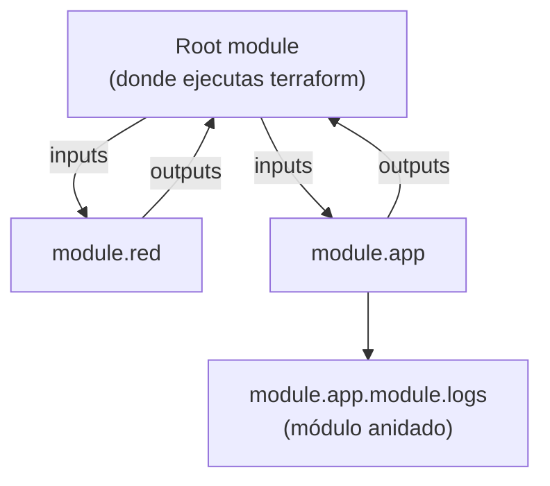

---
tags:
  - terraform
  - certificacion
  - terraform-associate
  - iac
---

# Objetivo 5: Terraform modules

> De dónde vienen los módulos, cómo pasan los valores entre módulo padre e hijo, cómo se usan con `count` y `for_each` y cómo se fijan sus versiones.

!!! info "Qué evalúa este objetivo"
    Sub-objetivos oficiales de la versión 004:

    - **5a** Explain how Terraform sources modules (de dónde obtiene Terraform los módulos).
    - **5b** Describe variable scope within modules (alcance de las variables dentro de los módulos).
    - **5c** Use modules in configuration (usar módulos en la configuración).
    - **5d** Manage module versions (gestionar versiones de módulos).

    Vuelve al [resumen del examen](resumen-examen.md) para ver el formato y el plan de estudio.

## ¿Qué es un módulo?

Un **module** (módulo) es **cualquier carpeta con archivos `.tf`**. La carpeta donde ejecutas `terraform` es el **root module** (módulo raíz); los que llama con bloques `module` son **child modules** (módulos hijo). Sirven para **encapsular y reutilizar** patrones: una red, un clúster, una aplicación estándar.



## 5a. Fuentes de módulos

El argumento `source` indica de dónde se obtiene el módulo. `terraform init` lo descarga en `.terraform/modules/` (los locales no se copian, se usan en su sitio).

| Fuente | Ejemplo de `source` | ¿Admite `version`? |
| --- | --- | --- |
| **Ruta local** | `"./modules/red"` o `"../comun/red"` (debe empezar por `./` o `../`) | No |
| **Terraform Registry** público | `"terraform-aws-modules/vpc/aws"` → `NAMESPACE/NOMBRE/PROVIDER` | **Sí** |
| **Private registry** de HCP Terraform / Terraform Enterprise | `"app.terraform.io/mi-org/red/aws"` → `HOSTNAME/ORG/NOMBRE/PROVIDER` | **Sí** |
| **GitHub** | `"github.com/mi-org/terraform-red"` | No (usa `?ref=`) |
| **Git genérico** | `"git::https://ejemplo.com/red.git?ref=v1.2.0"` (también `git::ssh://`) | No (usa `?ref=` con tag, rama o commit) |
| **Bitbucket**, **Mercurial** | `"bitbucket.org/org/repo"`, `"hg::https://..."` | No |
| **HTTP(S)** | `"https://ejemplo.com/red.zip"` | No |
| **S3** / **GCS** | `"s3::https://s3.amazonaws.com/bucket/red.zip"`, `"gcs::https://..."` | No |

Un **subdirectorio** dentro de un paquete se indica con doble barra: `"git::https://ejemplo.com/infra.git//modules/red?ref=v1.2.0"`.

!!! tip "En el examen"
    - Los módulos del **Registry** público tienen la forma `<NAMESPACE>/<NAME>/<PROVIDER>` y por convención el repositorio se llama `terraform-<PROVIDER>-<NAME>`.
    - Un módulo **verified** (verificado) en el Registry lo publica un partner verificado por HashiCorp.
    - Después de añadir o cambiar un `source` hay que ejecutar `terraform init` (o `terraform get`).

## 5b. Alcance de las variables

Cada módulo tiene **su propio espacio de nombres**. Un módulo hijo **no ve** las variables, locals ni recursos del padre, y el padre **no ve** los recursos internos del hijo. Lo único que cruza la frontera:

| Dirección | Mecanismo |
| --- | --- |
| Padre → hijo | **Input variables** del hijo, asignadas como argumentos en el bloque `module` |
| Hijo → padre | **Outputs** del hijo, leídos como `module.NOMBRE.OUTPUT` |
| Providers | Se **heredan** por defecto (la configuración por defecto); los alias se pasan con `providers = { ... }` |

Pruebas reales con Terraform 1.12.2:

```console
# Un módulo hijo intenta usar var.entorno, que solo existe en el padre
$ terraform validate
Error: Reference to undeclared input variable
  on modules\nombre\main.tf line 16, in resource "random_pet" "this":
  16:   prefix = var.entorno
An input variable with the name "entorno" has not been declared.

# El padre intenta leer un recurso interno del hijo
$ echo 'module.nombres["web"].random_pet.this' | terraform console
Error: Unsupported attribute
```

!!! tip "En el examen"
    "¿Cómo accede el módulo raíz al ID de un recurso creado dentro de un módulo hijo?" → el hijo debe **declarar un output** y el padre lo lee con `module.<nombre>.<output>`. No hay otra forma. Las variables del hijo sin `default` son **obligatorias** en el bloque `module`.

## 5c. Usar módulos

Módulo hijo probado:

```hcl title="modules/nombre/main.tf"
terraform {
  required_providers {
    random = {
      source  = "hashicorp/random"
      version = ">= 3.5" # en módulos reutilizables, solo versión mínima
    }
  }
}

variable "prefijo" {
  type        = string
  description = "Prefijo del nombre"
}

resource "random_pet" "this" {
  prefix = var.prefijo
}

output "id" {
  value = random_pet.this.id
}
```

Llamada desde el módulo raíz, con `for_each` sobre el módulo:

```hcl title="main.tf"
module "nombres" {
  source   = "./modules/nombre"
  for_each = toset(["web", "api"])

  prefijo = "${var.entorno}-${each.key}"
}

output "nombres" {
  value = { for k, m in module.nombres : k => m.id }
}
```

```console
$ terraform apply -auto-approve
Outputs:

nombres = {
  "api" = "dev-api-meet-firefly"
  "web" = "dev-web-bright-loon"
}
$ terraform state list
module.nombres["api"].random_pet.this
module.nombres["web"].random_pet.this
```

Meta-argumentos que acepta un bloque `module`: `source`, `version`, `count`, `for_each`, `providers` y `depends_on`.

```hcl
# Ilustrativo: pasar un provider con alias a un módulo
module "replica" {
  source = "./modules/bucket"

  providers = {
    aws = aws.europa
  }
}
```

### Estructura estándar de un módulo

| Archivo | Contenido |
| --- | --- |
| `main.tf` | Recursos |
| `variables.tf` | Inputs, con `description` y `type` |
| `outputs.tf` | Outputs |
| `versions.tf` | `required_providers` con versiones mínimas |
| `README.md` | Documentación (el Registry la muestra) |
| `examples/`, `modules/` | Ejemplos de uso y submódulos |

Buenas prácticas: los módulos reutilizables **no** deben tener bloques `provider` propios (los recibe del raíz) y deben declarar versiones mínimas (`>=`), dejando que el raíz fije las exactas. Evita módulos que solo envuelven un recurso sin añadir valor.

## 5d. Versiones de módulos

`version` solo funciona con módulos de un **registry** (público o privado). Acepta las mismas restricciones que los providers (`=`, `>=`, `~>`):

```hcl
module "vpc" {
  source  = "terraform-aws-modules/vpc/aws"
  version = "~> 6.0"
  # ...
}
```

Con un módulo local, Terraform lo rechaza (salida real):

```console
$ terraform init
Error: Invalid registry module source address
  on main.tf line 7, in module "nombres":
Failed to parse module registry address: can't use local directory
```

| Fuente | Cómo fijar la versión |
| --- | --- |
| Registry público o privado | `version = "~> 1.2"` |
| Git / GitHub | `?ref=v1.2.0` (tag), `?ref=<sha>` (commit; lo más inmutable) |
| Local | No se versiona por separado: va con el repositorio |

!!! tip "En el examen"
    - Las versiones de **módulos no** se guardan en `.terraform.lock.hcl` (solo providers). Para fijarlas, usa `version` exacta o `ref` a un tag/commit.
    - `terraform init -upgrade` descarga la versión más nueva de los módulos que cumpla la restricción.
    - Sin `version`, Terraform usa **la última** versión publicada: arriesgado.

## Casos de uso

1. **Tres equipos crean la misma red con pequeñas diferencias.** Un módulo `red` con variables para CIDR y número de subredes, publicado en el **private registry** de HCP Terraform.
2. **Usar un módulo de la comunidad para una VPC sin que cambie por sorpresa.** `source = "terraform-aws-modules/vpc/aws"` con `version = "~> 6.0"` y revisar el plan al hacer `init -upgrade`.
3. **El módulo vive en un repositorio Git interno.** `source = "git::ssh://git@ejemplo.com/infra/red.git?ref=v2.1.0"`.
4. **Crear el mismo componente para varios clientes.** `for_each` sobre el bloque `module` con un mapa de clientes.
5. **El raíz necesita el ID de la subred creada dentro del módulo.** Output `subnet_id` en el módulo y referencia `module.red.subnet_id`.
6. **Desplegar el módulo en una segunda región.** Provider con alias y `providers = { aws = aws.europa }` en el bloque `module`.
7. **Mover recursos del raíz a un módulo nuevo sin recrearlos.** Bloques `moved` con `from = aws_s3_bucket.logs` y `to = module.logs.aws_s3_bucket.this` ([objetivo 6](objetivo-6-7-estado-y-mantenimiento.md#6d-drift-y-refactorizacion-del-state)).

## Preguntas de práctica

**1.** ¿Cuál de estas fuentes de módulo admite el argumento `version`?

- A. `"./modules/red"`
- B. `"git::https://ejemplo.com/red.git"`
- C. `"terraform-aws-modules/vpc/aws"`
- D. `"https://ejemplo.com/red.zip"`

??? success "Respuesta"
    **C.** Solo los módulos de un registry admiten `version`. Con Git (B) se usa `?ref=`; local (A) y HTTP (D) no se versionan así.

**2.** Un módulo hijo necesita el valor de `var.region` del módulo raíz. ¿Qué haces?

- A. Nada: el hijo hereda todas las variables del padre.
- B. Declarar `variable "region"` en el hijo y pasarla en el bloque `module`.
- C. Usar `parent.var.region`.
- D. Declararla como `local` en el raíz.

??? success "Respuesta"
    **B.** Cada módulo tiene su propio alcance. A es falso (solo se heredan los providers). C no existe. D no la hace visible para el hijo.

**3.** ¿Cómo se lee en el raíz el output `bucket_arn` de `module "logs"`?

- A. `module.logs.bucket_arn`
- B. `output.logs.bucket_arn`
- C. `logs.output.bucket_arn`
- D. `module.logs.aws_s3_bucket.this.arn`

??? success "Respuesta"
    **A.** D no funciona: los recursos internos de un módulo no son accesibles desde fuera.

**4.** Verdadero o falso: `.terraform.lock.hcl` fija las versiones exactas de los módulos del Registry.

??? success "Respuesta"
    **Falso.** El lock file solo registra providers. Para módulos se usa `version` o `?ref=`.

**5.** ¿Qué meta-argumentos acepta un bloque `module`? (Elige DOS.)

- A. `for_each`
- B. `lifecycle`
- C. `providers`
- D. `provisioner`

??? success "Respuesta"
    **A y C.** Un bloque `module` acepta `source`, `version`, `count`, `for_each`, `providers` y `depends_on`. `lifecycle` y `provisioner` son de recursos.

**6.** ¿Qué formato tiene la dirección de un módulo del private registry de HCP Terraform?

- A. `<NAMESPACE>/<NAME>/<PROVIDER>`
- B. `<HOSTNAME>/<ORGANIZATION>/<NAME>/<PROVIDER>`
- C. `private::<NAME>`
- D. `registry://<ORGANIZATION>/<NAME>`

??? success "Respuesta"
    **B.** Por ejemplo `app.terraform.io/mi-org/red/aws`. A es el formato del Registry público.

**7.** Añades un nuevo bloque `module` y ejecutas `terraform plan`. Falla diciendo que el módulo no está instalado. ¿Qué falta?

- A. `terraform fmt`
- B. `terraform init` (o `terraform get`)
- C. `terraform validate`
- D. `terraform apply -refresh-only`

??? success "Respuesta"
    **B.** Los módulos se descargan/registran en `init`. Las demás opciones no instalan módulos.

## Para profundizar

- [Infrastructure as Code con Terraform](../../../devops/iac/terraform-basico.md#modules-modulos): uso de un módulo del Registry.
- [Terraform workspaces](../../../devops/iac/terraform-workspaces.md#alternativa-un-directorio-por-entorno): un directorio por entorno que reutiliza módulos.
- [Infrastructure as Code: panorama y herramientas](../../../devops/iac/infraestructura-como-codigo.md#estructura-de-un-repositorio-de-iac): estructura de repositorio y Terragrunt.
- [Pruebas de infraestructura](../../../devops/iac/pruebas-infraestructura.md): probar módulos con `terraform test` y Terratest.
- [Software supply chain](../../../devsecops/codigo-y-dependencias/cadena-suministro.md): version pinning de dependencias de terceros.
- Siguiente: [Objetivos 6 y 7: state y mantenimiento](objetivo-6-7-estado-y-mantenimiento.md).

!!! example "Practica en el laboratorio"
    - [Lab 08: Terraform sin nube: providers locales y workspaces](../../../laboratorios/devops/terraform-local-workspaces.md)

## Referencias

- [Modules overview](https://developer.hashicorp.com/terraform/language/modules)
- [Module sources](https://developer.hashicorp.com/terraform/language/modules/sources)
- [Module block reference](https://developer.hashicorp.com/terraform/language/block/module)
- [Module composition](https://developer.hashicorp.com/terraform/language/modules/develop/composition)
- [Terraform Registry: publishing modules](https://developer.hashicorp.com/terraform/registry/modules/publish)
- [HCP Terraform private registry](https://developer.hashicorp.com/terraform/cloud-docs/registry)
