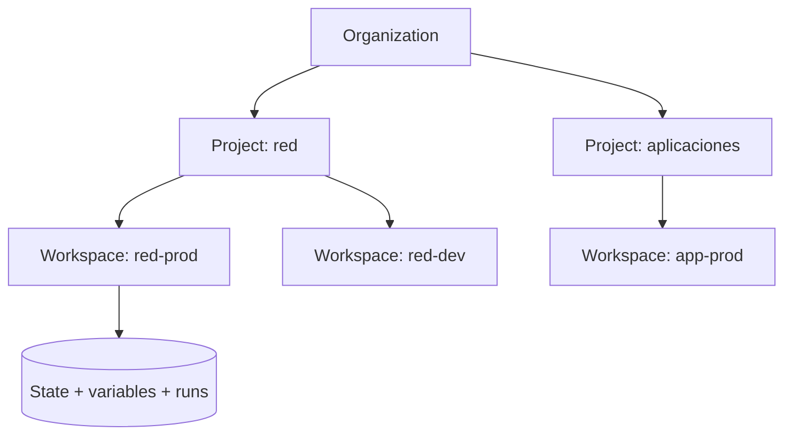
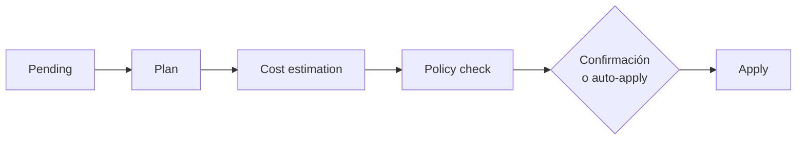
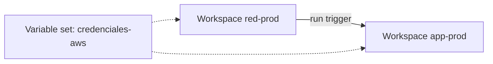

---
tags:
  - terraform
  - certificacion
  - terraform-associate
  - iac
  - ci-cd
  - cumplimiento
---

# Objetivo 8: HCP Terraform

> Qué añade HCP Terraform (antes *Terraform Cloud*) a la CLI: runs remotos, workspaces y projects, variables y variable sets, gobierno con políticas, registry privado, health y credenciales dinámicas; y cómo se conecta la CLI con `terraform login` y el bloque `cloud`.

!!! info "Qué evalúa este objetivo"
    Sub-objetivos oficiales de la versión 004 (8c es **nuevo** respecto a la 003, y la 004 incluye más contenido de HCP Terraform):

    - **8a** Use HCP Terraform to create infrastructure (crear infraestructura con HCP Terraform).
    - **8b** Describe HCP Terraform collaboration and governance features (funciones de colaboración y gobierno).
    - **8c** Describe how to organize and use HCP Terraform workspaces and projects (organizar workspaces y projects).
    - **8d** Configure and use HCP Terraform integration (configurar la integración con la CLI).

    Vuelve al [resumen del examen](resumen-examen.md) para ver el formato y el plan de estudio.

!!! note "Sin laboratorio local"
    Este objetivo necesita una organización de HCP Terraform (hay un plan gratuito con límite de recursos gestionados). Los ejemplos de HCL de esta nota son ilustrativos: no se pudieron probar sin cuenta. Las funciones y nombres se verificaron en la documentación oficial (octubre de 2026).

## Qué es HCP Terraform y cómo se diferencia

**HCP Terraform** es la plataforma SaaS de HashiCorp para ejecutar Terraform **en equipo**: guarda el state, ejecuta los planes y applies en sus propios entornos, aplica políticas y da visibilidad. Antes se llamaba **Terraform Cloud**. **Terraform Enterprise** es la versión **self-hosted** (autogestionada, en tu infraestructura) de la misma plataforma, para organizaciones con requisitos de aislamiento o cumplimiento.

| | Terraform Community Edition (CLI) | HCP Terraform | Terraform Enterprise |
| --- | --- | --- | --- |
| Dónde corre | Tu equipo o tu pipeline | SaaS de HashiCorp | Tu infraestructura (self-hosted) |
| State | Lo gestionas tú (backend) | Gestionado, cifrado, versionado, con locking | Igual, en tu infraestructura |
| Ejecución | Local | Remota (o local, o agentes) | Remota en tu infraestructura |
| Políticas (Sentinel/OPA), private registry, teams, SSO, audit | No | Sí (según el plan) | Sí |
| Costo | Gratis | Plan gratuito y planes de pago por recurso gestionado | Licencia |

!!! tip "En el examen"
    Si la pregunta menciona **políticas**, **aprobaciones**, **equipos con permisos**, **registry privado**, **run triggers**, **variable sets**, **drift detection continuo** o **projects**, la respuesta es HCP Terraform o Terraform Enterprise, no la CLI. Si dice "**self-hosted**" o "**air-gapped**" (sin conexión a internet), es **Terraform Enterprise**.

## 8a. Crear infraestructura con HCP Terraform

### Jerarquía



| Nivel | Qué es |
| --- | --- |
| **Organization** (organización) | Contenedor de todo: usuarios, equipos, plan de facturación, políticas, registry privado |
| **Project** (proyecto) | Agrupa workspaces; se asignan permisos y variable sets a nivel de project |
| **Workspace** | Unidad de trabajo: **una configuración + su state + sus variables + historial de runs + permisos** |
| **Run** (ejecución) | Un plan (y opcionalmente un apply) sobre un workspace |

### Tres formas de disparar runs (workflows)

| Workflow | Cómo funciona | Para quién |
| --- | --- | --- |
| **VCS-driven** (basado en control de versiones) | El workspace se conecta a un repositorio (GitHub, GitLab, Bitbucket, Azure DevOps). Un pull request genera un **speculative plan** (solo plan, no se puede aplicar) con el resultado en el PR; un merge en la rama configurada genera un run completo | Equipos que quieren GitOps sin mantener un pipeline propio |
| **CLI-driven** | Ejecutas `terraform plan`/`apply` en tu terminal y el run ocurre **en HCP Terraform**: la salida llega en streaming a tu consola | Quien ya trabaja con la CLI o con su propio pipeline |
| **API-driven** | Un sistema externo sube la configuración y crea runs con la API | Integraciones a medida |

### Fases de un run



Entre las fases pueden ejecutarse **run tasks** (integraciones de terceros, como escáneres de seguridad o de costos) en *pre-plan*, *post-plan*, *pre-apply* y *post-apply*.

### Execution modes

| Modo | Dónde corre Terraform | Notas |
| --- | --- | --- |
| **Remote** | En máquinas temporales de HCP Terraform | Permite políticas, cost estimation, notificaciones, VCS |
| **Local** | En tu equipo; HCP Terraform solo guarda el state | No usa las variables del workspace ni variable sets |
| **Agent** | En **HCP Terraform agents** que instalas en tu red | Para llegar a recursos privados u on-premises |

Por defecto un workspace hereda el modo del **project** ("Project Default").

### Variables del workspace

| Categoría | Uso |
| --- | --- |
| **Terraform variable** | Equivale a un valor de `variable` (como un `.tfvars`); puede ser HCL |
| **Environment variable** | Variable de entorno del run: credenciales de provider, `TF_LOG`, `TF_VAR_...` |
| **Sensitive** (marca) | El valor no se puede volver a leer en la UI ni en la API, solo sobrescribirlo |

!!! tip "En el examen"
    - En un workspace **conectado a VCS** no puedes hacer `terraform apply` desde la CLI: el repositorio es la fuente de verdad. Sí puedes lanzar **speculative plans**.
    - Las variables de entorno de tu terminal (salvo `TF_VAR_...`) **no** viajan al run remoto: las credenciales del provider se configuran en el workspace (mejor con dynamic credentials).
    - Desde Terraform 1.6 se puede hacer `plan -out` y `apply` del plan guardado también con HCP Terraform.

## 8b. Colaboración y gobierno

| Función | Qué resuelve |
| --- | --- |
| **Teams** (equipos) y permisos | Acceso por organización, project o workspace (leer, planificar, aplicar, administrar) |
| **Private registry** (registry privado) | Publicar módulos y providers internos con versionado; los módulos **no-code ready** permiten crear workspaces sin escribir HCL |
| **Policy enforcement** (aplicación de políticas) | **Sentinel** u **OPA** en *policy sets*, evaluados entre plan y apply |
| **Run tasks** | Integrar herramientas externas en el run |
| **Health** | **Drift detection** (planes de refresh periódicos que avisan de cambios fuera de Terraform) y **continuous validation** (reevalúa `check` blocks y condiciones) |
| **Explorer** | Vista de toda la organización: workspaces, versiones de Terraform, providers y módulos en uso, workspaces con drift |
| **Change requests** | Registros de tareas en un workspace (por ejemplo, "actualiza este módulo deprecated"), creados por administradores, a menudo desde Explorer. Disponibles en las ediciones **Standard** y **Premium** |
| **Dynamic provider credentials** | El run se autentica en AWS, Azure, Google Cloud, Vault o Kubernetes con **OIDC** y credenciales temporales: sin llaves estáticas guardadas |
| **Variable sets** | Variables reutilizables aplicadas a varios workspaces o projects ([8c](#8c-organizar-workspaces-y-projects)) |
| **Notifications**, **audit trails**, **SSO** | Avisos de runs, registro de auditoría, inicio de sesión corporativo |

### Niveles de enforcement de las políticas

| Framework | Niveles | Efecto si la política falla |
| --- | --- | --- |
| **Sentinel** | `advisory` | Solo avisa |
| | `soft-mandatory` | Bloquea, pero alguien con permiso puede hacer **override** (saltarla) |
| | `hard-mandatory` | Bloquea; por defecto no admite override (en versiones recientes el policy set puede configurarse para permitirlo) |
| **OPA** (Rego) | `advisory` | Solo avisa |
| | `mandatory` | Bloquea, pero un usuario con permiso **Manage Policy Overrides** puede hacer override |

El detalle de Sentinel y OPA como policy as code está en [Seguridad de IaC](../../../devsecops/infraestructura-y-contenedores/seguridad-iac.md#policy-as-code).

!!! warning "Funciones según el plan"
    Qué funciones incluye cada edición (Free, Essentials, Standard, Premium) cambia con frecuencia. Para el examen basta con saber **qué hace** cada función; para usarlas, revisa la página de precios vigente.

## 8c. Organizar workspaces y projects

### CLI workspaces vs workspaces de HCP Terraform

| | CLI workspace (`terraform workspace`) | Workspace de HCP Terraform |
| --- | --- | --- |
| Qué es | Otro **state** para la misma configuración y backend | Unidad completa: configuración, state, variables, permisos, runs |
| Credenciales y permisos | Compartidos con los demás workspaces | **Propios** de cada workspace |
| Variables | Las de tu terminal y archivos | Variables del workspace + variable sets |
| Ideal para | Entornos temporales casi idénticos | Separar entornos y componentes con controles distintos |

Más sobre los CLI workspaces en [Terraform workspaces](../../../devops/iac/terraform-workspaces.md).

### Cómo organizar

| Herramienta | Uso |
| --- | --- |
| **Projects** | Agrupar workspaces por equipo, aplicación o unidad de negocio; dar permisos a un equipo sobre todo un project; fijar el execution mode por defecto |
| **Workspace tags** | Etiquetas (`env:prod`, `team:red`) para filtrar y para que el bloque `cloud` seleccione varios workspaces |
| **Variable sets** | Variables comunes (región, credenciales, etiquetas) aplicadas a toda la organización (*global*), a projects o a workspaces concretos. Un variable set marcado como **priority** tiene precedencia sobre las variables del workspace |
| **Run triggers** | Conectan workspaces: cuando un run termina bien en un workspace **origen** (por ejemplo, `red-prod`), se encola un run en el **destino** (`app-prod`) |

Precedencia de variables en un run de HCP Terraform (de mayor a menor, simplificada):

1. Variable sets marcados como **priority** (global, luego de project, luego de workspace).
2. Variables de la línea de comandos (`-var`, `-var-file`) en runs CLI-driven.
3. Variables `TF_VAR_` del entorno local en runs CLI-driven.
4. Variables **del workspace**.
5. Variable sets sin priority (el más específico gana: de workspace antes que de project, y global al final).
6. Archivos `*.auto.tfvars` y `terraform.tfvars` de la configuración.

Buena práctica habitual: **un workspace por componente y entorno** (`red-prod`, `red-dev`, `app-prod`), en lugar de un único state gigante. Para compartir outputs entre workspaces existen `terraform_remote_state` (con permiso explícito) o el data source `tfe_outputs`.



## 8d. Integración de la CLI con HCP Terraform

### 1. Autenticarse

```console
$ terraform login
```

Abre el navegador para generar un **API token** y lo guarda en `credentials.tfrc.json` (en `~/.terraform.d/` en Linux/macOS, `%APPDATA%\terraform.d\` en Windows). En un pipeline se usa la variable de entorno `TF_TOKEN_app_terraform_io`. `terraform logout` lo elimina.

### 2. Bloque cloud

```hcl title="main.tf (ilustrativo)"
terraform {
  cloud {
    organization = "mi-organizacion"
    # hostname = "app.terraform.io" # por defecto; cámbialo para Terraform Enterprise

    workspaces {
      name    = "red-prod"     # un workspace concreto
      project = "plataforma"
      # tags = ["app"]          # alternativa: varios workspaces por etiqueta (excluyente con name)
    }
  }
}
```

| Regla | Detalle |
| --- | --- |
| Uno por configuración | Solo un bloque `cloud` |
| Excluyente con `backend` | No puedes tener `cloud` y `backend` a la vez |
| Sin referencias | No admite variables ni locals |
| Variables de entorno | `TF_CLOUD_ORGANIZATION`, `TF_CLOUD_HOSTNAME`, `TF_CLOUD_PROJECT`, `TF_WORKSPACE` sustituyen argumentos omitidos (el bloque `cloud` debe existir, aunque esté vacío) |
| `token` en el bloque | Existe, pero no se recomienda: usa `terraform login` |

### 3. Inicializar y migrar el state

```console
$ terraform init
```

Si el proyecto tenía un state local o en otro backend, `init` ofrece **migrarlo** al workspace de HCP Terraform. Después, `terraform plan` y `apply` se ejecutan en remoto (modo Remote) con la salida en tu terminal y un enlace al run en la web.

!!! tip "En el examen"
    - Archivos que no quieres subir con la configuración en un run CLI-driven → **`.terraformignore`**.
    - `terraform login` guarda el token; el bloque `cloud` dice **a qué organización y workspace** conectar; `terraform init` aplica la conexión.
    - Para pasar de backend a `cloud` (o al revés) hay que reinicializar y migrar el state.

## Casos de uso

1. **Tres equipos aplican Terraform desde sus laptops con credenciales personales.** Workspaces remotos con **dynamic provider credentials** y permisos por **team** a nivel de **project**.
2. **Ningún cambio debe abrir el puerto 22 a internet en producción.** Política **Sentinel** u **OPA** `hard-mandatory` en un policy set aplicado a los workspaces de producción.
3. **Se quiere el plan en cada pull request sin mantener un pipeline.** Workflow **VCS-driven**: speculative plan en el PR y run al hacer merge.
4. **Las credenciales y la región se repiten en 40 workspaces.** **Variable set** aplicado al project o global.
5. **La aplicación debe redesplegarse cuando cambia la red.** **Run trigger** de `red-prod` hacia `app-prod`.
6. **Hay que saber qué workspaces usan una versión vieja de un módulo y avisar a sus dueños.** **Explorer** para encontrarlos y **change requests** para pedir la actualización.
7. **Recursos en una red privada sin acceso desde internet.** **Agent** execution mode con HCP Terraform agents dentro de esa red.
8. **Un banco necesita la plataforma en su propio datacenter, sin SaaS.** **Terraform Enterprise**.
9. **Detectar cambios manuales en producción sin esperar al siguiente despliegue.** **Health assessments** con drift detection.

## Preguntas de práctica

**1.** ¿Qué componente de HCP Terraform agrupa workspaces y permite asignar permisos a un equipo sobre todos ellos?

- A. Organization
- B. Project
- C. Variable set
- D. Run trigger

??? success "Respuesta"
    **B.** La organization (A) es el nivel superior que contiene todo; un variable set (C) comparte variables; un run trigger (D) encadena runs.

**2.** Un workspace está conectado a un repositorio de GitHub. ¿Qué pasa si ejecutas `terraform apply` desde tu terminal con el bloque `cloud` apuntando a él?

- A. Se aplica normalmente.
- B. Se rechaza: en workspaces VCS-driven los applies llegan por merge en la rama configurada.
- C. Se ejecuta en local y sube el state.
- D. Se convierte automáticamente en un workspace CLI-driven.

??? success "Respuesta"
    **B.** El repositorio es la fuente de verdad. Desde la CLI sí puedes lanzar un speculative plan.

**3.** ¿Qué nivel de enforcement de Sentinel bloquea el run pero permite que un usuario autorizado lo salte?

- A. `advisory`
- B. `soft-mandatory`
- C. `hard-mandatory`
- D. `mandatory`

??? success "Respuesta"
    **B.** `advisory` solo avisa; `hard-mandatory` bloquea sin override por defecto; `mandatory` es un nivel de OPA, no de Sentinel.

**4.** ¿Qué afirmaciones distinguen un workspace de HCP Terraform de un CLI workspace? (Elige DOS.)

- A. Tiene sus propias variables y permisos.
- B. Comparte las credenciales del backend con los demás workspaces.
- C. Guarda el historial de runs.
- D. Se crea con `terraform workspace new`.

??? success "Respuesta"
    **A y C.** B y D describen CLI workspaces.

**5.** Quieres que los runs se autentiquen en AWS sin guardar access keys en el workspace. ¿Qué función usas?

- A. Sensitive variables
- B. Dynamic provider credentials
- C. Private registry
- D. Run tasks

??? success "Respuesta"
    **B.** Usa OIDC y credenciales temporales. A sigue guardando una llave estática (aunque oculta). C y D no autentican providers.

**6.** ¿Qué comando guarda localmente un token de API para HCP Terraform?

- A. `terraform init -cloud`
- B. `terraform login`
- C. `terraform workspace select`
- D. `terraform connect`

??? success "Respuesta"
    **B.** A y D no existen; C cambia de CLI workspace.

**7.** Verdadero o falso: una configuración puede tener un bloque `backend "s3"` y un bloque `cloud` al mismo tiempo para guardar el state en ambos sitios.

??? success "Respuesta"
    **Falso.** Son mutuamente excluyentes.

**8.** Una organización necesita detectar workspaces cuya infraestructura real ya no coincide con su configuración, de forma periódica. ¿Qué usa?

- A. Explorer
- B. Health assessments con drift detection
- C. Cost estimation
- D. Run triggers

??? success "Respuesta"
    **B.** Explorer (A) muestra el resultado y otros datos de la organización, pero la detección la hacen los health assessments. C estima costos; D encadena runs.

## Para profundizar

- [Terraform workspaces](../../../devops/iac/terraform-workspaces.md): CLI workspaces y cuándo no usarlos.
- [Seguridad de IaC](../../../devsecops/infraestructura-y-contenedores/seguridad-iac.md#hashicorp-sentinel): Sentinel, OPA y drift detection.
- [Secretos e identidades](../../../devsecops/identidades-y-pipeline/secretos-identidades.md#oidc-entre-el-pipeline-y-la-nube): OIDC entre el pipeline y la nube (la misma idea que dynamic credentials).
- [Seguridad del pipeline](../../../devsecops/identidades-y-pipeline/seguridad-pipeline.md): aprobaciones y aislamiento de entornos.
- [Gobernanza](../../../cloud/operacion-y-gobierno/gobernanza.md): guardrails de cada nube que complementan las políticas de HCP Terraform.
- Vuelve al [resumen del examen](resumen-examen.md).

## Referencias

- [HCP Terraform overview](https://developer.hashicorp.com/terraform/cloud-docs)
- [Workspaces](https://developer.hashicorp.com/terraform/cloud-docs/workspaces) y [Projects](https://developer.hashicorp.com/terraform/cloud-docs/projects)
- [CLI-driven run workflow](https://developer.hashicorp.com/terraform/cloud-docs/run/cli)
- [Variables y variable sets](https://developer.hashicorp.com/terraform/cloud-docs/variables)
- [Run triggers](https://developer.hashicorp.com/terraform/cloud-docs/workspaces/settings/run-triggers)
- [Policy enforcement](https://developer.hashicorp.com/terraform/cloud-docs/policy-enforcement)
- [Health (drift detection y continuous validation)](https://developer.hashicorp.com/terraform/cloud-docs/workspaces/health)
- [Explorer](https://developer.hashicorp.com/terraform/cloud-docs/workspaces/explorer) y [Change requests](https://developer.hashicorp.com/terraform/cloud-docs/workspaces/change-requests)
- [Dynamic provider credentials](https://developer.hashicorp.com/terraform/cloud-docs/workspaces/dynamic-provider-credentials)
- [Private registry](https://developer.hashicorp.com/terraform/cloud-docs/registry)
- [Bloque cloud](https://developer.hashicorp.com/terraform/language/block/terraform#cloud) y [Command: login](https://developer.hashicorp.com/terraform/cli/commands/login)
- [Terraform Enterprise](https://developer.hashicorp.com/terraform/enterprise)
