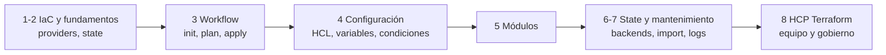

---
tags:
  - terraform
  - certificacion
  - terraform-associate
  - iac
---

# HashiCorp Certified: Terraform Associate (004): resumen del examen

> Qué evalúa la certificación de entrada de Terraform, cómo es el formato, qué cambió de la versión 003 a la 004, un plan de estudio de 5 semanas y un laboratorio práctico con la CLI `terraform` que no necesita cuenta de nube.

## ¿Qué es?

**HashiCorp Certified: Terraform Associate** es la certificación de nivel **Associate** (asociado, el primero de los tres niveles de Terraform) de HashiCorp. Demuestra que conoces los conceptos de **Infrastructure as Code** (IaC, infraestructura como código), que sabes usar la CLI de **Terraform Community Edition** (la edición gratuita) en el día a día y que entiendes qué añade **HCP Terraform** (antes *Terraform Cloud*) para trabajar en equipo.

El examen es **agnóstico al proveedor**: los tutoriales oficiales usan AWS, Azure, Google Cloud o Docker, pero **no se pregunta nada específico de una nube**. Lo que se evalúa es Terraform.

!!! info "Versión vigente: 004 (desde el 8 de enero de 2026)"
    La versión **004** sustituyó a la **003** con este calendario oficial:

    - **5 de enero de 2026**: último día para agendar la 003.
    - **7 de enero de 2026**: último día para presentar la 003.
    - **8 de enero de 2026**: primer día de la 004.

    La 004 evalúa **Terraform 1.12**. Si ya tienes la 003, tu credencial sigue válida hasta su fecha de vencimiento; para renovar tienes que presentar la 004 (ver [Renovación](#renovacion)).

Requisitos previos recomendados: manejo básico de la terminal y nociones de arquitectura on-premises y cloud. El perfil de candidato está en [Objetivo profesional](#objetivo-profesional).

## Formato del examen

| Aspecto | Detalle |
| --- | --- |
| Versión | **004** (Terraform Associate 004) |
| Versión de Terraform evaluada | **Terraform 1.12** |
| Tipos de pregunta | **True or false** (verdadero o falso), **multiple choice** (opción múltiple, 1 correcta) y **multiple answer** (respuesta múltiple, varias correctas) |
| Duración | **1 hora** |
| Número de preguntas | HashiCorp **no lo publica** en la página del examen (la comunidad reporta alrededor de 55–60; tómalo como orientativo) |
| Puntaje de aprobación | No publicado; el resultado es aprobado/no aprobado |
| Modalidad | **Online proctored** (en línea con supervisor), a través de la plataforma de HashiCorp Certifications |
| Idioma | **Inglés** |
| Costo | **70.50 USD** más impuestos locales. **No incluye** reintento gratuito |
| Validez | **2 años** |

!!! warning "Datos que cambian"
    Precio, plataforma de examen y número de preguntas pueden cambiar. Antes de agendar, revisa la [página oficial del examen](https://developer.hashicorp.com/certifications/terraform-associate). HashiCorp **no publica pesos por objetivo**: estudia todos con la misma atención.

### Renovación

| Si tienes… | Opciones para renovar |
| --- | --- |
| Terraform Associate **004** vigente | Aprobar **Terraform Infrastructure Engineer Professional**, aprobar **Terraform Authoring and Operations Advanced** (versión AWS o Azure), o volver a presentar la 004 desde **6 meses antes** del vencimiento (extiende la misma credencial) |
| Terraform Associate **002 o 003** vigente | Las dos certificaciones superiores, o presentar la 004 desde 6 meses antes del vencimiento: en este caso recibes una **credencial nueva y separada** (la antigua no se extiende) |
| Cualquier versión **vencida** | Presentar la versión vigente del examen en cualquier momento |

## Objetivo profesional

### Perfil de candidato según HashiCorp

La [página oficial del examen](https://developer.hashicorp.com/certifications/terraform-associate) dice, resumido, que el examen es para un **Cloud Engineer** (ingeniero/a cloud) con **conocimientos y habilidades fundamentales de Terraform**, capaz de **identificar las funciones de Terraform Enterprise y distinguirlas de las de Community Edition**. La guía de estudio añade que estarás mejor preparada con experiencia profesional usando Terraform en producción, pero que **practicar los objetivos en un entorno de pruebas personal** puede ser suficiente.

### Para qué roles sirve

Terraform es la herramienta de IaC más pedida en ofertas de trabajo de infraestructura, independientemente de la nube. Encaja con estos roles (detalle en [Roles profesionales](../../roles-profesionales.md)):

| Rol | Por qué le sirve |
| --- | --- |
| **DevOps Engineer** | Automatiza entornos y los integra en pipelines CI/CD con `plan` y `apply` |
| **Cloud Engineer** | Aprovisiona redes, cómputo e IAM como código en AWS, Azure o Google Cloud |
| **Platform Engineer** | Construye módulos reutilizables y un *golden path* (camino recomendado) para otros equipos, a menudo con HCP Terraform |
| **SRE** (*Site Reliability Engineer*) | Recrea infraestructura de forma reproducible, controla el drift y aplica cambios revisados |
| **DevSecOps / Cloud Security Engineer** | Revisa y escanea código Terraform, aplica policy as code (Sentinel, OPA) |

### Qué demuestra ante un empleador y qué no

| Demuestra | No demuestra |
| --- | --- |
| Que entiendes el workflow, el state, los módulos y el lenguaje HCL | Que sabes diseñar arquitecturas en una nube concreta (el examen es agnóstico al proveedor) |
| Que conoces las diferencias entre Community Edition, HCP Terraform y Terraform Enterprise | Experiencia operando Terraform en producción a escala (muchos equipos, cientos de states) |
| Vocabulario común para trabajar en un equipo que ya usa Terraform | Que sabes escribir código Terraform bajo presión: es opción múltiple, sin laboratorio |
| Interés y base verificable en IaC si vienes de otro perfil | Conocimientos de seguridad cloud, CI/CD o Kubernetes más allá de lo básico |

!!! tip "Cómo hacerla valer"
    Acompáñala con un repositorio público con código Terraform propio (un módulo con tests, un pipeline con `plan` en el pull request, escaneo con Checkov o Trivy). La certificación abre la conversación; el repositorio la sostiene.

### Qué certificación sigue

Más detalle y otras rutas en [Otras certificaciones](../../otras-certificaciones.md).

| Siguiente paso | Nivel | Formato | Para qué |
| --- | --- | --- | --- |
| **Terraform Infrastructure Engineer Professional** | Professional | Opción múltiple, 90 minutos, evalúa Terraform 1.15 (precio aún "coming soon" al revisar esta nota) | Construir, automatizar, asegurar y mantener infraestructura escalable con Terraform. HashiCorp recomienda tener antes la Associate y exige experiencia en producción |
| **Terraform Authoring and Operations Advanced** | Advanced | Examen **de laboratorio** (lab-based), versiones AWS o Azure, evalúa Terraform 1.6 | Experiencia avanzada de nivel producción |
| Una certificación de nube **Associate** | Associate | Según proveedor | Combinar Terraform con un proveedor: [Solutions Architect – Associate](../../aws/solutions-architect-associate/resumen-examen.md), [Associate Cloud Engineer](../../google-cloud/associate-cloud-engineer/resumen-examen.md) o [AZ-104](../../azure/azure-administrator/resumen-examen.md) |

Aprobar la Professional o la Advanced también **renueva** la Associate (ver [Renovación](#renovacion)).

## Qué cambió de la 003 a la 004

La 003 tenía **9 objetivos** organizados de otra forma (por ejemplo, "Understand Terraform basics", "Use Terraform outside the core workflow", "Read, generate, and modify configuration"). La 004 los reorganiza en **8 objetivos** y HashiCorp destaca **cuatro temas nuevos**:

| Tema nuevo en 004 | Qué tienes que saber | Nota |
| --- | --- | --- |
| **4f** `depends_on` y la regla de *lifecycle* `create_before_destroy` | Dependencias implícitas vs explícitas; crear el reemplazo antes de destruir el original | [Objetivo 4](objetivo-4-configuracion.md#4f-dependencias-entre-recursos) |
| **4g** Validar con *custom conditions* (condiciones personalizadas) | `validation` en variables, `precondition`/`postcondition` y bloques `check` | [Objetivo 4](objetivo-4-configuracion.md#4g-custom-conditions) |
| **4h** *Ephemeral values* (valores efímeros) y *write-only arguments* (argumentos de solo escritura) | Valores que **no se guardan** en el plan ni en el state (Terraform 1.10 y 1.11) y gestión de secretos con Vault | [Objetivo 4](objetivo-4-configuracion.md#4h-datos-sensibles-y-vault) |
| **8c** Organizar workspaces y **projects** en HCP Terraform | Projects, variable sets, run triggers | [Objetivo 8](objetivo-8-hcp-terraform.md#8c-organizar-workspaces-y-projects) |

Además, la 004 **incluye más contenido de HCP Terraform** (Explorer, change requests, health, dynamic credentials) y fija la versión evaluada en Terraform **1.12**, así que entran funciones recientes como los bloques `removed` (1.7), los valores efímeros (1.10) y los write-only arguments (1.11).

!!! tip "Si estudias con material de la 003"
    Casi todo sigue sirviendo (workflow, state, módulos, variables), pero te faltarán los cuatro temas de arriba y lo nuevo de HCP Terraform. Cuidado con material antiguo que dice **Terraform Cloud** (ahora **HCP Terraform**) o que recomienda `terraform taint` (ahora se usa `terraform apply -replace`).

## Objetivos del examen

| Objetivo oficial | Sub-objetivos | Nota |
| --- | --- | --- |
| **1. Infrastructure as Code (IaC) with Terraform** | 1a–1c: qué es IaC, ventajas, multi-cloud, hybrid cloud y flujos agnósticos al servicio | [Objetivos 1 y 2](objetivo-1-2-iac-y-fundamentos.md) |
| **2. Terraform fundamentals** | 2a–2d: instalar y versionar providers, cómo usa Terraform los providers, varios providers, state | [Objetivos 1 y 2](objetivo-1-2-iac-y-fundamentos.md) |
| **3. Core Terraform workflow** | 3a–3g: workflow, `init`, `validate`, `plan`, `apply`, `destroy`, `fmt` | [Objetivo 3](objetivo-3-flujo-de-trabajo.md) |
| **4. Terraform configuration** | 4a–4h: resources y data, referencias, variables y outputs, tipos complejos, expresiones y funciones, dependencias, custom conditions, datos sensibles y Vault | [Objetivo 4](objetivo-4-configuracion.md) |
| **5. Terraform modules** | 5a–5d: fuentes de módulos, alcance de variables, usar módulos, versiones | [Objetivo 5](objetivo-5-modulos.md) |
| **6. Terraform state management** | 6a–6d: backend local, locking, backend remoto, drift y state | [Objetivos 6 y 7](objetivo-6-7-estado-y-mantenimiento.md) |
| **7. Maintain infrastructure with Terraform** | 7a–7c: importar infraestructura, inspeccionar el state con la CLI, logging detallado | [Objetivos 6 y 7](objetivo-6-7-estado-y-mantenimiento.md) |
| **8. HCP Terraform** | 8a–8d: crear infraestructura, colaboración y gobierno, workspaces y projects, integración con la CLI | [Objetivo 8](objetivo-8-hcp-terraform.md) |



## Plan de estudio de 5 semanas

Pensado para 5–7 horas por semana. Si ya usas Terraform en el trabajo, compáctalo en 2 semanas y céntrate en los temas nuevos y en HCP Terraform.

| Semana | Tema | Qué hacer |
| --- | --- | --- |
| 1 | Objetivos 1, 2 y 3 | Lee las notas [1 y 2](objetivo-1-2-iac-y-fundamentos.md) y [3](objetivo-3-flujo-de-trabajo.md). Instala Terraform y haz el [laboratorio práctico](#laboratorio-practico) completo. Repasa [Infrastructure as Code con Terraform](../../../devops/iac/terraform-basico.md) |
| 2 | Objetivo 4 | Lee la nota del [objetivo 4](objetivo-4-configuracion.md) y practica cada expresión en `terraform console`. Escribe una variable con `validation`, un `precondition` y un `check` |
| 3 | Objetivos 5, 6 y 7 | Lee [módulos](objetivo-5-modulos.md) y [state y mantenimiento](objetivo-6-7-estado-y-mantenimiento.md). Practica `moved`, `removed`, `import` y los subcomandos `terraform state` |
| 4 | Objetivo 8 | Crea una organización gratuita en HCP Terraform, conecta la CLI con `terraform login` y un bloque `cloud`, prueba un workspace con VCS. Lee la nota del [objetivo 8](objetivo-8-hcp-terraform.md) |
| 5 | Repaso | *Sample questions* oficiales, preguntas de práctica de cada nota, los "En el examen" y la tabla de comandos del [laboratorio](#laboratorio-practico) |

!!! tip "Señal de que estás lista"
    Cuando puedas explicar sin mirar **qué hace cada comando** del laboratorio, **qué guarda el state** y **qué diferencia hay entre un CLI workspace y un workspace de HCP Terraform**, agenda. No uses *dumps* (preguntas filtradas): violan el acuerdo de certificación de HashiCorp.

## Recursos oficiales gratuitos

| Recurso | Para qué sirve |
| --- | --- |
| **Learning Path - Terraform Associate 004** | Ruta de estudio oficial ordenada por complejidad |
| **Exam Content List - Terraform Associate 004** | Cada sub-objetivo enlazado a su documentación y tutorial: la fuente de verdad |
| **Sample Questions - Terraform Associate 004** | Ejemplos del formato de preguntas (true/false, multiple choice, multiple answer) |
| **Get Started collections** (AWS, Azure, Google Cloud, Docker) | Tutoriales para crear, cambiar y destruir tu primera infraestructura. La de **Docker** no necesita cuenta de nube |
| **HCP Terraform Get Started** | Tutoriales del objetivo 8 con una organización gratuita |
| **Documentación de Terraform** | Referencia de lenguaje (HCL) y CLI |

## Laboratorio práctico

Un recorrido por el workflow completo **sin cuenta de nube**: usa los providers `random` (genera valores aleatorios) y `local` (crea archivos en tu equipo). Todo lo de abajo se probó con **Terraform 1.12.2** en Windows; las salidas son reales (recortadas).

!!! danger "Costos y limpieza"
    Este laboratorio **no tiene costo**: no crea nada en la nube. Si lo adaptas a una cuenta de pruebas de AWS, Azure o Google Cloud, usa una cuenta **solo para practicar**, crea antes una alerta de presupuesto y termina **siempre** con `terraform destroy`. Comprueba en la consola del proveedor que no quedó nada: los recursos creados fuera de Terraform o eliminados del state con `terraform state rm` **no** se destruyen y siguen cobrando.

1. **Escribe la configuración** en una carpeta vacía:

    ```hcl title="main.tf"
    terraform {
      required_version = ">= 1.12"

      required_providers {
        random = {
          source  = "hashicorp/random"
          version = "~> 3.7"
        }
        local = {
          source  = "hashicorp/local"
          version = "~> 2.5"
        }
      }
    }

    variable "entorno" {
      type    = string
      default = "dev"
    }

    resource "random_pet" "nombre" {
      prefix = var.entorno
    }

    resource "local_file" "saludo" {
      filename = "${path.module}/salida/saludo.txt"
      content  = "Hola desde ${random_pet.nombre.id}\n"
    }

    output "nombre" {
      value = random_pet.nombre.id
    }
    ```

2. **Init, fmt y validate** (objetivos 2 y 3):

    ```console
    $ terraform init
    - Installed hashicorp/local v2.9.1 (signed by HashiCorp)
    - Installed hashicorp/random v3.9.1 (signed by HashiCorp)
    Terraform has been successfully initialized!
    $ terraform fmt -check      # exit code 0: ya está formateado
    $ terraform validate
    Success! The configuration is valid.
    ```

3. **Plan guardado y apply** (objetivo 3):

    ```console
    $ terraform plan -out=lab.tfplan
      # local_file.saludo will be created
      # random_pet.nombre will be created
    Plan: 2 to add, 0 to change, 0 to destroy.
    $ terraform apply lab.tfplan
    Outputs:

    nombre = "dev-better-aardvark"
    ```

4. **Inspecciona** (objetivos 4 y 7):

    ```console
    $ terraform output -raw nombre
    dev-better-aardvark
    $ terraform state list
    local_file.saludo
    random_pet.nombre
    $ echo 'upper(random_pet.nombre.id)' | terraform console
    "DEV-BETTER-AARDVARK"
    ```

5. **Reemplazo forzado y drift** (objetivo 6): `-replace` recrea un recurso y todo lo que depende de él; si borras el archivo a mano, `-refresh-only` lo detecta.

    ```console
    $ terraform plan -replace=random_pet.nombre
      # local_file.saludo must be replaced
      # random_pet.nombre will be replaced, as requested
    Plan: 2 to add, 0 to change, 2 to destroy.
    $ rm salida/saludo.txt
    $ terraform plan -refresh-only
    Note: Objects have changed outside of Terraform
      # local_file.saludo has been deleted
    $ terraform plan
      # local_file.saludo will be created
    Plan: 1 to add, 0 to change, 0 to destroy.
    ```

6. **Limpieza**:

    ```console
    $ terraform destroy -auto-approve
    Destroy complete! Resources: 1 destroyed.
    $ terraform state list    # sin salida: el state está vacío
    ```

    Destruyó **1** recurso, no 2, porque el refresh previo detectó que el archivo ya no existía. Borra después la carpeta `.terraform/`, el state y el plan guardado si no los necesitas.

!!! tip "Amplía el laboratorio"
    Cada nota de objetivo trae ejemplos probados para seguir practicando: tipos complejos, `for_each`, `dynamic`, `check` (objetivo 4), un módulo local (objetivo 5), `moved`, `removed`, bloques `import`, `terraform_remote_state` y `TF_LOG` (objetivos 6 y 7). Para el objetivo 8 necesitas una organización de HCP Terraform (el plan gratuito permite hasta 500 recursos gestionados; revisa las condiciones vigentes).

### Comandos que debes dominar

| Comando | Para qué |
| --- | --- |
| `terraform init [-upgrade] [-migrate-state] [-reconfigure]` | Preparar el directorio: providers, módulos y backend |
| `terraform fmt [-check] [-recursive] [-diff]` | Formato estándar del código |
| `terraform validate` | Sintaxis y coherencia interna, sin acceder a APIs ni al state remoto |
| `terraform plan [-out=archivo] [-destroy] [-refresh-only] [-replace=dir]` | Previsualizar cambios |
| `terraform apply [archivo] [-auto-approve] [-replace=dir]` | Aplicar cambios |
| `terraform destroy` | Destruir todo lo gestionado (equivale a `apply -destroy`) |
| `terraform show`, `terraform output` | Ver el state o un plan guardado y los outputs |
| `terraform state list/show/mv/rm/pull/push` | Inspeccionar y modificar el state |
| `terraform import` y bloque `import` | Traer recursos existentes al state |
| `terraform console`, `terraform graph`, `terraform providers` | Probar expresiones, ver el grafo de dependencias, ver providers requeridos |
| `terraform workspace ...` | CLI workspaces (varios states con el mismo código) |
| `terraform login`, `terraform logout` | Credenciales para HCP Terraform o Terraform Enterprise |
| `terraform force-unlock <id>` | Liberar un lock atascado (con cuidado) |

## Consejos para el día del examen

- **Gestión del tiempo**: una hora da para leer con calma, pero las preguntas de código piden fijarse en detalles (una coma, un `count` frente a un `for_each`). Marca las dudosas y vuelve al final.
- **Lee qué piden**: "Which TWO…", "Select all that apply" indica **multiple answer**. En **true/false** busca la palabra absoluta ("always", "never", "only") que vuelve falsa la frase.
- **Distingue Community Edition, HCP Terraform y Terraform Enterprise**: muchas preguntas son "¿qué función necesita HCP Terraform?". Sentinel/OPA, variable sets, private registry, run triggers, health assessments y projects son de HCP Terraform/Enterprise, no de la CLI sola.
- **Trampas típicas**:

| Si la pregunta dice… | Piensa en… |
| --- | --- |
| "Recrear un recurso dañado" | `terraform apply -replace=...` (no `taint`, que está deprecated) |
| "Renombrar un recurso sin destruirlo" | Bloque `moved` (o `terraform state mv`) |
| "Dejar de gestionar un recurso sin borrarlo" | Bloque `removed` con `destroy = false` (o `terraform state rm`) |
| "Actualizar el state con la realidad sin cambiar infraestructura" | `terraform apply -refresh-only` |
| "Versión exacta de providers para todo el equipo" | `.terraform.lock.hcl` en Git |
| "Secretos en el state" | Siempre en texto plano: protege el backend; usa ephemeral/write-only si puedes |
| "Separar dev y prod con credenciales distintas" | No uses CLI workspaces: directorios o workspaces de HCP Terraform |

- **Online proctored**: escritorio despejado, un solo monitor, documento de identidad y prueba técnica del equipo antes del día.

## Para profundizar

- Terraform en el cuaderno: [Infrastructure as Code con Terraform](../../../devops/iac/terraform-basico.md), [Terraform workspaces](../../../devops/iac/terraform-workspaces.md), [Infrastructure as Code: panorama y herramientas](../../../devops/iac/infraestructura-como-codigo.md), [Pruebas de infraestructura](../../../devops/iac/pruebas-infraestructura.md) (`terraform test`)
- Seguridad: [Seguridad de IaC](../../../devsecops/infraestructura-y-contenedores/seguridad-iac.md) (Sentinel, OPA, drift), [IaC scanning](../../../devsecops/escaneos/iac-scanning.md), [Secretos e identidades](../../../devsecops/identidades-y-pipeline/secretos-identidades.md) (Vault)
- Comandos: [Guía de comandos de Terraform](../../../recursos/comandos/terraform.md)
- Otras certificaciones donde Terraform ayuda: [Associate Cloud Engineer](../../google-cloud/associate-cloud-engineer/resumen-examen.md), [Solutions Architect – Associate](../../aws/solutions-architect-associate/resumen-examen.md)

!!! example "Practica en el laboratorio"
    - [Lab 08: Terraform sin nube: providers locales y workspaces](../../../laboratorios/devops/terraform-local-workspaces.md)
    - [Lab 09: Terraform en AWS con remote state en S3](../../../laboratorios/devops/terraform-aws-backend-remoto.md)

## Referencias

- [Terraform Associate (004): página oficial del examen](https://developer.hashicorp.com/certifications/terraform-associate)
- [HashiCorp Certifications: Infrastructure Automation](https://developer.hashicorp.com/certifications/infrastructure-automation)
- [Exam Content List - Terraform Associate 004](https://developer.hashicorp.com/terraform/tutorials/certification-004/associate-review-004)
- [Learning Path - Terraform Associate 004](https://developer.hashicorp.com/terraform/tutorials/certification-004/associate-study-004)
- [Sample Questions - Terraform Associate 004](https://developer.hashicorp.com/terraform/tutorials/certification-004/associate-questions-004)
- [Documentación de Terraform](https://developer.hashicorp.com/terraform/docs)
- [HCP Terraform: planes y precios](https://www.hashicorp.com/pricing)
