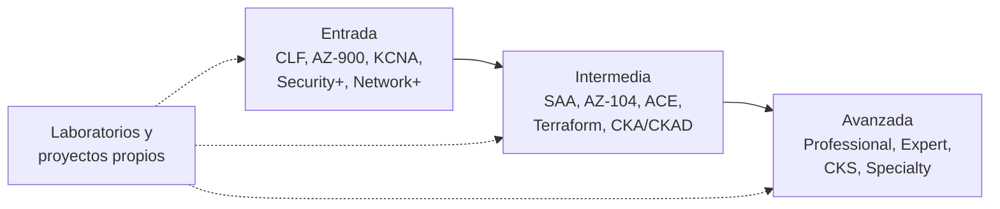

---
tags:
  - carrera
  - certificaciones
  - kubernetes
  - aws
  - azure
  - gcp
  - seguridad
---

# Otras certificaciones que conviene conocer

> Mapa de las certificaciones más pedidas en cloud, DevOps, Kubernetes, seguridad, redes y gestión: para qué rol sirve cada una, qué demuestra, qué pide antes, cuánto cuesta y cuáles se retiraron o cambian pronto.

## ¿Qué es esta nota?

El cuaderno tiene guías completas para seis certificaciones (ver [Certificaciones](index.md)). Esta nota es el **mapa del resto**: no explica temarios, sino que te ayuda a decidir **cuál conviene después** según el rol al que apuntas (ver [Roles profesionales](roles-profesionales.md)).

Cómo leer las tablas:

- **Formato**: *multiple choice* (opción múltiple, teórico) o **performance-based** (práctico en vivo: resuelves tareas reales en una terminal o un entorno de laboratorio). Los prácticos pesan más ante un empleador porque cuesta más aprobarlos sin saber hacer.
- **Objetivo profesional**: resumen del perfil de candidato oficial (*target candidate* / *audience profile*): para qué rol está pensada y qué demuestra.
- **Costo**: precio del examen en USD en Estados Unidos, sin impuestos. Varía por país, por promociones y con el tiempo.
- **Validez**: cuánto dura antes de renovar.

!!! warning "Datos verificados en octubre de 2026"
    Códigos, precios, nombres y fechas de retiro se revisaron en las páginas oficiales en **octubre de 2026**. Cambian a menudo (este año hubo muchos retiros y renombres): **antes de pagar, abre el enlace oficial**. Lo marcado como "verificar" no se pudo confirmar en una fuente oficial.

## Kubernetes y cloud native (CNCF / Linux Foundation)

Las emite la **Linux Foundation** junto con la **Cloud Native Computing Foundation (CNCF)**. Son **agnósticas al proveedor**: sirven igual si trabajas con EKS, AKS o GKE. Las tres "CK" (CKA, CKAD, CKS) son **prácticas en vivo** de 2 horas en una terminal con clústeres reales, y por eso son de las más valoradas en ofertas de DevOps y Platform Engineering. Todas se presentan en línea con supervisión e incluyen **un reintento**; tienes 12 meses desde la compra para presentar.

| Certificación | Nivel | Formato | Objetivo profesional | Prerrequisitos recomendados | Costo aprox. | Validez |
| --- | --- | --- | --- | --- | --- | --- |
| [KCNA – Kubernetes and Cloud Native Associate](https://training.linuxfoundation.org/certification/kubernetes-cloud-native-associate/) | Beginner | Teórico, opción múltiple, 90 min | Quien empieza en cloud native: demuestra que entiendes Kubernetes, contenedores, orquestación y el ecosistema CNCF (observabilidad, GitOps, entrega). No demuestra que sepas operar un clúster | Ninguno; nociones de Linux y [Docker](../devops/contenedores/docker.md) | 250 USD | 2 años |
| [KCSA – Kubernetes and Cloud Native Security Associate](https://training.linuxfoundation.org/certification/kubernetes-and-cloud-native-security-associate-kcsa/) | Beginner | Teórico, opción múltiple | Base de seguridad de Kubernetes: modelo de amenazas, RBAC, Pod Security Standards, cadena de suministro, cumplimiento. Paso previo natural a CKS | KCNA o conocimientos equivalentes | 250 USD | 2 años |
| [CKAD – Certified Kubernetes Application Developer](https://training.linuxfoundation.org/certification/certified-kubernetes-application-developer-ckad/) | Intermediate | **Práctico en vivo**, 2 h | Desarrolladores y DevOps que despliegan aplicaciones en Kubernetes: Deployments, ConfigMaps, probes, Services, Helm, estrategias de despliegue | Soltura con `kubectl` y YAML ([Kubernetes](../devops/contenedores/kubernetes.md)) | 445 USD | 2 años |
| [CKA – Certified Kubernetes Administrator](https://training.linuxfoundation.org/certification/certified-kubernetes-administrator-cka/) | Intermediate | **Práctico en vivo**, 2 h | Administradores de clústeres: instalación y upgrade, networking, storage, troubleshooting de nodos y pods, RBAC. La más pedida en ofertas de DevOps/SRE/Platform | Linux sólido, redes, experiencia con `kubectl` | 445 USD | 2 años |
| [CKS – Certified Kubernetes Security Specialist](https://training.linuxfoundation.org/certification/certified-kubernetes-security-specialist/) | Intermediate (la más difícil de las tres) | **Práctico en vivo**, 2 h | Seguridad de clústeres y cargas: hardening, network policies, admission control, escaneo de imágenes, runtime security con Falco ([Seguridad de Kubernetes](../devsecops/infraestructura-y-contenedores/seguridad-kubernetes.md)) | **Haber aprobado la CKA** (obligatorio) | 445 USD | 2 años |

Otras certificaciones CNCF de nivel asociado (teóricas, **250 USD**, vigentes en el [catálogo oficial](https://training.linuxfoundation.org/certification-catalog/)):

| Certificación | Qué demuestra | Para quién |
| --- | --- | --- |
| [PCA – Prometheus Certified Associate](https://training.linuxfoundation.org/certification/prometheus-certified-associate/) | Métricas, PromQL, alertas e instrumentación con Prometheus | SRE, quien opera [observabilidad](../devops/operacion/observabilidad.md) |
| [CGOA – Certified GitOps Associate](https://training.linuxfoundation.org/certification/certified-gitops-associate-cgoa/) | Principios GitOps y herramientas como Argo CD y Flux | DevOps / Platform ([despliegue continuo](../devops/ci-cd/despliegue-continuo.md)) |
| [OTCA – OpenTelemetry Certified Associate](https://training.linuxfoundation.org/certification/opentelemetry-certified-associate-otca/) | Trazas, métricas y logs con OpenTelemetry, Collector, instrumentación | SRE, observabilidad |
| CCA (Cilium), CAPA (Argo), CBA (Backstage), ICA (Istio) | Una herramienta concreta del ecosistema | Solo si tu equipo usa esa herramienta. Formato de ICA: **verificar** |

!!! info "Kubestronaut y Golden Kubestronaut"
    No son exámenes, son **reconocimientos** del [programa Kubestronaut](https://training.linuxfoundation.org/resources/kubestronaut-program/): **Kubestronaut** exige tener **las cinco** (KCNA, KCSA, CKA, CKAD y CKS) **vigentes a la vez**; **Golden Kubestronaut** exige todas las certificaciones CNCF más la LFCS (la lista crece cuando sale una certificación nueva; revísala en la página oficial). Útil como meta personal; para un empleador pesan más CKA, CKAD y CKS por separado.

## AWS: el resto del catálogo

Además de las tres con guía en el cuaderno ([Cloud Practitioner](aws/cloud-practitioner/resumen-examen.md), [AI Practitioner](aws/ai-practitioner/resumen-examen.md) y [Solutions Architect – Associate](aws/solutions-architect-associate/resumen-examen.md)), AWS tiene niveles **Associate**, **Professional** y **Specialty**. Todas son **teóricas** (opción múltiple y respuesta múltiple), se presentan en Pearson VUE o en línea y valen **3 años**. Ninguna tiene prerrequisitos obligatorios. 2026 trae **varias versiones nuevas**: revisa el código vigente al agendar.

| Certificación | Código | Formato | Objetivo profesional | Experiencia recomendada | Costo aprox. |
| --- | --- | --- | --- | --- | --- |
| [Developer – Associate](https://aws.amazon.com/certification/certified-developer-associate/) | DVA-C02 → **DVA-C03** (desde el 1 de diciembre de 2026; último día de C02: 30 de noviembre) | 65 preguntas, 130 min | Desarrolladores que construyen, despliegan y depuran aplicaciones con servicios de AWS (Lambda, API Gateway, DynamoDB, SDK, CI/CD). La C03 añade seguridad de IA y desarrollo asistido por IA | Alrededor de 1 año desarrollando con AWS | 150 USD |
| [CloudOps Engineer – Associate](https://aws.amazon.com/certification/certified-cloudops-engineer-associate/) | **SOA-C03** | 65 preguntas, 130 min | **Antes "SysOps Administrator – Associate"** (renombrada en septiembre de 2025). Operación: desplegar, monitorear, automatizar y asegurar cargas en AWS; añade contenedores, multi-cuenta e IaC | ~1 año desplegando y operando cargas en AWS | 150 USD |
| [Data Engineer – Associate](https://aws.amazon.com/certification/certified-data-engineer-associate/) | DEA-C01 | 65 preguntas, 130 min | Pipelines de datos: ingesta, transformación, almacenes y gobierno de datos (Glue, Kinesis, Redshift, Lake Formation) | 2–3 años en ingeniería de datos y 1–2 años con AWS | 150 USD |
| [Machine Learning Engineer – Associate](https://aws.amazon.com/certification/certified-machine-learning-engineer-associate/) | MLA-C01 → **MLA-C02** (beta en inglés desde septiembre de 2026; GA el 14 de enero de 2027) | 65 preguntas, 130 min (la beta: 85 preguntas) | Llevar modelos a producción con SageMaker AI y MLOps; la C02 añade IA generativa, agentes y Bedrock | Experiencia con ML en AWS | 150 USD |
| [Solutions Architect – Professional](https://aws.amazon.com/certification/certified-solutions-architect-professional/) | SAP-C02 → **SAP-C03** (GA el 17 de noviembre de 2026; último día de C02: 16 de noviembre) | 75 preguntas, 180 min | Arquitectura en organizaciones complejas: multi-cuenta, migraciones, híbrido, costos a escala. La C03 añade IA generativa, ingeniería de resiliencia, DevSecOps y criptografía post-cuántica | 2+ años diseñando soluciones en AWS | 300 USD |
| [DevOps Engineer – Professional](https://aws.amazon.com/certification/certified-devops-engineer-professional/) | DOP-C02 | 75 preguntas, 180 min | Quien aprovisiona, opera y gestiona sistemas distribuidos: CI/CD, IaC, monitoreo, respuesta a incidentes; pide experiencia de programación o scripting | 2+ años operando entornos AWS | 300 USD |
| [Security – Specialty](https://aws.amazon.com/certification/certified-security-specialty/) | SCS-C03 | 65 preguntas, 170 min | Seguridad en AWS: IAM avanzado, detección, respuesta a incidentes, protección de datos e infraestructura | 5 años en seguridad y 2+ asegurando cargas en AWS | 300 USD |
| [Advanced Networking – Specialty](https://aws.amazon.com/certification/certified-advanced-networking-specialty/) | ANS-C01 | 65 preguntas, 170 min | Redes híbridas y complejas en AWS (Direct Connect, Transit Gateway, DNS híbrido) | 5 años en redes, 2 en cloud/híbrido | 300 USD |
| [AI Business Strategist](https://aws.amazon.com/certification/certified-ai-business-strategist/) | AIB-C01 (**beta**) | Beta: 85 preguntas, 170 min | Nueva (2026), de nivel negocio: estrategia y adopción de IA en la organización, no implementación | Ninguno | 50 USD en beta (100 USD el estándar) |

!!! danger "Retiradas o por retirarse"
    - **Advanced Networking – Specialty (ANS-C01)**: último día para presentarla, **31 de diciembre de 2026**. AWS no anunció reemplazo.
    - **Machine Learning – Specialty (MLS-C01)**: retirada; último día fue el **31 de marzo de 2026**. AWS orienta a Machine Learning Engineer – Associate.
    - **SysOps Administrator – Associate (SOA-C02)**: retirada el 29 de septiembre de 2025; la sustituye CloudOps Engineer – Associate (SOA-C03).
    - **Data Analytics – Specialty**, **Database – Specialty** y **SAP on AWS – Specialty**: retiradas en abril de 2024.
    - Quien ya tiene una certificación retirada la conserva hasta su fecha de vencimiento.

!!! note "Microcredentials"
    AWS lanzó también **microcredentials**: evaluaciones prácticas cortas en un entorno real de AWS (serverless, agentic AI, redes de aplicaciones, respuesta a incidentes). No son certificaciones, pero sí son prácticas: pueden complementar una Associate.

## Microsoft Azure

Microsoft agrupa por niveles **Fundamentals**, **Associate** y **Expert**. Las *Fundamentals* **no vencen**; las *Associate* y *Expert* se renuevan **cada 12 meses gratis** con un *renewal assessment* en Microsoft Learn. Los exámenes pueden incluir laboratorios interactivos y el precio depende del país (en EE. UU., unos **99 USD** las Fundamentals y **165 USD** las Associate/Expert). 2026 fue un año de **muchos retiros**: Microsoft está reorientando el catálogo hacia IA.

| Certificación | Examen | Nivel | Objetivo profesional (según el *audience profile*) | Prerrequisitos | Estado |
| --- | --- | --- | --- | --- | --- |
| [Azure Fundamentals](https://learn.microsoft.com/en-us/credentials/certifications/azure-fundamentals/) | AZ-900 (45 min) | Fundamentals | Profesional de TI que quiere demostrar conceptos de nube y servicios base de Azure; "punto de partida común" para una carrera en Azure | Ninguno | Vigente |
| [Azure AI Fundamentals](https://learn.microsoft.com/en-us/credentials/certifications/azure-ai-fundamentals/) | **AI-901** (sustituye a AI-900) | Fundamentals | Quien empieza a desarrollar soluciones de IA en Azure (Microsoft Foundry); ahora pide nociones de Python | Ninguno | Vigente con AI-901; **AI-900 retirado** (2026) |
| [Security, Compliance, and Identity Fundamentals](https://learn.microsoft.com/en-us/credentials/certifications/security-compliance-and-identity-fundamentals/) | SC-900 (45 min) | Fundamentals | Negocio, TI o estudiantes que quieren entender seguridad, cumplimiento e identidad en Microsoft (Entra, Defender, Purview) | Ninguno | Vigente |
| [Azure AI Cloud Developer Associate](https://learn.microsoft.com/en-us/credentials/certifications/azure-ai-cloud-developer-associate/) | **AI-200** (120 min) | Associate | Desarrollo back-end de soluciones de IA en Azure: contenedores, mensajería, bases vectoriales, Python, SDK | Programación en Python | Nueva; **reemplaza a AZ-204** |
| [Azure Solutions Architect Expert](https://learn.microsoft.com/en-us/credentials/certifications/azure-solutions-architect/) | AZ-305 | Expert | Asesorar a stakeholders y traducir requisitos de negocio en diseños alineados con Well-Architected y Cloud Adoption Framework | **AZ-104 obligatoria** ([guía](azure/azure-administrator/resumen-examen.md)) | Vigente |
| [DevOps Engineer Expert](https://learn.microsoft.com/en-us/credentials/certifications/devops-engineer/) | AZ-400 | Expert | Desarrollador o administrador que entrega valor continuo: control de versiones, pipelines, seguridad y monitoreo con **GitHub y Azure DevOps** | **AZ-104 o Azure Developer Associate** | Vigente (revisa el prerrequisito: Azure Developer se retiró) |
| [Azure Network Engineer Associate](https://learn.microsoft.com/en-us/credentials/certifications/azure-network-engineer-associate/) | AZ-700 (100 min) | Associate | Planificar, implementar y operar redes en Azure: conectividad híbrida, entrega de aplicaciones, acceso privado, seguridad de red | Redes (DNS, protocolos, direccionamiento) y experiencia con Azure | Vigente |
| [Cloud and AI Security Engineer Associate](https://learn.microsoft.com/en-us/credentials/certifications/cloud-and-ai-security-engineer-associate/) | **SC-500** (120 min) | Associate | Controles de seguridad de punta a punta en Azure, híbrido y cargas de IA: identidad, red, datos, cómputo, postura | Administración de Azure, Entra ID, algo de Microsoft 365 | Nueva; **reemplaza a AZ-500**. Confirma que ya esté en GA |
| [Security Operations Analyst Associate](https://learn.microsoft.com/en-us/credentials/certifications/security-operations-analyst/) | SC-200 (100 min) | Associate | Analista de SOC: triaje, respuesta a incidentes, threat hunting con KQL, detecciones en Microsoft Sentinel y Defender XDR | Seguridad y Microsoft 365/Azure | Vigente |

!!! danger "Retirados en 2026"
    - **AZ-204 / Azure Developer Associate**: retirada (julio de 2026), incluida la renovación. Reemplazo: **AI-200**.
    - **AZ-500 / Azure Security Engineer Associate**: retirada el **31 de agosto de 2026**, incluida la renovación. Reemplazo: **SC-500**.
    - **AI-900**: el examen se retiró; la certificación Azure AI Fundamentals sigue, ahora con **AI-901**.
    - Si estudias con cursos de 2024–2025, revisa que el código no esté retirado.

## Google Cloud

Google tiene niveles **Foundational**, **Associate** y **Professional**. Todas son teóricas (opción múltiple y selección múltiple), de 50–60 preguntas, en línea o en centro de pruebas, sin prerrequisitos formales. Las **Foundational** valen **3 años** y las **Professional**, **2 años**; se renuevan con un *renewal exam* más corto o con cursos y *skill badges* en Google Skills. La guía del [Associate Cloud Engineer](google-cloud/associate-cloud-engineer/resumen-examen.md) está en el cuaderno.

| Certificación | Nivel | Duración | Objetivo profesional | Experiencia recomendada | Costo aprox. |
| --- | --- | --- | --- | --- | --- |
| [Cloud Digital Leader](https://cloud.google.com/learn/certification/cloud-digital-leader) | Foundational | 90 min | Cualquier persona que quiera explicar qué aporta la nube y Google Cloud a los objetivos de una organización y sus casos de uso de negocio | Haber colaborado con perfiles técnicos | 99 USD |
| [Generative AI Leader](https://cloud.google.com/learn/certification/generative-ai-leader) | Foundational | 90 min | Conocimiento de negocio sobre la oferta de IA generativa de Google Cloud; para cualquier rol, técnico o no | Ninguna | 99 USD |
| [Professional Cloud Architect](https://cloud.google.com/learn/certification/cloud-architect) | Professional | 2 h, con 2 casos de estudio | Diseñar y gestionar soluciones seguras, escalables, con alta disponibilidad y costo eficiente que cumplan objetivos de negocio | 3+ años en la industria, 1+ diseñando en Google Cloud | 200 USD |
| [Professional Cloud DevOps Engineer](https://cloud.google.com/learn/certification/cloud-devops-engineer) | Professional | 2 h | Prácticas SRE, pipelines CI/CD (también para infraestructura y ML), observabilidad, rendimiento y costo | 3+ años, 1+ con sistemas productivos en Google Cloud | 200 USD |
| [Professional Cloud Security Engineer](https://cloud.google.com/learn/certification/cloud-security-engineer) | Professional | 2 h | Diseñar e implementar cargas e infraestructura seguras: acceso, perímetros, protección de datos, operaciones y cumplimiento | 3+ años, 1+ en Google Cloud | 200 USD |
| [Professional Cloud Network Engineer](https://cloud.google.com/learn/certification/cloud-network-engineer) | Professional | 2 h | VPC, routing, load balancing, Cloud NAT, Cloud DNS, conectividad híbrida y multicloud, seguridad de red | 3+ años, 1+ en Google Cloud | 200 USD |

!!! note "Idiomas"
    Las Professional suelen estar solo en **inglés y japonés**; las Foundational y la Associate también en español. Revísalo en la página antes de agendar.

## HashiCorp

HashiCorp (ahora parte de IBM) reorganizó sus certificaciones en tres niveles: **Associate** (teórico), **Professional** (teórico, nuevo) y **Advanced** (laboratorio práctico intenso). Las credenciales valen **2 años**. La guía de [Terraform Associate (004)](hashicorp/terraform-associate/resumen-examen.md) está en el cuaderno.

| Certificación | Formato | Objetivo profesional | Prerrequisitos recomendados | Costo aprox. |
| --- | --- | --- | --- | --- |
| [Terraform Associate (004)](hashicorp/terraform-associate/resumen-examen.md) | Teórico, 1 h; evalúa Terraform 1.12 | Cloud Engineer con fundamentos de Terraform: flujo `init/plan/apply`, state, módulos, HCP Terraform | [Terraform básico](../devops/iac/terraform-basico.md) | 70.50 USD |
| [Terraform Infrastructure Engineer Professional](https://developer.hashicorp.com/certifications/infrastructure-automation) | Teórico; evalúa Terraform 1.15 | Nivel intermedio: construir infraestructura escalable con Terraform en equipo | Terraform Associate y experiencia real | Verificar |
| [Terraform Authoring and Operations Advanced](https://developer.hashicorp.com/certifications/infrastructure-automation) | **Laboratorio práctico** intenso (versiones AWS o Azure) | Experiencia de nivel producción: escribir módulos, gestionar state y operar Terraform a escala | Experiencia avanzada con Terraform | Verificar |
| [Vault Associate](https://developer.hashicorp.com/certifications/security-automation) | Teórico, ~1 h; evalúa Vault 1.19 | Fundamentos de Vault: secretos dinámicos, políticas, métodos de autenticación ([Secretos e identidades](../devsecops/identidades-y-pipeline/secretos-identidades.md)) | Nociones de seguridad e IAM | Verificar |
| [Vault Operations Advanced](https://developer.hashicorp.com/certifications/security-automation) | **Laboratorio práctico** | Operar Vault en producción (instalación, alta disponibilidad, replicación, recuperación) | Experiencia operando Vault | Verificar |

!!! warning "Consul Associate"
    **Consul Associate ya no aparece** en la página oficial de certificaciones de HashiCorp. Fuentes no oficiales indican que se retiró el **15 de julio de 2026** (verificar). Los nombres "Professional" y "Advanced" también cambiaron en 2025–2026: usa el nombre que aparezca en la página oficial al registrarte.

## Seguridad

Certificaciones de seguridad **no atadas a una nube**. Las de entrada (Security+, CC) dan vocabulario común; CISSP y CCSP son de **experiencia** (piden años de trabajo comprobables) y suelen aparecer en ofertas senior o de gestión.

| Certificación | Emisor | Formato | Objetivo profesional | Prerrequisitos | Costo aprox. | Validez |
| --- | --- | --- | --- | --- | --- | --- |
| [Security+](https://www.comptia.org/certifications/security) (SY0-701) | CompTIA | Teórico con preguntas *performance-based* (simulaciones) | Primer puesto de seguridad: amenazas, arquitectura segura, operaciones, gestión de riesgo. Muy pedida como base | Recomendado: Network+ y 2 años de TI | ~400–440 USD (verificar) | 3 años (con educación continua) |
| [Certified in Cybersecurity (CC)](https://www.isc2.org/certifications/cc) | ISC2 | Teórico | Nivel de entrada: principios de seguridad, continuidad, control de acceso, redes, operaciones | Ninguno | ISC2 ha ofrecido curso y examen gratuitos (verificar) | 3 años (con cuota anual) |
| [CISSP](https://www.isc2.org/certifications/cissp) | ISC2 | Teórico adaptativo | Liderazgo y gestión de programas de seguridad en 8 dominios; pensado para perfiles senior | **5 años** de experiencia en 2 de los 8 dominios (sin ella, quedas como *Associate of ISC2*) | ~749 USD | 3 años (con CPE y cuota anual) |
| [CCSP](https://www.isc2.org/certifications/ccsp) | ISC2 | Teórico | Seguridad cloud a nivel de arquitectura, datos, aplicaciones, operaciones y legal | **5 años** en TI (3 en seguridad, 1 en un dominio de CCSP) | ~599 USD | 3 años (con CPE y cuota anual) |
| [CCSK v5](https://cloudsecurityalliance.org/education/ccsk) | Cloud Security Alliance | Teórico, en línea, **libro abierto**, 60 preguntas, 120 min | Conocimiento neutral de seguridad cloud (Security Guidance v5): gobierno, IAM, datos, workloads, respuesta. Buena antesala de CCSP | Ninguno | 445 USD (2 intentos) | Verificar |
| [GIAC GCLD](https://www.giac.org/certifications/cloud-security-essentials-gcld/) / [GPCS](https://www.giac.org/certifications/public-cloud-security-gpcs/) / GCSA | GIAC (SANS) | Teórico con preguntas prácticas, libro abierto | Seguridad cloud práctica (esenciales, multi-cloud, automatización DevSecOps). Muy técnicas y caras; suelen pagarlas las empresas junto con el curso SANS | Experiencia en seguridad | Desde ~999 USD solo el examen (verificar) | 4 años |
| [OSCP+](https://www.offsec.com/courses/pen-200/) | OffSec | **Práctico**: examen de pentesting de 24 h | Seguridad **ofensiva** (pentesting); referencia del sector para esa especialidad | Redes, Linux, scripting | Desde ~1,749 USD con curso (verificar) | 3 años |
| [ISO/IEC 27001 Lead Implementer / Lead Auditor](https://pecb.com/en/education-and-certification-for-individuals/iso-iec-27001) | PECB, entre otros | Curso de 4–5 días + examen teórico | Implementar o auditar un sistema de gestión de seguridad de la información (SGSI) según [ISO 27001](../devsecops/gobierno-y-respuesta/cumplimiento.md) | Experiencia en seguridad o auditoría según el nivel | Normalmente se vende con el curso (~2,000 USD o más) | Según el emisor (con cuota anual) |

## Redes y sistemas

La base de todo lo demás: si no entiendes redes y Linux, cloud y Kubernetes se vuelven memorizar. Estas certificaciones ordenan esos fundamentos (ver [Networking](../networking/index.md) y [Linux, redes y scripting](../devops/fundamentos/linux-redes-scripting.md)).

| Certificación | Emisor | Formato | Objetivo profesional | Prerrequisitos | Costo aprox. | Validez |
| --- | --- | --- | --- | --- | --- | --- |
| [Network+](https://www.comptia.org/certifications/network) (N10-009) | CompTIA | Teórico con simulaciones | Técnico/a de redes junior: modelos, direccionamiento, servicios, seguridad, troubleshooting. Neutral al fabricante | Recomendado: 9–12 meses en redes | ~350–400 USD (verificar) | 3 años |
| [Linux+](https://www.comptia.org/certifications/linux) (XK0-006) | CompTIA | Teórico con simulaciones | Administración Linux: sistema, servicios, seguridad, scripting, automatización | Experiencia básica con Linux | ~360–400 USD (verificar) | 3 años |
| [CCNA](https://www.cisco.com/site/us/en/learn/training-certifications/certifications/enterprise/ccna/index.html) (200-301) | Cisco | Teórico con simulaciones, 120 min | Redes empresariales: switching, routing, IP, seguridad, automatización básica. Muy reconocida en redes on-premise | Ninguno formal | ~300 USD | 3 años |
| [LFCS](https://training.linuxfoundation.org/certification/linux-foundation-certified-sysadmin-lfcs/) | Linux Foundation | **Práctico en vivo**, terminal | Administración Linux de verdad: usuarios, servicios, storage, redes, troubleshooting. Cuenta para Golden Kubestronaut | Uso diario de Linux | 445 USD | 2 años (verificar) |
| [RHCSA](https://www.redhat.com/en/services/certification/rhcsa) (EX200) | Red Hat | **Práctico**, sobre RHEL 10 | Administración de Red Hat Enterprise Linux; muy valorada en empresas con RHEL | Experiencia con Linux | ~500 USD (verificar) | 3 años |
| [RHCE](https://www.redhat.com/en/services/certification/rhce) (EX294) | Red Hat | **Práctico** | Automatización de sistemas con [Ansible](../devops/iac/ansible.md) | **RHCSA obligatoria** | Verificar | 3 años |

## Gestión, procesos y costos

No son técnicas, pero aparecen en ofertas de operaciones, soporte, FinOps y liderazgo. Conectan con [Negocio TI](../negocio/index.md).

| Certificación | Emisor | Objetivo profesional | Formato y prerrequisitos | Costo aprox. | Validez |
| --- | --- | --- | --- | --- | --- |
| [ITIL 4 Foundation e ITIL (Version 5) Foundation](https://www.peoplecert.org/browse-certifications/it-governance-and-service-management/ITIL-1) | PeopleCert | Gestión de servicios de TI: incidentes, problemas, cambios, niveles de servicio ([ITSM e ITIL](../negocio/gestion-servicios-itil.md)). Útil en soporte, operaciones y SRE en empresas grandes | Teórico. **ITIL (Version 5)** salió a inicios de 2026 (Foundation: 40 preguntas, 60 min, según proveedores de formación); ITIL 4 convive un tiempo | Suele venderse con curso; verificar | ITIL 4: según política vigente de PeopleCert (verificar) |
| [FinOps Certified Practitioner](https://learn.finops.org/path/finops-certified-practitioner) | FinOps Foundation (Linux Foundation) | Conceptos y prácticas de FinOps: visibilidad, asignación, optimización de costos cloud ([FinOps y costos](../cloud/fundamentos/finops-costos.md)) | Teórico, en línea; sin prerrequisitos | ~325 USD (incluye varios intentos; verificar) | Verificar |
| [PSM I](https://www.scrum.org/assessments/professional-scrum-master-i-certification) / CSM | Scrum.org / Scrum Alliance | Scrum Master: entender Scrum para trabajar en equipos ágiles. PSM I es solo examen; CSM exige curso | Teórico | PSM I ~200 USD; CSM con curso | PSM I no vence; CSM se renueva cada 2 años |
| [PMP](https://www.pmi.org/certifications/project-management-pmp) | PMI | Dirección de proyectos (predictivo, ágil, híbrido); para gestión de proyectos, no para roles técnicos | Teórico; pide **35 h de formación y 3 años** dirigiendo proyectos (con título universitario) | ~400–575 USD según membresía (verificar) | 3 años (con PDUs) |

## Plataformas DevOps

Certificaciones de la herramienta donde vive el código y el pipeline. Son baratas y rápidas, y demuestran algo concreto si la oferta usa esa plataforma ([CI con GitHub Actions](../devops/ci-cd/ci-cd-github-actions.md), [Integración continua](../devops/ci-cd/integracion-continua.md)).

| Certificación | Emisor y examen | Objetivo profesional | Formato | Costo aprox. | Validez |
| --- | --- | --- | --- | --- | --- |
| [GitHub Foundations](https://learn.microsoft.com/en-us/credentials/certifications/github-foundations/) | GitHub, GH-900 | Uso básico de Git y GitHub: repos, colaboración, pull requests | Teórico, vía Microsoft Learn y Pearson VUE | ~99 USD (verificar) | 2 años |
| [GitHub Actions](https://learn.microsoft.com/en-us/credentials/certifications/github-actions/) | GitHub, GH-200 | DevOps y desarrolladores: crear y mantener workflows y actions, gestionarlas a escala y de forma segura | Teórico, 100 min; reescrito en 2026 | ~99 USD (verificar) | 2 años |
| [GitHub Advanced Security](https://learn.microsoft.com/en-us/credentials/certifications/github-advanced-security/) | GitHub, GH-500 | Code scanning (CodeQL), secret scanning, Dependabot ([SAST](../devsecops/escaneos/sast.md), [SCA](../devsecops/escaneos/sca.md)) | Teórico | ~99 USD (verificar) | 2 años |
| [GitHub Administration](https://learn.microsoft.com/en-us/credentials/certifications/github-administration/) | GitHub, GH-100 | Administrar organizaciones y empresas en GitHub: permisos, políticas, autenticación | Teórico | ~99 USD (verificar) | 2 años |
| [GitHub Copilot](https://learn.microsoft.com/en-us/credentials/certifications/github-copilot/) | GitHub, GH-300 | Uso responsable y productivo de Copilot | Teórico | ~99 USD (verificar) | 2 años |
| [GitLab CI/CD Associate](https://university.gitlab.com/pages/certifications) | GitLab | Pipelines en GitLab CI/CD (antes "CI/CD Specialist") | Examen escrito **y laboratorio práctico** calificado | ~150 USD (verificar) | Verificar |
| [Docker Certified Associate (DCA)](https://training.mirantis.com/certification/dca-certification-exam/) | Mirantis | Docker y orquestación básica | Teórico, 90 min | 199 USD | 2 años |

!!! note "GitHub y GitLab"
    GitHub está pasando sus certificaciones al **proceso de renovación de Microsoft** (sin repetir el examen completo); revisa el aviso en cada página. GitLab tiene más certificaciones (Git Associate, Security Specialist, Project Management Associate…); consulta la lista vigente en su página. La **DCA** sigue en la página de Mirantis, pero su temario ha cambiado poco y en ofertas pesa menos que CKAD o CKA.

## Rutas sugeridas por rol

Órdenes razonables para alguien que empieza en cada rol. No hace falta hacerlas todas: con **una de entrada y una o dos intermedias** del stack de tu objetivo suele bastar para pasar filtros de CV. Las fichas de cada rol están en [Roles profesionales](roles-profesionales.md).

| Rol | Orden recomendado |
| --- | --- |
| [Cloud Engineer](roles-profesionales.md#cloud-engineer) | Cloud Practitioner o AZ-900 → [SAA](aws/solutions-architect-associate/resumen-examen.md), [AZ-104](azure/azure-administrator/resumen-examen.md) o [ACE](google-cloud/associate-cloud-engineer/resumen-examen.md) (la del proveedor de tus ofertas) → [Terraform Associate](hashicorp/terraform-associate/resumen-examen.md) |
| [Cloud / Solutions Architect](roles-profesionales.md#cloud-architect-solutions-architect) | SAA → Solutions Architect – Professional; o AZ-104 → AZ-305; o ACE → Professional Cloud Architect |
| [DevOps Engineer](roles-profesionales.md#devops-engineer) | Terraform Associate → CKAD o CKA → GitHub Actions → DevOps Engineer – Professional, AZ-400 o Professional Cloud DevOps Engineer |
| [Platform Engineer](roles-profesionales.md#platform-engineer) | KCNA (opcional) → CKA → CKAD → CGOA → CKS |
| [SRE](roles-profesionales.md#site-reliability-engineer-sre) | LFCS o RHCSA → CKA → PCA u OTCA → Professional Cloud DevOps Engineer o DevOps Engineer – Professional |
| [DevSecOps / AppSec Engineer](roles-profesionales.md#devsecops-engineer-application-security-engineer) | Security+ → KCSA → GitHub Advanced Security → CKA → CKS |
| [Cloud Security Engineer](roles-profesionales.md#cloud-security-engineer) | Security+ o SC-900 → una Associate cloud → Security – Specialty, SC-500 o Professional Cloud Security Engineer → CCSK → CCSP (con experiencia) |
| [Infrastructure Engineer / SysAdmin](roles-profesionales.md#infrastructure-engineer-sysadmin-moderno) | Linux+ o LFCS → RHCSA → CloudOps Engineer – Associate o AZ-104 → RHCE o Terraform Associate |
| [Network / Cloud Network Engineer](roles-profesionales.md#network-engineer-y-cloud-network-engineer) | Network+ o CCNA → una Associate cloud → AZ-700 o Professional Cloud Network Engineer |
| [FinOps Practitioner](roles-profesionales.md#finops-practitioner-analyst) | Cloud Practitioner o Cloud Digital Leader → FinOps Certified Practitioner |
| [MLOps / AI Platform Engineer](roles-profesionales.md#mlops-ai-platform-engineer) | [AI Practitioner](aws/ai-practitioner/resumen-examen.md) o AI-901 → Machine Learning Engineer – Associate o AI-200 → CKA |
| [Support / Cloud Operations](roles-profesionales.md#support-cloud-operations) | Cloud Practitioner o AZ-900 → ITIL Foundation → CloudOps Engineer – Associate o AZ-104 |

## Cómo elegir sin coleccionar certificaciones

- **Empieza por las ofertas, no por el catálogo.** Busca 15–20 ofertas del puesto que quieres en tu país, anota qué nube y herramientas piden y elige las certificaciones de ese stack. Una nube bien sabida vale más que tres Foundational.
- **No colecciones.** Muchas certificaciones de entrada sin experiencia práctica dan una señal débil. Mejor una Associate y un proyecto en GitHub que cinco Fundamentals.
- **Prioriza lo práctico.** CKA, CKAD, CKS, LFCS, RHCSA y los exámenes Advanced de HashiCorp demuestran que *sabes hacer*. Para las teóricas, compénsalo con práctica: usa los [Laboratorios](../laboratorios/index.md) del cuaderno y publica el resultado en tu portafolio.
- **Cuenta el costo total.** Precio del examen, curso o material, simulacros, reintento y **renovación** (cuota anual en ISC2, CPE, exámenes cada 2–3 años). Pregunta si tu empresa paga exámenes o tiene vouchers.
- **Una a la vez, con fecha.** Agenda el examen con 4–8 semanas de margen; una fecha fija ordena el estudio.

!!! tip "Qué responde un empleador cuando ve una certificación"
    Una certificación abre la puerta del filtro de CV; la entrevista técnica y el portafolio deciden. Prepara para cada certificación un ejemplo concreto de algo que construiste con esos conocimientos.

## Cómo verificar la vigencia

1. **Página oficial de la certificación**: es la fuente de verdad para código, precio, idiomas y fecha de retiro. Los blogs y cursos de terceros suelen ir atrasados (o inventar versiones que no existen).
2. **Anuncios de retiro y versiones nuevas**: AWS los publica en la página del examen y en el [blog de Training and Certification](https://aws.amazon.com/blogs/training-and-certification/); Microsoft, con avisos en cada página de Microsoft Learn y en el *change log* del study guide; Google, en la página de cada certificación; la Linux Foundation, en su [catálogo](https://training.linuxfoundation.org/certification-catalog/).
3. **Fecha de la guía del examen**: compara la versión del temario (*exam guide*, *study guide*) con la del curso que uses.
4. **Renovación**: anota la fecha de vencimiento al aprobar. AWS y Google: 2–3 años, renovando con la versión vigente o un examen corto; Microsoft: cada 12 meses, gratis en línea; Linux Foundation: 2 años, repitiendo el examen; ISC2 y CompTIA: educación continua y cuota.
5. **Si se retira tu certificación**: la conservas hasta su vencimiento, pero no podrás renovarla; planifica pasar a la sustituta.

## Relación con otras secciones

| Enfoque | Qué se mira desde ahí | Nota |
| --- | --- | --- |
| Cloud (el control) | Los conceptos que evalúan las certificaciones de cada proveedor, comparados | [IAM](../cloud/identidad-y-seguridad/iam-comparativa.md), [Redes en la nube](../cloud/redes-y-datos/redes.md), [FinOps y costos](../cloud/fundamentos/finops-costos.md), [Well-Architected](../cloud/fundamentos/well-architected.md) |
| DevOps (la automatización) | Lo que piden CKA/CKAD, Terraform y las certificaciones de CI/CD | [Kubernetes](../devops/contenedores/kubernetes.md), [Terraform básico](../devops/iac/terraform-basico.md), [Integración continua](../devops/ci-cd/integracion-continua.md), [Observabilidad](../devops/operacion/observabilidad.md) |
| DevSecOps (la verificación) | El temario de CKS, KCSA, Security+ y las certificaciones de seguridad cloud | [Seguridad de Kubernetes](../devsecops/infraestructura-y-contenedores/seguridad-kubernetes.md), [Cumplimiento](../devsecops/gobierno-y-respuesta/cumplimiento.md), [Fundamentos DevSecOps](../devsecops/fundamentos-devsecops.md) |
| Negocio TI (el porqué) | ITIL, FinOps y gestión de proyectos | [Gestión de servicios e ITIL](../negocio/gestion-servicios-itil.md), [Proyectos y producto](../negocio/gestion-proyectos-producto.md) |
| Networking (la base) | Lo que cubren Network+, CCNA, AZ-700 y Cloud Network Engineer | [Networking](../networking/index.md) |

## Referencias

- [AWS Certification: todos los exámenes](https://aws.amazon.com/certification/exams/)
- [AWS Training and Certification Blog: novedades de septiembre de 2026 (SAP-C03, DVA-C03, MLA-C02)](https://aws.amazon.com/blogs/training-and-certification/september-2026-new-offerings/)
- [Microsoft Learn: explorar credenciales](https://learn.microsoft.com/en-us/credentials/browse/)
- [Microsoft Learn: renovar certificaciones](https://learn.microsoft.com/en-us/credentials/certifications/renew-your-microsoft-certification)
- [Google Cloud Certification](https://cloud.google.com/learn/certification)
- [Linux Foundation: catálogo de certificaciones](https://training.linuxfoundation.org/certification-catalog/)
- [CNCF: certificaciones](https://www.cncf.io/training/certification/)
- [HashiCorp Certifications](https://developer.hashicorp.com/certifications)
- [CompTIA Certifications](https://www.comptia.org/certifications)
- [ISC2 Certifications](https://www.isc2.org/certifications)
- [Cloud Security Alliance: CCSK](https://cloudsecurityalliance.org/education/ccsk)
- [GitLab Certifications](https://university.gitlab.com/pages/certifications)
