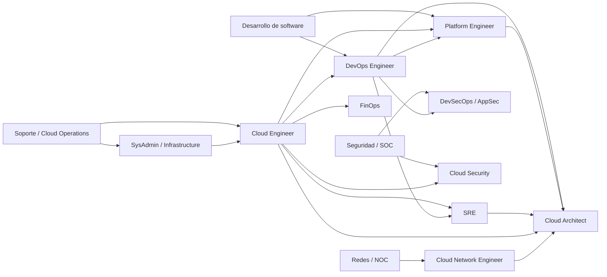

---
tags:
  - carrera
  - certificaciones
  - devops
  - sre
  - seguridad
  - finops
---

# Roles profesionales en cloud, DevOps y seguridad

> Qué hace cada rol (Cloud Engineer, Platform Engineer, SRE, DevOps, DevSecOps y otros), en qué se diferencian los que se confunden, cómo crece la carrera y qué parte del cuaderno, de los laboratorios y de las certificaciones sirve para cada camino.

## ¿Por qué se confunden los nombres de los puestos?

Los títulos de puesto (*job titles*) no están estandarizados. La misma persona puede llamarse **DevOps Engineer** en una empresa, **Platform Engineer** en otra y **Cloud Engineer** en una tercera, haciendo casi lo mismo. Y al revés: dos ofertas con el título "DevOps Engineer" pueden pedir trabajos muy distintos (una es administrar Jenkins; otra es diseñar una plataforma interna sobre Kubernetes).

Por eso la regla práctica es:

!!! tip "Lee las responsabilidades, no el título"
    Al revisar una oferta de trabajo (*job description*, JD), subraya los **verbos** ("diseñar", "operar", "automatizar", "auditar", "estar de guardia") y los **sistemas** (Kubernetes, Terraform, SIEM, firewalls). Esos dos datos te dicen el rol real mejor que el título.

Algunas causas de la confusión:

- **DevOps es una cultura, no un puesto.** El movimiento DevOps habla de colaboración entre desarrollo y operaciones; el mercado lo convirtió en título de trabajo (ver [Cultura DevOps y métricas DORA](../devops/fundamentos/cultura-metricas-dora.md)).
- **El tamaño de la empresa cambia el alcance.** En una startup una sola persona hace cloud, CI/CD, seguridad y guardias; en una empresa grande cada cosa es un equipo distinto.
- **Las modas renombran trabajos existentes.** Parte de lo que hoy se llama *platform engineering* antes se llamaba "equipo de infraestructura" o "equipo de herramientas".

### Cómo encajan con las capas del cuaderno

El cuaderno organiza cada tema en tres capas (ver el [mapa de relaciones](../mapa-de-relaciones.md)): **Cloud es el control**, **DevOps es la automatización** y **DevSecOps es la verificación**, con Negocio TI (el porqué), Networking (la base) y Python (la herramienta) alrededor. Cada rol vive sobre todo en una o dos capas:

| Capa del cuaderno | Roles que viven ahí sobre todo |
| --- | --- |
| Cloud (el control) | Cloud Engineer, Cloud Architect, Cloud Security Engineer, Cloud Network Engineer |
| DevOps (la automatización) | DevOps Engineer, Platform Engineer, SRE, Release / Build Engineer, MLOps Engineer |
| DevSecOps (la verificación) | DevSecOps Engineer, Application Security Engineer, Cloud Security Engineer |
| Negocio TI (el porqué) | Cloud Architect, FinOps Practitioner, todos los roles senior |
| Networking (la base) | Network Engineer, Infrastructure Engineer, Cloud Network Engineer |
| Python (la herramienta) | Todos: automatizar es parte de cada rol |

## Fichas por rol

Cada ficha usa el mismo formato para que puedas comparar. Las herramientas son ejemplos habituales, no una lista obligatoria: cada empresa usa su combinación.

!!! warning "Certificaciones: revisa la vigencia"
    Los proveedores cambian nombres, códigos y retiran certificaciones. Las que se nombran abajo sin enlace están descritas (o se describirán) en [Otras certificaciones](otras-certificaciones.md); compara siempre con la página oficial antes de estudiar.

### Cloud Engineer

**Misión:** construir y operar la infraestructura en uno o varios proveedores cloud de forma segura, repetible y con costos razonables.

| Aspecto | Detalle |
| --- | --- |
| Responsabilidades típicas | Crear redes, cómputo, almacenamiento e IAM; escribir IaC; configurar monitoreo y backups; atender incidentes de infraestructura; aplicar parches y cambios |
| Habilidades técnicas | Un proveedor a fondo (y nociones de otro), Linux, redes (subnets, DNS, routing), IAM, Terraform u otra IaC, scripting en Bash o Python |
| Herramientas habituales | Consola y CLI del proveedor, Terraform, Git, CloudWatch / Azure Monitor / Cloud Monitoring, Ansible |
| Habilidades no técnicas | Documentar, seguir procesos de cambio, priorizar tickets, explicar riesgos a quien pide el recurso |
| Con quién trabaja | Desarrollo, arquitectura, seguridad, soporte, finanzas (costos) |
| Cómo se mide | Disponibilidad de la infraestructura, cambios sin incidentes, tiempo de entrega de recursos, hallazgos de seguridad abiertos, gasto frente a presupuesto |
| Señales en la oferta | "Aprovisionar y mantener infraestructura en AWS/Azure/GCP", "Terraform", "landing zone", "migración", "administrar cuentas o suscripciones" |
| Notas que más le sirven | [IAM](../cloud/identidad-y-seguridad/iam-comparativa.md), [Redes en la nube](../cloud/redes-y-datos/redes.md), [Máquinas virtuales](../cloud/computo/maquinas-virtuales.md), [Terraform](../devops/iac/terraform-basico.md), [Observabilidad nativa](../cloud/operacion-y-gobierno/observabilidad-nativa.md) |
| Certificaciones que encajan | [Cloud Practitioner](aws/cloud-practitioner/resumen-examen.md) como base, [Solutions Architect – Associate](aws/solutions-architect-associate/resumen-examen.md), [Associate Cloud Engineer](google-cloud/associate-cloud-engineer/resumen-examen.md), [AZ-104](azure/azure-administrator/resumen-examen.md), [Terraform Associate](hashicorp/terraform-associate/resumen-examen.md) |

### Cloud Architect / Solutions Architect

**Misión:** decidir **cómo** se construye una solución en la nube para que cumpla requisitos de negocio, seguridad, fiabilidad y costo, y documentar esas decisiones.

| Aspecto | Detalle |
| --- | --- |
| Responsabilidades típicas | Levantar requisitos funcionales y no funcionales, diseñar arquitecturas, escribir **ADR** (*Architecture Decision Records*, registros de decisiones), revisar diseños de otros equipos, estimar costos, guiar migraciones |
| Habilidades técnicas | Amplitud en servicios cloud, patrones de arquitectura, redes, seguridad, datos, alta disponibilidad, Well-Architected |
| Herramientas habituales | Diagramas (modelo C4, draw.io), calculadoras de precios, frameworks Well-Architected, plantillas de ADR |
| Habilidades no técnicas | Comunicación con negocio, negociar *trade-offs* (compromisos entre opciones), escribir, presentar, influir sin autoridad formal |
| Con quién trabaja | Dirección, producto, clientes, equipos de ingeniería, seguridad, compras |
| Cómo se mide | Calidad de las decisiones (pocas revisiones por problemas de diseño), costo frente a estimado, cumplimiento de requisitos no funcionales, adopción de estándares |
| Señales en la oferta | "Diseñar soluciones", "preventa" (*pre-sales*), "documentos de arquitectura", "interlocución con clientes", "migración a la nube" |
| Notas que más le sirven | [Fundamentos de arquitectura de software](../cloud/arquitectura/fundamentos-arquitectura-software.md), [Arquitectura en la nube](../cloud/arquitectura/arquitectura-cloud.md), [Arquitecturas de referencia](../cloud/arquitectura/arquitecturas-referencia.md), [Well-Architected](../cloud/fundamentos/well-architected.md), [TI y negocio](../negocio/ti-y-negocio.md) |
| Certificaciones que encajan | [Solutions Architect – Associate](aws/solutions-architect-associate/resumen-examen.md); después las de nivel profesional/experto (AWS Solutions Architect – Professional, AZ-305, Google Professional Cloud Architect) en [Otras certificaciones](otras-certificaciones.md) |

!!! note "Solutions Architect en un proveedor o partner"
    En AWS, Microsoft, Google o sus partners, "Solutions Architect" suele ser un rol **de cara al cliente** (técnico de preventa): diseña propuestas y demos, más que operar sistemas.

### DevOps Engineer

**Misión:** acortar el camino entre un cambio en el código y producción, de forma automática, segura y repetible.

| Aspecto | Detalle |
| --- | --- |
| Responsabilidades típicas | Crear y mantener pipelines de **CI/CD** (integración y entrega continuas), contenerizar aplicaciones, automatizar entornos con IaC, definir estrategias de despliegue, apoyar a desarrollo en problemas de build y despliegue |
| Habilidades técnicas | Git, CI/CD, Docker, Kubernetes, IaC, scripting, observabilidad básica, un proveedor cloud |
| Herramientas habituales | GitHub Actions, GitLab CI, Jenkins, Azure Pipelines, Docker, Helm, Argo CD, Terraform |
| Habilidades no técnicas | Trabajar con desarrollo como cliente interno, enseñar, estandarizar sin bloquear |
| Con quién trabaja | Desarrollo, QA, operaciones, seguridad |
| Cómo se mide | Métricas **DORA**: frecuencia de despliegue, tiempo de entrega de cambios (*lead time*), tasa de fallo de cambios, tiempo de recuperación |
| Señales en la oferta | "Pipelines", "automatizar despliegues", "Docker/Kubernetes", "GitOps", "IaC" |
| Notas que más le sirven | [Integración continua](../devops/ci-cd/integracion-continua.md), [Despliegue continuo](../devops/ci-cd/despliegue-continuo.md), [Docker](../devops/contenedores/docker.md), [Kubernetes](../devops/contenedores/kubernetes.md), [Infrastructure as Code](../devops/iac/infraestructura-como-codigo.md) |
| Certificaciones que encajan | [Terraform Associate](hashicorp/terraform-associate/resumen-examen.md); en [Otras certificaciones](otras-certificaciones.md): CKA/CKAD, AWS DevOps Engineer – Professional, AZ-400, Google Professional Cloud DevOps Engineer |

### Platform Engineer

**Misión:** construir una **plataforma interna de desarrollo** (*Internal Developer Platform*, IDP) tratada como producto, para que los equipos de aplicación se sirvan solos (*self-service*) por **caminos dorados** (*golden paths*) seguros y estándar.

| Aspecto | Detalle |
| --- | --- |
| Responsabilidades típicas | Plantillas de servicios, módulos de IaC reutilizables, clústeres Kubernetes compartidos, portal de desarrolladores, pipelines estándar, políticas por defecto (seguridad y costos), documentación de la plataforma |
| Habilidades técnicas | Kubernetes a fondo, IaC y módulos, APIs, programación (Go o Python), GitOps, observabilidad, nociones de seguridad |
| Herramientas habituales | Kubernetes, Backstage, Crossplane, Argo CD/Flux, Terraform, Helm, OPA/Kyverno |
| Habilidades no técnicas | Mentalidad de producto: entrevistar a usuarios internos, priorizar un *roadmap*, medir adopción |
| Con quién trabaja | Equipos de desarrollo (sus usuarios), SRE, seguridad, arquitectura |
| Cómo se mide | Adopción de la plataforma, tiempo hasta el primer despliegue de un servicio nuevo, satisfacción de desarrolladores, métricas DORA de los equipos que la usan |
| Señales en la oferta | "Internal developer platform", "golden paths", "developer experience" (DevEx), "Backstage", "self-service", "platform as a product" |
| Notas que más le sirven | [Kubernetes](../devops/contenedores/kubernetes.md), [Infrastructure as Code](../devops/iac/infraestructura-como-codigo.md), [Pruebas de infraestructura](../devops/iac/pruebas-infraestructura.md), [Gobernanza](../cloud/operacion-y-gobierno/gobernanza.md), [Seguridad de IaC](../devsecops/infraestructura-y-contenedores/seguridad-iac.md) |
| Certificaciones que encajan | [Terraform Associate](hashicorp/terraform-associate/resumen-examen.md); CKA y CKAD en [Otras certificaciones](otras-certificaciones.md) |

### Site Reliability Engineer (SRE)

**Misión:** mantener los servicios **fiables** con ingeniería de software aplicada a operaciones: SLO, presupuestos de error, automatización y aprendizaje de incidentes. El libro de Google lo resume como "lo que pasa cuando le pides a una persona ingeniera de software que diseñe un equipo de operaciones".

| Aspecto | Detalle |
| --- | --- |
| Responsabilidades típicas | Definir SLI/SLO con producto, alertas basadas en síntomas, guardias (*on-call*), gestión de incidentes, *postmortems* sin culpables (*blameless*), planificación de capacidad (*capacity planning*), reducir **toil** (trabajo manual repetitivo) |
| Habilidades técnicas | Sistemas distribuidos, Linux a fondo, redes, observabilidad, programación, Kubernetes, análisis de rendimiento |
| Herramientas habituales | Prometheus, Grafana, OpenTelemetry, herramientas de logs, PagerDuty/Opsgenie, runbooks, chaos engineering |
| Habilidades no técnicas | Calma bajo presión, comunicación durante incidentes, escribir postmortems, negociar prioridades con el error budget |
| Con quién trabaja | Desarrollo, producto, soporte, plataforma |
| Cómo se mide | Cumplimiento de SLO, consumo del error budget, MTTR, alertas accionables frente a ruido, porcentaje de toil |
| Señales en la oferta | "SLO/SLI", "on-call", "incident management", "postmortems", "reliability", "observability" |
| Notas que más le sirven | [Operación y fiabilidad (SRE)](../devops/operacion/operacion-sre.md), [Observabilidad](../devops/operacion/observabilidad.md), [Postmortem](../devops/operacion/postmortem.md), [Runbooks y playbooks](../devops/operacion/runbooks-playbooks.md), [Niveles de servicio](../negocio/niveles-de-servicio.md), [Resiliencia](../cloud/operacion-y-gobierno/resiliencia.md) |
| Certificaciones que encajan | Pesa más la experiencia que las certificaciones; ayudan CKA y Google Professional Cloud DevOps Engineer ([Otras certificaciones](otras-certificaciones.md)) |

### DevSecOps Engineer / Application Security Engineer

**Misión:** que la seguridad sea parte del ciclo de desarrollo (*shift-left*, mover la seguridad hacia el inicio), con controles automáticos en el pipeline y apoyo a los equipos para corregir.

| Aspecto | Detalle |
| --- | --- |
| Responsabilidades típicas | Integrar SAST, SCA, secret scanning, escaneo de imágenes e IaC en CI; triage de hallazgos; *threat modeling* (modelado de amenazas); revisión de código seguro; seguridad de la cadena de suministro (SBOM, firma); formación a desarrolladores |
| Habilidades técnicas | OWASP Top 10, lenguajes de programación (leer código), CI/CD, contenedores, criptografía básica, gestión de vulnerabilidades |
| Herramientas habituales | Semgrep, CodeQL, SonarQube, Trivy, Dependabot, Snyk, gitleaks, OWASP ZAP, cosign |
| Habilidades no técnicas | Explicar el riesgo sin bloquear, priorizar por impacto, ganarse a los equipos de desarrollo |
| Con quién trabaja | Desarrollo, DevOps/plataforma, seguridad corporativa, cumplimiento |
| Cómo se mide | Tiempo de remediación por severidad (SLA de vulnerabilidades), porcentaje de repos con controles, falsos positivos, vulnerabilidades que llegan a producción |
| Señales en la oferta | "Shift-left", "AppSec", "SAST/DAST/SCA", "secure SDLC", "supply chain", "threat modeling" |
| Notas que más le sirven | [Fundamentos DevSecOps](../devsecops/fundamentos-devsecops.md), [Seguridad del código](../devsecops/codigo-y-dependencias/seguridad-codigo.md), [Software supply chain](../devsecops/codigo-y-dependencias/cadena-suministro.md), [Escaneo en el pipeline](../devsecops/escaneos/escaneo-en-pipeline.md), [Seguridad del pipeline](../devsecops/identidades-y-pipeline/seguridad-pipeline.md) |
| Certificaciones que encajan | CKS, CompTIA Security+ y certificaciones de AppSec en [Otras certificaciones](otras-certificaciones.md) |

### Cloud Security Engineer

**Misión:** proteger la **plataforma cloud** en sí: identidades, configuración, redes, datos y detección de amenazas en las cuentas, suscripciones y proyectos.

| Aspecto | Detalle |
| --- | --- |
| Responsabilidades típicas | Diseñar IAM y guardrails (SCP, Azure Policy, Organization Policy), **CSPM** (gestión de la postura de seguridad cloud), cifrado y KMS, logs de auditoría, detección y respuesta en la nube, cumplimiento (CIS, ISO 27001, SOC 2) |
| Habilidades técnicas | IAM a fondo en al menos un proveedor, redes cloud, servicios nativos de seguridad, IaC, policy as code, respuesta a incidentes |
| Herramientas habituales | Security Hub, Defender for Cloud, Security Command Center, GuardDuty, Microsoft Sentinel, Prowler, Checkov |
| Habilidades no técnicas | Gestión de riesgo, redactar políticas, trabajar con auditoría y legal |
| Con quién trabaja | Cloud/plataforma, seguridad corporativa (SOC), cumplimiento, arquitectura |
| Cómo se mide | Postura (hallazgos críticos abiertos, cumplimiento de benchmarks), tiempo de detección y respuesta, cobertura de logs, permisos excesivos eliminados |
| Señales en la oferta | "CSPM", "guardrails", "landing zone segura", "IAM", "GuardDuty/Defender/SCC", "CIS Benchmarks" |
| Notas que más le sirven | [Seguridad base](../cloud/identidad-y-seguridad/seguridad-base.md), [IAM](../cloud/identidad-y-seguridad/iam-comparativa.md), [CSPM](../devsecops/escaneos/cspm.md), [Cumplimiento](../devsecops/gobierno-y-respuesta/cumplimiento.md), [Detección y respuesta](../devsecops/gobierno-y-respuesta/deteccion-respuesta.md), [Responsabilidad compartida](../cloud/fundamentos/responsabilidad-compartida.md) |
| Certificaciones que encajan | [Solutions Architect – Associate](aws/solutions-architect-associate/resumen-examen.md) o [AZ-104](azure/azure-administrator/resumen-examen.md) como base; AWS Security – Specialty, SC-500 (reemplazo de AZ-500, retirada en agosto de 2026) y Google Professional Cloud Security Engineer en [Otras certificaciones](otras-certificaciones.md) |

### Infrastructure Engineer / SysAdmin moderno

**Misión:** mantener servidores, sistemas operativos, almacenamiento y virtualización (on-premise, híbridos o en la nube) funcionando, cada vez más **con código** en vez de a mano.

| Aspecto | Detalle |
| --- | --- |
| Responsabilidades típicas | Administrar Linux/Windows, parches, backups, virtualización, directorio (Active Directory / Entra ID), automatizar configuración, soporte de tercer nivel |
| Habilidades técnicas | Linux y Windows Server, redes, almacenamiento, scripting (Bash, PowerShell, Python), configuration management |
| Herramientas habituales | Ansible, PowerShell, VMware o Hyper-V, herramientas de backup, monitoreo (Zabbix, Prometheus) |
| Habilidades no técnicas | Disciplina con cambios y documentación, atención a usuarios internos |
| Con quién trabaja | Soporte, redes, seguridad, cloud |
| Cómo se mide | Disponibilidad, parches al día, backups probados, tickets resueltos dentro del SLA |
| Señales en la oferta | "Administración de servidores", "parches", "Active Directory", "virtualización", "Ansible", "entornos híbridos" |
| Notas que más le sirven | [Linux, redes y scripting](../devops/fundamentos/linux-redes-scripting.md), [Ansible](../devops/iac/ansible.md), [Troubleshooting](../devops/operacion/troubleshooting.md), [Python: sistema y procesos](../python/scripting/sistema-procesos.md) |
| Certificaciones que encajan | [AZ-104](azure/azure-administrator/resumen-examen.md); Linux (LFCS, Linux+, RHCSA) en [Otras certificaciones](otras-certificaciones.md) |

### Network Engineer y Cloud Network Engineer

**Misión:** diseñar y operar la conectividad: LAN/WAN, firewalls, VPN y, en la versión cloud, VPC/VNet, conectividad híbrida, DNS y balanceo entre nubes y datacenter.

| Aspecto | Detalle |
| --- | --- |
| Responsabilidades típicas | Diseño de direccionamiento IP, routing (BGP, OSPF), firewalls, VPN, balanceadores; en cloud: hub-and-spoke, Transit Gateway / Virtual WAN / Network Connectivity Center, Direct Connect / ExpressRoute / Cloud Interconnect, DNS híbrido |
| Habilidades técnicas | Modelo OSI y TCP/IP, subnetting, routing, seguridad de red, troubleshooting con capturas de paquetes; en cloud además IaC |
| Herramientas habituales | Equipos de fabricantes (Cisco, Juniper, Palo Alto, Fortinet), Wireshark, tcpdump, Terraform, herramientas de diagnóstico de red de cada nube |
| Habilidades no técnicas | Planificación de cambios con ventanas de mantenimiento, coordinación con proveedores de conectividad |
| Con quién trabaja | Seguridad, infraestructura, cloud, proveedores de telecomunicaciones |
| Cómo se mide | Disponibilidad y latencia de enlaces, cambios sin cortes, tiempo de diagnóstico, ausencia de solapamientos de IP |
| Señales en la oferta | "BGP", "SD-WAN", "firewalls", "VPN", "hybrid connectivity", "VPC design" |
| Notas que más le sirven | Toda la sección Networking, desde [Fundamentos de redes](../networking/basico/fundamentos-redes.md) hasta [Redes de datacenter e híbridas](../networking/avanzado/redes-datacenter-hibridas.md); [Redes en la nube](../cloud/redes-y-datos/redes.md); [Troubleshooting de red](../networking/avanzado/troubleshooting-red.md) |
| Certificaciones que encajan | [AZ-104](azure/azure-administrator/resumen-examen.md) (área de redes); CCNA, AWS Advanced Networking – Specialty, AZ-700 y Google Professional Cloud Network Engineer en [Otras certificaciones](otras-certificaciones.md) |

### FinOps Practitioner / Analyst

**Misión:** que la organización saque el máximo valor de cada unidad de dinero gastada en la nube, conectando ingeniería, finanzas y negocio. La FinOps Foundation lo define como una de sus *personas* principales, junto a Engineering, Finance, Product, Procurement y Leadership.

| Aspecto | Detalle |
| --- | --- |
| Responsabilidades típicas | Asignar costos (*tagging*, *showback*, *chargeback*), presupuestos y pronósticos, detectar anomalías, recomendar *rightsizing* y compromisos de uso, informes para dirección, gobierno de costos de IA y SaaS |
| Habilidades técnicas | Modelos de precios cloud, análisis de datos (SQL, hojas de cálculo, BI), etiquetado y gobierno, nociones de arquitectura |
| Herramientas habituales | AWS Cost Explorer y CUR, Microsoft Cost Management, Cloud Billing de Google Cloud, FOCUS (especificación abierta de datos de facturación), herramientas de BI |
| Habilidades no técnicas | Traducir entre finanzas e ingeniería, influir sin imponer, presentar a dirección |
| Con quién trabaja | Ingeniería, finanzas, compras, producto, dirección |
| Cómo se mide | Porcentaje de gasto asignado, precisión del pronóstico, cobertura de compromisos, ahorro realizado, costo unitario (por cliente, por transacción) |
| Señales en la oferta | "Cloud cost", "FinOps", "showback/chargeback", "forecasting", "unit economics" |
| Notas que más le sirven | [FinOps y costos](../cloud/fundamentos/finops-costos.md), [TI y negocio](../negocio/ti-y-negocio.md), [Métricas, KPIs y OKRs](../negocio/metricas-kpis-okrs.md), [Gobernanza](../cloud/operacion-y-gobierno/gobernanza.md) |
| Certificaciones que encajan | [Cloud Practitioner](aws/cloud-practitioner/resumen-examen.md) (facturación y precios); FinOps Certified Practitioner en [Otras certificaciones](otras-certificaciones.md) |

### MLOps / AI Platform Engineer

**Misión:** llevar modelos de *machine learning* (aprendizaje automático) e IA generativa a producción de forma repetible: pipelines de entrenamiento, despliegue, monitoreo y gobierno.

| Aspecto | Detalle |
| --- | --- |
| Responsabilidades típicas | Pipelines de entrenamiento continuo, registro de modelos (*model registry*), despliegue de modelos e inferencia, monitoreo de deriva (*drift*) y calidad, infraestructura con GPU, plataformas para aplicaciones con LLM, control de costos de IA |
| Habilidades técnicas | Python, contenedores y Kubernetes, CI/CD, datos, nociones de ML, servicios de IA de cada nube |
| Herramientas habituales | Amazon SageMaker AI / Amazon Bedrock, Azure Machine Learning / Microsoft Foundry, Vertex AI, MLflow, Kubeflow |
| Habilidades no técnicas | Hacer de puente entre ciencia de datos e ingeniería, gestionar expectativas sobre IA |
| Con quién trabaja | Ciencia de datos, ingeniería de datos, plataforma, seguridad, legal (IA responsable) |
| Cómo se mide | Tiempo de un modelo de experimento a producción, frecuencia de reentrenamiento, latencia y costo de inferencia, incidentes por degradación del modelo |
| Señales en la oferta | "MLOps", "LLMOps", "model serving", "feature store", "GPU", "Vertex AI/SageMaker/Bedrock" |
| Notas que más le sirven | [Kubernetes](../devops/contenedores/kubernetes.md), [Integración continua](../devops/ci-cd/integracion-continua.md), [Observabilidad](../devops/operacion/observabilidad.md), [Python](../python/index.md) |
| Certificaciones que encajan | [AI Practitioner](aws/ai-practitioner/resumen-examen.md) como base; AWS Machine Learning Engineer – Associate y Google Professional Machine Learning Engineer en [Otras certificaciones](otras-certificaciones.md) |

!!! info "Niveles de madurez de MLOps"
    La guía de Google Cloud describe tres niveles: **0** proceso manual, **1** automatización del pipeline de ML (entrenamiento continuo) y **2** automatización de CI/CD del propio pipeline. Es una buena forma de entender qué pide una oferta de MLOps.

### Release / Build Engineer

**Misión:** que el software se compile, empaquete, versione y publique de forma confiable. Es frecuente en empresas de software de producto, videojuegos, móviles o sistemas embebidos, donde un *release* es un evento complejo.

| Aspecto | Detalle |
| --- | --- |
| Responsabilidades típicas | Sistemas de build, versionado semántico, ramas de release, artefactos y registries, notas de versión, coordinación de lanzamientos |
| Herramientas habituales | Gradle, Maven, Bazel, CMake, Artifactory/Nexus, CI/CD |
| Notas que más le sirven | [Git y control de versiones](../devops/fundamentos/git-control-versiones.md), [Integración continua](../devops/ci-cd/integracion-continua.md), [Software supply chain](../devsecops/codigo-y-dependencias/cadena-suministro.md) |
| Cómo se mide | Builds reproducibles, tiempo de build, releases sin rollback |

### Support / Cloud Operations

**Misión:** atender incidencias y solicitudes, vigilar alertas y resolver o escalar problemas siguiendo runbooks. Es una de las **puertas de entrada** más comunes al mundo cloud: ves muchos sistemas distintos y aprendes troubleshooting real.

| Aspecto | Detalle |
| --- | --- |
| Responsabilidades típicas | Tickets de primer y segundo nivel, monitoreo de alertas, ejecutar runbooks, escalar, documentar soluciones |
| Notas que más le sirven | [Troubleshooting](../devops/operacion/troubleshooting.md), [Leer logs](../devops/operacion/leer-logs.md), [Runbooks y playbooks](../devops/operacion/runbooks-playbooks.md), [Gestión de servicios e ITIL 4](../negocio/gestion-servicios-itil.md) |
| Cómo se mide | Tiempo de primera respuesta, tickets resueltos dentro del SLA, calidad de escalamiento |

**NOC** (*Network Operations Center*, centro de operaciones de red) vigila la disponibilidad de redes y servicios; **SOC** (*Security Operations Center*, centro de operaciones de seguridad) vigila alertas de seguridad y es la puerta de entrada típica a Cloud Security y detección y respuesta.

## Tablas comparativas

### Matriz rol por responsabilidad

**P** = principal, **C** = compartida, **·** = poca o ninguna. Es una tendencia general: en cada empresa cambia.

| Rol | Diseño | Construir infra | CI/CD | Plataforma interna | Fiabilidad / on-call | Seguridad | Costos | Redes |
| --- | --- | --- | --- | --- | --- | --- | --- | --- |
| Cloud Engineer | C | P | C | C | C | C | C | C |
| Cloud Architect | P | · | · | C | C | C | P | C |
| DevOps Engineer | C | C | P | C | C | C | · | · |
| Platform Engineer | C | P | C | P | C | C | C | · |
| SRE | C | C | C | C | P | C | C | C |
| DevSecOps / AppSec | · | · | C | C | · | P | · | · |
| Cloud Security Engineer | C | C | · | C | C | P | · | C |
| Infrastructure Engineer | · | P | · | · | C | C | · | C |
| Network / Cloud Network Engineer | C | C | · | · | C | C | · | P |
| FinOps Practitioner | C | · | · | · | · | · | P | · |
| MLOps Engineer | C | C | P | C | C | · | C | · |
| Release / Build Engineer | · | · | P | C | · | C | · | · |
| Support / Cloud Operations | · | · | · | · | P | · | · | C |

### Pares que se confunden

| Par | En qué se parecen | Diferencia clave |
| --- | --- | --- |
| **DevOps vs SRE** | Automatizan, usan CI/CD, IaC y observabilidad | DevOps se centra en el **flujo de entrega** (llevar cambios a producción rápido); SRE en la **fiabilidad en producción** (SLO, error budget, incidentes, guardias). Google describe SRE como una forma concreta de implementar DevOps |
| **DevOps vs Platform Engineer** | Mismas herramientas (Kubernetes, Terraform, pipelines) | DevOps suele resolver la entrega **de uno o varios equipos**; Platform Engineer construye un **producto interno reutilizable** para toda la organización, con usuarios, roadmap y métricas de adopción |
| **Cloud Engineer vs Cloud Architect** | Conocen a fondo los servicios cloud | El Engineer **construye y opera**; el Architect **decide y documenta** el diseño, con más peso en requisitos de negocio, costos y trade-offs, y menos manos en la consola |
| **DevSecOps vs Cloud Security Engineer** | Los dos automatizan seguridad | DevSecOps protege el **software y su ciclo de vida** (código, dependencias, pipeline, imágenes); Cloud Security protege la **plataforma** (IAM, configuración de cuentas, red, detección) |
| **SRE vs Platform Engineer** | Trabajan sobre infraestructura compartida y a veces están en el mismo equipo | SRE mide y defiende la **fiabilidad de los servicios**; Platform Engineer mide la **productividad de los desarrolladores**. La plataforma suele tener sus propios SLO, que puede cuidar SRE |

### Seniority: qué cambia en cada nivel

Los nombres de nivel (*seniority*) varían; lo que importa es el **alcance**, la **autonomía** y el **impacto**.

| Nivel | Alcance | Autonomía | Impacto esperado |
| --- | --- | --- | --- |
| Junior | Tareas bien definidas dentro de un sistema | Necesita guía y revisión frecuente | Entrega tareas correctas, aprende rápido, pregunta a tiempo |
| Semi-senior (*mid-level*) | Funcionalidades o componentes completos | Resuelve sola la mayoría de problemas; pide ayuda en lo nuevo | Entrega de forma confiable, participa en guardias, mejora procesos de su equipo |
| Senior | Sistemas completos y decisiones técnicas del equipo | Define el cómo; identifica problemas que nadie asignó | Diseña, revisa a otros, mentoriza, reduce riesgo del equipo |
| Staff / Principal | Varios equipos o toda la organización | Define el qué y el porqué técnico; trabaja con dirección | Estrategia técnica, estándares, decisiones de largo plazo, multiplica a otros equipos |

!!! note "El salto a senior no es solo técnico"
    Desde senior en adelante, escribir (ADR, postmortems, propuestas), comunicar riesgos en términos de negocio y ayudar a otras personas pesa tanto como saber la herramienta. Las notas de [Negocio TI](../negocio/index.md) están pensadas para ese salto.

## Rutas de entrada y crecimiento

No hay un único camino. Estos son los más frecuentes:

### Cómo usar el cuaderno en cada camino

| Si vienes de… | Apunta a… | Empieza por estas secciones | Laboratorios clave | Certificaciones |
| --- | --- | --- | --- | --- |
| Soporte o SysAdmin | Cloud Engineer | Networking básico, [Linux, redes y scripting](../devops/fundamentos/linux-redes-scripting.md), Cloud (fundamentos, IAM, redes, cómputo) | 00–03, 08–09, 17, 19 | [Cloud Practitioner](aws/cloud-practitioner/resumen-examen.md) → [SAA](aws/solutions-architect-associate/resumen-examen.md) o [AZ-104](azure/azure-administrator/resumen-examen.md) |
| Cloud Engineer | DevOps, Platform o SRE | DevOps completo, [Observabilidad](../devops/operacion/observabilidad.md), [Operación SRE](../devops/operacion/operacion-sre.md) | 04–11, 21 | [Terraform Associate](hashicorp/terraform-associate/resumen-examen.md), CKA |
| Desarrollo de software | DevOps o Platform | [Git](../devops/fundamentos/git-control-versiones.md), CI/CD, contenedores, IaC; luego Cloud | 04–08, 18, 20 | [Terraform Associate](hashicorp/terraform-associate/resumen-examen.md), CKAD |
| Seguridad o SOC | DevSecOps o Cloud Security | DevSecOps completo, [Seguridad base](../cloud/identidad-y-seguridad/seguridad-base.md), [IAM](../cloud/identidad-y-seguridad/iam-comparativa.md) | 12–16 | Una asociada cloud + una de seguridad cloud |
| Redes o NOC | Cloud Network Engineer | Networking intermedio y avanzado, [Redes en la nube](../cloud/redes-y-datos/redes.md) | 01–02, 17, 19 | [AZ-104](azure/azure-administrator/resumen-examen.md) o [ACE](google-cloud/associate-cloud-engineer/resumen-examen.md), luego una de redes cloud |
| Cualquier rol técnico con experiencia | Cloud Architect | [Arquitectura](../cloud/arquitectura/fundamentos-arquitectura-software.md), [Well-Architected](../cloud/fundamentos/well-architected.md), Negocio TI | 17–20 (como diseño completo) | [SAA](aws/solutions-architect-associate/resumen-examen.md) → nivel profesional |

Los números corresponden a los [laboratorios](../laboratorios/index.md).

### Portafolio recomendado por rol

Un repositorio público en GitHub con README claro (qué problema resuelve, diagrama, cómo ejecutarlo, qué aprendiste y cómo limpiarlo) vale más que una lista de herramientas en el CV.

| Rol objetivo | Qué mostrar (a partir de los laboratorios) |
| --- | --- |
| Cloud Engineer | VPC con subnets públicas y privadas y EC2 sin IP pública en Terraform (lab [17](../laboratorios/cloud/aws-vpc-ec2.md)), la misma idea en Azure (lab [19](../laboratorios/cloud/azure-vnet-vm.md)), backend remoto con locking (lab [09](../laboratorios/devops/terraform-aws-backend-remoto.md)) |
| DevOps Engineer | App en contenedor multi-stage (lab [05](../laboratorios/devops/docker-multistage-compose.md)) con pipeline de CI que hace lint, tests, build y push a un registry (lab [07](../laboratorios/devops/github-actions-ci.md)), despliegue en Kubernetes (lab [06](../laboratorios/devops/kubernetes-local-kind.md)) |
| Platform Engineer | Módulos de Terraform reutilizables con tests (lab [08](../laboratorios/devops/terraform-local-workspaces.md)), plantilla de servicio con pipeline estándar y políticas (labs [07](../laboratorios/devops/github-actions-ci.md) y [14](../laboratorios/devsecops/seguridad-kubernetes.md)), documentación como si fuera para otros equipos |
| SRE | Stack de Prometheus y Grafana con un SLO y alertas sobre el error budget (lab [11](../laboratorios/devops/observabilidad-prometheus-grafana.md)), un postmortem bien escrito del game day (lab [21](../laboratorios/operacion/game-day-incidente.md)) |
| DevSecOps / AppSec | Pipeline con escaneos y gating (lab [12](../laboratorios/devsecops/escaneos-en-pipeline.md)), despliegue con OIDC sin llaves (lab [13](../laboratorios/devsecops/oidc-github-aws.md)), informe de DAST con ZAP y las correcciones (lab [15](../laboratorios/devsecops/dast-zap-juice-shop.md)) |
| Cloud Security | Auditoría con Prowler y remediación como código (lab [16](../laboratorios/devsecops/cspm-prowler.md)), OIDC (lab [13](../laboratorios/devsecops/oidc-github-aws.md)), endurecimiento de Kubernetes (lab [14](../laboratorios/devsecops/seguridad-kubernetes.md)) |
| Network / Cloud Network | Plan de direccionamiento con script (lab [02](../laboratorios/fundamentos/subnetting-plan-ips.md)), diagnóstico de red documentado (lab [01](../laboratorios/fundamentos/linux-red-diagnostico.md)), VPC y VNet como IaC (labs [17](../laboratorios/cloud/aws-vpc-ec2.md) y [19](../laboratorios/cloud/azure-vnet-vm.md)) |
| FinOps | Presupuestos y alertas (lab [00](../laboratorios/fundamentos/preparar-entorno.md)) más un análisis de costos de los labs con etiquetas y recomendaciones |
| MLOps | API serverless (lab [18](../laboratorios/cloud/aws-serverless-api.md)) o Cloud Run (lab [20](../laboratorios/cloud/gcp-cloud-run.md)) sirviendo un modelo pequeño, con CI y monitoreo |

!!! warning "Nada de secretos en el portafolio"
    Antes de publicar, revisa el historial de Git con un detector de secretos (ver [Secret scanning](../devsecops/escaneos/secret-scanning.md)) y no subas archivos de state de Terraform, `.env` ni IDs de cuenta.

## Contexto de mercado

Lo que sigue son **tendencias observables en fuentes reconocidas**, no predicciones. Contrasta siempre con ofertas reales de tu país y de tu sector.

| Tendencia | Qué se observa | Fuente |
| --- | --- | --- |
| Platform engineering | La CNCF define la plataforma como "una colección integrada de capacidades" presentada según las necesidades de sus usuarios, y publica un modelo de madurez (inversión, adopción, interfaces, operación, medición). El informe DORA 2024 señala la ingeniería de plataformas y el enfoque en el usuario como factores de éxito | CNCF Platforms White Paper, Platform Engineering Maturity Model, DORA |
| IA en la entrega y la operación | DORA describe la IA como un **amplificador**: los mayores beneficios llegan cuando los sistemas sociotécnicos de base (plataforma, prácticas) son buenos; sin una buena plataforma, las ganancias individuales se pierden en cuellos de botella de pruebas, seguridad y despliegue | DORA 2025 y capacidad "Platform engineering" |
| FinOps y costos de IA | El State of FinOps 2026 señala la gestión de costos de IA como prioridad y habilidad más buscada, y la expansión de FinOps más allá de la nube pública (SaaS, licencias, datacenter) | FinOps Foundation |
| Seguridad de la cadena de suministro | Marcos como **SLSA** (*Supply-chain Levels for Software Artifacts*) y prácticas como SBOM y firma de artefactos aparecen cada vez más en ofertas de DevSecOps y plataforma | SLSA, ver [Software supply chain](../devsecops/codigo-y-dependencias/cadena-suministro.md) |
| Fiabilidad como disciplina | El modelo SRE (SLO, error budget, límite al toil) sigue siendo la referencia para roles de operación | Google SRE book |

### Cómo informarte sobre salarios

Aquí no hay cifras a propósito: cambian mucho por país, ciudad, sector, idioma, modalidad (remoto para el extranjero o local) y moneda.

- Usa **encuestas públicas** con metodología explicada, como la Stack Overflow Developer Survey (incluye salario por tipo de desarrollador y por algunos países) y encuestas salariales de comunidades tecnológicas de tu país.
- Mira **rangos publicados en las propias ofertas** (en algunos lugares es obligatorio publicarlos) y portales de empleo locales.
- Compara siempre **el mismo nivel y el mismo alcance**: un "DevOps senior" de una empresa puede ser un semi-senior en otra.
- Pregunta en comunidades y a personas del rol: suelen dar contexto que las encuestas no tienen (beneficios, guardias pagadas, carga de trabajo).

## Relación con otras secciones

| Enfoque | Qué se mira desde ahí | Nota |
| --- | --- | --- |
| Negocio TI (el porqué) | Cómo se mide el valor del trabajo de cada rol, SLA y costos | [TI y negocio](../negocio/ti-y-negocio.md), [Niveles de servicio](../negocio/niveles-de-servicio.md), [Métricas, KPIs y OKRs](../negocio/metricas-kpis-okrs.md) |
| Cloud (el control) | La base técnica de Cloud Engineer, Architect, Cloud Security y Cloud Network | [Well-Architected](../cloud/fundamentos/well-architected.md), [IAM](../cloud/identidad-y-seguridad/iam-comparativa.md), [FinOps y costos](../cloud/fundamentos/finops-costos.md) |
| DevOps (la automatización) | El trabajo diario de DevOps, Platform, SRE y Release | [Cultura DevOps y métricas DORA](../devops/fundamentos/cultura-metricas-dora.md), [Operación y fiabilidad (SRE)](../devops/operacion/operacion-sre.md) |
| DevSecOps (la verificación) | El trabajo de DevSecOps, AppSec y Cloud Security | [Fundamentos DevSecOps](../devsecops/fundamentos-devsecops.md), [Cumplimiento](../devsecops/gobierno-y-respuesta/cumplimiento.md) |
| Laboratorios | La práctica que alimenta el portafolio | [Laboratorios](../laboratorios/index.md) |
| Certificaciones | Qué certificación encaja con cada rol | [Certificaciones](index.md), [Otras certificaciones](otras-certificaciones.md) |

## Referencias

- [CNCF Platforms White Paper](https://tag-app-delivery.cncf.io/whitepapers/platforms/)
- [CNCF Platform Engineering Maturity Model](https://tag-app-delivery.cncf.io/whitepapers/platform-eng-maturity-model/)
- [Google SRE book: Introduction](https://sre.google/sre-book/introduction/)
- [Google SRE book: Eliminating Toil](https://sre.google/sre-book/eliminating-toil/)
- [DORA Research (informes anuales)](https://dora.dev/research/)
- [DORA Capabilities: Platform engineering](https://dora.dev/capabilities/platform-engineering/)
- [FinOps Framework](https://www.finops.org/framework/)
- [FinOps Personas](https://www.finops.org/framework/personas/)
- [State of FinOps](https://data.finops.org/)
- [CNCF Reports (encuestas e informes anuales)](https://www.cncf.io/reports/)
- [SLSA: Supply-chain Levels for Software Artifacts](https://slsa.dev/)
- [Google Cloud: MLOps, continuous delivery and automation pipelines in machine learning](https://docs.cloud.google.com/architecture/mlops-continuous-delivery-and-automation-pipelines-in-machine-learning)
- [Stack Overflow Developer Survey 2025: Work (incluye salarios)](https://survey.stackoverflow.co/2025/work)
