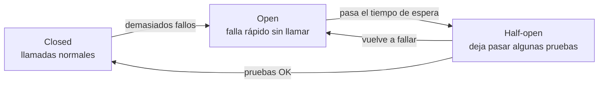
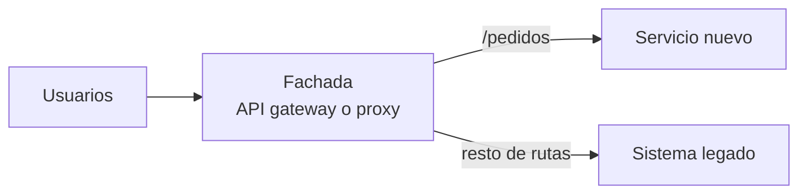

---
tags:
  - arquitectura
  - cloud-native
  - patrones
  - aws
  - azure
  - gcp
---

# Arquitectura en la nube (cloud-native)

> Los principios que hacen que una aplicación aproveche la nube (stateless, desechable, escalado horizontal, servicios gestionados primero, diseñar para el fallo), la metodología Twelve-Factor App, los patrones de diseño cloud más usados con su equivalente en AWS, Azure y Google Cloud, y cómo pensar multi-tenancy y multi-región.

## ¿Qué es?

Una aplicación **cloud-native** (nativa de la nube) está diseñada para **aprovechar** lo que ofrece la nube: capacidad elástica, servicios gestionados, automatización y despliegue continuo. No basta con que corra en la nube: una VM con un monolito copiado tal cual desde el datacenter (*lift and shift*, ver [Migración a la nube](migracion-cloud.md)) está **en** la nube, pero no es nativa de ella.

La diferencia está en el diseño: la nube da piezas que **fallan y se reemplazan** con frecuencia, que se **pagan por uso** y que se crean y destruyen con código. La arquitectura tiene que asumir eso.

## Principios

| Principio | Qué significa | Ejemplo |
| --- | --- | --- |
| **Stateless** (sin estado) | Las instancias no guardan datos de sesión ni archivos en local; el estado vive en servicios externos | Sesiones en Redis o en un token, archivos en object storage |
| **Disposable** (desechable) | Una instancia arranca rápido y se puede matar en cualquier momento sin perder nada | Contenedores que arrancan en segundos y gestionan `SIGTERM` |
| **Horizontal scaling** (escalado horizontal) | Se escala añadiendo instancias, no agrandando una | Auto Scaling group, HPA de Kubernetes (ver [Resiliencia](../operacion-y-gobierno/resiliencia.md#autoscaling)) |
| **Managed services first** (primero servicios gestionados) | Usar el servicio gestionado antes que operar tú el software | Base de datos gestionada en vez de PostgreSQL en una VM |
| **Design for failure** (diseñar para el fallo) | Asumir que cualquier componente fallará y que el sistema debe seguir funcionando | Multi-AZ, reintentos, circuit breakers, degradación controlada |
| **Automation** (automatizar todo) | Infraestructura, despliegues y recuperación por código | [Infrastructure as Code](../../devops/iac/infraestructura-como-codigo.md), CI/CD |
| **Observable** | Exponer logs, métricas y trazas desde el diseño | OpenTelemetry, health endpoints |
| **Security by design** (seguridad desde el diseño) | Mínimo privilegio, cifrado, identidades en lugar de claves | Managed identities, roles por servicio |

!!! tip "Pets vs cattle"
    La metáfora clásica: los servidores tradicionales son **pets** (mascotas), con nombre propio y cuidados individuales; en la nube son **cattle** (ganado), números intercambiables. Si una instancia se porta mal, no la arreglas: la reemplazas.

## Twelve-Factor App

**The Twelve-Factor App** (la aplicación de doce factores) es una metodología publicada originalmente por ingenieros de Heroku en 2011 para construir aplicaciones que se despliegan bien en plataformas cloud. Sigue siendo la referencia básica para contenedores y PaaS.

| Factor | Regla | En la práctica |
| --- | --- | --- |
| I. **Codebase** | Un repositorio por aplicación, muchos despliegues | El mismo código va a dev, staging y prod |
| II. **Dependencies** | Declarar y aislar dependencias | `requirements.txt`, `package-lock.json`, imagen de contenedor |
| III. **Config** | Configuración en el entorno, no en el código | Variables de entorno, servicios de configuración y secretos |
| IV. **Backing services** | Servicios externos como recursos intercambiables | La URL de la base de datos sale de la configuración |
| V. **Build, release, run** | Separar construir, publicar y ejecutar | Pipeline que genera un artefacto inmutable (ver [Integración continua](../../devops/ci-cd/integracion-continua.md)) |
| VI. **Processes** | Procesos sin estado | Nada de sesiones en memoria local |
| VII. **Port binding** | La app expone su servicio en un puerto | El contenedor escucha en `8080` |
| VIII. **Concurrency** | Escalar con más procesos | Réplicas horizontales |
| IX. **Disposability** | Arranque rápido y apagado limpio | Gestionar `SIGTERM`, terminar peticiones en curso |
| X. **Dev/prod parity** | Entornos lo más parecidos posible | Mismo tipo de base de datos en dev y prod, IaC para todos |
| XI. **Logs** | Logs como flujo de eventos a `stdout` | La plataforma los recoge y centraliza |
| XII. **Admin processes** | Tareas administrativas como procesos puntuales | Migraciones de esquema como un *job* |

!!! warning "Config no es lo mismo que secretos"
    El factor III dice "en el entorno", pero los **secretos** (contraseñas, tokens) no deberían ir en texto plano en variables de entorno del pipeline. Léelos de Secrets Manager, Key Vault o Secret Manager en tiempo de ejecución. Ver [Secretos e identidades](../../devsecops/identidades-y-pipeline/secretos-identidades.md).

## Patrones de diseño cloud

Un **design pattern** (patrón de diseño) es una solución probada a un problema que se repite. Los proveedores publican catálogos con su implementación:

- **Azure**: [Cloud design patterns](https://learn.microsoft.com/es-es/azure/architecture/patterns/) en el Azure Architecture Center, el catálogo más completo (más de 40 patrones, cada uno con cuándo usarlo y relación con los pilares de Well-Architected).
- **AWS**: [Cloud design patterns, architectures, and implementations](https://docs.aws.amazon.com/prescriptive-guidance/latest/cloud-design-patterns/introduction.html) en AWS Prescriptive Guidance, centrado en modernización (circuit breaker, retry with backoff, saga, strangler fig, transactional outbox, publish-subscribe, hexagonal, anti-corruption layer…).
- **Google Cloud**: no tiene un catálogo de patrones equivalente; las guías y arquitecturas del [Google Cloud Architecture Center](https://cloud.google.com/architecture) y el [Well-Architected Framework](../fundamentos/well-architected.md) cubren estos temas por escenario.

### Resiliencia en las llamadas

**Retry with exponential backoff** (reintento con espera exponencial): ante un fallo **transitorio** (timeout, `503`, `429`) se reintenta esperando cada vez más (1 s, 2 s, 4 s…) y con **jitter** (variación aleatoria) para que miles de clientes no reintenten a la vez. Solo para operaciones idempotentes y con un número máximo de intentos. Los SDK de AWS, Azure y Google Cloud ya traen reintentos configurables.

```python title="reintentos.py"
import random
import time

def con_reintentos(funcion, intentos=5, base=0.5, maximo=8.0):
    for intento in range(intentos):
        try:
            return funcion()
        except TimeoutError:
            if intento == intentos - 1:
                raise
            espera = min(maximo, base * 2 ** intento)
            time.sleep(random.uniform(0, espera))  # "full jitter"
```

**Circuit breaker** (cortocircuito): si una dependencia falla muchas veces seguidas, se **deja de llamarla** durante un tiempo y se responde rápido con un error o un valor por defecto. Evita saturar a un servicio que ya está mal y que los hilos del llamante se queden bloqueados esperando.



**Bulkhead** (mamparo): aislar recursos (pools de conexiones, hilos, instancias) por consumidor o por dependencia, como los compartimentos estancos de un barco. Si una dependencia lenta agota su pool, el resto del servicio sigue funcionando.

### Absorber carga y acelerar lecturas

**Queue-based load leveling** (nivelación de carga con colas): poner una cola entre quien genera trabajo y quien lo procesa. Los picos se acumulan en la cola y los consumidores trabajan a ritmo constante; también puedes escalar los consumidores según la profundidad de la cola (ver [Integración y APIs](integracion-apis.md#colas-pubsub-y-streaming)).

**Cache-aside** (caché a un lado): la aplicación busca primero en la caché; si no está (*cache miss*), lee de la base de datos y guarda el resultado en la caché con un **TTL** (tiempo de vida). Al escribir, actualiza la base de datos e invalida la entrada de caché.

**CQRS** (*Command Query Responsibility Segregation*, separación de comandos y consultas): usar **modelos distintos para escribir y para leer**. Las escrituras van a un modelo normalizado; las lecturas a vistas optimizadas (réplicas, índices de búsqueda, vistas materializadas) que se actualizan con eventos. Útil cuando lecturas y escrituras tienen necesidades muy distintas; añade complejidad y consistencia eventual, así que no lo uses por defecto.

### Modernizar y extender

**Strangler fig** (higuera estranguladora): para reemplazar un sistema legado, pones una **fachada** (proxy o API gateway) delante y vas desviando funcionalidades una a una al sistema nuevo, hasta que el viejo se puede apagar. Es el patrón base de la modernización incremental (ver [Migración a la nube](migracion-cloud.md)).



**Sidecar**: desplegar una función auxiliar (proxy, agente de logs, renovación de certificados) como un **contenedor aparte junto a la aplicación**, compartiendo su ciclo de vida. Es la base de los **service mesh** (malla de servicios) como Istio o Linkerd, y en Kubernetes son contenedores del mismo pod (ver [Kubernetes](../../devops/contenedores/kubernetes.md)).

### Implementación por proveedor

| Patrón | AWS | Azure | Google Cloud |
| --- | --- | --- | --- |
| Retry con backoff | Reintentos de los AWS SDK, Step Functions `Retry` | Políticas de reintento de los Azure SDK, reintentos en Durable Functions | Reintentos de las client libraries, `retry` en Workflows |
| Circuit breaker | En el código o en un service mesh (Istio en EKS) | En el código, políticas de API Management, service mesh en AKS | En el código, Cloud Service Mesh |
| Queue-based load leveling | Amazon SQS + consumidores con autoscaling | Azure Service Bus o Queue Storage + KEDA o Functions | Pub/Sub + Cloud Run o GKE |
| Cache-aside | Amazon ElastiCache, DynamoDB Accelerator (DAX) | Azure Managed Redis | Memorystore |
| CQRS (vistas de lectura) | DynamoDB Streams, réplicas de lectura de Aurora, Amazon OpenSearch Service | Change feed de Cosmos DB, réplicas de lectura, Azure AI Search | Réplicas de lectura de Cloud SQL, Datastream, BigQuery |
| Strangler fig (fachada) | Amazon API Gateway, Application Load Balancer | Azure API Management, Application Gateway | API Gateway, Apigee, Cloud Load Balancing |
| Sidecar / service mesh | Istio o Linkerd en EKS | Istio-based service mesh add-on para AKS | Cloud Service Mesh |

## Multi-tenancy

Un sistema **multi-tenant** (multiinquilino) sirve a varios clientes (**tenants**, inquilinos) con la misma aplicación. Es la base de casi cualquier SaaS. La decisión clave es **cuánto se comparte**:

| Modelo | Qué se comparte | Aislamiento | Costo por tenant | Cuándo |
| --- | --- | --- | --- | --- |
| **Silo** (aislado) | Nada: infraestructura propia por tenant (a veces una cuenta o suscripción por cliente) | Máximo | Alto | Clientes grandes, requisitos regulatorios fuertes |
| **Pool** (compartido) | Todo: misma aplicación y base de datos, filas marcadas con `tenant_id` | Lógico (en el código y en la base de datos) | Bajo | Muchos clientes pequeños |
| **Bridge** (mixto) | Parte: aplicación compartida, datos separados por esquema o base de datos | Medio | Medio | Lo más habitual en la práctica |

Riesgos que hay que diseñar desde el principio:

- **Noisy neighbor** (vecino ruidoso): un tenant consume tanto que degrada a los demás. Mitigación: cuotas, rate limiting, colas por tenant.
- **Fuga de datos entre tenants**: el error más grave en un SaaS. Mitigación: el `tenant_id` sale del token de identidad, nunca de un parámetro del usuario; *row-level security* en la base de datos; pruebas automáticas de aislamiento.
- **Costo por tenant**: etiquetar y medir para saber si cada cliente es rentable (ver [FinOps y costos](../fundamentos/finops-costos.md)).

## Multi-región

Desplegar en varias regiones responde a tres motivos distintos, y conviene saber cuál es el tuyo:

1. **Disaster recovery**: sobrevivir a la caída de una región (estrategias pilot light, warm standby, active/active en [Resiliencia](../operacion-y-gobierno/resiliencia.md#estrategias-de-disaster-recovery)).
2. **Latencia**: servir a usuarios de varios continentes desde cerca.
3. **Soberanía de datos**: los datos de ciertos clientes deben quedarse en su país o región (ver [Modelos de servicio y regiones](../fundamentos/modelos-de-servicio-y-regiones.md)).

Lo difícil no es el cómputo (es stateless y se replica con IaC), sino **los datos**:

| Decisión | Opciones |
| --- | --- |
| Replicación | Asíncrona (barata, RPO > 0) o síncrona (RPO casi 0, más latencia de escritura) |
| Escrituras | Una región escribe y las demás leen (*single-writer*), o todas escriben (*multi-writer*, requiere resolver conflictos) |
| Enrutamiento | DNS con failover o latencia, o load balancer global con anycast |

| Pieza | AWS | Azure | Google Cloud |
| --- | --- | --- | --- |
| Enrutamiento global | Amazon Route 53, AWS Global Accelerator, Amazon CloudFront | Azure Front Door, Azure Traffic Manager | Global external Application Load Balancer, Cloud DNS routing policies |
| Base de datos multi-región | Aurora Global Database, DynamoDB global tables | Azure Cosmos DB (multi-region writes), failover groups de Azure SQL | Spanner (configuraciones multi-región), réplicas entre regiones de Cloud SQL |
| Objetos replicados | S3 Cross-Region Replication | Geo-redundant storage (GRS / GZRS) | Buckets dual-region y multi-region |
| Red | Una VPC por región + Transit Gateway o AWS Cloud WAN | Una VNet por región + Azure Virtual WAN o peering global | Una VPC network global con subnets por región |

!!! info "Google Cloud parte con ventaja en la red"
    Como la VPC network de Google Cloud es **global** y su load balancer externo de aplicaciones también, un despliegue multi-región necesita menos piezas de red que en AWS o Azure. Ver [Redes en la nube](../redes-y-datos/redes.md).

!!! warning "Multi-región multiplica costo y complejidad"
    Antes de ir a multi-región, comprueba que el RTO/RPO que pide el negocio lo exige. Para la mayoría de sistemas, **multi-AZ bien hecho** y backups en otra región son suficientes.

## Conclusión práctica

- Cloud-native = stateless, desechable, escalado horizontal, servicios gestionados y diseño para el fallo.
- **Twelve-Factor** sigue siendo una buena checklist para cualquier app en contenedores o PaaS.
- Los patrones de resiliencia (**retry con backoff**, **circuit breaker**, **bulkhead**) van en el código o en la plataforma, no se dejan al azar.
- **Queue-based load leveling** y **cache-aside** resuelven picos y lecturas; **CQRS** y **sidecar**, solo si los necesitas.
- **Strangler fig** es el camino para modernizar sin un "big bang".
- En **multi-tenancy** y **multi-región** lo difícil son los datos: aislamiento, replicación y consistencia.

## Relación con otras secciones

| Enfoque | Qué se mira desde ahí | Nota |
| --- | --- | --- |
| Cloud (el control) | Pilares, resiliencia y DR, redes globales, arquitecturas completas y migración | [Well-Architected Framework](../fundamentos/well-architected.md), [Resiliencia](../operacion-y-gobierno/resiliencia.md), [Redes en la nube](../redes-y-datos/redes.md), [Almacenamiento y datos](../redes-y-datos/almacenamiento-datos.md), [Arquitecturas de referencia](arquitecturas-referencia.md), [Integración y APIs](integracion-apis.md), [Migración a la nube](migracion-cloud.md) |
| DevOps (la automatización) | Build/release/run, contenedores desechables, IaC y despliegues continuos | [Integración continua](../../devops/ci-cd/integracion-continua.md), [Despliegue continuo](../../devops/ci-cd/despliegue-continuo.md), [Docker](../../devops/contenedores/docker.md), [Kubernetes](../../devops/contenedores/kubernetes.md), [Infrastructure as Code](../../devops/iac/infraestructura-como-codigo.md) |
| DevSecOps (la verificación) | Secretos fuera del código, aislamiento entre tenants y servicios | [Secretos e identidades](../../devsecops/identidades-y-pipeline/secretos-identidades.md), [Seguridad de Kubernetes](../../devsecops/infraestructura-y-contenedores/seguridad-kubernetes.md) |
| Negocio TI (el porqué) | RTO/RPO y SLA que justifican multi-AZ o multi-región; costo por tenant | [Niveles de servicio](../../negocio/niveles-de-servicio.md), [Continuidad de negocio](../../negocio/continuidad-negocio.md) |
| Networking (la base) | Balanceo global, anycast y DNS failover | [Balanceo y alta disponibilidad](../../networking/avanzado/balanceo-alta-disponibilidad.md) |
| Laboratorios (la práctica) | Practicar esto paso a paso | [Lab 20: Google Cloud: desplegar un contenedor en Cloud Run](../../laboratorios/cloud/gcp-cloud-run.md) |

## Referencias

- [The Twelve-Factor App](https://12factor.net/es/)
- [Cloud design patterns (Azure Architecture Center)](https://learn.microsoft.com/es-es/azure/architecture/patterns/)
- [Cloud design patterns, architectures, and implementations (AWS Prescriptive Guidance)](https://docs.aws.amazon.com/prescriptive-guidance/latest/cloud-design-patterns/introduction.html)
- [Google Cloud Architecture Center](https://cloud.google.com/architecture)
- [Timeouts, retries, and backoff with jitter (Amazon Builders' Library)](https://aws.amazon.com/builders-library/timeouts-retries-and-backoff-with-jitter/)
- [SaaS Tenant Isolation Strategies (AWS whitepaper)](https://docs.aws.amazon.com/whitepapers/latest/saas-tenant-isolation-strategies/saas-tenant-isolation-strategies.html)
- [Architect multitenant solutions on Azure](https://learn.microsoft.com/es-es/azure/architecture/guide/multitenant/overview)
- [CNCF Cloud Native Definition](https://github.com/cncf/toc/blob/main/DEFINITION.md)
