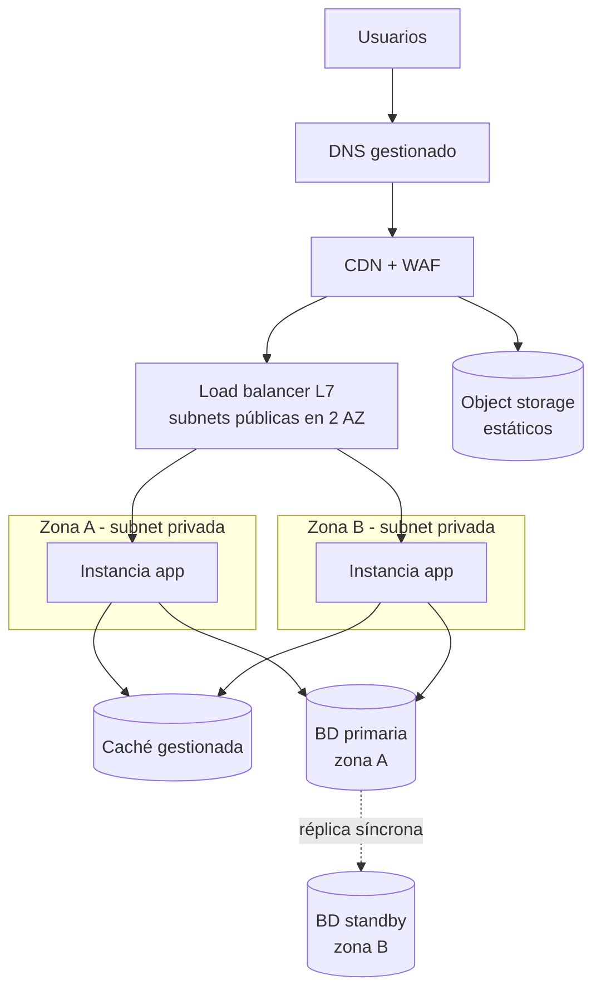
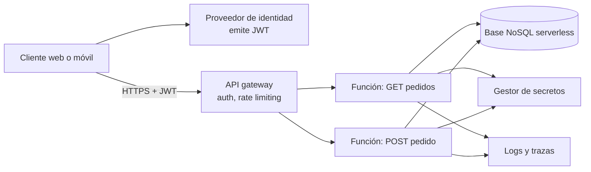
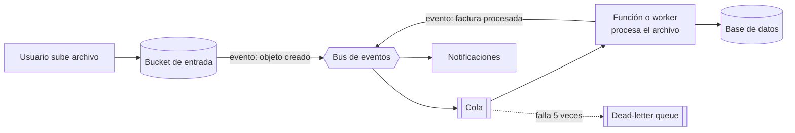
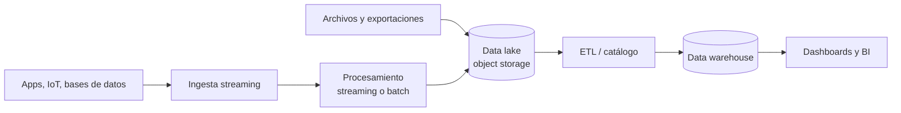
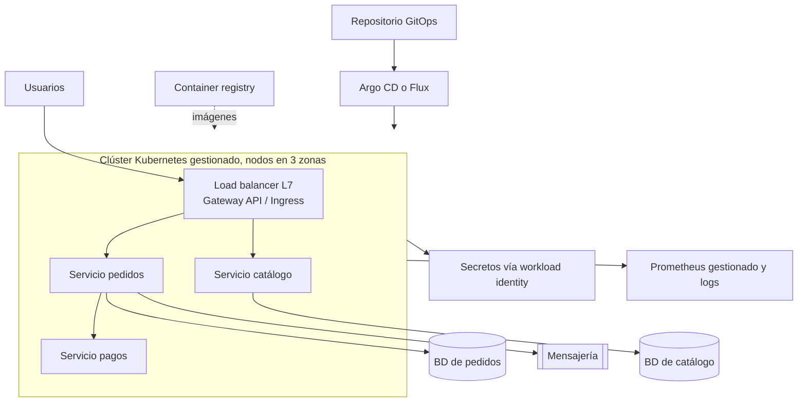
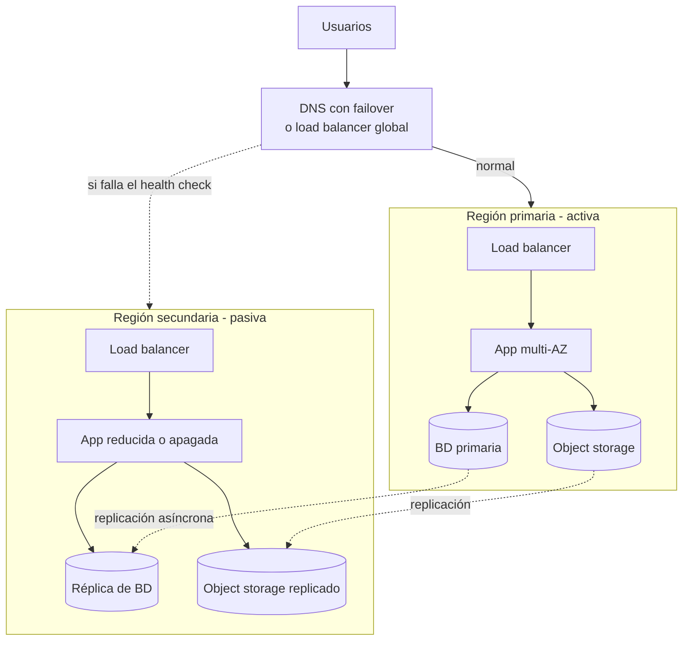

---
tags:
  - arquitectura
  - aws
  - azure
  - gcp
  - resiliencia
---

# Arquitecturas de referencia

> Seis arquitecturas que aparecen una y otra vez (web de tres capas con alta disponibilidad, API serverless, procesamiento event-driven, pipeline de datos, microservicios en Kubernetes y multi-región activo-pasivo), cada una con su diagrama y los servicios equivalentes en AWS, Azure y Google Cloud.

## ¿Qué es una arquitectura de referencia?

Una **reference architecture** (arquitectura de referencia) es un diseño probado para un tipo de problema, publicado como punto de partida: qué piezas usar, cómo se conectan y qué decisiones de seguridad, resiliencia y costos conviene tomar. No se copia tal cual; se **adapta** a tus requisitos no funcionales (ver [Fundamentos de arquitectura de software](fundamentos-arquitectura-software.md)).

Los tres proveedores mantienen un centro de arquitectura con cientos de ellas, muchas con código de IaC listo para desplegar:

| | AWS | Azure | Google Cloud |
| --- | --- | --- | --- |
| Centro de arquitectura | [AWS Architecture Center](https://aws.amazon.com/architecture/) | [Azure Architecture Center](https://learn.microsoft.com/es-es/azure/architecture/) | [Google Cloud Architecture Center](https://cloud.google.com/architecture) |
| Soluciones desplegables | AWS Solutions Library | Azure Verified Modules, plantillas de inicio rápido | Jump Start Solutions |
| Guías de patrones | AWS Prescriptive Guidance | Cloud design patterns | Guías por escenario del Architecture Center |

!!! tip "Cómo leer estas arquitecturas"
    En cada caso, los diagramas muestran la idea común y la tabla dice cómo se llama cada pieza en cada nube. Los principios que se repiten (stateless, multi-AZ, colas para absorber picos) se explican en [Arquitectura en la nube](arquitectura-cloud.md).

## 1. Web de tres capas con alta disponibilidad

La **three-tier architecture** clásica (presentación, aplicación, datos) repartida en **al menos dos Availability Zones**. Es la arquitectura típica tras una migración *rehost* o *replatform* (ver [Migración a la nube](migracion-cloud.md)).

| Pieza | AWS | Azure | Google Cloud |
| --- | --- | --- | --- |
| DNS | Amazon Route 53 | Azure DNS | Cloud DNS |
| CDN + WAF | Amazon CloudFront + AWS WAF | Azure Front Door + WAF | Cloud CDN + Google Cloud Armor |
| Load balancer L7 | Application Load Balancer | Application Gateway (o Front Door como entrada global) | Global/regional external Application Load Balancer |
| Capa de aplicación | EC2 Auto Scaling group en varias AZ | Virtual Machine Scale Sets zone-spanning, o Azure App Service | Regional managed instance group |
| Caché | Amazon ElastiCache | Azure Managed Redis | Memorystore |
| Base de datos HA | Amazon RDS Multi-AZ, Amazon Aurora | Azure SQL Database zone-redundant, Azure Database for PostgreSQL con HA | Cloud SQL high availability |
| Estáticos | Amazon S3 | Azure Blob Storage | Cloud Storage |

Claves de diseño: solo el load balancer en subnet pública; la app sin estado; el autoscaling con un mínimo que cubra la caída de una zona. Redes en [Redes en la nube](../redes-y-datos/redes.md) y balanceo en [Balanceo y alta disponibilidad](../../networking/avanzado/balanceo-alta-disponibilidad.md).

## 2. API serverless

Una API REST sin servidores que gestionar: gateway, funciones y base de datos NoSQL serverless. Escala a cero y se paga por petición.

| Pieza | AWS | Azure | Google Cloud |
| --- | --- | --- | --- |
| Identidad de usuarios | Amazon Cognito | Microsoft Entra External ID | Identity Platform |
| API gateway | Amazon API Gateway (HTTP API o REST API) | Azure API Management | API Gateway |
| Funciones | AWS Lambda | Azure Functions (Flex Consumption) | Cloud Run functions |
| Base de datos | Amazon DynamoDB | Azure Cosmos DB (serverless) | Firestore |
| Secretos | AWS Secrets Manager | Azure Key Vault | Secret Manager |
| Observabilidad | Amazon CloudWatch, AWS X-Ray | Application Insights (Azure Monitor) | Cloud Logging, Cloud Trace |

Claves de diseño: un rol de IAM por función con permisos mínimos, validación del JWT en el gateway, límites de concurrencia para no saturar la base de datos. Detalle en [Serverless](../computo/serverless.md).

## 3. Procesamiento event-driven

Un archivo o un evento dispara un procesamiento asíncrono desacoplado con una cola. Ejemplo: subir facturas en PDF, extraer los datos y guardarlos.

| Pieza | AWS | Azure | Google Cloud |
| --- | --- | --- | --- |
| Almacenamiento de entrada | Amazon S3 | Azure Blob Storage | Cloud Storage |
| Bus de eventos | Amazon EventBridge | Azure Event Grid | Eventarc |
| Cola + DLQ | Amazon SQS (con DLQ) | Azure Service Bus (dead-letter queue integrada) | Pub/Sub (dead-letter topic) |
| Procesamiento | AWS Lambda o tareas de Amazon ECS | Azure Functions o Azure Container Apps (con KEDA) | Cloud Run functions o Cloud Run |
| Base de datos | Amazon DynamoDB | Azure Cosmos DB | Firestore |
| Notificaciones | Amazon SNS | Azure Event Grid, Azure Communication Services | Pub/Sub |

Claves de diseño: consumidores idempotentes, DLQ con alarma, escalar workers por profundidad de la cola. Ver [Integración y APIs](integracion-apis.md).

## 4. Pipeline de datos

Ingesta de eventos o archivos, almacenamiento en un **data lake** (lago de datos) y análisis en un **data warehouse** (almacén de datos analítico).

| Pieza | AWS | Azure | Google Cloud |
| --- | --- | --- | --- |
| Ingesta streaming | Amazon Kinesis Data Streams, Amazon Data Firehose | Azure Event Hubs | Pub/Sub |
| Procesamiento | Amazon Managed Service for Apache Flink, AWS Glue | Azure Stream Analytics, Azure Databricks | Dataflow |
| Data lake | Amazon S3 | Azure Data Lake Storage | Cloud Storage |
| ETL y catálogo | AWS Glue (Data Catalog) | Azure Data Factory, Microsoft Purview | Dataflow, Dataplex Universal Catalog |
| Data warehouse / consultas | Amazon Redshift, Amazon Athena | Microsoft Fabric, Azure Databricks | BigQuery |
| BI | Quick Sight, dentro de Amazon Quick (antes Amazon QuickSight) | Power BI | Looker |

Claves de diseño: separar zonas del lago (*raw*, *curated*), cifrado y control de acceso por dataset, ciclo de vida para abaratar datos antiguos (ver [Almacenamiento y datos](../redes-y-datos/almacenamiento-datos.md)).

## 5. Microservicios en Kubernetes

Varios servicios en un clúster gestionado, expuestos por un gateway, con imágenes en un registry privado e identidades de carga de trabajo hacia la nube.

| Pieza | AWS | Azure | Google Cloud |
| --- | --- | --- | --- |
| Kubernetes gestionado | Amazon EKS (o EKS Auto Mode) | AKS (o AKS Automatic) | GKE (Standard o Autopilot) |
| Entrada L7 | AWS Load Balancer Controller (ALB) | Application Gateway for Containers | GKE Gateway controller |
| Registry | Amazon ECR | Azure Container Registry | Artifact Registry |
| Identidad del pod hacia la nube | EKS Pod Identity, IRSA | Microsoft Entra Workload ID | Workload Identity Federation for GKE |
| Secretos | AWS Secrets Manager + Secrets Store CSI Driver | Azure Key Vault + Secrets Store CSI Driver | Secret Manager (add-on de GKE o CSI) |
| Métricas | Amazon Managed Service for Prometheus | Azure Monitor managed service for Prometheus | Google Cloud Managed Service for Prometheus |
| Bases de datos | Amazon RDS, Amazon Aurora | Azure Database for PostgreSQL | Cloud SQL, AlloyDB for PostgreSQL |

Claves de diseño: una base de datos por servicio, network policies entre namespaces, despliegues con GitOps. Ver [Kubernetes](../../devops/contenedores/kubernetes.md), [Contenedores gestionados](../computo/contenedores-gestionados.md), [Despliegue continuo](../../devops/ci-cd/despliegue-continuo.md) y [Seguridad de Kubernetes](../../devsecops/infraestructura-y-contenedores/seguridad-kubernetes.md).

## 6. Multi-región activo-pasivo

Una región atiende todo el tráfico (**active**, activa) y otra está preparada para tomar el relevo (**passive**, pasiva) si la primera cae. Según cuánto esté encendido en la región pasiva, es *pilot light* o *warm standby* (ver [Resiliencia](../operacion-y-gobierno/resiliencia.md#estrategias-de-disaster-recovery)).

| Pieza | AWS | Azure | Google Cloud |
| --- | --- | --- | --- |
| Failover de tráfico | Route 53 failover routing, Amazon Application Recovery Controller | Azure Front Door, Azure Traffic Manager | Cloud DNS routing policies (failover), global external Application Load Balancer |
| Base de datos entre regiones | Aurora Global Database, réplicas entre regiones de RDS, DynamoDB global tables | Failover groups de Azure SQL, Azure Cosmos DB multi-region | Réplicas entre regiones de Cloud SQL, Spanner multi-region |
| Objetos | S3 Cross-Region Replication | Geo-redundant storage (GRS / GZRS) | Buckets dual-region |
| Replicar servidores | AWS Elastic Disaster Recovery | Azure Site Recovery | Backup and DR Service + IaC |
| Infraestructura en la región pasiva | IaC (Terraform, CloudFormation) | IaC (Terraform, Bicep) | IaC (Terraform, Infrastructure Manager) |

Claves de diseño: la replicación asíncrona implica un **RPO mayor que cero**; el failover debe estar **automatizado y probado** con game days; cuidado con las dependencias que solo existen en la región primaria (secretos, claves de cifrado, imágenes en el registry).

!!! warning "Un failover que nunca se probó no funciona"
    Lo más común es descubrir durante el desastre que falta un secreto, una cuota o un permiso en la región secundaria. Practica el failover y el **failback** (volver a la región original) de forma periódica.

## Resumen: qué arquitectura para qué

| Necesidad | Arquitectura de partida |
| --- | --- |
| Aplicación web tradicional o recién migrada | 1. Web de tres capas |
| API con tráfico variable, equipo pequeño | 2. API serverless |
| Procesar archivos o eventos sin bloquear al usuario | 3. Event-driven |
| Analítica y reporting | 4. Pipeline de datos |
| Muchos servicios y varios equipos con plataforma madura | 5. Microservicios en Kubernetes |
| RTO/RPO que no tolera perder una región | 6. Multi-región activo-pasivo (sobre cualquiera de las anteriores) |

## Relación con otras secciones

| Enfoque | Qué se mira desde ahí | Nota |
| --- | --- | --- |
| Cloud (el control) | Principios y patrones que usan estas arquitecturas; cómputo, redes, datos y resiliencia de cada pieza | [Arquitectura en la nube](arquitectura-cloud.md), [Estilos de arquitectura](estilos-arquitectura.md), [Integración y APIs](integracion-apis.md), [Well-Architected Framework](../fundamentos/well-architected.md), [Resiliencia](../operacion-y-gobierno/resiliencia.md), [Redes en la nube](../redes-y-datos/redes.md), [Almacenamiento y datos](../redes-y-datos/almacenamiento-datos.md), [Serverless](../computo/serverless.md), [Contenedores gestionados](../computo/contenedores-gestionados.md) |
| DevOps (la automatización) | Desplegar estas arquitecturas con IaC, CI/CD y GitOps; observarlas | [Infrastructure as Code](../../devops/iac/infraestructura-como-codigo.md), [Despliegue continuo](../../devops/ci-cd/despliegue-continuo.md), [Kubernetes](../../devops/contenedores/kubernetes.md), [Observabilidad](../../monitoreo/fundamentos/observabilidad.md) |
| DevSecOps (la verificación) | Escanear la IaC de la arquitectura y revisar la seguridad del clúster y de las APIs | [Seguridad de IaC](../../devsecops/infraestructura-y-contenedores/seguridad-iac.md), [Seguridad de Kubernetes](../../devsecops/infraestructura-y-contenedores/seguridad-kubernetes.md), [Pruebas dinámicas](../../devsecops/codigo-y-dependencias/pruebas-dinamicas.md) |
| Negocio TI (el porqué) | Disponibilidad compuesta y SLA de la arquitectura; continuidad | [Niveles de servicio](../../negocio/niveles-de-servicio.md), [Continuidad de negocio](../../negocio/continuidad-negocio.md) |
| Networking (la base) | Load balancing L4/L7, health checks, GSLB y DNS failover; conectividad híbrida | [Balanceo y alta disponibilidad](../../networking/avanzado/balanceo-alta-disponibilidad.md), [Redes de datacenter e híbridas](../../networking/avanzado/redes-datacenter-hibridas.md) |
| Laboratorios (la práctica) | Practicar esto paso a paso | [Lab 02: Plan de direccionamiento IP para una VPC](../../laboratorios/fundamentos/subnetting-plan-ips.md), [Lab 18: AWS: API serverless con Lambda, API Gateway y DynamoDB](../../laboratorios/cloud/aws-serverless-api.md) |

## Referencias

- [AWS Architecture Center](https://aws.amazon.com/architecture/)
- [AWS Reference Architecture Diagrams](https://aws.amazon.com/architecture/reference-architecture-diagrams/)
- [Azure Architecture Center](https://learn.microsoft.com/es-es/azure/architecture/)
- [Arquitecturas de referencia de Azure (navegador)](https://learn.microsoft.com/es-es/azure/architecture/browse/)
- [Google Cloud Architecture Center](https://cloud.google.com/architecture)
- [Disaster recovery of workloads on AWS](https://docs.aws.amazon.com/whitepapers/latest/disaster-recovery-workloads-on-aws/disaster-recovery-options-in-the-cloud.html)
- [Disaster recovery planning guide (Google Cloud)](https://cloud.google.com/architecture/dr-scenarios-planning-guide)
- [Baseline highly available zone-redundant web application (Azure)](https://learn.microsoft.com/es-es/azure/architecture/web-apps/app-service/architectures/baseline-zone-redundant)
