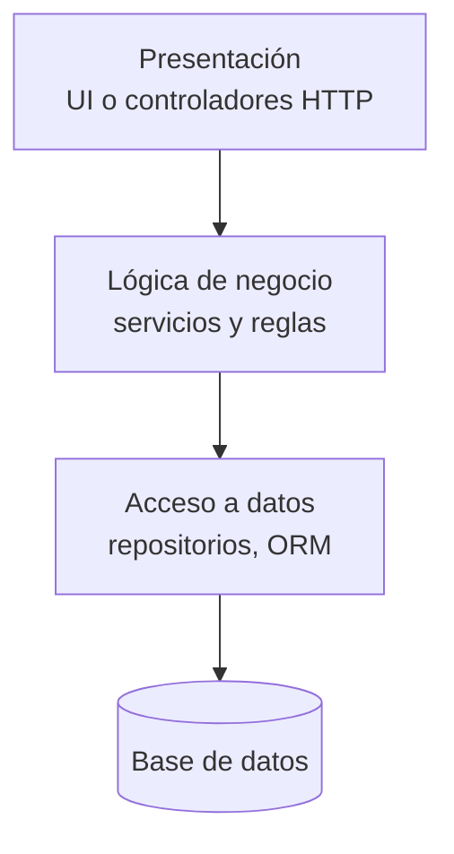
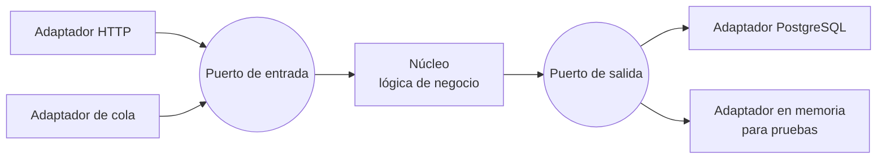
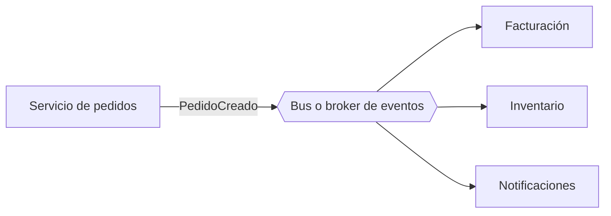
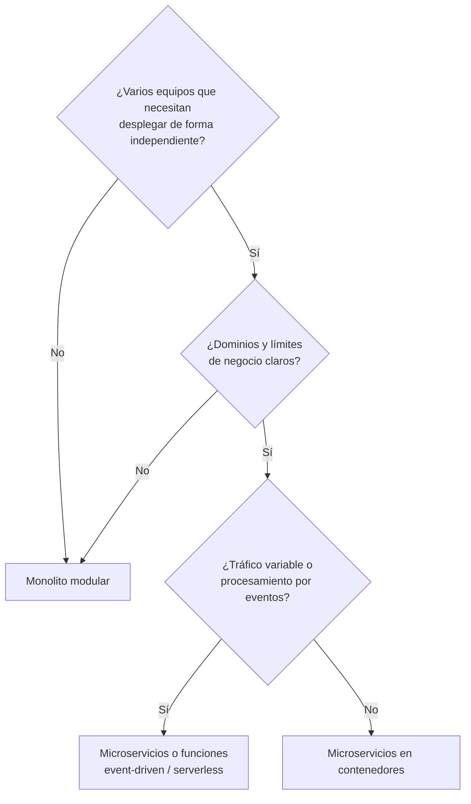

---
tags:
  - arquitectura
  - microservicios
  - event-driven
  - serverless
---

# Estilos de arquitectura

> Los estilos más usados (monolito, monolito modular, capas, hexagonal, microservicios, event-driven y serverless), qué problema resuelve cada uno, cuándo conviene y el anti-patrón que aparece cuando se aplican mal: el monolito distribuido.

## ¿Qué es un estilo de arquitectura?

Un **architectural style** (estilo de arquitectura) es una forma reconocible de organizar un sistema: cómo se reparten las responsabilidades y cómo se comunican las piezas. No es una tecnología: un monolito puede correr en una VM, en un contenedor o en Kubernetes, y un microservicio puede escribirse en cualquier lenguaje.

Los estilos se combinan: un microservicio puede tener arquitectura hexagonal por dentro y comunicarse con otros por eventos. Elegir uno es un **trade-off** entre los atributos de calidad vistos en [Fundamentos de arquitectura de software](fundamentos-arquitectura-software.md).

## Monolito

Un **monolith** (monolito) es una aplicación que se construye y despliega como **una sola unidad**: un único proceso, normalmente con una sola base de datos.

- **Ventajas**: simple de desarrollar, probar, desplegar y depurar; llamadas en memoria (rápidas, sin fallos de red); transacciones ACID fáciles.
- **Desventajas**: al crecer, cualquier cambio obliga a desplegarlo todo; un fallo puede tumbar el sistema entero; escala como un bloque; muchos equipos pisándose en el mismo código.

!!! note "Monolito no es una mala palabra"
    Para un producto nuevo o un equipo pequeño, el monolito suele ser **la mejor opción**. El problema no es el monolito, es el **big ball of mud** (gran bola de barro): código sin estructura interna en el que todo depende de todo.

## Monolito modular

El **modular monolith** (monolito modular) se despliega como una unidad, pero por dentro está dividido en **módulos con límites claros** (por dominio de negocio: pedidos, pagos, catálogo), cada uno con su API interna y, a ser posible, su propio esquema de datos.

Es el punto medio más recomendado hoy: tienes la simplicidad operativa del monolito y, si algún módulo lo necesita de verdad, puedes extraerlo como servicio más adelante sin reescribirlo todo.

## Arquitectura en capas (n-tier)

La **layered architecture** (arquitectura en capas) separa el código por responsabilidad técnica. Cada capa solo habla con la de abajo:

Conviene distinguir dos ideas que se mezclan:

- **Layers** (capas): separación **lógica** dentro del código.
- **Tiers** (niveles): separación **física** en máquinas o servicios distintos. La clásica **three-tier architecture** (arquitectura de tres niveles) pone web, aplicación y base de datos en niveles separados (ver la versión cloud en [Arquitecturas de referencia](arquitecturas-referencia.md)).

Es fácil de entender y muy común en aplicaciones empresariales. Su punto débil: la lógica de negocio acaba dependiendo de la base de datos y del framework, y un cambio "vertical" (una funcionalidad nueva) toca todas las capas.

## Hexagonal (ports and adapters)

La **hexagonal architecture** (arquitectura hexagonal), también llamada **ports and adapters** (puertos y adaptadores), propuesta por Alistair Cockburn, pone la **lógica de negocio en el centro** sin depender de nada externo:

- **Ports** (puertos): interfaces que define el núcleo. "Necesito guardar un pedido", "necesito notificar al cliente".
- **Adapters** (adaptadores): implementaciones concretas de esos puertos. Un adaptador para PostgreSQL, otro para DynamoDB, uno para enviar correos, otro falso para las pruebas.

Ventajas: la lógica se prueba sin base de datos ni red, y cambiar de proveedor o de base de datos afecta solo a un adaptador. Es una buena forma de reducir el **vendor lock-in** (dependencia del proveedor) donde de verdad importa. AWS la incluye en su guía de patrones de modernización.

## Microservicios

Los **microservices** (microservicios) dividen el sistema en **servicios pequeños e independientes**, cada uno alineado con una capacidad de negocio, que:

- Se despliegan **por separado** y los mantiene **un equipo** dueño.
- Tienen **su propia base de datos** (*database per service*); nadie más la toca.
- Se comunican por la red: APIs (REST, gRPC) o mensajes y eventos (ver [Integración y APIs](integracion-apis.md)).

| Ganas | Pagas |
| --- | --- |
| Desplegar y escalar cada servicio por separado | Red entre servicios: latencia, fallos parciales, reintentos |
| Equipos autónomos, tecnología adecuada por servicio | Transacciones distribuidas (patrón saga) y consistencia eventual |
| Un fallo queda aislado (si está bien diseñado) | Observabilidad obligatoria: trazas distribuidas, logs centralizados |
| | Mucha más infraestructura: CI/CD por servicio, service discovery, gestión de secretos, plataforma (a menudo [Kubernetes](../../devops/contenedores/kubernetes.md)) |

!!! warning "Microservicios resuelven un problema organizativo"
    Su principal beneficio es que **muchos equipos** puedan entregar de forma independiente. Si sois un equipo de cinco personas, probablemente pagarás todos los costos sin obtener el beneficio. Revisa la [ley de Conway](fundamentos-arquitectura-software.md#ley-de-conway).

## Event-driven

En una **event-driven architecture** (arquitectura dirigida por eventos, EDA) los componentes se comunican **emitiendo eventos**: hechos que ya ocurrieron ("pedido creado", "pago rechazado"). Quien emite no sabe quién escucha.

- **Ventajas**: muy bajo acoplamiento (añadir un consumidor no toca al productor), absorbe picos, se integra bien con serverless.
- **Desventajas**: el flujo completo es difícil de seguir y depurar; consistencia eventual; hay que diseñar idempotencia, orden y reintentos.

Los servicios de cada nube (colas, pub/sub, buses, streaming) se comparan en [Integración y APIs](integracion-apis.md).

## Serverless

Una **serverless architecture** (arquitectura serverless) construye la aplicación con servicios gestionados que escalan a cero y se pagan por uso: funciones (FaaS), API gateways, bases de datos serverless, colas y buses. Suele ser **event-driven** por naturaleza.

- **Ventajas**: nada de servidores que operar, escalado automático, costo cercano a cero sin tráfico, muy rápido para empezar.
- **Desventajas**: cold starts y límites de ejecución, más dependencia del proveedor, pruebas locales más difíciles, costo que puede dispararse con tráfico alto y constante.

El detalle de AWS Lambda, Azure Functions y Cloud Run functions está en [Serverless](../computo/serverless.md).

## Tabla comparativa

| Estilo | Unidad de despliegue | Complejidad operativa | Escalado | Equipo típico | Cuándo usarlo |
| --- | --- | --- | --- | --- | --- |
| **Monolito** | Una | Baja | Todo junto | 1 equipo | MVP, producto nuevo, dominio poco claro |
| **Monolito modular** | Una | Baja | Todo junto | 1 a pocos equipos | Opción por defecto para la mayoría de productos |
| **Capas (n-tier)** | Una o pocas | Baja a media | Por nivel | 1 a pocos equipos | Aplicaciones empresariales CRUD, migraciones *lift and shift* |
| **Hexagonal** | (Estilo interno, se combina) | Igual que el estilo que la contiene | — | Cualquiera | Lógica de negocio rica que debe durar y probarse aislada |
| **Microservicios** | Muchas | Alta | Por servicio | Varios equipos autónomos | Organización grande, dominios claros, partes con necesidades de escala muy distintas |
| **Event-driven** | Muchas | Media a alta | Por consumidor | Varios | Integración entre sistemas, procesamiento asíncrono, picos de carga |
| **Serverless** | Muchas (funciones) | Baja en infraestructura, media en diseño | Automático, a cero | Pequeño a medio | Tráfico variable, automatizaciones, APIs sencillas, prototipos |

## Anti-patrones

### Distributed monolith

El **distributed monolith** (monolito distribuido) es el peor de los dos mundos: el sistema está partido en servicios, pero **siguen acoplados** como si fueran uno. Tiene los costos de los microservicios sin sus beneficios.

Señales de que lo tienes:

- Para lanzar una funcionalidad hay que **desplegar varios servicios a la vez** y en un orden concreto.
- Varios servicios **comparten la misma base de datos** o las mismas tablas.
- Cadenas largas de llamadas síncronas: A llama a B, que llama a C, que llama a D. Si cae D, cae todo.
- Una librería compartida con lógica de negocio que obliga a actualizar todos los servicios.
- Un solo equipo mantiene todos los "microservicios".

Cómo salir: volver a un **monolito modular** y extraer solo lo que tenga sentido, o rediseñar límites por dominio, separar datos y pasar a comunicación asíncrona donde se pueda.

### Otros anti-patrones frecuentes

| Anti-patrón | Qué es | Qué hacer |
| --- | --- | --- |
| **Big ball of mud** | Código sin estructura; todo depende de todo | Introducir módulos con límites y ir refactorizando |
| **Nanoservices** (nanoservicios) | Servicios tan pequeños que el costo de red y operación supera a su lógica | Agrupar por capacidad de negocio |
| **Shared database** (base de datos compartida) | Varios servicios escriben las mismas tablas | Un dueño por dato; integración por API o eventos |
| **Golden hammer** (martillo de oro) | Usar el mismo estilo o herramienta para todo porque "es el que conocemos" | Elegir según NFR y documentar en un ADR |
| **Resume-driven development** | Elegir tecnología porque queda bien en el CV | Justificar con requisitos y costo |

## Conclusión práctica

- Empieza por un **monolito modular** salvo que tengas razones concretas (equipos, escala, dominios) para otra cosa.
- **Hexagonal** es un estilo interno que combina con todo y protege tu lógica del proveedor.
- **Microservicios** y **event-driven** compran autonomía y escalado a cambio de complejidad operativa: necesitas CI/CD, observabilidad y plataforma maduras.
- **Serverless** reduce la operación, no el diseño.
- Si partes un sistema y sigue desplegándose todo junto, tienes un **monolito distribuido**.

## Relación con otras secciones

| Enfoque | Qué se mira desde ahí | Nota |
| --- | --- | --- |
| Cloud (el control) | Dónde corre cada estilo y cómo se integran las piezas | [Integración y APIs](integracion-apis.md), [Arquitectura en la nube](arquitectura-cloud.md), [Arquitecturas de referencia](arquitecturas-referencia.md), [Máquinas virtuales](../computo/maquinas-virtuales.md), [Contenedores gestionados](../computo/contenedores-gestionados.md), [Serverless](../computo/serverless.md) |
| DevOps (la automatización) | Pipelines por servicio, contenedores, Kubernetes y estrategias de despliegue; observabilidad distribuida | [Kubernetes](../../devops/contenedores/kubernetes.md), [Docker](../../devops/contenedores/docker.md), [Despliegue continuo](../../devops/ci-cd/despliegue-continuo.md), [Observabilidad](../../monitoreo/fundamentos/observabilidad.md) |
| DevSecOps (la verificación) | Más servicios = más superficie de ataque: seguridad entre servicios, APIs y clústeres | [Seguridad de Kubernetes](../../devsecops/infraestructura-y-contenedores/seguridad-kubernetes.md), [Pruebas dinámicas](../../devsecops/codigo-y-dependencias/pruebas-dinamicas.md), [Fundamentos DevSecOps](../../devsecops/fundamentos-devsecops.md) |
| Negocio TI (el porqué) | Costo de operar cada estilo, organización de equipos y deuda técnica | [TI y negocio](../../negocio/ti-y-negocio.md), [Proyectos y producto en TI](../../negocio/gestion-proyectos-producto.md) |

## Referencias

- [Architecture styles (Azure Architecture Center)](https://learn.microsoft.com/es-es/azure/architecture/guide/architecture-styles/)
- [Hexagonal architecture pattern (AWS Prescriptive Guidance)](https://docs.aws.amazon.com/prescriptive-guidance/latest/cloud-design-patterns/hexagonal-architecture.html)
- [Microservices (Martin Fowler)](https://martinfowler.com/articles/microservices.html)
- [MonolithFirst (Martin Fowler)](https://martinfowler.com/bliki/MonolithFirst.html)
- [Hexagonal architecture (Alistair Cockburn)](https://alistair.cockburn.us/hexagonal-architecture/)
- [What is event-driven architecture? (AWS)](https://aws.amazon.com/es/event-driven-architecture/)
- [Microservices architecture on Google Cloud](https://cloud.google.com/architecture/microservices-architecture-introduction)
