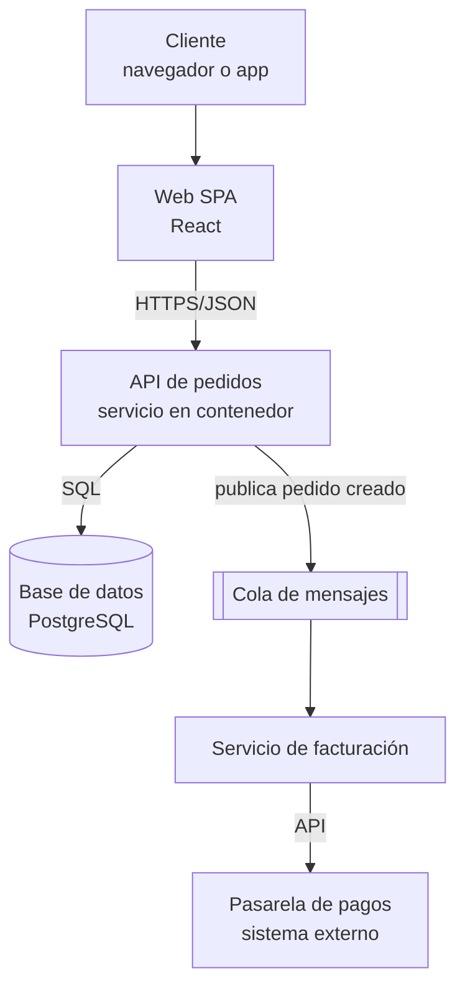

---
tags:
  - arquitectura
  - diseno
  - adr
---

# Fundamentos de arquitectura de software

> Qué hace un arquitecto, cómo se razona con atributos de calidad y trade-offs, cómo se documentan las decisiones (ADR) y se dibujan los sistemas (modelo C4), y por qué el acoplamiento, la cohesión y la ley de Conway importan tanto como la tecnología.

## ¿Qué es?

La **software architecture** (arquitectura de software) es el conjunto de **decisiones estructurales** de un sistema: en qué piezas se divide, cómo se comunican, dónde viven los datos y qué tecnologías se usan. Son las decisiones **caras de cambiar** más adelante.

Una forma práctica de verla:

- El **diseño** responde "¿cómo escribo esta clase o este módulo?".
- La **arquitectura** responde "¿qué pasa si mañana tenemos 10 veces más usuarios, o si se cae la base de datos, o si entra un equipo nuevo?".

No existe una arquitectura "correcta" en abstracto: existe la que mejor equilibra los requisitos, las restricciones (presupuesto, plazos, personas) y los riesgos de **ese** sistema.

## Qué hace un arquitecto

El rol de **software architect** (arquitecto de software) no consiste en dibujar diagramas y desaparecer. En equipos modernos lo puede ejercer una persona dedicada o el propio equipo, pero las tareas son las mismas:

| Tarea | En la práctica |
| --- | --- |
| Entender los requisitos | Hablar con negocio para sacar los **requisitos no funcionales** que nadie escribe (disponibilidad, latencia, costos, cumplimiento) |
| Tomar decisiones y documentarlas | Elegir estilo, tecnologías y límites entre componentes; dejarlo escrito en ADRs |
| Gestionar trade-offs | Explicar qué se gana y qué se pierde con cada opción |
| Comunicar | Diagramas que entienda cada audiencia (negocio, desarrollo, operaciones, seguridad) |
| Vigilar la deriva | Revisar que el sistema real siga pareciéndose al diseñado; detectar **deuda técnica** (*technical debt*) |
| Habilitar al equipo | Plantillas, guías, *golden paths* (caminos recomendados) en vez de imponer desde arriba |

## Requisitos funcionales y no funcionales

| Tipo | Qué describe | Ejemplo |
| --- | --- | --- |
| **Functional requirements** (requisitos funcionales) | **Qué** hace el sistema | "El usuario puede pagar con tarjeta" |
| **Non-functional requirements** (requisitos no funcionales, NFR) | **Cómo de bien** lo hace | "El pago responde en menos de 500 ms en el p95 y está disponible el 99,9 % del mes" |

Los requisitos funcionales rara vez deciden la arquitectura; los **no funcionales** casi siempre. Una tienda con 100 usuarios y otra con 10 millones pueden tener las mismas funciones y arquitecturas totalmente distintas.

!!! tip "Un NFR sin número no es un requisito"
    "Tiene que ser rápido y escalable" no sirve para decidir nada. Pide cifras: latencia en un percentil, usuarios concurrentes, RTO y RPO, presupuesto mensual. Los acuerdos de servicio con negocio se ven en [Niveles de servicio](../../negocio/niveles-de-servicio.md).

## Atributos de calidad

Los NFR se agrupan en **quality attributes** (atributos de calidad), a veces llamados las **"-ilities"** porque en inglés muchos terminan en *-ility*. El estándar de referencia es **ISO/IEC 25010**, pero en el día a día se usan estos nombres:

| Atributo | Pregunta | Cómo se mide o se logra |
| --- | --- | --- |
| **Availability** (disponibilidad) | ¿Está en servicio cuando se necesita? | % de tiempo disponible, redundancia (ver [Resiliencia](../operacion-y-gobierno/resiliencia.md)) |
| **Reliability** (fiabilidad) | ¿Hace lo correcto de forma consistente? | Tasa de errores, MTBF |
| **Scalability** (escalabilidad) | ¿Aguanta más carga añadiendo recursos? | Escalado horizontal, pruebas de carga |
| **Performance** (rendimiento) | ¿Responde rápido? | Latencia p95/p99, throughput |
| **Security** (seguridad) | ¿Resiste ataques y protege los datos? | Threat modeling, controles (ver [Fundamentos DevSecOps](../../devsecops/fundamentos-devsecops.md)) |
| **Maintainability** (mantenibilidad) | ¿Es fácil de cambiar sin romper? | Modularidad, pruebas, bajo acoplamiento |
| **Observability** (observabilidad) | ¿Puedo saber qué pasa dentro? | Logs, métricas, trazas |
| **Deployability** (desplegabilidad) | ¿Puedo desplegar seguido y sin miedo? | Frecuencia de despliegue, tiempo de rollback |
| **Portability** (portabilidad) | ¿Puedo moverlo a otro entorno? | Dependencia de servicios propietarios |
| **Cost efficiency** (eficiencia de costos) | ¿Cuesta lo que aporta? | Costo por transacción o por cliente (ver [FinOps y costos](../fundamentos/finops-costos.md)) |

### Trade-offs

Mejorar un atributo casi siempre empeora otro. A eso se le llama **trade-off** (compromiso o concesión):

| Si subes… | Suele bajar o encarecerse… | Ejemplo |
| --- | --- | --- |
| Availability (multi-región) | Costo y simplicidad | Duplicar infraestructura y replicar datos |
| Consistencia fuerte | Latencia y disponibilidad | Esperar confirmación de todas las réplicas |
| Security (más controles) | Velocidad de entrega y usabilidad | Aprobaciones manuales, MFA en cada paso |
| Performance (caché) | Consistencia | Datos que pueden estar unos segundos desactualizados |
| Portability (evitar servicios propietarios) | Productividad | Mantener tú mismo lo que el proveedor ya da gestionado |

!!! note "Todo es un trade-off"
    En arquitectura casi nunca hay una respuesta "mejor"; hay una respuesta que encaja con las prioridades. Lo que sí es un error es tomar el trade-off **sin saberlo** o sin dejarlo escrito. Los pilares del [Well-Architected Framework](../fundamentos/well-architected.md) son una buena lista para revisar qué estás sacrificando.

## Architecture Decision Records (ADR)

Un **ADR** (*Architecture Decision Record*, registro de decisión de arquitectura) es un documento corto que guarda **una** decisión importante: el contexto, lo que se decidió y sus consecuencias. Se guarda en el repositorio junto al código (por ejemplo en `docs/adr/`), se revisa en un pull request y **no se edita** cuando la decisión cambia: se escribe uno nuevo que lo reemplaza.

Para qué sirve:

- Que dentro de un año alguien entienda **por qué** se eligió PostgreSQL y no DynamoDB.
- Evitar reabrir la misma discusión cada pocos meses.
- Ayudar en el onboarding de personas nuevas.

La plantilla más usada es la de Michael Nygard:

```markdown title="docs/adr/0007-cola-para-pedidos.md"
# 7. Usar una cola gestionada para procesar pedidos

- Estado: Aceptada
- Fecha: 2026-03-12
- Decisores: equipo de pagos, arquitectura

## Contexto

El endpoint de checkout llama de forma síncrona al servicio de facturación.
En los picos de campaña, facturación tarda más de 5 s y el checkout falla.
Necesitamos que un pico en facturación no tumbe las ventas.

## Decisión

El checkout publicará un mensaje "pedido creado" en una cola gestionada.
Facturación consumirá los mensajes a su ritmo. Usaremos una dead-letter queue
para mensajes que fallen 5 veces.

## Consecuencias

- Positivas: el checkout ya no depende de la latencia de facturación;
  podemos escalar los consumidores por separado.
- Negativas: la factura deja de ser inmediata (consistencia eventual);
  necesitamos idempotencia en el consumidor y monitorear la profundidad de la cola.
- Alternativas descartadas: aumentar timeouts (solo esconde el problema).
```

Estados habituales: *Proposed* (propuesta), *Accepted* (aceptada), *Rejected* (rechazada), *Deprecated* (obsoleta), *Superseded by ADR-XXXX* (reemplazada por otra).

!!! tip "Pocas y relevantes"
    Escribe un ADR cuando la decisión sea difícil de revertir, afecte a varios equipos o haya habido discusión. No hace falta uno para elegir una librería de fechas.

## El modelo C4

El **C4 model** (modelo C4), creado por Simon Brown, propone dibujar la arquitectura en **cuatro niveles de zoom**, como un mapa:

| Nivel | Muestra | Audiencia |
| --- | --- | --- |
| 1. **System context** (contexto del sistema) | El sistema como una caja, sus usuarios y los sistemas externos | Todo el mundo, incluida gente no técnica |
| 2. **Container** (contenedor) | Las piezas desplegables: web, API, base de datos, cola | Equipo técnico, operaciones, seguridad |
| 3. **Component** (componente) | Los módulos dentro de un contenedor | Desarrollo |
| 4. **Code** (código) | Clases y relaciones | Rara vez se dibuja a mano; lo genera el IDE |

!!! info "Container en C4 no es un contenedor Docker"
    En C4, *container* significa "algo que se ejecuta o guarda datos por separado" (una SPA, una API, una base de datos, un bucket). Puede desplegarse en un contenedor Docker o no.

Ejemplo de nivel 2 (contenedores) de una tienda online:



Consejos para que un diagrama sirva:

- Título, leyenda y una frase de qué muestra.
- Cada flecha con **qué** viaja y **cómo** (HTTPS, SQL, eventos).
- Un nivel de zoom por diagrama: no mezcles clases con regiones de la nube.
- Mejor **diagrams as code** (diagramas como código: Mermaid, PlantUML, Structurizr) versionados en Git que imágenes que nadie actualiza.

## Acoplamiento y cohesión

Dos ideas que explican por qué un sistema es fácil o difícil de cambiar:

- **Coupling** (acoplamiento): cuánto depende un módulo de otro. Si cambiar A obliga a cambiar B, están **fuertemente acoplados**.
- **Cohesion** (cohesión): cuánto tienen que ver entre sí las cosas que hay dentro de un módulo. Un módulo de "pagos" que solo trata pagos tiene **alta cohesión**; un módulo `utils` con de todo, baja.

El objetivo es **bajo acoplamiento y alta cohesión**: cada pieza hace una cosa y la hace sola.

| Tipo de acoplamiento | Ejemplo | Cómo reducirlo |
| --- | --- | --- |
| De datos compartidos | Dos servicios leen y escriben la misma tabla | Cada servicio dueño de sus datos; exponer una API |
| Temporal | A necesita que B responda **ahora** | Comunicación asíncrona con colas o eventos (ver [Integración y APIs](integracion-apis.md)) |
| De despliegue | Hay que desplegar A y B a la vez | Contratos versionados y compatibles hacia atrás |
| De plataforma | El código depende de detalles de un proveedor | Interfaces propias (puertos y adaptadores, ver [Estilos de arquitectura](estilos-arquitectura.md)) |

## Ley de Conway

La **Conway's law** (ley de Conway), formulada por Melvin Conway en 1968, dice que las organizaciones diseñan sistemas que **copian su estructura de comunicación**. Si tres equipos construyen un compilador, saldrá un compilador de tres fases.

Consecuencias prácticas:

- Si quieres microservicios independientes pero tienes un único equipo que lo toca todo, acabarás con un **distributed monolith** (monolito distribuido).
- La **inverse Conway maneuver** (maniobra de Conway inversa) consiste en organizar primero los equipos según la arquitectura que quieres obtener.
- Los límites entre servicios deberían coincidir con los límites entre equipos y dominios de negocio (*bounded contexts* de **Domain-Driven Design**, diseño guiado por el dominio).

!!! warning "La arquitectura también es organizativa"
    Antes de partir un sistema en servicios, pregunta quién va a ser dueño de cada uno, quién lo opera de noche y quién paga su costo. La cultura y la forma de trabajar de los equipos se tratan en [Cultura DevOps y métricas DORA](../../devops/fundamentos/cultura-metricas-dora.md).

## Conclusión práctica

- La arquitectura son las decisiones caras de cambiar; la guían los **requisitos no funcionales** con números.
- Todo es un **trade-off**: hazlo explícito y déjalo escrito en un **ADR**.
- Dibuja con **C4** y un nivel de zoom por diagrama, mejor como código.
- Busca **bajo acoplamiento y alta cohesión**, y alinea equipos con servicios (**ley de Conway**).

## Relación con otras secciones

| Enfoque | Qué se mira desde ahí | Nota |
| --- | --- | --- |
| Cloud (el control) | Estilos y patrones concretos; atributos de calidad vistos como pilares del proveedor | [Estilos de arquitectura](estilos-arquitectura.md), [Arquitectura en la nube](arquitectura-cloud.md), [Well-Architected Framework](../fundamentos/well-architected.md), [Resiliencia](../operacion-y-gobierno/resiliencia.md) |
| DevOps (la automatización) | Equipos, flujo de trabajo y revisión de ADRs en pull requests; observabilidad como atributo de calidad | [Cultura DevOps y métricas DORA](../../devops/fundamentos/cultura-metricas-dora.md), [Git y control de versiones](../../devops/fundamentos/git-control-versiones.md), [Observabilidad](../../monitoreo/fundamentos/observabilidad.md) |
| DevSecOps (la verificación) | Seguridad como atributo de calidad desde el diseño: threat modeling sobre el diagrama C4 | [Fundamentos DevSecOps](../../devsecops/fundamentos-devsecops.md) |
| Negocio TI (el porqué) | De dónde salen los NFR: valor, costos, SLAs y deuda técnica como decisión de negocio | [TI y negocio](../../negocio/ti-y-negocio.md), [Niveles de servicio](../../negocio/niveles-de-servicio.md), [Proyectos y producto en TI](../../negocio/gestion-proyectos-producto.md) |

## Referencias

- [The C4 model for visualising software architecture](https://c4model.com/)
- [Architectural Decision Records (adr.github.io)](https://adr.github.io/)
- [Documenting Architecture Decisions, Michael Nygard](https://cognitect.com/blog/2011/11/15/documenting-architecture-decisions)
- [ISO/IEC 25010 (modelo de calidad del producto)](https://www.iso.org/standard/78176.html)
- [Conway's law, Melvin Conway](https://www.melconway.com/Home/Conways_Law.html)
- [Architecture decision records en AWS Prescriptive Guidance](https://docs.aws.amazon.com/prescriptive-guidance/latest/architectural-decision-records/introduction.html)
- [Architecture decision record en Azure Well-Architected Framework](https://learn.microsoft.com/es-es/azure/well-architected/architect-role/architecture-decision-record)
- [Mermaid: flowchart](https://mermaid.js.org/syntax/flowchart.html)
