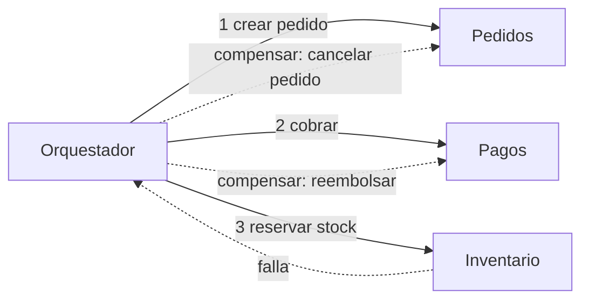

---
tags:
  - arquitectura
  - apis
  - mensajeria
  - aws
  - azure
  - gcp
---

# Integración y APIs

> Cómo se comunican las piezas de un sistema: REST, gRPC y GraphQL, buenas prácticas de diseño de APIs, comunicación síncrona y asíncrona con colas, pub/sub y streaming en cada nube, API gateways y los patrones saga y outbox.

## ¿Qué es?

En cuanto un sistema tiene más de una pieza, hay que decidir **cómo se hablan**. Hay dos grandes familias:

- **APIs** (*Application Programming Interfaces*, interfaces de programación): un componente pide algo a otro y espera la respuesta.
- **Messaging** (mensajería): un componente deja un mensaje o publica un evento y sigue con lo suyo; otro lo procesa cuando puede.

Elegir bien entre ambas define buena parte del **acoplamiento** del sistema (ver [Fundamentos de arquitectura de software](fundamentos-arquitectura-software.md#acoplamiento-y-cohesion)).

## REST, gRPC y GraphQL

| | **REST** | **gRPC** | **GraphQL** |
| --- | --- | --- | --- |
| Idea | Recursos con URL y verbos HTTP (`GET /pedidos/42`) | Llamar a funciones remotas definidas en un contrato | El cliente pide exactamente los campos que quiere en una consulta |
| Transporte | HTTP/1.1 o HTTP/2 | HTTP/2 | HTTP (normalmente `POST` a un único endpoint) |
| Formato | JSON (casi siempre) | **Protocol Buffers** (binario) | JSON |
| Contrato | OpenAPI (opcional, recomendado) | Archivo `.proto` (obligatorio) | Schema GraphQL (obligatorio) |
| Streaming | No nativo (se usa SSE o WebSockets) | Sí: unario, de servidor, de cliente y bidireccional | Subscriptions |
| Caché HTTP | Fácil (`GET` cacheable) | Difícil | Difícil (todo va por `POST`) |
| Desde el navegador | Directo | Necesita gRPC-Web o un proxy | Directo |
| Mejor para | APIs públicas, CRUD, integración con terceros | Comunicación interna entre servicios, baja latencia | Frontends con pantallas que combinan muchos datos (*Backend for Frontend*) |

Los fundamentos de HTTP (métodos, códigos, versiones, TLS) están en [Protocolos de aplicación](../../networking/intermedio/protocolos-aplicacion.md).

## Diseño de APIs

### Versionado

Una API publicada es un **contrato**: si lo rompes, rompes a tus clientes.

- **Cambios compatibles** (añadir un campo opcional, un endpoint nuevo): no necesitan versión nueva.
- **Cambios incompatibles** (quitar o renombrar campos, cambiar tipos): requieren versión nueva y un periodo de convivencia.
- Formas habituales: en la ruta (`/v2/pedidos`, la más visible), en un header o en el *media type*. Elige una y úsala siempre.

### Idempotencia

Una operación es **idempotent** (idempotente) si repetirla da el mismo resultado que hacerla una vez. En redes los reintentos son inevitables: si el cliente no recibe la respuesta de un pago, ¿lo reintenta y cobra dos veces?

- `GET`, `PUT` y `DELETE` deben ser idempotentes por definición; `POST` no lo es.
- Para `POST` críticos, usa una **idempotency key** (clave de idempotencia) enviada por el cliente: el servidor guarda el resultado asociado a esa clave y, si llega repetida, devuelve el mismo resultado sin volver a ejecutar.

```http
POST /v1/pagos HTTP/1.1
Host: api.ejemplo.com
Content-Type: application/json
Idempotency-Key: 6f1c2b7e-3a7d-4a51-9a0e-2f9c1d2e8b11

{"pedido_id": "42", "importe": 1990, "moneda": "USD"}
```

### Paginación

Nunca devuelvas colecciones sin límite.

| Tipo | Ejemplo | Pros y contras |
| --- | --- | --- |
| **Offset** | `?limit=50&offset=100` | Simple; lento en tablas grandes y puede saltar o repetir elementos si cambian los datos |
| **Cursor** (*keyset*) | `?limit=50&cursor=eyJpZCI6MTAwfQ` | Estable y eficiente; no permite saltar a "la página 7" |

### Errores

Usa los códigos HTTP correctamente (`400` dato inválido, `401` no autenticado, `403` sin permiso, `404` no existe, `409` conflicto, `429` demasiadas peticiones, `5xx` fallo del servidor) y un cuerpo de error con formato estándar. El **RFC 9457** (*Problem Details for HTTP APIs*) define uno:

```json
{
  "type": "https://api.ejemplo.com/errores/saldo-insuficiente",
  "title": "Saldo insuficiente",
  "status": 409,
  "detail": "La cuenta 123 tiene 10 USD y el pago es de 19,90 USD.",
  "instance": "/v1/pagos/8812"
}
```

!!! warning "No filtres detalles internos"
    Un error no debe incluir trazas de pila, consultas SQL ni nombres de servidores. Esa información ayuda a un atacante. Ver [Pruebas dinámicas](../../devsecops/codigo-y-dependencias/pruebas-dinamicas.md) para la seguridad de APIs.

## Síncrona vs asíncrona

| | **Synchronous** (síncrona) | **Asynchronous** (asíncrona) |
| --- | --- | --- |
| Cómo | El cliente llama y **espera** la respuesta | El emisor deja un mensaje y **sigue**; alguien lo procesa después |
| Ejemplos | REST, gRPC | Colas, pub/sub, streaming |
| Acoplamiento temporal | Alto: si el destino está caído o lento, el origen también falla | Bajo: el mensaje espera en el broker |
| Picos de carga | Se propagan a todos los servicios de la cadena | El broker los absorbe |
| Consistencia | Inmediata | Eventual |
| Complejidad | Baja | Más alta: reintentos, duplicados, orden, dead-letter queues |
| Úsala cuando | El usuario necesita la respuesta ya (consultar saldo) | El trabajo puede hacerse después (enviar correo, facturar, procesar un video) |

## Colas, pub/sub y streaming

| Modelo | Cómo funciona | Ejemplo de uso |
| --- | --- | --- |
| **Queue** (cola, punto a punto) | Cada mensaje lo procesa **un** consumidor; se borra al confirmarlo | Repartir trabajos entre *workers* |
| **Pub/sub** (publicación/suscripción) | Cada mensaje llega a **todos** los suscriptores | Notificar "pedido creado" a facturación, inventario y correo |
| **Event bus** (bus de eventos) | Pub/sub con **reglas de enrutamiento** por contenido del evento | Integrar servicios de la nube y SaaS |
| **Streaming** (flujo de eventos) | Registro ordenado y **persistente**; varios consumidores lo leen a su ritmo y pueden releer | Telemetría, clickstream, CDC, analítica en tiempo real |

### Servicios por proveedor

| Necesidad | AWS | Azure | Google Cloud |
| --- | --- | --- | --- |
| Cola simple | **Amazon SQS** | **Azure Queue Storage** | **Pub/Sub** (suscripción *pull*) |
| Cola empresarial (sesiones, transacciones, *topics*) | Amazon SQS FIFO, Amazon MQ | **Azure Service Bus** | Pub/Sub (con *ordering keys* y *exactly-once delivery*) |
| Pub/sub (*fan-out*) | **Amazon SNS** | Azure Service Bus *topics*, Azure Event Grid | **Pub/Sub** |
| Bus de eventos con reglas | **Amazon EventBridge** | **Azure Event Grid** | **Eventarc** |
| Streaming | **Amazon Kinesis Data Streams** | **Azure Event Hubs** | Pub/Sub, Dataflow para procesarlo |
| Kafka gestionado | Amazon MSK | Event Hubs (endpoint compatible con Kafka), Confluent en Azure Marketplace | Google Cloud Managed Service for Apache Kafka |
| Orquestar pasos | AWS Step Functions | Azure Logic Apps, Durable Functions | Workflows |

!!! tip "Diseña para mensajes duplicados"
    La mayoría de servicios de mensajería garantizan entrega **at-least-once** (al menos una vez): tarde o temprano recibirás el mismo mensaje dos veces. Haz los consumidores **idempotentes** (por ejemplo, guardando el ID del mensaje ya procesado) y configura una **dead-letter queue** (cola de mensajes fallidos, DLQ) para los mensajes que fallan una y otra vez.

## API gateway

Un **API gateway** (puerta de enlace de APIs) es el punto de entrada único a tus APIs. Centraliza lo que no quieres repetir en cada servicio:

- Autenticación y autorización (API keys, OAuth 2.0, JWT).
- **Rate limiting** (límite de peticiones) y cuotas por cliente.
- Enrutamiento a distintos backends y versiones.
- Transformación de peticiones, caché, CORS.
- Logs y métricas por API y por cliente.

| | AWS | Azure | Google Cloud |
| --- | --- | --- | --- |
| API gateway gestionado | **Amazon API Gateway** (REST, HTTP y WebSocket APIs) | **Azure API Management** | **API Gateway**, **Apigee** (gestión empresarial) |
| GraphQL gestionado | AWS AppSync | Azure API Management (APIs GraphQL) | Apigee (proxies GraphQL) |
| Dentro de Kubernetes | Gateway API con un controlador (ver [Kubernetes](../../devops/contenedores/kubernetes.md)) | Igual | Igual |

Más detalle sobre gateways delante de funciones en [Serverless](../computo/serverless.md#api-gateway-delante-de-las-funciones).

## Patrones de consistencia: saga y outbox

En microservicios cada servicio tiene su base de datos, así que no hay una transacción ACID que abarque "crear pedido + cobrar + reservar stock". Dos patrones resuelven esto.

### Saga

Una **saga** divide la operación en **transacciones locales**, una por servicio. Si un paso falla, se ejecutan **compensating transactions** (transacciones compensatorias) que deshacen los pasos anteriores (reembolsar, liberar stock).

- **Choreography** (coreografía): cada servicio escucha eventos y reacciona; no hay coordinador. Simple con pocos pasos, difícil de seguir con muchos.
- **Orchestration** (orquestación): un orquestador dice a cada servicio qué hacer y gestiona las compensaciones. Más visible y controlable. Step Functions, Durable Functions/Logic Apps y Workflows sirven como orquestadores.



### Transactional outbox

Problema: el servicio guarda el pedido en su base de datos **y** publica el evento "pedido creado". Si la base de datos confirma pero el broker falla (o al revés), quedas inconsistente.

El **transactional outbox** (bandeja de salida transaccional) lo resuelve:

1. En la **misma transacción** local se escribe el pedido y una fila en la tabla `outbox` con el evento.
2. Un proceso aparte (o **CDC**, *change data capture*, captura de cambios) lee la tabla `outbox` y publica en el broker.
3. Si la publicación falla, se reintenta; los consumidores deben ser idempotentes porque puede llegar duplicado.

```sql title="outbox.sql"
BEGIN;
INSERT INTO pedidos (id, cliente_id, total) VALUES ('42', 'c-7', 1990);
INSERT INTO outbox (id, tipo, payload)
  VALUES (gen_random_uuid(), 'PedidoCreado', '{"pedido_id":"42","total":1990}');
COMMIT;
```

En la nube, el CDC puede venir del propio servicio de datos: DynamoDB Streams, el change feed de Azure Cosmos DB o Datastream en Google Cloud.

## Conclusión práctica

- **REST** para APIs públicas, **gRPC** entre servicios internos, **GraphQL** cuando el frontend necesita combinar muchos datos.
- Diseña APIs con **versionado**, **idempotencia**, **paginación** y **errores estándar** desde el día uno.
- Prefiere **asíncrono** cuando el usuario no necesita la respuesta inmediata: desacopla y absorbe picos.
- Asume mensajes duplicados: consumidores idempotentes y DLQ.
- Sin transacciones distribuidas: **saga** para coordinar y **outbox** para no perder eventos.

## Relación con otras secciones

| Enfoque | Qué se mira desde ahí | Nota |
| --- | --- | --- |
| Cloud (el control) | Estilos que usan estas integraciones; funciones detrás del gateway; patrones de resiliencia en las llamadas | [Estilos de arquitectura](estilos-arquitectura.md), [Arquitectura en la nube](arquitectura-cloud.md), [Arquitecturas de referencia](arquitecturas-referencia.md), [Serverless](../computo/serverless.md) |
| DevOps (la automatización) | Exponer servicios con Ingress/Gateway API, trazas distribuidas entre servicios y colas | [Kubernetes](../../devops/contenedores/kubernetes.md), [Observabilidad](../../devops/operacion/observabilidad.md) |
| DevSecOps (la verificación) | Seguridad de APIs (OWASP API Security Top 10), DAST, autenticación entre servicios | [Pruebas dinámicas](../../devsecops/codigo-y-dependencias/pruebas-dinamicas.md), [Secretos e identidades](../../devsecops/identidades-y-pipeline/secretos-identidades.md) |
| Networking (la base) | HTTP, TLS y WebSockets por debajo de las APIs; balanceo L7 | [Protocolos de aplicación](../../networking/intermedio/protocolos-aplicacion.md), [Balanceo y alta disponibilidad](../../networking/avanzado/balanceo-alta-disponibilidad.md) |
| Laboratorios (la práctica) | Practicar esto paso a paso | [Lab 18: AWS: API serverless con Lambda, API Gateway y DynamoDB](../../laboratorios/cloud/aws-serverless-api.md) |

## Referencias

- [RFC 9457: Problem Details for HTTP APIs](https://www.rfc-editor.org/rfc/rfc9457)
- [OpenAPI Specification](https://spec.openapis.org/oas/latest.html)
- [gRPC: introducción](https://grpc.io/docs/what-is-grpc/introduction/)
- [GraphQL: introducción](https://graphql.org/learn/)
- [Saga patterns (AWS Prescriptive Guidance)](https://docs.aws.amazon.com/prescriptive-guidance/latest/cloud-design-patterns/saga-patterns.html)
- [Transactional outbox pattern (AWS Prescriptive Guidance)](https://docs.aws.amazon.com/prescriptive-guidance/latest/cloud-design-patterns/transactional-outbox.html)
- [Patrón Saga (Azure Architecture Center)](https://learn.microsoft.com/es-es/azure/architecture/patterns/saga)
- [Elegir entre servicios de mensajería de Azure](https://learn.microsoft.com/es-es/azure/service-bus-messaging/compare-messaging-services)
- [Amazon EventBridge](https://docs.aws.amazon.com/es_es/eventbridge/latest/userguide/eb-what-is.html)
- [Pub/Sub overview (Google Cloud)](https://cloud.google.com/pubsub/docs/overview)
- [Azure API Management](https://learn.microsoft.com/es-es/azure/api-management/api-management-key-concepts)
