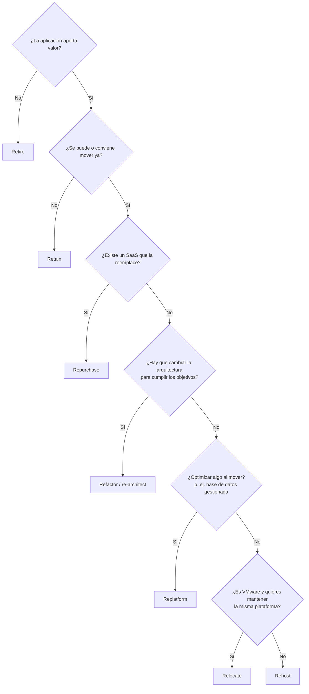
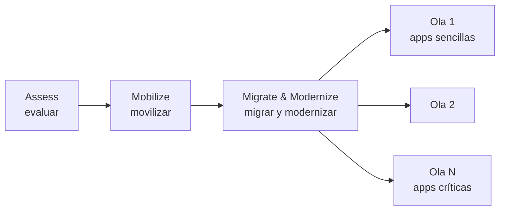

---
tags:
  - migracion
  - arquitectura
  - aws
  - azure
  - gcp
---

# Migración a la nube

> Cómo se mueve un portafolio de aplicaciones a la nube: las 7 R de AWS (y sus equivalentes en Azure y Google Cloud), las fases de una migración, las herramientas de cada proveedor, la modernización posterior y los riesgos que más se repiten.

## ¿Qué es?

Una **cloud migration** (migración a la nube) es el proceso de mover aplicaciones, datos e infraestructura desde un datacenter propio (**on-premises**, en las instalaciones) u otra nube hacia un proveedor cloud. Rara vez es "mover servidores": es decidir, **aplicación por aplicación**, qué hacer con cada una, en qué orden y con qué riesgo.

Por qué se migra (el **business case**, caso de negocio, se trata en [TI y negocio](../../negocio/ti-y-negocio.md)):

- Cerrar o no renovar un datacenter, o evitar comprar hardware (pasar de CapEx a OpEx).
- Agilidad: crear entornos en minutos, escalar con la demanda.
- Acceso a servicios gestionados (bases de datos, analítica, IA) y a regiones en todo el mundo.
- Reducir deuda técnica y riesgo (sistemas operativos o hardware sin soporte).

## Las 7 R

AWS clasifica las estrategias de migración en las **7 Rs** (siete R). Se elige **una por aplicación** durante la evaluación del portafolio.

| Estrategia | También llamada | Qué haces | Esfuerzo | Ejemplo |
| --- | --- | --- | --- | --- |
| **Retire** (retirar) | — | Apagar o archivar la aplicación porque ya no aporta valor | Mínimo | Una intranet que nadie usa desde hace 90 días |
| **Retain** (retener) | *Revisit* | Dejarla donde está, por ahora | Ninguno ahora | Un mainframe, hardware especial, una app que se acaba de renovar, requisitos de residencia de datos |
| **Rehost** (realojar) | ***Lift and shift*** (levantar y mover) | Mover los servidores tal cual a VMs en la nube | Bajo | VMs de VMware replicadas a EC2, Azure VMs o Compute Engine |
| **Relocate** (reubicar) | *Hypervisor-level lift and shift* | Mover a una versión cloud de la misma plataforma, sin comprar hardware ni cambiar la app | Bajo | VMware on-premises a VMware Cloud on AWS, Azure VMware Solution o Google Cloud VMware Engine |
| **Repurchase** (recomprar) | ***Drop and shop*** | Cambiar a otro producto, normalmente SaaS | Medio (datos, integraciones, formación) | CRM propio → Salesforce; servidor de correo → Microsoft 365 o Google Workspace |
| **Replatform** (cambiar de plataforma) | *Lift, tinker and shift*, *lift and reshape* | Mover con **algunas optimizaciones** sin cambiar la arquitectura | Medio | SQL Server en una VM → base de datos gestionada; app Java a contenedores |
| **Refactor / re-architect** (refactorizar / rediseñar) | — | Rediseñar la aplicación para aprovechar servicios cloud-native | Alto | Monolito → microservicios o serverless |

!!! tip "Migrar primero, modernizar después"
    AWS recomienda que en migraciones grandes se use sobre todo **rehost, replatform, relocate y retire**, y que el **refactor** se deje para **después** de migrar, porque cambiar la arquitectura en mitad de la migración es lo más lento y arriesgado. Una vez en la nube, modernizar es más fácil.

!!! info "De 6 R a 7 R"
    El modelo empezó como las "5 R" de Gartner (2010) y AWS lo amplió a 6 R. La séptima, **Relocate**, se añadió pensando en migraciones de VMware. Vas a ver materiales con 5, 6 y 7.

### Cómo lo llaman Azure y Google Cloud

Las ideas son las mismas, pero cada proveedor las agrupa distinto:

| Idea | AWS (7 R) | Azure (Cloud Adoption Framework) | Google Cloud |
| --- | --- | --- | --- |
| Apagar | Retire | Retire | — |
| No mover | Retain | Retain | — |
| Mover sin cambios | Rehost | Rehost | Rehost: *lift and shift* |
| Mover la plataforma de virtualización | Relocate | (Rehost hacia Azure VMware Solution) | (Rehost hacia Google Cloud VMware Engine) |
| Cambiar a SaaS | Repurchase | Replace | Repurchase |
| Optimizar al mover | Replatform | Replatform | Replatform: *lift and optimize* |
| Cambiar el código | Refactor | Refactor (mejorar el código sin cambiar funciones) | Refactor: *move and improve* |
| Cambiar la arquitectura | Refactor / re-architect | Rearchitect | Re-architect: *continue to modernize* |
| Rehacer desde cero | (Refactor) | Rebuild | Rebuild: *remove and replace* |

## Fases de una migración

AWS divide una migración grande en tres fases:

| Fase | Qué se hace | Resultado |
| --- | --- | --- |
| **Assess** (evaluar) | Inventario (**discovery**, descubrimiento) de servidores, aplicaciones y dependencias; estimar costos en la nube; business case | Decisión de migrar y caso de negocio |
| **Mobilize** (movilizar) | Preparar la **landing zone** (cuentas, red, identidad, seguridad; ver [Gobernanza](../operacion-y-gobierno/gobernanza.md)), formar a los equipos, elegir la R de cada app, planificar **waves** (olas) y hacer pilotos | Plataforma lista y plan por olas |
| **Migrate & Modernize** (migrar y modernizar) | Migrar ola por ola: replicar, probar, hacer el **cutover** (paso a producción) y retirar lo antiguo; luego optimizar y modernizar | Aplicaciones en la nube y datacenter liberado |

Los otros proveedores usan fases parecidas:

| | AWS | Azure | Google Cloud |
| --- | --- | --- | --- |
| Fases | Assess → Mobilize → Migrate & Modernize | Azure Migrate: Decide → Plan → Execute (dentro de las metodologías del Cloud Adoption Framework: Strategy, Plan, Ready, Adopt, Govern, Secure, Manage) | Assess → Plan → Deploy → Optimize |
| Marco de adopción | AWS Cloud Adoption Framework (AWS CAF) | Microsoft Cloud Adoption Framework for Azure | Google Cloud Adoption Framework |

!!! note "Planificar por olas y dependencias"
    Las aplicaciones que hablan mucho entre sí deben migrar en **la misma ola**: si separas una app de su base de datos y quedan una en la nube y otra on-premises, la latencia de red puede hacer que todo vaya lento. El **dependency mapping** (mapa de dependencias) de las herramientas de discovery sirve para esto. La conectividad híbrida durante la migración (VPN, Direct Connect, ExpressRoute, Cloud Interconnect) se ve en [Redes de datacenter e híbridas](../../networking/avanzado/redes-datacenter-hibridas.md).

## Herramientas de migración

| Necesidad | AWS | Azure | Google Cloud |
| --- | --- | --- | --- |
| Hub, discovery, evaluación y business case | **AWS Transform** (assessment y discovery), Migration Evaluator | **Azure Migrate** (discovery and assessment, business case) | **Migration Center** (descubrimiento, evaluación y estimación de costos) |
| Migrar servidores (rehost) | **AWS Transform MGN** (antes AWS Application Migration Service) | **Azure Migrate** (herramienta *Migrate and Modernize*) | **Migrate to Virtual Machines** |
| Migrar VMware sin cambios (relocate) | VMware Cloud on AWS (ver nota) | Azure VMware Solution | Google Cloud VMware Engine (con VMware HCX) |
| Migrar bases de datos | **AWS Database Migration Service** (AWS DMS), DMS Schema Conversion | **Azure Database Migration Service** | **Database Migration Service** |
| Transferir archivos y datos online | AWS DataSync | AzCopy, Azure Storage Mover | Storage Transfer Service |
| Transferir datos offline (dispositivo físico) | Familia AWS Snow (revisa disponibilidad) | Azure Data Box | Transfer Appliance |
| VMs a contenedores | AWS App2Container, AWS Transform | Azure Migrate (web apps a App Service y AKS) | Migrate to Containers |
| Asistencia con agentes de IA | AWS Transform (VMware, .NET, mainframe, código personalizado) | Azure Copilot migration agent en Azure Migrate (preview, centrado en planificación) | Revisa la oferta vigente |

!!! info "Cambios recientes en las herramientas de AWS"
    - **AWS Migration Hub** dejó de aceptar clientes nuevos el 7 de noviembre de 2025; AWS recomienda **AWS Transform**, que reúne sus funciones (discovery, planificación por olas, recomendaciones de instancias) con agentes de IA. Los clientes existentes pueden seguir usándolo.
    - **AWS Application Migration Service** (MGN) se renombró como **AWS Transform MGN** en junio de 2026. Funciona igual: replica los discos de los servidores de origen de forma continua y permite lanzar instancias de prueba y de cutover.
    - La oferta de **VMware Cloud on AWS** cambió tras la compra de VMware por Broadcom; revisa su disponibilidad actual antes de planificar un *relocate* en AWS.

### Ejemplo: flujo de un rehost

Las tres herramientas de rehost siguen el mismo patrón:

1. Instalar un agente (o desplegar un appliance sin agente) en el entorno de origen.
2. **Replicación continua** de los discos hacia la nube, sin parar el servidor original.
3. Lanzar una **test instance** (instancia de prueba) y validar la aplicación.
4. Programar el **cutover**: congelar cambios, última sincronización, lanzar la instancia definitiva y cambiar el DNS.
5. Mantener el origen apagado un tiempo como **rollback** y después retirarlo.

## Modernización

Migrar es el principio. La **modernization** (modernización) consiste en ir aprovechando la nube una vez allí:

| De | A | Patrón o servicio |
| --- | --- | --- |
| Base de datos en una VM | Base de datos gestionada | Replatform con DMS (ver [Almacenamiento y datos](../redes-y-datos/almacenamiento-datos.md)) |
| App en VM | Contenedores gestionados o Kubernetes | Replatform (ver [Contenedores gestionados](../computo/contenedores-gestionados.md)) |
| Tareas programadas en un servidor | Funciones serverless | Refactor parcial (ver [Serverless](../computo/serverless.md)) |
| Monolito | Monolito modular o servicios | **Strangler fig** (ver [Arquitectura en la nube](arquitectura-cloud.md#modernizar-y-extender)) |
| Licencias comerciales (Windows, Oracle, SQL Server) | Open source o servicios gestionados | .NET Framework a .NET moderno sobre Linux, PostgreSQL |
| Despliegues manuales | IaC y CI/CD | [Infrastructure as Code](../../devops/iac/infraestructura-como-codigo.md), [Despliegue continuo](../../devops/ci-cd/despliegue-continuo.md) |

## Riesgos típicos

| Riesgo | Qué pasa | Cómo mitigarlo |
| --- | --- | --- |
| **Dependencias ocultas** | Al migrar una app se rompe otra que la llamaba por una IP fija | Discovery con mapeo de dependencias, migrar por olas, DNS en vez de IPs |
| **Costos inesperados** | La factura supera el business case: VMs sobredimensionadas, transferencia de datos, entornos olvidados | **Rightsizing** con datos reales de uso, tagging, presupuestos y alertas desde el día uno (ver [FinOps y costos](../fundamentos/finops-costos.md)) |
| **Lift and shift eterno** | Se migra todo "tal cual" y nunca se moderniza; se paga la nube con la arquitectura del datacenter | Plan de modernización post-migración con fechas y dueños |
| **Seguridad trasladada sin revisar** | Reglas de firewall abiertas y cuentas compartidas copiadas a la nube | Landing zone con guardrails, revisión de IAM y red antes del cutover (ver [Seguridad base](../identidad-y-seguridad/seguridad-base.md)) |
| **Licencias** | Licencias que no se pueden llevar a la nube o cuestan más allí | Revisar contratos y opciones de **BYOL** (*bring your own license*, trae tu propia licencia) en la fase assess |
| **Latencia híbrida** | App en la nube y base de datos on-premises: todo lento | Migrar juntas las piezas que se hablan mucho |
| **Downtime en el cutover** | La ventana de corte se alarga o falla | Replicación continua, ensayos del cutover, plan de rollback probado |
| **Falta de habilidades** | El equipo no sabe operar la nube | Formación en la fase mobilize, un **Cloud Center of Excellence** (CCoE, centro de excelencia cloud) |
| **Vendor lock-in** | Dependencia fuerte de servicios propietarios | Decidir conscientemente qué servicios gestionados usar y documentarlo en un ADR (ver [Fundamentos de arquitectura de software](fundamentos-arquitectura-software.md#architecture-decision-records-adr)) |

!!! warning "Cumplimiento y residencia de datos"
    Antes de mover datos personales o regulados, confirma en qué regiones pueden vivir y qué controles exige la normativa. Ver [Cumplimiento y gobierno](../../devsecops/gobierno-y-respuesta/cumplimiento.md) y [Gobierno y riesgo de TI](../../negocio/gobierno-riesgo-ti.md).

## Conclusión práctica

- Decide **una R por aplicación**: no todo merece migrar, y no todo merece refactor.
- Sigue las fases: **evaluar** con datos, **movilizar** con una landing zone y olas, **migrar** con replicación y cutover probados.
- Usa las herramientas nativas: **AWS Transform / AWS Transform MGN**, **Azure Migrate**, **Migration Center / Migrate to Virtual Machines**, y los servicios de migración de bases de datos de cada nube.
- Migra primero, **moderniza después**, pero con un plan que de verdad se ejecute.
- Los riesgos más caros son las dependencias ocultas, los costos sin control y llevarse la mala seguridad del datacenter.

## Relación con otras secciones

| Enfoque | Qué se mira desde ahí | Nota |
| --- | --- | --- |
| Cloud (el control) | Modelos de servicio y regiones destino; landing zone; costos; arquitecturas a las que se llega y patrones de modernización | [Modelos de servicio y regiones](../fundamentos/modelos-de-servicio-y-regiones.md), [Gobernanza](../operacion-y-gobierno/gobernanza.md), [FinOps y costos](../fundamentos/finops-costos.md), [Arquitecturas de referencia](arquitecturas-referencia.md), [Arquitectura en la nube](arquitectura-cloud.md), [Máquinas virtuales](../computo/maquinas-virtuales.md) |
| DevOps (la automatización) | Recrear la infraestructura con IaC y automatizar los despliegues de lo migrado | [Infrastructure as Code](../../devops/iac/infraestructura-como-codigo.md), [Despliegue continuo](../../devops/ci-cd/despliegue-continuo.md), [Contenedores con Docker](../../devops/contenedores/docker.md) |
| DevSecOps (la verificación) | Revisar la postura de seguridad y el cumplimiento antes y después del cutover | [Cumplimiento y gobierno](../../devsecops/gobierno-y-respuesta/cumplimiento.md), [Seguridad de IaC](../../devsecops/infraestructura-y-contenedores/seguridad-iac.md) |
| Negocio TI (el porqué) | Business case, CapEx vs OpEx, TCO y ROI; riesgo y contratos con proveedores; continuidad durante el cambio | [TI y negocio](../../negocio/ti-y-negocio.md), [Gobierno y riesgo de TI](../../negocio/gobierno-riesgo-ti.md), [Continuidad de negocio](../../negocio/continuidad-negocio.md) |
| Networking (la base) | Conectividad híbrida durante la migración y planificación de IPs sin solapamientos | [Redes de datacenter e híbridas](../../networking/avanzado/redes-datacenter-hibridas.md), [Direccionamiento IP](../../networking/basico/direccionamiento-ip.md) |

## Referencias

- [Estrategias de migración (7 R), AWS Prescriptive Guidance](https://docs.aws.amazon.com/prescriptive-guidance/latest/large-migration-guide/migration-strategies.html)
- [AWS Migration Hub availability change](https://docs.aws.amazon.com/migrationhub/latest/ug/migrationhub-availability-change.html)
- [AWS Transform](https://aws.amazon.com/transform/)
- [AWS Application Migration Service ahora es AWS Transform MGN](https://aws.amazon.com/es/about-aws/whats-new/2026/06/aws-transform-mgn-rebrand/)
- [AWS Database Migration Service](https://docs.aws.amazon.com/es_es/dms/latest/userguide/Welcome.html)
- [Acerca de Azure Migrate](https://learn.microsoft.com/es-es/azure/migrate/migrate-services-overview)
- [Seleccionar estrategias de migración (Cloud Adoption Framework)](https://learn.microsoft.com/es-es/azure/cloud-adoption-framework/plan/select-cloud-migration-strategy)
- [Azure Database Migration Service](https://learn.microsoft.com/es-es/azure/dms/dms-overview)
- [Migration to Google Cloud: Getting started](https://cloud.google.com/architecture/migration-to-gcp-getting-started)
- [Migration Center (Google Cloud)](https://cloud.google.com/migration-center/docs/migration-center-overview)
- [Migration and modernization tools (Google Cloud)](https://cloud.google.com/migration-center/docs/migration-modernization-tools)
- [Migrate to Virtual Machines](https://cloud.google.com/migrate/virtual-machines/docs)
