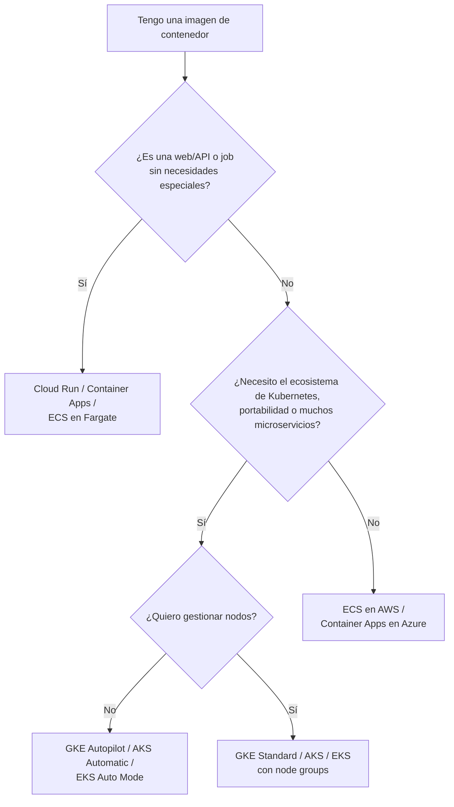

---
tags:
  - computo
  - contenedores
  - kubernetes
  - aws
  - azure
  - gcp
---

# Contenedores gestionados: AWS, Azure y GCP

> Qué servicios ofrece cada nube para ejecutar contenedores sin administrar servidores a mano: ECS, EKS y Fargate en AWS; AKS, Container Apps y Container Instances en Azure; GKE y Cloud Run en Google Cloud.

## ¿Qué es un servicio de contenedores gestionado?

Un **container** (contenedor) empaqueta una aplicación con todo lo que necesita para correr. La imagen se construye una vez (ver [Docker](../../devops/contenedores/docker.md)) y se ejecuta igual en cualquier lugar.

Ejecutar contenedores en producción exige más que `docker run`: repartirlos entre máquinas, reiniciarlos si fallan, escalarlos, exponerlos detrás de un load balancer y actualizarlos sin cortes. De eso se encarga un **orchestrator** (orquestador). Un servicio **gestionado** (*managed*) significa que el proveedor opera una parte o todo ese orquestador.

Hay tres niveles, de más control a menos operación:

| Nivel | Qué gestionas tú | AWS | Azure | Google Cloud |
| --- | --- | --- | --- | --- |
| **Kubernetes gestionado** | Nodos (o no, según modo), objetos de Kubernetes, *add-ons* | Amazon EKS | Azure Kubernetes Service (AKS) | Google Kubernetes Engine (GKE) |
| **Orquestador propio del proveedor** | Definición de tareas y servicios | Amazon ECS | No hay un equivalente directo (Container Apps cumple ese papel) | No hay un equivalente directo |
| **Contenedores "serverless"** | Solo la imagen y la configuración | AWS Fargate, Amazon ECS Express Mode, AWS App Runner | Azure Container Apps, Azure Container Instances (ACI) | Cloud Run, GKE Autopilot |

Y en todos los casos necesitas un **container registry** (registro de imágenes) donde guardar las imágenes:

| | AWS | Azure | Google Cloud |
| --- | --- | --- | --- |
| Registry | Amazon Elastic Container Registry (ECR) | Azure Container Registry (ACR) | Artifact Registry (sustituye a Container Registry) |
| Escaneo de vulnerabilidades integrado | Amazon Inspector (*enhanced scanning*) / *basic scanning* | Microsoft Defender for Containers | Artifact Analysis |

## Vista rápida

| | AWS | Azure | Google Cloud |
| --- | --- | --- | --- |
| Kubernetes gestionado | EKS | AKS | GKE (Standard, Autopilot) |
| Kubernetes sin gestionar nodos | EKS con Fargate, EKS Auto Mode | AKS Automatic | GKE Autopilot |
| Apps web/API desde una imagen, escala a cero | App Runner (cerrado a clientes nuevos), ECS Express Mode | Azure Container Apps | Cloud Run |
| Un contenedor suelto, rápido | ECS task en Fargate | Azure Container Instances | Cloud Run jobs |
| Permisos del contenedor hacia la nube | IAM roles for tasks / EKS Pod Identity, IRSA | Workload identity (Microsoft Entra Workload ID) | Workload Identity Federation for GKE |

## AWS

=== "Amazon ECS"

    **Amazon ECS** (*Elastic Container Service*) es el orquestador propio de AWS, más simple que Kubernetes.

    - **Task definition** (definición de tarea): JSON con imagen, CPU, memoria, puertos, variables y rol IAM.
    - **Task**: una ejecución de esa definición (uno o varios contenedores juntos).
    - **Service**: mantiene N tasks corriendo, las registra en el load balancer y hace *rolling updates* (actualizaciones graduales).
    - **Cluster**: agrupación lógica de tasks y services.

    **Launch types** (dónde corren las tasks):

    | | EC2 launch type | Fargate launch type |
    | --- | --- | --- |
    | Servidores | Tú gestionas las instancias EC2 del clúster (parches, escalado) | AWS los gestiona; no ves servidores |
    | Pago | Por las instancias EC2, uses o no su capacidad | Por vCPU y memoria de cada task, por segundo |
    | Control | GPUs, tipos de instancia concretos, *daemons* propios | Menos control, menos operación |
    | Cuándo | Carga grande y estable, necesidades especiales | Punto de partida por defecto |

    También existen **capacity providers** para mezclar, por ejemplo, Fargate y **Fargate Spot**.

=== "Amazon EKS"

    **Amazon EKS** (*Elastic Kubernetes Service*) es Kubernetes estándar: AWS opera el **control plane** (plano de control) y tú eliges cómo dar los nodos:

    - **Managed node groups**: grupos de EC2 que AWS ayuda a crear y actualizar.
    - **Fargate**: cada *pod* corre en capacidad gestionada, sin nodos visibles (con limitaciones, por ejemplo sin *DaemonSets*).
    - **EKS Auto Mode**: AWS gestiona también los nodos, el escalado (basado en Karpenter) y varios *add-ons*.

    El control plane tiene un costo por hora por clúster, aparte de los nodos.

=== "App Runner y ECS Express Mode"

    **AWS App Runner** desplegaba una web o API desde una imagen o repositorio sin configurar clúster ni load balancer. **Desde el 30 de abril de 2026 no acepta clientes nuevos**: quien ya lo usa puede seguir, pero AWS no le añade funciones y recomienda **Amazon ECS Express Mode** para nuevas cargas de ese tipo.

## Azure

=== "AKS"

    **Azure Kubernetes Service (AKS)**: Kubernetes gestionado. El control plane lo opera Azure; los nodos se organizan en **node pools** basados en Virtual Machine Scale Sets.

    - **AKS Standard**: tú decides node pools, tamaños, actualizaciones.
    - **AKS Automatic**: Azure preconfigura nodos, escalado, seguridad y monitoreo con valores recomendados.
    - Integración con Microsoft Entra ID para autenticación y con Azure RBAC para autorización en el clúster.

=== "Azure Container Apps"

    **Azure Container Apps** corre contenedores sin exponer Kubernetes (por debajo usa Kubernetes, KEDA, Dapr y Envoy, pero no los administras).

    - Escala por peticiones HTTP, eventos o colas, **incluso a cero**.
    - Soporta *revisions* (versiones) con reparto de tráfico entre ellas, útil para *canary*.
    - Tiene **jobs** para tareas que terminan.
    - Es la opción por defecto en Azure para APIs y microservicios sin necesidad de Kubernetes completo.

=== "Azure Container Instances"

    **Azure Container Instances (ACI)**: un contenedor o grupo de contenedores (*container group*) que arranca en segundos, sin orquestación. Útil para tareas sueltas, pruebas o *build agents*. No da escalado automático ni load balancing por sí mismo.

## Google Cloud

=== "GKE"

    **Google Kubernetes Engine (GKE)** tiene dos modos de operación:

    | | Standard | Autopilot |
    | --- | --- | --- |
    | Nodos | Tú gestionas node pools (tipo de máquina, cantidad, actualizaciones) | Google gestiona los nodos |
    | Pago | Por las VMs de los nodos | Por los recursos que piden los pods |
    | Seguridad por defecto | La configuras tú | *Hardening* aplicado por defecto (por ejemplo, sin pods privilegiados) |
    | Cuándo | Necesitas control total del nodo | Opción recomendada para empezar |

    Google recomienda **Autopilot** como modo por defecto para clústeres nuevos.

=== "Cloud Run"

    **Cloud Run** ejecuta una imagen de contenedor que escucha HTTP y escala según las peticiones, **incluso a cero**. Pagas principalmente por el tiempo de CPU y memoria usado mientras atiende peticiones (según el modo de facturación que elijas).

    - **Services**: APIs y webs.
    - **Jobs**: tareas que terminan (procesos *batch*).
    - **Worker pools**: cargas que no reciben peticiones HTTP (por ejemplo, consumir de una cola).
    - Las funciones de Google Cloud también corren sobre Cloud Run: ver [Serverless](serverless.md).

```bash
# Desplegar una imagen en Cloud Run
gcloud run deploy api-notas \
  --image=southamerica-east1-docker.pkg.dev/mi-proyecto/apps/api-notas:1.4.0 \
  --region=southamerica-east1 \
  --no-allow-unauthenticated
```

## ¿Orquestador gestionado o Kubernetes?



| Elige un servicio más simple (ECS, Container Apps, Cloud Run) si… | Elige Kubernetes (EKS, AKS, GKE) si… |
| --- | --- |
| Tienes pocos servicios y un equipo pequeño | Tienes muchos microservicios y equipo de plataforma |
| Quieres escalar a cero y pagar por uso | Necesitas Helm charts, operadores, service mesh o CRDs |
| No necesitas portabilidad entre nubes | Quieres la misma plataforma en varias nubes u *on-premises* |
| Quieres el menor esfuerzo operativo | Aceptas el costo de operar y actualizar Kubernetes |

!!! tip "Empieza por lo simple"
    Kubernetes es potente pero tiene una curva de aprendizaje alta y exige actualizaciones de versión frecuentes. Si una plataforma más simple cubre tu caso, úsala. Y si necesitas un servidor completo, ver [Máquinas virtuales](maquinas-virtuales.md).

## Seguridad en contenedores gestionados

Según el [Shared Responsibility Model](../fundamentos/responsabilidad-compartida.md), el proveedor opera el control plane, pero **tú sigues siendo responsable** de:

- **La imagen**: vulnerabilidades, imagen base, secretos dentro de ella. Ver [Seguridad de contenedores](../../devsecops/infraestructura-y-contenedores/seguridad-contenedores.md).
- **Los permisos** del contenedor hacia la nube: usa la identidad de carga de trabajo (IAM role de la task, Workload Identity) en vez de *access keys* en variables de entorno. Ver [IAM](../fundamentos/iam-comparativa.md).
- **La configuración del clúster**: RBAC, network policies, Pod Security Standards. Ver [Seguridad de Kubernetes](../../devsecops/infraestructura-y-contenedores/seguridad-kubernetes.md).
- **La red**: qué servicios son públicos y cuáles internos. Ver [Redes en la nube](../redes-y-datos/redes.md).

!!! warning "Etiquetas de imagen mutables"
    Desplegar `:latest` hace imposible saber qué versión corre. Usa etiquetas inmutables (versión o *digest* `@sha256:…`) y activa la inmutabilidad de *tags* en el registry (ECR y Artifact Registry lo permiten; en ACR se puede bloquear la escritura de una imagen).

## Con Terraform

| Recurso | AWS | Azure | Google Cloud |
| --- | --- | --- | --- |
| Kubernetes gestionado | `aws_eks_cluster` | `azurerm_kubernetes_cluster` | `google_container_cluster` |
| Servicio de contenedores | `aws_ecs_service` + `aws_ecs_task_definition` | `azurerm_container_app` | `google_cloud_run_v2_service` |
| Registry | `aws_ecr_repository` | `azurerm_container_registry` | `google_artifact_registry_repository` |

## Conclusión práctica

- Para una API o web en contenedor, empieza por **Cloud Run**, **Azure Container Apps** o **ECS en Fargate**.
- Usa **Kubernetes gestionado** cuando necesites su ecosistema; y prefiere los modos que gestionan nodos (**GKE Autopilot**, **AKS Automatic**, **EKS Auto Mode**) salvo que tengas una razón para no hacerlo.
- **App Runner** ya no admite clientes nuevos; en AWS la alternativa sugerida es ECS Express Mode.
- La imagen, sus permisos y la red siguen siendo tu responsabilidad.

## Relación con otras secciones

| Enfoque | Qué se mira desde ahí | Nota |
| --- | --- | --- |
| Cloud (el control) | Alternativas de cómputo; red e identidad de los contenedores | [Máquinas virtuales](maquinas-virtuales.md), [Serverless](serverless.md), [Redes en la nube](../redes-y-datos/redes.md), [IAM](../fundamentos/iam-comparativa.md) |
| DevOps (la automatización) | Construir la imagen, subirla al registry y desplegarla | [Docker](../../devops/contenedores/docker.md), [Kubernetes](../../devops/contenedores/kubernetes.md), [Despliegue continuo](../../devops/ci-cd/despliegue-continuo.md) |
| DevSecOps (la verificación) | Escaneo y firma de imágenes; seguridad del clúster | [Seguridad de contenedores](../../devsecops/infraestructura-y-contenedores/seguridad-contenedores.md), [Seguridad de Kubernetes](../../devsecops/infraestructura-y-contenedores/seguridad-kubernetes.md), [Software supply chain](../../devsecops/codigo-y-dependencias/cadena-suministro.md) |
| Laboratorios (la práctica) | Practicar esto paso a paso | [Lab 05: Imagen multi-stage y Docker Compose](../../laboratorios/devops/docker-multistage-compose.md), [Lab 06: Desplegar una app en Kubernetes local con kind](../../laboratorios/devops/kubernetes-local-kind.md), [Lab 14: Endurecer un clúster: Pod Security, NetworkPolicy y Kyverno](../../laboratorios/devsecops/seguridad-kubernetes.md), [Lab 20: Google Cloud: desplegar un contenedor en Cloud Run](../../laboratorios/cloud/gcp-cloud-run.md) |

## Referencias

- [Amazon ECS: launch types](https://docs.aws.amazon.com/AmazonECS/latest/developerguide/launch_types.html)
- [AWS Fargate](https://docs.aws.amazon.com/AmazonECS/latest/developerguide/AWS_Fargate.html)
- [Amazon EKS](https://docs.aws.amazon.com/eks/latest/userguide/what-is-eks.html)
- [AWS App Runner: cambio de disponibilidad](https://docs.aws.amazon.com/apprunner/latest/dg/apprunner-availability-change.html)
- [Amazon ECR](https://docs.aws.amazon.com/AmazonECR/latest/userguide/what-is-ecr.html)
- [Azure Kubernetes Service (AKS)](https://learn.microsoft.com/es-es/azure/aks/what-is-aks)
- [Azure Container Apps](https://learn.microsoft.com/es-es/azure/container-apps/overview)
- [Azure Container Instances](https://learn.microsoft.com/es-es/azure/container-instances/container-instances-overview)
- [Comparación de opciones de contenedores en Azure](https://learn.microsoft.com/es-es/azure/container-apps/compare-options)
- [GKE: Autopilot y Standard](https://cloud.google.com/kubernetes-engine/docs/concepts/choose-cluster-mode)
- [Cloud Run](https://cloud.google.com/run/docs/overview/what-is-cloud-run)
- [Artifact Registry](https://cloud.google.com/artifact-registry/docs/overview)
