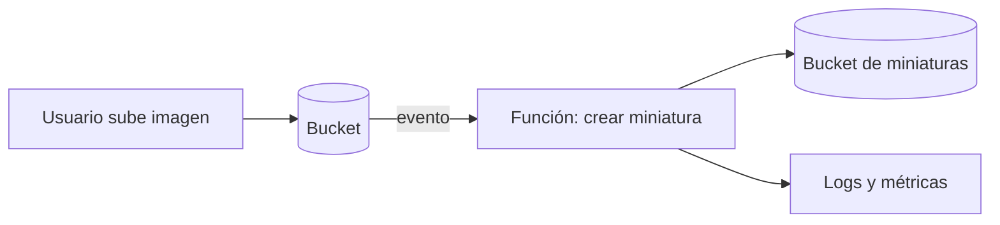

---
tags:
  - computo
  - serverless
  - aws
  - azure
  - gcp
---

# Serverless: AWS Lambda, Azure Functions y Cloud Run functions

> Qué es serverless, cómo funcionan las funciones que se ejecutan por eventos en cada nube, qué limitaciones tienen y cuándo conviene usarlas.

## ¿Qué es serverless?

**Serverless** (sin servidor) no significa que no haya servidores: significa que **no los ves ni los administras**. El proveedor aprovisiona, escala, parchea y apaga la capacidad; tú entregas código o una imagen y pagas por lo que se ejecuta.

Rasgos comunes de un servicio serverless:

- **No hay servidores que gestionar** (ni sistema operativo ni parches).
- **Escala automáticamente**, incluso **a cero** cuando no hay tráfico.
- **Pagas por uso**: por invocación y por tiempo de ejecución, no por horas encendidas.
- **Event-driven** (dirigido por eventos): el código se ejecuta como reacción a algo.

Dentro de serverless, **FaaS** (*Functions as a Service*, funciones como servicio) es el modelo donde la unidad de despliegue es **una función**. Serverless es más amplio: también incluye bases de datos (DynamoDB, Firestore), colas (SQS, Pub/Sub) y contenedores serverless (Cloud Run, Container Apps; ver [Contenedores gestionados](contenedores-gestionados.md)).

Según el [Shared Responsibility Model](../fundamentos/responsabilidad-compartida.md), en serverless el proveedor asume el sistema operativo y el runtime; tú sigues a cargo del **código, sus dependencias, los permisos (IAM) y los datos**.

## Vista rápida

| | AWS | Azure | Google Cloud |
| --- | --- | --- | --- |
| Servicio FaaS | **AWS Lambda** | **Azure Functions** | **Cloud Run functions** (antes *Cloud Functions*) |
| Unidad | Function | Function dentro de una **Function App** | Function (desplegada como servicio de Cloud Run) |
| Planes / modos | On-demand, Provisioned Concurrency, Lambda Managed Instances | Flex Consumption, Premium, Dedicated (App Service plan), Container Apps | Cloud Run (facturación por petición o por instancia) |
| Empaquetado | ZIP o imagen de contenedor | Código o imagen de contenedor | Código fuente (se construye una imagen) o imagen |
| Exponer por HTTP | Function URL, API Gateway, ALB | HTTP trigger, API Management | URL de Cloud Run, API Gateway |
| Orquestar pasos | AWS Step Functions | Durable Functions, Logic Apps | Workflows |
| Bus de eventos | Amazon EventBridge | Azure Event Grid | Eventarc |
| Permisos de la función | Execution role (IAM role) | Managed identity | Service account |

!!! info "Cloud Functions ahora es Cloud Run functions"
    En 2024 Google renombró **Cloud Functions (2nd gen)** a **Cloud Run functions**: las funciones se despliegan sobre la infraestructura de Cloud Run y comparten su consola y opciones. Muchos tutoriales antiguos siguen usando el nombre anterior.

## Triggers y eventos

Un **trigger** (disparador) es lo que hace que la función se ejecute.

| Tipo de evento | AWS Lambda | Azure Functions | Cloud Run functions |
| --- | --- | --- | --- |
| Petición HTTP | Function URL, API Gateway, ALB | HTTP trigger | HTTP (URL propia) |
| Archivo subido | S3 event notifications | Blob trigger / Event Grid | Cloud Storage vía Eventarc |
| Mensaje en cola | SQS | Queue Storage, Service Bus | Pub/Sub |
| Programado (*cron*) | EventBridge Scheduler | Timer trigger | Cloud Scheduler |
| Cambio en base de datos | DynamoDB Streams | Cosmos DB trigger | Firestore vía Eventarc |
| Stream de datos | Kinesis, Amazon MSK | Event Hubs | Pub/Sub |



=== "AWS"

    ```python title="handler.py"
    import json

    def lambda_handler(event, context):
        # event trae los datos del trigger (aquí, un evento de S3)
        for record in event.get("Records", []):
            key = record["s3"]["object"]["key"]
            print(f"Nuevo objeto: {key}")
        return {"statusCode": 200, "body": json.dumps({"ok": True})}
    ```

=== "Azure"

    ```python title="function_app.py"
    import azure.functions as func

    app = func.FunctionApp()

    @app.route(route="saludo", auth_level=func.AuthLevel.FUNCTION)
    def saludo(req: func.HttpRequest) -> func.HttpResponse:
        nombre = req.params.get("nombre", "mundo")
        return func.HttpResponse(f"Hola, {nombre}")
    ```

=== "Google Cloud"

    ```python title="main.py"
    import functions_framework

    @functions_framework.http
    def saludo(request):
        nombre = request.args.get("nombre", "mundo")
        return f"Hola, {nombre}"
    ```

## Cold starts

Un **cold start** (arranque en frío) ocurre cuando no hay ninguna instancia lista y el proveedor tiene que crear una: descargar el código, iniciar el runtime y ejecutar la inicialización. Esa primera petición tarda más (desde cientos de milisegundos hasta varios segundos, según runtime y tamaño).

Cómo reducirlos:

| Técnica | AWS | Azure | Google Cloud |
| --- | --- | --- | --- |
| Mantener instancias calientes | Provisioned Concurrency | *Always ready instances* (Flex Consumption), plan Premium | `min-instances` (instancias mínimas) |
| Acelerar el arranque | Lambda SnapStart (Java, Python, .NET) | — | *Startup CPU boost* |
| En tu código | Paquetes pequeños, inicializar clientes fuera del *handler*, runtimes ligeros | Igual | Igual |

!!! tip "Inicializa fuera del handler"
    Crea los clientes de base de datos o SDK **fuera** de la función principal: se reutilizan entre invocaciones mientras la instancia siga viva (*warm start*).

## Límites

Todas las plataformas FaaS tienen límites de **tiempo máximo de ejecución**, **memoria**, **tamaño del paquete**, **tamaño de la petición/respuesta** y **concurrencia** por cuenta o región. Los valores cambian con el tiempo y según el plan, así que **revísalos en la documentación oficial** antes de diseñar.

Como orientación general:

- **AWS Lambda** tiene un tiempo máximo de ejecución de minutos (no horas) y un límite de concurrencia por región que se puede ampliar con una solicitud de *service quota*.
- **Azure Functions** cambia mucho según el plan: los planes Premium y Dedicated permiten ejecuciones más largas que los de consumo.
- **Cloud Run functions** hereda los límites de Cloud Run, que permite *timeouts* más largos que la FaaS clásica, sobre todo en funciones HTTP.

!!! warning "Si chocas con los límites, quizá no es caso para FaaS"
    Procesos de muchos minutos u horas, conexiones persistentes o necesidades de GPU suelen encajar mejor en contenedores ([Contenedores gestionados](contenedores-gestionados.md)) o VMs ([Máquinas virtuales](maquinas-virtuales.md)). Para flujos largos, divide el trabajo en pasos con Step Functions, Durable Functions o Workflows.

## Modelo de pago

En los tres se paga, a grandes rasgos, por:

1. **Número de invocaciones** (peticiones).
2. **Tiempo de ejecución × memoria asignada** (en AWS se mide en *GB-seconds*).
3. Extras: instancias calientes reservadas, transferencia de datos, servicios conectados (API Gateway, logs).

Los tres tienen una capa gratuita mensual de invocaciones y tiempo de cómputo; sus valores cambian, revísalos en la página de precios.

!!! note "Serverless no siempre es más barato"
    Con tráfico bajo o intermitente es muy económico, porque no pagas en reposo. Con tráfico alto y constante, una VM o un contenedor siempre encendido puede salir más barato. Ver [FinOps y costos](../fundamentos/finops-costos.md).

## API Gateway delante de las funciones

Para exponer funciones como una API pública se suele poner un **API gateway** delante, que aporta autenticación, *rate limiting* (limitar peticiones), *throttling*, versionado, dominios propios y transformación de peticiones.

| | AWS | Azure | Google Cloud |
| --- | --- | --- | --- |
| Gateway de APIs | **Amazon API Gateway** (REST APIs, HTTP APIs, WebSocket APIs) | **Azure API Management** (incluye un *tier* Consumption serverless) | **API Gateway** (para APIs sencillas) y **Apigee** (gestión de APIs empresarial) |
| Autenticación típica | IAM, Amazon Cognito, *Lambda authorizers*, JWT | Subscription keys, OAuth 2.0 / Entra ID, políticas | API keys, JWT (Firebase, Auth0, Google ID tokens) |
| Protección adicional | AWS WAF | Azure Front Door + WAF, Application Gateway | Cloud Armor (con load balancer) |

## Cuándo sí y cuándo no

| Buen caso para serverless | Mal caso para serverless |
| --- | --- |
| Procesar archivos subidos, mensajes de una cola o eventos | Procesos largos (horas) o con estado en memoria |
| APIs con tráfico variable o bajo | Tráfico alto y constante (puede salir más caro) |
| Tareas programadas (*cron*) | Latencia muy baja garantizada sin cold starts |
| Automatizaciones de la propia nube (reaccionar a eventos de auditoría, etiquetar recursos) | Software que necesita control del sistema operativo |
| Prototipos y MVPs | Conexiones persistentes de larga duración |

## Seguridad en serverless

- **Una función, un rol**: cada función con su propio execution role / managed identity / service account y permisos mínimos. Ver [IAM](../fundamentos/iam-comparativa.md).
- **Secretos fuera del código**: léelos de Secrets Manager, Key Vault o Secret Manager, no de variables en texto plano. Ver [Seguridad de cifrado y secretos](../seguridad/seguridad-cifrado-secretos.md).
- **Dependencias**: la función arrastra sus librerías; escanéalas (SCA). Ver [Software supply chain](../../devsecops/codigo-y-dependencias/cadena-suministro.md).
- **Entrada no confiable**: los eventos también son entrada de usuario; valida y sanea. Ver [Pruebas dinámicas](../../devsecops/codigo-y-dependencias/pruebas-dinamicas.md) para seguridad de APIs.

## Con Terraform

| Recurso | AWS | Azure | Google Cloud |
| --- | --- | --- | --- |
| Función | `aws_lambda_function` | `azurerm_function_app_flex_consumption` / `azurerm_linux_function_app` | `google_cloudfunctions2_function` o `google_cloud_run_v2_service` |
| Permiso de invocación | `aws_lambda_permission` | (configuración del trigger) | `google_cloud_run_service_iam_member` |
| API | `aws_apigatewayv2_api` | `azurerm_api_management` | `google_api_gateway_api` |

## Conclusión práctica

- Serverless = sin servidores que administrar, escala a cero, pago por uso, ejecución por eventos.
- Lambda, Azure Functions y Cloud Run functions resuelven lo mismo; cambian planes, nombres y límites.
- Diseña pensando en **cold starts** y **límites**; si chocas con ellos, mira contenedores o VMs.
- Pon un **API gateway** delante cuando expongas funciones públicamente.
- Tu responsabilidad se reduce a código, dependencias, permisos y datos, pero no desaparece.

## Relación con otras secciones

| Enfoque | Qué se mira desde ahí | Nota |
| --- | --- | --- |
| Cloud (el control) | Otras opciones de cómputo; permisos y secretos de la función; costos | [Contenedores gestionados](contenedores-gestionados.md), [Máquinas virtuales](maquinas-virtuales.md), [IAM](../fundamentos/iam-comparativa.md), [FinOps y costos](../fundamentos/finops-costos.md) |
| DevOps (la automatización) | Empaquetar y desplegar funciones desde el pipeline; versiones y alias para *canary* | [Despliegue continuo](../../devops/ci-cd/despliegue-continuo.md), [Infrastructure as Code](../../devops/iac/infraestructura-como-codigo.md), [Observabilidad](../../devops/operacion/observabilidad.md) |
| DevSecOps (la verificación) | Dependencias de la función, secretos y seguridad de la API | [Software supply chain](../../devsecops/codigo-y-dependencias/cadena-suministro.md), [Secretos e identidades](../../devsecops/identidades-y-pipeline/secretos-identidades.md), [Pruebas dinámicas](../../devsecops/codigo-y-dependencias/pruebas-dinamicas.md) |
| Laboratorios (la práctica) | Practicar esto paso a paso | [Lab 18: AWS: API serverless con Lambda, API Gateway y DynamoDB](../../laboratorios/cloud/aws-serverless-api.md), [Lab 20: Google Cloud: desplegar un contenedor en Cloud Run](../../laboratorios/cloud/gcp-cloud-run.md) |

## Referencias

- [AWS Lambda](https://docs.aws.amazon.com/es_es/lambda/latest/dg/welcome.html)
- [Cuotas de AWS Lambda](https://docs.aws.amazon.com/lambda/latest/dg/gettingstarted-limits.html)
- [Amazon API Gateway](https://docs.aws.amazon.com/es_es/apigateway/latest/developerguide/welcome.html)
- [Azure Functions](https://learn.microsoft.com/es-es/azure/azure-functions/functions-overview)
- [Opciones de hospedaje de Azure Functions](https://learn.microsoft.com/es-es/azure/azure-functions/functions-scale)
- [Azure API Management](https://learn.microsoft.com/es-es/azure/api-management/api-management-key-concepts)
- [Cloud Run functions](https://cloud.google.com/functions/docs/concepts/overview)
- [Cuotas y límites de Cloud Run](https://cloud.google.com/run/quotas)
- [API Gateway de Google Cloud](https://cloud.google.com/api-gateway/docs/about-api-gateway)
