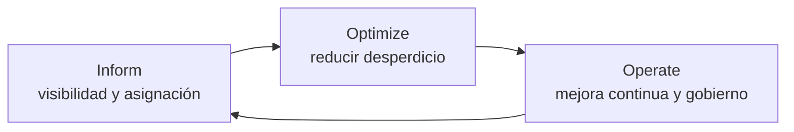

---
tags:
  - finops
  - aws
  - azure
  - gcp
---

# FinOps y costos

> Qué es FinOps, cómo se cobra la nube, qué herramientas nativas tiene cada proveedor para ver y controlar el gasto, y qué prácticas reducen la factura sin perder fiabilidad.

## ¿Qué es FinOps?

**FinOps** (de *Finance* + *DevOps*, gestión financiera de la nube) es la práctica de que **ingeniería, finanzas y negocio** tomen juntos decisiones sobre el gasto en la nube. La **FinOps Foundation** (parte de la Linux Foundation) mantiene el **FinOps Framework**, que es la referencia común.

La idea de fondo: en la nube cualquier persona con permisos puede crear recursos que cuestan dinero, así que el costo deja de ser un tema solo de compras y pasa a ser **responsabilidad de los equipos que construyen**.

!!! note "FinOps no es solo ahorrar"
    El objetivo es **maximizar el valor** de cada peso gastado, no gastar lo mínimo. A veces la decisión correcta es gastar más (por ejemplo, una segunda zona para no perder ventas).

### Fases del FinOps Framework



| Fase | Pregunta | Ejemplos |
| --- | --- | --- |
| **Inform** (informar) | ¿Cuánto gastamos, en qué y quién? | *Tagging*, *dashboards*, *showback*, presupuestos, *forecasting* (pronóstico) |
| **Optimize** (optimizar) | ¿Dónde podemos gastar mejor? | *Rightsizing*, compromisos de uso, Spot, apagar recursos ociosos |
| **Operate** (operar) | ¿Cómo lo hacemos parte del día a día? | Políticas, alertas, revisiones periódicas, automatización |

Es un ciclo: cada vuelta mejora la visibilidad y las decisiones. El framework habla de madurez **Crawl, Walk, Run** (gatear, caminar, correr): no hace falta hacerlo todo desde el primer día.

## Cómo se cobra la nube

| Modelo de precio | Qué es | Cuándo conviene |
| --- | --- | --- |
| **On-demand** / **pay-as-you-go** (pago por uso) | Pagas por hora, segundo o petición, sin compromiso | Cargas nuevas, variables o temporales |
| **Commitments** (compromisos de 1 o 3 años) | Descuento a cambio de comprometer un gasto o una capacidad | Cargas estables encendidas siempre |
| **Spot** | Capacidad sobrante muy barata que puede interrumpirse | *Batch*, CI/CD, cargas tolerantes a fallos |
| **Free tier** (capa gratuita) | Uso gratis hasta cierto límite | Pruebas y aprendizaje |
| Por consumo de servicio gestionado | Peticiones, GB almacenados, GB transferidos | Serverless, almacenamiento, bases de datos |

| Compromiso | AWS | Azure | Google Cloud |
| --- | --- | --- | --- |
| Compromiso de gasto flexible | Savings Plans | Azure savings plan for compute | Committed use discounts (CUD) basados en gasto |
| Compromiso de recurso concreto | Reserved Instances (RI) | Azure Reservations | CUD basados en recursos |
| Descuento automático por uso sostenido | No existe | No existe | Sustained use discounts (SUD), en algunas series |

Los detalles por tipo de VM están en [Máquinas virtuales](../computo/maquinas-virtuales.md#modelos-de-pago).

!!! warning "Los costos que nadie mira"
    - **Egress** (transferencia de datos de salida): sacar datos hacia internet, entre regiones y a veces entre zonas se cobra. La entrada (*ingress*) suele ser gratuita.
    - **NAT Gateway**: cobra por hora y por GB procesado; en arquitecturas con mucho tráfico saliente puede ser una de las líneas más grandes. Ver [Redes en la nube](../redes-y-datos/redes.md).
    - **Recursos huérfanos**: discos sin VM, *snapshots* antiguos, IPs públicas sin uso, load balancers sin destinos.
    - **Logs**: ingerir y retener logs en el servicio de observabilidad cuesta. Ver [Observabilidad nativa](../operacion-y-gobierno/observabilidad-nativa.md).

## Herramientas nativas de costos

| Necesidad | AWS | Azure | Google Cloud |
| --- | --- | --- | --- |
| Explorar el gasto | AWS Cost Explorer | Cost Management (*cost analysis*) | Cloud Billing reports |
| Presupuestos y alertas | AWS Budgets | Budgets en Cost Management | Budgets and alerts de Cloud Billing |
| Datos detallados de facturación | AWS Cost and Usage Report (CUR), hoy vía **AWS Data Exports** (CUR 2.0) | Exports de Cost Management | **Cloud Billing export to BigQuery** |
| Recomendaciones de tamaño y ahorro | AWS Compute Optimizer, Cost Optimization Hub, Trusted Advisor | Azure Advisor (categoría *Cost*) | Recommender (Active Assist) |
| Detección de anomalías | AWS Cost Anomaly Detection | Anomaly alerts en Cost Management | Anomalías de costos en Cloud Billing |
| Calculadora de precios | AWS Pricing Calculator | Azure Pricing Calculator | Google Cloud Pricing Calculator |

=== "AWS"

    - **AWS Cost Explorer**: gráficos de gasto por servicio, cuenta, región o tag, con pronóstico.
    - **AWS Budgets**: presupuestos de costo o de uso con alertas por correo o SNS; también puede aplicar **budget actions** (por ejemplo, aplicar una policy que impida crear recursos).
    - **CUR / Data Exports**: el detalle línea por línea, exportado a un bucket S3 para analizarlo con Athena o QuickSight.
    - **AWS Compute Optimizer**: recomienda tamaños de EC2, EBS, Lambda y ECS en Fargate según el uso medido.
    - En **AWS Organizations** la factura se consolida en la *management account* (cuenta de administración).

=== "Azure"

    - **Microsoft Cost Management + Billing**: *cost analysis*, presupuestos, alertas y *exports* programados a un Storage Account. El scope puede ser management group, subscription o resource group.
    - **Azure Advisor**: recomendaciones de costo (VMs infrautilizadas, reservas sugeridas).
    - Los **resource groups** ya agrupan costos de forma natural; las **tags** permiten cruzarlos por equipo o proyecto.

=== "Google Cloud"

    - **Cloud Billing reports**: gasto por proyecto, servicio, SKU o label.
    - **Budgets and alerts**: avisos por umbral; pueden publicar en **Pub/Sub** para automatizar respuestas.
    - **Cloud Billing export to BigQuery**: la forma recomendada de analizar costos en detalle con SQL; conviene activarlo desde el primer día porque no recupera datos anteriores a su activación.
    - **Recommender**: VMs inactivas, *rightsizing*, discos sin usar y sugerencias de CUD.

!!! danger "Un presupuesto no frena el gasto"
    En los tres proveedores un **budget** por defecto **solo avisa**: no apaga recursos ni corta la facturación. Para frenar el gasto hay que automatizar la reacción (budget actions en AWS, Pub/Sub + función en Google Cloud, Action groups en Azure) o usar políticas preventivas.

## Asignar costos: tags y labels

Para saber **quién** gasta, cada recurso debe llevar metadatos con su dueño.

| | AWS | Azure | Google Cloud |
| --- | --- | --- | --- |
| Nombre | Tags | Tags | **Labels** (las *tags* de GCP son otra cosa: se usan para políticas) |
| Para que aparezcan en facturación | Activar **cost allocation tags** en Billing | Aparecen en Cost Management | Aparecen en reports y en el export a BigQuery |
| Forzar su uso | Tag policies + SCPs (AWS Organizations) | Azure Policy | Organization Policy / validación en IaC |

Un esquema mínimo típico: `owner`, `team`, `environment` (`dev`, `staging`, `prod`), `cost-center`, `project`.

```hcl title="main.tf"
# AWS: default_tags aplica tags a todos los recursos del provider
provider "aws" {
  region = "sa-east-1"
  default_tags {
    tags = {
      team        = "plataforma"
      environment = "dev"
      cost-center = "cc-1234"
    }
  }
}
```

!!! tip "Lo que no tiene tag no tiene dueño"
    Define el esquema de tags al inicio, aplícalo desde el código (IaC) y bloquea en el pipeline los recursos sin tags obligatorias. Ver [Gobernanza](../operacion-y-gobierno/gobernanza.md) y [Seguridad de IaC](../../devsecops/infraestructura-y-contenedores/seguridad-iac.md) (policy as code).

### Showback y chargeback

- **Showback** (mostrar el gasto): cada equipo **ve** cuánto gasta, sin cobro interno. Es el primer paso y genera conciencia.
- **Chargeback** (cobro interno): el gasto se **imputa** al presupuesto de cada equipo o área. Requiere tags fiables y acuerdos sobre costos compartidos (red, soporte, seguridad).

## Prácticas típicas de optimización

| Práctica | Qué hacer | Ahorro típico en |
| --- | --- | --- |
| **Rightsizing** (ajustar tamaño) | Bajar el tamaño de VMs, bases de datos y contenedores según el uso medido | Cómputo |
| **Apagar entornos** | Detener dev/test fuera de horario (noches y fines de semana) | Cómputo |
| **Spot** | Usar Spot en CI/CD, *batch* y nodos tolerantes a interrupción | Cómputo |
| **Compromisos** | Savings Plans / Reservations / CUD para la base estable, después de hacer rightsizing | Cómputo y bases de datos |
| **Storage lifecycle** (ciclo de vida del almacenamiento) | Mover objetos poco usados a clases más baratas y borrar lo viejo | Almacenamiento |
| **Limpiar huérfanos** | Discos, snapshots, IPs y load balancers sin uso | Varios |
| **Reducir egress** | CDN, mantener tráfico dentro de la región, *VPC endpoints* / Private Link en vez de NAT | Red |
| **ARM** | Graviton, Cobalt o Axion si el software es compatible | Cómputo |
| **Serverless** | Pagar solo por ejecución en cargas intermitentes | Cómputo |

!!! warning "El orden importa"
    Primero **rightsizing** y limpieza, después **compromisos**. Si compras un Savings Plan o una reserva para VMs sobredimensionadas, quedas atado durante 1 o 3 años a pagar de más.

Las reglas de ciclo de vida del almacenamiento se ven en [Almacenamiento y datos](../redes-y-datos/almacenamiento-datos.md).

## FinOps en DevOps: el costo en el pipeline

El momento más barato para evitar un gasto es **antes de desplegarlo**. Herramientas como **Infracost** calculan el costo estimado de un cambio de Terraform y lo comentan en el *pull request*:

```bash
# Costo mensual estimado del código Terraform actual
infracost breakdown --path .

# Diferencia de costo frente a una línea base (útil en pull requests)
infracost diff --path . --compare-to infracost-base.json
```

Así la persona que revisa ve "este cambio sube el costo en X al mes" junto al `terraform plan`. Ver [Integración continua](../../devops/ci-cd/integracion-continua.md) y [Terraform](../../devops/iac/terraform-basico.md).

Otras prácticas en la automatización:

- Entornos efímeros que se destruyen solos al cerrar el *pull request* (ver [Pruebas de infraestructura](../../devops/iac/pruebas-infraestructura.md)).
- Programar el apagado de dev/test con el scheduler del proveedor o con el pipeline.
- Alertas de presupuesto conectadas al mismo canal que las alertas operativas.

## Conclusión práctica

- FinOps es **Inform → Optimize → Operate** en ciclo: primero visibilidad, luego optimización, luego hábito.
- Sin **tags/labels** no hay asignación de costos; defínelas en IaC y hazlas obligatorias.
- Activa desde el día uno **presupuestos con alertas** y el **export detallado** de facturación.
- Rightsizing y limpieza antes de comprar compromisos; Spot para lo que tolera interrupciones.
- Vigila los costos "invisibles": egress, NAT Gateway, logs y recursos huérfanos.

## Relación con otras secciones

| Enfoque | Qué se mira desde ahí | Nota |
| --- | --- | --- |
| Cloud (el control) | Pilar de Cost Optimization; tags obligatorias y políticas; modelos de pago de cómputo | [Well-Architected Framework](well-architected.md), [Gobernanza](../operacion-y-gobierno/gobernanza.md), [Máquinas virtuales](../computo/maquinas-virtuales.md), [Almacenamiento y datos](../redes-y-datos/almacenamiento-datos.md) |
| DevOps (la automatización) | Estimar costos en el pipeline; entornos efímeros; tags desde IaC | [Integración continua](../../devops/ci-cd/integracion-continua.md), [Infrastructure as Code](../../devops/iac/infraestructura-como-codigo.md), [Pruebas de infraestructura](../../devops/iac/pruebas-infraestructura.md) |
| DevSecOps (la verificación) | Policy as code que bloquea recursos sin tags o tamaños no permitidos | [Seguridad de IaC](../../devsecops/infraestructura-y-contenedores/seguridad-iac.md), [Cumplimiento y gobierno](../../devsecops/gobierno-y-respuesta/cumplimiento.md) |
| Negocio TI (el porqué) | CapEx vs OpEx, TCO, ROI y costo de downtime para decidir cuánto gastar | [TI y negocio](../../negocio/ti-y-negocio.md) |
| Laboratorios (la práctica) | Practicar esto paso a paso | [Lab 00: Preparar el entorno de laboratorio](../../laboratorios/fundamentos/preparar-entorno.md), [Lab 09: Terraform en AWS con remote state en S3](../../laboratorios/devops/terraform-aws-backend-remoto.md), [Lab 17: AWS: VPC con subnets públicas y privadas y una EC2](../../laboratorios/cloud/aws-vpc-ec2.md), [Lab 18: AWS: API serverless con Lambda, API Gateway y DynamoDB](../../laboratorios/cloud/aws-serverless-api.md), [Lab 19: Azure: VNet, NSG y una VM con Azure CLI](../../laboratorios/cloud/azure-vnet-vm.md), [Lab 20: Google Cloud: desplegar un contenedor en Cloud Run](../../laboratorios/cloud/gcp-cloud-run.md) |

## Referencias

- [FinOps Framework (FinOps Foundation)](https://www.finops.org/framework/)
- [FinOps Framework: fases](https://www.finops.org/framework/phases/)
- [AWS Cost Explorer](https://aws.amazon.com/es/aws-cost-management/aws-cost-explorer/)
- [AWS Budgets](https://docs.aws.amazon.com/cost-management/latest/userguide/budgets-managing-costs.html)
- [AWS Data Exports (Cost and Usage Report 2.0)](https://docs.aws.amazon.com/cur/latest/userguide/what-is-data-exports.html)
- [AWS Compute Optimizer](https://aws.amazon.com/es/compute-optimizer/)
- [Microsoft Cost Management](https://learn.microsoft.com/es-es/azure/cost-management-billing/costs/overview-cost-management)
- [Azure Advisor: recomendaciones de costos](https://learn.microsoft.com/es-es/azure/advisor/advisor-reference-cost-recommendations)
- [Google Cloud Billing: exportar a BigQuery](https://cloud.google.com/billing/docs/how-to/export-data-bigquery)
- [Google Cloud Billing: presupuestos y alertas](https://cloud.google.com/billing/docs/how-to/budgets)
- [Google Cloud Recommender](https://cloud.google.com/recommender/docs/overview)
- [Infracost](https://www.infracost.io/docs/)
