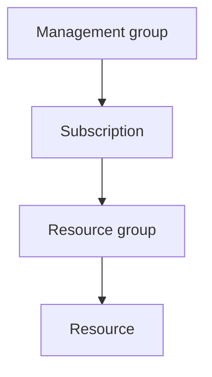
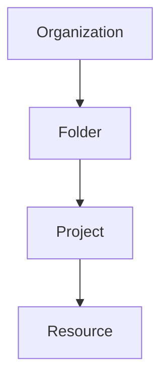

---
tags:
  - iam
  - seguridad
  - aws
  - azure
  - gcp
---

# IAM: AWS, Azure y GCP

> Cómo maneja cada proveedor quién eres (*identity*, identidad) y qué puedes hacer (*permissions*, permisos), y cuáles son los equivalentes entre AWS IAM, Microsoft Entra ID + Azure RBAC y Google Cloud IAM.

## ¿Qué es IAM?

**IAM** (*Identity and Access Management*, gestión de identidades y accesos) responde a dos preguntas:

1. **Authentication** (autenticación, a veces abreviado *AuthN*): ¿quién eres? (una persona, una aplicación, un servidor).
2. **Authorization** (autorización, *AuthZ*): ¿qué puedes hacer y sobre qué recursos?

Según el [Shared Responsibility Model](responsabilidad-compartida.md), IAM **siempre es responsabilidad del cliente**, sea IaaS, PaaS o SaaS. Es también donde ocurren muchas brechas de seguridad (*security breaches*): permisos excesivos, credenciales filtradas o cuentas sin **MFA** (*Multi-Factor Authentication*, autenticación multifactor).

Las tres nubes comparten la misma idea de fondo:

> Una **identity** (identidad) recibe un **conjunto de permisos** sobre un **scope** (alcance): una cuenta, suscripción, proyecto o recurso concreto.

Lo que cambia es el nombre de cada pieza y cómo se combinan.

## Vista rápida

| | AWS | Azure | Google Cloud |
| --- | --- | --- | --- |
| Servicio de identidad | AWS IAM + IAM Identity Center | **Microsoft Entra ID** (antes Azure AD) | Cloud Identity / Google Workspace |
| Servicio de permisos | AWS IAM (*policies*) | **Azure RBAC** (*Role-Based Access Control*) | Cloud IAM |
| Identidad y permisos… | En el mismo servicio | En servicios **separados** | Identidades fuera, permisos en IAM |
| Unidad de permisos | **Policy** (política) JSON con acciones | **Role** (rol) asignado en un scope | **Role** vinculado en una *allow policy* |
| Límite principal | AWS account (cuenta) | Subscription (suscripción) | Project (proyecto) |
| Jerarquía | Organization → Organizational Unit (OU) → Account | Management group → Subscription → Resource group → Resource | Organization → Folder → Project → Resource |

## AWS IAM

En AWS, identidades y permisos viven en el mismo servicio, **AWS IAM**, y cada **AWS account** tiene su propio IAM aislado.

### Identities

- **Root user** (usuario raíz): el correo con el que se creó la cuenta. Tiene acceso total y no se puede limitar con políticas de IAM. Solo se usa para tareas excepcionales, siempre con MFA.
- **IAM users** (usuarios IAM): identidades con credenciales de larga duración (*long-term credentials*: contraseña y *access keys*). Hoy se desaconsejan para personas.
- **IAM groups** (grupos): conjuntos de IAM users para asignar políticas en bloque.
- **IAM roles** (roles): identidades **sin credenciales fijas** que se "asumen" (*assume role*) y entregan **temporary credentials** (credenciales temporales) mediante AWS STS (*Security Token Service*). Se usan para servicios (EC2, Lambda), acceso entre cuentas (*cross-account access*) y federación.
- **IAM Identity Center** (antes AWS SSO, *Single Sign-On*): punto central para que las **personas** entren a varias cuentas con su usuario corporativo (Entra ID, Google, Okta…) mediante *permission sets* (conjuntos de permisos).

### Policies

Los permisos se escriben como **policies** (políticas) en JSON:

```json title="Policy de solo lectura sobre un bucket"
{
  "Version": "2012-10-17",
  "Statement": [
    {
      "Effect": "Allow",
      "Action": ["s3:GetObject", "s3:ListBucket"],
      "Resource": [
        "arn:aws:s3:::cuaderno-notas-dev",
        "arn:aws:s3:::cuaderno-notas-dev/*"
      ]
    }
  ]
}
```

Tipos de policy más usados:

| Tipo | Dónde se aplica | Para qué |
| --- | --- | --- |
| **Identity-based policy** (basada en identidad) | User, group o role | Qué puede hacer esa identidad |
| **Resource-based policy** (basada en recurso) | El recurso (S3 bucket, SQS queue, KMS key…) | Quién puede acceder a ese recurso, incluso desde otra cuenta |
| **Permissions boundary** (límite de permisos) | User o role | Máximo de permisos que puede llegar a tener |
| **SCP** (*Service Control Policy*) | Account u OU en AWS Organizations | Límite para toda la cuenta, incluido el root user |

!!! info "Cómo decide AWS (*policy evaluation logic*)"
    Todo está **denegado por defecto** (*implicit deny*). Una acción se permite solo si alguna policy la autoriza **y** ninguna la deniega. Un `Deny` explícito (*explicit deny*) **siempre gana** sobre cualquier `Allow`.

## Azure: Microsoft Entra ID + Azure RBAC

Azure separa **identidad** y **permisos** en dos sistemas distintos, y esa es la mayor fuente de confusión al empezar.

### Identities: Microsoft Entra ID

**Microsoft Entra ID** (llamado **Azure Active Directory** o **Azure AD** hasta 2023) es el *directory* (directorio) de identidades de la organización. Es el mismo que usa Microsoft 365, así que normalmente las personas ya existen ahí. En Azure a este directorio también se le llama **tenant** (inquilino).

- **Users** y **groups** (usuarios y grupos): personas de la organización o invitados externos (*guest users*).
- **Service principals**: la identidad de una aplicación dentro del directorio (se crean al registrar una app, *app registration*).
- **Managed identities** (identidades administradas): identidades que Azure gestiona por ti para que un recurso (VM, App Service, Function) acceda a otros servicios **sin guardar secretos**. Pueden ser:
    - *System-assigned*: ligada a un recurso; se borra con él.
    - *User-assigned*: recurso independiente que se puede asociar a varios recursos.

### Permisos: Azure RBAC

Un permiso en Azure es una **role assignment** (asignación de rol) con tres piezas:

```text
Quién (security principal) + Qué (role definition) + Dónde (scope)
```

- **Built-in roles** (roles integrados) frecuentes: **Owner** (todo, incluido dar permisos), **Contributor** (todo menos dar permisos), **Reader** (solo lectura), **User Access Administrator** (solo gestionar permisos). Hay cientos de roles específicos por servicio, y se pueden crear **custom roles** (roles personalizados).
- **Scope** y herencia: lo que se asigna en un nivel se hereda hacia abajo.



!!! warning "Entra ID roles ≠ Azure roles"
    **Global Administrator** o **User Administrator** son **Microsoft Entra roles**: gestionan el directorio (usuarios, apps, licencias). **Owner** o **Contributor** son **Azure roles** (Azure RBAC): gestionan recursos de Azure. Ser Global Administrator no da acceso automático a las subscriptions.

### Otras herramientas de Azure

- **Privileged Identity Management (PIM)**: activa roles privilegiados solo cuando se necesitan (*just-in-time access*, acceso justo a tiempo), con aprobación y tiempo límite. Requiere licencia Entra ID P2.
- **Conditional Access** (acceso condicional): reglas de *sign-in* (inicio de sesión) según ubicación, dispositivo, riesgo o MFA.
- **Azure Policy**: no da permisos, sino que **impide configuraciones** (por ejemplo, prohibir crear recursos fuera de ciertas regiones).

## Google Cloud IAM

En Google Cloud las **identidades** vienen de fuera de IAM (Google accounts, Cloud Identity o Google Workspace) y **Cloud IAM** se encarga de los permisos.

### Principals (identidades)

- **Google accounts** y **Google groups** (cuentas y grupos de Google): personas. Lo recomendado es dar permisos a **groups**, no a usuarios individuales.
- **Cloud Identity / Google Workspace**: el directorio de la organización. También se puede sincronizar con Entra ID o Active Directory.
- **Service accounts** (cuentas de servicio): identidades para aplicaciones y recursos (VMs, Cloud Run, GKE…).
- **Workforce Identity Federation**: permite que las personas entren con un *identity provider* (IdP, proveedor de identidad) externo como Entra ID u Okta, sin crear Google accounts.
- **Workload Identity Federation**: permite que workloads de fuera de GCP (GitHub Actions, AWS, Azure) usen credenciales temporales sin *service account keys*.

### Roles y allow policies

Los permisos se agrupan en **roles**, y los roles se vinculan a identidades mediante una **allow policy** (política de permisos, antes llamada *IAM policy*) adjunta a un recurso. Cada vínculo *principal + role* dentro de la policy es un **role binding**:

```text
Quién (principal) + Role + Recurso donde se adjunta la allow policy
```

Tipos de role:

| Tipo | Ejemplo | Uso recomendado |
| --- | --- | --- |
| **Basic roles** (roles básicos) | `roles/owner`, `roles/editor`, `roles/viewer` | Evitarlos en producción: son demasiado amplios |
| **Predefined roles** (roles predefinidos) | `roles/storage.objectViewer` | La opción habitual |
| **Custom roles** (roles personalizados) | Role propio con permisos elegidos | Cuando ningún predefined role encaja |



Los permisos se **heredan hacia abajo** (*policy inheritance*): un role dado en la organization aplica a todos sus projects.

### Otras herramientas de GCP

- **IAM Conditions** (condiciones): permisos que solo aplican bajo ciertas condiciones (por ejemplo, hasta una fecha o sobre recursos con cierto prefijo).
- **Deny policies** (políticas de denegación): **ganan** sobre los permisos concedidos.
- **Privileged Access Manager (PAM)**: elevación temporal de permisos (*just-in-time*), similar a PIM de Azure.
- **Organization Policy**: igual que Azure Policy, restringe configuraciones (por ejemplo, prohibir crear service account keys).
- **IAM Recommender**: detecta permisos que no se usan y propone quitarlos.

!!! danger "Evita las service account keys"
    Descargar una *key* (clave) JSON de una service account crea una credencial de larga duración que se puede filtrar. Usa la service account **adjunta** al recurso (*attached service account*) o **Workload Identity Federation** desde fuera de GCP.

## Tabla de equivalencias

| Concepto | AWS | Azure | Google Cloud |
| --- | --- | --- | --- |
| Persona de la organización | User de IAM Identity Center | User de Entra ID | Cuenta de Cloud Identity / Workspace |
| Grupo | IAM group / group de Identity Center | Entra ID group | Google group |
| Identidad de una aplicación | IAM role | Service principal / Managed identity | Service account |
| Identidad gestionada para un recurso | *Instance profile* o *execution role* | Managed identity | Attached service account |
| Conjunto de permisos | IAM policy | Role definition | Role |
| Asignar permisos | Adjuntar (*attach*) la policy a una identidad o recurso | Role assignment | Role binding en la allow policy |
| Denegación explícita | `Deny` en policies, SCP | Deny assignments (uso limitado) | Deny policies |
| Barrera a nivel organización (*guardrail*) | SCP | Azure Policy (configuración) | Organization Policy (configuración) |
| Acceso privilegiado temporal | Assume role con STS (temporary credentials) | PIM | Privileged Access Manager |
| Federación desde CI/CD | OIDC + `AssumeRoleWithWebIdentity` | Workload identity federation | Workload Identity Federation |
| Análisis de permisos | IAM Access Analyzer | Access reviews (Entra ID) | IAM Recommender / Policy Analyzer |

## Comandos para saber "quién soy" (*whoami*)

| Comando | Descripción |
| --- | --- |
| `aws sts get-caller-identity` | Account, user o role con el que estás autenticado en AWS |
| `az account show` | Subscription activa y usuario en Azure |
| `az ad signed-in-user show` | Datos de tu usuario en Entra ID |
| `gcloud auth list` | Cuentas autenticadas en gcloud y cuál está activa |
| `gcloud config list` | Cuenta y project activos |

## Best practices comunes

Las ideas que se repiten en cualquier proveedor (la lista completa, con controles y cómo verificarlos, está en [Seguridad de identidades](../seguridad/seguridad-identidades.md#buenas-practicas)):

- **Least privilege** (mínimo privilegio), con permisos asignados a **groups** y no a personas, y revisados de forma periódica.
- **MFA obligatorio** para todas las personas, sobre todo para las cuentas con más privilegios (root user, Global Administrator, Owner de la organización).
- **Temporary credentials** en lugar de *long-term credentials*: IAM roles en AWS, managed identities en Azure, attached service accounts en GCP, y **federación con OIDC** (*OpenID Connect*) para los pipelines CI/CD (ver [Secretos e identidades](../../devsecops/identidades-y-pipeline/secretos-identidades.md)).
- **Separar entornos** (dev, prod) en accounts, subscriptions o projects distintos.
- **Auditar**: CloudTrail (AWS), Activity Log y *sign-in logs* de Entra ID (Azure), Cloud Audit Logs (GCP).

!!! tip "Relación con Well-Architected"
    IAM es la base del pilar de **Security** en los tres marcos. Ver [Well-Architected Framework](well-architected.md).

## Relación con otras secciones

| Enfoque | Qué se mira desde ahí | Nota |
| --- | --- | --- |
| Cloud (el control) | Claves, secretos y audit logs protegidos con IAM; guardrails de organización (SCPs, Azure Policy, Organization Policy) | [Seguridad de identidades](../seguridad/seguridad-identidades.md), [Seguridad de cifrado, claves y secretos](../seguridad/seguridad-cifrado-secretos.md), [Seguridad de logging y detección](../seguridad/seguridad-logging-deteccion.md), [Gobernanza](../operacion-y-gobierno/gobernanza.md) |
| DevOps (la automatización) | Un rol por pipeline, creado con Terraform y con solo los permisos que necesita ese pipeline | [Terraform](../../devops/iac/terraform-basico.md), [Integración continua](../../devops/ci-cd/integracion-continua.md) |
| DevSecOps (la verificación) | OIDC entre el pipeline y la nube en lugar de claves; auditoría de permisos del pipeline; fallar el build si una policy tiene `*:*` | [Secretos e identidades](../../devsecops/identidades-y-pipeline/secretos-identidades.md), [Seguridad del pipeline](../../devsecops/identidades-y-pipeline/seguridad-pipeline.md), [Seguridad de IaC](../../devsecops/infraestructura-y-contenedores/seguridad-iac.md) |
| Laboratorios (la práctica) | Practicar esto paso a paso | [Lab 00 (parte 2): Cuentas cloud, presupuestos e identidades](../../laboratorios/fundamentos/preparar-cuentas-cloud.md), [Lab 09: Terraform en AWS con remote state en S3](../../laboratorios/devops/terraform-aws-backend-remoto.md), [Lab 13: Desplegar en AWS desde GitHub Actions con OIDC (sin llaves)](../../laboratorios/devsecops/oidc-github-aws.md), [Lab 16: Auditar tu cuenta cloud con Prowler (CSPM)](../../laboratorios/devsecops/cspm-prowler.md), [Lab 17: AWS: VPC con subnets públicas y privadas y una EC2](../../laboratorios/cloud/aws-vpc-ec2.md), [Lab 18: AWS: API serverless con Lambda, API Gateway y DynamoDB](../../laboratorios/cloud/aws-serverless-api.md), [Lab 19: Azure: VNet, NSG y una VM con Azure CLI](../../laboratorios/cloud/azure-vnet-vm.md), [Lab 20: Google Cloud: desplegar un contenedor en Cloud Run](../../laboratorios/cloud/gcp-cloud-run.md) |

## Referencias

- [Documentación de AWS IAM](https://docs.aws.amazon.com/es_es/IAM/latest/UserGuide/introduction.html)
- [Policy evaluation logic en AWS](https://docs.aws.amazon.com/es_es/IAM/latest/UserGuide/reference_policies_evaluation-logic.html)
- [AWS IAM Identity Center](https://docs.aws.amazon.com/es_es/singlesignon/latest/userguide/what-is.html)
- [Microsoft Entra ID](https://learn.microsoft.com/es-es/entra/fundamentals/whatis)
- [Azure RBAC](https://learn.microsoft.com/es-es/azure/role-based-access-control/overview)
- [Microsoft Entra roles vs. Azure roles](https://learn.microsoft.com/es-es/azure/role-based-access-control/rbac-and-directory-admin-roles)
- [Google Cloud IAM](https://cloud.google.com/iam/docs/overview)
- [Best practices para service accounts en GCP](https://cloud.google.com/iam/docs/best-practices-service-accounts)
