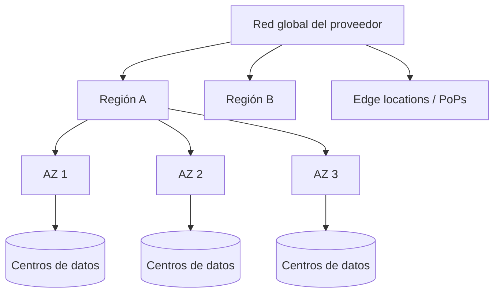

---
tags:
  - arquitectura
  - aws
  - azure
  - gcp
---

# Modelos de servicio y regiones

> Qué son IaaS, PaaS y SaaS, cómo organiza cada proveedor su infraestructura física en regiones, zonas y puntos de presencia, y qué mirar para elegir dónde desplegar.

## ¿Qué es un modelo de servicio?

Un **service model** (modelo de servicio) indica **cuánto de la pila tecnológica gestiona el proveedor** y cuánto gestionas tú. Cuanto más arriba en la pila te entrega el proveedor, menos operas tú, pero también tienes menos control.

| Modelo | Qué te entrega el proveedor | Qué gestionas tú | Ejemplo cotidiano |
| --- | --- | --- | --- |
| **IaaS** (*Infrastructure as a Service*, infraestructura como servicio) | Hardware, red física y virtualización | Sistema operativo, runtime, aplicación, datos | Alquilar un departamento vacío |
| **PaaS** (*Platform as a Service*, plataforma como servicio) | Lo anterior + sistema operativo y runtime | Código, configuración y datos | Alquilar un departamento amoblado |
| **SaaS** (*Software as a Service*, software como servicio) | La aplicación completa | Usuarios, accesos y datos | Hospedarte en un hotel |

El reparto exacto de tareas de seguridad en cada modelo está en la tabla del [Shared Responsibility Model](responsabilidad-compartida.md); aquí no se repite.

!!! info "Entre PaaS y FaaS hay más categorías"
    En la práctica también se habla de **CaaS** (*Containers as a Service*, contenedores como servicio: tú das la imagen, el proveedor la ejecuta) y **FaaS** (*Functions as a Service*, funciones como servicio: tú das una función, el proveedor la ejecuta cuando ocurre un evento). Se ven en [Contenedores gestionados](../computo/contenedores-gestionados.md) y [Serverless](../computo/serverless.md).

### Ejemplos por proveedor

| Modelo | AWS | Azure | Google Cloud |
| --- | --- | --- | --- |
| IaaS: máquinas virtuales | Amazon EC2 | Azure Virtual Machines | Compute Engine |
| IaaS: discos y redes | Amazon EBS, Amazon VPC | Managed Disks, Azure Virtual Network | Persistent Disk, VPC |
| CaaS: contenedores | Amazon ECS, Amazon EKS | Azure Kubernetes Service (AKS), Azure Container Apps | Google Kubernetes Engine (GKE), Cloud Run |
| PaaS: aplicaciones web | AWS Elastic Beanstalk | Azure App Service | App Engine |
| PaaS: bases de datos | Amazon RDS, Amazon Aurora | Azure SQL Database | Cloud SQL, AlloyDB |
| FaaS | AWS Lambda | Azure Functions | Cloud Run functions |
| SaaS | Amazon WorkMail, Amazon Connect | Microsoft 365, Dynamics 365 | Google Workspace |

!!! tip "Regla para elegir"
    Sube por la pila (IaaS → PaaS → FaaS) mientras el servicio cubra lo que necesitas. Baja a IaaS solo cuando necesites control del sistema operativo, software que no corre en PaaS o licencias concretas. Ver [Máquinas virtuales](../computo/maquinas-virtuales.md).

## Infraestructura global

Los tres proveedores organizan su infraestructura en niveles parecidos:

- **Region** (región): una zona geográfica (por ejemplo, São Paulo o Virginia del Norte) con uno o varios centros de datos. Es la unidad con la que eliges **dónde** viven tus recursos.
- **Availability Zone** (zona de disponibilidad, **AZ**): uno o más centros de datos dentro de una región con energía, refrigeración y red independientes. Están separadas físicamente, pero unidas por red de baja latencia. Repartir recursos entre AZs protege ante la caída de un centro de datos.
- **Edge location** / **point of presence** (ubicación perimetral / punto de presencia, **PoP**): sitios pequeños, mucho más numerosos que las regiones, cerca de los usuarios. Sirven para CDN, DNS y entrada a la red del proveedor; no corren tus VMs.



### Cómo lo define cada proveedor

| | AWS | Azure | Google Cloud |
| --- | --- | --- | --- |
| Región | Region (`us-east-1`, `sa-east-1`) | Region (`eastus`, `brazilsouth`) | Region (`us-central1`, `southamerica-east1`) |
| Zona | Availability Zone (`us-east-1a`) | Availability zone (1, 2, 3) | Zone (`us-central1-a`) |
| ¿Toda región tiene zonas? | Sí, al menos 3 AZs en las regiones nuevas | **No**: hay regiones con y sin availability zones | Sí, normalmente 3 zonas |
| Pareja de regiones | No existe como concepto | **Region pairs** (*paired regions*) | No existe como concepto |
| Extensiones locales | Local Zones, Wavelength Zones, Outposts | Extended Zones, Azure Local | Google Distributed Cloud |
| Edge | Edge locations (CloudFront, Route 53) | Puntos de presencia de Azure Front Door | Edge PoPs (Cloud CDN, Cloud Load Balancing) |

=== "AWS"

    - Cada región tiene varias **Availability Zones**. Los nombres como `us-east-1a` se asignan **por cuenta**: tu `us-east-1a` puede ser otro centro de datos que la `us-east-1a` de otra cuenta. Para coordinar entre cuentas se usa el **AZ ID** (`use1-az1`).
    - Casi todos los servicios son **regionales**. Algunos son **globales**: IAM, Route 53, CloudFront.
    - **Local Zones** acercan cómputo a ciudades grandes sin región propia; **Outposts** lleva hardware de AWS a tu centro de datos.

=== "Azure"

    - Hay regiones **con availability zones** y regiones **sin ellas**. Si necesitas *zone redundancy* (redundancia entre zonas), revisa que la región la tenga.
    - Muchas regiones tienen una **region pair** (región pareja) en la misma geografía, a cientos de kilómetros. Azure usa la pareja para replicación de algunos servicios (por ejemplo, *geo-redundant storage*, GRS) y para escalonar actualizaciones de plataforma. Las regiones más nuevas pueden **no tener pareja**.
    - Los recursos pueden ser **zonal** (anclados a una zona), **zone-redundant** (repartidos automáticamente entre zonas) o **non-zonal** (sin garantía de zona).

=== "Google Cloud"

    Google clasifica cada recurso por su alcance:

    - **Zonal resources** (recursos zonales): viven en una zona. Ejemplo: VM instances, Persistent Disk zonal.
    - **Regional resources** (recursos regionales): repartidos entre zonas de una región. Ejemplo: subnets, regional managed instance groups, Cloud SQL con HA.
    - **Global resources** (recursos globales): disponibles en todas las regiones. Ejemplo: la red **VPC** (es global, con subnets regionales), images, firewall rules, el *global external Application Load Balancer*.
    - Las **multi-regions** de Cloud Storage y BigQuery (`US`, `EU`) guardan datos en varias regiones a la vez.

!!! warning "Una región tiene varias zonas, no al revés"
    Desplegar en "una región" no te da alta disponibilidad por sí solo. Una VM vive en **una** zona; si quieres sobrevivir a la caída de una zona, necesitas recursos en **al menos dos** zonas y un load balancer delante. Ver [Resiliencia](../operacion-y-gobierno/resiliencia.md).

## Cómo elegir región

| Criterio | Qué preguntar | Ejemplo |
| --- | --- | --- |
| **Latencia** (*latency*) | ¿Dónde están los usuarios? | Usuarios en Chile → región en Santiago o São Paulo antes que en EE. UU. |
| **Costo** | ¿Cuánto cuesta el mismo servicio aquí? | Las regiones de EE. UU. suelen ser más baratas que las de Sudamérica para el mismo tipo de VM |
| **Compliance** y **data residency** (cumplimiento y residencia de datos) | ¿Alguna ley o contrato exige que los datos se queden en un país? | Datos de salud o de sector público que no pueden salir del país |
| **Disponibilidad de servicios** | ¿Existe ahí el servicio o el tipo de VM que necesito? | Servicios nuevos o GPUs llegan primero a pocas regiones |
| **Zonas** | ¿Tiene al menos dos o tres zonas? | Necesario para alta disponibilidad dentro de la región |
| **Sustainability** (sostenibilidad) | ¿Qué huella de carbono tiene? | Google Cloud publica el porcentaje de energía libre de carbono por región |

!!! tip "Comprueba antes de decidir"
    - **Precios**: usa las calculadoras oficiales (AWS Pricing Calculator, Azure Pricing Calculator, Google Cloud Pricing Calculator); los precios cambian según región.
    - **Servicios por región**: AWS publica la lista de servicios por región, Azure tiene *Products available by region* y Google Cloud indica las ubicaciones disponibles en la documentación de cada producto.
    - **Egress** (tráfico de salida): mover datos entre regiones o hacia internet se cobra. Ver [FinOps y costos](finops-costos.md).

## Comandos para listar regiones y zonas

```bash
# AWS: regiones habilitadas y AZs de una región
aws ec2 describe-regions --output table
aws ec2 describe-availability-zones --region sa-east-1 --output table

# Azure: regiones disponibles para la suscripción
az account list-locations -o table

# Google Cloud: regiones y zonas
gcloud compute regions list
gcloud compute zones list --filter="region:southamerica-west1"
```

Más comandos en [AWS CLI](../../recursos/comandos/aws-cli.md) y [Google Cloud CLI](../../recursos/comandos/google-cli.md).

## Con Terraform

La región se fija en el bloque `provider`, y la zona en cada recurso zonal:

```hcl title="providers.tf"
provider "aws" {
  region = "sa-east-1"
}

provider "azurerm" {
  features {}
  # En Azure la región va en cada recurso: location = "brazilsouth"
}

provider "google" {
  project = "mi-proyecto"
  region  = "southamerica-east1"
  zone    = "southamerica-east1-a"
}
```

Parametrizar la región como variable permite reutilizar el mismo código en otra región (por ejemplo, para *disaster recovery*). Ver [Infrastructure as Code](../../devops/iac/infraestructura-como-codigo.md).

## Conclusión práctica

- **IaaS, PaaS, SaaS** son niveles de abstracción: cuanto más arriba, menos operas tú, pero datos e identidades siguen siendo tuyos.
- **Región** = dónde; **zona** = dentro de esa región, en qué centro de datos aislado. Alta disponibilidad empieza por usar **varias zonas**.
- Azure tiene regiones sin zonas y region pairs; Google Cloud distingue recursos zonales, regionales y globales (su VPC es global).
- Elige región por latencia, costo, cumplimiento y servicios disponibles, en ese orden según el caso, y revísalo con las calculadoras oficiales.

## Relación con otras secciones

| Enfoque | Qué se mira desde ahí | Nota |
| --- | --- | --- |
| Cloud (el control) | Quién es responsable de qué según el modelo; diseño multi-zona; regiones permitidas | [Shared Responsibility Model](responsabilidad-compartida.md), [Resiliencia](../operacion-y-gobierno/resiliencia.md), [Gobernanza](../operacion-y-gobierno/gobernanza.md), [Migración a la nube](../arquitectura/migracion-cloud.md) |
| DevOps (la automatización) | Región y zonas como variables del código de infraestructura | [Infrastructure as Code](../../devops/iac/infraestructura-como-codigo.md), [Terraform](../../devops/iac/terraform-basico.md) |
| DevSecOps (la verificación) | Verificar que los datos se quedan en las regiones permitidas (residencia de datos) | [Cumplimiento y gobierno](../../devsecops/gobierno-y-respuesta/cumplimiento.md), [Seguridad de IaC](../../devsecops/infraestructura-y-contenedores/seguridad-iac.md) |
| Laboratorios (la práctica) | Practicar esto paso a paso | [Lab 00 (parte 2): Cuentas cloud, presupuestos e identidades](../../laboratorios/fundamentos/preparar-cuentas-cloud.md), [Lab 02: Plan de direccionamiento IP para una VPC](../../laboratorios/fundamentos/subnetting-plan-ips.md), [Lab 17: AWS: VPC con subnets públicas y privadas y una EC2](../../laboratorios/cloud/aws-vpc-ec2.md) |

## Referencias

- [Infraestructura global de AWS: regiones y zonas de disponibilidad](https://aws.amazon.com/es/about-aws/global-infrastructure/regions_az/)
- [AWS: tipos de computación en la nube](https://aws.amazon.com/es/types-of-cloud-computing/)
- [Regiones de Azure](https://learn.microsoft.com/es-es/azure/reliability/regions-overview)
- [Zonas de disponibilidad de Azure](https://learn.microsoft.com/es-es/azure/reliability/availability-zones-overview)
- [Azure region pairs y regiones sin pareja](https://learn.microsoft.com/es-es/azure/reliability/regions-paired)
- [Google Cloud: regiones y zonas](https://cloud.google.com/compute/docs/regions-zones)
- [Google Cloud: recursos globales, regionales y zonales](https://cloud.google.com/compute/docs/regions-zones/global-regional-zonal-resources)
- [Google Cloud: energía libre de carbono por región](https://cloud.google.com/sustainability/region-carbon)
