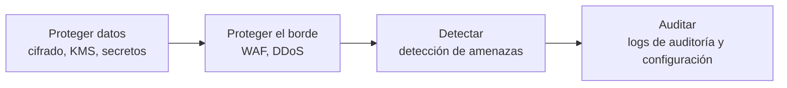
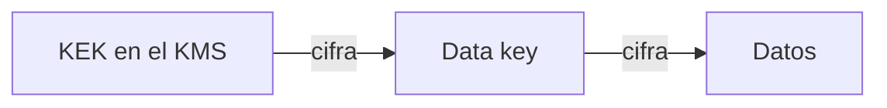

---
tags:
  - seguridad
  - cifrado
  - secretos
  - aws
  - azure
  - gcp
---

# Seguridad base en la nube: AWS, Azure y GCP

> Las piezas de seguridad que toda cuenta debería tener desde el primer día (cifrado, gestión de claves y secretos, WAF, detección de amenazas, logs de auditoría y registro de configuración) y cómo se llaman en AWS, Azure y Google Cloud.

## ¿Qué es la seguridad base?

Es el **baseline** (línea base) de controles que conviene activar en cualquier cuenta, suscripción o proyecto **antes** de desplegar cargas de trabajo. No sustituye a la seguridad de la aplicación, pero cubre lo que más se repite en los incidentes: datos sin cifrar, secretos en texto plano, aplicaciones web expuestas sin filtro, ataques que nadie detecta y cambios que nadie puede auditar.

Según el [Shared Responsibility Model](../fundamentos/responsabilidad-compartida.md), el proveedor te da las herramientas, pero **activarlas y configurarlas es responsabilidad tuya**. Junto con [IAM](iam-comparativa.md), son la base del pilar de **Security** del [Well-Architected Framework](../fundamentos/well-architected.md).



## Vista rápida

| Necesidad | AWS | Azure | Google Cloud |
| --- | --- | --- | --- |
| Gestión de claves | **AWS KMS** (*Key Management Service*) | **Azure Key Vault** (keys) | **Cloud KMS** |
| HSM dedicado | AWS CloudHSM | Azure Key Vault Managed HSM | Cloud HSM |
| Gestión de secretos | **AWS Secrets Manager**, Parameter Store (AWS Systems Manager) | **Azure Key Vault** (secrets) | **Secret Manager** |
| WAF | **AWS WAF** | **Azure Web Application Firewall** (en Front Door o Application Gateway) | **Google Cloud Armor** |
| Protección DDoS | AWS Shield (Standard / Advanced) | Azure DDoS Protection | Google Cloud Armor (incluida protección DDoS) |
| Detección de amenazas | **Amazon GuardDuty** | **Microsoft Defender for Cloud** | **Security Command Center** |
| Postura de seguridad (CSPM) | AWS Security Hub / Security Hub CSPM | Microsoft Defender for Cloud | Security Command Center |
| Logs de auditoría | **AWS CloudTrail** | **Azure Activity Log** + logs de Microsoft Entra ID | **Cloud Audit Logs** |
| Registro de configuración | **AWS Config** | **Azure Policy** + **Azure Resource Graph** | **Cloud Asset Inventory** |

## Cifrado en tránsito y en reposo

Hay dos momentos en los que los datos necesitan protección:

- **Encryption in transit** (cifrado en tránsito): mientras viajan por la red. Se resuelve con **TLS** (*Transport Layer Security*): HTTPS en los endpoints, conexiones TLS a las bases de datos y certificados gestionados (AWS Certificate Manager, certificados gestionados de App Service/Front Door, Google-managed SSL certificates).
- **Encryption at rest** (cifrado en reposo): mientras están guardados en discos, buckets, bases de datos o backups.

!!! info "En reposo, casi todo viene cifrado por defecto"
    Google Cloud cifra todos los datos en reposo por defecto. Azure Storage y los managed disks también están cifrados siempre. En AWS, Amazon S3 cifra todos los objetos nuevos por defecto desde 2023, pero el **cifrado por defecto de los volúmenes EBS** es una opción por región que tienes que activar. Revisa siempre qué servicio queda fuera del cifrado automático.

### Envelope encryption

Los servicios de KMS no cifran tus datos directamente: usan **envelope encryption** (cifrado de sobre). Un **data key** (clave de datos) cifra los datos y una **KEK** (*key encryption key*, clave de cifrado de claves) guardada en el KMS cifra ese data key. Así la clave maestra nunca sale del KMS y rotarla no obliga a recifrar todos los datos.



### Quién gestiona la clave

| Modelo | AWS | Azure | Google Cloud | Qué controlas |
| --- | --- | --- | --- | --- |
| **Provider-managed keys** (claves gestionadas por el proveedor) | AWS owned keys, AWS managed keys (`aws/s3`, `aws/ebs`…) | Microsoft-managed keys | Google default encryption | Nada: el proveedor crea, guarda y rota la clave |
| **Customer-managed keys** (claves gestionadas por el cliente, CMK) | Customer managed keys en AWS KMS | Customer-managed keys en Key Vault o Managed HSM | CMEK (*customer-managed encryption keys*) en Cloud KMS | Políticas de acceso, rotación, desactivación y borrado de la clave |
| Clave generada o guardada fuera | Importar material de clave (*BYOK*, *Bring Your Own Key*) o external key store (XKS) | Importar claves a Key Vault o Managed HSM (*BYOK*) | Importar claves a Cloud KMS o Cloud External Key Manager (EKM) | Generas la clave tú; con XKS y EKM además vive en un gestor externo |

Las **customer-managed keys** tienen sentido cuando un requisito de [cumplimiento](../../devsecops/gobierno-y-respuesta/cumplimiento.md) lo exige, cuando necesitas separar quién administra los datos de quién administra las claves, o cuando quieres poder "apagar" el acceso a los datos desactivando la clave (*crypto-shredding*, borrado criptográfico). A cambio, tú respondes de su ciclo de vida.

!!! danger "Borrar una clave es borrar los datos"
    Si eliminas una customer-managed key, los datos cifrados con ella **no se pueden recuperar**. Por eso AWS KMS exige un periodo de espera antes de borrar (*pending deletion*), Key Vault tiene **soft-delete** y **purge protection**, y Cloud KMS mantiene las versiones destruidas un tiempo en estado *scheduled for destruction*. Activa esas protecciones y limita quién puede programar el borrado.

### Ejemplo: clave con rotación automática

=== "AWS"

    ```bash
    aws kms create-key --description "cuaderno-notas-dev"
    aws kms enable-key-rotation --key-id <key-id>
    aws kms create-alias --alias-name alias/cuaderno-dev --target-key-id <key-id>
    ```

=== "Azure"

    ```bash
    az keyvault create -g rg-seguridad -n kv-cuaderno-dev \
      --enable-rbac-authorization true --enable-purge-protection true
    az keyvault key create --vault-name kv-cuaderno-dev -n datos --kty RSA --size 3072
    ```

=== "Google Cloud"

    ```bash
    gcloud kms keyrings create cuaderno --location us-central1
    gcloud kms keys create datos --keyring cuaderno --location us-central1 \
      --purpose encryption --rotation-period 90d \
      --next-rotation-time 2026-12-01T00:00:00Z
    ```

## Gestión de secretos

Un **secret** (secreto) es cualquier credencial que una aplicación necesita: contraseñas de bases de datos, API keys, tokens, certificados. Nunca debe estar en el código, en variables de entorno escritas en un repositorio ni en la imagen del contenedor. Lo correcto es guardarlo en un servicio de secretos y que la aplicación lo lea **en tiempo de ejecución** usando su identidad (IAM role, managed identity o service account).

| | AWS Secrets Manager | AWS Parameter Store | Azure Key Vault (secrets) | Secret Manager (GCP) |
| --- | --- | --- | --- | --- |
| Uso típico | Credenciales con rotación | Configuración y secretos simples (`SecureString`) | Secretos, claves y certificados en el mismo vault | Secretos con versiones |
| Rotación automática | Sí (integrada para RDS y otros, o con una función Lambda) | No | Con Event Grid + función propia; autorrotación nativa para claves y certificados | Envía notificaciones de rotación a Pub/Sub; la rotación la haces tú |
| Versionado | Sí (`AWSCURRENT`, `AWSPREVIOUS`) | Sí | Sí | Sí |
| Control de acceso | IAM policies + resource policy | IAM policies | Azure RBAC (recomendado) o access policies | Cloud IAM |

=== "AWS"

    ```bash
    aws secretsmanager create-secret --name prod/app/db \
      --secret-string '{"user":"app","password":"<generada>"}'
    aws secretsmanager get-secret-value --secret-id prod/app/db
    ```

=== "Azure"

    ```bash
    az keyvault secret set --vault-name kv-cuaderno-dev -n db-password --value "<generada>"
    az keyvault secret show --vault-name kv-cuaderno-dev -n db-password --query value
    ```

=== "Google Cloud"

    ```bash
    printf "%s" "<generada>" | gcloud secrets create db-password --data-file=-
    gcloud secrets versions access latest --secret db-password
    ```

!!! tip "Un vault por aplicación y entorno"
    En Azure se recomienda un Key Vault por aplicación y por entorno, con el **modelo de permisos Azure RBAC** en lugar de las *access policies* antiguas. En los tres proveedores, separa los secretos de dev y prod para que una identidad de dev nunca pueda leer secretos de prod.

Cómo inyectar estos secretos en los despliegues, rotarlos y conectar el pipeline con OIDC se ve en [Secretos e identidades](../../devsecops/identidades-y-pipeline/secretos-identidades.md); cómo detectar secretos filtrados en commits, en [Seguridad del código](../../devsecops/codigo-y-dependencias/seguridad-codigo.md).

## WAF y protección del borde

Un **WAF** (*Web Application Firewall*, firewall de aplicaciones web) inspecciona el tráfico HTTP(S) **antes** de que llegue a tu aplicación y bloquea patrones de ataque como SQL injection, XSS (*Cross-Site Scripting*) o bots, además de aplicar **rate limiting** (limitación de peticiones por IP). No reemplaza los Security groups ni las reglas de firewall de red: trabaja en la capa 7 (HTTP), no en IPs y puertos (ver [Redes en la nube](../redes-y-datos/redes.md)).

| | AWS WAF | Azure WAF | Google Cloud Armor |
| --- | --- | --- | --- |
| Dónde se asocia | Amazon CloudFront, Application Load Balancer, Amazon API Gateway, AWS AppSync, entre otros | Azure Front Door o Application Gateway | Backend services de los load balancers de aplicación externos de Cloud Load Balancing |
| Conjunto de reglas | **Web ACL** con *AWS Managed Rules* y reglas propias | **WAF policy** con *Default Rule Set* / OWASP CRS y reglas propias | **Security policy** con *preconfigured WAF rules* (basadas en OWASP CRS) y reglas propias |
| DDoS | AWS Shield Standard incluido; Shield Advanced de pago | Protección básica de la plataforma; Azure DDoS Protection de pago | Protección DDoS incluida; Cloud Armor Enterprise de pago |

!!! tip "Empieza en modo detección"
    Los tres permiten que una regla solo **registre** sin bloquear (*Count* en AWS, *Detection mode* en Azure, *preview mode* en Cloud Armor). Actívalo así unos días, revisa los falsos positivos en los logs y después pasa a bloquear.

## Detección de amenazas

Estos servicios analizan logs de la plataforma (auditoría, flujos de red, DNS) y comportamiento de los recursos para avisarte de actividad sospechosa: credenciales usadas desde un país inusual, una instancia minando criptomonedas, un bucket que de pronto se vuelve público.

| | AWS | Azure | Google Cloud |
| --- | --- | --- | --- |
| Detección de amenazas | **Amazon GuardDuty** | **Microsoft Defender for Cloud** (planes Defender for Servers, Storage, Containers…) | **Security Command Center** (Event Threat Detection, Container Threat Detection…) |
| Postura (*CSPM*, *Cloud Security Posture Management*) | AWS Security Hub CSPM (controles contra estándares como CIS) | Defender for Cloud (*Secure score*, recomendaciones) | Security Command Center (Security Health Analytics) |
| Correlación de hallazgos | **AWS Security Hub** (agrega GuardDuty, Inspector y Security Hub CSPM) | Defender for Cloud + Microsoft Sentinel | Security Command Center + Google Security Operations |
| Vulnerabilidades en cómputo | Amazon Inspector | Defender for Servers / Defender Vulnerability Management | Security Command Center (Vulnerability Assessment) |

!!! info "Cambio reciente en AWS Security Hub"
    En 2025 AWS lanzó un **nuevo AWS Security Hub** que correlaciona señales de GuardDuty, Inspector y otros servicios, y el Security Hub original pasó a llamarse **AWS Security Hub CSPM**. Siguen siendo dos servicios con configuración separada.

Activar el servicio es el primer paso; lo importante es **quién recibe las alertas y qué hace con ellas**. Eso se trabaja en [Detección y respuesta](../../devsecops/gobierno-y-respuesta/deteccion-respuesta.md) (SIEM, playbooks) y el uso de estos servicios para auditoría continua en [Cumplimiento y gobierno](../../devsecops/gobierno-y-respuesta/cumplimiento.md).

## Logs de auditoría

Los **audit logs** (logs de auditoría) responden a "**quién hizo qué, cuándo y desde dónde**" sobre la nube: crear una VM, cambiar una política, leer un secreto. Son la primera fuente en cualquier investigación de incidentes.

| | AWS CloudTrail | Azure | Cloud Audit Logs (GCP) |
| --- | --- | --- | --- |
| Acciones de administración | *Management events* (Event history de 90 días, gratis) | **Activity Log** (90 días) | **Admin Activity audit logs** (siempre activos, gratis) |
| Acceso a datos | *Data events* (lectura/escritura en S3, Lambda…), opcionales y de pago | *Resource logs* vía *Diagnostic settings* | **Data Access audit logs**, desactivados por defecto (salvo BigQuery) |
| Identidad | Eventos de IAM y STS en CloudTrail | **Sign-in logs** y **audit logs** de Microsoft Entra ID | Incluidos en Cloud Audit Logs |
| Retención larga | *Trail* hacia S3 o CloudTrail Lake | Exportar a Log Analytics, Storage o Event Hubs | *Log sinks* hacia Cloud Storage, BigQuery o un log bucket |

!!! warning "La retención por defecto no basta"
    Los 90 días por defecto se quedan cortos para una investigación o una auditoría. Crea un **trail de organización** en AWS, *diagnostic settings* a nivel de suscripción en Azure y un **aggregated sink** a nivel de organización en GCP, y envíalos a una cuenta o proyecto de **logs centralizado** donde los equipos no puedan borrarlos (ver [Gobernanza](../operacion-y-gobierno/gobernanza.md)).

Las métricas y logs de aplicación se tratan en [Observabilidad nativa](../operacion-y-gobierno/observabilidad-nativa.md).

## Registro de configuración

Los audit logs dicen quién hizo un cambio; el **registro de configuración** dice **cómo está configurado cada recurso ahora y cómo estaba antes**. Sirve para inventario, para detectar *drift* (desvíos respecto a lo esperado) y para evaluar reglas de cumplimiento de forma continua.

| | AWS Config | Azure | Cloud Asset Inventory (GCP) |
| --- | --- | --- | --- |
| Inventario de recursos | *Configuration items* | **Azure Resource Graph** (consultas KQL) | Asset inventory y búsqueda de recursos |
| Historial de cambios | Configuration timeline | Change analysis en Resource Graph | Historial de assets (5 semanas) y exportaciones |
| Reglas de cumplimiento | **AWS Config rules** y *conformance packs* | **Azure Policy** (efectos `Audit`, `Deny`, `DeployIfNotExists`…) | Security Health Analytics (SCC) y Organization Policy |
| Remediación automática | Remediation con SSM Automation | `DeployIfNotExists` / `Modify` con tareas de remediación | Mediante Cloud Functions o Workflows propios |

=== "AWS"

    ```bash
    aws configservice describe-compliance-by-config-rule
    ```

=== "Azure"

    ```bash
    az graph query -q "Resources | where type =~ 'microsoft.storage/storageaccounts' | project name, properties.allowBlobPublicAccess"
    ```

=== "Google Cloud"

    ```bash
    gcloud asset search-all-resources --scope=projects/<proyecto> \
      --asset-types=storage.googleapis.com/Bucket
    ```

## Checklist de seguridad base

- [ ] MFA y least privilege en IAM (ver [IAM: AWS, Azure y GCP](iam-comparativa.md)).
- [ ] Audit logs de toda la organización enviados a una cuenta o proyecto central, con retención definida.
- [ ] Registro de configuración activo en todas las regiones que uses.
- [ ] Detección de amenazas (GuardDuty, Defender for Cloud, Security Command Center) activa en todas las cuentas.
- [ ] Cifrado por defecto revisado (por ejemplo, EBS default encryption) y customer-managed keys donde lo exija el cumplimiento.
- [ ] Secretos solo en el servicio de secretos, leídos con la identidad del recurso.
- [ ] WAF delante de toda aplicación web pública.
- [ ] Alertas de seguridad con un responsable y un canal claros.

## Relación con otras secciones

| Enfoque | Qué se mira desde ahí | Nota |
| --- | --- | --- |
| Cloud (el control) | Quién puede usar las claves y los secretos; dónde se centralizan logs y guardrails | [IAM: AWS, Azure y GCP](iam-comparativa.md), [Gobernanza](../operacion-y-gobierno/gobernanza.md), [Observabilidad nativa](../operacion-y-gobierno/observabilidad-nativa.md) |
| DevOps (la automatización) | Crear claves, vaults, WAF y trails como código; inyectar secretos en los despliegues | [Infrastructure as Code](../../devops/iac/infraestructura-como-codigo.md), [Despliegue continuo](../../devops/ci-cd/despliegue-continuo.md) |
| DevSecOps (la verificación) | CSPM y auditoría continua contra CIS/ISO; rotación y OIDC; alertas, SIEM y respuesta | [Cumplimiento y gobierno](../../devsecops/gobierno-y-respuesta/cumplimiento.md), [CSPM](../../devsecops/escaneos/cspm.md), [Secretos e identidades](../../devsecops/identidades-y-pipeline/secretos-identidades.md), [Detección y respuesta](../../devsecops/gobierno-y-respuesta/deteccion-respuesta.md) |
| Laboratorios (la práctica) | Practicar esto paso a paso | [Lab 00: Preparar el entorno de laboratorio](../../laboratorios/fundamentos/preparar-entorno.md), [Lab 09: Terraform en AWS con remote state en S3](../../laboratorios/devops/terraform-aws-backend-remoto.md), [Lab 13: Desplegar en AWS desde GitHub Actions con OIDC (sin llaves)](../../laboratorios/devsecops/oidc-github-aws.md), [Lab 16: Auditar tu cuenta cloud con Prowler (CSPM)](../../laboratorios/devsecops/cspm-prowler.md), [Lab 17: AWS: VPC con subnets públicas y privadas y una EC2](../../laboratorios/cloud/aws-vpc-ec2.md), [Lab 19: Azure: VNet, NSG y una VM con Azure CLI](../../laboratorios/cloud/azure-vnet-vm.md), [Lab 20: Google Cloud: desplegar un contenedor en Cloud Run](../../laboratorios/cloud/gcp-cloud-run.md) |

## Referencias

- [AWS KMS concepts](https://docs.aws.amazon.com/es_es/kms/latest/developerguide/concepts.html)
- [AWS Secrets Manager](https://docs.aws.amazon.com/es_es/secretsmanager/latest/userguide/intro.html)
- [AWS WAF](https://docs.aws.amazon.com/es_es/waf/latest/developerguide/waf-chapter.html)
- [Amazon GuardDuty](https://docs.aws.amazon.com/es_es/guardduty/latest/ug/what-is-guardduty.html)
- [AWS CloudTrail](https://docs.aws.amazon.com/es_es/awscloudtrail/latest/userguide/cloudtrail-user-guide.html)
- [AWS Config](https://docs.aws.amazon.com/es_es/config/latest/developerguide/WhatIsConfig.html)
- [Información general de Azure Key Vault](https://learn.microsoft.com/es-es/azure/key-vault/general/overview)
- [Azure Web Application Firewall](https://learn.microsoft.com/es-es/azure/web-application-firewall/overview)
- [Microsoft Defender for Cloud](https://learn.microsoft.com/es-es/azure/defender-for-cloud/defender-for-cloud-introduction)
- [Registro de actividad de Azure](https://learn.microsoft.com/es-es/azure/azure-monitor/platform/activity-log)
- [Información general de Azure Resource Graph](https://learn.microsoft.com/es-es/azure/governance/resource-graph/overview)
- [Cloud KMS](https://cloud.google.com/kms/docs/key-management-service)
- [Default encryption at rest en Google Cloud](https://cloud.google.com/docs/security/encryption/default-encryption)
- [Secret Manager](https://cloud.google.com/secret-manager/docs/overview)
- [Google Cloud Armor](https://cloud.google.com/armor/docs/cloud-armor-overview)
- [Security Command Center](https://cloud.google.com/security-command-center/docs/security-command-center-overview)
- [Cloud Audit Logs](https://cloud.google.com/logging/docs/audit)
- [Cloud Asset Inventory](https://cloud.google.com/asset-inventory/docs/overview)
