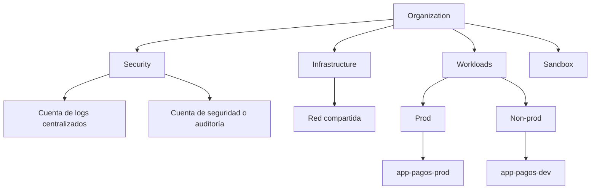

---
tags:
  - gobernanza
  - cumplimiento
  - arquitectura
  - aws
  - azure
  - gcp
---

# Gobernanza: AWS, Azure y GCP

> Cómo organizar una nube con muchas cuentas y equipos sin perder el control: landing zone, estrategia multi-cuenta, guardrails (SCPs, Azure Policy, Organization Policy), etiquetas obligatorias y cuentas centrales de logs y seguridad.

## ¿Qué es la gobernanza en la nube?

La **cloud governance** (gobernanza en la nube) es el conjunto de reglas, estructuras y controles que permiten que muchos equipos usen la nube **con autonomía, pero dentro de límites**. Responde a preguntas como: ¿dónde se crea cada recurso?, ¿quién paga qué?, ¿qué está prohibido en cualquier caso?, ¿dónde quedan los logs?

Sin gobernanza, cada equipo crea cuentas, regiones y recursos a su manera, y en pocos meses nadie sabe qué existe, cuánto cuesta ni si cumple las normas. Con demasiada gobernanza manual, todo pasa por tickets y la nube pierde su agilidad. El objetivo es automatizar los límites para que lo correcto sea lo fácil.

## Landing zone

Una **landing zone** (zona de aterrizaje) es el entorno base, preparado **antes** de desplegar aplicaciones: estructura de cuentas, identidades, red, logs centralizados, seguridad y guardrails. Es la "casa" a la que llegan las cargas de trabajo.

| | AWS | Azure | Google Cloud |
| --- | --- | --- | --- |
| Servicio o guía | **AWS Control Tower**; **Landing Zone Accelerator on AWS** para entornos más exigentes | **Azure landing zones** del **Cloud Adoption Framework** (CAF), con *accelerators* en el portal, Bicep y Terraform | **Google Cloud setup** (asistente en la consola) y el *enterprise foundations blueprint* en Terraform |
| Qué crea | Organización con OUs, cuentas Log Archive y Audit, guardrails (*controls*) y Account Factory | Jerarquía de management groups, suscripciones de plataforma (identidad, gestión, conectividad) y políticas de Azure Policy | Organización con folders y projects, grupos, red compartida, logging centralizado y organization policies |

!!! info "Landing zone como código"
    Las tres opciones pueden desplegarse y mantenerse con IaC (Terraform, CloudFormation, Bicep). Gestionar la landing zone como código permite revisar cada cambio en un pull request, igual que una aplicación (ver [Infrastructure as Code](../../devops/iac/infraestructura-como-codigo.md)).

## Estrategia multi-cuenta

La unidad de aislamiento de cada nube (AWS account, Azure subscription, Google Cloud project) es también un límite de **seguridad**, de **facturación** y de **cuotas**. Por eso se recomienda usar **muchas** y no meter todo en una.

| | AWS | Azure | Google Cloud |
| --- | --- | --- | --- |
| Raíz | Organization (**AWS Organizations**) | Tenant de Microsoft Entra ID + *root management group* | Organization |
| Agrupación | **Organizational Units** (OUs), anidables | **Management groups**, anidables | **Folders**, anidables |
| Unidad de aislamiento | **AWS account** | **Subscription** (y dentro, *resource groups*) | **Project** |
| Herencia de políticas | SCPs y RCPs de la OU hacia sus cuentas | Azure Policy y Azure RBAC hacia abajo | Organization Policy e IAM hacia abajo |

Una estructura típica separa **por entorno** y **por función**:



- **Cuentas separadas por entorno**: dev, staging y prod en cuentas, suscripciones o proyectos distintos. Un error o una credencial filtrada en dev no puede tocar prod, y cada entorno tiene sus propios límites y costos.
- **Sandbox**: cuentas para experimentar, con presupuesto bajo y guardrails estrictos, que se pueden borrar.
- **Plataforma**: red compartida, identidad y herramientas comunes, gestionadas por un equipo central.

!!! tip "En Terraform, un state por cuenta y entorno"
    Separar entornos en cuentas distintas encaja con tener un *state* y un backend por entorno, en lugar de depender solo de [Terraform workspaces](../../devops/iac/terraform-workspaces.md).

## Guardrails

Un **guardrail** (barrera de protección) es una regla que se aplica a toda una rama de la jerarquía y que **ningún equipo puede saltarse**, aunque tenga permisos de administrador en su cuenta. Hay dos tipos:

- **Preventive** (preventivos): impiden la acción. Por ejemplo, prohibir regiones no aprobadas.
- **Detective** (detectivos): permiten la acción pero la detectan y avisan. Por ejemplo, alertar si un bucket se vuelve público.

| | AWS | Azure | Google Cloud |
| --- | --- | --- | --- |
| Limitar qué **acciones** pueden hacer las identidades | **SCPs** (*Service Control Policies*) | Azure RBAC + deny assignments (uso limitado) | IAM deny policies |
| Limitar el acceso **a los recursos** desde fuera | **RCPs** (*Resource Control Policies*) | — | — |
| Limitar **configuraciones** de recursos | Controles proactivos de Control Tower, AWS Config rules (detectivos) | **Azure Policy** (efecto `Deny`, `Audit`, `Modify`, `DeployIfNotExists`) | **Organization Policy** (*constraints* predefinidas y *custom constraints*) |

!!! info "Los guardrails no dan permisos"
    SCPs, RCPs, Azure Policy y Organization Policy **solo restringen**. El acceso se sigue concediendo con [IAM](../identidad-y-seguridad/iam-comparativa.md); el permiso efectivo es la intersección de ambos.

### Ejemplos de guardrails habituales

=== "AWS"

    ```json title="SCP: denegar regiones no aprobadas"
    {
      "Version": "2012-10-17",
      "Statement": [
        {
          "Sid": "DenyOtherRegions",
          "Effect": "Deny",
          "NotAction": ["iam:*", "organizations:*", "sts:*", "support:*", "cloudfront:*", "route53:*"],
          "Resource": "*",
          "Condition": {
            "StringNotEquals": { "aws:RequestedRegion": ["us-east-1", "sa-east-1"] }
          }
        }
      ]
    }
    ```

    Los servicios globales (IAM, CloudFront, Route 53…) se excluyen con `NotAction` porque sus llamadas se registran en `us-east-1`. La lista está simplificada: revisa el ejemplo oficial de AWS antes de usarla.

=== "Azure"

    ```bash
    # Asignar la política integrada "Allowed locations" a un management group
    az policy assignment create --name ubicaciones-permitidas \
      --scope /providers/Microsoft.Management/managementGroups/mg-workloads \
      --policy e56962a6-4747-49cd-b67b-bf8b01975c4c \
      --params '{"listOfAllowedLocations":{"value":["eastus","brazilsouth"]}}'
    ```

=== "Google Cloud"

    ```yaml title="policy.yaml"
    name: organizations/123456789012/policies/iam.disableServiceAccountKeyCreation
    spec:
      rules:
        - enforce: true
    ```

    ```bash
    gcloud org-policies set-policy policy.yaml
    ```

Otros guardrails frecuentes: impedir que se desactive CloudTrail o los audit logs, bloquear el acceso público a buckets a nivel de organización, exigir cifrado, prohibir IPs públicas en VMs, impedir que una cuenta salga de la organización.

!!! warning "Prueba los guardrails antes de aplicarlos"
    Una SCP o una política `Deny` mal escrita puede bloquear a todos los equipos a la vez. Aplícala primero a una OU o management group de pruebas; en Azure usa el efecto `Audit` antes de `Deny`, y en GCP el modo *dry-run* de Organization Policy cuando esté disponible para la constraint.

## Tagging y labels

Las **tags** (etiquetas) son pares clave-valor que se añaden a los recursos. Sirven para **asignar costos** (*cost allocation*), automatizar (apagar lo que tenga `entorno=dev` por la noche), aplicar políticas y saber a quién preguntar por un recurso.

| | AWS | Azure | Google Cloud |
| --- | --- | --- | --- |
| Nombre | **Tags** | **Tags** | **Labels** (para costos y organización) y **Tags** (recurso de IAM, para condiciones y políticas) |
| Exigir etiquetas | **Tag policies** de AWS Organizations, SCPs con condición `aws:RequestTag` | Azure Policy (*Require a tag on resources*, heredar tags del resource group) | Organization Policy con custom constraints; validación en IaC |
| Usar en costos | Activar *cost allocation tags* en Billing | Tags en Cost Management | Labels en el export de facturación a BigQuery |

!!! note "Labels y tags en Google Cloud no son lo mismo"
    En Google Cloud, los **labels** son metadatos simples para organizar y repartir costos. Los **tags** son recursos que se crean a nivel de organización o proyecto, se heredan en la jerarquía y se pueden usar en condiciones de IAM y en Organization Policy.

Una estrategia de etiquetas mínima y obligatoria:

| Clave | Ejemplo | Para qué |
| --- | --- | --- |
| `entorno` | `dev`, `staging`, `prod` | Políticas y automatización por entorno |
| `owner` | `equipo-pagos` | A quién preguntar o avisar |
| `cost-center` | `cc-1234` | Reparto de costos |
| `app` | `api-pagos` | Agrupar recursos de una aplicación |
| `data-classification` | `public`, `internal`, `confidential` | Controles de seguridad según la sensibilidad |

Define las claves en minúsculas y con un formato único: `Entorno`, `env` y `environment` en distintos recursos arruinan cualquier reporte de [FinOps y costos](../fundamentos/finops-costos.md). Lo más fiable es aplicarlas desde IaC (en Terraform, `default_tags` del provider de AWS o un bloque común de `tags`/`labels`).

## Cuentas centrales de logs y seguridad

Los logs de auditoría y los hallazgos de seguridad deben salir de las cuentas de los equipos y guardarse en un lugar que ellos **no puedan modificar ni borrar**.

| Función | AWS | Azure | Google Cloud |
| --- | --- | --- | --- |
| Logs centralizados | Cuenta **Log Archive** (Control Tower) con un *organization trail* de CloudTrail y AWS Config | Log Analytics workspace central en la suscripción de *management*, con diagnostic settings desplegados por Azure Policy | Proyecto de logging con un **aggregated sink** a nivel de organización |
| Seguridad y auditoría | Cuenta **Audit** con administrador delegado de GuardDuty y Security Hub | Microsoft Defender for Cloud y Microsoft Sentinel a nivel de management group | Security Command Center activado a nivel de organización |
| Protección de los logs | S3 Object Lock, SCP que impide borrar el trail | Resource locks, RBAC restringido | Log bucket con *retention lock*, Organization Policy |

Qué conviene registrar y vigilar se explica en [Seguridad base](../identidad-y-seguridad/seguridad-base.md) y [Observabilidad nativa](observabilidad-nativa.md).

## Comandos para ver la jerarquía

| Comando | Descripción |
| --- | --- |
| `aws organizations list-accounts` | Cuentas de la organización de AWS |
| `aws organizations list-policies --filter SERVICE_CONTROL_POLICY` | SCPs existentes |
| `az account management-group list -o table` | Management groups de Azure |
| `az policy assignment list --scope <scope>` | Políticas asignadas en un scope |
| `gcloud resource-manager folders list --organization <org-id>` | Folders de la organización en GCP |
| `gcloud org-policies list --project <proyecto>` | Organization policies aplicadas a un proyecto |

## Relación con otras secciones

| Enfoque | Qué se mira desde ahí | Nota |
| --- | --- | --- |
| Cloud (el control) | Permisos dentro de la jerarquía; costos por cuenta y etiqueta; logs y seguridad centralizados | [IAM: AWS, Azure y GCP](../identidad-y-seguridad/iam-comparativa.md), [FinOps y costos](../fundamentos/finops-costos.md), [Seguridad base](../identidad-y-seguridad/seguridad-base.md) |
| DevOps (la automatización) | Landing zone, cuentas, guardrails y etiquetas definidos como código | [Infrastructure as Code](../../devops/iac/infraestructura-como-codigo.md), [Terraform](../../devops/iac/terraform-basico.md) |
| DevSecOps (la verificación) | Policy as code en el pipeline y auditoría continua contra marcos de cumplimiento | [Seguridad de IaC](../../devsecops/infraestructura-y-contenedores/seguridad-iac.md), [Cumplimiento y gobierno](../../devsecops/gobierno-y-respuesta/cumplimiento.md) |
| Laboratorios (la práctica) | Practicar esto paso a paso | [Lab 00: Preparar el entorno de laboratorio](../../laboratorios/fundamentos/preparar-entorno.md), [Lab 09: Terraform en AWS con remote state en S3](../../laboratorios/devops/terraform-aws-backend-remoto.md), [Lab 16: Auditar tu cuenta cloud con Prowler (CSPM)](../../laboratorios/devsecops/cspm-prowler.md), [Lab 19: Azure: VNet, NSG y una VM con Azure CLI](../../laboratorios/cloud/azure-vnet-vm.md) |

## Referencias

- [AWS Control Tower](https://docs.aws.amazon.com/es_es/controltower/latest/userguide/what-is-control-tower.html)
- [Landing Zone Accelerator on AWS](https://aws.amazon.com/solutions/implementations/landing-zone-accelerator-on-aws/)
- [Organizing your AWS environment using multiple accounts](https://docs.aws.amazon.com/whitepapers/latest/organizing-your-aws-environment/organizing-your-aws-environment.html)
- [Service control policies (SCPs)](https://docs.aws.amazon.com/es_es/organizations/latest/userguide/orgs_manage_policies_scps.html)
- [Resource control policies (RCPs)](https://docs.aws.amazon.com/organizations/latest/userguide/orgs_manage_policies_rcps.html)
- [Tag policies](https://docs.aws.amazon.com/es_es/organizations/latest/userguide/orgs_manage_policies_tag-policies.html)
- [¿Qué es una zona de aterrizaje de Azure?](https://learn.microsoft.com/es-es/azure/cloud-adoption-framework/ready/landing-zone/)
- [Grupos de administración de Azure](https://learn.microsoft.com/es-es/azure/governance/management-groups/overview)
- [Información general de Azure Policy](https://learn.microsoft.com/es-es/azure/governance/policy/overview)
- [Estrategia de etiquetado en Azure (CAF)](https://learn.microsoft.com/es-es/azure/cloud-adoption-framework/ready/azure-best-practices/resource-tagging)
- [Landing zone design in Google Cloud](https://cloud.google.com/architecture/landing-zones)
- [Enterprise foundations blueprint](https://cloud.google.com/architecture/security-foundations)
- [Resource hierarchy en Google Cloud](https://cloud.google.com/resource-manager/docs/cloud-platform-resource-hierarchy)
- [Organization Policy Service](https://cloud.google.com/resource-manager/docs/organization-policy/overview)
- [Tags y labels en Google Cloud](https://cloud.google.com/resource-manager/docs/tags/tags-overview)
