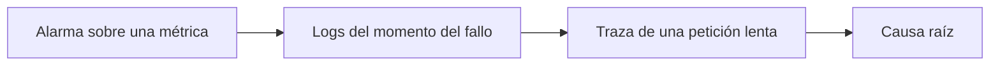

---
tags:
  - observabilidad
  - aws
  - azure
  - gcp
---

# Observabilidad nativa: AWS, Azure y GCP

> Qué ofrece cada nube "de serie" para ver lo que pasa en tus sistemas (métricas, logs, trazas y alertas) con Amazon CloudWatch, Azure Monitor y Google Cloud Observability, y cómo evitar que los logs se coman el presupuesto.

## ¿Qué es la observabilidad nativa?

La **observability** (observabilidad) es la capacidad de entender qué pasa dentro de un sistema a partir de los datos que emite. La **observabilidad nativa** es la que te da el propio proveedor: los servicios de la nube publican métricas y logs automáticamente en su herramienta de monitoreo, sin instalar nada.

Es el punto de partida natural, pero no el único: muchas organizaciones combinan la herramienta nativa con un stack abierto (Prometheus, Grafana, OpenTelemetry), que se ve en [Observabilidad](../../devops/operacion/observabilidad.md) de DevOps.

## Métricas, logs y trazas

Las tres señales clásicas (*three pillars of observability*, los tres pilares):

| Señal | Qué es | Pregunta que responde | Ejemplo |
| --- | --- | --- | --- |
| **Metrics** (métricas) | Valores numéricos en el tiempo, baratos de guardar | ¿Hay un problema? ¿Desde cuándo? | CPU al 95 %, 300 errores 5xx por minuto |
| **Logs** (registros) | Eventos de texto o JSON con detalle | ¿Qué pasó exactamente? | `ERROR timeout al conectar a db-prod` |
| **Traces** (trazas) | Recorrido de una petición a través de varios servicios, dividido en *spans* | ¿Dónde se pierde el tiempo? | La petición tardó 2 s: 1,8 s en la llamada a pagos |



## Vista rápida

| | AWS | Azure | Google Cloud |
| --- | --- | --- | --- |
| Servicio paraguas | **Amazon CloudWatch** | **Azure Monitor** | **Google Cloud Observability** (antes *Operations suite* / Stackdriver) |
| Métricas | CloudWatch Metrics | Azure Monitor Metrics | **Cloud Monitoring** |
| Logs | **CloudWatch Logs** (*log groups*, *log streams*) | Azure Monitor Logs en un **Log Analytics workspace** | **Cloud Logging** (*log buckets*) |
| Lenguaje de consulta de logs | CloudWatch **Logs Insights** query language | **KQL** (*Kusto Query Language*) | Logging query language; SQL con Log Analytics |
| Trazas | **AWS X-Ray**, CloudWatch **Application Signals** | **Application Insights** | **Cloud Trace** |
| APM (*Application Performance Monitoring*) | CloudWatch Application Signals | Application Insights | Cloud Trace + Cloud Profiler |
| Alertas | **CloudWatch alarms** + Amazon SNS | **Azure Monitor alerts** + **action groups** | **Alerting policies** + notification channels |
| Dashboards | CloudWatch dashboards | Azure dashboards, **Azure Workbooks**, Azure Managed Grafana | Cloud Monitoring dashboards |
| Agente en VMs | CloudWatch agent | **Azure Monitor Agent** (AMA) con *data collection rules* | **Ops Agent** |
| Prometheus gestionado | Amazon Managed Service for Prometheus | Azure Monitor managed service for Prometheus | Google Cloud Managed Service for Prometheus |
| Grafana gestionado | Amazon Managed Grafana | Azure Managed Grafana | (sin servicio propio; Grafana se conecta a Cloud Monitoring) |

!!! info "OpenTelemetry en los tres"
    Los tres proveedores aceptan datos de **OpenTelemetry** (OTel), el estándar abierto para instrumentar aplicaciones: AWS Distro for OpenTelemetry (ADOT), la *Azure Monitor OpenTelemetry Distro* y el OpenTelemetry Collector con exportadores de Google Cloud. Instrumentar con OTel te permite cambiar de backend sin tocar el código.

## Cómo funciona en cada proveedor

=== "AWS"

    - **Metrics**: cada servicio publica métricas en un *namespace* (`AWS/EC2`, `AWS/Lambda`, `AWS/ApplicationELB`). La memoria y el disco de una instancia EC2 **no** se publican por defecto: necesitas el **CloudWatch agent**.
    - **Logs**: los logs van a **log groups** (uno por aplicación o función) que contienen **log streams**. Lambda escribe ahí automáticamente.
    - **Logs Insights**: consultas interactivas sobre uno o varios log groups.
    - **Alarms**: vigilan una métrica y cambian de estado (`OK`, `ALARM`, `INSUFFICIENT_DATA`); suelen notificar por un *topic* de SNS. Las **composite alarms** combinan varias.
    - **Traces**: X-Ray y **Application Signals**, que muestra latencia, errores y SLOs por servicio. AWS recomienda instrumentar con OpenTelemetry (ADOT).

    ```text title="CloudWatch Logs Insights: errores por minuto"
    fields @timestamp, @message
    | filter @message like /ERROR/
    | stats count(*) as errores by bin(1m)
    | sort errores desc
    ```

=== "Azure"

    - **Metrics**: los recursos envían *platform metrics* automáticamente a Azure Monitor Metrics, con 93 días de retención.
    - **Logs**: los *resource logs* **no** se guardan por defecto. Tienes que crear **diagnostic settings** en cada recurso (o con Azure Policy a escala) para enviarlos a un **Log Analytics workspace**.
    - **KQL**: el lenguaje para consultar logs, también usado en Microsoft Sentinel y Azure Resource Graph.
    - **Application Insights**: APM para aplicaciones (peticiones, dependencias, excepciones, trazas distribuidas), guardado en un Log Analytics workspace.
    - **Alerts**: *metric alerts*, *log search alerts* y *activity log alerts*; avisan a través de **action groups** (correo, SMS, webhook, Logic Apps).

    ```text title="KQL: errores 5xx por minuto en Application Insights"
    requests
    | where timestamp > ago(1h) and toint(resultCode) >= 500
    | summarize errores = count() by bin(timestamp, 1m)
    | order by timestamp asc
    ```

=== "Google Cloud"

    - **Cloud Monitoring**: recibe métricas de los servicios de Google Cloud automáticamente. Para memoria y disco de las VMs de Compute Engine instala el **Ops Agent**. Las consultas avanzadas de métricas se escriben en **PromQL**.
    - **Cloud Logging**: todos los logs pasan por el **Log Router**, que los envía según **sinks** a *log buckets* (`_Required`, `_Default` o propios), BigQuery, Cloud Storage o Pub/Sub.
    - **Log Analytics**: permite consultar log buckets con SQL.
    - **Cloud Trace**: trazas distribuidas, alimentadas normalmente con OpenTelemetry.
    - **Alerting policies**: condiciones sobre métricas o logs, con **notification channels** (correo, Slack, PagerDuty, Pub/Sub).

    ```text title="Cloud Logging: errores de un servicio de Cloud Run"
    resource.type="cloud_run_revision"
    resource.labels.service_name="api"
    severity>=ERROR
    ```

## Retención y costos de logs

Los logs suelen ser **lo más caro de la observabilidad**: se paga por GB ingerido y por GB almacenado, y un log de depuración olvidado en producción puede costar más que el propio servicio. Los precios cambian; revisa la página de precios de cada proveedor.

| | AWS | Azure | Google Cloud |
| --- | --- | --- | --- |
| Retención por defecto | Log groups: **Never expire** (para siempre) si no la cambias | Log Analytics: 30 días de retención interactiva (ampliable, con *long-term retention* hasta 12 años) | `_Default`: 30 días (configurable); `_Required`: 400 días, sin costo y no modificable |
| Opción de logs más barata | Log class **Infrequent Access** | Planes de tabla **Basic** y **Auxiliary** | Exclusion filters y sinks a Cloud Storage |
| Archivo barato | Exportar a S3 | Long-term retention o exportar a Azure Storage | Sink a Cloud Storage |
| Filtrar antes de pagar | Filtrar en la aplicación o en el agente | *Transformations* en data collection rules | **Exclusion filters** en el Log Router |

!!! warning "Define la retención siempre"
    En AWS un log group creado automáticamente (por ejemplo, por Lambda) **nunca expira**. Define la retención en tu IaC (`retention_in_days` en el recurso `aws_cloudwatch_log_group` de Terraform) y crea el log group antes que la función.

Buenas prácticas para controlar costos:

- **Logs estructurados** (JSON) con niveles (`DEBUG`, `INFO`, `ERROR`): consultar es más fácil y puedes filtrar por nivel.
- **No subas `DEBUG` en producción** salvo de forma temporal.
- **Retención distinta por tipo**: logs de aplicación unas semanas; logs de auditoría y seguridad, lo que exija el [cumplimiento](../../devsecops/gobierno-y-respuesta/cumplimiento.md), en almacenamiento barato.
- **Muestreo** (*sampling*) de trazas: no hace falta guardar el 100 % de las peticiones correctas.
- Vigila el costo de observabilidad dentro de [FinOps y costos](../fundamentos/finops-costos.md).

## Alarmas útiles

Una mala alarma despierta a alguien sin motivo (*alert fatigue*, fatiga de alertas); una buena avisa de algo que **afecta a los usuarios** y que **alguien puede arreglar**. Empieza por los síntomas, no por las causas:

| Alarma | Por qué | Ejemplo de umbral |
| --- | --- | --- |
| Tasa de errores 5xx en el load balancer | Los usuarios ven fallos | > 1 % durante 5 minutos |
| Latencia p95/p99 | Lentitud que el promedio esconde | p99 > 1 s durante 10 minutos |
| Health checks fallando | Instancias o tareas fuera de servicio | Hosts sanos < mínimo |
| Errores y *throttling* de funciones | Lambda, Functions o Cloud Run rechazando trabajo | Errores > 0 sostenidos |
| Cola acumulándose | El consumidor no da abasto | Edad del mensaje más antiguo > 5 min |
| Disco o memoria | Previene caídas | Disco > 85 % |
| Presupuesto | Gasto inesperado | 80 % del presupuesto mensual |

!!! tip "Alarmas como código"
    Define alarmas, dashboards y retención en Terraform junto con el recurso que vigilan: `aws_cloudwatch_metric_alarm`, `azurerm_monitor_metric_alert`, `google_monitoring_alert_policy`. Así ningún servicio llega a producción sin sus alertas (ver [Infrastructure as Code](../../devops/iac/infraestructura-como-codigo.md)).

=== "AWS"

    ```bash
    aws cloudwatch put-metric-alarm --alarm-name api-5xx \
      --namespace AWS/ApplicationELB --metric-name HTTPCode_Target_5XX_Count \
      --dimensions Name=LoadBalancer,Value=app/api-prod/0123456789abcdef \
      --statistic Sum --period 300 --evaluation-periods 1 \
      --threshold 50 --comparison-operator GreaterThanThreshold \
      --alarm-actions arn:aws:sns:us-east-1:111122223333:alertas-prod
    ```

=== "Azure"

    ```bash
    az monitor metrics alert create -g rg-prod -n vm-cpu-alta \
      --scopes <id-de-la-vm> \
      --condition "avg Percentage CPU > 90" \
      --window-size 5m --evaluation-frequency 1m \
      --action <id-del-action-group>
    ```

=== "Google Cloud"

    ```bash
    gcloud logging metrics create errores-api \
      --description="Errores del servicio api" \
      --log-filter='resource.type="cloud_run_revision" AND severity>=ERROR'
    # Después, crea una alerting policy sobre la métrica logging/user/errores-api
    ```

La definición de **SLI/SLO** (indicadores y objetivos de nivel de servicio) y las alertas basadas en *error budget* se tratan en [Observabilidad](../../devops/operacion/observabilidad.md) y [Operación y fiabilidad (SRE)](../../devops/operacion/operacion-sre.md).

## Observabilidad y seguridad

Los logs de plataforma también son una fuente de seguridad: los **audit logs** (CloudTrail, Activity Log, Cloud Audit Logs) se explican en [Seguridad base](../identidad-y-seguridad/seguridad-base.md), y enviarlos a un SIEM para detectar ataques se ve en [Detección y respuesta](../../devsecops/gobierno-y-respuesta/deteccion-respuesta.md). Conviene que los logs de seguridad vayan a una cuenta o proyecto central (ver [Gobernanza](gobernanza.md)).

## Relación con otras secciones

| Enfoque | Qué se mira desde ahí | Nota |
| --- | --- | --- |
| Cloud (el control) | Audit logs, health checks y cuentas centrales de logs | [Seguridad base](../identidad-y-seguridad/seguridad-base.md), [Resiliencia](resiliencia.md), [Gobernanza](gobernanza.md) |
| DevOps (la automatización) | Centralizar y alertar con Prometheus, Grafana y OpenTelemetry; SLOs, on-call e incidentes | [Observabilidad](../../devops/operacion/observabilidad.md), [Operación y fiabilidad (SRE)](../../devops/operacion/operacion-sre.md) |
| DevSecOps (la verificación) | Usar logs y métricas para detectar ataques, SIEM y auditoría | [Detección y respuesta](../../devsecops/gobierno-y-respuesta/deteccion-respuesta.md) |
| Laboratorios (la práctica) | Practicar esto paso a paso | [Lab 11: Observabilidad con Prometheus y Grafana](../../laboratorios/devops/observabilidad-prometheus-grafana.md), [Lab 18: AWS: API serverless con Lambda, API Gateway y DynamoDB](../../laboratorios/cloud/aws-serverless-api.md), [Lab 20: Google Cloud: desplegar un contenedor en Cloud Run](../../laboratorios/cloud/gcp-cloud-run.md), [Lab 21: Game day: incidente simulado, troubleshooting y postmortem](../../laboratorios/operacion/game-day-incidente.md) |

## Referencias

- [¿Qué es Amazon CloudWatch?](https://docs.aws.amazon.com/es_es/AmazonCloudWatch/latest/monitoring/WhatIsCloudWatch.html)
- [CloudWatch Logs Insights](https://docs.aws.amazon.com/es_es/AmazonCloudWatch/latest/logs/AnalyzingLogData.html)
- [CloudWatch Application Signals](https://docs.aws.amazon.com/AmazonCloudWatch/latest/monitoring/CloudWatch-Application-Monitoring-Sections.html)
- [AWS X-Ray](https://docs.aws.amazon.com/es_es/xray/latest/devguide/aws-xray.html)
- [Información general de Azure Monitor](https://learn.microsoft.com/es-es/azure/azure-monitor/fundamentals/overview)
- [Log Analytics workspace](https://learn.microsoft.com/es-es/azure/azure-monitor/logs/log-analytics-workspace-overview)
- [Application Insights](https://learn.microsoft.com/es-es/azure/azure-monitor/app/app-insights-overview)
- [Kusto Query Language (KQL)](https://learn.microsoft.com/es-es/kusto/query/)
- [Google Cloud Observability](https://cloud.google.com/stackdriver/docs)
- [Cloud Logging: routing and storage](https://cloud.google.com/logging/docs/routing/overview)
- [Cloud Monitoring](https://cloud.google.com/monitoring/docs/monitoring-overview)
- [Cloud Trace](https://cloud.google.com/trace/docs/overview)
- [OpenTelemetry](https://opentelemetry.io/docs/)
