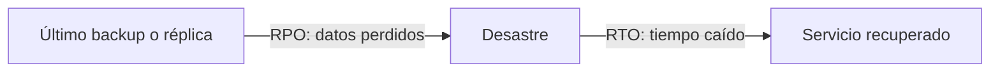
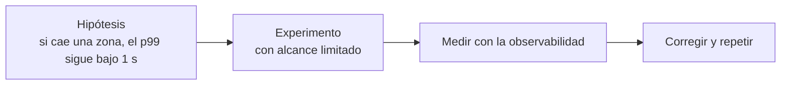

---
tags:
  - resiliencia
  - arquitectura
  - aws
  - azure
  - gcp
---

# Resiliencia: AWS, Azure y GCP

> Cómo diseñar sistemas que sigan funcionando cuando algo falla: high availability, autoscaling, health checks y disaster recovery con objetivos de RTO y RPO, y qué servicios ofrece cada nube para lograrlo y probarlo.

## ¿Qué es la resiliencia?

La **resilience** (resiliencia) es la capacidad de un sistema de **resistir fallos y recuperarse** de ellos. En la nube los fallos no son una posibilidad, son una certeza: discos que se rompen, instancias que se reinician, una zona entera sin servicio, un despliegue con un bug, alguien que borra una tabla.

Es el pilar de **Reliability** (fiabilidad) del [Well-Architected Framework](../fundamentos/well-architected.md), y se apoya en la infraestructura física que se explica en [Modelos de servicio y regiones](../fundamentos/modelos-de-servicio-y-regiones.md): regiones y Availability Zones.

## High availability, fault tolerance y disaster recovery

Tres conceptos que se confunden a menudo:

| Concepto | Qué significa | Ante qué protege | Ejemplo |
| --- | --- | --- | --- |
| **High availability** (alta disponibilidad, HA) | El sistema sigue dando servicio con una interrupción mínima o nula | Fallo de una instancia o de una zona | Dos o más instancias en zonas distintas detrás de un load balancer |
| **Fault tolerance** (tolerancia a fallos) | El sistema sigue funcionando **sin ninguna degradación** aunque falle un componente | Fallo de un componente, sin que el usuario lo note | Capacidad de sobra en cada zona para absorber la caída de otra |
| **Disaster recovery** (recuperación ante desastres, DR) | Volver a operar después de un evento grave | Caída de una región, borrado o corrupción de datos, ransomware | Backups en otra región y un plan para levantar el entorno allí |

!!! note "HA no reemplaza al backup"
    La replicación síncrona entre zonas copia también los errores: si alguien borra una tabla o un ransomware cifra los datos, el cambio llega a todas las réplicas al instante. Por eso necesitas **backups** (copias de seguridad) inmutables además de HA (ver [Almacenamiento y datos](../redes-y-datos/almacenamiento-datos.md)).

## RTO y RPO

Antes de elegir una arquitectura, el negocio tiene que definir dos números por cada sistema:

- **RTO** (*Recovery Time Objective*, objetivo de tiempo de recuperación): cuánto tiempo **máximo** puede estar el servicio caído. "Debemos volver a estar en línea en menos de 1 hora".
- **RPO** (*Recovery Point Objective*, objetivo de punto de recuperación): cuántos datos, medidos en tiempo, se pueden **perder**. "Podemos perder como máximo los últimos 15 minutos de datos".

Cuanto más bajos son RTO y RPO, más caro es el diseño. No todos los sistemas necesitan lo mismo: la web de pagos y el entorno de reportes internos no merecen la misma inversión.

## Multi-AZ y multi-región

| Diseño | Protege ante | Complejidad y costo | Cuándo usarlo |
| --- | --- | --- | --- |
| **Single-AZ** (una zona) | Nada a nivel de zona | Bajo | Dev, pruebas, cargas que se pueden recrear |
| **Multi-AZ** (varias zonas de una región) | Fallo de un centro de datos o de una zona | Moderado; la mayoría de servicios gestionados lo ofrecen con una opción | **Mínimo para producción** |
| **Multi-region** (varias regiones) | Caída de una región completa, requisitos de latencia global o de soberanía | Alto: replicación de datos, DNS, costo duplicado | Sistemas críticos con RTO/RPO muy bajos |

| Pieza | AWS | Azure | Google Cloud |
| --- | --- | --- | --- |
| Zonas dentro de una región | Availability Zones | Availability zones | Zones |
| Base de datos con réplica en otra zona | Amazon RDS Multi-AZ | Zone-redundant HA en Azure SQL Database / Azure Database for PostgreSQL | Cloud SQL high availability (regional) |
| Almacenamiento redundante entre regiones | S3 Cross-Region Replication | Geo-redundant storage (GRS, GZRS) | Dual-region y multi-region buckets |
| Base de datos multi-región | Aurora Global Database, DynamoDB global tables | Azure Cosmos DB multi-region, active geo-replication en Azure SQL | Spanner multi-region, réplicas entre regiones de Cloud SQL |
| DNS con failover entre regiones | Amazon Route 53 (*failover routing*) | Azure Traffic Manager, Azure Front Door | Cloud DNS (*routing policies*) |
| Load balancer global | AWS Global Accelerator, Amazon CloudFront | Azure Front Door | Cloud Load Balancing (global external Application Load Balancer) |

## Autoscaling

El **autoscaling** (escalado automático) añade o quita capacidad según la demanda. Aporta resiliencia (reemplaza instancias que fallan) y ahorro (no pagas capacidad ociosa).

- **Scale out / scale in** (escalado horizontal): añadir o quitar instancias. Es lo habitual en la nube.
- **Scale up / scale down** (escalado vertical): usar una máquina más grande o más pequeña. Suele requerir reinicio.

| | AWS | Azure | Google Cloud |
| --- | --- | --- | --- |
| Grupo de VMs | **Auto Scaling group** + launch template | **Virtual Machine Scale Set** (VMSS) | **Managed instance group** (MIG) + instance template |
| Escalar por métrica objetivo | Target tracking scaling policy | Autoscale rules (Azure Monitor autoscale) | Autoscaling policy (CPU, load balancing, métricas de Cloud Monitoring) |
| Escalado programado | Scheduled actions | Scheduled autoscale profiles | Schedule-based autoscaling |
| Escalado predictivo | Predictive scaling | Predictive autoscale | Predictive autoscaling |
| Repartir entre zonas | Subnets en varias AZ | Zone-spanning scale set | Regional MIG |

### Escalado de contenedores y serverless

| Nivel | AWS | Azure | Google Cloud |
| --- | --- | --- | --- |
| Tareas o contenedores | ECS Service Auto Scaling | Azure Container Apps (escala con reglas de KEDA) | Cloud Run (escala por peticiones concurrentes) |
| Pods en Kubernetes | Horizontal Pod Autoscaler (HPA) en EKS | HPA y KEDA en AKS | HPA en GKE |
| Nodos de Kubernetes | Karpenter, Cluster Autoscaler, EKS Auto Mode | AKS cluster autoscaler, node autoprovisioning | GKE cluster autoscaler, GKE Autopilot |

Más detalle en [Contenedores gestionados](../computo/contenedores-gestionados.md), [Serverless](../computo/serverless.md) y [Kubernetes](../../devops/contenedores/kubernetes.md).

!!! tip "Escala con margen"
    Un autoscaling tarda minutos en arrancar instancias nuevas. Fija un **mínimo** que reparta capacidad en al menos dos zonas, y un objetivo de CPU razonable (por ejemplo, 50–60 %) para absorber picos mientras llegan las nuevas instancias.

## Health checks

Un **health check** (comprobación de salud) es una petición periódica que decide si una instancia puede recibir tráfico. Sin health checks, el load balancer seguiría enviando usuarios a una instancia rota.

| | AWS | Azure | Google Cloud |
| --- | --- | --- | --- |
| En el load balancer | Target group health checks (ELB) | Health probes (Load Balancer, Application Gateway, Front Door) | Health checks de Cloud Load Balancing |
| Reemplazar instancias enfermas | Auto Scaling group con health check type `ELB` | Automatic instance repairs en VMSS (Application Health extension o health probe) | **Autohealing** en MIG |
| Contenedores | Health check de la task definition (ECS) | Health probes en Container Apps | Startup y liveness probes en Cloud Run |

!!! warning "Health checks útiles, no triviales"
    Un endpoint `/health` que siempre responde `200` no sirve. Tampoco uno que falla si cae una dependencia externa no crítica: haría que el load balancer retire **todas** las instancias a la vez. Comprueba que la aplicación puede atender peticiones y distingue entre *liveness* (el proceso vive) y *readiness* (puede recibir tráfico), como en Kubernetes.

## Estrategias de disaster recovery

Las cuatro estrategias clásicas, de la más barata a la más cara:

| Estrategia | Cómo funciona | RTO | RPO | Costo |
| --- | --- | --- | --- | --- |
| **Backup & restore** (copia y restauración) | Backups en otra región; en un desastre recreas la infraestructura (idealmente con IaC) y restauras los datos | Horas a días | Horas (frecuencia del backup) | $ |
| **Pilot light** (piloto encendido) | Los datos se replican a la otra región; el resto de la infraestructura está definida pero apagada o mínima | Decenas de minutos a horas | Minutos | $$ |
| **Warm standby** (espera en caliente) | Una copia completa pero reducida del entorno corre en la otra región; en un desastre se escala | Minutos | Segundos a minutos | $$$ |
| **Multi-site active/active** (activo/activo) | Dos o más regiones atienden tráfico a la vez | Casi cero | Casi cero (según la replicación de datos) | $$$$ |

Los tiempos son orientativos: el RTO real depende de lo automatizado que esté el proceso y de si lo has probado.

!!! tip "Sin IaC, no hay DR rápido"
    Recrear una región a mano en medio de un desastre es lento y propenso a errores. Con toda la infraestructura en [Infrastructure as Code](../../devops/iac/infraestructura-como-codigo.md), *backup & restore* y *pilot light* se vuelven mucho más rápidos: cambias la región y aplicas.

### Servicios de backup y DR

| Necesidad | AWS | Azure | Google Cloud |
| --- | --- | --- | --- |
| Backup centralizado con políticas | **AWS Backup** | **Azure Backup** | **Backup and DR Service** |
| Backups inmutables / protegidos | AWS Backup Vault Lock, logically air-gapped vaults | Immutable vaults, soft delete | Backup vaults (aislados y gestionados por Google) |
| Replicar servidores para DR | **AWS Elastic Disaster Recovery** (AWS DRS) | **Azure Site Recovery** | No hay un equivalente directo; se combina Backup and DR Service con IaC para recrear el entorno en otra región |
| Evaluar la resiliencia de una aplicación | AWS Resilience Hub | Reliability en Azure Advisor | Recomendaciones de Active Assist |

## Probar el DR: game days y chaos engineering

Un plan de DR que nunca se probó **no es un plan**. Hay dos prácticas complementarias:

- **Game day** (día de simulacro): un ejercicio planificado en el que el equipo simula un desastre (caída de una zona, restaurar un backup en otra región) y mide el RTO y RPO reales.
- **Chaos engineering** (ingeniería del caos): inyectar fallos controlados (matar instancias, añadir latencia, cortar la red) para comprobar que el sistema se comporta como se espera.

| | AWS | Azure | Google Cloud |
| --- | --- | --- | --- |
| Servicio gestionado de inyección de fallos | **AWS Fault Injection Service** (FIS) | **Azure Chaos Studio** | No tiene un servicio gestionado equivalente; se usan herramientas open source (por ejemplo, Chaos Toolkit o Chaos Mesh en GKE) |

!!! danger "Empieza con radio de impacto pequeño"
    Haz los primeros experimentos en un entorno de pruebas, con una **condición de parada** definida (por ejemplo, detener el experimento si salta una alarma) y con alguien vigilando. Pasa a producción solo cuando el equipo y la [observabilidad](observabilidad-nativa.md) estén preparados.

Cómo se organizan los incidentes, el on-call y los postmortems se ve en [Operación y fiabilidad (SRE)](../../devops/operacion/operacion-sre.md); cómo probar la infraestructura automáticamente con entornos efímeros, en [Pruebas de infraestructura](../../devops/iac/pruebas-infraestructura.md).

## Checklist de resiliencia

- [ ] RTO y RPO definidos y aprobados por el negocio para cada sistema.
- [ ] Producción repartida en al menos dos zonas, con load balancer y health checks.
- [ ] Autoscaling con un mínimo que cubra la caída de una zona.
- [ ] Backups automáticos, cifrados, en otra región y protegidos contra borrado.
- [ ] Restauración de backups probada de forma periódica.
- [ ] Infraestructura en IaC para poder recrearla en otra región.
- [ ] Game days o experimentos de caos programados.

## Relación con otras secciones

| Enfoque | Qué se mira desde ahí | Nota |
| --- | --- | --- |
| Cloud (el control) | Regiones y zonas, réplicas de datos, alarmas y backups | [Modelos de servicio y regiones](../fundamentos/modelos-de-servicio-y-regiones.md), [Almacenamiento y datos](../redes-y-datos/almacenamiento-datos.md), [Observabilidad nativa](observabilidad-nativa.md) |
| DevOps (la automatización) | Incidentes, on-call, SLOs y capacity planning; probar la infraestructura y recrearla con IaC; despliegues sin caída | [Operación y fiabilidad (SRE)](../../devops/operacion/operacion-sre.md), [Pruebas de infraestructura](../../devops/iac/pruebas-infraestructura.md), [Despliegue continuo](../../devops/ci-cd/despliegue-continuo.md) |
| DevSecOps (la verificación) | Respuesta a incidentes de seguridad y recuperación ante ransomware | [Detección y respuesta](../../devsecops/gobierno-y-respuesta/deteccion-respuesta.md) |
| Negocio TI (el porqué) | De dónde salen el RTO y el RPO (BIA, tiers de criticidad) y cuánta disponibilidad se compromete | [Continuidad de negocio](../../negocio/continuidad-negocio.md), [Niveles de servicio](../../negocio/niveles-de-servicio.md) |
| Laboratorios (la práctica) | Practicar esto paso a paso | [Lab 02: Plan de direccionamiento IP para una VPC](../../laboratorios/fundamentos/subnetting-plan-ips.md), [Lab 06: Desplegar una app en Kubernetes local con kind](../../laboratorios/devops/kubernetes-local-kind.md), [Lab 21: Game day: incidente simulado, troubleshooting y postmortem](../../laboratorios/operacion/game-day-incidente.md) |

## Referencias

- [Pilar de fiabilidad de AWS Well-Architected](https://docs.aws.amazon.com/es_es/wellarchitected/latest/reliability-pillar/welcome.html)
- [Disaster recovery options in the cloud (AWS)](https://docs.aws.amazon.com/whitepapers/latest/disaster-recovery-workloads-on-aws/disaster-recovery-options-in-the-cloud.html)
- [Amazon EC2 Auto Scaling](https://docs.aws.amazon.com/es_es/autoscaling/ec2/userguide/what-is-amazon-ec2-auto-scaling.html)
- [AWS Elastic Disaster Recovery](https://docs.aws.amazon.com/es_es/drs/latest/userguide/what-is-drs.html)
- [AWS Fault Injection Service](https://docs.aws.amazon.com/es_es/fis/latest/userguide/what-is.html)
- [Fiabilidad en Azure Well-Architected Framework](https://learn.microsoft.com/es-es/azure/well-architected/reliability/)
- [Virtual Machine Scale Sets](https://learn.microsoft.com/es-es/azure/virtual-machine-scale-sets/overview)
- [Azure Site Recovery](https://learn.microsoft.com/es-es/azure/site-recovery/site-recovery-overview)
- [Azure Chaos Studio](https://learn.microsoft.com/es-es/azure/chaos-studio/chaos-studio-overview)
- [Disaster recovery planning guide (Google Cloud)](https://cloud.google.com/architecture/dr-scenarios-planning-guide)
- [Managed instance groups](https://cloud.google.com/compute/docs/instance-groups)
- [Backup and DR Service](https://cloud.google.com/backup-disaster-recovery/docs/concepts/backup-dr)
