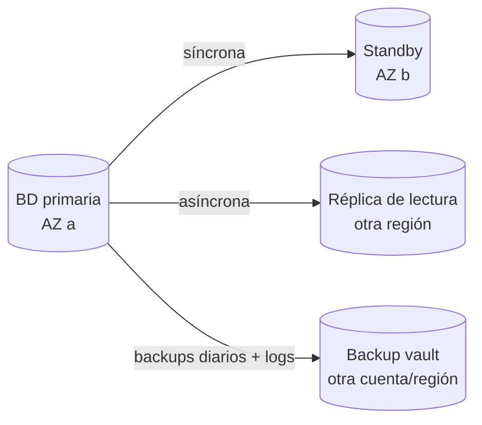

---
tags:
  - almacenamiento
  - bases-de-datos
  - aws
  - azure
  - gcp
---

# Almacenamiento y datos: AWS, Azure y GCP

> Los tres tipos de almacenamiento (objetos, bloques y archivos), las bases de datos gestionadas relacionales y NoSQL de cada nube, y cómo se protegen con backups y replicación.

## ¿Qué tipos de almacenamiento hay?

| Tipo | Cómo se accede | Para qué | Analogía |
| --- | --- | --- | --- |
| **Object storage** (almacenamiento de objetos) | API HTTP: `PUT`/`GET` de un objeto por su *key* (clave) | Archivos estáticos, backups, logs, *data lakes*, imágenes | Un depósito donde cada caja tiene una etiqueta |
| **Block storage** (almacenamiento de bloques) | Como un disco conectado a una VM | Sistema operativo, bases de datos autogestionadas | Un disco duro |
| **File storage** (almacenamiento de archivos) | Sistema de archivos compartido por red (NFS, SMB) | Carpetas compartidas entre varias VMs o contenedores | Una carpeta compartida de la oficina |

## Vista rápida

| | AWS | Azure | Google Cloud |
| --- | --- | --- | --- |
| Object storage | **Amazon S3** | **Azure Blob Storage** (dentro de un *storage account*) | **Cloud Storage** |
| Contenedor de objetos | Bucket | Container | Bucket |
| Block storage | Amazon EBS | Azure Managed Disks | Persistent Disk, Hyperdisk |
| File storage (NFS) | Amazon EFS | Azure Files (NFS), Azure NetApp Files | Filestore |
| File storage (SMB / Windows) | Amazon FSx for Windows File Server | Azure Files (SMB) | Filestore, NetApp Volumes |
| Relacional gestionada | Amazon RDS, Amazon Aurora | Azure SQL Database, Azure Database for PostgreSQL / MySQL (*flexible server*) | Cloud SQL, AlloyDB for PostgreSQL, Spanner |
| NoSQL clave-valor / documentos | Amazon DynamoDB | Azure Cosmos DB | Firestore, Bigtable |
| Backups centralizados | AWS Backup | Azure Backup | Backup and DR Service |

## Object storage

El object storage es prácticamente ilimitado, muy durable y barato. Los objetos no se modifican "por partes": se reemplazan enteros.

### Clases de almacenamiento

Cada proveedor ofrece clases más baratas para guardar datos que se leen poco, a cambio de cobrar más por leerlos o de exigir un tiempo mínimo de almacenamiento.

| Uso | Amazon S3 (*storage classes*) | Azure Blob Storage (*access tiers*) | Cloud Storage (*storage classes*) |
| --- | --- | --- | --- |
| Acceso frecuente | S3 Standard | Hot | Standard |
| Acceso infrecuente | S3 Standard-IA, S3 One Zone-IA | Cool | Nearline |
| Acceso muy infrecuente | S3 Glacier Instant Retrieval | Cold | Coldline |
| Archivo (horas para recuperar) | S3 Glacier Flexible Retrieval, S3 Glacier Deep Archive | Archive | Archive |
| Mueve objetos solo según su uso | S3 Intelligent-Tiering | (lifecycle management) | Autoclass |

!!! tip "Lifecycle rules"
    Con **lifecycle rules** (reglas de ciclo de vida) defines que, por ejemplo, los logs pasen a una clase fría a los 30 días y se borren a los 365. Existen en los tres proveedores y son una de las formas más simples de bajar costos. Ver [FinOps y costos](../fundamentos/finops-costos.md).

```hcl title="s3-lifecycle.tf"
resource "aws_s3_bucket_lifecycle_configuration" "logs" {
  bucket = aws_s3_bucket.logs.id

  rule {
    id     = "logs-a-frio-y-borrar"
    status = "Enabled"
    filter {
      prefix = "logs/"
    }
    transition {
      days          = 30
      storage_class = "STANDARD_IA"
    }
    expiration {
      days = 365
    }
  }
}
```

### Protección de los objetos

| | AWS | Azure | Google Cloud |
| --- | --- | --- | --- |
| Bloquear acceso público | S3 Block Public Access (activo por defecto en buckets nuevos) | *Allow blob anonymous access* desactivado | *Public access prevention* |
| Versionado | S3 Versioning | Blob versioning, soft delete | Object Versioning, soft delete |
| Inmutabilidad (WORM) | S3 Object Lock | Immutable storage (políticas de retención) | Bucket Lock, retention policies |
| Replicación a otra región | S3 Replication (CRR) | GRS / GZRS (*geo-redundant storage*), object replication | Buckets *dual-region* o *multi-region* |

!!! danger "Buckets públicos por error"
    Un bucket expuesto a internet es una de las filtraciones de datos más frecuentes en la nube. Mantén el bloqueo de acceso público activado a nivel de cuenta/organización, cifra los datos (ver [Seguridad base](../identidad-y-seguridad/seguridad-base.md)) y controla el acceso con IAM (ver [IAM](../identidad-y-seguridad/iam-comparativa.md)).

### Redundancia en Azure Storage

Azure define la redundancia **en el storage account** con siglas propias:

| Opción | Copias | Protege ante |
| --- | --- | --- |
| **LRS** (*locally redundant*) | 3 en un centro de datos | Fallo de disco o servidor |
| **ZRS** (*zone-redundant*) | 3 en zonas distintas | Caída de una zona |
| **GRS** / **RA-GRS** | LRS + copia asíncrona en la *region pair* | Caída de la región (RA = lectura en la secundaria) |
| **GZRS** / **RA-GZRS** | ZRS + copia en la región pareja | Zona y región |

## Block y file storage

Los discos de VM (EBS, Managed Disks, Persistent Disk/Hyperdisk) y sus tipos se comparan en [Máquinas virtuales](../computo/maquinas-virtuales.md#discos). Puntos clave:

- Un disco de bloques suele vivir en **una zona** y conectarse a una VM a la vez (hay excepciones: *multi-attach*, discos regionales de Google Cloud, discos ZRS de Azure).
- Los **snapshots** (copias instantáneas) de disco se guardan en object storage y se pueden copiar a otra región.
- El file storage (EFS, Azure Files, Filestore) se monta desde varias VMs o pods a la vez; útil para contenido compartido, más caro por GB que el object storage.

## Bases de datos gestionadas

Una base de datos **gestionada** (*managed database*) delega en el proveedor la instalación, parches, backups automáticos, alta disponibilidad y escalado. Tú sigues a cargo del esquema, las consultas, los usuarios y los datos.

### Relacionales

| | AWS | Azure | Google Cloud |
| --- | --- | --- | --- |
| Motores estándar gestionados | **Amazon RDS** (PostgreSQL, MySQL, MariaDB, SQL Server, Oracle, Db2) | **Azure SQL Database** (SQL Server), **Azure Database for PostgreSQL** y **for MySQL** (*flexible server*) | **Cloud SQL** (PostgreSQL, MySQL, SQL Server) |
| Motor "nativo de la nube" compatible | **Amazon Aurora** (MySQL y PostgreSQL compatible) | Azure SQL Database Hyperscale | **AlloyDB for PostgreSQL** |
| Distribuida global con consistencia fuerte | Amazon Aurora DSQL | No hay un equivalente directo | **Spanner** |
| Alta disponibilidad en la región | Multi-AZ deployment | Zone-redundant HA / zone-redundant configuration | High availability (regional) |
| Réplicas de lectura | Read replicas (también *cross-region*) | Read replicas, *active geo-replication* (Azure SQL) | Read replicas (también *cross-region*) |
| Serverless / escala automática | Aurora Serverless v2 | Azure SQL Database serverless | Spanner con *managed autoscaler* |

!!! info "Single Server ya no existe en Azure"
    Las opciones antiguas **Azure Database for PostgreSQL/MySQL - Single Server** fueron retiradas; hoy la opción es **Flexible Server**. Muchos tutoriales antiguos aún muestran Single Server.

### NoSQL

| Modelo | AWS | Azure | Google Cloud |
| --- | --- | --- | --- |
| Clave-valor / documentos, serverless | **Amazon DynamoDB** | **Azure Cosmos DB** (APIs NoSQL, MongoDB, Cassandra, Gremlin, Table) | **Firestore** |
| Columnar ancho, gran volumen | Amazon Keyspaces (Cassandra) | Azure Cosmos DB for Apache Cassandra, Azure Managed Instance for Apache Cassandra | **Bigtable** |
| Documentos compatible con MongoDB | Amazon DocumentDB | Azure Cosmos DB for MongoDB | Firestore with MongoDB compatibility |
| Caché en memoria | Amazon ElastiCache, Amazon MemoryDB | Azure Managed Redis, Azure Cache for Redis | Memorystore |
| Multi-región activa | DynamoDB *global tables* | Cosmos DB *multi-region writes* | Firestore *multi-region* |

!!! tip "¿Relacional o NoSQL?"
    Si tus datos tienen relaciones, transacciones entre tablas o consultas variadas, empieza con **relacional**. Elige **NoSQL** cuando conoces bien los patrones de acceso, necesitas escalar a gran volumen con latencia constante o el esquema cambia mucho. En DynamoDB y Bigtable el diseño de la clave lo es todo.

## Backups y replicación

Replicación y backup **no son lo mismo**:

- La **replicación** copia los cambios casi en tiempo real a otra zona o región. Protege ante la caída de infraestructura, pero **también replica los errores**: si alguien borra una tabla, el borrado llega a la réplica.
- El **backup** (copia de seguridad) guarda el estado en momentos concretos. Protege ante borrados, corrupción y *ransomware*.

| Mecanismo | AWS | Azure | Google Cloud |
| --- | --- | --- | --- |
| Backups centralizados con políticas | **AWS Backup** (EC2, EBS, RDS, DynamoDB, EFS, S3…) | **Azure Backup** con Recovery Services vault / Backup vault | **Backup and DR Service** |
| Point-in-time recovery en BD | RDS/Aurora PITR, DynamoDB PITR | Azure SQL PITR, flexible server PITR | Cloud SQL PITR, AlloyDB continuous backup |
| Backups inmutables / protegidos | AWS Backup Vault Lock, *logically air-gapped vault* | Immutable vaults, soft delete | Backup vaults con retención forzada |
| Copia a otra región o cuenta | Cross-region / cross-account copy | Cross-region restore (vault con GRS) | Backup vault en otra región |
| Disaster recovery de VMs | AWS Elastic Disaster Recovery | Azure Site Recovery | Backup and DR Service |



- **Multi-AZ / zone-redundant**: copia **síncrona** en otra zona y *failover* automático. Protege ante la caída de una zona; no sirve para escalar lecturas.
- **Read replicas** (réplicas de lectura): copia **asíncrona** para repartir lecturas; se puede promover a primaria en un desastre.
- **Cross-region**: réplica o backups en otra región para sobrevivir a la caída de una región completa.

!!! warning "Un backup que no se ha restaurado no es un backup"
    Prueba la restauración de forma periódica y mide cuánto tarda. Ese tiempo y la antigüedad del último backup definen tu **RTO** y **RPO**; ver [Resiliencia](../operacion-y-gobierno/resiliencia.md). Guarda copias en **otra cuenta** o suscripción, para que un atacante con acceso a producción no pueda borrarlas.

## Conclusión práctica

- **Object storage** para archivos, backups y logs; **block** para discos de VM; **file** solo cuando varias máquinas necesitan el mismo sistema de archivos.
- Usa **lifecycle rules** y clases frías para lo que se lee poco.
- Bloquea el acceso público de los buckets a nivel de organización y activa versionado en lo importante.
- Prefiere bases de datos **gestionadas**, con alta disponibilidad multi-zona en producción.
- Replicación no reemplaza al backup: necesitas ambos, con copias fuera de la cuenta de producción y restauraciones probadas.

## Relación con otras secciones

| Enfoque | Qué se mira desde ahí | Nota |
| --- | --- | --- |
| Cloud (el control) | RTO/RPO y DR; cifrado con KMS; discos de VM; costos de almacenamiento; acceso privado desde la red | [Resiliencia](../operacion-y-gobierno/resiliencia.md), [Seguridad base](../identidad-y-seguridad/seguridad-base.md), [Máquinas virtuales](../computo/maquinas-virtuales.md), [FinOps y costos](../fundamentos/finops-costos.md), [Redes en la nube](redes.md) |
| DevOps (la automatización) | Definir buckets, bases de datos y políticas de backup como código; migraciones de esquema en el despliegue | [Infrastructure as Code](../../devops/iac/infraestructura-como-codigo.md), [Despliegue continuo](../../devops/ci-cd/despliegue-continuo.md), [Operación y fiabilidad (SRE)](../../devops/operacion/operacion-sre.md) |
| DevSecOps (la verificación) | Detectar buckets públicos y bases sin cifrar o sin backup; auditoría continua | [Seguridad de IaC](../../devsecops/infraestructura-y-contenedores/seguridad-iac.md), [Cumplimiento y gobierno](../../devsecops/gobierno-y-respuesta/cumplimiento.md) |
| Laboratorios (la práctica) | Practicar esto paso a paso | [Lab 09: Terraform en AWS con remote state en S3](../../laboratorios/devops/terraform-aws-backend-remoto.md), [Lab 18: AWS: API serverless con Lambda, API Gateway y DynamoDB](../../laboratorios/cloud/aws-serverless-api.md), [Lab 19: Azure: VNet, NSG y una VM con Azure CLI](../../laboratorios/cloud/azure-vnet-vm.md) |

## Referencias

- [Amazon S3 storage classes](https://aws.amazon.com/es/s3/storage-classes/)
- [Amazon RDS Multi-AZ](https://docs.aws.amazon.com/es_es/AmazonRDS/latest/UserGuide/Concepts.MultiAZ.html)
- [AWS Backup](https://docs.aws.amazon.com/es_es/aws-backup/latest/devguide/whatisbackup.html)
- [Niveles de acceso de Azure Blob Storage](https://learn.microsoft.com/es-es/azure/storage/blobs/access-tiers-overview)
- [Redundancia de Azure Storage](https://learn.microsoft.com/es-es/azure/storage/common/storage-redundancy)
- [Azure Cosmos DB](https://learn.microsoft.com/es-es/azure/cosmos-db/introduction)
- [Azure Backup](https://learn.microsoft.com/es-es/azure/backup/backup-overview)
- [Cloud Storage classes](https://cloud.google.com/storage/docs/storage-classes)
- [Cloud SQL: alta disponibilidad](https://cloud.google.com/sql/docs/postgres/high-availability)
- [Elegir una base de datos en Google Cloud](https://cloud.google.com/products/databases)
- [Backup and DR Service](https://cloud.google.com/backup-disaster-recovery/docs/concepts/backup-dr)
- [Comparación de servicios de almacenamiento: AWS y Azure](https://learn.microsoft.com/es-es/azure/architecture/aws-professional/storage)
