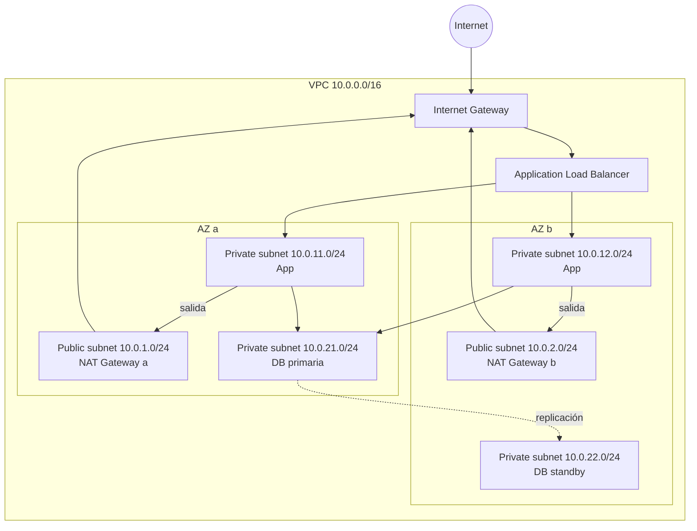

---
tags:
  - redes
  - aws
  - azure
  - gcp
---

# Redes en la nube: AWS, Azure y GCP

> Cómo se arma una red privada en cada nube (VPC, VNet), cómo se controla el tráfico que entra y sale, y qué servicios conectan esa red con internet, con otras redes y con los usuarios.

## ¿Qué es una red virtual en la nube?

Una **virtual network** (red virtual) es tu red privada dentro de la nube: un rango de direcciones IP propio, aislado de los demás clientes, donde viven tus VMs, contenedores, bases de datos y load balancers. Sobre ella decides qué es público, qué es privado y quién puede hablar con quién.

Según el [Shared Responsibility Model](../fundamentos/responsabilidad-compartida.md), la **configuración de red es responsabilidad del cliente**. Muchas exposiciones accidentales vienen de aquí: un puerto abierto a `0.0.0.0/0` o una base de datos en una subnet pública.

!!! note "Conceptos previos"
    Esta nota asume que conoces direcciones IP, notación **CIDR** (`10.0.0.0/16`), puertos, TCP/UDP y DNS. Si no, ver [Linux, redes y scripting](../../devops/fundamentos/linux-redes-scripting.md) y la tabla de [puertos](../../recursos/puertos.md).

!!! info "Fundamentos de redes"
    Si necesitas la base (modelos OSI y TCP/IP, subnetting, routing, TCP/UDP, DNS, TLS), la sección [Networking](../../networking/basico/fundamentos-redes.md) la recorre de lo más básico a lo avanzado, de forma agnóstica al proveedor.

## Vista rápida

| Pieza | AWS | Azure | Google Cloud |
| --- | --- | --- | --- |
| Red privada | **VPC** (*Virtual Private Cloud*) | **Virtual Network (VNet)** | **VPC network** |
| Alcance de la red | Regional | Regional | **Global** |
| Subred | Subnet (en **una AZ**) | Subnet (abarca **todas las zonas** de la región) | Subnet (**regional**) |
| Tabla de rutas | Route table | Route table (*user-defined routes*, UDR) | Routes (a nivel de VPC) |
| Salida/entrada a internet | Internet Gateway | Implícita (salida por defecto) / Public IP | Ruta por defecto a *default internet gateway* |
| Salida a internet sin IP pública | NAT Gateway | Azure NAT Gateway | Cloud NAT |
| Firewall a nivel de recurso | **Security group** (*stateful*) | **Network security group (NSG)** | **VPC firewall rules** / **firewall policies** |
| Firewall a nivel de subred | **Network ACL** (*stateless*) | NSG asociado a la subnet | (firewall rules con *target tags* o *service accounts*) |
| DNS gestionado | Amazon Route 53 | Azure DNS | Cloud DNS |
| Conectar dos redes | VPC peering | VNet peering | VPC Network Peering |
| Hub para muchas redes | AWS Transit Gateway, AWS Cloud WAN | Azure Virtual WAN, hub-and-spoke | Network Connectivity Center |
| VPN site-to-site | AWS Site-to-Site VPN | Azure VPN Gateway | Cloud VPN (HA VPN) |
| Conexión dedicada | AWS Direct Connect | Azure ExpressRoute | Cloud Interconnect |
| Acceso privado a servicios gestionados | VPC endpoints (AWS PrivateLink) | Private Endpoint (Azure Private Link) | Private Service Connect, Private Google Access |
| CDN | Amazon CloudFront | Azure Front Door | Cloud CDN |

!!! info "La VPC de Google Cloud es global"
    En AWS y Azure una VPC/VNet vive en **una región**; para cubrir dos regiones necesitas dos redes conectadas. En Google Cloud una **VPC network es global**: una sola red puede tener subnets en `southamerica-east1` y `us-central1`, y las VMs se comunican por IP privada sin peering. En Azure, además, una subnet abarca todas las zonas de la región; en AWS cada subnet está en **una sola AZ**.

## Subnets públicas y privadas

Una **subnet** (subred) es un trozo del rango de la red. Lo que la hace "pública" o "privada" no es un botón, sino **sus rutas**:

- **Public subnet** (subred pública): tiene una ruta `0.0.0.0/0` hacia el Internet Gateway. Aquí van el load balancer y, como mucho, un *bastion host*.
- **Private subnet** (subred privada): **no** tiene ruta directa a internet. Sale (si lo necesita) a través de un **NAT Gateway**, que permite conexiones salientes (descargar parches, llamar APIs) pero no entrantes. Aquí van las aplicaciones y las bases de datos.

### Una VPC típica en dos zonas



Los route tables de este diseño (AWS):

| Route table | Destino | Target |
| --- | --- | --- |
| Pública | `10.0.0.0/16` | `local` |
| Pública | `0.0.0.0/0` | Internet Gateway |
| Privada AZ a | `10.0.0.0/16` | `local` |
| Privada AZ a | `0.0.0.0/0` | NAT Gateway a |
| Privada AZ b | `0.0.0.0/0` | NAT Gateway b |

!!! tip "Planifica los rangos antes de empezar"
    Elige rangos privados (RFC 1918: `10.0.0.0/8`, `172.16.0.0/12`, `192.168.0.0/16`) que **no se solapen** con otras redes de la organización ni con la red de la oficina. Dos redes con rangos solapados no se pueden conectar con peering.

!!! warning "Un NAT Gateway por zona, pero cuesta"
    Un NAT Gateway por AZ evita que la caída de una zona deje sin salida a la otra, pero cada uno cobra por hora y por GB. Para tráfico hacia servicios del propio proveedor (S3, Storage, APIs de Google), usa **endpoints privados** y ahorra NAT. Ver [FinOps y costos](../fundamentos/finops-costos.md).

=== "AWS"

    - **Internet Gateway** (IGW): se adjunta a la VPC y permite tráfico de entrada y salida para recursos con IP pública.
    - **NAT Gateway**: se crea en una public subnet; las private subnets lo usan como ruta por defecto.
    - **Egress-only Internet Gateway**: equivalente para IPv6 (solo salida).
    - Cada cuenta trae una **default VPC** en cada región, con subnets públicas. Para producción, crea la tuya.

=== "Azure"

    - Los recursos dentro de una VNet pueden salir a internet sin configurar un gateway, pero Microsoft está retirando ese **default outbound access** para VNets nuevas: lo recomendado es una salida explícita con **Azure NAT Gateway**, un load balancer o una IP pública.
    - Para forzar que el tráfico pase por un firewall (por ejemplo, **Azure Firewall**) se usan **user-defined routes** (UDR).
    - Algunas subnets se **delegan** a servicios concretos (por ejemplo, a Azure Container Apps o a bases de datos flexibles).

=== "Google Cloud"

    - La VPC trae una ruta por defecto al *default internet gateway*; una VM sale a internet si tiene IP externa.
    - **Cloud NAT** (sobre un **Cloud Router**) da salida a VMs sin IP externa, por región.
    - **Shared VPC**: un *host project* comparte su red con varios *service projects*, para que un equipo central gestione la red.
    - Los proyectos nuevos pueden traer una red `default` con subnets en todas las regiones y reglas permisivas; en producción se usa una red en *custom mode*.

## Firewalls: stateful y stateless

| | Security group (AWS) | Network ACL (AWS) | NSG (Azure) | Firewall rules / policies (GCP) |
| --- | --- | --- | --- | --- |
| Se aplica a | Interfaz de red (ENI) de la instancia | Subnet | Subnet o NIC | VPC, dirigidas por *network tags* o *service accounts* |
| Estado | **Stateful** (la respuesta vuelve sola) | **Stateless** (hay que permitir la vuelta) | Stateful | Stateful |
| Reglas | Solo **allow** | Allow y **deny**, por número de orden | Allow y deny, por **priority** | Allow y deny, por **priority** |
| Por defecto | Deniega entrada, permite salida | La NACL por defecto permite todo | Reglas por defecto: permite tráfico interno de la VNet, deniega entrada desde internet | Deniega entrada (*implied deny ingress*), permite salida |

- **Stateful** (con estado): si permites la entrada al puerto 443, la respuesta sale sin regla extra.
- **Stateless** (sin estado): cada dirección se evalúa por separado; tienes que abrir también los puertos efímeros de respuesta.

!!! tip "Referencia grupos, no IPs"
    En AWS una regla puede permitir tráfico **desde otro security group** ("la app puede hablar con la base de datos"). En Azure se hace con **application security groups** y en Google Cloud con **network tags** o **service accounts** como origen y destino. Es más robusto que mantener listas de IPs.

```hcl title="security-groups.tf"
# La base de datos solo acepta PostgreSQL desde el security group de la app
resource "aws_vpc_security_group_ingress_rule" "db_desde_app" {
  security_group_id            = aws_security_group.db.id
  referenced_security_group_id = aws_security_group.app.id
  ip_protocol                  = "tcp"
  from_port                    = 5432
  to_port                      = 5432
}
```

!!! danger "0.0.0.0/0 en puertos de administración"
    Abrir SSH (22), RDP (3389) o puertos de bases de datos a `0.0.0.0/0` es uno de los hallazgos más comunes en auditorías. Usa Session Manager, Azure Bastion o IAP (ver [Máquinas virtuales](../computo/maquinas-virtuales.md#acceso-y-seguridad)) y detecta estas reglas en el pipeline con [Seguridad de IaC](../../devsecops/infraestructura-y-contenedores/seguridad-iac.md).

## DNS

| | AWS | Azure | Google Cloud |
| --- | --- | --- | --- |
| Zonas públicas | Route 53 *public hosted zones* | Azure DNS *public zones* | Cloud DNS *public zones* |
| Zonas privadas | Route 53 *private hosted zones* | Azure Private DNS zones | Cloud DNS *private zones* |
| Resolver híbrido (on-prem ↔ nube) | Route 53 Resolver endpoints | Azure DNS Private Resolver | Cloud DNS *forwarding zones* y *inbound server policies* |
| Enrutamiento por salud o latencia | Routing policies (*latency, weighted, failover*…) | Azure Traffic Manager | Cloud DNS *routing policies* |

## Load balancers

| Tipo | AWS (Elastic Load Balancing) | Azure | Google Cloud (Cloud Load Balancing) |
| --- | --- | --- | --- |
| Capa 7 (HTTP/HTTPS) regional | Application Load Balancer (ALB) | Application Gateway | Regional external/internal Application Load Balancer |
| Capa 7 global | (CloudFront + ALB) | Azure Front Door | Global external Application Load Balancer |
| Capa 4 (TCP/UDP) | Network Load Balancer (NLB) | Azure Load Balancer | Network Load Balancer (*passthrough* o *proxy*) |
| Appliances de terceros | Gateway Load Balancer | Gateway Load Balancer | — |

El load balancer suele ser el **único** recurso en subnet pública: termina TLS, reparte el tráfico entre zonas y comprueba la salud (*health checks*) de los destinos. Más sobre su papel en la alta disponibilidad en [Resiliencia](../operacion-y-gobierno/resiliencia.md).

## Conectar redes

### Peering y hubs

- **Peering**: conecta dos redes por IP privada. **No es transitivo**: si A está conectada con B y B con C, A no llega a C.
- Para muchas redes se usa un modelo **hub-and-spoke** (concentrador y radios) con un servicio central:

| | AWS | Azure | Google Cloud |
| --- | --- | --- | --- |
| Peering | VPC peering | VNet peering (también *global VNet peering* entre regiones) | VPC Network Peering |
| Hub central | **AWS Transit Gateway** (regional), AWS Cloud WAN (global) | **Azure Virtual WAN** o una VNet hub con Azure Firewall | **Network Connectivity Center** |

### Conexión con on-premises

| | VPN por internet (cifrada) | Conexión privada dedicada |
| --- | --- | --- |
| AWS | AWS Site-to-Site VPN, AWS Client VPN | AWS Direct Connect |
| Azure | Azure VPN Gateway (site-to-site, point-to-site) | Azure ExpressRoute |
| Google Cloud | Cloud VPN (HA VPN) | Cloud Interconnect (Dedicated, Partner) |

La VPN se monta en horas y sirve para empezar; la conexión dedicada tarda semanas en aprovisionarse, pero ofrece ancho de banda estable y latencia predecible. Una conexión dedicada **no va cifrada por defecto**: si lo necesitas, añade una VPN sobre ella o el cifrado que ofrezca el proveedor (por ejemplo, MACsec).

## CDN y edge

Una **CDN** (*Content Delivery Network*, red de distribución de contenido) guarda copias del contenido en los **edge locations** cercanos al usuario (ver [Modelos de servicio y regiones](../fundamentos/modelos-de-servicio-y-regiones.md)).

| | AWS | Azure | Google Cloud |
| --- | --- | --- | --- |
| CDN | Amazon CloudFront | Azure Front Door (incluye CDN, balanceo global y WAF) | Cloud CDN (sobre el global external Application Load Balancer) |
| WAF en el edge | AWS WAF | WAF de Azure Front Door | Google Cloud Armor |
| Protección DDoS | AWS Shield | Azure DDoS Protection | Google Cloud Armor |

Los WAF y la protección DDoS se ven en [Seguridad base](../identidad-y-seguridad/seguridad-base.md).

## Comandos básicos

| Comando | Descripción |
| --- | --- |
| `aws ec2 describe-vpcs` | Listar VPCs |
| `aws ec2 describe-security-groups --group-ids <id>` | Ver reglas de un security group |
| `aws ec2 describe-route-tables --filters Name=vpc-id,Values=<vpc>` | Ver route tables de una VPC |
| `az network vnet list -o table` | Listar VNets |
| `az network nsg rule list -g <rg> --nsg-name <nsg> -o table` | Ver reglas de un NSG |
| `gcloud compute networks list` | Listar VPC networks |
| `gcloud compute networks subnets list --network <red>` | Listar subnets de una red |
| `gcloud compute firewall-rules list` | Listar firewall rules |

## Conclusión práctica

- Diseña la red **antes** de crear recursos: rangos sin solapes, subnets públicas solo para lo que da la cara a internet, todo lo demás privado.
- Reparte subnets en **al menos dos zonas**.
- Prefiere firewalls que referencien grupos/tags/service accounts en vez de IPs, y nunca abras puertos de administración a `0.0.0.0/0`.
- Usa endpoints privados para hablar con servicios del proveedor y vigila el costo del NAT.
- Define toda la red como código: es la parte de la infraestructura que más cuesta cambiar después.

## Relación con otras secciones

| Enfoque | Qué se mira desde ahí | Nota |
| --- | --- | --- |
| Networking (la base) | Subnetting y planificación de rangos; routing y NAT; firewalls, DMZ y VPN; spine-leaf, conectividad híbrida y hub-and-spoke | [Direccionamiento IP](../../networking/basico/direccionamiento-ip.md), [Routing y NAT](../../networking/intermedio/routing-nat.md), [Seguridad de red](../../networking/avanzado/seguridad-red.md), [Redes de datacenter e híbridas](../../networking/avanzado/redes-datacenter-hibridas.md) |
| Cloud (el control) | Zonas y edge; alta disponibilidad con load balancers; WAF y DDoS; costos de NAT y egress | [Modelos de servicio y regiones](../fundamentos/modelos-de-servicio-y-regiones.md), [Resiliencia](../operacion-y-gobierno/resiliencia.md), [Seguridad base](../identidad-y-seguridad/seguridad-base.md), [FinOps y costos](../fundamentos/finops-costos.md) |
| DevOps (la automatización) | Fundamentos de redes (IP, DNS, HTTP); definir VPC, subnets y reglas como código | [Linux, redes y scripting](../../devops/fundamentos/linux-redes-scripting.md), [Infrastructure as Code](../../devops/iac/infraestructura-como-codigo.md), [Terraform](../../devops/iac/terraform-basico.md) |
| DevSecOps (la verificación) | Escanear reglas abiertas a `0.0.0.0/0`; segmentación dentro del clúster con network policies | [Seguridad de IaC](../../devsecops/infraestructura-y-contenedores/seguridad-iac.md), [Seguridad de Kubernetes](../../devsecops/infraestructura-y-contenedores/seguridad-kubernetes.md), [Cumplimiento y gobierno](../../devsecops/gobierno-y-respuesta/cumplimiento.md) |
| Laboratorios (la práctica) | Practicar esto paso a paso | [Lab 01: Diagnóstico de red desde Linux](../../laboratorios/fundamentos/linux-red-diagnostico.md), [Lab 02: Plan de direccionamiento IP para una VPC](../../laboratorios/fundamentos/subnetting-plan-ips.md), [Lab 17: AWS: VPC con subnets públicas y privadas y una EC2](../../laboratorios/cloud/aws-vpc-ec2.md), [Lab 19: Azure: VNet, NSG y una VM con Azure CLI](../../laboratorios/cloud/azure-vnet-vm.md) |

## Referencias

- [Amazon VPC: cómo funciona](https://docs.aws.amazon.com/es_es/vpc/latest/userguide/how-it-works.html)
- [Security groups vs network ACLs](https://docs.aws.amazon.com/vpc/latest/userguide/infrastructure-security.html)
- [AWS Transit Gateway](https://docs.aws.amazon.com/vpc/latest/tgw/what-is-transit-gateway.html)
- [Azure Virtual Network](https://learn.microsoft.com/es-es/azure/virtual-network/virtual-networks-overview)
- [Network security groups en Azure](https://learn.microsoft.com/es-es/azure/virtual-network/network-security-groups-overview)
- [Acceso de salida predeterminado en Azure](https://learn.microsoft.com/es-es/azure/virtual-network/ip-services/default-outbound-access)
- [Azure Virtual WAN](https://learn.microsoft.com/es-es/azure/virtual-wan/virtual-wan-about)
- [Google Cloud VPC networks](https://cloud.google.com/vpc/docs/vpc)
- [Google Cloud VPC firewall rules](https://cloud.google.com/firewall/docs/firewalls)
- [Cloud NAT](https://cloud.google.com/nat/docs/overview)
- [Network Connectivity Center](https://cloud.google.com/network-connectivity/docs/network-connectivity-center/concepts/overview)
- [Comparación de servicios de redes: AWS y Azure](https://learn.microsoft.com/es-es/azure/architecture/aws-professional/networking)
