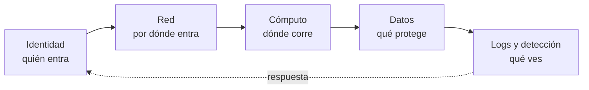
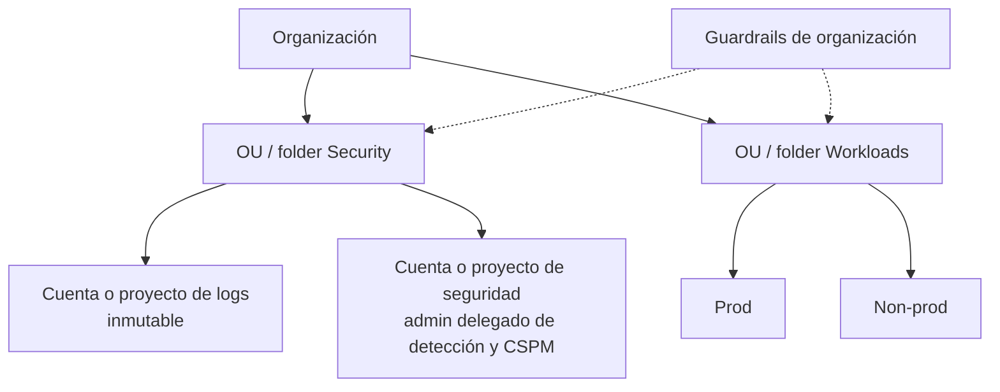

---
tags:
  - seguridad
  - cloud
  - aws
  - azure
  - gcp
  - cumplimiento
---

# Fundamentos de seguridad en la nube

> Los principios que guían todas las decisiones de seguridad en AWS, Azure y Google Cloud, los baselines oficiales para medirte, cómo priorizar y el checklist de controles imprescindibles, con enlace a cada nota de este bloque.

!!! info "Antes de leer"
    Esta es la puerta de entrada del bloque **Seguridad en la nube**. Conviene haber leído el [Shared Responsibility Model](../fundamentos/responsabilidad-compartida.md) (qué protege el proveedor y qué te toca a ti), [IAM: AWS, Azure y GCP](../fundamentos/iam-comparativa.md) (identidades y permisos en cada proveedor) y [Gobernanza](../operacion-y-gobierno/gobernanza.md) (landing zone y guardrails). El foco del bloque no es qué es cada servicio, sino **cómo configurarlo bien y cómo comprobarlo**; la tabla de [controles por proveedor](#controles-por-proveedor) da las equivalencias entre nubes.

## ¿Qué es la seguridad en la nube?

La **cloud security** (seguridad en la nube) es el conjunto de controles que protegen identidades, datos, redes y cargas de trabajo que corren en un proveedor cloud. El proveedor asegura la infraestructura física y los servicios base (*security **of** the cloud*); tú respondes de cómo los configuras (*security **in** the cloud*).

En la práctica, la mayoría de los incidentes en la nube no vienen de fallos del proveedor, sino de **misconfigurations** (configuraciones incorrectas) y de **credenciales comprometidas**: un bucket público, una access key en un repositorio, un rol con `*:*`, una cuenta de administración sin MFA o unos logs que nadie mira.



## Principios

| Principio | Qué significa | Ejemplo en la nube |
| --- | --- | --- |
| **Defense in depth** (defensa en profundidad) | Varias capas de control independientes: si una falla, la siguiente frena el ataque | Bucket privado **y** Block Public Access de organización **y** cifrado con CMK **y** alerta si cambia la política |
| **Least privilege** (mínimo privilegio) | Cada identidad tiene solo los permisos que necesita, en el alcance más pequeño y durante el menor tiempo | Un rol por función Lambda, no un rol compartido con `AdministratorAccess` |
| **Zero trust** (confianza cero) | Ninguna red ni identidad es de confianza por defecto: se verifica cada acceso de forma explícita, con contexto (identidad, dispositivo, riesgo) | Acceso administrativo con Session Manager / Azure Bastion / IAP en lugar de "estar dentro de la VPN" |
| **Secure by default** (seguro por defecto) | Lo que se crea nace seguro sin que nadie tenga que acordarse | Guardrails de organización que impiden IPs públicas o service account keys |
| **Automatizar** (*automate everything*) | Controles definidos como código, aplicados por pipeline y verificados de forma continua | Terraform + escaneo de IaC + CSPM con alertas |
| **Assume breach** (asume la brecha) | Diseña pensando que algo ya está comprometido: limita el radio de impacto (*blast radius*) y prepara la detección | Cuentas separadas por entorno, logs inmutables, playbooks de respuesta |

!!! tip "Zero trust no es un producto"
    Es un modelo descrito, por ejemplo, en **NIST SP 800-207**. En la nube se traduce en tres hábitos: identidad fuerte (MFA resistente a phishing, credenciales temporales), acceso por petición y con contexto (Conditional Access, IAM Conditions, acceso justo a tiempo) y red que no concede confianza por sí sola (private endpoints, sin puertos de administración abiertos). Ver también [Seguridad de red](../../networking/avanzado/seguridad-red.md).

## Baselines oficiales

Un **baseline** (línea base) es una lista de controles verificables contra la que mides tu entorno. Los servicios de **CSPM** (*Cloud Security Posture Management*, gestión de la postura de seguridad) los evalúan de forma automática (ver [CSPM](../../devsecops/escaneos/cspm.md)).

| Baseline | AWS | Azure | Google Cloud |
| --- | --- | --- | --- |
| Del propio proveedor | **AWS Foundational Security Best Practices (FSBP)**, estándar de AWS Security Hub CSPM | **Microsoft cloud security benchmark (MCSB)**, estándar por defecto de Microsoft Defender for Cloud (v2 en *preview* sustituye a v1) | Detectores de **Security Health Analytics** en Security Command Center y **predefined postures** (por ejemplo `secure_by_default_essential`) |
| CIS | **CIS AWS Foundations Benchmark** (Security Hub CSPM soporta hasta v5.0.0) | **CIS Microsoft Azure Foundations Benchmark** | **CIS Google Cloud Computing Platform Benchmark** |
| Arquitectura de referencia | **AWS Security Reference Architecture (AWS SRA)** | Azure landing zones (Cloud Adoption Framework) y **Microsoft Cybersecurity Reference Architectures (MCRA)** | **Enterprise foundations blueprint** |
| Marco de diseño | Pilar de seguridad de AWS Well-Architected | Pilar de seguridad de Azure Well-Architected Framework | Pilar de seguridad del Google Cloud Well-Architected Framework |
| Dónde se evalúa | AWS Security Hub CSPM (y AWS Config) | Microsoft Defender for Cloud (Defender CSPM) y Azure Policy | Security Command Center (Standard, Premium o Enterprise) |

!!! info "Cómo se llaman los controles"
    - **AWS**: cada control tiene un ID `<Servicio>.<n>`, por ejemplo `IAM.6` (*Hardware MFA should be enabled for the root user*) o `CloudTrail.4` (*CloudTrail log file validation should be enabled*). Un mismo control mapea a varios estándares (FSBP, CIS, NIST, PCI DSS).
    - **Azure**: el MCSB se organiza por dominios con IDs como `IM-6` (*Use strong authentication controls*), `DP-6` (*Use a secure key management process*) o `LT-3` (*Enable logging for security investigation*); Defender for Cloud las convierte en **recommendations** con nombre propio (por ejemplo *Key vaults should have purge protection enabled*).
    - **Google Cloud**: los detectores de Security Health Analytics generan **findings** con una categoría en mayúsculas, por ejemplo `MFA_NOT_ENFORCED` o `KMS_KEY_NOT_ROTATED`.

    Las versiones de los benchmarks cambian cada año: revisa en [cisecurity.org](https://www.cisecurity.org/cis-benchmarks) cuál es la vigente y cuál soporta tu CSPM.

!!! note "Security Command Center: tiers"
    Security Health Analytics y la detección básica están en el tier **Standard**; las **postures**, Event Threat Detection y la mayoría de detectores de amenazas requieren **Premium** (o Enterprise, que Google anunció como *deprecated* con migración a Premium). Revisa qué tier tienes antes de asumir que un detector está activo.

## Seguridad desde la landing zone

La seguridad más barata es la que se pone **antes** de que exista la primera aplicación. Una [landing zone](../operacion-y-gobierno/gobernanza.md) bien hecha resuelve de una vez lo que cada equipo olvidaría:



| Pieza | AWS | Azure | Google Cloud |
| --- | --- | --- | --- |
| Identidad central con SSO y MFA | IAM Identity Center federado | Microsoft Entra ID + Conditional Access | Cloud Identity / Google Workspace o Workforce Identity Federation |
| Guardrails preventivos | SCPs y RCPs | Azure Policy (`Deny`) en management groups | Organization Policy |
| Logs centralizados e inmutables | Organization trail a la cuenta Log Archive | Diagnostic settings por Azure Policy a un Log Analytics workspace central | Aggregated sink de organización a un log bucket con retención bloqueada |
| Detección y CSPM de toda la organización | GuardDuty y Security Hub con administrador delegado | Defender for Cloud a nivel de management group | Security Command Center a nivel de organización |
| Contactos de seguridad | Alternate contacts (Security) de cada cuenta | Security contacts de Defender for Cloud | Essential Contacts (categoría Security) |

Cada pieza se detalla en las notas de [identidades](seguridad-identidades.md) y de [logging y detección](seguridad-logging-deteccion.md).

## Cómo priorizar

No se puede hacer todo el primer día. Un orden razonable, de mayor a menor impacto por esfuerzo:

1. **Proteger el acceso privilegiado**: root / Global Administrator / Super Admin con MFA resistente a phishing, cuentas break-glass, nadie trabaja con ellas a diario.
2. **Eliminar credenciales de larga duración**: access keys, client secrets y service account keys sustituidos por roles, managed identities, Workload Identity Federation y OIDC.
3. **Ver lo que pasa**: audit logs de toda la organización centralizados e inmutables, y detección de amenazas activa en todas las cuentas y regiones.
4. **Cerrar la exposición pública**: almacenamiento, bases de datos, puertos de administración y endpoints de gestión sin acceso desde internet salvo lo que sea explícitamente público.
5. **Guardrails**: convertir lo anterior en políticas de organización para que no se pueda deshacer.
6. **Datos**: cifrado con CMK donde lo exija la clasificación, secretos en un gestor, backups protegidos contra borrado.
7. **Cargas de trabajo**: endurecimiento y parches de VMs, contenedores, serverless, APIs y servicios de IA.
8. **Mejora continua**: CSPM con objetivos (*secure score*, % de controles en `PASSED`), revisión de permisos y simulacros de respuesta.

!!! tip "Usa el riesgo, no la lista"
    Prioriza los hallazgos de CSPM por **exposición + privilegio + sensibilidad del dato**: un bucket público con datos personales va antes que cien recursos sin etiqueta. Las herramientas modernas (Defender CSPM *attack paths*, Security Command Center *attack exposure*, el nuevo AWS Security Hub) ya correlacionan estos factores.

## Riesgos típicos

| Riesgo | Ejemplo o incidente conocido | Control que lo evita |
| --- | --- | --- |
| Credenciales filtradas de larga duración | Access keys de AWS publicadas en repositorios (caso Uber, 2016) | Sin long-term keys; secret scanning; OIDC ([identidades](seguridad-identidades.md)) |
| Cuentas sin MFA | Robo masivo de datos de clientes de Snowflake (2024) con credenciales robadas y sin MFA | MFA obligatorio y resistente a phishing |
| Consola de administración comprometida | Code Spaces (2014): el atacante borró casi todos los recursos y backups, y la empresa cerró | Break-glass, separación de cuentas, backups en otra cuenta con bloqueo de borrado |
| Rol con demasiados permisos + SSRF | Capital One (2019): SSRF contra el servicio de metadatos y un rol con acceso a cientos de buckets | Least privilege, IMDSv2 ([VMs](seguridad-maquinas-virtuales.md)), WAF ([APIs](seguridad-apis-aplicaciones.md)) |
| Almacenamiento público por error | Buckets y blobs expuestos con datos personales (muy frecuente) | Block Public Access de organización ([almacenamiento](seguridad-almacenamiento.md)) |
| Nadie detecta el ataque | Actividad maliciosa visible en logs que no se revisaban | Logs centralizados + detección + alertas ([logging](seguridad-logging-deteccion.md)) |
| Entorno de prueba olvidado | Midnight Blizzard contra Microsoft (2024): un tenant de pruebas heredado sin MFA dio acceso inicial | Inventario, guardrails también en sandbox, revisión de cuentas inactivas |

## Controles por proveedor

Servicios que soportan los controles transversales del bloque. **(I)** = imprescindible.

| Control | AWS | Azure | Google Cloud |
| --- | --- | --- | --- |
| CSPM contra un baseline **(I)** | AWS Security Hub CSPM (FSBP + CIS) | Defender for Cloud (MCSB, Defender CSPM) | Security Command Center (Security Health Analytics, postures) |
| Detección de amenazas **(I)** | Amazon GuardDuty | Microsoft Defender for Cloud (planes Defender for…) | Security Command Center (Event Threat Detection…) |
| Audit logs de organización **(I)** | AWS CloudTrail (organization trail) | Activity Log + logs de Microsoft Entra | Cloud Audit Logs + aggregated sink |
| Guardrails preventivos **(I)** | SCPs / RCPs | Azure Policy | Organization Policy |
| Registro de configuración | AWS Config | Azure Resource Graph + Azure Policy | Cloud Asset Inventory |
| Análisis de permisos | IAM Access Analyzer | Entra access reviews, PIM, Defender CSPM (CIEM) | IAM Recommender, Policy Analyzer |
| Gestión de claves | AWS KMS | Azure Key Vault / Managed HSM | Cloud KMS |
| Gestión de secretos | AWS Secrets Manager, Parameter Store | Azure Key Vault (secrets) | Secret Manager |
| WAF y DDoS | AWS WAF, AWS Shield | Azure Web Application Firewall, Azure DDoS Protection | Google Cloud Armor |
| Vulnerabilidades de cómputo | Amazon Inspector | Defender for Servers / Defender Vulnerability Management | Security Command Center (Vulnerability Assessment) |
| Agregación y SIEM | AWS Security Hub, Amazon Security Lake | Microsoft Sentinel | Google Security Operations |

## Buenas prácticas

1. **Activa el CSPM y la detección en toda la organización**, no cuenta por cuenta, con una cuenta o proyecto de seguridad como administrador delegado.
2. **Elige un baseline principal** (FSBP, MCSB o el detector set de SCC) y uno de referencia externa (CIS). No actives diez estándares: multiplicas hallazgos duplicados.
3. **Define objetivos medibles**: porcentaje de controles críticos en `PASSED`, *secure score*, tiempo de remediación por severidad (ver [Detección y respuesta](../../devsecops/gobierno-y-respuesta/deteccion-respuesta.md)).
4. **Todo como código**: landing zone, guardrails, roles y configuración de seguridad en Terraform u otro IaC, revisado en pull request y escaneado (ver [Seguridad de IaC](../../devsecops/infraestructura-y-contenedores/seguridad-iac.md)).
5. **Separa entornos y funciones** en cuentas, suscripciones o proyectos distintos.
6. **Etiqueta la sensibilidad del dato** (`data-classification`) para decidir controles: no todo necesita CMK ni Object Lock.
7. **Asigna un dueño a cada alerta**: un hallazgo sin responsable es ruido.
8. **Practica la respuesta**: simulacros de credencial filtrada o bucket público al menos una vez al año.

=== "AWS"

    - Activa **AWS Organizations** con todas las funciones, **Control Tower** o una landing zone equivalente, y la **gestión centralizada del root** de las cuentas miembro.
    - En Security Hub CSPM usa la **configuración central** (*central configuration*) para aplicar estándares a todas las cuentas y regiones desde el administrador delegado.

=== "Azure"

    - Asigna el estándar **MCSB** y los planes de Defender a nivel de **management group**, no suscripción por suscripción.
    - Recuerda que Microsoft exige **MFA obligatorio** para iniciar sesión en Azure (portal y, de forma progresiva, CLI, PowerShell e IaC): planifica cuentas de servicio con managed identities o workload identity federation, no con usuarios.

=== "Google Cloud"

    - Las organizaciones creadas desde mayo de 2024 nacen con **secure-by-default organization policies** (por ejemplo, `iam.managed.disableServiceAccountKeyCreation` y `storage.uniformBucketLevelAccess`). Si tu organización es anterior, aplícalas tú.
    - Activa Security Command Center **a nivel de organización** para que cubra todos los proyectos.

## Cómo verificarlo

Comandos de solo lectura para comprobar que la base del bloque está activa.

=== "AWS"

    ```bash
    # Security Hub CSPM activo y estándares habilitados (FSBP, CIS...)
    aws securityhub describe-hub
    aws securityhub get-enabled-standards \
      --query 'StandardsSubscriptions[].{arn:StandardsArn,estado:StandardsStatus}'

    # Controles fallidos más críticos
    aws securityhub get-findings --max-items 20 --filters '{
      "ComplianceStatus":[{"Value":"FAILED","Comparison":"EQUALS"}],
      "SeverityLabel":[{"Value":"CRITICAL","Comparison":"EQUALS"}],
      "RecordState":[{"Value":"ACTIVE","Comparison":"EQUALS"}]}' \
      --query 'Findings[].{control:Compliance.SecurityControlId,recurso:Resources[0].Id}'

    # Administrador delegado de seguridad en la organización
    aws organizations list-delegated-administrators
    ```

=== "Azure"

    ```bash
    # Planes de Defender for Cloud (Standard = activo)
    az security pricing list --query "value[].{plan:name, tier:pricingTier}" -o table

    # Secure score y recomendaciones no saludables
    az security secure-scores list -o table
    az security assessment list \
      --query "[?status.code=='Unhealthy'].{rec:displayName, recurso:resourceDetails.Id}" -o table

    # Iniciativas asignadas en un management group (MCSB, CIS...)
    az policy assignment list --scope /providers/Microsoft.Management/managementGroups/<mg> \
      --query "[].{nombre:displayName, def:policyDefinitionId}" -o table
    ```

=== "Google Cloud"

    ```bash
    # Findings activos de alta severidad en toda la organización
    gcloud scc findings list organizations/<org-id> --location=global \
      --filter='state="ACTIVE" AND (severity="CRITICAL" OR severity="HIGH")' \
      --format="table(finding.category, finding.resourceName)"

    # Postures desplegadas (requiere Premium)
    gcloud scc posture-deployments list --organization=<org-id> --location=global

    # Organization policies efectivas en la organización
    gcloud org-policies list --organization=<org-id>
    ```

| Control imprescindible | AWS (Security Hub CSPM) | Azure (MCSB / Defender for Cloud) | Google Cloud (SCC) |
| --- | --- | --- | --- |
| Detección de amenazas activa | `GuardDuty.1` | `LT-1`; planes de Defender en *Standard* | Event Threat Detection habilitado (Premium) |
| Logging de auditoría | `CloudTrail.1` | `LT-3` | `AUDIT_LOGGING_DISABLED` |
| Contactos de seguridad | `Account.1` (*Security contact information should be provided*) | Security contacts configurados | `ESSENTIAL_CONTACTS_NOT_CONFIGURED` |

## Configuración segura con IaC

Los fragmentos de Terraform con estos controles (y los guardrails de organización, cuando aplican) están en las páginas por proveedor: [AWS](terraform/aws.md#base-de-seguridad), [Azure](terraform/azure.md#base-de-seguridad) y [Google Cloud](terraform/google-cloud.md#base-de-seguridad).

## Errores comunes

- **Activar el CSPM y no mirarlo**: cientos de hallazgos sin dueño ni SLA.
- **Habilitar solo en la región "principal"**: los atacantes usan las regiones que no vigilas. Detección y CloudTrail en todas las regiones, y guardrail que bloquee las no usadas.
- **Excepciones permanentes**: suprimir un control "por ahora" sin fecha de revisión.
- **Guardrails que no cubren sandbox**: las cuentas de pruebas también tienen credenciales y facturan.
- **Confundir cumplimiento con seguridad**: pasar CIS al 100 % no significa estar a salvo; el benchmark es el mínimo.
- **Confiar en los valores por defecto antiguos**: lo que era seguro por defecto cambia (cifrado de S3, uniform bucket-level access, MFA obligatorio). Revisa las cuentas antiguas.

## Checklist resumen

Controles imprescindibles de todo el bloque y la nota que los desarrolla:

- [ ] Root / Global Administrator / Super Admin con MFA resistente a phishing, cuentas break-glass y sin uso diario → [Seguridad de identidades](seguridad-identidades.md)
- [ ] Sin access keys, client secrets ni service account keys de larga duración; OIDC y workload identities → [Seguridad de identidades](seguridad-identidades.md)
- [ ] Guardrails de organización (SCP/RCP, Azure Policy, Organization Policy) → [Seguridad de identidades](seguridad-identidades.md)
- [ ] Cifrado por defecto revisado (por ejemplo, EBS encryption by default); claves con rotación, separación de roles y protección contra borrado; secretos en un gestor, leídos con la identidad del recurso y con rotación → [Seguridad de cifrado y secretos](seguridad-cifrado-secretos.md)
- [ ] Audit logs de organización centralizados, inmutables y con retención; registro de configuración en todas las regiones; detección activa en todas las cuentas y alertas mínimas con responsable y canal claros → [Seguridad de logging y detección](seguridad-logging-deteccion.md)
- [ ] Sin 0.0.0.0/0 a puertos de administración; private endpoints; flow logs; WAF y DDoS → [Seguridad de redes](seguridad-redes.md)
- [ ] VMs con imagen endurecida, parches automáticos, IMDSv2 y sin IP pública → [Seguridad de máquinas virtuales](seguridad-maquinas-virtuales.md)
- [ ] Clústeres con API server privado, workload identity, Pod Security y registry con escaneo → [Seguridad de contenedores y Kubernetes](seguridad-contenedores-kubernetes.md)
- [ ] Funciones con rol mínimo, sin secretos en variables y sin URLs públicas sin autenticación → [Seguridad de serverless](seguridad-serverless.md)
- [ ] Bloqueo de acceso público a nivel organización, versioning y bloqueo de objetos donde aplique → [Seguridad de almacenamiento](seguridad-almacenamiento.md)
- [ ] Bases de datos sin acceso público, TLS obligatorio, autenticación con IAM/Entra y backups protegidos → [Seguridad de bases de datos](seguridad-bases-datos.md)
- [ ] APIs con autenticación, rate limiting y WAF delante → [Seguridad de APIs y aplicaciones](seguridad-apis-aplicaciones.md)
- [ ] Servicios de IA con acceso privado, guardrails de contenido y logs de invocación → [Seguridad de servicios de IA](seguridad-servicios-ia.md)

## Relación con otras secciones

| Enfoque | Qué se mira desde ahí | Nota |
| --- | --- | --- |
| Cloud (el control) | Modelo de responsabilidad, IAM de cada proveedor, landing zone y guardrails | [Shared Responsibility Model](../fundamentos/responsabilidad-compartida.md), [IAM: AWS, Azure y GCP](../fundamentos/iam-comparativa.md), [Gobernanza](../operacion-y-gobierno/gobernanza.md), [Well-Architected Framework](../fundamentos/well-architected.md) |
| DevOps (la automatización) | Landing zone y controles definidos como código y desplegados por pipeline | [Infrastructure as Code](../../devops/iac/infraestructura-como-codigo.md), [Terraform](../../devops/iac/terraform-basico.md) |
| DevSecOps (la verificación) | Postura evaluada de forma continua contra CIS y el baseline del proveedor; respuesta a hallazgos | [CSPM](../../devsecops/escaneos/cspm.md), [Cumplimiento y gobierno](../../devsecops/gobierno-y-respuesta/cumplimiento.md), [Fundamentos DevSecOps](../../devsecops/fundamentos-devsecops.md), [Detección y respuesta](../../devsecops/gobierno-y-respuesta/deteccion-respuesta.md) |
| Networking (la base) | Zero trust, segmentación y firewalls como base de la seguridad de red | [Seguridad de red](../../networking/avanzado/seguridad-red.md) |
| Negocio TI (el porqué) | Riesgo, apetito de riesgo y relación con cumplimiento | [Gobierno y riesgo de TI](../../negocio/gobierno-riesgo-ti.md) |
| Laboratorios (la práctica) | Practicar esto paso a paso | [Lab 16: Auditar tu cuenta cloud con Prowler (CSPM)](../../laboratorios/devsecops/cspm-prowler.md) |

## Referencias

- [AWS Foundational Security Best Practices standard](https://docs.aws.amazon.com/securityhub/latest/userguide/fsbp-standard.html)
- [CIS AWS Foundations Benchmark en Security Hub CSPM](https://docs.aws.amazon.com/securityhub/latest/userguide/cis-aws-foundations-benchmark.html)
- [AWS Security Reference Architecture (AWS SRA)](https://docs.aws.amazon.com/prescriptive-guidance/latest/security-reference-architecture/welcome.html)
- [Pilar de seguridad de AWS Well-Architected](https://docs.aws.amazon.com/wellarchitected/latest/security-pillar/welcome.html)
- [Microsoft cloud security benchmark](https://learn.microsoft.com/es-es/security/benchmark/azure/overview)
- [Microsoft Defender for Cloud](https://learn.microsoft.com/es-es/azure/defender-for-cloud/defender-for-cloud-introduction)
- [Microsoft Cybersecurity Reference Architectures](https://learn.microsoft.com/es-es/security/adoption/mcra)
- [Security Command Center](https://cloud.google.com/security-command-center/docs/security-command-center-overview)
- [Security posture service](https://cloud.google.com/security-command-center/docs/security-posture-overview)
- [Secure-by-default organizations en Google Cloud](https://cloud.google.com/resource-manager/docs/secure-by-default-organizations)
- [Enterprise foundations blueprint](https://cloud.google.com/architecture/security-foundations)
- [CIS Benchmarks](https://www.cisecurity.org/cis-benchmarks)
- [NIST SP 800-207: Zero Trust Architecture](https://csrc.nist.gov/pubs/sp/800/207/final)
