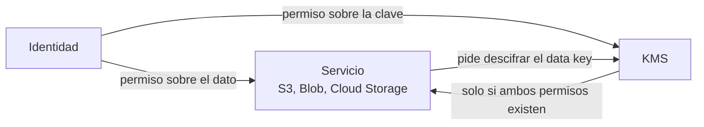
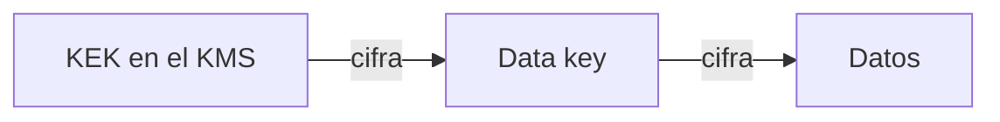

---
tags:
  - seguridad
  - cloud
  - aws
  - azure
  - gcp
  - cifrado
  - secretos
---

# Seguridad de cifrado, claves y secretos

> Cómo configurar bien el cifrado en reposo y en tránsito, los servicios de claves (AWS KMS, Azure Key Vault, Cloud KMS), los secretos y los certificados: políticas de acceso, separación de roles, rotación y protección contra el borrado.

!!! info "Antes de leer"
    En el [Shared Responsibility Model](../fundamentos/responsabilidad-compartida.md), el proveedor cifra la infraestructura y opera los HSM; tú decides **qué clave usa cada dato, quién puede usarla, cuándo se rota y quién puede borrarla**, y dónde viven los secretos de tus aplicaciones. Quién puede usar cada clave se decide con IAM (ver [IAM: AWS, Azure y GCP](../fundamentos/iam-comparativa.md)).

## ¿Qué protege el cifrado y qué no?

El cifrado protege los datos **si alguien obtiene el soporte** (un disco, un snapshot, un backup, un paquete de red) **pero no la clave**. No protege frente a una identidad que tiene permiso para leer el dato: si un rol puede hacer `s3:GetObject` **y** `kms:Decrypt`, verá el contenido en claro. Por eso el cifrado en la nube es, sobre todo, **un problema de control de acceso a las claves**.



Con una **customer-managed key** (CMK) añades un segundo candado independiente: aunque alguien tenga acceso al dato, sin permiso sobre la clave no lo puede leer, y desactivar la clave "apaga" el acceso a todo lo que cifra.

## Envelope encryption y modelos de clave

Los servicios de KMS no cifran tus datos directamente: usan **envelope encryption** (cifrado de sobre). Un **data key** (clave de datos) cifra los datos y una **KEK** (*key encryption key*, clave de cifrado de claves) guardada en el KMS cifra ese data key. Así la clave maestra nunca sale del KMS y rotarla no obliga a recifrar todos los datos.



Quién gestiona la KEK define cuánto controlas tú:

| Modelo | AWS | Azure | Google Cloud | Qué controlas |
| --- | --- | --- | --- | --- |
| **Provider-managed keys** (claves gestionadas por el proveedor) | AWS owned keys, AWS managed keys (`aws/s3`, `aws/ebs`…) | Microsoft-managed keys | Google default encryption | Nada: el proveedor crea, guarda y rota la clave |
| **Customer-managed keys** (claves gestionadas por el cliente, CMK) | Customer managed keys en AWS KMS | Customer-managed keys en Key Vault o Managed HSM | CMEK (*customer-managed encryption keys*) en Cloud KMS | Políticas de acceso, rotación, desactivación y borrado de la clave |
| Clave generada o guardada fuera | Importar material de clave (*BYOK*, *Bring Your Own Key*) o external key store (XKS) | Importar claves a Key Vault o Managed HSM (*BYOK*) | Importar claves a Cloud KMS o Cloud External Key Manager (EKM) | Generas la clave tú; con XKS y EKM además vive en un gestor externo |

Las CMK tienen sentido cuando un requisito de [cumplimiento](../../devsecops/gobierno-y-respuesta/cumplimiento.md) lo exige, cuando necesitas separar quién administra los datos de quién administra las claves, o cuando quieres poder "apagar" el acceso a los datos desactivando la clave (*crypto-shredding*, borrado criptográfico). A cambio, tú respondes de su ciclo de vida.

## Cifrado en reposo y en tránsito por servicio

El **encryption at rest** (cifrado en reposo) protege los datos guardados en discos, buckets, bases de datos y backups; el **encryption in transit** (cifrado en tránsito), los que viajan por la red, con **TLS** (*Transport Layer Security*).

| Servicio | En reposo por defecto | Qué te toca activar | En tránsito |
| --- | --- | --- | --- |
| **Amazon S3** | Sí (SSE-S3) desde 2023 | SSE-KMS con CMK si la clasificación lo exige; *S3 Bucket Keys* para reducir llamadas a KMS | Bucket policy que deniega si `aws:SecureTransport` es `false` |
| **Amazon EBS** | **No** por defecto | **EBS encryption by default** en cada región | Cifrado entre la instancia y el volumen en instancias Nitro |
| **Amazon RDS / Aurora** | Opción al crear (no se puede activar después sin restaurar) | `storage_encrypted = true` con CMK | Parámetro `rds.force_ssl` (PostgreSQL) o `require_secure_transport` (MySQL) |
| **Azure Storage** | Sí (Microsoft-managed keys, siempre) | CMK en Key Vault; *infrastructure encryption* (doble cifrado) si se exige | **Secure transfer required** y TLS mínimo 1.2 |
| **Azure managed disks** | Sí (SSE con Microsoft-managed keys) | **Encryption at host** o disk encryption set con CMK | — |
| **Azure SQL Database** | Sí (**TDE**, *Transparent Data Encryption*) | TDE con CMK si se exige | TLS mínimo configurable en el servidor |
| **Cloud Storage, Persistent Disk, Cloud SQL** | Sí (Google default encryption, siempre) | **CMEK** con Cloud KMS donde lo exija la clasificación | Cloud SQL: `ssl_mode` que exige conexiones cifradas |
| **Tráfico entre servicios del proveedor** | — | — | Cifrado por el proveedor en su red; tu parte es TLS en tus endpoints y en tus clientes |

!!! warning "Azure Disk Encryption"
    Microsoft recomienda **encryption at host** (y SSE con CMK) para los discos de VMs en lugar de **Azure Disk Encryption** (BitLocker/DM-Crypt dentro de la VM), que tiene fecha de retiro anunciada. Revisa la fecha vigente en la documentación antes de planificar.

Detalle por servicio en [almacenamiento](seguridad-almacenamiento.md), [bases de datos](seguridad-bases-datos.md) y [máquinas virtuales](seguridad-maquinas-virtuales.md).

## Servicios de claves

| | AWS KMS | Azure Key Vault / Managed HSM | Cloud KMS |
| --- | --- | --- | --- |
| Control de acceso | **Key policy** (obligatoria, en la clave) + IAM policies + grants | **Azure RBAC** (recomendado) o *access policies* heredadas | Cloud IAM en key ring o en la clave |
| Roles de administración | Acciones `kms:Create*`, `kms:Put*`, `kms:ScheduleKeyDeletion`… | **Key Vault Crypto Officer**, **Key Vault Administrator** | `roles/cloudkms.admin` |
| Roles de uso | `kms:Encrypt`, `kms:Decrypt`, `kms:GenerateDataKey*` | **Key Vault Crypto User**, **Key Vault Crypto Service Encryption User** | `roles/cloudkms.cryptoKeyEncrypterDecrypter` |
| Rotación automática | Anual por defecto; periodo configurable (90–2560 días) y rotación bajo demanda | **Key rotation policy** (autorrotación con aviso antes de la expiración) | `rotation_period` en claves simétricas |
| Protección contra borrado | **Waiting period** de 7 a 30 días (estado `PendingDeletion`) | **Soft-delete** (obligatorio, 7–90 días) + **purge protection** | Versiones en `DESTROY_SCHEDULED` durante `destroy_scheduled_duration` (30 días por defecto) |
| HSM | Claves de KMS en HSM validados FIPS; **AWS CloudHSM**; custom key stores | Key Vault Premium (claves HSM); **Managed HSM** (single-tenant) | Protection level `HSM`; **Cloud HSM** |
| Clave fuera del proveedor | **External key store (XKS)** | Managed HSM con BYOK | **Cloud External Key Manager (EKM)** |
| Automatizar CMEK | — | — | **Cloud KMS Autokey** (crea claves por recurso) |

### Separación de roles

La **separation of duties** (separación de funciones) es el control más importante después de "tener una CMK": **quien administra la clave no la usa, y quien la usa no la administra**.

- Los **administradores de claves** (equipo de seguridad o plataforma) crean, rotan, desactivan y programan el borrado, pero **no** pueden descifrar.
- Los **usuarios de claves** (la aplicación, el servicio) cifran y descifran, pero **no** pueden cambiar la política ni borrarla.
- Nadie tiene ambos roles de forma permanente. En Google Cloud, Security Health Analytics lo comprueba con `KMS_ROLE_SEPARATION`.
- Las claves viven en una **cuenta, suscripción o proyecto dedicado** a seguridad, separado de las cargas de trabajo (en GCP, sin `roles/owner` en ese proyecto: `KMS_PROJECT_HAS_OWNER`).

=== "AWS"

    ```json title="Key policy con separación de roles (fragmento)"
    {
      "Version": "2012-10-17",
      "Statement": [
        {
          "Sid": "KeyAdmins",
          "Effect": "Allow",
          "Principal": { "AWS": "arn:aws:iam::111122223333:role/seguridad-kms-admin" },
          "Action": [
            "kms:Create*", "kms:Describe*", "kms:Enable*", "kms:List*", "kms:Put*",
            "kms:Update*", "kms:Revoke*", "kms:Disable*", "kms:Get*", "kms:Delete*",
            "kms:TagResource", "kms:UntagResource",
            "kms:ScheduleKeyDeletion", "kms:CancelKeyDeletion", "kms:RotateKeyOnDemand"
          ],
          "Resource": "*"
        },
        {
          "Sid": "KeyUsersViaS3",
          "Effect": "Allow",
          "Principal": { "AWS": "arn:aws:iam::111122223333:role/app-pagos" },
          "Action": ["kms:Encrypt", "kms:Decrypt", "kms:GenerateDataKey*", "kms:DescribeKey"],
          "Resource": "*",
          "Condition": {
            "StringEquals": { "kms:ViaService": "s3.us-east-1.amazonaws.com" }
          }
        }
      ]
    }
    ```

    La condición `kms:ViaService` hace que la aplicación solo pueda usar la clave **a través de S3**, no llamando a KMS directamente. En una key policy, `"Resource": "*"` significa "esta clave".

=== "Azure"

    Usa el **modelo de permisos Azure RBAC** en el vault (no las access policies) y asigna los roles en el ámbito del vault o de la clave concreta: el equipo de seguridad recibe *Key Vault Crypto Officer*; la identidad del servicio (por ejemplo, la de una storage account con CMK) recibe *Key Vault Crypto Service Encryption User*. Nadie de los equipos de aplicación debería tener *Key Vault Administrator*.

=== "Google Cloud"

    Crea un **proyecto de claves** separado. Concede `roles/cloudkms.admin` al grupo de seguridad y `roles/cloudkms.cryptoKeyEncrypterDecrypter` **en la clave concreta** al *service agent* del servicio que la usa (por ejemplo, `service-<número>@gs-project-accounts.iam.gserviceaccount.com` para Cloud Storage), no en todo el proyecto.

### Rotación

- **Rotar una clave KMS no recifra los datos**: crea una nueva versión del material para cifrar lo nuevo y conserva las anteriores para descifrar lo existente. Por eso es barata y conviene activarla siempre en claves simétricas.
- La rotación **no protege** si la clave ya fue usada por un atacante con permisos: para eso se revoca el permiso o se desactiva la clave.
- Las claves **asimétricas** y las importadas (BYOK) suelen requerir rotación manual.

### Borrado programado

!!! danger "Borrar una CMK es destruir los datos"
    Antes de programar el borrado de una clave, comprueba en los audit logs que nadie la usa (en AWS, que no hay llamadas `Decrypt` en los últimos meses) y prefiere **desactivarla** primero. Limita con un guardrail quién puede programar el borrado y alerta cuando ocurra (`ScheduleKeyDeletion`, `DisableKey`; en Azure, `Purge`; en GCP, `DestroyCryptoKeyVersion`).

## Secretos

Un **secret** (secreto) es una credencial que una aplicación necesita en tiempo de ejecución. Reglas que no cambian entre nubes:

1. **Nunca en el código, en la imagen ni en variables de entorno escritas en texto plano** en IaC, en la definición de la función o en el repositorio. Las variables de entorno de Lambda, App Service o Cloud Run son visibles para cualquiera con permiso de lectura sobre la configuración.
2. **La aplicación lee el secreto con su identidad** (rol, managed identity, service account) desde el gestor, en tiempo de ejecución o al arrancar, y solo **su** secreto.
3. **Un gestor por entorno** (o al menos permisos separados): una identidad de dev nunca lee secretos de prod.
4. **Rotación automática** donde se pueda; donde no, caducidad y alerta antes de que venza.
5. **Mejor sin secreto**: si el servicio de destino acepta autenticación con IAM o Entra (RDS IAM authentication, Azure SQL con Entra ID, Cloud SQL IAM database authentication), elimina la contraseña.

| | AWS Secrets Manager | Azure Key Vault (secrets) | Secret Manager |
| --- | --- | --- | --- |
| Rotación | Automática con una función Lambda o **managed rotation** (p. ej. contraseña maestra de RDS gestionada) | Caducidad + evento `SecretNearExpiry` en Event Grid para tu automatización | **Rotation schedule** que publica en Pub/Sub; la rotación la implementas tú |
| Acceso | IAM + **resource policy** del secreto (con *Block Public Policy*) | Azure RBAC: **Key Vault Secrets User** en el vault o en el secreto | `roles/secretmanager.secretAccessor` en el secreto |
| Cifrado | KMS (clave `aws/secretsmanager` o CMK) | Del propio vault (HSM en Premium) | Google default encryption o CMEK |
| Red | VPC endpoint (PrivateLink) | Private endpoint, firewall del vault | VPC Service Controls; regional secrets |
| Caducidad | Rotación programada | `expires` en cada secreto | `expire_time` / `ttl` |

=== "AWS"

    Para bases de datos de RDS y Aurora, usa `manage_master_user_password = true`: RDS guarda la contraseña maestra en Secrets Manager y la rota sin función Lambda propia. En ECS y Lambda, referencia el ARN del secreto en lugar de copiar su valor en una variable.

    **Parameter Store** (de AWS Systems Manager) también guarda secretos simples como parámetros `SecureString` (cifrados con KMS y con versiones), pero **no rota**: úsalo para configuración y deja las credenciales que deben rotar en Secrets Manager.

=== "Azure"

    Se recomienda **un Key Vault por aplicación y por entorno**, con el modelo de permisos Azure RBAC. En App Service y Azure Functions usa **Key Vault references** (`@Microsoft.KeyVault(SecretUri=...)`) en la configuración, resueltas con la managed identity de la app. En AKS, el **Secrets Store CSI Driver** con el proveedor de Azure Key Vault monta los secretos sin guardarlos en el clúster.

=== "Google Cloud"

    En Cloud Run y Cloud Run functions, monta el secreto como **volumen o variable referenciada** a Secret Manager (no como valor literal) y fija una versión concreta o `latest` según tu estrategia de rotación.

Cómo inyectar secretos desde el pipeline, Vault y External Secrets Operator se ven en [Secretos e identidades](../../devsecops/identidades-y-pipeline/secretos-identidades.md); cómo detectarlos en commits, en [Secret scanning](../../devsecops/escaneos/secret-scanning.md).

## Certificados

| | AWS | Azure | Google Cloud |
| --- | --- | --- | --- |
| Certificados públicos gestionados | **AWS Certificate Manager (ACM)**: emisión gratuita y renovación automática con validación DNS | Certificados gestionados de **Azure Front Door** y **App Service**; **Key Vault certificates** con CA integrada (DigiCert, GlobalSign) | **Certificate Manager** (Google-managed con *DNS authorization*); certificados gestionados de los load balancers |
| CA privada | **AWS Private CA** | Key Vault con CA propia o externa | **Certificate Authority Service** |
| Dónde se usan | CloudFront, ALB/NLB, API Gateway | Front Door, Application Gateway, App Service, API Management | Load balancers, Cloud Run (dominios), API Gateway |

!!! warning "Los certificados TLS duran cada vez menos"
    El CA/Browser Forum aprobó reducir la validez máxima de los certificados TLS públicos de forma escalonada (hasta 47 días hacia 2029). Renovar a mano dejará de ser viable: usa siempre certificados **gestionados con renovación automática** y alertas de caducidad. Una caducidad olvidada puede tumbar un servicio entero, como le pasó a Microsoft Teams en febrero de 2020.

## Riesgos típicos

| Riesgo | Ejemplo o incidente conocido | Control que lo evita |
| --- | --- | --- |
| Secreto publicado en un repositorio | Toyota (2022): una clave de acceso a un servidor de datos estuvo años en un repositorio público de GitHub | Secretos en un gestor, secret scanning, identidades sin secreto |
| Claves de descifrado guardadas junto a los datos | LastPass (2022): el atacante obtuvo backups y las claves para acceder a ellos | Separación de roles y de cuentas; CMK con acceso restringido |
| Robo de una clave de firma | Storm-0558 (2023): una clave de firma de Microsoft robada permitió falsificar tokens | HSM, claves que no salen del KMS, rotación |
| Borrado o desactivación de una CMK | Datos irrecuperables o servicio caído (ransomware "cripto" con claves propias del atacante) | Waiting period, purge protection, guardrail sobre el borrado, alerta |
| Volúmenes o snapshots sin cifrar | Snapshots de EBS compartidos públicamente con datos sensibles | EBS encryption by default; bloqueo de compartición pública de snapshots |
| Tráfico en claro | Conexiones a bases de datos sin TLS dentro de la VPC | Forzar TLS en el servidor y en la política del bucket |
| Certificado caducado | Caída de Microsoft Teams (2020) | Certificados gestionados con renovación automática |

## Controles por proveedor

**(I)** = imprescindible.

| Control | AWS | Azure | Google Cloud |
| --- | --- | --- | --- |
| Cifrado por defecto en todos los volúmenes **(I)** | EBS encryption by default por región | SSE de managed disks (siempre); encryption at host | Siempre (Google default encryption) |
| CMK donde lo exija la clasificación | SSE-KMS / CMK por servicio | CMK en Key Vault o Managed HSM | CMEK (manual o con Autokey) |
| Rotación de claves **(I)** | `enable_key_rotation` | Key rotation policy | `rotation_period` |
| Separación de roles sobre claves **(I)** | Key policy con admins y usuarios separados | RBAC: Crypto Officer vs Crypto User | `cloudkms.admin` vs `cryptoKeyEncrypterDecrypter` |
| Protección contra borrado **(I)** | Waiting period 30 días + guardrail | Soft-delete + **purge protection** | `destroy_scheduled_duration` + `prevent_destroy` en IaC |
| Acceso privado al KMS y a los secretos | VPC endpoints de KMS y Secrets Manager | Private endpoint, firewall del vault | Private Google Access, VPC Service Controls |
| Secretos en gestor con rotación **(I)** | Secrets Manager | Key Vault secrets | Secret Manager |
| TLS obligatorio **(I)** | `aws:SecureTransport`, parámetros de RDS, políticas TLS de ELB | Secure transfer required, TLS mínimo 1.2 | `ssl_mode` en Cloud SQL, políticas SSL de los load balancers |
| Certificados gestionados | ACM, AWS Private CA | Key Vault certificates, certificados gestionados | Certificate Manager, Certificate Authority Service |
| Exigir CMK por guardrail | SCP con condiciones `s3:x-amz-server-side-encryption-aws-kms-key-id` u otras por servicio | Azure Policy (*should use customer-managed key*) | `gcp.restrictNonCmekServices`, `gcp.restrictCmekCryptoKeyProjects` |

## Buenas prácticas

1. **Activa el cifrado por defecto** que no viene activado (EBS por región) y verifica que nada antiguo quedó fuera.
2. **Fuerza TLS** en todos los endpoints de datos (buckets, bases de datos, colas) con políticas, no con buena voluntad.
3. **Clasifica los datos** y usa CMK solo donde aporte: datos regulados, separación de funciones o necesidad de *crypto-shredding*.
4. **Claves en una cuenta o proyecto de seguridad**, con separación de roles y sin administradores humanos permanentes.
5. **Rotación automática** de claves simétricas y de secretos; caducidad y alerta donde no haya rotación.
6. **Protege el borrado**: waiting period máximo, purge protection, `prevent_destroy` en Terraform y guardrail.
7. **Elimina secretos** que se puedan reemplazar por identidad (IAM/Entra para bases de datos, managed identities, Workload Identity Federation).
8. **Certificados gestionados** con renovación automática en todo lo público.
9. **Audita el uso de las claves**: las llamadas a KMS quedan en los audit logs (ver [logging y detección](seguridad-logging-deteccion.md)).

## Cómo verificarlo

Comandos de solo lectura.

=== "AWS"

    ```bash
    # Cifrado por defecto de EBS en la región actual
    aws ec2 get-ebs-encryption-by-default

    # Claves customer managed: rotación, estado y borrado programado
    for k in $(aws kms list-keys --query 'Keys[].KeyId' --output text); do
      m=$(aws kms describe-key --key-id "$k" --query 'KeyMetadata.[KeyManager,KeyState,DeletionDate]' --output text)
      r=$(aws kms get-key-rotation-status --key-id "$k" --query 'KeyRotationEnabled' --output text 2>/dev/null)
      echo "$k $m rotacion=$r"
    done | grep CUSTOMER

    # Secretos sin rotación automática
    aws secretsmanager list-secrets \
      --query 'SecretList[?RotationEnabled!=`true`].Name' --output table

    # Certificados de ACM y su elegibilidad para renovarse solos
    aws acm list-certificates --query 'CertificateSummaryList[].{dominio:DomainName,vence:NotAfter,renovable:RenewalEligibility}'
    ```

=== "Azure"

    ```bash
    # Vaults: purge protection, soft-delete, RBAC y acceso público
    az keyvault list --query "[].{vault:name, purge:properties.enablePurgeProtection, softDeleteDias:properties.softDeleteRetentionInDays, rbac:properties.enableRbacAuthorization, publico:properties.publicNetworkAccess}" -o table

    # Política de rotación de una clave
    az keyvault key rotation-policy show --vault-name <vault> --name <clave>

    # Secretos sin fecha de caducidad
    az keyvault secret list --vault-name <vault> --query "[?attributes.expires==null].name" -o tsv

    # Storage accounts: HTTPS obligatorio y TLS mínimo
    az storage account list --query "[].{cuenta:name, https:enableHttpsTrafficOnly, tls:minimumTlsVersion}" -o table
    ```

=== "Google Cloud"

    ```bash
    # Claves de un key ring: periodo de rotación y protección
    gcloud kms keys list --keyring=<keyring> --location=<region> \
      --format="table(name.basename(), purpose, rotationPeriod, nextRotationTime, versionTemplate.protectionLevel)"

    # Versiones programadas para destrucción
    gcloud kms keys versions list --key=<clave> --keyring=<keyring> --location=<region> \
      --filter="state=DESTROY_SCHEDULED"

    # Quién puede administrar y usar las claves del proyecto de claves
    gcloud projects get-iam-policy <proyecto-kms> --flatten="bindings[].members" \
      --filter="bindings.role:roles/cloudkms" --format="table(bindings.role, bindings.members)"

    # Secretos y su programación de rotación
    gcloud secrets list --format="table(name.basename(), rotation.rotationPeriod, rotation.nextRotationTime)"
    ```

| Control imprescindible | AWS (Security Hub CSPM) | Azure (MCSB / Defender for Cloud) | Google Cloud (SCC) |
| --- | --- | --- | --- |
| Cifrado por defecto | `EC2.7` (*EBS default encryption should be enabled*) | `DP-4` | (por defecto); `DISK_CMEK_DISABLED`, `BUCKET_CMEK_DISABLED` si exiges CMEK |
| CMK cuando se exige | Controles por servicio (p. ej. `CloudTrail.2`) | `DP-5` | Detectores `*_CMEK_DISABLED` |
| Rotación de claves | `KMS.4` | `DP-6`; *Key Vault keys should have an expiration date* | `KMS_KEY_NOT_ROTATED` |
| Protección contra borrado | `KMS.3` | *Key vaults should have purge protection enabled*, *Key vaults should have soft delete enabled* | — (usa `prevent_destroy` y alertas) |
| Acceso a claves restringido | `KMS.1`, `KMS.2`, `KMS.5` | `DP-8`; *Private endpoint should be configured for Key Vault* | `KMS_PUBLIC_KEY`, `KMS_ROLE_SEPARATION`, `KMS_PROJECT_HAS_OWNER` |
| Rotación de secretos | `SecretsManager.1`, `SecretsManager.4` | *Key Vault secrets should have an expiration date* | — (revisa `rotation` en Secret Manager) |
| TLS obligatorio | `S3.5` (*S3 general purpose buckets should require requests to use SSL*) | `DP-3`; *Secure transfer to storage accounts should be enabled* | `SSL_NOT_ENFORCED` (Cloud SQL) |
| Certificados | `ACM.1` | `DP-7`; *Validity period of certificates stored in Azure Key Vault should not exceed 12 months* | — |

## Configuración segura con IaC

Los fragmentos de Terraform con estos controles (y los guardrails de organización, cuando aplican) están en las páginas por proveedor: [AWS](terraform/aws.md#cifrado-claves-y-secretos), [Azure](terraform/azure.md#cifrado-claves-y-secretos) y [Google Cloud](terraform/google-cloud.md#cifrado-claves-y-secretos).

## Errores comunes

- **Creer que "cifrado" significa "seguro"**: si cualquier rol tiene `kms:Decrypt` sobre `*`, la CMK no añade nada (`KMS.1`, `KMS.2`).
- **El mismo equipo administra y usa la clave**, o la clave vive en la misma cuenta que los datos y con los mismos administradores.
- **Borrar o desactivar una clave "que nadie usa"** sin mirar los logs: backups antiguos, snapshots o réplicas pueden depender de ella.
- **Secretos en variables de entorno en texto plano** en Terraform (`environment { variables = { DB_PASSWORD = "..." } }`): quedan en el state y en la consola.
- **Secretos en el state de Terraform**: aunque los leas de un gestor, el valor queda en el state. Protege el backend (cifrado, acceso restringido) y usa, cuando el provider lo permita, argumentos *write-only* o referencias en lugar de valores.
- **Rotación que rompe la aplicación**: rotar sin que la aplicación sepa recargar el secreto. Prueba la rotación en staging y usa versiones o etiquetas (`AWSCURRENT`/`AWSPREVIOUS`).
- **Certificados subidos a mano** a un load balancer, sin dueño ni alerta de caducidad.

## Relación con otras secciones

| Enfoque | Qué se mira desde ahí | Nota |
| --- | --- | --- |
| Cloud (el control) | Quién puede usar las claves; cifrado de cada servicio | [IAM: AWS, Azure y GCP](../fundamentos/iam-comparativa.md), [Seguridad de identidades](seguridad-identidades.md), [Seguridad de almacenamiento](seguridad-almacenamiento.md), [Seguridad de bases de datos](seguridad-bases-datos.md) |
| DevOps (la automatización) | Claves, vaults y secretos como código; inyectar secretos en los despliegues | [Infrastructure as Code](../../devops/iac/infraestructura-como-codigo.md), [Despliegue continuo](../../devops/ci-cd/despliegue-continuo.md) |
| DevSecOps (la verificación) | Detectar secretos en commits, rotación, OIDC y Vault; escanear IaC sin cifrado | [Secretos e identidades](../../devsecops/identidades-y-pipeline/secretos-identidades.md), [Secret scanning](../../devsecops/escaneos/secret-scanning.md), [Seguridad de IaC](../../devsecops/infraestructura-y-contenedores/seguridad-iac.md) |
| Networking (la base) | TLS, certificados, PKI y mTLS | [Protocolos de aplicación](../../networking/intermedio/protocolos-aplicacion.md) |

## Referencias

- [AWS KMS concepts](https://docs.aws.amazon.com/es_es/kms/latest/developerguide/concepts.html)
- [AWS KMS: best practices](https://docs.aws.amazon.com/kms/latest/developerguide/best-practices.html)
- [Key policies in AWS KMS](https://docs.aws.amazon.com/es_es/kms/latest/developerguide/key-policies.html)
- [Rotate AWS KMS keys](https://docs.aws.amazon.com/kms/latest/developerguide/rotate-keys.html)
- [Security Hub CSPM controls for AWS KMS](https://docs.aws.amazon.com/securityhub/latest/userguide/kms-controls.html)
- [AWS Secrets Manager: best practices](https://docs.aws.amazon.com/secretsmanager/latest/userguide/best-practices.html)
- [AWS Certificate Manager](https://docs.aws.amazon.com/es_es/acm/latest/userguide/acm-overview.html)
- [Procedimientos recomendados para Azure Key Vault](https://learn.microsoft.com/es-es/azure/key-vault/general/best-practices)
- [Configurar la rotación automática de claves en Azure Key Vault](https://learn.microsoft.com/es-es/azure/key-vault/keys/how-to-configure-key-rotation)
- [Recuperación de Azure Key Vault: soft-delete y purge protection](https://learn.microsoft.com/es-es/azure/key-vault/general/key-vault-recovery)
- [Azure RBAC para Key Vault](https://learn.microsoft.com/es-es/azure/key-vault/general/rbac-guide)
- [MCSB v2: Data Protection](https://learn.microsoft.com/en-us/security/benchmark/azure/mcsb-v2-data-protection)
- [Cloud KMS: separation of duties](https://cloud.google.com/kms/docs/separation-of-duties)
- [Cloud KMS: key rotation](https://cloud.google.com/kms/docs/key-rotation)
- [Default encryption at rest en Google Cloud](https://cloud.google.com/docs/security/encryption/default-encryption)
- [Customer-managed encryption keys (CMEK)](https://cloud.google.com/kms/docs/cmek)
- [Secret Manager: best practices](https://cloud.google.com/secret-manager/docs/best-practices)
- [Certificate Manager](https://cloud.google.com/certificate-manager/docs/overview)
