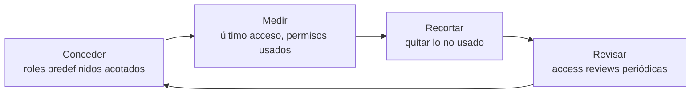

---
tags:
  - seguridad
  - cloud
  - aws
  - azure
  - gcp
  - iam
---

# Seguridad de identidades

> Cómo proteger las identidades más poderosas (root, Global Administrator, Super Admin), eliminar credenciales de larga duración, mantener el mínimo privilegio y poner guardrails en AWS, Azure y Google Cloud.

!!! info "Antes de leer"
    En el [Shared Responsibility Model](../fundamentos/responsabilidad-compartida.md), **la identidad siempre es responsabilidad tuya**, en IaaS, PaaS y SaaS. Esta nota supone que conoces los conceptos de [IAM: AWS, Azure y GCP](../identidad-y-seguridad/iam-comparativa.md) (policies, role assignments, allow policies, managed identities, service accounts) y los guardrails de [Gobernanza](../operacion-y-gobierno/gobernanza.md). Aquí se ve cómo **endurecerlos y comprobarlos**.

## ¿Por qué la identidad es el nuevo perímetro?

En la nube no hay un muro de red que proteja la consola: cualquiera con una credencial válida puede llamar a la API desde cualquier lugar. Por eso la **identity** (identidad) es el **perímetro** real. Tres ideas guían esta nota:

1. **Proteger el privilegio máximo**: pocas personas, MFA fuerte, acceso justo a tiempo y cuentas de emergencia.
2. **Credenciales temporales en todas partes**: nada de claves que vivan meses en un portátil o en un pipeline.
3. **Permisos que se encogen con el tiempo**: revisar y quitar lo que no se usa, con guardrails que pongan un techo.

## Identidades con privilegio máximo

| | AWS | Azure | Google Cloud |
| --- | --- | --- | --- |
| Identidad "dueña" | **Root user** de cada AWS account (y de la management account de AWS Organizations) | **Global Administrator** del tenant de Microsoft Entra ID (y *Owner* en el root management group) | **Super Admin** de Cloud Identity / Google Workspace y **Organization Administrator** (`roles/resourcemanager.organizationAdmin`) |
| Qué puede hacer | Todo en la cuenta; no se limita con IAM (sí con SCPs, salvo en la management account) | Todo en el directorio; puede elevarse a *User Access Administrator* en todas las suscripciones | Super Admin controla el directorio y puede recuperar el acceso a la organización; Organization Administrator controla la IAM de toda la jerarquía |
| Recomendación | Centralizar y **eliminar credenciales root** en cuentas miembro; root de la management account con MFA de hardware o passkey | 2 o más **emergency access accounts** cloud-only con passkey (FIDO2); el resto de admins con PIM | Super Admin separado del usuario diario, con llave de seguridad; administrar con roles de IAM, no con Super Admin |

### Cuentas break-glass

Una **break-glass account** (cuenta de emergencia, "romper el cristal") es una cuenta con privilegio máximo que **solo** se usa cuando el acceso normal falla: el IdP federado está caído, alguien borró por error los permisos de administración, o el MFA de todos los administradores no funciona.

- **Al menos dos**, sin depender del IdP federado (por ejemplo, cuentas `*.onmicrosoft.com` en Entra ID, no sincronizadas).
- **MFA resistente a phishing** y distinto del de las cuentas normales (llave FIDO2 guardada en un lugar físico seguro).
- **Excluidas** de las políticas de Conditional Access que bloquean (en Azure); nunca excluidas del MFA en sí.
- **Alerta en cada inicio de sesión** y prueba periódica (Microsoft recomienda validar al menos cada 90 días).

=== "AWS"

    Con la **gestión centralizada del root** (*centralized root access*) de AWS Organizations puedes **eliminar** la contraseña, las access keys y el MFA del root de las cuentas miembro, y las cuentas nuevas se crean sin credenciales root. Las pocas tareas que exigen root (por ejemplo, desbloquear una bucket policy que deniega a todos) se hacen como **privileged task** desde la management account o el administrador delegado de IAM, con una sesión root de corta duración. El root de la **management account** sigue existiendo: protégelo con MFA (AWS ya lo exige) y úsalo solo para emergencias.

=== "Azure"

    Las emergency access accounts tienen el rol Global Administrator **activo permanente** en PIM (no *eligible*), para no depender de una aprobación durante la emergencia. Monitoriza sus inicios de sesión con una alerta sobre `SigninLogs` en Log Analytics o en Microsoft Sentinel.

=== "Google Cloud"

    Mantén pocas cuentas Super Admin (Google recomienda más de una para no quedarte sin acceso, pero no muchas), sin licencia de uso diario, con **llaves de seguridad** y sin roles de IAM innecesarios. Para administrar Google Cloud usa grupos con roles de IAM (`gcp-organization-admins`), no la cuenta Super Admin.

## MFA resistente a phishing

El MFA por SMS, llamada o código de una app (TOTP) reduce mucho el riesgo, pero **se puede robar** con un sitio falso que reenvía el código en tiempo real (*adversary-in-the-middle*) o con fatiga de notificaciones (*MFA fatigue*). El **phishing-resistant MFA** (MFA resistente a phishing) liga la autenticación al dominio legítimo:

| Método | AWS | Azure | Google Cloud |
| --- | --- | --- | --- |
| **Passkeys / llaves FIDO2** | Passkeys y llaves de seguridad para root, IAM users e IAM Identity Center | Passkeys (FIDO2), incluido Microsoft Authenticator con passkey | Passkeys y llaves de seguridad (Titan u otras FIDO2) |
| Certificados / smart card | — | Certificate-based authentication (CBA) | — |
| Windows Hello for Business | — | Sí | — |
| Exigirlo | Política de MFA de IAM Identity Center; MFA del IdP federado | **Conditional Access** con *authentication strength* "Phishing-resistant MFA" | Política de 2SV en la consola de administración con "Only security key" |

!!! warning "MFA obligatorio de los proveedores"
    AWS exige MFA para el root user, Microsoft aplica **MFA obligatorio** para iniciar sesión en Azure (portal, CLI, PowerShell e IaC, en fases) y Google está haciendo obligatoria la verificación en dos pasos (2SV) para Google Cloud. Esto rompe automatizaciones que usan **usuarios humanos** como cuentas de servicio: migra esos casos a workload identities.

## SSO y federación

Las personas no deberían tener usuarios locales en cada nube. Con **SSO** (*Single Sign-On*, inicio de sesión único) y **federación** (*federation*) se autentican una vez en el IdP corporativo y reciben credenciales temporales:

| | AWS | Azure | Google Cloud |
| --- | --- | --- | --- |
| Entrada de personas | **IAM Identity Center** con *permission sets* | **Microsoft Entra ID** (el propio directorio) | Cloud Identity / Google Workspace, o **Workforce Identity Federation** con un IdP externo |
| IdP externo | Entra ID, Okta, Google Workspace… vía SAML 2.0 y SCIM | Federación con otros IdP o B2B para externos | SAML/OIDC; sincronización con Google Cloud Directory Sync |
| Altas y bajas | **SCIM** (*System for Cross-domain Identity Management*) desde el IdP | Ciclo de vida en Entra ID (Lifecycle Workflows con ID Governance) | Aprovisionamiento automático desde el IdP |
| Qué evitar | IAM users con contraseña para personas | Cuentas locales de invitado sin revisar | Cuentas personales (`@gmail.com`) en la organización |

Cuando una persona deja la empresa, se desactiva **en un solo lugar** y pierde el acceso a todas las nubes.

## Eliminar credenciales de larga duración

Una **long-term credential** (credencial de larga duración) no caduca sola: si se filtra, sirve hasta que alguien la revoque. Las tres nubes ofrecen alternativas temporales:

| Credencial estática | Dónde aparece | Alternativa temporal |
| --- | --- | --- |
| **Access keys** de IAM users (AWS) | Portátiles, pipelines, servidores on-premise | IAM Identity Center (`aws sso login`) para personas; roles para servicios; **OIDC** para CI/CD; **IAM Roles Anywhere** para servidores fuera de AWS |
| **Client secrets** de service principals (Azure) | App registrations, pipelines | **Managed identities** dentro de Azure; **workload identity federation** (credenciales federadas) desde GitHub, Kubernetes u otras nubes; certificados si no queda otra |
| **Service account keys** JSON (Google Cloud) | Archivos en repositorios, variables de CI | **Attached service accounts**; **Workload Identity Federation** desde fuera; **service account impersonation** para personas |

!!! danger "Si una credencial se filtró, rotar no basta"
    Desactiva la credencial **y** revisa en los audit logs qué se hizo con ella (recursos creados, datos leídos, nuevas credenciales emitidas). El playbook completo está en [Detección y respuesta](../../devsecops/gobierno-y-respuesta/deteccion-respuesta.md); cómo conectar el pipeline con OIDC, en [Secretos e identidades](../../devsecops/identidades-y-pipeline/secretos-identidades.md).

## Identidades de workload

Una **workload identity** (identidad de carga de trabajo) es la identidad con la que una aplicación, función o pipeline llama a la API de la nube. Reglas comunes:

- **Una identidad por aplicación y entorno**, nunca compartida entre dev y prod.
- **Sin roles amplios** (`AdministratorAccess`, `Owner`, `roles/editor`) en identidades de workload.
- **Condiciones de confianza estrictas** en la federación: en OIDC desde GitHub, limita el `sub` al repositorio **y** a la rama o entorno (`repo:org/app:environment:prod`), nunca `repo:org/*`.
- **Evita las identidades por defecto**: el *default service account* de Compute Engine con `roles/editor` o un rol de instancia compartido por todas las VMs.

Detalle por servicio: [máquinas virtuales](seguridad-maquinas-virtuales.md), [contenedores y Kubernetes](seguridad-contenedores-kubernetes.md) y [serverless](seguridad-serverless.md).

## Least privilege y su revisión

El **least privilege** no se consigue escribiendo la política perfecta el primer día, sino con un ciclo: empezar acotado, medir lo que se usa y recortar.



| Necesidad | AWS | Azure | Google Cloud |
| --- | --- | --- | --- |
| Accesos externos o públicos | **IAM Access Analyzer**: *external access analyzer* | Defender CSPM / Entra (invitados, apps multi-tenant) | **Policy Analyzer**, findings de SCC (`NON_ORG_IAM_MEMBER`) |
| Permisos y credenciales sin uso | Access Analyzer: *unused access analyzer*; *last accessed* de IAM | Recomendación de Defender *Permissions of inactive identities in your Azure subscription should be revoked* | **IAM Recommender** (role recommendations) |
| Generar una policy mínima | Access Analyzer *policy generation* a partir de CloudTrail | — | Role recommendations proponen roles más pequeños |
| Validar policies antes de desplegar | Access Analyzer *policy validation* y *custom policy checks* | — | Policy Troubleshooter |
| Acceso justo a tiempo (JIT) | Sesiones temporales de IAM Identity Center; soluciones como TEAM | **Privileged Identity Management (PIM)** | **Privileged Access Manager (PAM)** |
| Revisión periódica | Revisión manual de permission sets y Access Analyzer | **Access reviews** de Microsoft Entra ID Governance | Recomendaciones + revisión de grupos |

## Guardrails

Los guardrails ponen un **techo** que ni un administrador de la cuenta puede superar. Guardrails de identidad recomendados:

| Objetivo | AWS (SCP / RCP) | Azure (Azure Policy / Entra) | Google Cloud (Organization Policy) |
| --- | --- | --- | --- |
| Impedir claves de larga duración | SCP que deniega `iam:CreateAccessKey` e `iam:CreateUser` salvo a un rol de excepción | Política de métodos de autenticación de aplicaciones (*app management policies*) que limita client secrets | `iam.managed.disableServiceAccountKeyCreation` e `iam.disableServiceAccountKeyUpload` |
| Limitar identidades externas | RCP con `aws:PrincipalOrgID` para que solo identidades de tu organización accedan a tus recursos | Restricciones de colaboración externa (B2B) en Entra ID | `iam.allowedPolicyMemberDomains` (*domain restricted sharing*) |
| Proteger roles de seguridad | SCP que impide modificar los roles de la plataforma (`OrganizationAccountAccessRole`, roles de seguridad) | Deny assignments de las landing zones; PIM para roles de plataforma | IAM deny policies sobre permisos críticos |
| Evitar permisos automáticos amplios | — | — | `iam.automaticIamGrantsForDefaultServiceAccounts` (sin `roles/editor` automático) |

## Riesgos típicos

| Riesgo | Ejemplo o incidente conocido | Control que lo evita |
| --- | --- | --- |
| Credenciales sin MFA reutilizadas | Clientes de Snowflake (2024) comprometidos con credenciales robadas por infostealers | MFA obligatorio, idealmente resistente a phishing |
| Phishing con robo de sesión o MFA fatigue | Uber (2022): fatiga de notificaciones MFA a un contratista | Passkeys/FIDO2, *number matching*, Conditional Access |
| Access key filtrada en un repositorio | Claves de AWS publicadas en GitHub explotadas en minutos para minería | Sin access keys; secret scanning; OIDC |
| Tenant o cuenta de pruebas olvidada | Midnight Blizzard (2024): tenant de pruebas heredado sin MFA y una app OAuth con permisos elevados | Inventario de tenants y apps, revisión de consentimientos, MFA en todo |
| Identidad de workload sobreprivilegiada | Capital One (2019): un rol de EC2 con acceso a cientos de buckets | Una identidad por workload con permisos mínimos |
| Clave de firma comprometida | Storm-0558 (2023): una clave de firma de Microsoft robada permitió falsificar tokens | Lado proveedor; para ti: monitorizar tokens y accesos anómalos |
| Quedarse sin acceso de administración | Federación caída o último admin eliminado | Cuentas break-glass probadas |

## Controles por proveedor

**(I)** = imprescindible.

| Control | AWS | Azure | Google Cloud |
| --- | --- | --- | --- |
| MFA en la identidad dueña **(I)** | MFA (passkey/hardware) en root; root centralizado en cuentas miembro | Phishing-resistant MFA para todos los roles de administración | 2SV con llave de seguridad para Super Admins |
| Cuentas break-glass **(I)** | Root de la management account custodiado; privileged tasks | 2+ emergency access accounts con FIDO2 y alerta | 2+ Super Admins de emergencia con llave de seguridad |
| SSO para personas **(I)** | IAM Identity Center | Microsoft Entra ID | Cloud Identity / Workforce Identity Federation |
| Sin credenciales de larga duración **(I)** | Sin access keys de root ni de IAM users; OIDC; IAM Roles Anywhere | Managed identities; workload identity federation | Attached service accounts; Workload Identity Federation; constraint de keys |
| Acceso privilegiado JIT | Sesiones temporales de Identity Center | PIM | PAM |
| Revisión de permisos **(I)** | IAM Access Analyzer (external + unused) | Access reviews, PIM, Defender CSPM | IAM Recommender, Policy Analyzer |
| Guardrails de identidad **(I)** | SCPs / RCPs | Azure Policy, Conditional Access, configuración de Entra | Organization Policy, IAM deny policies |
| Detección de abuso de identidad | GuardDuty (findings `IAMUser/…`, `Policy:IAMUser/RootCredentialUsage`) | Microsoft Entra ID Protection, Defender for Cloud | Event Threat Detection (anomalías de IAM) |

## Buenas prácticas

1. **Inventaria quién tiene privilegio máximo** hoy: root con credenciales, Global Administrators, Owners de suscripción, Super Admins, Organization Administrators. Reduce a lo mínimo.
2. **Crea y prueba las cuentas break-glass** antes de endurecer Conditional Access o guardrails.
3. **Exige MFA resistente a phishing** a todos los roles de administración y, después, a todas las personas.
4. **Centraliza el acceso de personas** con SSO y SCIM; elimina IAM users y cuentas locales.
5. **Elimina claves de larga duración** empezando por las más poderosas y las de CI/CD (OIDC).
6. **Aplica guardrails** que impidan volver a crearlas.
7. **Usa grupos**, no personas, en las asignaciones de roles.
8. **JIT para lo privilegiado**: PIM, PAM o sesiones temporales con aprobación.
9. **Revisa permisos cada trimestre** con Access Analyzer, access reviews o IAM Recommender, y quita lo no usado en 90 días.
10. **Alerta** sobre uso de root/break-glass y cambios en IAM (ver [logging y detección](seguridad-logging-deteccion.md)).

=== "AWS"

    - Activa `RootCredentialsManagement` y `RootSessions` en IAM para la organización y elimina las credenciales root de las cuentas miembro.
    - Crea un **organization analyzer** de IAM Access Analyzer (external access) y un analyzer de **unused access** desde el administrador delegado.
    - Usa **permissions boundaries** cuando delegues la creación de roles a los equipos.

=== "Azure"

    - Usa **Conditional Access** con *authentication strengths* y bloquea la **legacy authentication**.
    - Pon los roles de Entra (Global Administrator, Privileged Role Administrator) y los de Azure (Owner, User Access Administrator) como **eligible** en PIM, con aprobación y duración máxima.
    - Revisa las **app registrations** con secretos y los **consentimientos** de aplicaciones OAuth; prefiere certificados o credenciales federadas.

=== "Google Cloud"

    - Quita los **basic roles** (`roles/owner`, `roles/editor`) en producción y usa roles predefinidos.
    - Asigna roles a **grupos** y aplica `iam.allowedPolicyMemberDomains` para que no entren cuentas ajenas a tu dominio.
    - Para personas que necesitan actuar como una service account, usa **impersonation** (`roles/iam.serviceAccountTokenCreator` acotado) en lugar de descargar una key.

## Cómo verificarlo

Comandos de solo lectura.

=== "AWS"

    ```bash
    # Root: ¿tiene MFA? ¿tiene access keys?
    aws iam get-account-summary \
      --query 'SummaryMap.{mfa_root:AccountMFAEnabled, keys_root:AccountAccessKeysPresent}'

    # Gestión centralizada del root habilitada en la organización
    aws iam list-organizations-features

    # IAM users con access keys y su antigüedad (el reporte se genera, no modifica nada)
    aws iam generate-credential-report >/dev/null
    aws iam get-credential-report --query Content --output text | base64 -d | \
      cut -d, -f1,4,8,9,10,14 | column -t -s,

    # Analyzers de IAM Access Analyzer y hallazgos activos
    aws accessanalyzer list-analyzers --query 'analyzers[].{n:name,tipo:type,estado:status}'
    aws accessanalyzer list-findings-v2 --analyzer-arn <arn> \
      --filter '{"status":{"eq":["ACTIVE"]}}' --max-items 20

    # SCPs existentes
    aws organizations list-policies --filter SERVICE_CONTROL_POLICY
    ```

=== "Azure"

    ```bash
    # Miembros de Global Administrator (role template 62e90394-...)
    az rest --method get --url \
      "https://graph.microsoft.com/v1.0/directoryRoles(roleTemplateId='62e90394-69f5-4237-9190-012177145e10')/members?\$select=displayName,userPrincipalName"

    # Owners y User Access Administrators en todas las suscripciones visibles
    az role assignment list --all --include-inherited \
      --query "[?roleDefinitionName=='Owner' || roleDefinitionName=='User Access Administrator'].{quien:principalName, tipo:principalType, scope:scope}" -o table

    # App registrations con client secrets y su fecha de caducidad
    az ad app list --all \
      --query "[?length(passwordCredentials) > \`0\`].{app:displayName, secretos:passwordCredentials[].endDateTime}"

    # Políticas de Conditional Access (estado)
    az rest --method get --url "https://graph.microsoft.com/v1.0/identity/conditionalAccess/policies?\$select=displayName,state"
    ```

=== "Google Cloud"

    ```bash
    # Quién tiene roles amplios en la organización
    gcloud organizations get-iam-policy <org-id> --flatten="bindings[].members" \
      --filter="bindings.role:(roles/owner roles/editor roles/resourcemanager.organizationAdmin)" \
      --format="table(bindings.role, bindings.members)"

    # Keys gestionadas por el usuario de una service account
    gcloud iam service-accounts keys list --iam-account=<sa>@<proyecto>.iam.gserviceaccount.com \
      --managed-by=user

    # Constraint de creación de keys aplicada
    gcloud org-policies describe iam.managed.disableServiceAccountKeyCreation --organization=<org-id>

    # Recomendaciones de IAM Recommender en un proyecto
    gcloud recommender recommendations list --project=<proyecto> --location=global \
      --recommender=google.iam.policy.Recommender --format="table(description, stateInfo.state)"
    ```

| Control imprescindible | AWS (Security Hub CSPM) | Azure (MCSB / Defender for Cloud) | Google Cloud (SCC) |
| --- | --- | --- | --- |
| MFA en root / administradores | `IAM.6`, `IAM.9` | `IM-6`, `PA-1`; MFA obligatorio de Azure | `MFA_NOT_ENFORCED` |
| Sin claves de root | `IAM.4` | — | — |
| Break-glass | — | `PA-5` (*Set up emergency access*) | — |
| Sin claves de larga duración | `IAM.3`, `IAM.22` | `IM-3`, `IM-8` | `USER_MANAGED_SERVICE_ACCOUNT_KEY`, `SERVICE_ACCOUNT_KEY_NOT_ROTATED` |
| Sin políticas de administrador total | `IAM.1`, `IAM.21` | *Service Principals should not be assigned with administrative roles at the subscription and resource group level* | `PRIMITIVE_ROLES_USED`, `ADMIN_SERVICE_ACCOUNT` |
| Revisión de permisos | `IAM.28` (external access analyzer) | `PA-4`; *Permissions of inactive identities in your Azure subscription should be revoked* | `SERVICE_ACCOUNT_ROLE_SEPARATION` |
| Pocos dueños y sin externos | — | *A maximum of 3 owners should be designated for subscriptions*, *Guest accounts with owner permissions on Azure resources should be removed* | `NON_ORG_IAM_MEMBER` |

## Configuración segura con IaC

=== "AWS"

    ```hcl title="identidades.tf"
    # Gestión centralizada del root (desde la management account)
    resource "aws_iam_organizations_features" "root" {
      enabled_features = ["RootCredentialsManagement", "RootSessions"]
    }

    # IAM Access Analyzer: accesos externos y accesos sin uso en toda la organización
    resource "aws_accessanalyzer_analyzer" "externo" {
      analyzer_name = "org-external-access"
      type          = "ORGANIZATION"
    }

    resource "aws_accessanalyzer_analyzer" "sin_uso" {
      analyzer_name = "org-unused-access"
      type          = "ORGANIZATION_UNUSED_ACCESS"

      configuration {
        unused_access {
          unused_access_age = 90
        }
      }
    }
    ```

    ```json title="scp-sin-claves-de-larga-duracion.json"
    {
      "Version": "2012-10-17",
      "Statement": [
        {
          "Sid": "DenyLongTermCredentials",
          "Effect": "Deny",
          "Action": ["iam:CreateUser", "iam:CreateAccessKey", "iam:CreateLoginProfile"],
          "Resource": "*",
          "Condition": {
            "ArnNotLike": {
              "aws:PrincipalArn": "arn:aws:iam::*:role/plataforma-excepciones-iam"
            }
          }
        }
      ]
    }
    ```

=== "Azure"

    ```hcl title="identidades.tf"
    # Identidad de workload sin secretos: user-assigned managed identity
    resource "azurerm_user_assigned_identity" "api" {
      name                = "id-api-pagos-prod"
      resource_group_name = azurerm_resource_group.app.name
      location            = azurerm_resource_group.app.location
    }

    # Permiso mínimo y acotado: solo leer secretos de su propio Key Vault
    resource "azurerm_role_assignment" "api_secretos" {
      scope                = azurerm_key_vault.app.id
      role_definition_name = "Key Vault Secrets User"
      principal_id         = azurerm_user_assigned_identity.api.principal_id
    }

    # Owner solo como asignación eligible en PIM, con justificación
    data "azurerm_subscription" "prod" {
      subscription_id = var.subscription_prod_id
    }

    data "azurerm_role_definition" "owner" {
      name = "Owner"
    }

    resource "azurerm_pim_eligible_role_assignment" "owner_plataforma" {
      scope              = data.azurerm_subscription.prod.id
      role_definition_id = "${data.azurerm_subscription.prod.id}${data.azurerm_role_definition.owner.id}"
      principal_id       = var.grupo_plataforma_object_id
      justification      = "Administración de la suscripción de producción"

      schedule {
        expiration {
          duration_days = 180
        }
      }
    }
    ```

    Las políticas de **Conditional Access** y las emergency access accounts se gestionan con el provider `hashicorp/azuread` (`azuread_conditional_access_policy`), no con `azurerm`.

=== "Google Cloud"

    ```hcl title="identidades.tf"
    # Solo identidades del dominio de la organización
    resource "google_org_policy_policy" "dominios" {
      name   = "organizations/${var.org_id}/policies/iam.allowedPolicyMemberDomains"
      parent = "organizations/${var.org_id}"

      spec {
        rules {
          values {
            allowed_values = [var.customer_id] # ID de cliente de Cloud Identity, p. ej. C0xxxxxxx
          }
        }
      }
    }

    # Sin service account keys
    resource "google_org_policy_policy" "sin_keys" {
      name   = "organizations/${var.org_id}/policies/iam.managed.disableServiceAccountKeyCreation"
      parent = "organizations/${var.org_id}"

      spec {
        rules {
          enforce = "TRUE"
        }
      }
    }

    # Service account propia de la aplicación con un rol predefinido acotado
    resource "google_service_account" "api" {
      project      = var.project_id
      account_id   = "api-pagos"
      display_name = "API de pagos (prod)"
    }

    resource "google_project_iam_member" "api_secretos" {
      project = var.project_id
      role    = "roles/secretmanager.secretAccessor"
      member  = "serviceAccount:${google_service_account.api.email}"
    }
    ```

## Errores comunes

- **Una sola cuenta break-glass** o ninguna, o una que nadie ha probado en un año.
- **Excluir a los administradores del MFA** "para no bloquearse": la exclusión correcta es solo la de las emergency access accounts de las políticas que bloquean.
- **IAM users con access keys para personas** porque "la CLI es más cómoda": `aws sso login` hace lo mismo con credenciales temporales.
- **Confianza OIDC demasiado abierta**: un `sub` con comodín permite que cualquier repositorio o rama asuma el rol de producción.
- **Roles `Owner` / `roles/editor` en service principals o service accounts** de CI/CD.
- **Guardrails sin rol de excepción**: una SCP que bloquea `iam:CreateUser` sin excepción puede impedir procesos legítimos de la plataforma. Pruébala primero en una OU de pruebas.
- **Olvidar las apps OAuth y los consentimientos**: una app con permisos delegados amplios es una identidad privilegiada más.

## Relación con otras secciones

| Enfoque | Qué se mira desde ahí | Nota |
| --- | --- | --- |
| Cloud (el control) | Conceptos de IAM, jerarquía y guardrails; resto de controles del bloque | [IAM: AWS, Azure y GCP](../identidad-y-seguridad/iam-comparativa.md), [Gobernanza](../operacion-y-gobierno/gobernanza.md), [Fundamentos de seguridad en la nube](fundamentos-seguridad-cloud.md), [Seguridad de cifrado y secretos](seguridad-cifrado-secretos.md), [Seguridad de logging y detección](seguridad-logging-deteccion.md) |
| DevOps (la automatización) | Un rol por pipeline creado con Terraform; OIDC en GitHub Actions | [Terraform](../../devops/iac/terraform-basico.md), [Pipeline CI/CD con GitHub Actions](../../devops/ci-cd/ci-cd-github-actions.md) |
| DevSecOps (la verificación) | OIDC en lugar de claves, permisos mínimos del pipeline, detectar `*:*` en IaC y secretos en commits | [Secretos e identidades](../../devsecops/identidades-y-pipeline/secretos-identidades.md), [Seguridad del pipeline](../../devsecops/identidades-y-pipeline/seguridad-pipeline.md), [Seguridad de IaC](../../devsecops/infraestructura-y-contenedores/seguridad-iac.md), [Secret scanning](../../devsecops/escaneos/secret-scanning.md) |
| Laboratorios (la práctica) | Practicar esto paso a paso | [Lab 16: Auditar tu cuenta cloud con Prowler (CSPM)](../../laboratorios/devsecops/cspm-prowler.md) |

## Referencias

- [Root user best practices (AWS)](https://docs.aws.amazon.com/IAM/latest/UserGuide/root-user-best-practices.html)
- [Centrally manage root access for member accounts](https://docs.aws.amazon.com/IAM/latest/UserGuide/id_root-user.html#id_root-user-access-management)
- [Security best practices in IAM](https://docs.aws.amazon.com/es_es/IAM/latest/UserGuide/best-practices.html)
- [IAM Access Analyzer](https://docs.aws.amazon.com/es_es/IAM/latest/UserGuide/what-is-access-analyzer.html)
- [Security Hub CSPM controls for IAM](https://docs.aws.amazon.com/securityhub/latest/userguide/iam-controls.html)
- [Administrar cuentas de acceso de emergencia en Microsoft Entra ID](https://learn.microsoft.com/es-es/entra/identity/role-based-access-control/security-emergency-access)
- [Planificación de MFA obligatoria para Azure](https://learn.microsoft.com/es-es/entra/identity/authentication/concept-mandatory-multifactor-authentication)
- [Microsoft Entra Privileged Identity Management](https://learn.microsoft.com/es-es/entra/id-governance/privileged-identity-management/pim-configure)
- [Workload identity federation (Microsoft Entra)](https://learn.microsoft.com/es-es/entra/workload-id/workload-identity-federation)
- [MCSB v2: Identity Management](https://learn.microsoft.com/en-us/security/benchmark/azure/mcsb-v2-identity-management) y [Privileged Access](https://learn.microsoft.com/en-us/security/benchmark/azure/mcsb-v2-privileged-access)
- [Super administrator account best practices (Google Cloud)](https://cloud.google.com/resource-manager/docs/super-admin-best-practices)
- [Best practices for managing service account keys](https://cloud.google.com/iam/docs/best-practices-for-managing-service-account-keys)
- [Workload Identity Federation](https://cloud.google.com/iam/docs/workload-identity-federation)
- [Security Health Analytics findings](https://cloud.google.com/security-command-center/docs/concepts-security-health-analytics-findings)
